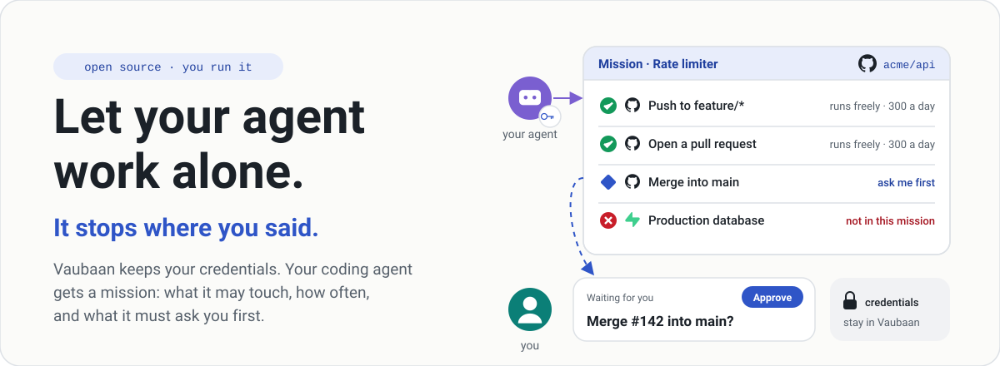
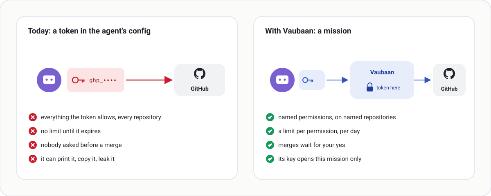

# Vaubaan

**Let your agent work alone. It stops where you said.**

Vaubaan is an open-source MCP gateway you run yourself: your agent gets a mission instead of your credentials — named permissions, limits, and “ask me first” on what is hard to undo.

[](https://github.com/vaubaan/gateway/actions/workflows/ci.yml)
[](https://github.com/vaubaan/gateway/releases)
[](LICENSE)
[](https://scorecard.dev/viewer/?uri=github.com/vaubaan/gateway)

[vaubaan.com](https://vaubaan.com) · [Try it](https://vaubaan.com/try) · [Docs](https://vaubaan.com/docs) · [Security](https://vaubaan.com/trust)

<picture>
  <source media="(prefers-color-scheme: dark)" srcset="apps/website/drawings/svg/hero-dark.svg">
  
</picture>

## Quick start

The demo: the whole interface on your laptop, with seeded people, accounts and missions, a
simulated sign-in and simulated services. Needs Node.js 26 and npm 11; nothing to register,
nothing leaves your machine.

```bash
git clone https://github.com/vaubaan/gateway.git
cd gateway
npm ci
npm run demo
```

It prints a URL, three people to sign in as and a guided tour ([quick look](https://vaubaan.com/docs/quick-look)).
The demo is a development tool, never an instance. **On your computer without a server: a desktop
app for macOS and Windows is planned, not built** ([every way to start](https://vaubaan.com/try)).

## What a mission is

Two projects, one idea:

- **A developer, “Rate limiter for the API”.** Claude Code reads `acme/api`, pushes to
  `feature/*`, opens a pull request and migrates Supabase staging on its own. A merge into `main`
  waits for your yes; the production database is not in the mission, so a migration there is
  refused with `resource-not-in-mission`. (GitHub has run real tools live; Supabase its discovery
  only.)
- **A consultant, “Weekly client recap”.** The assistant searches Gmail, reads the calendar and
  writes in Notion on its own. The recap mail to a client waits for your yes; a thread under the
  sensitive Finance label is refused. (Gmail, Notion and Google Calendar have not yet run against
  the real services.)

A mission names the accounts and resources the agent may touch, the permissions it holds from
each service's reviewed catalog, a limit per day for each, and what asks you first. You tick a few
verbs at a trust level and every line is written out. The agent holds a key to that mission, never
the credential; every call is recorded, allowed or refused.

<picture>
  <source media="(prefers-color-scheme: dark)" srcset="apps/website/drawings/svg/token-or-mission-dark.svg">
  
</picture>

How a call goes through, in drawings: [how it works](https://vaubaan.com/how-it-works).

## Status

**Pre-release.** `2.0.0-alpha` versions are tagged from `main` and published as images; expect
breaking changes until `2.0.0`. No third-party security audit yet. What is not done, one line
each: [known limitations](docs/handbook/known-limitations.md); what comes next:
[roadmap](ROADMAP.md); what changed: [changelog](CHANGELOG.md).

## Run it for a team

The same instance on a server: sign-in through your identity provider, GitHub or local accounts
with a second factor; accounts shared permission by permission; one key per person. Docker
Compose or Railway, a DNS name and ports 80 and 443: [install](https://vaubaan.com/docs/install),
or paste one block into your coding agent:
[install with your coding agent](https://vaubaan.com/docs/install/with-your-coding-agent).
For your team: [vaubaan.com/teams](https://vaubaan.com/teams).

## Find your way

| You want to…   | Read                                                                                                                                                                                      |
| -------------- | ----------------------------------------------------------------------------------------------------------------------------------------------------------------------------------------- |
| use it         | the user docs, [vaubaan.com/docs](https://vaubaan.com/docs) (sources: [`apps/website/content/docs`](apps/website/content/docs)); the words: [concepts](https://vaubaan.com/docs/concepts) |
| run it         | [install](https://vaubaan.com/docs/install), [`deploy/README.md`](deploy/README.md), [configuration](docs/handbook/configuration.md), [first install](docs/handbook/first-install.md)     |
| review it      | the [trust center](https://vaubaan.com/trust), the [threat model](docs/handbook/threat-model.md), [`SECURITY.md`](SECURITY.md)                                                            |
| extend it      | [write a plugin](https://vaubaan.com/write-a-plugin), [`plugins/README.md`](plugins/README.md), the [risk model](docs/spec/gateway-risk-model.md)                                         |
| work on it     | [`docs/architecture.md`](docs/architecture.md), the [spec](docs/spec/vaubaan-gateway.md), the [handbooks](docs/handbook/README.md), [decisions](docs/decisions/), [tests](docs/tests/)    |
| with an agent  | [`docs/AGENTS-guide.md`](docs/AGENTS-guide.md), [`AGENTS.md`](AGENTS.md), the [workflow](docs/workflow/coding-workflow.md)                                                                |
| know who's who | [`MAINTAINERS.md`](MAINTAINERS.md), [`ROADMAP.md`](ROADMAP.md)                                                                                                                            |

## Repository layout

npm workspaces under `apps/` (the gateway, the site), `packages/` and `plugins/` (one per
service); what each one holds: [CONTRIBUTING.md](CONTRIBUTING.md#repository-layout).

## Contributing

Bug reports, catalog corrections, plugins and documentation are welcome. Start with
[`CONTRIBUTING.md`](CONTRIBUTING.md): set-up, the documentation-first order, the rules the code
follows, and the sign-off every commit carries (`git commit -s`). For development: `npm ci`, then
`npm run ci` (type-check, lint, format check, build, tests). Report a vulnerability privately:
[`SECURITY.md`](SECURITY.md).

## Licence

[Apache-2.0](LICENSE). Copyright 2026 Vaubaan contributors. Third-party attributions:
[NOTICE](NOTICE).
