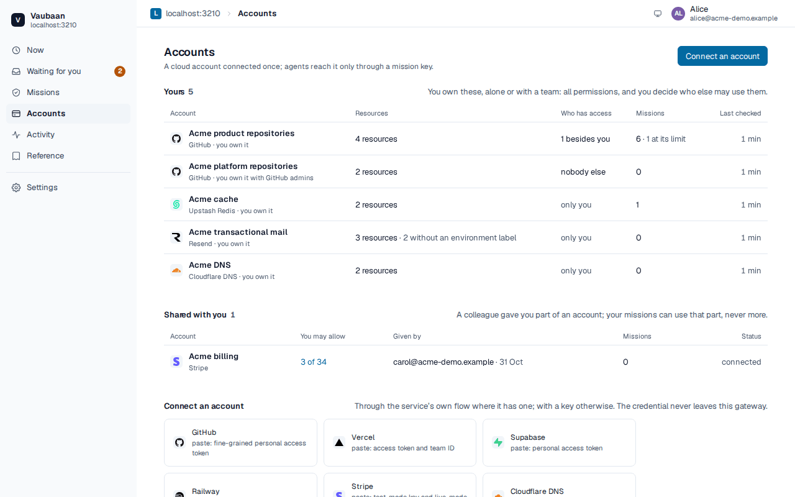
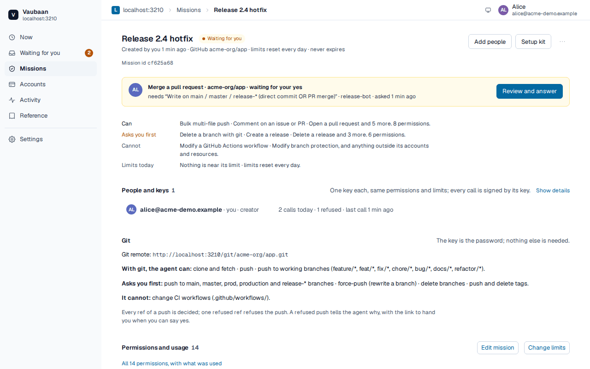

# Vaubaan Gateway

[](https://github.com/vaubaan/gateway/actions/workflows/ci.yml)
[](https://github.com/vaubaan/gateway/releases)
[](LICENSE)
[](package.json)

An MCP gateway you run on your own network, for teams whose coding agents act on GitHub,
Supabase, Vercel, Stripe and other cloud services. Agents never hold your credentials: each one
gets a key to a **mission** that names what it may touch, what it may do, how often, and what it
must ask you first.





## Quick start: the demo in one minute

Needs Node.js 26 or later and npm 11. Nothing to register, nothing leaves your machine: the
identity provider and the cloud services are simulated.

```bash
git clone https://github.com/vaubaan/gateway.git
cd gateway
npm ci
npm run demo
```

The last command builds the application (on the first start, and again only when the sources
changed), then prints a URL (`http://localhost:3210`), three people to sign in as without a
password, the keys of seeded missions and ready-made `curl` commands. Use Chrome or Firefox.
`DEMO_PORT=4000 npm run demo` picks another port. The demo is a development tool, never an
instance: anybody who reaches it signs in as anybody. Guided tour:
[demo mode](docs/handbook/demo-mode.md).

## How it works

- A person connects an account at a cloud service once. The credential is encrypted on the
  instance and never handed to an agent.
- A person creates a mission: the resources the agent may reach, the permissions it holds, a limit
  per permission (per period, per minute), and which actions run freely or ask first. Permissions
  are named in each plugin's catalog (`github.merge-protected`) and a mission stores them as an
  explicit list: nothing is ever "all".
- The agent calls MCP tools with the mission's key. For every call the gateway asks the service's
  plugin which permissions the call needs, checks them against the mission, counts the call
  against its limits, runs it with the stored credential and records it in the activity, allowed
  or refused.
- A refusal is structured (`risk-not-accepted`, `budget-exhausted`, `approval-required`…) and
  says what to do; an action that asks first carries the URL where the mission's creator answers.
- An agent can prepare missions for a person the same way: the person connects their Vaubaan
  account (one click) and gives the agent the key of a mission on it; its `vaubaan__*` tools issue,
  rotate and stop missions in the person's name, never on itself. They answer nothing: requests are
  answered in the browser only.

The path of a request through the doors, the policy engine, the plugins and the store:
[architecture](docs/architecture.md).

## Who it is for

- **A team that lets coding agents act on real infrastructure** and wants a boundary it can read:
  "write on feature branches, never merge; apply migrations on staging, ask me before production".
- **A company that will not hand its cloud tokens to a third party.** The instance runs on your
  network, behind your identity provider, and the credentials stay on it. There is no hosted
  service and no tenant.
- **Someone who must answer "what did the agent do?"** Every call is recorded with the permissions
  it needed, whose key made it and the decision taken.

It is not a secrets manager, not a proxy for CLIs or SDKs (only MCP and git through the gateway's
remote are intercepted), and not highly available: one process, one embedded database.

## Words

The interface speaks to people; the protocol — MCP tool names, refusal codes,
ids, the API, the database, the configuration, and the specification of the
domain — keeps the names it had. The same things, under both:

| In the interface                            | In the protocol, the code and the spec                |
| ------------------------------------------- | ----------------------------------------------------- |
| access (Give access)                        | share                                                 |
| permission                                  | risk, by its `RiskId` (`github.merge-protected`)      |
| limits (per day, per minute)                | budget: quota and rate limit                          |
| runs freely / ask me first                  | gate: `auto` / `approval`                             |
| key, machine key                            | mission token: member token, named token              |
| Replace key                                 | rotate                                                |
| Waiting for you                             | request: a claim (limit reached), an approval request |
| Vaubaan account                             | the account of the `vaubaan` plugin (host account)    |
| Activity                                    | audit, session                                        |
| teammate, team                              | mission member, group                                 |
| administrator                               | operator                                              |
| service, OAuth client, Reference            | provider, provider app, the provider pages            |
| account, mission, macro-action, trust level | the same                                              |

## Status

**Pre-release.** Versions `2.0.0-alpha.N`, then `2.0.0-rc.N`, are tagged from `main` and
published as a `linux/amd64` image on the GitHub Container Registry; the
[changelog](CHANGELOG.md) lists each one. Expect
breaking changes until a `v2.0.0` tag exists. The code has had no third-party security audit yet;
how to report a vulnerability, and what is in scope, is in [SECURITY.md](SECURITY.md).

The code base is called **v5** in its design documents and is released as **v2**; it replaces an
earlier hosted product and shares no data with it.

What exists today: sign-in through your identity provider (OpenID Connect), GitHub, or the
gateway's own local accounts with a second factor; accounts at your cloud services with their
resources, shared with a teammate or a team; missions with limits per permission and "ask me first"
where you want it, worked on alone or as a team, each person with their own key; both MCP doors and
a git remote; "Waiting for you", where a mission's creator answers what an agent asks; the activity
record; a scheduled, encrypted backup to S3-compatible storage; a reference page of every
permission and macro-action per service; one plugin per service under [`plugins/`](plugins/).
What has not been done or is not there, one line each:
[known limitations](docs/handbook/known-limitations.md). What comes next: [roadmap](ROADMAP.md).

## Install an instance

Needs Docker with Compose v2, a DNS name pointing at the host, and ports 80 and 443 reachable (the
bundled proxy obtains the TLS certificate), plus a sign-in provider (OpenID Connect or a GitHub
OAuth App) or none at all with local accounts.

- Every step, running the image without Compose, upgrades, verifying an image's provenance:
  [`deploy/README.md`](deploy/README.md). On Railway: [deploy/railway.md](deploy/railway.md).
- Checking a new instance end to end, from the first sign-in to a day of agent work:
  [first install](docs/handbook/first-install.md).
- Every configuration key: [configuration handbook](docs/handbook/configuration.md).

## Documentation

| If you want to…                                    | Read                                                                                                                                                                                                                                  |
| -------------------------------------------------- | ------------------------------------------------------------------------------------------------------------------------------------------------------------------------------------------------------------------------------------- |
| understand the code in ten minutes                 | [`docs/architecture.md`](docs/architecture.md)                                                                                                                                                                                        |
| understand what the product does and why           | [`docs/spec/vaubaan-gateway.md`](docs/spec/vaubaan-gateway.md)                                                                                                                                                                        |
| understand how a call becomes a set of permissions | [`docs/spec/gateway-risk-model.md`](docs/spec/gateway-risk-model.md)                                                                                                                                                                  |
| run an instance                                    | [`deploy/README.md`](deploy/README.md), [configuration](docs/handbook/configuration.md), [first install](docs/handbook/first-install.md)                                                                                              |
| read the user docs, or install with a coding agent | the site's docs, [vaubaan.com/docs](https://vaubaan.com/docs) (sources: [`apps/website/content/docs`](apps/website/content/docs)), and [install with your coding agent](apps/website/content/docs/install-with-your-coding-agent.mdx) |
| know how a part of the code works today            | [`docs/handbook/`](docs/handbook/README.md), one handbook per subsystem and per service                                                                                                                                               |
| know why something was decided                     | [`docs/decisions/`](docs/decisions/), starting with [the pivot to an on-prem gateway](docs/decisions/pivot-v4-to-v5-on-prem-mission-tokens.md)                                                                                        |
| see what is tested                                 | [`docs/tests/`](docs/tests/)                                                                                                                                                                                                          |
| contribute, or write a plugin for another service  | [`CONTRIBUTING.md`](CONTRIBUTING.md), [`plugins/README.md`](plugins/README.md), [workflow](docs/workflow/coding-workflow.md)                                                                                                          |
| work on the repository with a coding agent         | [`docs/AGENTS-guide.md`](docs/AGENTS-guide.md)                                                                                                                                                                                        |
| know who maintains it and what is planned          | [`MAINTAINERS.md`](MAINTAINERS.md), [`ROADMAP.md`](ROADMAP.md)                                                                                                                                                                        |
| report a vulnerability                             | [`SECURITY.md`](SECURITY.md)                                                                                                                                                                                                          |
| see what changed                                   | [`CHANGELOG.md`](CHANGELOG.md)                                                                                                                                                                                                        |

## Repository layout

```
apps/gateway/            the deployable: both doors, the web interface, the store
apps/website/            vaubaan.com: user docs, plugin pages, trust center, the telemetry collector
apps/oauth-broker/       the OAuth broker: keeps no token, runs in an attested enclave
packages/shared/         domain and risk types
packages/policy-engine/  slices, matching, the risk decision, the validity rule of a budget (protocol names)
packages/gateway-core/   the call pipeline, refusals, the audit entry
packages/plugin-sdk/     the plugin contract, catalog loader, registry, test kit
packages/telemetry/      opt-in, anonymous plugin reports (off by default)
packages/oauth-providers/ the OAuth provider table the gateway and the broker share
plugins/<provider>/      one plugin per service; plugins/_template to start one
deploy/                  Dockerfile, Compose file, example configuration
docs/                    spec, decisions, handbook, tests, workflow
```

## Contributing

Bug reports, catalog corrections, plugins and documentation are welcome. Start with
[`CONTRIBUTING.md`](CONTRIBUTING.md): set-up, the documentation-first order, the rules the code
follows, and the sign-off every commit carries (`git commit -s`). Issues labelled
`good first issue` are the place to begin. For development: `npm ci`, then `npm run ci`
(type-check, lint, format check, build, tests). Pull requests target `main`.

## Licence

[Apache-2.0](LICENSE). Copyright 2026 Vaubaan contributors. Third-party attributions:
[NOTICE](NOTICE).
