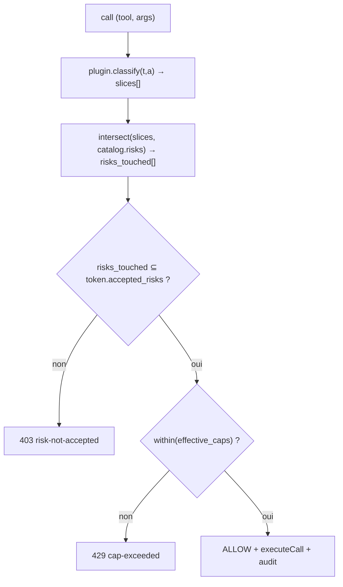

# Scope caps — axe d'amplification orthogonal aux risks

> **DRAFT 2026-06-16** — proposé en marge de la modélisation Gmail
> (cf. [`/.vaubaan/research/providers/gmail.md`](../../.vaubaan/research/providers/gmail.md)).
> Identifie une famille de garde-fous (temporal window, volume per
> call, rate over time) que la spec v4 risk-based ne capture pas et
> qu'il faut introduire **avant** de figer le data-model d'un provider
> dont la surface naturelle s'exprime en quantités (emails, log
> lines, rows, deployments…). À valider par Renaud avant promotion en
> `accepted`.

## Contexte

L'ADR [[pivot-to-risk-based-model]] (raffiné par [[unified-gates-drop-confirm]])
établit que la décision runtime se réduit à un test d'inclusion :

```
risks_touched ⊆ token.accepted_risks  →  ALLOW
                                          sinon DENY
```

Ce test capture **le kind d'action** (lire un mail, écrire un env var,
merger sur main) mais **pas son amplitude**. Trois cas concrets où
l'amplitude domine la sévérité :

1. **Temporal** — un agent qui lit `gmail.read-from-zone-internal`
   sur les 7 derniers jours expose le contexte récent. Le même
   accepted_risk sur les 5 dernières années expose **l'historique
   complet** de l'org. Même `RiskId`, sévérités très différentes.

2. **Volume per call** — un `search_threads(q="from:no-reply@github.com")`
   peut renvoyer 5 ou 50 000 threads. Le risk `gmail.read-from-zone-automated`
   couvre les deux. L'amplitude est silencieuse.

3. **Rate over time** — un agent qui appelle 10× par minute un risk
   accepté est légitime ; 10 000× par minute c'est une exfiltration
   ou une boucle bug. Aucun rate cap actuel.

Le pattern se retrouve **dans tous les providers** existants — pas
qu'un edge-case Gmail :

| Provider | Temporal natif                   | Volume natif               | Rate natif                     |
| -------- | -------------------------------- | -------------------------- | ------------------------------ |
| Gmail    | `q: newer_than:Nd`               | `pageSize`                 | quota Gmail API                |
| GitHub   | `since=`, `until=`, `?per_page=` | `?per_page=` (max 100)     | primary + secondary rate limit |
| Vercel   | `since/until` sur runtime-log    | `limit` sur list endpoints | upstream rate limit            |
| Supabase | `WHERE created_at > now() - …`   | `LIMIT N`                  | postgres connection limit      |
| Railway  | log filter `since`               | log line count             | API rate                       |
| SSH      | n/a (commande shell ad-hoc)      | `head -N`, `\| wc -l`      | concurrent sessions            |

Chaque provider a déjà des manettes natives. Vaubaan n'a pas de
mécanisme uniforme pour les cadrer.

### Tentation à écarter d'emblée

**Repli sur le vecteur 6D** : ajouter un 7e axe `amplitude` ou
quantifier `blast: bulk`. Mauvaise idée :

- Le vecteur 6D est **descriptif** (explique le risk à l'humain en
  UI / audit), pas **enforcé** au runtime (cf. [[unified-gates-drop-confirm]]
  D2 — drop `default_gate`, le vecteur ne gate plus rien).
- Les caps sont **quantitatifs** et **evolvent** post-incident (on
  serre la vis sans rééditer le catalog).
- Le vecteur 6D doit rester **stable inter-provider** pour permettre
  les comparaisons ; un cap est binding-spécifique.

Les caps demandent leur propre couche.

## Décision

### D1 — Introduire `ScopeCaps` comme primitive orthogonale aux risks

Un nouveau type dans `packages/shared/src/risk.ts`, à côté de
`RiskEntry` et `RiskAcceptance`, **sans relation logique avec eux** :

```ts
export interface ScopeCaps {
  /**
   * Plafond temporel : l'agent ne peut atteindre que les items créés /
   * modifiés dans les N derniers jours. Le classifier injecte la
   * contrainte dans l'arg upstream quand le provider le supporte
   * (`q: newer_than:Nd`, `?since=...`, `WHERE created_at > now() - ...`),
   * sinon le call est denied avec `cap-temporal-not-enforceable`.
   *
   * S'applique aux reads ET aux writes (écriture sur un item ancien =
   * révision de l'historique, posture sensible).
   */
  readonly temporal_window_days?: number;

  /**
   * Plafond items / call : l'agent ne peut demander/toucher plus de N
   * items dans un seul tool call. Le classifier injecte / cappe les
   * params upstream (`pageSize`, `?per_page=`, `LIMIT N`).
   */
  readonly items_per_call_max?: number;

  /**
   * Plafond bytes / call : pour les payloads variables (attachments
   * Gmail, runtime-log Vercel, blob Supabase storage). Optionnel —
   * non applicable à tous les tools.
   */
  readonly bytes_per_call_max?: number;

  /**
   * Plafond rate (stateful) : N calls / minute glissante sur le scope
   * porteur du cap (cf. D3). Implémenté via le cache Redis existant
   * (ADR [[redis-cache-upstash-with-memory-fallback]]) avec fallback
   * mémoire local.
   */
  readonly calls_per_minute_max?: number;

  /**
   * Plafond rate (stateful, longue durée) : N calls cumulés sur la
   * durée de vie d'UN token. Compteur incrémenté sur `tokens.calls_seen`
   * (colonne nouvelle, cf. D6).
   */
  readonly calls_per_session_max?: number;
}
```

Tous les champs sont **optionnels**. `undefined` = pas de cap (=
comportement actuel). C'est le shape qui rend l'ADR strictement
additif : aucun catalog/binding existant ne casse.

### D2 — Trois niveaux de déclaration, intersection au runtime

Cap effectif = **intersection (= min) des 3 niveaux**. Jamais l'union,
jamais l'override par un niveau plus bas qui assouplirait. Identique
au pattern d'inclusion des `accepted_risks` (le child token est un
sous-ensemble strict du parent).

#### Niveau 1 — Binding (config statique, par-binding)

Posé par l'opérateur projet sur le `ProviderBinding`, vit dans la DB
(colonne JSONB `caps`) :

```sql
alter table provider_bindings
  add column caps jsonb;       -- nullable, shape = ScopeCaps
```

Exemple : un binding Gmail "inbox-readonly-agent" décrit dans la UI
projet pose `caps: { temporal_window_days: 30, items_per_call_max: 50,
calls_per_minute_max: 10 }`. Tous les tokens mintés contre ce binding
héritent au minimum de ces caps.

#### Niveau 2 — Entrée de catalogue (par-risk, hard limit catalog-level)

Optionnel par `RiskEntry` du `risk-catalog.yaml` d'un provider. Sert à
**hard-limiter** un risk même si l'opérateur ne pose pas de cap binding :

```yaml
- id: gmail.bulk-read
  label: '…'
  matches: 'gmail.mailbox.bulk-marker.R'
  vector: { … }
  caps:
    items_per_call_max: 200 # bulk-read est capé à 200 items/call par design
    calls_per_minute_max: 5 # et 5 bulk-reads / min max, partout
```

C'est le garde-fou que le mainteneur du provider impose sur le risk
le plus sensible, en plus de l'`acceptable_in_envs` existant.

#### Niveau 3 — Token (par-mint, override **strict-tighter**)

Champ ajouté à `TokenMintRequest`, optionnel :

```ts
type TokenMintRequest = {
  bindings: ProjectBinding[];
  accepted_risks: RiskId[];
  denied_risks?: RiskId[];
  caps_override?: ScopeCaps; // ← NEW
  context?: TokenContext;
  // …
};
```

Validation côté mint : chaque champ de `caps_override`, s'il est
défini, doit être **≤** la valeur effective au niveau parent (binding ∩
catalog). Sinon 403 `caps-not-tightenable` avec liste des champs
problématiques. Un manager peut serrer ; il ne peut **jamais**
desserrer ce que le binding ou le catalog ont posé.

#### Résolution effective

```ts
function resolveEffectiveCaps(
  riskId: RiskId,
  binding: ProviderBinding,
  catalog: RiskCatalog,
  tokenOverride: ScopeCaps | null,
): ScopeCaps {
  const fromBinding = binding.caps ?? {};
  const fromCatalog = catalog.risks.find((r) => r.id === riskId)?.caps ?? {};
  const fromToken = tokenOverride ?? {};
  return {
    temporal_window_days: minDefined(
      fromBinding.temporal_window_days,
      fromCatalog.temporal_window_days,
      fromToken.temporal_window_days,
    ),
    items_per_call_max: minDefined(
      fromBinding.items_per_call_max,
      fromCatalog.items_per_call_max,
      fromToken.items_per_call_max,
    ),
    bytes_per_call_max: minDefined(
      fromBinding.bytes_per_call_max,
      fromCatalog.bytes_per_call_max,
      fromToken.bytes_per_call_max,
    ),
    calls_per_minute_max: minDefined(
      fromBinding.calls_per_minute_max,
      fromCatalog.calls_per_minute_max,
      fromToken.calls_per_minute_max,
    ),
    calls_per_session_max: minDefined(
      fromBinding.calls_per_session_max,
      fromCatalog.calls_per_session_max,
      fromToken.calls_per_session_max,
    ),
  };
}
```

`minDefined(...args)` = min des valeurs définies ; `undefined` si toutes
sont absentes.

### D3 — Le runtime check devient `risks_touched ⊆ accepted ∧ within(caps)`

Le pipeline §8 de [[gateway-risk-model]] est étendu :



Sémantique des deux codes d'erreur :

- **403 `risk-not-accepted`** — le _kind_ de l'action n'est pas
  autorisé. Re-mint par le parent pour élargir la posture.
- **429 `cap-exceeded`** — le _kind_ est autorisé mais l'amplitude
  est trop large. Restreindre l'arg côté agent (réduire `pageSize`,
  ajouter un `q: newer_than:…`, ralentir), OU re-mint avec un binding
  / token override plus permissif (rare — assouplir est une décision).

Le 429 est distinct du 403 par design : c'est un signal au caller qu'il
peut **adapter son call sans escalation**, contrairement au 403 qui
nécessite un round-trip humain ou parent.

### D4 — La classifier gagne une responsabilité "normalize args"

Le `ProviderPlugin` (§7 spec) gagne une méthode optionnelle :

```ts
interface ProviderPlugin {
  readonly provider: string;
  readonly dataModel: DataModel;

  classify(tool, args, bindings): { slices: Slice[] } | { denied: string };

  /**
   * NEW. Pour les caps stateless (temporal, items_per_call, bytes),
   * normalise les args upstream pour respecter les caps SANS rejeter
   * le call quand c'est possible. Ex : capper `pageSize` à
   * `items_per_call_max`, injecter `newer_than:Nd` dans le `q` Gmail.
   *
   * Retourne :
   *  - `normalized_args` si la normalisation est possible (call procède
   *    avec les args modifiés ; audit log capture l'ajustement).
   *  - `denied` si le cap ne peut pas être injecté côté provider (ex:
   *    SSH bash où les args sont du shell opaque).
   *
   * Le rate (calls_per_minute, calls_per_session) reste runtime-only
   * — pas de normalisation possible.
   */
  normalizeForCaps?(
    tool: string,
    args: Record<string, unknown>,
    caps: ScopeCaps,
  ): { normalized_args: Record<string, unknown> } | { denied: string };
}
```

Cette extension est **opt-in** : un plugin qui ne l'implémente pas
laisse le runtime faire un check post-hoc sur la réponse (compter les
items retournés, rejeter avec 429 si dépassement). Moins efficace mais
toujours sûr.

### D5 — Le rate (stateful) vit dans le cache Redis existant

`calls_per_minute_max` et `calls_per_session_max` requièrent un
compteur. Réutilisation de l'infra existante :

- Cache Redis Upstash + fallback mémoire (ADR [[redis-cache-upstash-with-memory-fallback]]).
- Clés :
  - `caps:rate:{token_id}:{risk_id}:{minute_bucket}` — TTL 90 s (deux
    fenêtres pour absorber les transitions).
  - `caps:rate:{token_id}:{risk_id}:session` — TTL = `token.expires_at - now()`.
- Increment atomique au moment de la décision ALLOW (juste avant
  `executeCall`). Si l'increment fait dépasser le cap, rollback et
  retourner 429.

**Pas de check Redis sur les `accepted_risks` eux-mêmes** — ceux-ci
restent stateless (memoization du token résolu existante). Seuls les
compteurs caps consomment Redis.

### D6 — Pas de colonne `tokens.calls_seen` séparée

Initialement tentant : matérialiser un counter en DB sur la row token
pour la durabilité du `calls_per_session_max`. Refusé : le Redis avec
TTL=durée de vie du token est suffisant, et ajouter un write-hot-path
DB sur chaque call est précisément ce que l'ADR
[[redis-cache-upstash-with-memory-fallback]] cherchait à éviter.

Conséquence : si le cache Redis est purgé en cours de vie d'un token
(redémarrage Upstash, fallback mémoire perdu), le compteur session
redémarre à 0. C'est un trou volontaire — `calls_per_session_max` est
un garde-fou "best effort", pas une garantie cryptographique.

### D7 — Audit log enrichi

```jsonc
{
  "token_id": "tok_…",
  "tool": "gmail__search_threads",
  "args_hash": "sha256:…",
  "slices_executed": ["gmail.mailbox.bulk-marker.R", "…"],
  "risks_touched": ["gmail.bulk-read"],
  "decision": "allowed",
  "effective_caps": {
    // ← NEW
    "temporal_window_days": 30,
    "items_per_call_max": 200,
    "calls_per_minute_max": 5,
  },
  "caps_action": "normalized", // ← NEW : "normalized" | "enforced-as-is" | null
  "caps_normalization": {
    // ← NEW : si caps_action == "normalized"
    "args_diff": { "pageSize": [100, 50] }, // pageSize passé de 100 à 50
  },
  "decided_at": "2026-…",
}
```

Lecture forensique : `caps_action: normalized` = on a ajusté
silencieusement l'arg de l'agent ; un opérateur peut compter ces
ajustements pour savoir si un binding est trop serré (friction agent)
ou bien dimensionné.

### D8 — UI mint affiche les caps effectifs avant submit

Le `POST /api/v1/tokens/preview` (et la UI mint) renvoient pour chaque
risk les caps effectifs résolus par D2. Le manager voit :

```
☑ gmail.bulk-read
   ⚙ Caps : 200 items/call, 5 calls/min
   ⓘ Hérité du catalog. Override autorisé jusqu'à 100 items/call.
```

Le manager peut serrer (cocher un override) mais pas desserrer (les
flèches "+" sont absentes). Le caps_override mintsouhaité est validé
serveur-side avant 201.

## Conséquences

### Wire changes (additifs, non breaking)

- `RiskEntry` gagne un champ optionnel `caps?: ScopeCaps`.
- `ProviderBinding` gagne un champ optionnel `caps?: ScopeCaps`.
- `TokenMintRequest` gagne un champ optionnel `caps_override?: ScopeCaps`.
- `TokenMintPreviewResponse` gagne `effective_caps` par risk.
- `ResolvedToken` (cache hot-path) gagne `effective_caps_by_risk_id`.
- Audit log `decided_caps` + `caps_action` + `caps_normalization`.
- Code d'erreur runtime nouveau : **429 `cap-exceeded`** distinct du
  403 `risk-not-accepted`.

Tous les catalogs / bindings / tokens existants restent valides. Caps
vide = comportement actuel inchangé.

### Plugin contract étendu

`ProviderPlugin.normalizeForCaps?` ajouté en option. Plugins qui ne
l'implémentent pas (les 5 actuels en l'état) ont un comportement
correct par défaut : check post-hoc côté runtime (compte items
retournés, applique 429). Aucune migration code mandatory.

L'opportunité naturelle : Gmail et Supabase, où la normalisation
upstream est triviale (`q: newer_than:Nd` / `LIMIT N`), implémentent
`normalizeForCaps` d'emblée. Les autres providers suivent au rythme
des besoins.

### Schéma DB

```sql
-- migration 0037 (à venir, hors-scope de cet ADR)
alter table provider_bindings
  add column caps jsonb;            -- nullable, shape ScopeCaps

-- pas de table dédiée pour le rate counter — Redis only (D5).
-- pas de colonne tokens.caps_override : on stocke directement le shape
-- résolu (effective_caps_by_risk_id) sur la row tokens en JSONB.
alter table tokens
  add column effective_caps_by_risk_id jsonb;  -- snapshot au mint, lecture seule
```

### Couplage avec le cache Redis

Le compteur rate est un nouveau client du cache. Estimation de volume :
1 Redis write par tool call qui touche un risk avec `calls_per_minute_max`
défini. Sur les catalogs MVP (où seuls 1-2 risks par provider
porteront probablement un cap rate), c'est négligeable vs. le cache
resolved-token déjà en place.

### Implications spec `gateway-risk-model.md`

Une nouvelle section §4bis "Scope caps" entre §4 catalogue et §5 wire.
Section §8 (runtime) modifiée pour intégrer le test `within(caps)`.
Section §13 (migration phases) gagne une Phase 1bis "Caps optionnels
sur les catalogs existants" entre Phase 1 et Phase 2.

Le `provider-modeler` skill (cf. [`/docs/skills/provider-modeler.md`](../skills/provider-modeler.md))
gagne une consigne : pour chaque risk du catalog, **considérer**
explicitement si un cap par défaut a du sens. Pas obligatoire — mais
question à se poser à la Phase C de la modélisation.

### Impact `escalation_channel`

Un 429 `cap-exceeded` est-il un cas d'escalation comme le 403 ? **Non
par défaut.** Le 429 signale "tu es dans tes droits mais trop
agressivement" — l'agent ralentit / réduit son scope d'arg lui-même.
L'escalation reste l'option du dernier recours si le cap est
structurellement trop bas pour la tâche (auquel cas re-mint avec
override desserré au binding ou catalog).

## Alternatives rejetées

### A1 — Folder les caps dans le vecteur 6D (7e axe `amplitude`)

Tentation initiale. Rejet : (a) casse la séparation descriptif /
enforcé ([[unified-gates-drop-confirm]] D2 est récent et clair),
(b) le vecteur 6D est qualitatif par design (énums ordonnées), les
caps sont quantitatifs (entiers), (c) le vecteur est censé être
stable inter-provider pour permettre comparaison, un cap est
binding-spécifique.

### A2 — Caps uniquement au niveau HTTP gateway (rate-limit générique)

Implémenter le rate au niveau d'un middleware d'edge Vercel
(`@vercel/edge`), sans intégration risk. Rejet : ne couvre que le
rate, pas temporal ni volume. Et ne discrimine pas par risk
(impossible d'avoir "5 reads bulk / min, 100 reads single / min"
côté HTTP middleware).

### A3 — Ressusciter `project_risk_policies` pour porter les caps par-projet

L'ADR [[unified-gates-drop-confirm]] D3 a droppé cette table comme
complexité morte. Tentation de la ressusciter pour les caps. Rejet :
les caps ne sont pas "par-projet" mais "par-binding" (un même projet
peut avoir plusieurs bindings Gmail aux caps différents). Donc le bon
porteur est `provider_bindings.caps`, pas `project_*`.

### A4 — Pas de niveau token override (D2 niveau 3)

Simplification : caps fixés par binding + catalog seulement, le mint
ne peut pas serrer. Rejet : un manager veut souvent mint un token
"très restreint" pour une session sensible (ex: "ce coding-agent a 50
items/call max temporairement"). Sans D2-niveau-3, il faut un binding
dédié — friction inutile. L'override token est bon marché (validation
côté serveur).

### A5 — Permettre au manager de **desserrer** les caps binding au mint

Pour symétrie avec le pouvoir "élargir" qu'un parent a sur un enfant.
Rejet : les caps sont des **garde-fous opérateur projet**, posés
intentionnellement bas pour limiter l'exposition de ce projet. Si un
manager pouvait les desserrer au mint, ils seraient inutiles. Cette
asymétrie (serrage-only) est volontaire et cohérente avec la
philosophie binding-as-policy.

### A6 — Caps stateful (rate) en Postgres

Persister les compteurs en DB pour durabilité. Rejet (cf. D6) :
write-hot-path à chaque call, contraire à l'ADR
[[redis-cache-upstash-with-memory-fallback]]. Le best-effort Redis
suffit pour un garde-fou "abus en boucle" — un attaquant qui
chercherait à contourner via crash Redis n'a pas gagné grand-chose
(les autres caps stateless tiennent toujours).

### A7 — `bytes_per_call_max` retiré du shape

Cap moins universel que les autres (pas applicable à un `label_thread`).
Rejet de A7 : gardé optionnel, c'est un cap utile précisément pour
les tools à payload variable (Gmail attachments, Vercel runtime-log,
Supabase storage object). Coût d'inclusion = 1 champ optionnel.

### A8 — Implémenter caps seulement sur Gmail pour piloter

Modéliser les caps comme un champ ad-hoc de `binding.metadata`
Gmail-spécifique, sans toucher au shared type. Tester en prod, promouvoir
plus tard. Rejet : la généralisation est claire (le tableau §Contexte
montre que tous les providers en bénéficient). Faire un détour
Gmail-only crée une dette technique de promotion plus tard, sans
gain : le shape est trivial à introduire maintenant que le besoin est
identifié, et les 5 providers existants ne sont pas affectés tant
qu'ils n'utilisent pas le champ (additif strict).

## Plan d'implémentation (haut-niveau, à éclater en ADR ops séparé)

1. **`packages/shared/src/risk.ts`** — ajouter `ScopeCaps` interface,
   étendre `RiskEntry`, `ProviderBinding` (déjà dans `types.ts`),
   `TokenMintRequest`. Pure type additive.
2. **`packages/policy-engine/`** — nouveau module `caps-resolver.ts`
   avec `resolveEffectiveCaps(riskId, binding, catalog, tokenOverride)`.
   Tests unitaires (intersection min, undefined-safe).
3. **`packages/policy-engine/runtime`** — wire le `within(caps)` check
   post-`risks_touched ⊆ accepted_risks`. Code retour 429 distinct
   de 403.
4. **Migration SQL 0037** — `alter table provider_bindings add column
caps jsonb`, `alter table tokens add column effective_caps_by_risk_id
jsonb`.
5. **Mint endpoint + preview** — résoudre + valider
   `caps_override ≤ binding ∩ catalog`. Stocker snapshot
   `effective_caps_by_risk_id` à la création du token.
6. **Audit log** — étendre la shape (cf. D7).
7. **Cache Redis** — nouveau client `caps-rate-counter.ts` avec
   compteurs bucket-minute et bucket-session.
8. **UI mint** — afficher caps effectifs par risk, permettre
   override-tighten only.
9. **Plugin contract** — ajouter `normalizeForCaps?` optionnel. Pas de
   migration mandatory des 5 plugins existants ; runtime fait
   check post-hoc à défaut.
10. **Spec `gateway-risk-model.md`** — nouvelle section §4bis,
    section §8 amendée, Phase 1bis dans §13.
11. **`provider-modeler` skill** — ajouter la consigne "considérer
    les caps par défaut au catalog" dans la Phase C.
12. **Tests** — fixtures de catalogs avec caps, tests intégration
    429 vs 403, tests rate counter Redis + fallback mémoire.

Phases 1-3 peuvent rouler avant les autres (zéro impact UX ni DB).
Phase 4 ouvre les phases 5-7. Phase 8 ouvre UI. Phase 11 nourrit le
modèle Gmail.

## Notes

- Cet ADR est **strictement additif** : aucun catalog/binding/token
  existant n'est cassé. C'est ce qui justifie de le poser maintenant
  malgré son scope (avant la Phase B Gmail qui en bénéficiera, et
  avant de rétro-appliquer aux 5 providers existants au rythme des
  besoins).
- Le 429 distinct du 403 est inspiré de l'industrie (HTTP standard
  rate-limit + RFC 6585) et permet au caller d'avoir une logique de
  back-off automatique distincte de la logique d'escalation.
- À surveiller dans les 6 premiers mois : la friction "normalisation
  silencieuse" (D4) côté agent. Si les agents tournent en boucle parce
  que `pageSize` est silently capé à 50 alors qu'ils en attendaient
  100, on devra documenter explicitement la normalisation dans la
  réponse upstream (header `X-Vaubaan-Caps-Applied: items_per_call=50`).
- Le `bytes_per_call_max` est le seul cap qu'on n'a pas modélisé dans
  Gmail au §3 du research — à intégrer si validé.
