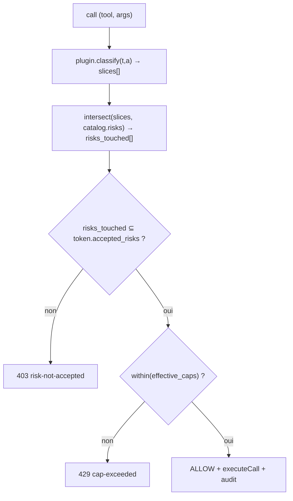

> **Pre-v5 document (French).** Not translated; read with the mapping in [[legacy-status-of-v4-adrs-and-handbooks]].

# Scope caps — axe d'amplification orthogonal aux risks

> Identifie une famille de garde-fous (temporal window, volume per
> call, rate over time) que la spec v4 risk-based ne capture pas et
> qu'il faut introduire **avant** de figer le data-model d'un provider
> dont la surface naturelle s'exprime en quantités (emails, log
> lines, rows, deployments…). Introduit deux primitives parallèles
> (`ScopeCaps` soft, `InfraLimits` hard) et un modèle à 4 niveaux
> asymétriques (catalog default → org loose-or-tighten → binding
> tighten-only → token tighten-only) avec wrap infra non-overrideable.
> Proposé en marge de la modélisation Gmail
> (cf. [`/.vaubaan/research/providers/gmail.md`](../../.vaubaan/research/providers/gmail.md)).

## Contexte

L'ADR [[pivot-to-risk-based-model]] (raffiné par [[unified-gates-drop-confirm]])
établit que la décision runtime se réduit à un test d'inclusion :

```
risks_touched ⊆ token.accepted_risks  →  ALLOW
                                          sinon DENY
```

Ce test capture **le kind d'action** (lire un mail, écrire un env var,
merger sur main) mais **pas son amplitude**. Trois cas concrets où
l'amplitude domine la sévérité :

1. **Temporal** — un agent qui lit `gmail.read-from-zone-internal`
   sur les 7 derniers jours expose le contexte récent. Le même
   accepted_risk sur les 5 dernières années expose **l'historique
   complet** de l'org. Même `RiskId`, sévérités très différentes.

2. **Volume per call** — un `search_threads(q="from:no-reply@github.com")`
   peut renvoyer 5 ou 50 000 threads. Le risk `gmail.read-from-zone-automated`
   couvre les deux. L'amplitude est silencieuse.

3. **Rate over time** — un agent qui appelle 10× par minute un risk
   accepté est légitime ; 10 000× par minute c'est une exfiltration
   ou une boucle bug. Aucun rate cap actuel.

Le pattern se retrouve **dans tous les providers** existants — pas
qu'un edge-case Gmail :

| Provider | Temporal natif                   | Volume natif               | Rate natif                     |
| -------- | -------------------------------- | -------------------------- | ------------------------------ |
| Gmail    | `q: newer_than:Nd`               | `pageSize`                 | quota Gmail API                |
| GitHub   | `since=`, `until=`, `?per_page=` | `?per_page=` (max 100)     | primary + secondary rate limit |
| Vercel   | `since/until` sur runtime-log    | `limit` sur list endpoints | upstream rate limit            |
| Supabase | `WHERE created_at > now() - …`   | `LIMIT N`                  | postgres connection limit      |
| Railway  | log filter `since`               | log line count             | API rate                       |
| SSH      | n/a (commande shell ad-hoc)      | `head -N`, `\| wc -l`      | concurrent sessions            |

Chaque provider a déjà des manettes natives. Vaubaan n'a pas de
mécanisme uniforme pour les cadrer.

### Tentation à écarter d'emblée

**Repli sur le vecteur 6D** : ajouter un 7e axe `amplitude` ou
quantifier `blast: bulk`. Mauvaise idée :

- Le vecteur 6D est **descriptif** (explique le risk à l'humain en
  UI / audit), pas **enforcé** au runtime (cf. [[unified-gates-drop-confirm]]
  D2 — drop `default_gate`, le vecteur ne gate plus rien).
- Les caps sont **quantitatifs** et **evolvent** post-incident (on
  serre la vis sans rééditer le catalog).
- Le vecteur 6D doit rester **stable inter-provider** pour permettre
  les comparaisons ; un cap est binding-spécifique.

Les caps demandent leur propre couche.

## Décision

### D1 — Introduire `ScopeCaps` et `InfraLimits` comme primitives orthogonales aux risks

Deux types parallèles dans `packages/shared/src/risk.ts`, à côté de
`RiskEntry` et `RiskAcceptance`, **sans relation logique avec eux** —
mêmes champs, sémantiques différentes :

```ts
/**
 * Caps "policy" — soft defaults, loosenable au niveau org, tighten-only
 * en aval (binding, token). Les caps reflètent la posture acceptée
 * par l'organisation, pas une limite physique. Cf. D2.
 */
export interface ScopeCaps {
  /**
   * Plafond temporel : l'agent ne peut atteindre que les items créés /
   * modifiés dans les N derniers jours. Le classifier injecte la
   * contrainte dans l'arg upstream quand le provider le supporte
   * (`q: newer_than:Nd`, `?since=...`, `WHERE created_at > now() - ...`),
   * sinon : denied (read-only post-hoc) ou 403 cap-not-enforceable
   * (mutating, cf. D4.1).
   *
   * S'applique aux reads ET aux writes (écriture sur un item ancien =
   * révision de l'historique, posture sensible).
   */
  readonly temporal_window_days?: number;

  /**
   * Plafond items / call : l'agent ne peut demander/toucher plus de N
   * items dans un seul tool call. Le classifier injecte / cappe les
   * params upstream (`pageSize`, `?per_page=`, `LIMIT N`).
   */
  readonly items_per_call_max?: number;

  /**
   * Plafond bytes / call : pour les payloads variables (attachments
   * Gmail, runtime-log Vercel, blob Supabase storage). Optionnel —
   * non applicable à tous les tools.
   */
  readonly bytes_per_call_max?: number;

  /**
   * Plafond rate (stateful) : N calls / minute glissante sur le scope
   * porteur du cap. Compteur sur l'infra cache existante (in-memory
   * par défaut, Upstash Redis si configuré, cf. D5).
   */
  readonly calls_per_minute_max?: number;

  /**
   * Plafond rate (stateful, longue durée) : N calls cumulés sur la
   * durée de vie d'UN token. Compteur cache best-effort, pas DB (D6).
   */
  readonly calls_per_session_max?: number;
}

/**
 * Limites "infra" — hard ceilings imposés par le mainteneur du provider
 * plugin pour des raisons techniques/opérationnelles non-négociables
 * (budget mémoire gateway, quotas Upstash partagés, plafonds upstream
 * durs imposés par le provider tiers). **Jamais loosenable** par
 * aucun niveau (org, binding, token). Wrap final dans la résolution
 * effective (D2 § Wrap infra). Cf. distinction D2 sur les sémantiques
 * soft (ScopeCaps) vs hard (InfraLimits).
 */
export interface InfraLimits {
  readonly temporal_window_days?: number;
  readonly items_per_call_max?: number;
  readonly bytes_per_call_max?: number;
  readonly calls_per_minute_max?: number;
  readonly calls_per_session_max?: number;
}
```

Tous les champs sont **optionnels** dans les deux types. `undefined` =
pas de limite à ce niveau. C'est ce qui rend l'ADR strictement
additif : aucun catalog / binding / org existant ne casse.

**Pourquoi deux types et pas un seul avec un flag ?** La distinction
ne porte ni sur le champ ni sur la valeur — elle porte sur **qui peut
modifier quoi**. Séparer en deux types matérialise cette asymétrie
dans le typage TypeScript : on ne peut pas accidentellement assigner
un `ScopeCaps` à un champ `infra_limits`, et le code de résolution
(D2) prend les deux en arguments distincts. Coût d'inclusion = duplication
des 5 champs ; bénéfice = type-safety + lisibilité du contrat. Le coût
est marginal vu que la shape est figée.

### D2 — Quatre niveaux asymétriques + wrap infra non-overrideable

Le cap effectif d'un champ donné se résout par une chaîne **dernière-valeur-définie** sur 4 niveaux, puis **wrap** par `InfraLimits` qui plafonne quoi qu'il arrive. Les niveaux ne sont pas symétriques :

| Niveau                                  | Direction permise                    | Owner                                         |
| --------------------------------------- | ------------------------------------ | --------------------------------------------- |
| **catalog** (`RiskEntry.caps`)          | point de départ — default recommandé | Mainteneur du provider plugin                 |
| **org** (`organizations.caps_defaults`) | **loose OU tighten** vs catalog      | Org-admin (informed acceptance contractuelle) |
| **binding** (`provider_bindings.caps`)  | **tighten only** vs org              | Opérateur projet                              |
| **token** (`tokens.caps_override`)      | **tighten only** vs binding          | Manager au mint                               |
| **infra** (`RiskEntry.infra_limits`)    | wrap final, **jamais overrideable**  | Mainteneur du provider plugin                 |

Justification de l'asymétrie :

- L'**org** est la primitive contractuelle multi-tenant Vauban (cf. [[architecture-two-tenants]]). Elle accepte la posture _du customer_, qui peut différer (à la hausse comme à la baisse) du default catalog. Informed consent au niveau juridique.
- Le **binding** est une _refinement opérationnelle dans la posture org_. Si binding pouvait loosen au-dessus de l'org, l'org-admin perdrait le contrôle (privilege escalation : un user-projet bypasse la politique org).
- Le **token** est une refinement par-session, même rationale.
- Les **`infra_limits`** plafonnent des contraintes techniques (budget mémoire gateway, quotas Upstash partagés cross-org, plafonds upstream durs imposés par le provider tiers). Aucun org, même averti, ne peut les dépasser sans crasher le runtime ou DOSer les autres tenants.

#### Niveau catalog — `RiskEntry.caps` (default suggéré)

Optionnel par `RiskEntry` du `risk-catalog.yaml`. Si absent → `undefined` (fall-through au niveau suivant ou pas de cap).

```yaml
- id: gmail.bulk-read
  label: 'Lecture bulk via filtre `q`'
  matches: 'gmail.mailbox.bulk-marker.R'
  vector: { … }
  caps: # ← default recommandé par le mainteneur Gmail
    items_per_call_max: 200
    calls_per_minute_max: 5
  infra_limits: # ← hard ceiling non-overrideable
    bytes_per_call_max: 10485760 # 10 MB, budget parsing gateway
    items_per_call_max: 500 # Gmail API plafonne à 500 max
```

#### Niveau org — `organizations.caps_defaults` (informed, loose OU tighten)

Nouveau JSONB sur la table `organizations`, par-risk ou global :

```sql
alter table organizations
  add column caps_defaults jsonb;     -- nullable, shape = { [riskId]: ScopeCaps } | ScopeCaps
```

Posé par l'org-admin via la UI org-level. Sémantique : « pour notre
organisation, voici la posture acceptée pour ce risk ». Peut être :

- **Plus restrictif** que le catalog (ex. compliance santé qui veut
  `bulk-read items=30` au lieu de 200).
- **Plus permissif** que le catalog (ex. labo de recherche qui veut
  `bulk-read items=5000` pour ses backfills), tant que ça reste **sous
  `infra_limits`**.

#### Niveau binding — `provider_bindings.caps` (tighten only vs org)

```sql
alter table provider_bindings
  add column caps jsonb;       -- nullable, shape = ScopeCaps
```

Posé par l'opérateur projet. Validation au write : chaque champ défini
doit être **≤** la valeur résolue au niveau org (org ?? catalog). Sinon
**403 `binding-caps-loosens-org`** avec la liste des champs problématiques.

#### Niveau token — `tokens.caps_override` (tighten only vs binding)

Champ optionnel dans `TokenMintRequest` :

```ts
type TokenMintRequest = {
  bindings: ProjectBinding[];
  accepted_risks: RiskId[];
  denied_risks?: RiskId[];
  caps_override?: ScopeCaps;
  context?: TokenContext;
};
```

Validation au mint : chaque champ doit être **≤** la valeur résolue
au niveau binding (binding ?? org ?? catalog). Sinon **403
`token-caps-loosens-binding`**.

#### Wrap infra — `InfraLimits` (jamais overrideable)

Après résolution des 4 niveaux, chaque champ effectif est plafonné par
`infra_limits` du catalog. Si la valeur résolue par les 4 niveaux
dépasse `infra_limits`, on **clamp silencieusement** au `infra_limits`
au moment de la résolution (pas d'erreur au mint — l'org-admin ne
pouvait pas savoir). Le mint preview affiche cependant le clamp pour
transparence.

#### Résolution effective

```ts
function resolveEffectiveCaps(
  riskId: RiskId,
  catalog: RiskCatalog,
  orgDefaults: Record<RiskId, ScopeCaps> | ScopeCaps | null,
  binding: ProviderBinding,
  tokenOverride: ScopeCaps | null,
): { caps: ScopeCaps; source: Record<keyof ScopeCaps, CapSource> } {
  const fromCatalog = catalog.risks.find((r) => r.id === riskId)?.caps ?? {};
  const infraLimits = catalog.risks.find((r) => r.id === riskId)?.infra_limits ?? {};
  const fromOrg = resolveOrgFor(riskId, orgDefaults);
  const fromBinding = binding.caps ?? {};
  const fromToken = tokenOverride ?? {};

  const fields: (keyof ScopeCaps)[] = [
    'temporal_window_days',
    'items_per_call_max',
    'bytes_per_call_max',
    'calls_per_minute_max',
    'calls_per_session_max',
  ];

  const caps: Partial<ScopeCaps> = {};
  const source: Partial<Record<keyof ScopeCaps, CapSource>> = {};

  for (const f of fields) {
    // Chaîne dernière-valeur-définie : token > binding > org > catalog
    let value: number | undefined;
    let src: CapSource = 'unset';
    if (fromToken[f] !== undefined) {
      value = fromToken[f];
      src = 'token';
    } else if (fromBinding[f] !== undefined) {
      value = fromBinding[f];
      src = 'binding';
    } else if (fromOrg[f] !== undefined) {
      value = fromOrg[f];
      src = 'org';
    } else if (fromCatalog[f] !== undefined) {
      value = fromCatalog[f];
      src = 'catalog-default';
    }

    // Wrap infra : clamp silencieux si dépassement
    if (value !== undefined && infraLimits[f] !== undefined && value > infraLimits[f]!) {
      value = infraLimits[f];
      src = 'infra-limit';
    }

    if (value !== undefined) {
      caps[f] = value;
      source[f] = src;
    }
  }

  return { caps: caps as ScopeCaps, source: source as Record<keyof ScopeCaps, CapSource> };
}

type CapSource = 'catalog-default' | 'org' | 'binding' | 'token' | 'infra-limit' | 'unset';
```

Note : la sémantique est **dernière-valeur-définie**, pas `min()`.
C'est ce qui permet à l'org de loosen au-dessus du catalog default.
Les validations cross-level (binding ≤ org, token ≤ binding) sont
faites **au write** (PUT binding, POST mint), pas à la résolution
runtime. Au runtime on a déjà des valeurs cohérentes par construction.

### D3 — Le runtime check devient `risks_touched ⊆ accepted ∧ within(caps)`

Le pipeline §8 de [[gateway-risk-model]] est étendu :



Sémantique des deux codes d'erreur :

- **403 `risk-not-accepted`** — le _kind_ de l'action n'est pas
  autorisé. Re-mint par le parent pour élargir la posture.
- **429 `cap-exceeded`** — le _kind_ est autorisé mais l'amplitude
  est trop large. Restreindre l'arg côté agent (réduire `pageSize`,
  ajouter un `q: newer_than:…`, ralentir), OU re-mint avec un binding
  / token override plus permissif (rare — assouplir est une décision).

Le 429 est distinct du 403 par design : c'est un signal au caller qu'il
peut **adapter son call sans escalation**, contrairement au 403 qui
nécessite un round-trip humain ou parent.

> **Note** — la branche `within(caps) ?` ci-dessus est volontairement
> simplifiée. Le check effectif diffère selon que le slice classifié
> est `.R` ou `.W` (cf. DSL [[gateway-risk-model]] §3.1) et selon que
> le plugin expose `normalizeForCaps`. Détail en D4.1. Un troisième
> code, **403 `cap-not-enforceable`**, peut sortir de cette branche
> pour les tools mutating dont les caps stateless ne peuvent pas être
> injectés à priori.

### D4 — La classifier gagne une responsabilité "normalize args"

Le `ProviderPlugin` (§7 spec) gagne une méthode optionnelle :

```ts
interface ProviderPlugin {
  readonly provider: string;
  readonly dataModel: DataModel;

  classify(tool, args, bindings): { slices: Slice[] } | { denied: string };

  /**
   * NEW. Pour les caps stateless (temporal, items_per_call, bytes),
   * normalise les args upstream pour respecter les caps SANS rejeter
   * le call quand c'est possible. Ex : capper `pageSize` à
   * `items_per_call_max`, injecter `newer_than:Nd` dans le `q` Gmail.
   *
   * Retourne :
   *  - `normalized_args` si la normalisation est possible (call procède
   *    avec les args modifiés ; audit log capture l'ajustement).
   *  - `denied` si le cap ne peut pas être injecté côté provider (ex:
   *    SSH bash où les args sont du shell opaque).
   *
   * Le rate (calls_per_minute, calls_per_session) reste runtime-only
   * — pas de normalisation possible.
   */
  normalizeForCaps?(
    tool: string,
    args: Record<string, unknown>,
    caps: ScopeCaps,
  ): { normalized_args: Record<string, unknown> } | { denied: string };
}
```

Cette extension est **opt-in pour les tools read-only** (slices `.R`
uniquement) : un plugin qui ne l'implémente pas laisse le runtime
faire un check post-hoc sur la réponse (compter les items retournés,
rejeter avec 429 si dépassement, jeter le payload sans le relayer au
caller). Moins efficace mais sûr — la réponse n'est jamais retournée
si le cap est dépassé.

**Pour les tools mutating** (au moins un slice `.W`), `normalizeForCaps`
devient obligatoire dès qu'un cap stateless est posé. Cf. D4.1.

### D4.1 — Tools mutating : à priori obligatoire, pas de fallback post-hoc

Un check post-hoc sur un tool mutating (`delete_thread`, `merge_pr`,
bulk `UPDATE`, …) est par construction trop tard : le side effect a
déjà eu lieu côté provider quand le runtime compte la réponse. Le 429
deviendrait un **constat de dégât** plutôt qu'un garde-fou. On refuse
explicitement cette sémantique.

Règle :

1. Le classifier marque chaque slice avec son operation kind (`R` ou
   `W`, déjà encodé dans le DSL [[gateway-risk-model]] §3.1).
2. Si **au moins un** slice classifié est `.W` ET qu'au moins un cap
   stateless (`temporal_window_days`, `items_per_call_max`,
   `bytes_per_call_max`) est défini dans `effective_caps` ET que le
   plugin n'expose pas `normalizeForCaps` (ou il retourne `denied`),
   le runtime refuse le call avec **403 `cap-not-enforceable`** —
   avant tout appel upstream.
3. Les caps **stateful** (`calls_per_minute_max`, `calls_per_session_max`)
   restent toujours à priori (incrément Redis avant `executeCall`) :
   pas d'enjeu mutating spécifique, le compteur n'a pas besoin de
   normalisation upstream.

Sémantique du 403 `cap-not-enforceable` :

```jsonc
403 cap-not-enforceable
{
  "error": "cap-not-enforceable",
  "tool": "supabase__execute_sql",
  "mutating_slices": ["supabase[prod].db.rows.W"],
  "unenforceable_caps": ["items_per_call_max"],
  "hint": "Mutating tool requires plugin.normalizeForCaps to enforce caps before the side effect. Either implement the method in the plugin, re-mint without items_per_call_max on this risk, or drop the cap on the binding/catalog."
}
```

403 et non 429 : le caller ne peut **pas** ralentir ou serrer ses
args pour récupérer (un `LIMIT 50` dans un `bulk DELETE` reste un
side effect non-réversible côté provider). Le seul recours est
code-side (implémenter `normalizeForCaps` dans le plugin) ou
config-side (retirer le cap incriminé du binding/catalog/token).

### D5 — Le rate (stateful) réutilise l'infra cache : in-memory par défaut, Upstash Redis si configuré

`calls_per_minute_max` et `calls_per_session_max` requièrent un
compteur. Réutilisation **stricte** du pattern de l'ADR
[[redis-cache-upstash-with-memory-fallback]] — pas un nouveau client,
pas un nouveau backend :

- **In-memory par défaut** (`Map<string, {count, expiresAt}>` mono-process).
  C'est le mode utilisé dev local (pas d'env vars) et en fallback si
  Upstash est down ou pas configuré.
- **Upstash Redis si `UPSTASH_REDIS_*` env vars présents** —
  incrément atomique distribué via `INCR` + `EXPIRE`. C'est l'uplift
  qui rend le cap effectif global cross-instance Vercel.

Clés (identiques dans les deux backends) :

- `caps:rate:{token_id}:{risk_id}:{minute_bucket}` — TTL 90 s (deux
  fenêtres pour absorber les transitions).
- `caps:rate:{token_id}:{risk_id}:session` — TTL = `token.expires_at - now()`.

Increment au moment de la décision ALLOW (juste avant `executeCall`).
Si l'increment fait dépasser le cap → **429 `cap-exceeded`**. Pas de
rollback nécessaire : un compteur à N+1 reste cohérent, le call est
juste refusé.

**Trade-off in-memory vs Redis assumé explicitement** : sans Upstash,
le compteur est par-instance Vercel. Le cap effectif global ≈ `cap ×
nombre d'instances chaudes`. Acceptable en dev et en prod
single-instance ; en prod multi-instance, l'écart peut être
significatif (`calls_per_minute_max=10` × 5 instances chaudes →
potentiellement 50 calls/min réels). Configurer Upstash quand le
scale multi-instance le justifie — la décision est ops-side, pas
code-side. Le cap reste un **garde-fou "best effort"** dans les deux
modes (cf. D6 sur la non-durabilité DB).

**Pas de check cache sur les `accepted_risks` eux-mêmes** — ceux-ci
restent stateless (memoization du token résolu déjà en place). Seuls
les compteurs caps consomment le backend cache.

### D6 — Pas de colonne `tokens.calls_seen` séparée

Initialement tentant : matérialiser un counter en DB sur la row token
pour la durabilité du `calls_per_session_max`. Refusé : le cache
(in-memory ou Upstash, cf. D5) avec TTL = durée de vie du token est
suffisant, et ajouter un write-hot-path DB sur chaque call est
précisément ce que l'ADR
[[redis-cache-upstash-with-memory-fallback]] cherchait à éviter.

Conséquence : si le cache est purgé en cours de vie d'un token
(redémarrage Upstash, restart Vercel function chaude, fallback
in-memory perdu), le compteur session redémarre à 0. C'est un trou
volontaire — `calls_per_session_max` est un garde-fou "best effort",
pas une garantie cryptographique. Cohérent avec D5.

### D7 — Audit log enrichi

```jsonc
{
  "token_id": "tok_…",
  "tool": "gmail__search_threads",
  "args_hash": "sha256:…",
  "slices_executed": ["gmail.mailbox.bulk-marker.R", "…"],
  "risks_touched": ["gmail.bulk-read"],
  "decision": "allowed",
  "effective_caps": {
    "temporal_window_days": 30,
    "items_per_call_max": 200,
    "calls_per_minute_max": 5,
  },
  "cap_source": {
    // ← NEW : pour chaque champ d'effective_caps, d'où vient la valeur
    "temporal_window_days": "binding",
    "items_per_call_max": "catalog-default",
    "calls_per_minute_max": "org",
  },
  "caps_action": "normalized", // "normalized" | "enforced-as-is" | "denied-pre-execute" | "exceeded-post-execute" | "infra-clamped" | null
  "caps_normalization": {
    // si caps_action == "normalized"
    "args_diff": { "pageSize": [100, 50] }, // pageSize passé de 100 à 50
  },
  "decided_at": "2026-…",
}
```

Lecture forensique :

- `caps_action: normalized` — l'arg agent a été ajusté silencieusement.
  Compter ces ajustements indique si un binding est trop serré
  (friction agent) ou bien dimensionné.
- `caps_action: denied-pre-execute` — le call mutating a été refusé
  avant tout appel upstream (D4.1). Compter ces refus indique soit un
  plugin sans `normalizeForCaps` à implémenter, soit un cap mal posé
  sur un risk mutating.
- `caps_action: exceeded-post-execute` — la réponse read-only a été
  jetée parce que le payload dépasse le cap. Compter ces rejets
  indique soit un agent qui demande trop large, soit un cap mal
  dimensionné pour les besoins légitimes.
- `caps_action: infra-clamped` — la résolution 4-niveaux a sorti une
  valeur supérieure à `infra_limits` ; le runtime a clampé. Compter
  ces clamps indique soit un org-admin qui pousse trop haut soit un
  `infra_limits` trop bas pour les besoins légitimes — invite à
  revisiter le catalog côté provider plugin.

`cap_source` permet de tracer la responsabilité de chaque champ
effectif :

- `catalog-default` — valeur héritée du catalog YAML
- `org` — valeur posée par l'org-admin (peut être loose vs catalog)
- `binding` — valeur posée par l'opérateur projet (tighten vs org)
- `token` — valeur posée par le manager au mint (tighten vs binding)
- `infra-limit` — valeur clampée par `infra_limits` (l'org-admin
  voulait plus haut)
- `unset` — aucun niveau ne porte de valeur (cap absent ≡ pas de limite)

### D8 — UI mint affiche les caps effectifs + source avant submit

Le `POST /api/v1/tokens/preview` (et la UI mint) renvoient pour chaque
risk les caps effectifs résolus par D2 + le `cap_source` par champ. Le
manager voit :

```
☑ gmail.bulk-read
   ⚙ Caps : 200 items/call (catalog), 30j (binding), 5/min (org)
   ⓘ Tighten autorisé. Loosen impossible (politique org / binding).
```

Le manager peut serrer (cocher un override token) mais pas desserrer
(les flèches "+" sont absentes au-delà de la valeur résolue binding).
Le `caps_override` souhaité est validé serveur-side avant 201.

Une UI **org-level** distincte (admin org) permet de poser les
`caps_defaults` per-risk avec un widget plus permissif (peut loosen
le catalog, bornée par `infra_limits` affiché en read-only). Une UI
**binding-level** (admin projet) tighten only depuis l'org.

## Conséquences

### Wire changes (additifs, non breaking)

- `RiskEntry` gagne deux champs optionnels : `caps?: ScopeCaps` (default
  recommandé) et `infra_limits?: InfraLimits` (hard ceiling).
- `Organization` (shared type) gagne `caps_defaults?: Record<RiskId,
ScopeCaps> | ScopeCaps`.
- `ProviderBinding` gagne `caps?: ScopeCaps`.
- `TokenMintRequest` gagne `caps_override?: ScopeCaps`.
- `TokenMintPreviewResponse` gagne `effective_caps` + `cap_source` par risk.
- `ResolvedToken` (cache hot-path) gagne `effective_caps_by_risk_id`
  - `cap_source_by_risk_id`.
- Audit log `effective_caps` + `cap_source` + `caps_action` +
  `caps_normalization`.
- Codes d'erreur runtime nouveaux :
  - **429 `cap-exceeded`** (caller peut adapter — rate dépassé).
  - **403 `cap-not-enforceable`** (tool mutating sans
    `normalizeForCaps`, D4.1).
  - **403 `binding-caps-loosens-org`** (validation write binding).
  - **403 `token-caps-loosens-binding`** (validation mint, remplace
    l'ancien `caps-not-tightenable`).
  - Tous distincts du 403 `risk-not-accepted` existant.

Tous les catalogs / bindings / tokens existants restent valides. Caps
vide = comportement actuel inchangé. `infra_limits` vide = pas de
plafond hard.

### Plugin contract étendu

`ProviderPlugin.normalizeForCaps?` ajouté en option.

**Tools read-only** : plugins qui ne l'implémentent pas (les 5 actuels
en l'état) ont un comportement correct par défaut — check post-hoc
côté runtime (compte items retournés, applique 429). Aucune migration
code mandatory tant que les tools concernés sont `.R`.

**Tools mutating** : `normalizeForCaps` devient obligatoire dès qu'un
cap stateless est posé sur un risk qu'ils touchent (cf. D4.1). Sur
les 5 plugins existants, l'impact est nul tant qu'aucun opérateur ne
pose de cap items/bytes sur un binding qui sert un tool mutating ;
dès qu'un cap est posé dans ce contexte, le plugin doit être étendu
ou le runtime renvoie 403 `cap-not-enforceable`. La migration plugin
suit donc le rythme d'adoption des caps, jamais en masse.

L'opportunité naturelle : Gmail et Supabase, où la normalisation
upstream est triviale (`q: newer_than:Nd` / `LIMIT N`), implémentent
`normalizeForCaps` d'emblée — couvre les tools mutating Supabase
(`execute_sql` avec `WHERE` injecté) et débloque les caps Gmail
post-Phase B. Les autres providers suivent au rythme des besoins.

### Schéma DB

```sql
-- migration 0037 (à venir, hors-scope de cet ADR)

-- Niveau org : caps_defaults par-risk ou global
alter table organizations
  add column caps_defaults jsonb;   -- nullable, shape Record<RiskId, ScopeCaps> | ScopeCaps

-- Niveau binding : caps par-binding (tighten only vs org)
alter table provider_bindings
  add column caps jsonb;            -- nullable, shape ScopeCaps

-- Niveau token : snapshot des caps effectifs + source au mint
-- (pas de colonne caps_override séparée — le shape résolu suffit pour
-- l'audit, l'override original peut être reconstruit via le diff
-- token vs binding au moment du mint si forensique poussée)
alter table tokens
  add column effective_caps_by_risk_id jsonb,   -- snapshot au mint, lecture seule
  add column cap_source_by_risk_id    jsonb;    -- snapshot source par champ

-- Pas de table dédiée pour le rate counter — cache only (D5,
-- in-memory ou Upstash selon env).
-- Pas de colonne infra_limits côté DB — ils vivent dans le catalog YAML.
```

### Couplage avec le cache (in-memory ou Redis)

Le compteur rate s'ajoute aux clients existants du backend cache
(`packages/mcp-gateway/src/cache.ts`, interface `CacheClient`). Pas
de nouvelle dépendance, pas de nouveau backend — juste un nouveau
keyspace (`caps:rate:*`) sur l'infra déjà en place.

Estimation de volume : 1 `INCR` par tool call qui touche un risk avec
`calls_per_minute_max` ou `calls_per_session_max` défini. Sur les
catalogs MVP (où seuls 1-2 risks par provider porteront probablement
un cap rate), c'est négligeable vs. le cache resolved-token déjà en
place.

En mode in-memory (dev local, prod sans Upstash), le compteur est
mono-process — cf. D5 pour le trade-off.

### Implications spec `gateway-risk-model.md`

Une nouvelle section §4bis "Scope caps" entre §4 catalogue et §5 wire.
Section §8 (runtime) modifiée pour intégrer le test `within(caps)`.
Section §13 (migration phases) gagne une Phase 1bis "Caps optionnels
sur les catalogs existants" entre Phase 1 et Phase 2.

Le `provider-modeler` skill (cf. [`/docs/skills/provider-modeler.md`](../skills/provider-modeler.md))
gagne une consigne : pour chaque risk du catalog, **considérer**
explicitement si un cap par défaut a du sens. Pas obligatoire — mais
question à se poser à la Phase C de la modélisation.

### Impact `escalation_channel`

Un 429 `cap-exceeded` est-il un cas d'escalation comme le 403 ? **Non
par défaut.** Le 429 signale "tu es dans tes droits mais trop
agressivement" — l'agent ralentit / réduit son scope d'arg lui-même.
L'escalation reste l'option du dernier recours si le cap est
structurellement trop bas pour la tâche (auquel cas re-mint avec
override desserré au binding ou catalog).

## Alternatives rejetées

### A1 — Folder les caps dans le vecteur 6D (7e axe `amplitude`)

Tentation initiale. Rejet : (a) casse la séparation descriptif /
enforcé ([[unified-gates-drop-confirm]] D2 est récent et clair),
(b) le vecteur 6D est qualitatif par design (énums ordonnées), les
caps sont quantitatifs (entiers), (c) le vecteur est censé être
stable inter-provider pour permettre comparaison, un cap est
binding-spécifique.

### A2 — Caps uniquement au niveau HTTP gateway (rate-limit générique)

Implémenter le rate au niveau d'un middleware d'edge Vercel
(`@vercel/edge`), sans intégration risk. Rejet : ne couvre que le
rate, pas temporal ni volume. Et ne discrimine pas par risk
(impossible d'avoir "5 reads bulk / min, 100 reads single / min"
côté HTTP middleware).

### A3 — Ressusciter `project_risk_policies` pour porter les caps par-projet

L'ADR [[unified-gates-drop-confirm]] D3 a droppé cette table comme
complexité morte. Tentation de la ressusciter pour les caps. Rejet :
les caps ne sont pas "par-projet" mais "par-binding" (un même projet
peut avoir plusieurs bindings Gmail aux caps différents). Donc le bon
porteur est `provider_bindings.caps`, pas `project_*`.

### A4 — Pas de niveau token override (D2 niveau 3)

Simplification : caps fixés par binding + catalog seulement, le mint
ne peut pas serrer. Rejet : un manager veut souvent mint un token
"très restreint" pour une session sensible (ex: "ce coding-agent a 50
items/call max temporairement"). Sans D2-niveau-3, il faut un binding
dédié — friction inutile. L'override token est bon marché (validation
côté serveur).

### A5 — Permettre au manager de **desserrer** les caps binding au mint

Pour symétrie avec le pouvoir "élargir" qu'un parent a sur un enfant.
Rejet : les caps sont des **garde-fous opérateur projet**, posés
intentionnellement bas pour limiter l'exposition de ce projet. Si un
manager pouvait les desserrer au mint, ils seraient inutiles. Cette
asymétrie (serrage-only) est volontaire et cohérente avec la
philosophie binding-as-policy.

### A6 — Caps stateful (rate) en Postgres

Persister les compteurs en DB pour durabilité. Rejet (cf. D6) :
write-hot-path à chaque call, contraire à l'ADR
[[redis-cache-upstash-with-memory-fallback]]. Le best-effort cache
(in-memory ou Upstash, cf. D5) suffit pour un garde-fou "abus en
boucle" — un attaquant qui chercherait à contourner via crash du
backend cache n'a pas gagné grand-chose (les autres caps stateless
tiennent toujours).

### A7 — `bytes_per_call_max` retiré du shape

Cap moins universel que les autres (pas applicable à un `label_thread`).
Rejet de A7 : gardé optionnel, c'est un cap utile précisément pour
les tools à payload variable (Gmail attachments, Vercel runtime-log,
Supabase storage object). Coût d'inclusion = 1 champ optionnel.

### A8 — Implémenter caps seulement sur Gmail pour piloter

Modéliser les caps comme un champ ad-hoc de `binding.metadata`
Gmail-spécifique, sans toucher au shared type. Tester en prod, promouvoir
plus tard. Rejet : la généralisation est claire (le tableau §Contexte
montre que tous les providers en bénéficient). Faire un détour
Gmail-only crée une dette technique de promotion plus tard, sans
gain : le shape est trivial à introduire maintenant que le besoin est
identifié, et les 5 providers existants ne sont pas affectés tant
qu'ils n'utilisent pas le champ (additif strict).

### A9 — Tolérer le check post-hoc pour les tools mutating

Considéré : laisser le 429 fonctionner uniformément read & write, et
documenter en audit que le side effect mutating a eu lieu avant le
rejet (« 429 + caps_action: exceeded-post-execute-mutating »). Rejet :
un cap est censé être un **garde-fou préventif**, pas un journal de
violations. Un `bulk_delete` qui dépasse `items_per_call_max=100` et
supprime 5 000 rows en aval avant que le runtime ne décompte n'est
pas "capé", c'est constaté. Le 403 `cap-not-enforceable` (D4.1) est
plus honnête : la combinaison (cap stateless × tool mutating × plugin
sans `normalizeForCaps`) est strictement non-honorable et doit être
résolue côté code ou config, pas tolérée silencieusement.

Corollaire : cette rigueur force soit l'implémentation de
`normalizeForCaps` côté plugin (réponse code), soit le retrait du cap
sur les risks mutating concernés (réponse ops). Les deux sont des
décisions explicites — ce qu'on cherche.

### A10 — Pas de niveau org, juste catalog + binding + token

Considéré : économiser un niveau, faire passer toute la politique
multi-tenant par les bindings. Rejet : l'org est la primitive
contractuelle Vauban (cf. [[architecture-two-tenants]]). Sans niveau
org, chaque projet d'une même org doit dupliquer la même posture dans
ses bindings, et l'org-admin n'a pas de point unique pour la déclarer.
Plus important : un user-projet peut bypasser la politique org en
créant un binding plus permissif (privilege escalation par-binding).
Le niveau org matérialise la frontière de policy.

### A11 — Catalog comme hard ceiling (org ne peut pas loosen)

Considéré : garder les caps catalog comme plafonds non-overrideables
(modèle initial à 3 niveaux strict-tighter). Rejet : c'est précisément
ce que `infra_limits` capture désormais (D1, D2 § Wrap infra). Forcer
_toutes_ les caps catalog à être des plafonds enlève à l'org le
pouvoir d'**informed loosening** sur des contextes où le default
provider est trop conservateur (labo research, backfill ops). v4 est
"informed acceptance" — l'org décide, le catalog suggère. La
distinction est portée par la séparation des deux types `ScopeCaps`
(soft) et `InfraLimits` (hard).

### A12 — Niveau org loose-or-tighten, niveau binding loose-or-tighten symétrique

Considéré : symétrie de pouvoir org/binding (les deux peuvent loose ou
tighten). Rejet : si binding pouvait loosen au-dessus de la posture
org, l'org-admin n'aurait pas de contrôle effectif (un user-projet
contournerait la policy). L'asymétrie binding-tighten-only est ce qui
fait du niveau org une **frontière de policy**, pas juste un autre
default. Use case "binding-loose-justifié" couvert : org-admin loosen
au niveau org, puis tighten dans les bindings où c'est inapproprié.

## Plan d'implémentation (haut-niveau, à éclater en ADR ops séparé)

1. **`packages/shared/src/risk.ts`** — ajouter `ScopeCaps` et
   `InfraLimits` interfaces, étendre `RiskEntry` (`caps?`,
   `infra_limits?`), `Organization` (`caps_defaults?`), `ProviderBinding`
   (`caps?`), `TokenMintRequest` (`caps_override?`). Pure type additive.
2. **`packages/policy-engine/`** — nouveau module `caps-resolver.ts`
   avec `resolveEffectiveCaps(riskId, catalog, orgDefaults, binding,
tokenOverride)` (cf. D2). Retourne `{ caps, source }`. Tests
   unitaires : chaîne dernière-valeur-définie, wrap infra (clamp
   silencieux), undefined-safe, source tracking par champ.
3. **`packages/policy-engine/runtime`** — wire le `within(caps)` check
   post-`risks_touched ⊆ accepted_risks`. Quatre codes retour distincts :
   429 `cap-exceeded` (rate dépassé — caller peut adapter), 403
   `risk-not-accepted` (re-mint nécessaire), 403 `cap-not-enforceable`
   (tool mutating sans `normalizeForCaps`, D4.1), 403
   `binding-caps-loosens-org` / `token-caps-loosens-binding` (validations
   write/mint).
4. **Migration SQL 0037** — `alter table organizations add column
caps_defaults jsonb` ; `alter table provider_bindings add column caps
jsonb` ; `alter table tokens add column effective_caps_by_risk_id jsonb,
add column cap_source_by_risk_id jsonb`.
5. **Mint endpoint + preview** — résoudre via D2 + valider
   `caps_override ≤ binding ?? org ?? catalog`. Stocker snapshot
   `effective_caps_by_risk_id` + `cap_source_by_risk_id` à la création
   du token. Preview retourne aussi le `cap_source` par champ pour UI.
   Endpoint binding write valide `binding_caps ≤ org ?? catalog` avec
   403 `binding-caps-loosens-org`.
6. **Audit log** — étendre la shape (cf. D7).
7. **Cache backend** — pas de nouveau client, juste un nouveau module
   `caps-rate-counter.ts` qui consomme l'interface `CacheClient`
   existante (in-memory par défaut, Upstash si env vars présents).
   Compteurs bucket-minute et bucket-session.
   6bis. **UI org-level** — page admin org pour poser `caps_defaults`
   per-risk avec widget loose-or-tighten, `infra_limits` affiché en
   read-only comme plafond.
8. **UI mint + UI binding** — afficher caps effectifs par risk + le
   `cap_source` par champ. UI mint : tighten-only depuis binding. UI
   binding : tighten-only depuis org.
9. **Plugin contract** — ajouter `normalizeForCaps?` optionnel. Pas de
   migration mandatory des 5 plugins existants pour les tools
   read-only ; runtime fait check post-hoc à défaut. Pour les tools
   mutating qui touchent un risk capé, `normalizeForCaps` devient
   obligatoire ou le runtime renvoie 403 `cap-not-enforceable`
   (D4.1) — adoption au cas par cas, suit le rythme des caps posés.
10. **Spec `gateway-risk-model.md`** — nouvelle section §4bis,
    section §8 amendée, Phase 1bis dans §13.
11. **`provider-modeler` skill** — ajouter en Phase C la consigne
    "considérer caps + infra_limits par défaut au catalog" et la
    guideline "ne pas dupliquer un risk pour amplitude pure
    quantitative ; dupliquer seulement si le vecteur 6D ou le reason
    change matériellement".
12. **Tests** — fixtures de catalogs avec caps + infra_limits, tests
    intégration distinguant les 4 codes (429 cap-exceeded, 403
    risk-not-accepted, 403 cap-not-enforceable, 403
    binding-caps-loosens-org / token-caps-loosens-binding), tests
    `caps-resolver` (chaîne dernière-valeur-définie, infra clamp,
    source tracking), tests rate counter cache + fallback mémoire.

Phases 1-3 peuvent rouler avant les autres (zéro impact UX ni DB).
Phase 4 ouvre les phases 5-7 et 6bis. Phase 8 ouvre les UIs. Phase
11 nourrit le modèle Gmail.

## Notes

- Cet ADR est **strictement additif** : aucun catalog/binding/token
  existant n'est cassé. C'est ce qui justifie de le poser maintenant
  malgré son scope (avant la Phase B Gmail qui en bénéficiera, et
  avant de rétro-appliquer aux 5 providers existants au rythme des
  besoins).
- Le 429 distinct du 403 est inspiré de l'industrie (HTTP standard
  rate-limit + RFC 6585) et permet au caller d'avoir une logique de
  back-off automatique distincte de la logique d'escalation.
- À surveiller dans les 6 premiers mois : la friction "normalisation
  silencieuse" (D4) côté agent. Si les agents tournent en boucle parce
  que `pageSize` est silently capé à 50 alors qu'ils en attendaient
  100, on devra documenter explicitement la normalisation dans la
  réponse upstream (header `X-Vaubaan-Caps-Applied: items_per_call=50`).
- Le `bytes_per_call_max` est le seul cap qu'on n'a pas modélisé dans
  Gmail au §3 du research — à intégrer si validé.
- L'asymétrie 4 niveaux (catalog default → org loose-OR-tighten →
  binding tighten-only → token tighten-only) + wrap `infra_limits`
  matérialise le shift v4 "informed acceptance" jusque dans le cap
  layer : c'est l'org qui décide de sa posture, le catalog suggère,
  le binding/token raffinent dans la direction tighten.
- Le nom `caps_defaults` (et non `caps`) sur la table `organizations`
  est volontaire : il rappelle que les valeurs posées par l'org sont
  des défauts qui peuvent être tightened en aval (binding, token).
  Sur les autres niveaux le nom `caps` (sans `_defaults`) signale que
  ce sont des valeurs "appliquées telles quelles".
