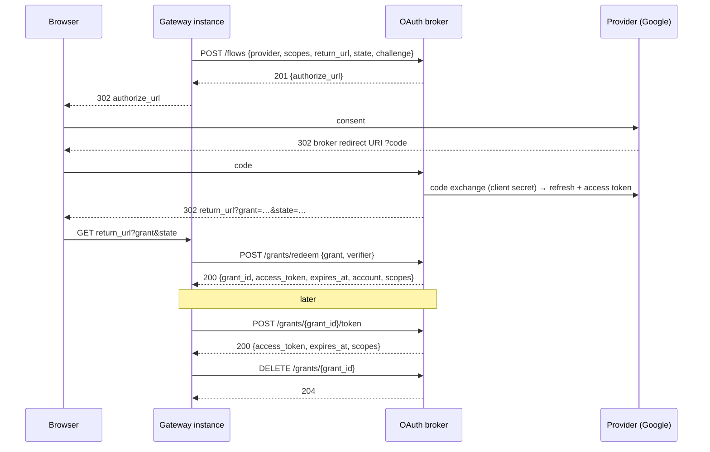

# OAuth broker contract

This page is the contract an **OAuth broker** implements so that a Vaubaan
Gateway instance can connect a provider through it (ADR
[google-calendar-through-an-oauth-broker](../decisions/google-calendar-through-an-oauth-broker.md),
D1 and D2). It is written for whoever builds a broker; the gateway's side
is `apps/gateway/src/server/connections/oauth-broker.ts`, and the reference
behaviour is the fake broker of the test kit,
`apps/gateway/src/server/connections/fake-oauth-broker.ts`, which the
gateway's tests run against.

A broker is a service outside the gateway that owns an OAuth client at a
provider — its client id, its client secret, its **one** redirect URI — and
runs the authorization-code flow on behalf of the instances enrolled with
it. The gateway is a client of the broker and knows nothing of who operates
it: a broker is a base URL and a key in the instance's configuration
(handbook [configuration](configuration.md), "OAuth brokers").

What the broker keeps and what the instance keeps:

| Kept by the broker                                                | Kept by the instance (encrypted)         |
| ----------------------------------------------------------------- | ---------------------------------------- |
| the client secret, the provider's **refresh token** of each grant | the `grant_id`, the current access token |
| which instance each grant belongs to; the return URLs on record   | the broker key                           |

Provider data never transits the broker: the instance calls the provider
(for Google Calendar, Google's Calendar MCP server) with the access token.

## Shape



## Transport and authentication

- **HTTPS** only (the gateway accepts `http` for a loopback host only, for
  tests). Requests and answers are JSON (`Content-Type: application/json`),
  UTF-8. A request without a body (`DELETE`) carries no `Content-Type`.
- **Base URL.** The instance is configured with a base URL that may carry a
  path (`https://broker.example.com/v1`); the four paths below are appended
  to it.
- **The broker key** is sent on every call as `Authorization: Bearer <key>`.
  It identifies the **instance**: the broker knows which instance a key
  enrolls, and every grant is bound to that instance. The key never appears
  in a body, a URL or a redirect.
- The gateway follows **no redirect** on these calls and waits at most **15
  seconds** for an answer.
- A broker that rotates a key gives the instance's administrator the new
  one; the gateway reads it at its next start.

## The four calls

### 1. `POST /flows` — start a flow

Request:

```json
{
  "provider": "google",
  "scopes": [
    "https://www.googleapis.com/auth/calendar.calendarlist.readonly",
    "https://www.googleapis.com/auth/calendar.events.readonly",
    "https://www.googleapis.com/auth/calendar.events.freebusy",
    "https://www.googleapis.com/auth/calendar.events"
  ],
  "return_url": "https://gateway.acme.example/connections/callback/google-calendar",
  "state": "9h4nqk2…43 url-safe characters",
  "challenge": "E9Melhoa2OwvFrEMTJguCHaoeK1t8URWbuGJSstw-cM",
  "challenge_method": "S256"
}
```

| Field              | Rule                                                                                                                                                                                                                      |
| ------------------ | ------------------------------------------------------------------------------------------------------------------------------------------------------------------------------------------------------------------------- |
| `provider`         | A lowercase slug the broker serves (`google`).                                                                                                                                                                            |
| `scopes`           | The scopes to ask the provider for, in full. The broker asks for these and no others.                                                                                                                                     |
| `return_url`       | `<public_url>/connections/callback/<plugin id>`. It **must** be one the broker has on record for the instance of the key (recorded at enrollment); any other is refused. The broker never sends a browser to another URL. |
| `state`            | Opaque, 20 to 128 characters of `[A-Za-z0-9_-]`. The broker gives it back unchanged on the way back. It is the gateway's, not the broker's own state towards the provider.                                                |
| `challenge`        | The PKCE challenge (RFC 7636): BASE64URL(SHA-256(verifier)), without padding. The gateway keeps the verifier.                                                                                                             |
| `challenge_method` | Always `S256`.                                                                                                                                                                                                            |

Answer `201 Created`:

```json
{
  "authorize_url": "https://accounts.google.com/o/oauth2/v2/auth?client_id=…&redirect_uri=https%3A%2F%2Fbroker…&state=…"
}
```

`authorize_url` is an **https** URL of the provider's consent page, with the
**broker's** client id, the broker's redirect URI and a state of the
broker's own. For Google, the broker asks for offline access
(`access_type=offline`) so that it receives a refresh token, and for
consent when it needs a new one.

### The way back — browser → provider → broker → `return_url`

The provider sends the browser to the broker's redirect URI. The broker
exchanges the code with its client secret, keeps the refresh token, and
sends the browser to:

```
<return_url>?grant=<one-time grant>&state=<the gateway's state>
```

or, when the person refused or the provider failed:

```
<return_url>?error=<protocol code>&state=<the gateway's state>
```

`error` is a protocol token (`access_denied`, `server_error`…), never free
text; the gateway shows it to the person. Nothing else is added to the URL.

The **grant** is a one-time, opaque, unguessable value (at least 128 bits of
randomness, URL-safe). It is single use and lives a few minutes (the fake
broker: 5 minutes). The gateway checks `state` itself (bound to the person's
session, single use, minted for this plugin, 10 minutes) before it redeems
the grant.

### 2. `POST /grants/redeem` — turn the grant into a grant id and a token

Request:

```json
{ "grant": "gr_Qm9vU2VjcmV0…", "verifier": "dBjftJeZ4CVP-mB92K27uhbUJU1p1r_wW1gFWFOEjXk" }
```

Answer `200 OK`:

```json
{
  "grant_id": "g_7Hc2kP0q…",
  "access_token": "ya29.a0Af…",
  "expires_at": "2026-10-27T10:00:00.000Z",
  "account": "alice@acme.example",
  "scopes": [
    "https://www.googleapis.com/auth/calendar.calendarlist.readonly",
    "https://www.googleapis.com/auth/calendar.events.readonly",
    "https://www.googleapis.com/auth/calendar.events.freebusy",
    "https://www.googleapis.com/auth/calendar.events"
  ]
}
```

| Field          | Rule                                                                                                                                          |
| -------------- | --------------------------------------------------------------------------------------------------------------------------------------------- |
| `grant_id`     | The broker's id of the grant: 8 to 128 characters of `[A-Za-z0-9_-]` (it goes in a URL path). Stable for the life of the grant.               |
| `access_token` | The provider's access token, as the provider issued it.                                                                                       |
| `expires_at`   | ISO-8601 instant when the access token stops working. Omit or `null` when unknown; the gateway then refreshes only when the provider refuses. |
| `account`      | The provider account the person signed in with (an email at Google), or `null`. Shown on the account's page; nothing is decided on it.        |
| `scopes`       | The scopes the provider actually granted (a person may untick some at Google).                                                                |

The broker refuses, with **one** answer, a grant that is unknown, already
redeemed, past its lifetime, issued to another instance (another key), or
redeemed with a verifier whose S256 is not the flow's challenge:
`400 {"error":"invalid_grant"}`. A grant is spent by its first redeem
attempt, successful or not.

### 3. `POST /grants/{grant_id}/token` — a fresh access token (the refresh)

Request: an empty JSON object `{}`.

Answer `200 OK`:

```json
{ "access_token": "ya29.a0Ag…", "expires_at": "2026-10-27T11:00:00.000Z", "scopes": ["…"] }
```

`scopes` may be omitted; the gateway then keeps the ones it has. The broker
uses the provider's refresh token it holds; when the provider rotates it,
the broker keeps the new one. The gateway calls this when its access token
expires within a minute, and when the provider answers it 401 or 403.

When the grant is over — the broker never had it, forgot it, or the provider
no longer accepts the refresh token (the person removed the app at Google)
— the broker answers `404 {"error":"grant_not_found"}` or
`410 {"error":"grant_revoked"}` and forgets the grant. The gateway then marks
the connection **expired**; its owner reconnects it.

### 4. `DELETE /grants/{grant_id}` — revoke and forget

No body. The broker revokes the grant at the provider (for Google,
`https://oauth2.googleapis.com/revoke` with the refresh token) and forgets
it. Answer `204 No Content` — also when the grant is already gone, so the
call is idempotent. The gateway calls it when the connection is revoked
(ADR
[provider-side-revocation-on-connection-revoke](../decisions/provider-side-revocation-on-connection-revoke.md))
and tells the person whether the broker confirmed.

## Errors

Every error answer is JSON `{"error": "<code>", "error_description": "<text>"}`.
`error` is a protocol token, `[a-z_]{1,40}`; `error_description` is optional
and the gateway never shows it or logs it (it keeps the status and the code
only).

| Status | `error`                     | Where              | What the gateway does                            |
| ------ | --------------------------- | ------------------ | ------------------------------------------------ |
| 400    | `invalid_request`           | any                | broker failure                                   |
| 400    | `unsupported_provider`      | `/flows`           | broker failure ("the broker could not complete") |
| 400    | `invalid_scope`             | `/flows`           | broker failure                                   |
| 403    | `return_url_not_registered` | `/flows`           | broker failure                                   |
| 400    | `invalid_grant`             | `/grants/redeem`   | the connect fails: start again                   |
| 404    | `grant_not_found`           | `/token`, `DELETE` | `/token`: connection **expired**; `DELETE`: done |
| 410    | `grant_revoked`             | `/token`           | connection **expired**                           |
| 401    | `invalid_key`               | any                | broker failure — never an expiry                 |
| 429    | `rate_limited`              | any                | broker failure, retried later                    |
| 5xx    | `temporarily_unavailable`…  | any                | broker failure, retried later                    |
| —      | (no answer, timeout)        | any                | broker failure, retried later                    |

**A broker failure is never an expiry.** Only `grant_not_found` and
`grant_revoked` on a grant end a connection. A broker that is down, slow,
refuses the key or answers something else leaves every connection as it
is; the person reads "OAuth broker '<name>' answered 503 to token" on the
account page, and once the current access token expires (an hour at
Google) calls to the provider fail until the broker is back.

## Lifetimes

| Thing            | Lifetime                                                                              |
| ---------------- | ------------------------------------------------------------------------------------- |
| A flow (`state`) | 10 minutes at the gateway; the broker may keep its own flow as long.                  |
| A grant          | single use, a few minutes (5 in the fake broker).                                     |
| A `grant_id`     | until `DELETE`, or until the provider refuses its refresh token.                      |
| An access token  | the provider's (an hour at Google); the gateway refreshes a minute before it expires. |

## What a broker operator provides

For each instance it enrolls: the base URL, a key, and the return URLs it
records (`<public_url>/connections/callback/<plugin id>`, one per plugin
that uses the broker; for Google Calendar
`<public_url>/connections/callback/google-calendar`).

For the `google` provider, a Google Cloud project with:

- the **Google Calendar API** and the **Calendar MCP service**
  (`calendarmcp.googleapis.com`) enabled — Google's guide "Configure the
  Calendar MCP server";
- an OAuth client of type **Web application**, whose one authorized
  redirect URI is the broker's own callback;
- an OAuth consent screen (external, in production) that lists the four
  scopes above — `calendar.calendarlist.readonly`,
  `calendar.events.readonly`, `calendar.events.freebusy`,
  `calendar.events` — and Google's **app verification** for these
  sensitive scopes (verified domain, privacy policy, demonstration, scope
  justification); no CASA assessment, which only restricted scopes need.

## The fake broker (test kit)

`FakeOAuthBroker.start({ keys })` runs an in-memory server on `127.0.0.1`
that implements this page: `recordReturnUrl` enrolls a return URL,
`approve(authorizeUrl)` / `deny(authorizeUrl)` play the person at the
provider and give the URL the browser comes back on, `down()` answers 503
to everything, `refusingProvider()` makes refreshes `grant_revoked`, and
`calls` records what the gateway sent. `oauth-broker.test.ts` pins against
it: the whole flow, a grant redeemed twice, late, by another instance or
with the wrong verifier, a bad key, a broker that is down or gone, the
refresh, the revocation.
