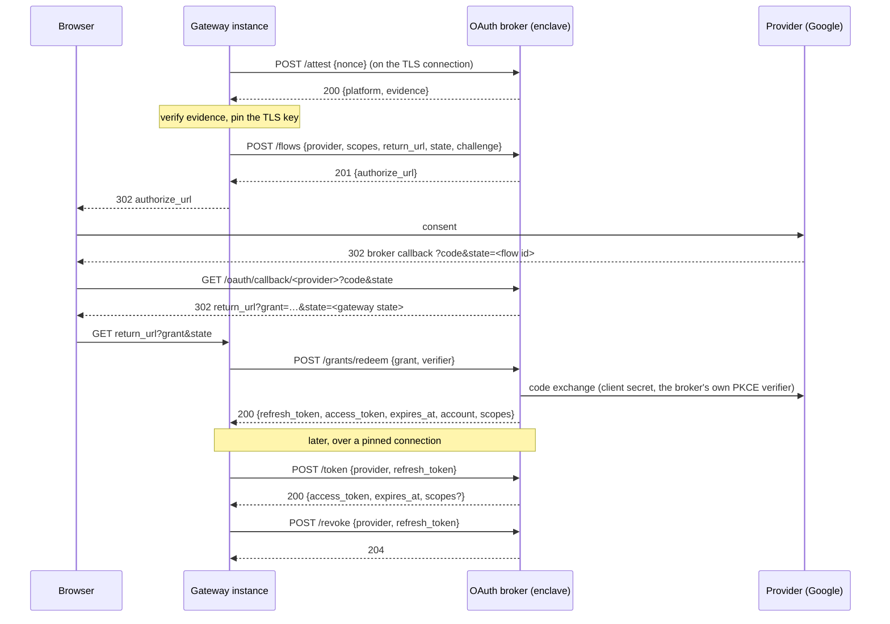

# OAuth broker contract

This page is the contract an **OAuth broker** implements so that a Vaubaan
Gateway instance can connect a provider through it (ADRs
[google-calendar-through-an-oauth-broker](../decisions/google-calendar-through-an-oauth-broker.md)
and
[oauth-broker-stateless-in-an-attested-enclave](../decisions/oauth-broker-stateless-in-an-attested-enclave.md)).
It is written for whoever builds a broker, and both sides code against this
text: the gateway's side is `apps/gateway/src/server/connections/oauth-broker.ts`
(the calls), `broker-channel.ts` (the pinned TLS connection) and
`broker-attestation.ts` with one adapter per platform (`attestation-gcp.ts`);
the reference behaviour is the fake broker of the test kit,
`apps/gateway/src/server/connections/fake-oauth-broker.ts`, which the
gateway's tests run against.

A broker is a service outside the gateway that owns an OAuth client at a
provider — its client id, its client secret, its **one** redirect URI — and
runs the authorization-code flow on behalf of the instances enrolled with
it. The gateway is a client of the broker and knows nothing of who operates
it: a broker is a base URL and a key in the instance's configuration
(handbook [configuration](configuration.md), "OAuth brokers").

What the broker keeps and what the instance keeps:

| Kept by the broker                                                                          | Kept by the instance (encrypted)                           |
| ------------------------------------------------------------------------------------------- | ---------------------------------------------------------- |
| the client secret of each provider it serves (sealed in the enclave platform's key service) | the provider's **refresh token**, the current access token |
| the instances enrolled: the digest of each broker key, the return URLs on record            | the broker key                                             |
| flows in progress, ten minutes at most                                                      |                                                            |

The broker keeps **no token and no account**: once a flow is redeemed it
holds nothing of who connected what. At a refresh the instance presents the
refresh token; the broker adds its client secret, calls the provider and
writes nothing. Provider data never transits the broker: the instance calls
the provider (for Google Calendar, Google's Calendar MCP server) with the
access token.

## Shape



## Transport and authentication

- **HTTPS, JSON.** Requests and answers are JSON
  (`Content-Type: application/json`), UTF-8. Every call is a `POST` with a
  JSON body.
- **Base URL.** The instance is configured with a base URL that may carry a
  path (`https://broker.example.com/v1`); the paths below are appended to it.
- **The broker key** is sent on every call as `Authorization: Bearer <key>`,
  `/attest` included — every call but the browser's callback. It identifies
  the **instance**: the broker knows which instance a key enrolls, and every
  flow is bound to that instance. The key never appears in a body, a URL or a
  redirect.
- The gateway follows **no redirect** on these calls and waits at most **15
  seconds** for an answer (the attestation included).
- A broker that rotates a key gives the instance's administrator the new
  one; the gateway reads it at its next start.

### The TLS key is the enclave's, and the gateway pins it

The gateway↔broker API is served over TLS with a key the enclave generates at
start and never releases. It is **not** trusted through a certificate
authority, so it is not on the public certificate chain (it needs a TCP
passthrough to the enclave, beside the public HTTPS front that serves the
browser callback).

The gateway accepts a connection only when an attestation obtained on it
carries the SPKI hash of the certificate that connection presented:

1. It opens a TLS connection of its own to the broker (no shared agent, no
   connection reuse), completes the handshake **without** checking the
   chain, and computes `base64url(SHA-256(DER SubjectPublicKeyInfo))` of the
   certificate presented. Nothing is written before this.
2. With no pin in force, it sends `POST /attest {nonce}` on that connection
   and verifies the answer (below). The key is then **pinned** for
   min(the evidence's `exp`, 1 hour).
3. Every call — `/flows`, `/grants/redeem`, `/token`, `/revoke` — goes over a
   new connection whose presented key is the pinned one; the request is
   written only after that comparison. A connection presenting another key
   (the enclave restarted) makes the gateway attest again, once; a key that
   no fresh attestation carries gets nothing.
4. After the pin expires, the next call attests again with a new nonce.

The certificate chain is unchecked on these connections **only**; every
other HTTPS call of the gateway verifies certificates as usual.

A broker an administrator declares `attestation: none` (their own broker,
outside an enclave) is reached as any HTTPS service: certificate checked by
the system's authorities, no `/attest` (http is accepted for a loopback host,
for tests). The connect page and the account page say it is not attested.

## The calls

### `POST /attest` — the attestation

Request:

```json
{ "nonce": "kQ0b4r…43 characters" }
```

`nonce` is the base64url encoding, without padding, of 32 random bytes the
gateway draws for this attestation (43 characters).

Answer `200 OK`:

```json
{ "platform": "gcp-confidential-space", "evidence": "eyJhbGciOiJSUzI1NiIs…" }
```

| Field      | Rule                                                                            |
| ---------- | ------------------------------------------------------------------------------- |
| `platform` | The enclave platform: one the gateway release has an adapter for.               |
| `evidence` | The platform's attestation, in the platform's format (below for each platform). |

For `platform: "gcp-confidential-space"`, `evidence` is a **Confidential
Space OIDC attestation token** (a JWT) that the broker requests from the
Confidential Space launcher (`POST /v1/token` on
`/run/container_launcher/teeserver.sock`, `token_type: "OIDC"`) with:

- `audience`: **`oauth-broker-attestation`**
  (`BROKER_ATTESTATION_AUDIENCE`);
- `nonces`, exactly two, in this order: the gateway's `nonce`, then
  `base64url(SHA-256(DER SubjectPublicKeyInfo of the broker's TLS key))`
  (43 characters each — within Google's 10 to 74 bytes).

The gateway checks, and refuses on any miss:

| What                                            | Expected                                                                                                                               |
| ----------------------------------------------- | -------------------------------------------------------------------------------------------------------------------------------------- |
| signature                                       | RS256, a key of the JWKS named by `https://confidentialcomputing.googleapis.com/.well-known/openid-configuration` (`jwks_uri`), cached |
| `iss`                                           | `https://confidentialcomputing.googleapis.com`                                                                                         |
| `aud`                                           | `oauth-broker-attestation`                                                                                                             |
| `exp`, `iat`                                    | not expired; issued within the last 10 minutes (60 s of clock tolerance)                                                               |
| `swname`                                        | `CONFIDENTIAL_SPACE`                                                                                                                   |
| `dbgstat`                                       | `disabled-since-boot` (the production image, not the debug one)                                                                        |
| `secboot`                                       | `true`                                                                                                                                 |
| `submods.confidential_space.support_attributes` | contains `STABLE`                                                                                                                      |
| `submods.container.image_digest`                | `sha256:<64 hex>`, **on the allowlist** of the gateway release                                                                         |
| `eat_nonce`                                     | an array of exactly two values: `[<the gateway's nonce>, <the SPKI hash of the connection's key>]`                                     |

### The allowlist

The broker versions a gateway release admits ship **in the release**, in
`apps/gateway/src/server/connections/broker-measurements.json`:

```json
[
  {
    "platform": "gcp-confidential-space",
    "measurement": "sha256:<image digest>",
    "broker_version": "1.0.0"
  }
]
```

A broker release publishes, for every supported platform, the measurement
that platform reports for it (for Confidential Space, the image digest); a
gateway release adds it. Nothing in the configuration widens the list: the
only switch is `attestation: none` for one broker. While the list is empty
(no broker released yet), an attested broker gets nothing and the connection
shows the broker's failure "no attested broker version admitted by this
release".

### `POST /flows` — start a flow

Request:

```json
{
  "provider": "google",
  "scopes": [
    "https://www.googleapis.com/auth/calendar.calendarlist.readonly",
    "https://www.googleapis.com/auth/calendar.events.readonly",
    "https://www.googleapis.com/auth/calendar.events.freebusy",
    "https://www.googleapis.com/auth/calendar.events"
  ],
  "return_url": "https://gateway.acme.example/connections/callback/google-calendar",
  "state": "9h4nqk2…43 url-safe characters",
  "challenge": "E9Melhoa2OwvFrEMTJguCHaoeK1t8URWbuGJSstw-cM",
  "challenge_method": "S256"
}
```

| Field              | Rule                                                                                                                                                                                                                      |
| ------------------ | ------------------------------------------------------------------------------------------------------------------------------------------------------------------------------------------------------------------------- |
| `provider`         | A lowercase slug the broker serves (`google`).                                                                                                                                                                            |
| `scopes`           | The scopes to ask the provider for, in full. The broker asks for these and no others.                                                                                                                                     |
| `return_url`       | `<public_url>/connections/callback/<plugin id>`. It **must** be one the broker has on record for the instance of the key (recorded at enrollment); any other is refused. The broker never sends a browser to another URL. |
| `state`            | Opaque, 20 to 128 characters of `[A-Za-z0-9_-]`. The broker gives it back unchanged on the way back. It is the gateway's, not the broker's own state towards the provider.                                                |
| `challenge`        | The PKCE challenge (RFC 7636): BASE64URL(SHA-256(verifier)), without padding. The gateway keeps the verifier.                                                                                                             |
| `challenge_method` | Always `S256`.                                                                                                                                                                                                            |

Answer `201 Created`:

```json
{
  "authorize_url": "https://accounts.google.com/o/oauth2/v2/auth?client_id=…&redirect_uri=https%3A%2F%2Fbroker…&state=…"
}
```

`authorize_url` is an **https** URL of the provider's consent page, with the
**broker's** client id, the broker's redirect URI, the flow id as the state
towards the provider, and a PKCE challenge of the broker's **own** (its
verifier is generated and kept in the enclave, so a `code` read at the public
front cannot be exchanged without it). For Google, the broker asks for
offline access (`access_type=offline`) so that the provider issues a refresh
token, and for consent when it needs a new one.

### The way back — browser → provider → broker → `return_url`

The provider sends the browser to the broker's callback,
`GET /oauth/callback/<provider>?code&state=<flow id>` (no broker key: it is
the browser). The broker does **not** exchange the code yet: it keeps it in
the flow and sends the browser to:

```
<return_url>?grant=<one-time grant>&state=<the gateway's state>
```

or, when the person refused or the provider failed:

```
<return_url>?error=<protocol code>&state=<the gateway's state>
```

`error` is a protocol token (`access_denied`, `server_error`…), never free
text; the gateway shows it to the person. Nothing else is added to the URL.

The **grant** is a one-time, opaque, unguessable value (at least 128 bits of
randomness, URL-safe). It is single use and lives a few minutes (the fake
broker: 5 minutes). The gateway checks `state` itself (bound to the person's
session, single use, minted for this plugin, 10 minutes) before it redeems
the grant.

### `POST /grants/redeem` — the provider's tokens, once

Request:

```json
{ "grant": "gr_Qm9vU2VjcmV0…", "verifier": "dBjftJeZ4CVP-mB92K27uhbUJU1p1r_wW1gFWFOEjXk" }
```

The broker checks the instance of the key and the PKCE verifier against the
flow's challenge, **then** exchanges the code at the provider (client secret,
its own verifier), answers, and deletes the flow.

Answer `200 OK`:

```json
{
  "refresh_token": "1//0gL…",
  "access_token": "ya29.a0Af…",
  "expires_at": "2026-10-27T10:00:00.000Z",
  "account": "alice@acme.example",
  "scopes": [
    "https://www.googleapis.com/auth/calendar.calendarlist.readonly",
    "https://www.googleapis.com/auth/calendar.events.readonly",
    "https://www.googleapis.com/auth/calendar.events.freebusy",
    "https://www.googleapis.com/auth/calendar.events"
  ]
}
```

| Field           | Rule                                                                                                                                          |
| --------------- | --------------------------------------------------------------------------------------------------------------------------------------------- |
| `refresh_token` | The provider's refresh token, as the provider issued it. The instance seals it; the broker keeps no copy.                                     |
| `access_token`  | The provider's access token, as the provider issued it.                                                                                       |
| `expires_at`    | ISO-8601 instant when the access token stops working. Omit or `null` when unknown; the gateway then refreshes only when the provider refuses. |
| `account`       | The provider account the person signed in with (an email at Google), or `null`. Shown on the account's page; nothing is decided on it.        |
| `scopes`        | The scopes the provider actually granted (a person may untick some at Google).                                                                |

The broker refuses, with **one** answer, a grant that is unknown, already
redeemed, past its lifetime, issued to another instance (another key),
redeemed with a verifier whose S256 is not the flow's challenge, or whose
code the provider refused: `400 {"error":"invalid_grant", "message": "…"}`.
A grant is spent by its first redeem attempt, successful or not.

### `POST /token` — a fresh access token (the refresh)

Request:

```json
{ "provider": "google", "refresh_token": "1//0gL…" }
```

Answer `200 OK`:

```json
{ "access_token": "ya29.a0Ag…", "expires_at": "2026-10-27T11:00:00.000Z", "scopes": ["…"] }
```

`scopes` may be omitted; the gateway then keeps the ones it has. The broker
adds its client secret, calls the provider's token endpoint (RFC 6749 §6) and
answers; it writes nothing. The gateway calls this when its access token
expires within a minute, and when the provider answers it 401 or 403.

When the provider refuses the refresh token (the person removed the app at
Google, or the client secret was rotated), the broker answers
`400 {"error":"invalid_grant", …}`. The gateway then marks the connection
**expired**; its owner reconnects it.

### `POST /revoke` — revoke at the provider

Request:

```json
{ "provider": "google", "refresh_token": "1//0gL…" }
```

The broker relays the revocation to the provider's revocation endpoint (for
Google, `https://oauth2.googleapis.com/revoke`, RFC 7009). Answer
`204 No Content` — also when the token is already revoked, so the call is
idempotent. The gateway calls it when the connection is revoked (ADR
[provider-side-revocation-on-connection-revoke](../decisions/provider-side-revocation-on-connection-revoke.md))
and tells the person whether the broker confirmed.

## Errors

Every error answer is JSON `{"error": "<code>", "message": "<text>"}`.
`error` is a protocol token, `[a-z_]{1,40}`; `message` is for a person
reading the broker's own logs — the gateway never shows it or logs it (it
keeps the status and the code only).

| Status | `error`                     | Where                   | What the gateway does                            |
| ------ | --------------------------- | ----------------------- | ------------------------------------------------ |
| 400    | `invalid_request`           | any                     | broker failure                                   |
| 400    | `unsupported_provider`      | any                     | broker failure                                   |
| 400    | `invalid_scope`             | `/flows`                | broker failure                                   |
| 403    | `return_url_not_registered` | `/flows`                | broker failure                                   |
| 400    | `invalid_grant`             | `/grants/redeem`        | the connect fails: start again                   |
| 400    | `invalid_grant`             | `/token`                | connection **expired**                           |
| 401    | `invalid_key`               | any, `/attest` included | broker failure — never an expiry                 |
| 429    | `rate_limited`              | any                     | broker failure, retried later                    |
| 5xx    | `temporarily_unavailable`…  | any                     | broker failure, retried later                    |
| —      | (no answer, timeout)        | any                     | broker failure, retried later                    |
| —      | (attestation refused)       | before any call         | broker failure: nothing is sent, nothing expires |

**A broker failure is never an expiry.** Only `invalid_grant` on `/token`
ends a connection. A broker that is down, slow, not attested, refuses the
key or answers something else leaves every connection as it is; the person
reads the broker's failure on the account page — "OAuth broker 'main'
answered 503 to token", "OAuth broker 'main' could not be attested (token:
answered 503 to attest)", "OAuth broker 'main' is not attested (flows: no
attested broker version admitted by this release)" — and once the current
access token expires (an hour at Google) calls to the provider fail until
the broker is back.

## Lifetimes

| Thing            | Lifetime                                                                              |
| ---------------- | ------------------------------------------------------------------------------------- |
| A flow (`state`) | 10 minutes at the gateway; the broker keeps its own flow as long, at most.            |
| A grant          | single use, a few minutes (5 in the fake broker).                                     |
| A refresh token  | the provider's: until revoked, refused, or the client secret is rotated.              |
| An access token  | the provider's (an hour at Google); the gateway refreshes a minute before it expires. |
| A pinned TLS key | min(the evidence's `exp`, 1 hour); then the gateway attests again.                    |

## What a broker operator provides

For each instance it enrolls: the base URL, a key, and the return URLs it
records (`<public_url>/connections/callback/<plugin id>`, one per plugin
that uses the broker; for Google Calendar
`<public_url>/connections/callback/google-calendar`).

For the `google` provider, a Google Cloud project with:

- the **Google Calendar API** and the **Calendar MCP service**
  (`calendarmcp.googleapis.com`) enabled — Google's guide "Configure the
  Calendar MCP server";
- an OAuth client of type **Web application**, whose one authorized
  redirect URI is the broker's own callback;
- an OAuth consent screen (external, in production) that lists the four
  scopes above — `calendar.calendarlist.readonly`,
  `calendar.events.readonly`, `calendar.events.freebusy`,
  `calendar.events` — and Google's **app verification** for these
  sensitive scopes (verified domain, privacy policy, demonstration, scope
  justification); no CASA assessment, which only restricted scopes need.

And the broker runs in an attested enclave (ADR
[oauth-broker-stateless-in-an-attested-enclave](../decisions/oauth-broker-stateless-in-an-attested-enclave.md)
D3, D7), its image built reproducibly and its measurement in a gateway
release.

## The fake broker (test kit)

`FakeOAuthBroker.start({ keys })` runs an in-memory **HTTPS** server on
`127.0.0.1` with a throwaway self-signed key (`fake-tls-certificate.ts`) that
implements this page, `/attest` included, on the **test-only** platform
`fake-enclave`: `attestationKit()` hands the code under test that platform's
adapter and an allowlist admitting the fake's measurement — the
configuration can never name it, and the production kit
(`productionAttestationKit`) does not contain it. `{ attestation: 'none' }`
plays a broker outside an enclave (plain HTTP, no `/attest`).

`recordReturnUrl` enrolls a return URL, `approve(authorizeUrl)` /
`deny(authorizeUrl)` play the person at the provider and give the URL the
browser comes back on, `down()` answers 503 to everything,
`refusingProvider()` makes the provider refuse every refresh token
(`invalid_grant`), `attestWith({measurement, spkiHash, debug})` makes the
evidence lie, `rotateTlsKey()` plays an enclave restart, and `calls` records
what the gateway sent. Like a real broker it keeps no token: the refresh
tokens it hands out live on its fake provider's side
(`providerRefreshTokens`). `oauth-broker.test.ts` pins against it: the whole
flow, a grant redeemed twice, late, by another instance or with the wrong
verifier, a bad key, a broker that is down or gone, the refresh, the
revocation, the pin and its renewal, and every refused attestation.
`attestation-gcp.test.ts` pins the Confidential Space adapter on tokens
signed by a key of its own, found through a discovery document as in
production.
