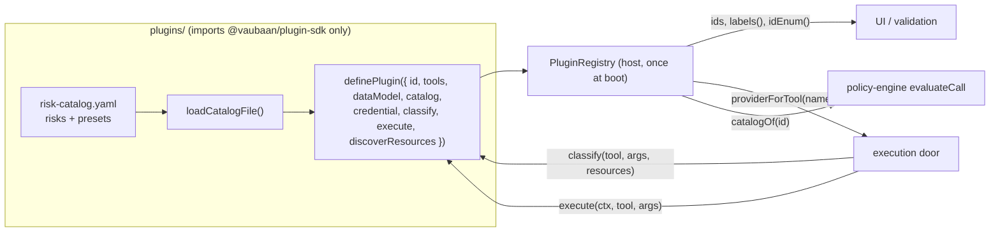

# Plugin SDK — `@vaubaan/plugin-sdk`

The package a provider plugin is written against, and the single place the
gateway learns which providers exist. ADR :
[[plugin-contract-and-credential-spec]]. Spec :
[`vaubaan-gateway.md`](../spec/vaubaan-gateway.md) §5 (plugins), §3.2
(presets), §10 (structural tests) ;
[`gateway-risk-model.md`](../spec/gateway-risk-model.md) §7.

## Layout

```
packages/plugin-sdk/
  src/
    plugin.ts           ProviderPlugin, ClassifyOutcome, ConnectionContext, ExecuteContext, PluginLogger
    credential.ts       CredentialSpec (4 kinds) and the per-kind Spec/Secret interfaces, CredentialSecret,
                        CredentialField, ProviderAppConfig, OAuth2ClientAuthMethod,
                        expectCredentialKind, CredentialKindMismatch
    catalog-loader.ts   loadCatalogFile / parseCatalogYaml / validateCatalog, CatalogError,
                        PluginCatalog / LoadedCatalog / LoadCatalogOptions,
                        semanticIssues / presetIssues / wildcardIssues / structuralIssues
    define-plugin.ts    definePlugin, pluginIssues, PluginDefinitionError, PLUGIN_VERSION_PATTERN
    registry.ts         PluginRegistry, createRegistry, RegisteredPlugin, ProviderLabel
    flags.ts            PluginHostFlags, DEFAULT_HOST_FLAGS, normalizeArgsIfEnabled
    index.ts            barrel + re-exports of the shared vocabulary a plugin needs
                        (+ parseSlice / serializeSlice from @vaubaan/policy-engine)
    testing/
      mock-fetch.ts     mockFetch, MockRoute, RecordedCall
      assertions.ts     assertPluginWellFormed, assertCatalogCoverage, assertNoWildcard,
                        assertPresetsValid, PluginAssertionError
  tests/
    fixtures/acme/      a tiny valid plugin (risk-catalog.yaml + acme-plugin.ts) used by the tests
    unit/               catalog-loader (19), registry (10), define-plugin (11), testing-kit (13)
```

Dependencies : `@vaubaan/shared`, `@vaubaan/policy-engine`, `js-yaml`.
Nothing from `gateway-core` or `apps/`. Two entry points : `.` and
`./testing`.

## The contract in one picture



### `ProviderPlugin` (`plugin.ts`)

| Member                                               | Pure ? | Notes                                                                                                                                                                                                                                         |
| ---------------------------------------------------- | ------ | --------------------------------------------------------------------------------------------------------------------------------------------------------------------------------------------------------------------------------------------- |
| `id`                                                 | —      | Provider slug ; also the first segment of every slice and the tool prefix (`cloudflare-dns` → `cloudflare_dns__`).                                                                                                                            |
| `displayName`, `version`, `description?`, `docsUrl?` | —      | `version` is semver and goes into telemetry.                                                                                                                                                                                                  |
| `tools`                                              | —      | `McpToolDeclaration[]`. Every name starts with the prefix ; names unique. May be empty (experimental, classifier-only plugin).                                                                                                                |
| `dataModel`                                          | —      | `DataModel` of the risk-model spec §2 ; `validateDataModel` runs in `definePlugin`.                                                                                                                                                           |
| `catalog`                                            | —      | `RiskCatalog` with `presets` ; loaded from YAML, see below.                                                                                                                                                                                   |
| `credential`                                         | —      | `CredentialSpec`, see below.                                                                                                                                                                                                                  |
| `classify(tool, args, resources)`                    | yes    | `{ slices: Slice[] } \| { denied: string }`. `resources` = the mission's resources on this connection ; used to derive the env and default refs. The gateway core's `Classifier` is exactly this member (`Pick<ProviderPlugin, 'classify'>`). |
| `execute(ctx, tool, args)`                           | no     | `ctx: ExecuteContext` = credential (decrypted), appConfig, fetch, signal?, logger?, resources, agentLabel?. Throws `UpstreamAuthError` on 401/403.                                                                                            |
| `discoverResources(ctx)`                             | no     | `ctx: ConnectionContext` (same minus resources/agentLabel). Returns `Resource[]`.                                                                                                                                                             |
| `refresh?(ctx)`                                      | no     | Returns a new `CredentialSecret` ; must not mutate the input. Required when `credential.refreshable` is true.                                                                                                                                 |
| `normalizeForCaps?(args, caps)`                      | yes    | Scope caps (ADR scope-caps).                                                                                                                                                                                                                  |
| `normalizeArgs?(args, resources)`                    | yes    | Only called when `PluginHostFlags.argNormalization` is on. **Default off** (plan §8-Q4).                                                                                                                                                      |

`definePlugin(def)` validates (`pluginIssues`) and `Object.freeze`s. Issues
are aggregated into one `PluginDefinitionError` so a contributor fixes a
broken definition in one pass.

### `CredentialSpec` and `CredentialSecret` (`credential.ts`)

| Kind          | Spec fields                                                                                                                                                        | Secret the plugin receives                                           |
| ------------- | ------------------------------------------------------------------------------------------------------------------------------------------------------------------ | -------------------------------------------------------------------- |
| `api-key`     | `fields` (≥ 1 with `secret: true`), `createUrl?`                                                                                                                   | `{ fields: Record<name, value>, metadata }`                          |
| `oauth2`      | `authorizationUrl`, `tokenUrl` (https), `scopes`, `pkce`, `resourceIndicator?`, `clientAuthMethod`, `refreshable`, `extraAuthorizationParams?`, `appConfigFields?` | `{ accessToken, refreshToken, expiresAt, scopes, metadata }`         |
| `app-install` | `appConfigFields` (app id, private key…), `installUrl(appConfig)`, `installationIdParam`                                                                           | `{ installationId, metadata }` + `ctx.appConfig` for the private key |
| `ssh-key`     | `algorithm: 'ed25519'`, `fields` (host, port, user)                                                                                                                | `{ privateKeyPem, publicKey, fields, metadata }`                     |

The host runs each flow generically ; the plugin never sees the OAuth client
secret and never reads `process.env`. `expectCredentialKind(pluginId,
secret, kind)` narrows the secret or throws `CredentialKindMismatch`. The
encrypted envelope (`Credential` in `@vaubaan/shared`) never reaches a
plugin.

### Catalog loader (`catalog-loader.ts`)

```ts
export const myCatalog = loadCatalogFile(new URL('./risk-catalog.yaml', import.meta.url));
// → { catalog: PluginCatalog, indexed: IndexedRiskCatalog }
```

Runs at module load, hence at gateway boot. Pipeline :

1. `js-yaml` `load` with `CORE_SCHEMA` (YAML 1.2 core : no implicit date
   or binary coercion). Syntax errors → `CatalogError` with the source name.
2. `structuralIssues(doc)` — every key known (`provider`, `risks`,
   `presets`, `catalog_version`, `catalog_date`) ; provider slug ; each risk
   : id grammar and provider, `label`, `reason`, `matches` (string or
   list), `vector` with the six axes from `RISK_VECTOR_AXES`,
   `vector_overrides`, `acceptable_in_envs` (env labels), `caps`,
   `infra_limits`, `deprecated`, `replaced_by` ; each preset : slug id,
   `label`, `description`, non-empty `entries` with `risk_id`, positive
   integer `quota`, `rate_limit { max, window_seconds }`, `gate` (default
   `auto`).
3. `prepareCatalog` from `policy-engine` — duplicate ids, id regex, every
   pattern parses and belongs to the provider.
4. `semanticIssues` — fallback `<provider>.uncategorized-*` present
   (`requireFallback`, default true) ; `wildcardIssues` ; `presetIssues`
   (`requirePresets`, default true) : at least one preset, ids unique,
   every `risk_id` an explicit id of this provider present in the catalog,
   env-qualified entries only on env-scoped risks and inside
   `acceptable_in_envs`, no deprecated risk, no repeated risk in a preset.

All issues are collected and thrown together, path-qualified :

```
Invalid risk catalog '/…/plugins/github/src/risk-catalog.yaml':
  - risks[3].vector.blast: expected one of single | env | account | bulk
  - presets[1].entries[2].risk_id 'github.nope' is not a risk of the 'github' catalog
```

`validateCatalog(doc)` accepts an already-parsed object (tests, JSON).
`semanticIssues`, `presetIssues` and `wildcardIssues` are exported for the
test kit and `definePlugin`.

### Registry (`registry.ts`)

`new PluginRegistry(plugins)` / `createRegistry(plugins)` : rejects
duplicate ids and ill-formed plugins (`PluginRegistryError` listing every
issue), indexes each catalog with `prepareCatalog`. Derivations :

| Method                              | Returns                                                                                                                              |
| ----------------------------------- | ------------------------------------------------------------------------------------------------------------------------------------ |
| `ids`, `size`, `all()`              | The provider list, in registration order.                                                                                            |
| `has(id)`, `get(id)`, `require(id)` | `RegisteredPlugin { plugin, catalog (indexed), toolPrefix, toolNames }` ; `require` throws naming the known ids.                     |
| `providerForTool(name)`             | Exact tool-name lookup, then the prefix rule via `splitToolName` for tools a plugin classifies but does not list ; `null` otherwise. |
| `catalogOf(id)`, `presetsOf(id)`    | Indexed catalog ; presets.                                                                                                           |
| `toolDeclarations()`                | Every tool of every plugin.                                                                                                          |
| `labels()`                          | `{ id, displayName, version, description }[]` for the UI.                                                                            |
| `idEnum()`                          | `[string, ...string[]]` for validation schemas ; throws on an empty registry.                                                        |

Tool names cannot collide across plugins : ids are unique and the prefix
rule (checked per plugin) is a bijection on ids.

### Host flags (`flags.ts`)

`PluginHostFlags { argNormalization: boolean }`, `DEFAULT_HOST_FLAGS =
{ argNormalization: false }`. `normalizeArgsIfEnabled(plugin, args,
resources, flags)` is the only caller of `plugin.normalizeArgs`. Flipping
plan §8-Q4 to "yes" means passing `{ argNormalization: true }` from the
instance configuration ; no contract change.

### Test kit (`testing/`)

```ts
import { assertCatalogCoverage, assertNoWildcard, assertPluginWellFormed, assertPresetsValid, mockFetch }
  from '@vaubaan/plugin-sdk/testing';

assertPluginWellFormed(plugin);
assertPresetsValid(plugin);
assertNoWildcard(plugin);
const report = assertCatalogCoverage(plugin, {
  github__list_branches: [{ args: { owner: 'acme', repo: 'app' } }],
  …one entry per declared tool…
}, { resources: [stagingRepo] });
// report.risksTouched / report.risksUntouched / report.toolsChecked / report.samplesChecked
```

`assertCatalogCoverage` fails when a declared tool has no sample, a sample
names an undeclared tool, a non-`expectDenied` sample is denied (or an
`expectDenied` one is not), a sample yields no slice, a slice carries
another provider, or a slice matches no catalog risk. Every assertion
throws `PluginAssertionError { subject, findings }`.

`mockFetch(routes)` returns a `fetch` with `.calls` (method, url,
lower-cased headers, body text, parsed JSON) and `.pending()` (routes whose
`times` is not exhausted). A route is `{ method?, url: string | RegExp |
predicate, status?, headers?, body? | respond?(call), times? }` ; an object
body is serialized as JSON. **An unmatched request rejects**, so a plugin
test can never reach the network.

## Shared vocabulary the SDK relies on (`@vaubaan/shared`)

The barrel `@vaubaan/shared` is **server-only** : it re-exports `api-key.ts`
(argon2, `node:crypto`). Code the UI bundles — and `@vaubaan/policy-engine`,
which the issuance form imports — takes _values_ from the subpaths
`@vaubaan/shared/risk-id` and `@vaubaan/shared/api-key` ; type imports from
the barrel are erased and always safe. The SDK itself is server-side
(`node:fs` for the YAML) and imports the barrel.

- `domain.ts` — v5 domain : `Resource { provider, ref, env?, displayName,
metadata? }`, `ConnectionResource`, `Credential` (encrypted envelope),
  `CredentialKind` (how a _connection_ authenticates : `api-key`, `oauth2`,
  `app-install`, `ssh-key` — the three kinds of _bearer_ a door receives
  are `BearerKind` in `@vaubaan/gateway-core`), `Connection`, `Share`,
  `Restriction`, `Mission`, `MissionPolicyEntry` (`risk_id`, `quota`,
  `rate_limit`, `gate`), `MissionPolicy` (the explicit entry list),
  `Budget`, `RateLimit`, `Gate` + `GATES`, `Period`, `MissionResourceSelection`,
  `MissionToken`, `Session`,
  `SessionEvent`, `SessionCounter`, `Request`, `Approval`, `Delegation`,
  `User`, `Group`, `Principal`, `CREDENTIAL_KINDS`, `acceptedRisksOf(mission)`,
  `AuditDecision`
  (`allowed` | `refused`). These are the only definitions : `gateway-core`
  re-exports them and builds its `MissionContext` from projections of
  `Mission`, `Connection`, `ConnectionResource` and `Session`.
- `risk.ts` — `Slice`, `RiskVector` + `RISK_VECTOR_AXES`, `RiskEntry`,
  `ScopeCaps`, `InfraLimits`, `Preset`, `PresetEntry`, `RiskCatalog`
  (`presets?`, `catalog_version?`, `catalog_date?`), `RiskDecision` — the
  `denied` branch carries `code: RefusalCode` next to the free-text `hint`,
  so the audit entry and the refusal body never guess the code.
- `risk-id.ts` — `parseRiskId` → `ParsedRiskId { provider, env | null, name }`,
  `formatRiskId`, `baseRiskId`, `isRiskId`, `isProviderId`,
  `isExplicitRiskId` (no `*`/`?`), `WILDCARD_CHARS`, `RISK_ID_PATTERN`,
  `PROVIDER_ID_PATTERN`, `ENV_LABEL_PATTERN`.
- `refusal.ts` — `REFUSAL_CODES` (8), `RefusalCode`, `isRefusalCode`.
- `mcp.ts` — `toolPrefixFor`, `splitToolName`, `McpToolDeclaration`,
  `McpToolResult`, `McpToolContent`, `UpstreamAuthError`, JSON-RPC types.
- `legacy-v4.ts` — quarantined v4 row types (`Provider`, `PROVIDERS`,
  `providerForTool`, `ProviderBinding`, `ProviderAdmin`, `Token`,
  `TokenContext`, `AccessTokenContext`, …), all `@deprecated`. No new
  import ; deleted after P1.2 / P1.6.

## The template (`plugins/_template`)

`@vaubaan/plugin-template`, provider id `template`, imports the SDK only.
Six source files (`risk-catalog.yaml`, `data-model.ts`, `tools.ts`,
`classify.ts`, `execute.ts`, `index.ts`) and one test file running the kit
and `mockFetch`. The classifier shows the two conventions every plugin
follows : the resource ref is taken from the arguments, falls back to the
mission's single resource of the provider, and anything else is `denied`
(never mapped to a broad slice) ; identifiers are validated against a safe
character class before being embedded in a slice. `execute.ts` shows the
injected `fetch`, the bearer from the `api-key` secret and the
`UpstreamAuthError` on 401/403.

## How to debug

- **Boot fails with `Invalid risk catalog`** — read every bullet ; paths
  are exact (`presets[1].entries[2].risk_id`). A legacy YAML with a
  top-level `railway:` key fails with `provider: expected a lowercase
slug` + `risks: expected a non-empty list` + `railway: unknown key` :
  convert it to `provider:` / `risks:` (P1.2).
- **`PluginDefinitionError … must start with '<prefix>'`** — the tool name
  uses `-` or a different id ; the prefix maps `-` → `_` and ends with `__`.
- **`assertCatalogCoverage` says `no catalog risk matches it`** — the
  classifier emits a slice outside every `matches`, including the
  fallback. Either the slice path is wrong (check against `dataModel`) or
  the catalog needs an entry. The fallback `<provider>.**.W` only catches
  writes ; a read slice needs its own entry.
- **`mockFetch: unexpected GET …`** — the plugin called a URL no route
  covers. The message names the method and URL ; add a route or fix the
  URL building.
- **`idEnum(): the registry is empty`** — the host built validation
  schemas before registering plugins ; registry construction must precede
  anything that derives from it.

## Extension

- **A new credential kind** — add the variant to `CredentialSpec` and
  `CredentialSecret`, the kind to `CREDENTIAL_KINDS` in `shared/domain.ts`,
  its coherence checks in `credentialSpecIssues`, and the generic flow in
  the host. That is an ADR (it changes the public contract).
- **A new catalog field** — add it to `RiskEntry` (shared), to the
  `RISK_KEYS` set and `riskFrom` in `catalog-loader.ts`, and to the loader
  tests. Unknown keys are rejected on purpose, so a typo in a YAML never
  silently disables a guard.
- **A new derivation from the registry** — add a method on
  `PluginRegistry` ; never a second list.

## References

- ADR [[plugin-contract-and-credential-spec]] ; neighbours
  [[policy-engine]], [`providers/README.md`](./providers/README.md) (per
  provider modelling, v4).
- Guide : [`plugins/README.md`](../../plugins/README.md).
- Tests : `npx vitest run packages/plugin-sdk plugins/_template` — 64 tests.
