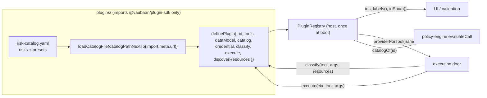

# Plugin SDK — `@vaubaan/plugin-sdk`

The package a provider plugin is written against, and the single place the
gateway learns which providers exist. ADRs:
[plugin-contract-and-credential-spec](../decisions/plugin-contract-and-credential-spec.md),
[plugin-catalog-path-and-standalone-tracing](../decisions/plugin-catalog-path-and-standalone-tracing.md),
[fallback-risk-only-when-uncategorized](../decisions/fallback-risk-only-when-uncategorized.md).
Spec: [`vaubaan-gateway.md`](../spec/vaubaan-gateway.md) §5 (plugins), §3.2
(presets), §10 (structural tests);
[`gateway-risk-model.md`](../spec/gateway-risk-model.md) §7.

## Layout

```
packages/plugin-sdk/
  src/
    plugin.ts           ProviderPlugin, ClassifyOutcome, ConnectionContext, ExecuteContext, PluginLogger,
                        UpstreamCredentialCache
    streaming.ts        ToolResultPartSink, PartEmitter, streamToolResult, textParts, appendPart
    credential.ts       CredentialSpec (4 kinds) and the per-kind Spec/Secret interfaces, CredentialSecret,
                        CredentialField, ProviderAppConfig, OAuth2ClientAuthMethod,
                        expectCredentialKind, CredentialKindMismatch,
                        CLIENT_ID_FIELD / CLIENT_SECRET_FIELD, AppInstallUserVerification,
                        AppInstallClientAuthMethod, AppInstallListPagination
    catalog-loader.ts   loadCatalogFile / parseCatalogYaml / validateCatalog, CatalogError,
                        PluginCatalog / LoadedCatalog / LoadCatalogOptions,
                        semanticIssues / fallbackIssues / fallbackFlagIssues / presetIssues / wildcardIssues /
                        riskIdWildcardIssues / presetWildcardIssues / structuralIssues, catalogWarnings,
                        isCompleteVector
    catalog-path.ts     catalogPathNextTo, CATALOG_FILE_NAME — the filesystem path of the YAML
    env-of.ts           envFromSliceSegment, EnvOf — helpers for `ProviderPlugin.envOf`
    define-plugin.ts    definePlugin, pluginIssues, PluginDefinitionError, PLUGIN_VERSION_PATTERN,
                        MAX_INSTALLATIONS_PER_PAGE
    registry.ts         PluginRegistry, createRegistry, RegisteredPlugin, ProviderLabel, PluginRegistryError
    flags.ts            PluginHostFlags, DEFAULT_HOST_FLAGS, normalizeArgsIfEnabled
    index.ts            barrel + re-exports of the shared vocabulary a plugin needs
                        (+ parseSlice / serializeSlice from @vaubaan/policy-engine)
    testing/
      mock-fetch.ts     mockFetch, MockRoute, RecordedCall, MockFetch, FetchInput
      assertions.ts     assertPluginWellFormed, assertCatalogCoverage, assertNoWildcard,
                        assertPresetsValid, PluginAssertionError,
                        SampleCall, ToolSamples, CoverageOptions, CoverageReport
  tests/
    fixtures/acme/      a tiny valid plugin (risk-catalog.yaml + acme-plugin.ts) used by the tests
    unit/               catalog-loader (31), catalog-path (4), env-of (3), registry (10),
                        define-plugin (24), testing-kit (14), streaming (9)
```

Dependencies: `@vaubaan/shared`, `@vaubaan/policy-engine`, `js-yaml`.
Nothing from `gateway-core` or `apps/`. Two entry points: `.` and
`./testing`.

## The contract in one picture



### `ProviderPlugin` (`plugin.ts`)

| Member                                               | Pure? | Notes                                                                                                                                                                                                                                                                                                                                                                                                                                                                                                                           |
| ---------------------------------------------------- | ----- | ------------------------------------------------------------------------------------------------------------------------------------------------------------------------------------------------------------------------------------------------------------------------------------------------------------------------------------------------------------------------------------------------------------------------------------------------------------------------------------------------------------------------------- |
| `id`                                                 | —     | Provider slug; also the first segment of every slice and the tool prefix (`cloudflare-dns` → `cloudflare_dns__`).                                                                                                                                                                                                                                                                                                                                                                                                               |
| `displayName`, `version`, `description?`, `docsUrl?` | —     | `version` is semver and goes into telemetry (a version that is not semver is never reported).                                                                                                                                                                                                                                                                                                                                                                                                                                   |
| `summary?`                                           | —     | A short paragraph in plain words for the provider reference of the web interface (`/providers/<id>`): what one connection is, what one resource is, where the environment of a call comes from. Optional; when present, a non-empty string of at most `PLUGIN_SUMMARY_MAX_LENGTH` (600) characters. Every shipped plugin fills it (`reference.test.ts`). `labels()` carries it.                                                                                                                                                 |
| `tokenHandouts?`                                     | —     | `TokenHandout { tool, riskIds }[]`: the tools whose purpose is to hand the agent a short-lived, narrowly scoped provider token (spec §2.4, the one exception to "the executor never sees a provider credential"), each with the catalog risks such a call touches. `definePlugin` checks that the tool is declared and the risks are entries of the catalog. A declaration for the reader — the provider reference marks these tools and risks; the host decides nothing from it. GitHub declares `github__mint_install_token`. |
| `experimental?`                                      | —     | `true` for a plugin the host registers but keeps out of the default connect / issuance flows, listing none of its tools (gmail). `labels()` carries it as a boolean.                                                                                                                                                                                                                                                                                                                                                            |
| `tools`                                              | —     | `McpToolDeclaration[]`. Every name starts with the prefix; names unique. May be empty (experimental, classifier-only plugin).                                                                                                                                                                                                                                                                                                                                                                                                   |
| `dataModel`                                          | —     | `DataModel` of the risk-model spec §2; `validateDataModel` runs in `definePlugin`.                                                                                                                                                                                                                                                                                                                                                                                                                                              |
| `catalog`                                            | —     | `RiskCatalog` with `presets`; loaded from YAML, see below.                                                                                                                                                                                                                                                                                                                                                                                                                                                                      |
| `credential`                                         | —     | `CredentialSpec`, see below.                                                                                                                                                                                                                                                                                                                                                                                                                                                                                                    |
| `classify(tool, args, resources)`                    | yes   | `{ slices: Slice[] } \| { denied: string }`. `resources` = the mission's resources on this connection; used to derive the env and default refs. The gateway core's `Classifier` is this member plus `envOf` (`Pick<ProviderPlugin, 'classify' \| 'envOf'>`).                                                                                                                                                                                                                                                                    |
| `execute(ctx, tool, args)`                           | no    | `ctx: ExecuteContext` = credential (decrypted), appConfig, fetch, signal?, logger?, resources, agentLabel?, credentialCache?, emitPart?. Throws every provider failure (`UpstreamAuthError` on 401/403, `UpstreamHttpError` on another failed status); returns `isError` only for what it declines itself — see "Errors of `execute`".                                                                                                                                                                                          |
| `discoverResources(ctx)`                             | no    | `ctx: ConnectionContext` (same minus resources/agentLabel). Returns `Resource[]`.                                                                                                                                                                                                                                                                                                                                                                                                                                               |
| `envOf?(slice, resources)`                           | yes   | The environment a slice carries in itself (Vercel's `env[prod]` segment, the only shipped plugin declaring it); `undefined` defers to the resource label. See "Environment resolution".                                                                                                                                                                                                                                                                                                                                         |
| `refresh?(ctx)`                                      | no    | Override for a non-standard refresh only (re-minted installation token…). A standard `oauth2` credential is refreshed by the host from the spec (`tokenUrl`, `clientAuthMethod`, `resourceIndicator`): `refreshable: true` needs no `refresh`.                                                                                                                                                                                                                                                                                  |
| `normalizeForCaps?(args, caps)`                      | yes   | Scope caps. **Reserved: the v5.0 host never calls it** ([ADR](../decisions/scope-caps-not-enforced-in-v5-0.md)).                                                                                                                                                                                                                                                                                                                                                                                                                |
| `normalizeArgs?(args, resources)`                    | yes   | Only called when `PluginHostFlags.argNormalization` is on. **Default off** (plan §8-Q4).                                                                                                                                                                                                                                                                                                                                                                                                                                        |

`definePlugin(def)` validates (`pluginIssues`) and `Object.freeze`s. Issues
are aggregated into one `PluginDefinitionError` so a contributor fixes a
broken definition in one pass. `pluginIssues` is the concatenation of
`identityIssues`, `toolIssues` (a malformed tool entry is an issue —
`tools[i].name: expected a string` — not a `TypeError`), `dataModelIssues`,
`catalogIssues`, `credentialSpecIssues` and `hookIssues`.

`catalogIssues` runs `semanticIssues` on `plugin.catalog`. It is the only
validation a catalog **written in TypeScript** goes through (it never
meets the YAML parser), so every rule that must hold for every catalog
lives there: the fallback rules, the wildcard rules and the preset rules,
budgets included. A TypeScript preset entry with `quota: Infinity`, a
negative rate, a zero window or a gate outside `auto | approval` is refused
by `definePlugin`, by `new PluginRegistry(...)` and by the test kit, with
the same message the YAML loader gives
(`catalog: presets[0].entries[0].quota: expected a positive integer …`).
Not on this path yet (YAML only): the vector axis values, the env-label
grammar of `acceptable_in_envs`, the non-empty `matches`, the preset id
slug and the `caps` / `infra_limits` values.

`ExecuteContext.credentialCache` (`UpstreamCredentialCache { get, set(key,
value, ttlSeconds) }`, optional) is a cache the host scopes to the
connection, for the short-lived upstream credential a plugin derives on
every call. The plugin picks the key and the lifetime; the host namespaces
the entries per connection, caps their lifetime and drops them when the
provider answers 401 or the connection stops being `active`. Only `execute`
receives it; a credential that is the result of a tool is never cached.
GitHub is the one user (`plugins/github/src/token-cache.ts`); the host side
is described in [execution-door](execution-door.md), the decision in
[upstream-credential-cache-and-rejected-credentials](../decisions/upstream-credential-cache-and-rejected-credentials.md).

#### Streamed results (`streaming.ts`)

`ExecuteContext.emitPart` (`ToolResultPartSink = (part: McpToolContent) =>
Promise<void>`, optional) is for a tool whose provider answers progressively.
The contract of `execute` does not change — it returns one complete
`McpToolResult`, because an MCP `tools/call` is answered by one message — but
each part handed to `emitPart` leaves for the caller at once, as a progress
notification, while `execute` keeps reading the provider. A plugin that never
calls it is unaffected; a host that does not provide it (discovery, tests)
gets the complete result alone.

```ts
async execute(ctx, tool, args) {
  const response = await ctx.fetch(url, { headers }); // open the provider's response first
  if (response.status === 401) throw new UpstreamAuthError('…', 401);
  if (!response.ok || !response.body) throw new UpstreamHttpError('…', response.status);
  return streamToolResult(ctx, textParts(response.body));
}
```

- `streamToolResult(ctx, parts)` hands each part of an
  `AsyncIterable<McpToolContent>` to `ctx.emitPart`, awaits it, and returns
  `{ content }` with consecutive text parts merged into one block
  (`appendPart`).
- `textParts(body)` turns a `ReadableStream<Uint8Array>` into text parts, one
  per chunk, decoding UTF-8 across chunk boundaries; ending the iteration
  early cancels the body.

Rules: open the provider's response **before** the first part (an
`UpstreamAuthError` thrown before any part is retried by the host; after a
part nothing is replayed); **await** every `emitPart` (it is the
backpressure, and it rejects when the caller is gone, which is how a long
stream stops); **throw** when the provider's stream breaks (the host records
the call as failed after N parts; the credit stays consumed). The host side —
what the caller receives, the audit entry, the limits — is
[execution-door](execution-door.md), "Streaming". Decision: amendment
"Streamed results" of
[plugin-contract-and-credential-spec](../decisions/plugin-contract-and-credential-spec.md).

#### Errors of `execute`

One rule, two channels: **a provider failure is thrown; what the executor
declines itself is returned.**

| What happened                                                                                          | The plugin                                   | Audit entry (`allowed`)                             | Telemetry                                   |
| ------------------------------------------------------------------------------------------------------ | -------------------------------------------- | --------------------------------------------------- | ------------------------------------------- |
| the provider answered 401 or 403                                                                       | throws `UpstreamAuthError(message, status)`  | `<provider> answered HTTP 403 (UpstreamAuthError)`  | `upstream-error` / `http_<status>`          |
| the provider answered any other failed status                                                          | throws `UpstreamHttpError(message, status)`  | `<provider> answered HTTP 500 (UpstreamHttpError)`  | `upstream-error` / `http_<status>`          |
| the provider failed without a status (a JSON-RPC error frame, an unusable answer)                      | throws an `Error`                            | `<provider> call failed (Error)`                    | `upstream-error` / `unspecified`            |
| the network failed, the call timed out                                                                 | lets the error of `ctx.fetch` propagate      | `<provider> call failed (<class>)`                  | `upstream-error` / `network` or `timeout`   |
| the executor declines the call: unknown tool, an argument it cannot read, a target outside the mission | returns `{ content: [text], isError: true }` | no `upstream_error`: nothing failed at the provider | `classification-error` / `executor_refused` |

`UpstreamAuthError` and `UpstreamHttpError` live in `@vaubaan/shared`
(`mcp.ts`) and are re-exported by the SDK. Both carry the provider's status
(`upstreamStatus`, `status`): the host reads it for the audit summary and the
telemetry class, and never stores the message, which goes to the agent only
(`Upstream error: <message>`).

Never catch a provider failure into an `isError` result: the audit entry of
a `PATCH` the provider answered with 500 would read `allowed` with no
`upstream_error`, as if the write had gone through, and telemetry would
count a failing provider as a classifier defect. The agent loses nothing
when a plugin throws — the door answers it an `isError` result carrying the
plugin's sentence. The pattern the shipped plugins use when refusals are
raised deep in the executor: a private `class ExecutorRefusal extends Error`
and, at the entry point, `catch (e) { if (e instanceof ExecutorRefusal)
return errorResult(e.message); throw e; }` (`plugins/vercel`,
`plugins/upstash-redis`, `plugins/cloudflare-dns`).

The execution door treats only a 401 as a rejected credential (refresh,
retry, then the connection is `expired`); a 403 is reported as a failed call
and changes nothing. A plugin must therefore raise 401 only when the
provider says the credential itself is invalid.

### `CredentialSpec` and `CredentialSecret` (`credential.ts`)

| Kind          | Spec fields                                                                                                                                                        | Secret the plugin receives                                           |
| ------------- | ------------------------------------------------------------------------------------------------------------------------------------------------------------------ | -------------------------------------------------------------------- |
| `api-key`     | `fields` (≥ 1 with `secret: true`), `createUrl?`                                                                                                                   | `{ fields: Record<name, value>, metadata }`                          |
| `oauth2`      | `authorizationUrl`, `tokenUrl` (https), `scopes`, `pkce`, `resourceIndicator?`, `clientAuthMethod`, `refreshable`, `extraAuthorizationParams?`, `appConfigFields?` | `{ accessToken, refreshToken, expiresAt, scopes, metadata }`         |
| `app-install` | `appConfigFields` (app id, private key…), `installUrl(appConfig)`, `installationIdParam`, `userVerification?`                                                      | `{ installationId, metadata }` + `ctx.appConfig` for the private key |
| `ssh-key`     | `algorithm: 'ed25519'`, `fields` (host, port, user)                                                                                                                | `{ privateKeyPem, publicKey, fields, metadata }`                     |

**`userVerification` (`app-install`).** The installation id on the
callback is a claim the browser makes; this block tells the host how to
check it against the identity of the human who performed the installation.
It is data only — the plugin runs none of it and never sees the client
secret or the user token:

| Member                    | Meaning                                                                                        |
| ------------------------- | ---------------------------------------------------------------------------------------------- |
| `codeParam`               | callback query parameter carrying the authorization code (`code`); not `state`, not the id one |
| `tokenUrl`                | https token endpoint the host exchanges the code at                                            |
| `clientAuthMethod`        | `client_secret_basic` or `client_secret_post` (`AppInstallClientAuthMethod`)                   |
| `installationsUrl`        | https endpoint listing the installations the user token can reach (GET, Bearer)                |
| `installationsHeaders?`   | static headers of that call (API version, `Accept`); never `Authorization`                     |
| `installationsListField?` | property of the JSON response holding the list; omitted when the body is the list              |
| `installationIdField`     | property of each item holding the id (string or number)                                        |
| `pagination?`             | `{ pageParam, perPageParam, perPage }` (pages from 1; `perPage` 1…1000)                        |

The provider's app must be set to ask the installing user to authorize it
(GitHub: "Request user authorization (OAuth) during installation"), so the
authorization request is implicit in the install redirect. A spec that
declares the block must list `CLIENT_ID_FIELD` (`client_id`, non-secret) and
`CLIENT_SECRET_FIELD` (`client_secret`, secret) — both exported by the SDK —
as required `appConfigFields`; `definePlugin` reports each malformed member
by path. A spec **without** the block is valid, but the host refuses to
connect it unless the operator explicitly accepts unverified installations
for that provider ([connections](connections.md), "Installation binding").
`ctx.appConfig` never contains `client_secret`, for any kind.

The host runs each flow generically — the authorization-code dance **and**
the standard `refresh_token` grant (client authentication per
`clientAuthMethod`, `resource` per `resourceIndicator`) — so an `oauth2`
plugin whose provider follows RFC 6749 declares `refreshable: true` and
implements nothing (gmail, supabase, railway). The plugin never sees the
OAuth client secret and never reads `process.env`. `expectCredentialKind(
pluginId, secret, kind)` narrows the secret or throws
`CredentialKindMismatch`. The encrypted envelope (`Credential` in
`@vaubaan/shared`) never reaches a plugin.

### Catalog path (`catalog-path.ts`)

```ts
export const myCatalog = loadCatalogFile(catalogPathNextTo(import.meta.url));
// catalogPathNextTo(moduleUrl, fileName = 'risk-catalog.yaml') → '/…/plugins/<id>/src/risk-catalog.yaml'
```

Never write `new URL('./risk-catalog.yaml', import.meta.url)` in a plugin:
Turbopack (Next.js 16, `apps/gateway`) recognises that literal and rewrites
it into a `/_next/static/media/*.yaml` asset URL, and `next build` fails
when the loader reads it. The helper builds the path with `node:path` from
`import.meta.url`, which the bundler leaves alone — in the server bundle
`import.meta.url` becomes a runtime `file:` URL of the source path relative
to the output root, so the same path works in vitest, `next dev`,
`next build` and the standalone server. A non-`file:` URL (a rewrite) throws
a named error instead of an `ENOENT`. The `join` call carries
`/* turbopackIgnore: true */`: without it Turbopack reports the computed path
as "dynamic filesystem access" and traces the whole `apps/gateway` directory
— `tests/` included — into `.next/standalone`
(`apps/gateway/tests/integration/demo/demo-safety.test.ts` fails if a test
file gets there; ADR [local-demo-mode](../decisions/local-demo-mode.md) D7).
`apps/gateway/next.config.ts` traces
`plugins/*/src/**/*.yaml` into `.next/standalone` so the Docker image ships
every catalog; `apps/gateway/tests/integration/standalone-plugin-catalogs.test.ts`
checks it after a build. ADR
[plugin-catalog-path-and-standalone-tracing](../decisions/plugin-catalog-path-and-standalone-tracing.md).

### Catalog loader (`catalog-loader.ts`)

```ts
export const myCatalog = loadCatalogFile(catalogPathNextTo(import.meta.url));
// → { catalog: PluginCatalog, indexed: IndexedRiskCatalog }
```

Runs at module load, hence at gateway boot. The rules it shares with the
policy engine are imported, not re-implemented: `fallbackEntriesOf` /
`fallbackRiskPrefix` / `hasCatchAllWritePattern` for the mandatory
fallback, `isEnvScopedEntry` / `isAcceptableInEnv` for env-qualified preset
entries, `budgetIssues` / `isValidBudget` for the budget of a preset entry
(the same function the application's issuance preview calls, `budgetProblem` in `missions/preview.ts`).
Pipeline:

1. `js-yaml` `load` with `CORE_SCHEMA` (YAML 1.2 core: no implicit date
   or binary coercion). Syntax errors → `CatalogError` with the source name.
2. `structuralIssues(doc)` — every key known (`provider`, `risks`,
   `presets`, `catalog_version`, `catalog_date`); provider slug; each
   risk: id grammar and provider, `label`, `reason`, `matches` (string or
   list), `vector` with the six axes from `RISK_VECTOR_AXES`,
   `vector_overrides`, `acceptable_in_envs` (env labels), `caps`,
   `infra_limits`, `fallback` (boolean), `deprecated`, `replaced_by`; each preset: slug id,
   `label`, `description`, non-empty `entries` with `risk_id`, positive
   integer `quota`, `rate_limit { max, window_seconds }`, `gate` (default
   `auto`). One parser per field (`riskIdFrom`, `matchesFrom`,
   `vectorFrom` / `partialVectorFrom`, `vectorOverridesFrom`,
   `acceptableEnvsFrom`, `capsFrom`, `optionalBoolean`, `replacedByFrom`;
   `presetEntryFrom`, `presetEntriesFrom`), each taking a `ParseContext
{ at, issues }` and returning the typed value or `undefined` after
   reporting at its path; `riskFrom` and `presetFrom` only assemble. The
   output types prove what was checked: a vector is a `RiskVector` only
   through the guard `isCompleteVector`, `caps` / `infra_limits` are a
   `ScopeCaps` rebuilt from the five known keys (accepted keys and values
   unchanged: positive integers), a preset entry is typed through
   `isValidBudget`. The loader accepts `caps` and every `infra_limits` key
   because the contract is the SDK's; what a host enforces is the host's
   business. The v5.0 gateway enforces `infra_limits.calls_per_minute_max`
   only (at issuance), calls neither `normalizeForCaps` nor `normalizeArgs`,
   and a structural test of the app refuses any other declared limit in the
   shipped catalogs
   ([ADR](../decisions/scope-caps-not-enforced-in-v5-0.md)).
3. `prepareCatalog` from `policy-engine` — duplicate ids, id regex, every
   pattern parses and belongs to the provider.
4. `semanticIssues` — `fallbackIssues`: exactly one fallback entry
   (`fallback: true`, or detected by the catch-all pattern
   `<provider>.**.W` or the `<provider>.uncategorized-` id — see
   `isFallbackEntry` in the policy engine), named
   `<provider>.uncategorized-*` (the dash is part of the prefix) **and
   matching the catch-all write `<provider>.**.W`**; zero
(`requireFallback`, default true) or two is an error. The pattern is
checked because the fallback is left out of the touched risks whenever
another entry matches: flagged on a narrow pattern, a named risk would
silently stop being required. `wildcardIssues`(=`riskIdWildcardIssues`+`presetWildcardIssues`); `presetIssues`
(`requirePresets`, default true): at least one preset, ids unique, every
entry a legal budget (`budgetIssues`: positive integer quota and rate
limit, gate from the closed set), every `risk_id`an
explicit id of this provider present in the catalog, env-qualified
entries only on env-scoped risks and inside`acceptable_in_envs`, no
   deprecated risk, no repeated risk in a preset, **never the fallback** —
   it fires only on writes no other entry covers (ADR
   [fallback-risk-only-when-uncategorized](../decisions/fallback-risk-only-when-uncategorized.md)),
   so a preset including it would pre-accept unreviewed writes; an error
   since P1.2-align (no plugin needs it).
5. `catalogWarnings` → `options.warn` (default `console.warn`):
   `fallbackFlagIssues`, a fallback entry recognised by convention (pattern
   or id) without `fallback: true`. The loader only warns so a third-party
   catalog written before the flag still boots; the test kit's
   `assertPluginWellFormed` fails on it, so every first-party catalog carries
   the flag.

All issues are collected and thrown together, path-qualified:

```
Invalid risk catalog '/…/plugins/github/src/risk-catalog.yaml':
  - risks[3].vector.blast: expected one of single | env | account | bulk
  - presets[1].entries[2].risk_id 'github.nope' is not a risk of the 'github' catalog
```

`validateCatalog(doc)` accepts an already-parsed object (tests, JSON).
`semanticIssues`, `fallbackIssues`, `fallbackFlagIssues`, `presetIssues`,
`wildcardIssues`, `riskIdWildcardIssues`, `presetWildcardIssues` and
`catalogWarnings` are exported for the test kit and `definePlugin`.

### The fallback at runtime

`risksTouchedBy` (policy engine) includes the fallback **only when no other
entry of the catalog matched the slice**. A write covered by a dedicated
entry touches that entry alone; a write covered by none touches the
fallback; a slice covered by nothing — reads are not caught by
`<provider>.**.W` — yields an empty set, which the runtime refuses. So a
preset must not include the fallback (loader error), and its appearance in
an audit log means "a catalog entry is missing". The YAML marks it
`fallback: true` (all ten plugins do); the detection by pattern or id is the
compatibility path for third-party catalogs written before the flag, and
warns.

### Environment resolution (`env-of.ts`)

Env-scoped risks (`vercel[prod].env-var-write`) need the environment of the
executed slice. The policy engine's default resolver, `envResolverFor(
resources, plugin.envOf)`, asks the plugin first, then the owner's label on
the matching resource, then gives up (unqualified):

| Provider shape                                                            | Declare                                 |
| ------------------------------------------------------------------------- | --------------------------------------- |
| The environment is a slice segment (`vercel.project[p].env[prod].…`)      | `envOf: envFromSliceSegment('env')`     |
| The environment is a function of the arguments (a branch, a mode flag)    | a custom pure `envOf(slice, resources)` |
| The environment is the owner's label on the resource (Supabase, Railway)  | nothing                                 |
| The plugin labels one resource per mode at discovery (Stripe test / live) | nothing                                 |

`envFromSliceSegment(entity)` returns the identifier following the named
entity, `undefined` for wildcards, lists or an absent segment. The hook is
pure and validated by `definePlugin` (a function when present).
`gateway-core`'s `evaluateCallForToken` builds its default resolver as
`envResolverFor(resources, adapter.envOf?.bind(adapter))` (P1.2-align).
Today only vercel declares `envOf` (`vercelEnvOf`, which also validates the
label against the closed triad); github's catalog has no env-scoped risk,
so the branch rule stays a documented possibility, not a hook.

### Registry (`registry.ts`)

`new PluginRegistry(plugins)` / `createRegistry(plugins)`: rejects
duplicate ids and ill-formed plugins (`PluginRegistryError` listing every
issue), indexes each catalog with `prepareCatalog`. Derivations:

| Method                              | Returns                                                                                                                             |
| ----------------------------------- | ----------------------------------------------------------------------------------------------------------------------------------- |
| `ids`, `size`, `all()`              | The provider list, in registration order.                                                                                           |
| `has(id)`, `get(id)`, `require(id)` | `RegisteredPlugin { plugin, catalog (indexed), toolPrefix, toolNames }`; `require` throws naming the known ids.                     |
| `providerForTool(name)`             | Exact tool-name lookup, then the prefix rule via `splitToolName` for tools a plugin classifies but does not list; `null` otherwise. |
| `catalogOf(id)`, `presetsOf(id)`    | Indexed catalog; presets.                                                                                                           |
| `toolDeclarations()`                | Every tool of every plugin.                                                                                                         |
| `labels()`                          | `ProviderLabel { id, displayName, version, description \| null, summary \| null, experimental }[]` for the UI.                      |
| `idEnum()`                          | `[string, ...string[]]` for validation schemas; throws on an empty registry.                                                        |

Tool names cannot collide across plugins: ids are unique and the prefix
rule (checked per plugin) is a bijection on ids.

### Host flags (`flags.ts`)

`PluginHostFlags { argNormalization: boolean }`, `DEFAULT_HOST_FLAGS =
{ argNormalization: false }`. `normalizeArgsIfEnabled(plugin, args,
resources, flags)` is the only caller of `plugin.normalizeArgs`. Flipping
plan §8-Q4 to "yes" means passing `{ argNormalization: true }` from the
instance configuration; no contract change.

### Test kit (`testing/`)

```ts
import { assertCatalogCoverage, assertNoWildcard, assertPluginWellFormed, assertPresetsValid, mockFetch }
  from '@vaubaan/plugin-sdk/testing';

assertPluginWellFormed(plugin);
assertPresetsValid(plugin);
assertNoWildcard(plugin);
const report = assertCatalogCoverage(plugin, {
  github__list_branches: [{ args: { owner: 'acme', repo: 'app' } }],
  …one entry per declared tool…
}, { resources: [stagingRepo] });
// report.risksTouched / report.risksUntouched / report.fallbackHits / report.toolsChecked / report.samplesChecked
```

`assertPresetsValid` is `presetIssues` plus `presetWildcardIssues` — the
preset half of the wildcard rule called as a function, not filtered out of
`wildcardIssues` by the wording of its messages. Budgets are part of
`presetIssues`, so the kit refuses an illegal budget whatever the catalog
was written in.

`assertCatalogCoverage` fails when a declared tool has no sample, a sample
names an undeclared tool, a non-`expectDenied` sample is denied (or an
`expectDenied` one is not), a sample yields no slice, a slice carries
another provider, or a slice matches no catalog risk. `risksUntouched`
leaves the fallback out: it is reachable by design only through writes no
dedicated entry covers, so a complete catalog never touches it and a plugin
test asserts `risksUntouched` equal to `[]` (or to the entries it knowingly
leaves unreached). `fallbackHits` lists the samples only the fallback
covered — informational, but a realistic sample there means the catalog
misses an entry. Every assertion throws `PluginAssertionError { subject,
findings }`.

`mockFetch(routes)` returns a `fetch` with `.calls` (method, url,
lower-cased headers, body text, parsed JSON) and `.pending()` (routes whose
`times` is not exhausted). A route is `{ method?, url: string | RegExp |
predicate, status?, headers?, body? | respond?(call), times? }`; an object
body is serialized as JSON. **An unmatched request rejects**, so a plugin
test can never reach the network.

## Shared vocabulary the SDK relies on (`@vaubaan/shared`)

The barrel `@vaubaan/shared` is **server-only**: it re-exports `api-key.ts`
(argon2, `node:crypto`). Code the UI bundles — and `@vaubaan/policy-engine`,
which the issuance form imports — takes _values_ from the subpaths
`@vaubaan/shared/risk-id`, `@vaubaan/shared/domain` (the closed sets and
their guards: `GATES`, `isGate`…; added for the policy engine's
`budgetIssues`) and `@vaubaan/shared/api-key`; type imports from
the barrel are erased and always safe. The SDK itself is server-side
(`node:fs` for the YAML) and imports the barrel.

- `domain.ts` — v5 domain: `Resource { provider, ref, env?, displayName,
metadata? }`, `ConnectionResource`, `Credential` (encrypted envelope),
  `CredentialKind` (how a _connection_ authenticates: `api-key`, `oauth2`,
  `app-install`, `ssh-key` — the three kinds of _bearer_ a door receives
  are `BearerKind` in `@vaubaan/gateway-core`), `Connection`, `Share`,
  `Restriction`, `Mission`, `MissionPolicyEntry` (`risk_id`, `quota`,
  `rate_limit`, `gate`), `MissionPolicy` (the explicit entry list),
  `Budget`, `RateLimit`, `Gate` + `GATES`, `Period`, `MissionResourceSelection`,
  `MissionToken`, `Session`,
  `SessionEvent`, `SessionCounter`, `Request`, `Approval`, `Delegation`,
  `User`, `Group`, `Principal`, `CREDENTIAL_KINDS`, `acceptedRisksOf(mission)`,
  `AuditDecision` (`allowed` | `refused`), the guards `isCredentialKind` and
  `isGate`, `Iso8601`, `GroupSource`, and the status and kind unions
  `ConnectionStatus`, `MissionStatus`, `ShareStatus`, `MissionTokenStatus`,
  `SessionEventKind`, `RequestKind`, `RequestStatus`, `ClaimResolution`.
  These are the only definitions: `gateway-core`
  re-exports them and builds its `MissionContext` from projections of
  `Mission`, `Connection`, `ConnectionResource` and `Session`.
- `risk.ts` — `Slice`, `RiskVector` + `RISK_VECTOR_AXES`, `RiskEntry`,
  `ScopeCaps`, `InfraLimits`, `Preset`, `PresetEntry`, `RiskCatalog`
  (`presets?`, `catalog_version?`, `catalog_date?`), `RiskDecision` — the
  `denied` branch carries `code: 'risk-not-accepted'`
  (`Extract<RefusalCode, 'risk-not-accepted'>`) next to the free-text `hint`,
  so the audit entry and the refusal body never guess the code.
- `risk-id.ts` — `parseRiskId` → `ParsedRiskId { provider, env | null, name }`,
  `formatRiskId`, `baseRiskId`, `isRiskId`, `isProviderId`,
  `isExplicitRiskId` (no `*`/`?`), `WILDCARD_CHARS`, `RISK_ID_PATTERN`,
  `PROVIDER_ID_PATTERN`, `ENV_LABEL_PATTERN`.
- `refusal.ts` — `REFUSAL_CODES` (8), `RefusalCode`, `isRefusalCode`.
- `mcp.ts` — `toolPrefixFor`, `splitToolName`, `McpToolDeclaration`,
  `McpToolResult`, `McpToolContent`, `UpstreamAuthError`, `UpstreamHttpError`,
  JSON-RPC types.
- `data-model.ts` — `DataModel`, `DataModelPlane`, `DataModelEntity`,
  `DataModelCardinality`, `validateDataModel` (run by `definePlugin`).

The quarantined v4 row types (`legacy-v4.ts`: `ProviderBinding`,
`ProviderAdmin`, `Token`, `TokenContext`…) were deleted with the v4
application; no plugin exports a v4 adapter or a `classifyXxxV4` wrapper
any more.

## The template (`plugins/_template`)

`@vaubaan/plugin-template`, provider id `template`, imports the SDK only. It
is a complete plugin kept at the level of the shipped ones, and it is never
registered. The guide that tells a contributor what to change in a copy is
[`plugins/README.md`](../../plugins/README.md); the template's own README has
the sections every plugin README has.

Seven source files (`identity.ts`, `risk-catalog.yaml` with three named
risks, its `fallback: true` entry and two presets, `data-model.ts`,
`tools.ts` (four tools), `classify.ts`, `execute.ts`, `index.ts` loading the
catalog with `catalogPathNextTo`) and one test file. The sources import the
SDK only; `@vaubaan/policy-engine` is a `devDependency`, for the test that
asserts which risks a slice touches (`risksTouchedBy`).

`identity.ts` is the one place the ids are written: `PROVIDER_ID`, the tool
names derived from it with `toolPrefixFor` (`TOOL.listWidgets`…) and
`API_KEY_FIELD`, the name of the credential's secret field. The plugin id,
the data-model provider, the tool declarations, both dispatch `switch`es,
the discovered resources and the bearer all read it; a copy changes
`PROVIDER_ID`, the YAML (`provider:` and the ids) and the `package.json`
name, nothing else. The test derives its expectations the same way,
including the catalog path, which it computes from its own location.

`index.ts` exports the plugin as a named export and as the **default
export** (what `shipped-plugins.ts` imports), and declares an `api-key`
credential with `createUrl`, `required`, `placeholder`, `pattern` and
`help`.

The classifier shows the conventions every plugin follows:

- the resource ref is resolved by one exported function,
  `resolveWorkspace(args, resources)`: an explicit ref must be well-formed
  **and one of the mission's resources of this provider**, else the call is
  `denied` (`workspace '<ref>' is not selected in this mission`) — never
  the single resource as a silent substitute; an absent ref falls back to
  the mission's single resource, and none or several is `denied`. The
  classifier is the check: the gateway's resource stage works from the
  slices and only recognises refs the connection has discovered;
- **identifiers: one grammar function per kind, shared by `classify` and
  `execute`; refuse, never escape** (ADR
  [plugin-identifiers-one-grammar-for-classify-and-execute](../decisions/plugin-identifiers-one-grammar-for-classify-and-execute.md)).
  Every identifier a call carries — an argument, a resource ref, connection
  metadata, a value the provider answered — is read by the grammar function
  of its kind, which returns the value or `null`; `classify` builds its
  slices from the result and `execute` its request from the same function,
  never from the raw arguments. A value outside the grammar is `denied` on
  one side and refused before any request on the other: it is not trimmed,
  escaped or replaced. `encodeURIComponent` does not neutralise `.` and
  `..` — it leaves them alone and the URL parser then removes them, so the
  request would hit the workspace while the slice named a widget. The
  template's grammar is `pathIdent` (`PATH_IDENT`, `^[A-Za-z0-9_-]{1,64}$`)
  in `plugins/_template/src/classify.ts`, the default for a URL path
  segment; a value that is legitimately dotted or multi-segment (a domain,
  a file path, a git ref) gets a grammar of its own that forbids empty and
  dot-only segments. A plugin proves it with a test file that feeds hostile
  values (`..`, `.`, `a/../b`, `%2e%2e`, `%2f`, empty, overlong) to both
  sides; `apps/gateway/tests/unit/structural/plugin-identifier-tests.test.ts`
  fails for a plugin directory without one. Each provider handbook lists its
  grammars under "Identifiers";
- a call that cannot be placed on the data model is `denied`, never mapped
  to a broad slice;
- a destructive operation has its own risk through a **verb leaf**:
  `delete_widget` emits `…widget[<id>].delete.W`, the data model declares
  `delete` under `widget`, and the catalog matches it with `widget-delete`.
  The pattern of `widget-write` (`widget[**].W`) covers it too, so a deletion
  touches both risks and a mission needs both — the layering
  `plugins/cloudflare-dns` uses for record deletions.

`execute.ts` resolves the workspace with the same `resolveWorkspace` and the
widget id with the same `pathIdent` (a refusal is an `isError` result,
returned before any request), so the call runs on what the slice named; it
validates by itself and is safe when called alone. It
shows the injected `fetch`, the bearer read from the `api-key` secret by
`API_KEY_FIELD` (a credential without it is refused, never sent as
`Bearer undefined`), the two thrown provider failures (`UpstreamAuthError`
on 401/403, `UpstreamHttpError` on another failed status), and
`discoverResources` checking the provider's answer with a type guard
(`isWorkspaceDtoList`) instead of a cast and refusing a workspace id that is
not a path-safe identifier. A `204` (the answer to the `DELETE`) is not
parsed as JSON; the tool returns its own confirmation.

The test file runs the kit (`assertPluginWellFormed`, `assertPresetsValid`,
`assertNoWildcard`, `assertCatalogCoverage`), then checks that the default
export is the plugin and that its `version` equals the one in
`package.json`, that no preset entry is a wildcard or the fallback, every
branch of the classifier (hostile identifiers included), the two risks a
deletion touches, and `execute` and
`discoverResources` against `mockFetch`.

## How to debug

- **Boot fails with `Invalid risk catalog`** — read every bullet; paths
  are exact (`presets[1].entries[2].risk_id`). A legacy YAML with a
  top-level `railway:` key fails with `provider: expected a lowercase
slug` + `risks: expected a non-empty list` + `railway: unknown key`:
  convert it to `provider:` / `risks:` (P1.2). `exactly one fallback entry
  per catalog, found 2`: a second entry matches `<provider>.**.W` or is
  flagged — give it a narrower pattern or `fallback: false`.
  `risks[i].matches: the fallback '…' must match the catch-all write
'<provider>.**.W'`: the entry flagged (or named) as the fallback has a
  narrower pattern — give the fallback the catch-all and move the narrow
  pattern to a named risk.
- **`PluginDefinitionError … catalog: presets[…].entries[…].quota:
expected a positive integer`** (or `.rate_limit.max`, `.gate`) — a
  catalog built in TypeScript carries an illegal budget; the rule is the
  YAML loader's (`budgetIssues`).
- **`next build` fails reading `risk-catalog.yaml`, or `catalogPathNextTo:
expected a file: URL`** — the plugin uses `new URL('./risk-catalog.yaml',
import.meta.url)`; switch to `catalogPathNextTo(import.meta.url)`.
- **The container boots with `ENOENT … risk-catalog.yaml`** — the YAML was
  not traced into `.next/standalone`; it must live under
  `plugins/<id>/src/` (the glob in `next.config.ts`). Run the standalone
  integration test after `next build`.
- **`presets[…].risk_id … is the fallback — a preset must not pre-accept
uncategorized writes`** — drop the fallback from the preset; the writes
  it names are covered by their dedicated entries. If a realistic call only
  reached the fallback, the catalog misses an entry (stripe's
  `create_subscription` → `payment-intent.W` was the worked example).
- **`[plugin-sdk] catalog … is the fallback by convention only — set
fallback: true on it`** — add the flag to the catch-all entry; the kit's
  `assertPluginWellFormed` fails on the same finding.
- **`report.fallbackHits` is not empty** — a realistic sample classifies
  to a slice only the catch-all covers: add the catalog entry.
- **`PluginDefinitionError … must start with '<prefix>'`** — the tool name
  uses `-` or a different id; the prefix maps `-` → `_` and ends with `__`.
- **`assertCatalogCoverage` says `no catalog risk matches it`** — the
  classifier emits a slice outside every `matches`, including the
  fallback. Either the slice path is wrong (check against `dataModel`) or
  the catalog needs an entry. The fallback `<provider>.**.W` only catches
  writes; a read slice needs its own entry.
- **`mockFetch: unexpected GET …`** — the plugin called a URL no route
  covers. The message names the method and URL; add a route or fix the
  URL building.
- **`idEnum(): the registry is empty`** — the host built validation
  schemas before registering plugins; registry construction must precede
  anything that derives from it.

## Extension

- **A new credential kind** — add the variant to `CredentialSpec` and
  `CredentialSecret`, the kind to `CREDENTIAL_KINDS` in `shared/domain.ts`,
  its coherence checks in `credentialSpecIssues`, and the generic flow in
  the host. That is an ADR (it changes the public contract).
- **A new catalog field** — add it to `RiskEntry` (shared), to the
  `RISK_KEYS` set, a `<field>From(raw, ctx)` parser and its line in
  `riskFrom` in `catalog-loader.ts`, and to the loader tests (`fallback` is
  the worked example). Unknown keys are rejected on purpose, so a typo in a
  YAML never silently disables a guard. A rule that must also hold for a
  catalog written in TypeScript goes in `semanticIssues`, not in the
  parser.
- **A new derivation from the registry** — add a method on
  `PluginRegistry`; never a second list.

## References

- ADRs
  [plugin-contract-and-credential-spec](../decisions/plugin-contract-and-credential-spec.md),
  [plugin-catalog-path-and-standalone-tracing](../decisions/plugin-catalog-path-and-standalone-tracing.md),
  [fallback-risk-only-when-uncategorized](../decisions/fallback-risk-only-when-uncategorized.md),
  [plugin-identifiers-one-grammar-for-classify-and-execute](../decisions/plugin-identifiers-one-grammar-for-classify-and-execute.md);
  neighbours [policy-engine](./policy-engine.md),
  [`providers/README.md`](./providers/README.md) (index of the
  per-provider handbooks).
- Guide: [`plugins/README.md`](../../plugins/README.md).
- Tests: `npx vitest run packages/plugin-sdk plugins/_template` — 120 tests;
  `apps/gateway/tests/integration/standalone-plugin-catalogs.test.ts` after
  a `next build`.
