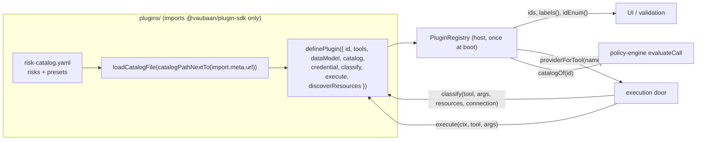

# Plugin SDK — `@vaubaan/plugin-sdk`

The package a provider plugin is written against, and the single place the
gateway learns which providers exist. ADRs:
[plugin-contract-and-credential-spec](../decisions/plugin-contract-and-credential-spec.md),
[plugin-catalog-path-and-standalone-tracing](../decisions/plugin-catalog-path-and-standalone-tracing.md),
[fallback-risk-only-when-uncategorized](../decisions/fallback-risk-only-when-uncategorized.md),
[plugin-identifiers-one-grammar-for-classify-and-execute](../decisions/plugin-identifiers-one-grammar-for-classify-and-execute.md),
[plugin-arguments-closed-surface-and-typed-refusals](../decisions/plugin-arguments-closed-surface-and-typed-refusals.md).
Spec: [`vaubaan-gateway.md`](../spec/vaubaan-gateway.md) §5 (plugins), §3.2
(presets), §10 (structural tests);
[`gateway-risk-model.md`](../spec/gateway-risk-model.md) §7.

## Layout

```
packages/plugin-sdk/
  src/
    plugin.ts           ProviderPlugin, ClassifyOutcome, ConnectionContext, ExecuteContext, PluginLogger,
                        UpstreamCredentialCache, TokenHandout
    streaming.ts        ToolResultPartSink, PartEmitter, streamToolResult, textParts, appendPart
    credential.ts       CredentialSpec (4 kinds) and the per-kind Spec/Secret interfaces, CredentialSecret,
                        CredentialField, ProviderAppConfig, OAuth2ClientAuthMethod,
                        expectCredentialKind, CredentialKindMismatch,
                        CLIENT_ID_FIELD / CLIENT_SECRET_FIELD, AppInstallUserVerification,
                        AppInstallClientAuthMethod, AppInstallListPagination
    catalog-loader.ts   loadCatalogFile / parseCatalogYaml / validateCatalog, CatalogError,
                        PluginCatalog / LoadedCatalog / LoadCatalogOptions,
                        semanticIssues / fallbackIssues / fallbackFlagIssues / presetIssues / wildcardIssues /
                        riskIdWildcardIssues / presetWildcardIssues / structuralIssues, catalogWarnings,
                        isCompleteVector
    catalog-path.ts     catalogPathNextTo, CATALOG_FILE_NAME — the filesystem path of the YAML
    arguments.ts        declaredArgumentsOf, undeclaredArgumentDenial, DeclaredArguments — the closed
                        argument surface of a tool
    slices.ts           ANY_IDENT, isSliceIdent, identSegment, sliceRoundTripIssues — the identifier
                        segments a classifier may emit
    refusal.ts          ExecutorRefusal, refusalResult, declining — what an executor declines itself
    env-of.ts           envFromSliceSegment, EnvOf, NO_SINGLE_ENV (re-exported from the policy engine)
                        — helpers for `ProviderPlugin.envOf`
    define-plugin.ts    definePlugin, pluginIssues, PluginDefinitionError, PLUGIN_VERSION_PATTERN,
                        PLUGIN_SUMMARY_MAX_LENGTH, MAX_INSTALLATIONS_PER_PAGE
    registry.ts         PluginRegistry, createRegistry, RegisteredPlugin, ProviderLabel, PluginRegistryError
    flags.ts            PluginHostFlags, DEFAULT_HOST_FLAGS, normalizeArgsIfEnabled
    git/                the git remote's wire primitives and contract (handbook git-remote): pkt-line, streams
                        (prependChunk), receive-pack, upload-pack (v2 head, listing filters), advertisement, remote
      pkt-line.ts       pktLine, flushPkt, parsePktLines, PktLineReader (one pkt-line at a time, rest()),
                        side-band helpers, PKT_LINE_MAX
      receive-pack.ts   readCommandList, parseCommand, encodeCommandList, emptyPack, report-status
                        encode/parse, sendRefUpdates, ZERO_OID, OID_SHAPE, GitProtocolError, GitUpstream
      advertisement.ts  parseAdvertisement, encodeAdvertisement (smart HTTP v0/v1)
      pack.ts           readPackObjects (bounded, objects kept under the SHA-1 of their content,
                        never throws), parseCommit, parseTree, parseTag, applyDelta, objectId
      remote.ts         GitRemoteCapability, GitAbility, GitRefUpdate, GitInspectedUpdate, GitReviewedUpdate, GitReview,
                        GIT_UPDATE_KINDS, GIT_TEMPORARY_REF_PREFIX
    index.ts            barrel + re-exports of the shared vocabulary a plugin needs
                        (+ parseSlice / serializeSlice from @vaubaan/policy-engine)
    testing/
      mock-fetch.ts     mockFetch, MockRoute, RecordedCall, MockFetch, FetchInput
      identifiers.ts    assertIdentifiersRefused, HOSTILE_IDENTIFIERS — "what is executed is what
                        was classified", proven by running the plugin
      assertions.ts     assertPluginWellFormed, assertCatalogCoverage, assertNoWildcard,
                        assertPresetsValid, declaredOnly, refusalText, PluginAssertionError,
                        SampleCall, ToolSamples, CoverageOptions, CoverageReport
  tests/
    fixtures/acme/      a tiny valid plugin (risk-catalog.yaml + acme-plugin.ts) used by the tests
    unit/               catalog-loader (31), catalog-path (4), env-of (8), registry (11),
                        define-plugin (32), testing-kit (14), identifiers-kit (9), streaming (9), arguments (10),
                        slices (21), git-wire (20: framing, command list, a seeded
                        fuzz of the command-list reader)
```

Dependencies: `@vaubaan/shared`, `@vaubaan/policy-engine`, `js-yaml`.
Nothing from `gateway-core` or `apps/`. Two entry points: `.` and
`./testing`.

## The contract in one picture



### `ProviderPlugin` (`plugin.ts`)

| Member                                               | Pure? | Notes                                                                                                                                                                                                                                                                                                                                                                                                                                                                                                                                                                                                                                                                                                                                                                                                                                                                                                                                                                                                                                                                                                                                                                                                                                                                                                                                                                                                                                                                                                                                                                                                                                 |
| ---------------------------------------------------- | ----- | ------------------------------------------------------------------------------------------------------------------------------------------------------------------------------------------------------------------------------------------------------------------------------------------------------------------------------------------------------------------------------------------------------------------------------------------------------------------------------------------------------------------------------------------------------------------------------------------------------------------------------------------------------------------------------------------------------------------------------------------------------------------------------------------------------------------------------------------------------------------------------------------------------------------------------------------------------------------------------------------------------------------------------------------------------------------------------------------------------------------------------------------------------------------------------------------------------------------------------------------------------------------------------------------------------------------------------------------------------------------------------------------------------------------------------------------------------------------------------------------------------------------------------------------------------------------------------------------------------------------------------------- |
| `id`                                                 | —     | Provider slug; also the first segment of every slice and the tool prefix (`cloudflare-dns` → `cloudflare_dns__`).                                                                                                                                                                                                                                                                                                                                                                                                                                                                                                                                                                                                                                                                                                                                                                                                                                                                                                                                                                                                                                                                                                                                                                                                                                                                                                                                                                                                                                                                                                                     |
| `displayName`, `version`, `description?`, `docsUrl?` | —     | `version` is semver and goes into telemetry (a version that is not semver is never reported).                                                                                                                                                                                                                                                                                                                                                                                                                                                                                                                                                                                                                                                                                                                                                                                                                                                                                                                                                                                                                                                                                                                                                                                                                                                                                                                                                                                                                                                                                                                                         |
| `summary?`                                           | —     | A short paragraph in plain words for the provider reference of the web interface (`/reference/<id>`): what one connection is, what one resource is, where the environment of a call comes from. Optional; when present, a non-empty string of at most `PLUGIN_SUMMARY_MAX_LENGTH` (600) characters. Every shipped plugin fills it (`reference.test.ts`). `labels()` carries it.                                                                                                                                                                                                                                                                                                                                                                                                                                                                                                                                                                                                                                                                                                                                                                                                                                                                                                                                                                                                                                                                                                                                                                                                                                                       |
| `tokenHandouts?`                                     | —     | `TokenHandout { tool, riskIds, readOnlyRiskIds? }[]`: the tools whose purpose is to hand the agent a short-lived, narrowly scoped provider token (spec §2.4, the one exception to "the executor never sees a provider credential"), each with the catalog risks such a call touches. `definePlugin` checks that the tool is declared and the risks are entries of the catalog. A declaration for the reader — the provider reference marks these tools and risks; the host decides nothing from it. GitHub declares `github__mint_install_token`. `readOnlyRiskIds` names the risks among `riskIds` whose token cannot write at the provider; a risk not named there is taken as write (`writeHandoutRiskIds(plugin)`), and `definePlugin` refuses a preset that leaves a write one on `auto` (spec §2.4: a token-handing risk that grants write is gated by approval in presets, a read-only one may be automatic).                                                                                                                                                                                                                                                                                                                                                                                                                                                                                                                                                                                                                                                                                                                  |
| `gitRemote?`                                         | —     | `GitRemoteCapability`: the instance as this provider's git remote (`/git/<repository>.git`, spec §4.1 ter, handbook [git-remote](git-remote.md)). Two tool names the pipeline decides and audits but that are **not MCP tools** (`fetchTool`, `pushTool`, prefixed, distinct, never in `tools`); `pushRisk` (the permission every push touches: a mission without it gets no push advertisement); `repositoryOf(path)`; `upstream(ctx, repository, 'read' \| 'write')` → the endpoint and the `Authorization` to present there, in memory; `review(ctx, repository, updates)` → the reviewed updates (kind, commits, files, workflow files) or a reason to refuse; optional `inspectPack(ctx, repository, updates, objects)` → the workflow paths each update's tip changes, decided from the push's own objects (hashed by the host) before the pack is sent — what it cannot read counts as changed, a throw refuses the push (ADR [git-push-inspected-before-it-leaves](../decisions/git-push-inspected-before-it-leaves.md)); optional `admitPush(ctx, repository, inspected)` → the sentence that refuses a push the provider credential cannot carry (a permission the account lacks, by name) or `null`, asked after the mission's precheck on the inspection and before the pack is sent, the write endpoint asked for again afterwards (amendment of 2026-10-18 to that ADR); optional `compareUrl`, `insteadOf` (the provider's URL prefix the setup kit rewrites), `abilities` (`{ risk_id, words }[]`: what each permission means for git, for the mission page). At most one registered plugin declares it. GitHub does. |
| `experimental?`                                      | —     | `true` for a plugin the host registers but keeps out of the default connect / issuance flows, listing none of its tools (gmail). `labels()` carries it as a boolean.                                                                                                                                                                                                                                                                                                                                                                                                                                                                                                                                                                                                                                                                                                                                                                                                                                                                                                                                                                                                                                                                                                                                                                                                                                                                                                                                                                                                                                                                  |
| `resourceCreatingTools?`                             | —     | tool names: the MCP tools whose success creates something `discoverResources` returns as a new ref (`fly__create_app`). After such a call succeeds through the execution door (outcome `allowed`, result not `isError`), the host runs the connection's discovery again off the request path, coalesced and bounded, so the resource is known — and reached by a whole-connection mission — at once ([connections](connections.md), "Discovery after a creating call"). A tool that creates something _inside_ a resource (a DNS record, a machine, a bucket) is not one. Optional; `resourceCreatingToolIssues` refuses an empty list, a name that is not an MCP tool of the plugin, a duplicate. Declared by Fly (`fly__create_app`), Railway (`railway__create-project`), Resend (`resend__create_domain`, `resend__create_segment`), Upstash Redis (`upstash_redis__create_database`); `resource-creating-tools.test.ts` (application structural) pins the table. ADR [discovery-runs-after-a-creating-call](../decisions/discovery-runs-after-a-creating-call.md).                                                                                                                                                                                                                                                                                                                                                                                                                                                                                                                                                               |
| `unboundTools?`                                      | —     | tool name → one sentence (≤ 300 chars): a tool whose effect cannot be bound to one resource (a free-text request to the provider's agent). The host makes it unavailable on a connection that reaches a resource hosting the gateway (`self_resources`: `MissionConnection.hosts_instance`), refused by the resource stage and left out of `tools/list` (SEC 2026-10-15 re-check M-1). Railway declares `railway__railway-agent`.                                                                                                                                                                                                                                                                                                                                                                                                                                                                                                                                                                                                                                                                                                                                                                                                                                                                                                                                                                                                                                                                                                                                                                                                     |
| `tools`                                              | —     | `McpToolDeclaration[]`. Every name starts with the prefix; names unique. May be empty (experimental, classifier-only plugin).                                                                                                                                                                                                                                                                                                                                                                                                                                                                                                                                                                                                                                                                                                                                                                                                                                                                                                                                                                                                                                                                                                                                                                                                                                                                                                                                                                                                                                                                                                         |
| `dataModel`                                          | —     | `DataModel` of the risk-model spec §2; `validateDataModel` runs in `definePlugin`.                                                                                                                                                                                                                                                                                                                                                                                                                                                                                                                                                                                                                                                                                                                                                                                                                                                                                                                                                                                                                                                                                                                                                                                                                                                                                                                                                                                                                                                                                                                                                    |
| `catalog`                                            | —     | `RiskCatalog` with `presets`; loaded from YAML, see below.                                                                                                                                                                                                                                                                                                                                                                                                                                                                                                                                                                                                                                                                                                                                                                                                                                                                                                                                                                                                                                                                                                                                                                                                                                                                                                                                                                                                                                                                                                                                                                            |
| `credential`                                         | —     | `CredentialSpec`, see below; `alternativeCredentials?` adds other ways.                                                                                                                                                                                                                                                                                                                                                                                                                                                                                                                                                                                                                                                                                                                                                                                                                                                                                                                                                                                                                                                                                                                                                                                                                                                                                                                                                                                                                                                                                                                                                               |
| `classify(tool, args, resources, connection?)`       | yes   | `{ slices: Slice[] } \| { denied: string }`. `resources` = the mission's resources on this connection; used to derive the env and default refs. `connection` = `ClassifyConnection { fields }`, the non-secret form fields the connection was made with (`metadata.fields`; a Fly `org_slug`), so a slice can name what the connection is bound to when no resource says it; absent outside a host, never a secret (ADR [classify-sees-the-connection-public-fields](../decisions/classify-sees-the-connection-public-fields.md)). The gateway core's `Classifier` is this member plus `envOf` (`Pick<ProviderPlugin, 'classify' \| 'envOf'>`).                                                                                                                                                                                                                                                                                                                                                                                                                                                                                                                                                                                                                                                                                                                                                                                                                                                                                                                                                                                       |
| `execute(ctx, tool, args)`                           | no    | `ctx: ExecuteContext` = credential (decrypted), appConfig, fetch, signal?, logger?, resources, agentLabel?, credentialCache?, emitPart?. Throws every provider failure (`UpstreamAuthError` on 401/403, `UpstreamHttpError` on another failed status); returns `isError` only for what it declines itself (`ExecutorRefusal` + `declining`) — see "Errors of `execute`".                                                                                                                                                                                                                                                                                                                                                                                                                                                                                                                                                                                                                                                                                                                                                                                                                                                                                                                                                                                                                                                                                                                                                                                                                                                              |
| `discoverResources(ctx)`                             | no    | `ctx: ConnectionContext` (same minus resources/agentLabel). Returns `Resource[]`. Called at connect, on the owner's "Refresh" and after a successful call of a `resourceCreatingTools` tool.                                                                                                                                                                                                                                                                                                                                                                                                                                                                                                                                                                                                                                                                                                                                                                                                                                                                                                                                                                                                                                                                                                                                                                                                                                                                                                                                                                                                                                          |
| `envOf?(slice, resources)`                           | yes   | The environment a slice carries in itself (Vercel's `env[prod]` segment, the only shipped plugin declaring it); `undefined` defers to the resource label; `NO_SINGLE_ENV` says the slice names several environments, and nothing stands in for them. See "Environment resolution".                                                                                                                                                                                                                                                                                                                                                                                                                                                                                                                                                                                                                                                                                                                                                                                                                                                                                                                                                                                                                                                                                                                                                                                                                                                                                                                                                    |
| `refresh?(ctx)`                                      | no    | Override for a non-standard refresh only (re-minted installation token…). A standard `oauth2` credential is refreshed by the host from the spec (`tokenUrl`, `clientAuthMethod`, `resourceIndicator`): `refreshable: true` needs no `refresh`.                                                                                                                                                                                                                                                                                                                                                                                                                                                                                                                                                                                                                                                                                                                                                                                                                                                                                                                                                                                                                                                                                                                                                                                                                                                                                                                                                                                        |
| `revoke?(ctx)`                                       | no    | Withdraws the grant at the provider when the owner revokes the connection, for a provider whose revocation is not one of the declarative `credential.revocation` shapes. Called once by the host with the credential it is about to erase, after the local revocation; resolves when the provider confirmed, throws otherwise. Takes precedence over `credential.revocation`. No agent argument reaches it.                                                                                                                                                                                                                                                                                                                                                                                                                                                                                                                                                                                                                                                                                                                                                                                                                                                                                                                                                                                                                                                                                                                                                                                                                           |
| `toolTitles?`                                        | —     | What each tool does, in a few words a person reads at a glance, keyed by tool name: a verb and its object, sentence case, no final period, at most `TOOL_TITLE_MAX_LENGTH` (60) characters, one line (`github__merge_pull_request` → "Merge a pull request"). The web interface heads an approval request with it, before the resource the call resolves to ("Merge a pull request · acme-org/app": [requests](requests.md), "What a page heads a request with"); a tool without a title is shown by its name. For people only: it is not part of `tools/list` and the host decides nothing from it. Optional; a key must be a declared tool (`toolTitleIssues`). Every tool of a shipped plugin has one (`shipped-providers.test.ts`).                                                                                                                                                                                                                                                                                                                                                                                                                                                                                                                                                                                                                                                                                                                                                                                                                                                                                               |
| `secretArguments?`                                   | —     | tool name → names of top-level arguments whose values are secrets (`fly__set_secrets` → `values`). The approval view shows each string inside them as `[secret · sha256:<12 hex>]` and keeps the keys (`maskSecretArguments`, [requests](requests.md), "Who reads the arguments"); the call, the sealed copy and the replay are unchanged. Optional; a key must be a declared tool and each name a declared argument of it (`secretArgumentIssues`). ADR [secret-arguments-masked-in-the-approval-view](../decisions/secret-arguments-masked-in-the-approval-view.md).                                                                                                                                                                                                                                                                                                                                                                                                                                                                                                                                                                                                                                                                                                                                                                                                                                                                                                                                                                                                                                                                |
| `manualRevocation?`                                  | yes   | One or two sentences (at most 400 characters): where, at the provider, a person removes the grant themselves. Shown when the gateway cannot withdraw it, or tried and was not answered. Every shipped plugin fills it (`shipped-providers.test.ts`).                                                                                                                                                                                                                                                                                                                                                                                                                                                                                                                                                                                                                                                                                                                                                                                                                                                                                                                                                                                                                                                                                                                                                                                                                                                                                                                                                                                  |
| `normalizeForCaps?(args, caps)`                      | yes   | Scope caps. **Reserved: the v5.0 host never calls it** ([ADR](../decisions/scope-caps-not-enforced-in-v5-0.md)).                                                                                                                                                                                                                                                                                                                                                                                                                                                                                                                                                                                                                                                                                                                                                                                                                                                                                                                                                                                                                                                                                                                                                                                                                                                                                                                                                                                                                                                                                                                      |
| `normalizeArgs?(args, resources)`                    | yes   | Only called when `PluginHostFlags.argNormalization` is on. **Default off** (plan §8-Q4).                                                                                                                                                                                                                                                                                                                                                                                                                                                                                                                                                                                                                                                                                                                                                                                                                                                                                                                                                                                                                                                                                                                                                                                                                                                                                                                                                                                                                                                                                                                                              |

`definePlugin(def)` validates (`pluginIssues`) and `Object.freeze`s. Issues
are aggregated into one `PluginDefinitionError` so a contributor fixes a
broken definition in one pass. `pluginIssues` is the concatenation of
`identityIssues` (the `summary` rule included), `toolIssues` (a malformed tool
entry is an issue — `tools[i].name: expected a string` — not a `TypeError`),
`dataModelIssues`, `catalogIssues`, `credentialSpecIssues`, `hookIssues` and
`tokenHandoutIssues` (each hand-out names a declared tool and at least one
risk of the plugin's own catalog) and `gitRemoteIssues` (the two git tools
prefixed, distinct and not MCP tools; the three functions present; each
ability's `risk_id` a risk of the catalog). `declaredToolNames(plugin)` — the
MCP tools plus the git remote's two — is what `toolTitles` and the company
app's permission declaration (`manifestRegistration.permissions`) may name.

`catalogIssues` runs `semanticIssues` on `plugin.catalog`. It is the only
validation a catalog **written in TypeScript** goes through (it never
meets the YAML parser), so every rule that must hold for every catalog
lives there: the fallback rules, the wildcard rules and the preset rules,
budgets included. A TypeScript preset entry with `quota: Infinity`, a
negative rate, a zero window or a gate outside `auto | approval` is refused
by `definePlugin`, by `new PluginRegistry(...)` and by the test kit, with
the same message the YAML loader gives
(`catalog: presets[0].entries[0].quota: expected a positive integer …`).
Not on this path yet (YAML only): the vector axis values, the env-label
grammar of `acceptable_in_envs`, the non-empty `matches`, the preset id
slug and the `caps` / `infra_limits` values.

`ExecuteContext.credentialCache` (`UpstreamCredentialCache { get, set(key,
value, ttlSeconds) }`, optional) is a cache the host scopes to the
connection, for the short-lived upstream credential a plugin derives on
every call. The plugin picks the key and the lifetime; the host namespaces
the entries per connection, caps their lifetime and drops them when the
provider answers 401 or the connection stops being `active`. Only `execute`
receives it; a credential that is the result of a tool is never cached.
GitHub is the one user (`plugins/github/src/token-cache.ts`); the host side
is described in [execution-door](execution-door.md), the decision in
[upstream-credential-cache-and-rejected-credentials](../decisions/upstream-credential-cache-and-rejected-credentials.md).

#### Streamed results (`streaming.ts`)

`ExecuteContext.emitPart` (`ToolResultPartSink = (part: McpToolContent) =>
Promise<void>`, optional) is for a tool whose provider answers progressively.
The contract of `execute` does not change — it returns one complete
`McpToolResult`, because an MCP `tools/call` is answered by one message — but
each part handed to `emitPart` leaves for the caller at once, as a progress
notification, while `execute` keeps reading the provider. A plugin that never
calls it is unaffected; a host that does not provide it (discovery, tests)
gets the complete result alone.

```ts
async execute(ctx, tool, args) {
  const response = await ctx.fetch(url, { headers }); // open the provider's response first
  if (response.status === 401) throw new UpstreamAuthError('…', 401);
  if (!response.ok || !response.body) throw new UpstreamHttpError('…', response.status);
  return streamToolResult(ctx, textParts(response.body));
}
```

- `streamToolResult(ctx, parts)` hands each part of an
  `AsyncIterable<McpToolContent>` to `ctx.emitPart`, awaits it, and returns
  `{ content }` with consecutive text parts merged into one block
  (`appendPart`).
- `textParts(body)` turns a `ReadableStream<Uint8Array>` into text parts, one
  per chunk, decoding UTF-8 across chunk boundaries; ending the iteration
  early cancels the body.

Rules: open the provider's response **before** the first part (an
`UpstreamAuthError` thrown before any part is retried by the host; after a
part nothing is replayed); **await** every `emitPart` (it is the
backpressure, and it rejects when the caller is gone, which is how a long
stream stops); **throw** when the provider's stream breaks (the host records
the call as failed after N parts; the credit stays consumed). The host side —
what the caller receives, the audit entry, the limits — is
[execution-door](execution-door.md), "Streaming". Decision: amendment
"Streamed results" of
[plugin-contract-and-credential-spec](../decisions/plugin-contract-and-credential-spec.md).

#### Errors of `execute`

What `execute` returns and what it throws. One rule, two channels: **a
provider failure is thrown; what the executor declines itself is returned**
(ADR
[plugin-arguments-closed-surface-and-typed-refusals](../decisions/plugin-arguments-closed-surface-and-typed-refusals.md)
D3).

| What happened                                                                                          | The plugin                                   | Audit entry (`allowed`)                             | Telemetry                                   |
| ------------------------------------------------------------------------------------------------------ | -------------------------------------------- | --------------------------------------------------- | ------------------------------------------- |
| the provider answered 401 or 403                                                                       | throws `UpstreamAuthError(message, status)`  | `<provider> answered HTTP 403 (UpstreamAuthError)`  | `upstream-error` / `http_<status>`          |
| the provider answered any other failed status                                                          | throws `UpstreamHttpError(message, status)`  | `<provider> answered HTTP 500 (UpstreamHttpError)`  | `upstream-error` / `http_<status>`          |
| the provider failed without a status (a JSON-RPC error frame, an unusable answer)                      | throws an `Error`                            | `<provider> call failed (Error)`                    | `upstream-error` / `unspecified`            |
| the network failed, the call timed out                                                                 | lets the error of `ctx.fetch` propagate      | `<provider> call failed (<class>)`                  | `upstream-error` / `network` or `timeout`   |
| the executor declines the call: unknown tool, an argument it cannot read, a target outside the mission | returns `{ content: [text], isError: true }` | no `upstream_error`: nothing failed at the provider | `classification-error` / `executor_refused` |

`UpstreamAuthError` and `UpstreamHttpError` live in `@vaubaan/shared`
(`mcp.ts`) and are re-exported by the SDK. Both carry the provider's status
(`upstreamStatus`, `status`): the host reads it for the audit summary and the
telemetry class, and never stores the message, which goes to the agent only
(`Upstream error: <message>`).

Never catch a provider failure into an `isError` result: the audit entry of
a `PATCH` the provider answered with 500 would read `allowed` with no
`upstream_error`, as if the write had gone through, and telemetry would
count a failing provider as a classifier defect. The agent loses nothing
when a plugin throws — the door answers it an `isError` result carrying the
plugin's sentence.

The reverse mistake is as costly: a refusal thrown as a plain `Error` is read
as a provider failure. The audit says the provider failed when no request
left, telemetry files a plugin fault, and the agent gets an opaque "upstream
error" instead of a sentence it can act on. `refusal.ts` is the typed way to
decline from anywhere inside an executor:

| Export                   | What it is                                                                                                                                                                              |
| ------------------------ | --------------------------------------------------------------------------------------------------------------------------------------------------------------------------------------- |
| `ExecutorRefusal`        | `class extends Error` (`name` = `ExecutorRefusal`). Thrown **inside** `execute` to say "I will not run this, and nothing failed at the provider"; never let out of it.                  |
| `declining(run)`         | Runs the body of an `execute`. An `ExecutorRefusal` thrown at any depth becomes the `isError` result carrying its message; any other throw propagates untouched for the host to record. |
| `refusalResult(message)` | The `isError` result of a declined call: one text block, the reason. For a refusal decided at the entry point, where nothing needs to be thrown.                                        |

```ts
export function executeAcme(ctx, tool, args) {
  return declining(async () => {
    const id = pathIdent(args.id);
    if (id === null) throw new ExecutorRefusal('acme: id: missing or malformed'); // declined
    const response = await ctx.fetch(url(id), { headers });
    if (!response.ok) throw new UpstreamHttpError('…', response.status); // the provider failed
    return { content: [{ type: 'text', text: await response.text() }] };
  });
}
```

Not every shipped plugin wraps its entry point in `declining`: several
catch `ExecutorRefusal` themselves, keep a local class of the same shape, or
return the `isError` result directly from the entry point. The contract is
the result, not the helper: a declined call is an `isError` result, a
provider failure is a throw. In a test, `refusalText(promise)` of the test
kit awaits `execute`, requires an `isError` result and returns its text — a
throw fails the test as the provider failure it would be.

The execution door treats only a 401 as a rejected credential (refresh,
retry, then the connection is `expired`); a 403 is reported as a failed call
and changes nothing. A plugin must therefore raise 401 only when the
provider says the credential itself is invalid.

### `CredentialSpec` and `CredentialSecret` (`credential.ts`)

| Kind          | Spec fields                                                                                                                                                        | Secret the plugin receives                                           |
| ------------- | ------------------------------------------------------------------------------------------------------------------------------------------------------------------ | -------------------------------------------------------------------- |
| `api-key`     | `fields` (≥ 1 with `secret: true`), `createUrl?`                                                                                                                   | `{ fields: Record<name, value>, metadata }`                          |
| `oauth2`      | `authorizationUrl`, `tokenUrl` (https), `scopes`, `pkce`, `resourceIndicator?`, `clientAuthMethod`, `refreshable`, `extraAuthorizationParams?`, `appConfigFields?` | `{ accessToken, refreshToken, expiresAt, scopes, metadata }`         |
| `app-install` | `appConfigFields` (app id, private key…), `installUrl(appConfig)`, `installationIdParam`, `userVerification?`, `manifestRegistration?`                             | `{ installationId, metadata }` + `ctx.appConfig` for the private key |
| `ssh-key`     | `algorithm: 'ed25519'`, `fields` (host, port, user)                                                                                                                | `{ privateKeyPem, publicKey, fields, metadata }`                     |

**`userVerification` (`app-install`).** The installation id on the
callback is a claim the browser makes; this block tells the host how to
check it against the identity of the human who performed the installation.
It is data only — the plugin runs none of it and never sees the client
secret or the user token:

| Member                    | Meaning                                                                                        |
| ------------------------- | ---------------------------------------------------------------------------------------------- |
| `codeParam`               | callback query parameter carrying the authorization code (`code`); not `state`, not the id one |
| `tokenUrl`                | https token endpoint the host exchanges the code at                                            |
| `clientAuthMethod`        | `client_secret_basic` or `client_secret_post` (`AppInstallClientAuthMethod`)                   |
| `installationsUrl`        | https endpoint listing the installations the user token can reach (GET, Bearer)                |
| `installationsHeaders?`   | static headers of that call (API version, `Accept`); never `Authorization`                     |
| `installationsListField?` | property of the JSON response holding the list; omitted when the body is the list              |
| `installationIdField`     | property of each item holding the id (string or number)                                        |
| `pagination?`             | `{ pageParam, perPageParam, perPage }` (pages from 1; `perPage` 1…1000)                        |

The provider's app must be set to ask the installing user to authorize it
(GitHub: "Request user authorization (OAuth) during installation"), so the
authorization request is implicit in the install redirect. A spec that
declares the block must list `CLIENT_ID_FIELD` (`client_id`, non-secret) and
`CLIENT_SECRET_FIELD` (`client_secret`, secret) — both exported by the SDK —
as required `appConfigFields`; `definePlugin` reports each malformed member
by path. A spec **without** the block is valid, but the host refuses to
connect it unless the operator explicitly accepts unverified installations
for that provider ([connections](connections.md), "Installation binding").
`ctx.appConfig` never contains `client_secret`, for any kind.

**`manifestRegistration` (`app-install`, optional).** How the administrator
creates the company's app from the interface when the provider offers an
app manifest flow (GitHub), instead of registering it by hand (ADR
[company-app-created-from-a-manifest](../decisions/company-app-created-from-a-manifest.md)).
Declarative like `userVerification`: the host runs the flow
([connections](connections.md), "Company apps created from the page").

| Member                                      | Meaning                                                                                                                                                |
| ------------------------------------------- | ------------------------------------------------------------------------------------------------------------------------------------------------------ |
| `permissions`                               | `AppPermission[]`: the provider's name, a label, a sentence, levels lowest first (`access`, `label`, `tools`, `onlyWhen?`), `mandatory?`, `sensitive?` |
| `ownerLoginPattern`, `nameMaxLength`        | checked before the login goes in a URL and the name in the manifest                                                                                    |
| `registrationUrl(owner)`                    | where the manifest is posted: an organisation's or the personal account's address                                                                      |
| `manifestField`, `stateParam`, `codeParam`  | `manifest`, `state`, `code`                                                                                                                            |
| `buildManifest(input)`                      | the manifest from the name, `public_url`, the connection callback, the return address and the chosen permissions                                       |
| `conversionUrl(code)`, `conversionHeaders?` | the exchange endpoint (POST, no credential), `null` for a code outside the provider's grammar; never `Authorization`                                   |
| `registeredApp(body)`                       | the created app: every `appConfigFields` value, its name, slug, owner, page and permissions — or `null`                                                |

The permission declaration is the single source for what the page offers,
what the manifest requests and what the plugin checks a call against. The
SDK reads it in `app-permissions.ts`: `defaultPermissionChoice` (every
highest level), `checkPermissionChoice` (a level or `NO_ACCESS` per
permission; a mandatory one kept; anything undeclared refused),
`toolsLostAt`, `accessCovers` (a granted level covers the declared levels
below it, and so does a level the declaration does not list but the provider
orders above: `read` < `write` < `admin` — an installation holding Actions
"Read and write" covers tools that need only "Read"),
`unconditionalNeeds(permissions, tool)` (the
levels a tool needs on every call; `onlyWhen` needs are the plugin's to
check), `missingPermissions` and `tokenPermissionsOf(permissions, excluded)`
(the token guide's permissions read off the same declaration when the
provider's tokens share the app's permission names: a `read` level as
`read`, any other as `read-write`, the `excluded` tools left out).
`definePlugin` names each malformed member,
a tool a level lists that the plugin does not declare, and an `onlyWhen`
tool that its level does not list.

**Revocation of an `oauth2` grant** is declared, not coded:
`revocation: { url, format }` on the spec, with `format` one of
`OAUTH2_REVOCATION_FORMATS` — `token-form` (`POST`, form-encoded `token`,
no client authentication) or `client-credentials-json` (`POST`, JSON
`{ client_id, client_secret, refresh_token }`; `definePlugin` refuses it for
a public client or a spec that is not `refreshable`). The host sends the
request when the owner revokes the connection, because it may carry the
client secret. Absent: the provider documents no endpoint, and the plugin's
`manualRevocation` sentence is what the person reads. Declare an endpoint
only after reading it in the provider's documentation (handbook
[providers](providers/README.md#revoking-a-connection-what-happens-at-the-provider)).

The host runs each flow generically — the authorization-code dance **and**
the standard `refresh_token` grant (client authentication per
`clientAuthMethod`, `resource` per `resourceIndicator`) — so an `oauth2`
plugin whose provider follows RFC 6749 declares `refreshable: true` and
implements nothing (gmail, supabase, railway). The plugin never sees the
OAuth client secret and never reads `process.env`. `expectCredentialKind(
pluginId, secret, kind)` narrows the secret or throws
`CredentialKindMismatch`. The encrypted envelope (`Credential` in
`@vaubaan/shared`) never reaches a plugin.

**More than one way to connect** (ADR
[token-connections-beside-the-integration-app](../decisions/token-connections-beside-the-integration-app.md)).
`ProviderPlugin.alternativeCredentials?: CredentialSpec[]` adds ways beside
`credential` (the primary, offered first). Read them only through
`credentialSpecsOf(plugin)`, `credentialSpecFor(plugin, kind)`,
`appCredentialSpecOf(plugin)` and `unavailableToolReason(plugin, kind,
tool)`. `definePlugin` validates each alternative like a primary spec (issues
prefixed `alternativeCredentials[i]`), refuses a kind declared twice and more
than one way through a company app. A plugin with several ways reads
`ctx.credential.kind` in `execute` and `discoverResources`.

Every spec may carry (`CredentialSpecCommon`):

| Member              | Meaning                                                                                                                                         |
| ------------------- | ----------------------------------------------------------------------------------------------------------------------------------------------- |
| `unavailableTools?` | tool name → one sentence (≤ 300 chars) why a connection made this way cannot run it; the host refuses it before the budget and does not list it |
| `manualRevocation?` | where a person removes the grant of a connection made this way; overrides the plugin's sentence                                                 |

An `api-key` spec may also carry:

| Member    | Meaning                                                                                                                                                                                                                                                                             |
| --------- | ----------------------------------------------------------------------------------------------------------------------------------------------------------------------------------------------------------------------------------------------------------------------------------- |
| `label?`  | what the person creates, lower case, in the service's words ("fine-grained personal access token")                                                                                                                                                                                  |
| `guide?`  | `{ steps, permissions: { name, access: 'read' \| 'read-write', tools }[], recommendedExpiryDays: number \| null, docsUrl? }` — rendered by the connect page; every tool the way can run must be served by a permission (an empty list means the token carries no permission choice) |
| `verify?` | `(ctx) → { account, expiresAt }`: asked before anything is stored; throw `UpstreamAuthError` on a rejected token                                                                                                                                                                    |

A plugin whose tokens share its app's permission names derives the guide's
permissions with `tokenPermissionsOf` rather than writing a second list
(GitHub). The plugin's own `refresh` and `revoke` hooks serve its primary kind only.
Shipped examples: `plugins/github/src/token.ts`, `plugins/supabase/src/token.ts`,
`plugins/railway/src/token.ts`.

### Catalog path (`catalog-path.ts`)

```ts
export const myCatalog = loadCatalogFile(catalogPathNextTo(import.meta.url));
// catalogPathNextTo(moduleUrl, fileName = 'risk-catalog.yaml') → '/…/plugins/<id>/src/risk-catalog.yaml'
```

Never write `new URL('./risk-catalog.yaml', import.meta.url)` in a plugin:
Turbopack (Next.js 16, `apps/gateway`) recognises that literal and rewrites
it into a `/_next/static/media/*.yaml` asset URL, and `next build` fails
when the loader reads it. The helper builds the path with `node:path` from
`import.meta.url`, which the bundler leaves alone — in the server bundle
`import.meta.url` becomes a runtime `file:` URL of the source path relative
to the output root, so the same path works in vitest, `next dev`,
`next build` and the standalone server. A non-`file:` URL (a rewrite) throws
a named error instead of an `ENOENT`. The `join` call carries
`/* turbopackIgnore: true */`: without it Turbopack reports the computed path
as "dynamic filesystem access" and traces the whole `apps/gateway` directory
— `tests/` included — into `.next/standalone`
(`apps/gateway/tests/integration/demo/demo-safety.test.ts` fails if a test
file gets there; ADR [local-demo-mode](../decisions/local-demo-mode.md) D7).
`apps/gateway/next.config.ts` traces
`plugins/*/src/**/*.yaml` into `.next/standalone` so the Docker image ships
every catalog; `apps/gateway/tests/integration/standalone-plugin-catalogs.test.ts`
checks it after a build. ADR
[plugin-catalog-path-and-standalone-tracing](../decisions/plugin-catalog-path-and-standalone-tracing.md).

### Catalog loader (`catalog-loader.ts`)

```ts
export const myCatalog = loadCatalogFile(catalogPathNextTo(import.meta.url));
// → { catalog: PluginCatalog, indexed: IndexedRiskCatalog }
```

Runs at module load, hence at gateway boot. The rules it shares with the
policy engine are imported, not re-implemented: `fallbackEntriesOf` /
`fallbackRiskPrefix` / `hasCatchAllWritePattern` for the mandatory
fallback, `isEnvScopedEntry` / `isAcceptableInEnv` for env-qualified preset
entries, `budgetIssues` / `isValidBudget` for the budget of a preset entry
(the same function the application's issuance preview calls, `budgetProblem` in `missions/preview.ts`).
Pipeline:

1. `js-yaml` `load` with `CORE_SCHEMA` (YAML 1.2 core: no implicit date
   or binary coercion). Syntax errors → `CatalogError` with the source name.
2. `structuralIssues(doc)` — every key known (`provider`, `risks`,
   `presets`, `catalog_version`, `catalog_date`); provider slug; each
   risk: id grammar and provider, `label`, `reason`, `matches` (string or
   list), `vector` with the six axes from `RISK_VECTOR_AXES`,
   `vector_overrides`, `acceptable_in_envs` (env labels), `caps`,
   `infra_limits`, `fallback` (boolean), `deprecated`, `replaced_by`; each preset: slug id,
   `label`, `description`, non-empty `entries` with `risk_id`, positive
   integer `quota`, `rate_limit { max, window_seconds }`, `gate` (default
   `auto`). One parser per field (`riskIdFrom`, `matchesFrom`,
   `vectorFrom` / `partialVectorFrom`, `vectorOverridesFrom`,
   `acceptableEnvsFrom`, `capsFrom`, `optionalBoolean`, `replacedByFrom`;
   `presetEntryFrom`, `presetEntriesFrom`), each taking a `ParseContext
{ at, issues }` and returning the typed value or `undefined` after
   reporting at its path; `riskFrom` and `presetFrom` only assemble. The
   output types prove what was checked: a vector is a `RiskVector` only
   through the guard `isCompleteVector`, `caps` / `infra_limits` are a
   `ScopeCaps` rebuilt from the five known keys (accepted keys and values
   unchanged: positive integers), a preset entry is typed through
   `isValidBudget`. The loader accepts `caps` and every `infra_limits` key
   because the contract is the SDK's; what a host enforces is the host's
   business. The v5.0 gateway enforces `infra_limits.calls_per_minute_max`
   only (at issuance), calls neither `normalizeForCaps` nor `normalizeArgs`,
   and a structural test of the app refuses any other declared limit in the
   shipped catalogs
   ([ADR](../decisions/scope-caps-not-enforced-in-v5-0.md)).
3. `prepareCatalog` from `policy-engine` — duplicate ids, id regex, every
   pattern parses and belongs to the provider.
4. `semanticIssues` — `fallbackIssues`: exactly one fallback entry
   (`fallback: true`, or detected by the catch-all pattern
   `<provider>.**.W` or the `<provider>.uncategorized-` id — see
   `isFallbackEntry` in the policy engine), named
   `<provider>.uncategorized-*` (the dash is part of the prefix) **and
   matching the catch-all write `<provider>.**.W`**; zero
   (`requireFallback`, default true) or two is an error. The pattern is
   checked because the fallback is left out of the touched risks whenever
   another entry matches: flagged on a narrow pattern, a named risk would
   silently stop being required. `wildcardIssues`(=`riskIdWildcardIssues`+`presetWildcardIssues`); `presetIssues`
   (`requirePresets`, default true): at least one preset, ids unique, every
   entry a legal budget (`budgetIssues`: positive integer quota and rate
   limit, gate from the closed set), every `risk_id`an
   explicit id of this provider present in the catalog, env-qualified
   entries only on env-scoped risks and inside`acceptable_in_envs`, no
   deprecated risk, no repeated risk in a preset, **never the fallback** —
   it fires only on writes no other entry covers (ADR
   [fallback-risk-only-when-uncategorized](../decisions/fallback-risk-only-when-uncategorized.md)),
   so a preset including it would pre-accept unreviewed writes; an error
   today (no plugin needs it).
5. `catalogWarnings` → `options.warn` (default `console.warn`):
   `fallbackFlagIssues`, a fallback entry recognised by convention (pattern
   or id) without `fallback: true`. The loader only warns so a third-party
   catalog written before the flag still boots; the test kit's
   `assertPluginWellFormed` fails on it, so every first-party catalog carries
   the flag.

All issues are collected and thrown together, path-qualified:

```
Invalid risk catalog '/…/plugins/github/src/risk-catalog.yaml':
  - risks[3].vector.blast: expected one of single | env | account | bulk
  - presets[1].entries[2].risk_id 'github.nope' is not a risk of the 'github' catalog
```

`validateCatalog(doc)` accepts an already-parsed object (tests, JSON).
`semanticIssues`, `fallbackIssues`, `fallbackFlagIssues`, `presetIssues`,
`wildcardIssues`, `riskIdWildcardIssues`, `presetWildcardIssues` and
`catalogWarnings` are exported for the test kit and `definePlugin`.

### The fallback at runtime

`risksTouchedBy` (policy engine) includes the fallback **only when no other
entry of the catalog matched the slice**. A write covered by a dedicated
entry touches that entry alone; a write covered by none touches the
fallback; a slice covered by nothing — reads are not caught by
`<provider>.**.W` — yields an empty set, which the runtime refuses. So a
preset must not include the fallback (loader error), and its appearance in
an audit log means "a catalog entry is missing". The YAML marks it
`fallback: true` (every shipped plugin does); the detection by pattern or id is the
compatibility path for third-party catalogs written before the flag, and
warns.

### Environment resolution (`env-of.ts`)

Env-scoped risks (`vercel[prod].env-var-write`) need the environment of the
executed slice. The policy engine's default resolver, `envResolverFor(
resources, plugin.envOf)`, asks the plugin first, then the owner's label on
the resources the slice names, then gives up (unqualified):

| Provider shape                                                            | Declare                                 |
| ------------------------------------------------------------------------- | --------------------------------------- |
| The environment is a slice segment (`vercel.project[p].env[prod].…`)      | `envOf: envFromSliceSegment('env')`     |
| The environment is a function of the arguments (a branch, a mode flag)    | a custom pure `envOf(slice, resources)` |
| The environment is the owner's label on the resource (Supabase, Railway)  | nothing                                 |
| The plugin labels one resource per mode at discovery (Stripe test / live) | nothing                                 |

`EnvOf` — the shape of the hook — has three answers, and the host reads
them differently:

| `envOf` returns | Meaning                                                                                                                    | The host                                                                                                       |
| --------------- | -------------------------------------------------------------------------------------------------------------------------- | -------------------------------------------------------------------------------------------------------------- |
| a label         | the one environment the slice touches                                                                                      | qualifies the touched risks with it                                                                            |
| `undefined`     | the slice says nothing about its environment                                                                               | falls back to the owner's label on the resource                                                                |
| `NO_SINGLE_ENV` | the slice names its environment but not exactly one: a wildcard, a list, a glob, a value outside the provider's closed set | resolves **no** environment and does not consult the label: every env-scoped risk the slice touches is refused |

`NO_SINGLE_ENV` is the policy engine's symbol, re-exported here
([policy-engine](./policy-engine.md), `qualify.ts`). It exists because the
label says what the _resource_ is, while such a slice says the call reaches
several environments of it: falling back would price a call that reaches
`prod` as whatever the resource happens to be labelled (ADR
[decision-stages-fail-closed-and-audited](../decisions/decision-stages-fail-closed-and-audited.md)
D3).

`envFromSliceSegment(entity)` returns the identifier following the named
entity; `NO_SINGLE_ENV` when that position holds a wildcard, a list or an
identifier containing `*`; `undefined` when the slice has no such entity,
when the entity is the last segment, or when another entity name follows it.
The value is returned as it is: the classifier is responsible for emitting
the owner-facing label. The hook is pure and validated by `definePlugin` (a
function when present). `gateway-core`'s `evaluateCallForToken` builds its
default resolver as `envResolverFor(resources, adapter.envOf?.bind(adapter))`.
Today only vercel declares `envOf` (`vercelEnvOf`, which also validates the
label against the closed triad and answers `NO_SINGLE_ENV` for anything
else in that position); github's catalog has no env-scoped risk, so the
branch rule stays a documented possibility, not a hook.

### Declared arguments (`arguments.ts`)

The argument surface of a tool is closed: what its input schema does not
declare is refused. A classifier reads the arguments it knows; an argument it
does not know was priced by no rule, and an executor that forwards the
arguments it was given — a JSON body built from `args`, a rewrapped upstream
tool — would send it to the provider all the same (ADR
[plugin-arguments-closed-surface-and-typed-refusals](../decisions/plugin-arguments-closed-surface-and-typed-refusals.md)
D1).

- `declaredArgumentsOf(tools)` → `DeclaredArguments`, a
  `ReadonlyMap<tool name, ReadonlySet<argument name>>` built once per plugin
  from the `inputSchema.properties` of its tool declarations.
- `undeclaredArgumentDenial(declared, tool, args, routing?)` → the denial for
  the first argument of the call its tool does not declare, in the order the
  call gives them, or `null`. The sentence reads
  `<name>: not an argument of '<tool>' — nothing classifies it, so it is not sent.`;
  a key that is not name-shaped (`^[A-Za-z_][A-Za-z0-9_-]{0,63}$`) is
  described as `an argument with a malformed name`, never quoted. An
  argument given as `undefined` is absent (`null`, `false`, `0` and `''` are values); another spelling of a
  declared name is another argument; inherited property names are not
  declared. An unknown tool yields `null`: the classifier says that in its
  own words.
- `routing` names the arguments the plugin reads itself whatever the tool
  declares, and writes again (or drops) before the call leaves: the project
  or team a mission pins.

Top-level keys only: the value of a declared argument is the tool's own
business. A plugin whose executor forwards arguments calls the function in
`classify` — a denial, so the call is refused before the budget and audited
as a refusal — **and** in `execute`, the second lock for a caller that did
not go through `classify`. A plugin that builds its request field by field
from declared arguments forwards nothing else and does not need it: an
undeclared argument is never read. Which shipped plugin does which is in its
handbook ([`providers/`](./providers/README.md)).

### Slice identifiers (`slices.ts`)

A classifier builds its slices structurally (`{ kind: 'ident', value }`), so
nothing stops it from putting into an identifier a character the slice
grammar has no place for (`@`, `:`, `+`, a space). The slice is also
_written_ — in the audit entry, in the refusal the agent reads, in the
session — and written with such a character it cannot be read back; a `,` or
a `]` would even read back as a different slice.

- `isSliceIdent(value)` — true when the grammar can carry `value` as one
  bracket identifier (`BRACKET_IDENT_CHAR_CLASS` of the policy engine, one
  character or more).
- `identSegment(value)` — `[value]` when it can, `ANY_IDENT` otherwise (an
  empty value, a character outside the grammar, a glob such as `feature/*`).
  Never throws.
- `ANY_IDENT` — `{ kind: 'ident', value: '*' }`, serialised `[*]`: the "any
  identifier" placeholder of an executed slice.
- `sliceRoundTripIssues(slice)` — why a slice cannot be serialised and parsed
  back as itself; empty when it can.

A call naming an identifier the grammar cannot carry is therefore classified
on **every** instance of the entity: only a mission whose pattern covers them
all accepts it. The identifier is never dropped (the slice would match a
narrower pattern than the call deserves) and never escaped (the slice would
no longer be the name an owner writes in a restriction). A classifier that
writes a caller's value into an `ident` segment without these helpers can
emit `feature/*`: the policy engine refuses an executed slice carrying `*`
inside an identifier (`carriesGlobIdentifier`,
[policy-engine](./policy-engine.md)), and `assertCatalogCoverage` fails on
it and on a slice that does not read back as itself (ADR
[plugin-arguments-closed-surface-and-typed-refusals](../decisions/plugin-arguments-closed-surface-and-typed-refusals.md)
D2).

### Registry (`registry.ts`)

`new PluginRegistry(plugins)` / `createRegistry(plugins)`: rejects
duplicate ids and ill-formed plugins (`PluginRegistryError` listing every
issue), indexes each catalog with `prepareCatalog`. Derivations:

| Method                              | Returns                                                                                                                             |
| ----------------------------------- | ----------------------------------------------------------------------------------------------------------------------------------- |
| `ids`, `size`, `all()`              | The provider list, in registration order.                                                                                           |
| `has(id)`, `get(id)`, `require(id)` | `RegisteredPlugin { plugin, catalog (indexed), toolPrefix, toolNames }`; `require` throws naming the known ids.                     |
| `providerForTool(name)`             | Exact tool-name lookup, then the prefix rule via `splitToolName` for tools a plugin classifies but does not list; `null` otherwise. |
| `catalogOf(id)`, `presetsOf(id)`    | Indexed catalog; presets.                                                                                                           |
| `toolDeclarations()`                | Every tool of every plugin.                                                                                                         |
| `labels()`                          | `ProviderLabel { id, displayName, version, description \| null, summary \| null, experimental }[]` for the UI.                      |
| `idEnum()`                          | `[string, ...string[]]` for validation schemas; throws on an empty registry.                                                        |
| `gitRemote()`                       | The one plugin that declares a `gitRemote`, or `null`; the constructor refuses two (the `/git/` path is shared).                    |

Tool names cannot collide across plugins: ids are unique and the prefix
rule (checked per plugin) is a bijection on ids.

### Host flags (`flags.ts`)

`PluginHostFlags { argNormalization: boolean }`, `DEFAULT_HOST_FLAGS =
{ argNormalization: false }`. `normalizeArgsIfEnabled(plugin, args,
resources, flags)` is the only caller of `plugin.normalizeArgs`. Flipping
plan §8-Q4 to "yes" means passing `{ argNormalization: true }` from the
instance configuration; no contract change.

### Test kit (`testing/`)

```ts
import { assertCatalogCoverage, assertIdentifiersRefused, assertNoWildcard, assertPluginWellFormed,
  assertPresetsValid, declaredOnly, mockFetch, refusalText } from '@vaubaan/plugin-sdk/testing';

assertPluginWellFormed(plugin);
assertPresetsValid(plugin);
assertNoWildcard(plugin);
const report = assertCatalogCoverage(plugin, {
  github__list_branches: [{ args: { owner: 'acme', repo: 'app' } }],
  …one entry per declared tool…
}, { resources: [stagingRepo] });
// report.risksTouched / report.risksUntouched / report.fallbackHits / report.toolsChecked / report.samplesChecked
```

`propertyRuns()` (`testing/property.ts`) gives the `{ seed, numRuns }` of
the property-based tests of the parsers that read untrusted input (the SQL
and shell readers of the plugins, the git wire): a fixed seed and 300 cases
unless `FC_SEED` / `FC_RUNS` say otherwise, so a failure replays. It imports
nothing from fast-check (a root dev dependency), so the kit adds no
dependency to a plugin that does not use it.

`assertPresetsValid` is `presetIssues` plus `presetWildcardIssues` — the
preset half of the wildcard rule called as a function, not filtered out of
`wildcardIssues` by the wording of its messages. Budgets are part of
`presetIssues`, so the kit refuses an illegal budget whatever the catalog
was written in.

`assertCatalogCoverage` fails when a declared tool has no sample, a sample
names an undeclared tool, a non-`expectDenied` sample is denied (or an
`expectDenied` one is not), a sample yields no slice, a slice carries
another provider, a slice does not read back as itself through serialise →
parse (`sliceRoundTripIssues`), a slice carries `*` inside an identifier
(`carriesGlobIdentifier`: the host refuses it), or a slice matches no
catalog risk. `risksUntouched`
leaves the fallback out: it is reachable by design only through writes no
dedicated entry covers, so a complete catalog never touches it and a plugin
test asserts `risksUntouched` equal to `[]` (or to the entries it knowingly
leaves unreached). `fallbackHits` lists the samples only the fallback
covered — informational, but a realistic sample there means the catalog
misses an entry. Every assertion throws `PluginAssertionError { subject,
findings }`.

**`assertIdentifiersRefused(plugin, samples, options)`** is the behavioural
proof of the identifier rule (ADR
[plugin-identifiers-one-grammar-for-classify-and-execute](../decisions/plugin-identifiers-one-grammar-for-classify-and-execute.md)).
It takes the same `samples` as `assertCatalogCoverage`. For every sample
`classify` accepts and every top-level **string** argument of it, it replaces
the value by each of `HOSTILE_IDENTIFIERS` (`..`, `.`, `a/../b`, `%2e%2e`,
`..%2f`, `%2f`, a line break, `r1?x=1#y`), calls `classify`, then `execute`
against a `fetch` that records and answers anything, and holds four rules:

1. refused by `classify` ⇒ `execute` sent nothing (the executor validates by
   itself);
2. no request carries a path segment that decodes to `.` or `..`;
3. a value holding `?`, `#` or a line break never appears verbatim in a URL;
4. when the sample's own value is a whole segment of a request path — which
   is how the kit recognises an identifier, by running the sample, with no
   list kept by hand — the request made for an accepted hostile value has
   the same method and the same segments, and carries that value, encoded,
   in the same place. A dot segment cannot satisfy 2 and 4: it must be
   refused.

```ts
const report = await assertIdentifiersRefused(plugin, SAMPLES, {
  resources: [stagingRepo],
  context: (fetch, resources) => ({ credential, appConfig: {}, fetch, resources }),
  routes: [mintRoute()], // answers an executor reads before the request that carries the identifier
});
// report.toolsChecked / argumentsChecked / hostileCalls / refusedByClassify / nothingSent
// report.pathIdentifiers: [{ tool, argument }] — what it found in a request path
```

Options: `routes` (tried before the catch-all `{}`), `fallbackBody`, `exempt`
(`{ tool: { argument: reason } }`), `elsewhere` (`{ reset(), sent() }`: what the
executor sends by another road than `ctx.fetch`, for rule 1 on an upstream
that is not HTTP — the SSH plugin reads its transport there), and
`pathIdentifiers: { none: reason }`. **A plugin with tools in which no
argument was seen in a request path fails**: the proof would have run on
nothing. Either the executions did not reach their requests (give `routes`),
or the plugin has no identifier in a path and says so with its reason
(Railway: one JSON-RPC POST, identifiers in the body; SSH: a command).

What it does not see: an identifier that is not a top-level string argument
(a resource ref, connection metadata, a nested field), a request reached
only after an answer the routes do not give, and "refuse, never repair" for
a multi-segment value that escaping happens to name exactly. Each plugin's
own identifier tests hold those. Every plugin directory must call it in a
test that runs (`apps/gateway/tests/unit/structural/plugin-identifier-tests.test.ts`).

Two helpers serve the tests of the rules above:

- `declaredOnly(plugin, tool, args)` — the entries of `args` that `tool`
  declares in its input schema (throws on a tool the plugin does not have).
  For test tables that feed one argument object to a whole family of tools:
  an argument a tool does not declare is refused by its classifier, which
  would hide the rule the table is about.
- `refusalText(promise)` — awaits an `execute`, requires an `isError` result
  (`PluginAssertionError` otherwise; a throw propagates and fails the test as
  a provider failure) and returns the text of its first block.

`mockFetch(routes)` returns a `fetch` with `.calls` (method, url,
lower-cased headers, body text, parsed JSON) and `.pending()` (routes whose
`times` is not exhausted). A route is `{ method?, url: string | RegExp |
predicate, status?, headers?, body? | respond?(call), times? }`; an object
body is serialized as JSON. **An unmatched request rejects**, so a plugin
test can never reach the network.

## Shared vocabulary the SDK relies on (`@vaubaan/shared`)

The barrel `@vaubaan/shared` is **server-only**: it re-exports `api-key.ts`
(argon2, `node:crypto`). Code the UI bundles — and `@vaubaan/policy-engine`,
which the issuance form imports — takes _values_ from the subpaths
`@vaubaan/shared/risk-id`, `@vaubaan/shared/domain` (the closed sets and
their guards: `GATES`, `isGate`…; added for the policy engine's
`budgetIssues`) and `@vaubaan/shared/api-key`; type imports from
the barrel are erased and always safe. The SDK itself is server-side
(`node:fs` for the YAML) and imports the barrel.

- `domain.ts` — v5 domain: `Resource { provider, ref, env?, displayName,
metadata? }`, `ConnectionResource`, `Credential` (encrypted envelope),
  `CredentialKind` (how a _connection_ authenticates: `api-key`, `oauth2`,
  `app-install`, `ssh-key` — the three kinds of _bearer_ a door receives
  are `BearerKind` in `@vaubaan/gateway-core`), `Connection`, `Share`,
  `Restriction`, `Mission`, `MissionPolicyEntry` (`risk_id`, `quota`,
  `rate_limit`, `gate`), `MissionPolicy` (the explicit entry list),
  `Budget`, `RateLimit`, `Gate` + `GATES`, `Period`, `MissionResourceSelection`,
  `MissionToken` (one holder each: `kind`, `holder_user_id` or `name`),
  `MissionTokenKind` + `MISSION_TOKEN_KINDS` + `isMissionTokenKind`,
  `TokenAttribution` (`token_id`, `token_kind`, `holder`), `Session`,
  `SessionEvent`, `SessionCounter`, `Request`, `Approval`, `Delegation`,
  `User`, `Group`, `Principal`, `CREDENTIAL_KINDS`, `acceptedRisksOf(mission)`,
  `AuditDecision` (`allowed` | `refused`), the guards `isCredentialKind` and
  `isGate`, `Iso8601`, `GroupSource`, and the status and kind unions
  `ConnectionStatus`, `MissionStatus`, `ShareStatus`, `MissionTokenStatus`,
  `SessionEventKind`, `RequestKind`, `RequestStatus`, `ClaimResolution`.
  These are the only definitions: `gateway-core`
  re-exports them and builds its `MissionContext` from projections of
  `Mission`, `Connection`, `ConnectionResource` and `Session`.
- `risk.ts` — `Slice`, `RiskVector` + `RISK_VECTOR_AXES`, `RiskEntry`,
  `ScopeCaps`, `InfraLimits`, `Preset`, `PresetEntry`, `RiskCatalog`
  (`presets?`, `catalog_version?`, `catalog_date?`), `RiskDecision` — the
  `denied` branch carries `code: 'risk-not-accepted'`
  (`Extract<RefusalCode, 'risk-not-accepted'>`) next to the free-text `hint`,
  so the audit entry and the refusal body never guess the code.
- `risk-id.ts` — `parseRiskId` → `ParsedRiskId { provider, env | null, name }`,
  `formatRiskId`, `baseRiskId`, `isRiskId`, `isProviderId`,
  `isExplicitRiskId` (no `*`/`?`), `WILDCARD_CHARS`, `RISK_ID_PATTERN`,
  `PROVIDER_ID_PATTERN`, `ENV_LABEL_PATTERN`.
- `refusal.ts` — `REFUSAL_CODES` (8), `RefusalCode`, `isRefusalCode`.
- `mcp.ts` — `toolPrefixFor`, `splitToolName`, `McpToolDeclaration`,
  `McpToolResult`, `McpToolContent`, `UpstreamAuthError`, `UpstreamHttpError`,
  JSON-RPC types.
- `data-model.ts` — `DataModel`, `DataModelPlane`, `DataModelEntity`,
  `DataModelCardinality`, `validateDataModel` (run by `definePlugin`).
- `wildcard.ts` — `matchWildcard(tokens, text)` with `WildcardToken`
  (`char`, `one`, `any`), `wildcardLiteral`, `WILDCARD_ONE`, `WILDCARD_ANY`:
  glob matching without a regular expression, linear in practice. Re-exported
  by the SDK; a plugin that matches a glob from its arguments uses it rather
  than building a `RegExp` (the SSH classifier does), and the slice matcher
  of `policy-engine` reads bracket globs with it.

The quarantined v4 row types (`legacy-v4.ts`: `ProviderBinding`,
`ProviderAdmin`, `Token`, `TokenContext`…) were deleted with the v4
application; no plugin exports a v4 adapter or a `classifyXxxV4` wrapper
any more.

## The template (`plugins/_template`)

`@vaubaan/plugin-template`, provider id `template`, imports the SDK only. It
is a complete plugin kept at the level of the shipped ones, and it is never
registered. The guide that tells a contributor what to change in a copy is
[`plugins/README.md`](../../plugins/README.md); the template's own README has
the sections every plugin README has.

Seven source files (`identity.ts`, `risk-catalog.yaml` with three named
risks, its `fallback: true` entry and two presets, `data-model.ts`,
`tools.ts` (four tools), `classify.ts`, `execute.ts`, `index.ts` loading the
catalog with `catalogPathNextTo`) and one test file. The sources import the
SDK only; `@vaubaan/policy-engine` is a `devDependency`, for the test that
asserts which risks a slice touches (`risksTouchedBy`).

`identity.ts` is the one place the ids are written: `PROVIDER_ID`, the tool
names derived from it with `toolPrefixFor` (`TOOL.listWidgets`…) and
`API_KEY_FIELD`, the name of the credential's secret field. The plugin id,
the data-model provider, the tool declarations, both dispatch `switch`es,
the discovered resources and the bearer all read it; a copy changes
`PROVIDER_ID`, the YAML (`provider:` and the ids) and the `package.json`
name, nothing else. The test derives its expectations the same way,
including the catalog path, which it computes from its own location.

`index.ts` exports the plugin as a named export and as the **default
export** (what `shipped-plugins.ts` imports), fills `description` and
`summary`, and declares an `api-key` credential with `createUrl`,
`required`, `placeholder`, `pattern` and `help`.

The classifier shows the conventions every plugin follows:

- the resource ref is resolved by one exported function,
  `resolveWorkspace(args, resources)`: an explicit ref must be well-formed
  **and one of the mission's resources of this provider**, else the call is
  `denied` (`workspace '<ref>' is not selected in this mission`) — never
  the single resource as a silent substitute; an absent ref falls back to
  the mission's single resource, and none or several is `denied`. The
  classifier is the check: the gateway's resource stage works from the
  slices and only recognises refs the connection has discovered;
- **identifiers: one grammar function per kind, shared by `classify` and
  `execute`; refuse, never escape** (ADR
  [plugin-identifiers-one-grammar-for-classify-and-execute](../decisions/plugin-identifiers-one-grammar-for-classify-and-execute.md)).
  Every identifier a call carries — an argument, a resource ref, connection
  metadata, a value the provider answered — is read by the grammar function
  of its kind, which returns the value or `null`; `classify` builds its
  slices from the result and `execute` its request from the same function,
  never from the raw arguments. A value outside the grammar is `denied` on
  one side and refused before any request on the other: it is not trimmed,
  escaped or replaced. `encodeURIComponent` does not neutralise `.` and
  `..` — it leaves them alone and the URL parser then removes them, so the
  request would hit the workspace while the slice named a widget. The
  template's grammar is `pathIdent` (`PATH_IDENT`, `^[A-Za-z0-9_-]{1,64}$`)
  in `plugins/_template/src/classify.ts`, the default for a URL path
  segment; a value that is legitimately dotted or multi-segment (a domain,
  a file path, a git ref) gets a grammar of its own that forbids empty and
  dot-only segments. A plugin proves it with a test file that feeds hostile
  values (`..`, `.`, `a/../b`, `%2e%2e`, `%2f`, empty, overlong) to both
  sides; `apps/gateway/tests/unit/structural/plugin-identifier-tests.test.ts`
  fails for a plugin directory without one (it parses each test file: the
  hostile values are string literals of the code, the classifier and the
  executor are called, and at least one test runs). Each provider handbook lists its
  grammars under "Identifiers";
- a call that cannot be placed on the data model is `denied`, never mapped
  to a broad slice;
- a destructive operation has its own risk through a **verb leaf**:
  `delete_widget` emits `…widget[<id>].delete.W`, the data model declares
  `delete` under `widget`, and the catalog matches it with `widget-delete`.
  The pattern of `widget-write` (`widget[**].W`) covers it too, so a deletion
  touches both risks and a mission needs both — the layering
  `plugins/cloudflare-dns` uses for record deletions.

`execute.ts` resolves the workspace with the same `resolveWorkspace` and the
widget id with the same `pathIdent` (a refusal is an `isError` result,
returned before any request), so the call runs on what the slice named; it
validates by itself and is safe when called alone. It
shows the injected `fetch`, the bearer read from the `api-key` secret by
`API_KEY_FIELD` (a credential without it is refused, never sent as
`Bearer undefined`), the two thrown provider failures (`UpstreamAuthError`
on 401/403, `UpstreamHttpError` on another failed status), and
`discoverResources` checking the provider's answer with a type guard
(`isWorkspaceDtoList`) instead of a cast and refusing a workspace id that is
not a path-safe identifier. A `204` (the answer to the `DELETE`) is not
parsed as JSON; the tool returns its own confirmation.

The test file runs the kit (`assertPluginWellFormed`, `assertPresetsValid`,
`assertNoWildcard`, `assertCatalogCoverage`), then checks that the default
export is the plugin and that its `version` equals the one in
`package.json`, that no preset entry is a wildcard or the fallback, every
branch of the classifier (hostile identifiers included), the two risks a
deletion touches, and `execute` and
`discoverResources` against `mockFetch`.

## How to debug

- **Boot fails with `Invalid risk catalog`** — read every bullet; paths
  are exact (`presets[1].entries[2].risk_id`). A legacy YAML with a
  top-level `railway:` key fails with `provider: expected a lowercase
slug` + `risks: expected a non-empty list` + `railway: unknown key`:
  convert it to `provider:` / `risks:`. `exactly one fallback entry
per catalog, found 2`: a second entry matches `<provider>.**.W` or is
  flagged — give it a narrower pattern or `fallback: false`.
  `risks[i].matches: the fallback '…' must match the catch-all write
'<provider>.**.W'`: the entry flagged (or named) as the fallback has a
  narrower pattern — give the fallback the catch-all and move the narrow
  pattern to a named risk.
- **`PluginDefinitionError … catalog: presets[…].entries[…].quota:
expected a positive integer`** (or `.rate_limit.max`, `.gate`) — a
  catalog built in TypeScript carries an illegal budget; the rule is the
  YAML loader's (`budgetIssues`).
- **`next build` fails reading `risk-catalog.yaml`, or `catalogPathNextTo:
expected a file: URL`** — the plugin uses `new URL('./risk-catalog.yaml',
import.meta.url)`; switch to `catalogPathNextTo(import.meta.url)`.
- **The container boots with `ENOENT … risk-catalog.yaml`** — the YAML was
  not traced into `.next/standalone`; it must live under
  `plugins/<id>/src/` (the glob in `next.config.ts`). Run the standalone
  integration test after `next build`.
- **`presets[…].risk_id … is the fallback — a preset must not pre-accept
uncategorized writes`** — drop the fallback from the preset; the writes
  it names are covered by their dedicated entries. If a realistic call only
  reached the fallback, the catalog misses an entry (stripe's
  `create_subscription` → `payment-intent.W` was the worked example).
- **`[plugin-sdk] catalog … is the fallback by convention only — set
fallback: true on it`** — add the flag to the catch-all entry; the kit's
  `assertPluginWellFormed` fails on the same finding.
- **`report.fallbackHits` is not empty** — a realistic sample classifies
  to a slice only the catch-all covers: add the catalog entry.
- **`PluginDefinitionError … must start with '<prefix>'`** — the tool name
  uses `-` or a different id; the prefix maps `-` → `_` and ends with `__`.
- **`assertCatalogCoverage` says `no catalog risk matches it`** — the
  classifier emits a slice outside every `matches`, including the
  fallback. Either the slice path is wrong (check against `dataModel`) or
  the catalog needs an entry. The fallback `<provider>.**.W` only catches
  writes; a read slice needs its own entry.
- **`assertCatalogCoverage` says `cannot be read back`, or
  `carries '*' inside an identifier`** — the classifier put a raw value into an `ident`
  segment. Refuse the value in the grammar function of its kind, or emit
  `identSegment(value)` when the provider legitimately accepts characters the
  slice grammar does not.
- **A call is refused with `<name>: not an argument of '<tool>'`** — the
  argument is not in the tool's `inputSchema.properties`. Declare it (and
  classify it), or stop sending it. In a test table shared by several tools,
  `declaredOnly` keeps the entries each tool declares.
- **The audit shows `upstream_error` although no request left** — the
  executor threw a plain `Error` to decline. Throw `ExecutorRefusal` under
  `declining`, or return `refusalResult(message)`.
- **`mockFetch: unexpected GET …`** — the plugin called a URL no route
  covers. The message names the method and URL; add a route or fix the
  URL building.
- **`idEnum(): the registry is empty`** — the host built validation
  schemas before registering plugins; registry construction must precede
  anything that derives from it.

## Extension

- **A new credential kind** — add the variant to `CredentialSpec` and
  `CredentialSecret`, the kind to `CREDENTIAL_KINDS` in `shared/domain.ts`,
  its coherence checks in `credentialSpecIssues`, and the generic flow in
  the host. That is an ADR (it changes the public contract).
- **A new catalog field** — add it to `RiskEntry` (shared), to the
  `RISK_KEYS` set, a `<field>From(raw, ctx)` parser and its line in
  `riskFrom` in `catalog-loader.ts`, and to the loader tests (`fallback` is
  the worked example). Unknown keys are rejected on purpose, so a typo in a
  YAML never silently disables a guard. A rule that must also hold for a
  catalog written in TypeScript goes in `semanticIssues`, not in the
  parser.
- **A new derivation from the registry** — add a method on
  `PluginRegistry`; never a second list.

## References

- ADRs
  [plugin-contract-and-credential-spec](../decisions/plugin-contract-and-credential-spec.md),
  [plugin-catalog-path-and-standalone-tracing](../decisions/plugin-catalog-path-and-standalone-tracing.md),
  [fallback-risk-only-when-uncategorized](../decisions/fallback-risk-only-when-uncategorized.md),
  [plugin-identifiers-one-grammar-for-classify-and-execute](../decisions/plugin-identifiers-one-grammar-for-classify-and-execute.md),
  [plugin-arguments-closed-surface-and-typed-refusals](../decisions/plugin-arguments-closed-surface-and-typed-refusals.md),
  [decision-stages-fail-closed-and-audited](../decisions/decision-stages-fail-closed-and-audited.md);
  neighbours [policy-engine](./policy-engine.md),
  [`providers/README.md`](./providers/README.md) (index of the
  per-provider handbooks).
- Guide: [`plugins/README.md`](../../plugins/README.md).
- Tests: `npx vitest run packages/plugin-sdk plugins/_template` — 175 tests;
  `apps/gateway/tests/integration/standalone-plugin-catalogs.test.ts` after
  a `next build`.
