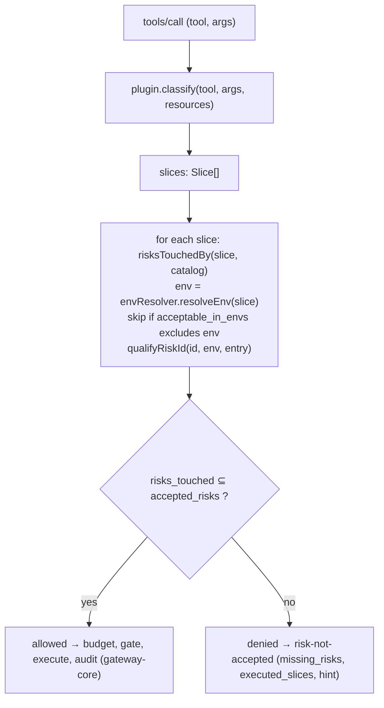

# Policy engine — `@vaubaan/policy-engine`

Pure modules around **slices** and **risk catalogs** (spec
[`gateway-risk-model.md`](../spec/gateway-risk-model.md) §3, §4, §8 ;
[`vaubaan-gateway.md`](../spec/vaubaan-gateway.md) §4.1). No IO, no state :
the gateway feeds it parsed objects (`IndexedRiskCatalog`, `Slice[]`,
`Resource[]`) and gets a decision back. The only dependency is
`@vaubaan/shared` — types from the barrel, values (`parseRiskId`,
`formatRiskId`, `isRiskId`) from the browser-safe subpath
`@vaubaan/shared/risk-id`, because the issuance UI bundles this package and
the barrel drags in argon2 through `api-key.ts`.

Rewritten in English at P0.2 (ADR [[plugin-contract-and-credential-spec]]
D3, D8) : the engine now resolves environments through an `EnvResolver`
over v5 `Resource`s instead of v4 bindings, and two v4 modules are
quarantined.

## Modules

| Module               | Responsibility                                                                                                                                              | Called from                                         |
| -------------------- | ----------------------------------------------------------------------------------------------------------------------------------------------------------- | --------------------------------------------------- |
| `slice-dsl.ts`       | Parse / serialize the slice grammar (path on the data model + action `R`/`W`).                                                                              | catalog loader (SDK), classifiers, audit, tests     |
| `slice-matcher.ts`   | Predicates `matches` / `covers` / `intersects` between slice patterns.                                                                                      | `risk-evaluator`, lints                             |
| `risk-evaluator.ts`  | `indexCatalog` (parse every `matches` once, unique ids) + `risksTouchedBy[All]` for executed slices.                                                        | `risk-runtime`, SDK registry, test kit              |
| `risk-policy.ts`     | `checkAcceptableInEnv` (issuance-time structural restriction) + `prepareCatalog` (boot checks, injectable `warn`) + `hasFallbackRisk`.                      | SDK catalog loader, issuance                        |
| `qualify.ts`         | Env-qualify a `RiskId` (`provider.name` → `provider[env].name`) and back ; `EnvResolver` + `resourceEnvResolver` ; `resolveVector`.                         | `risk-runtime`, issuance UI, SDK                    |
| `risk-runtime.ts`    | `evaluateCall` — the pure risk step of the call decision : strict-fail if `risks_touched ⊄ accepted`.                                                       | gateway-core `risk-gateway.ts` (with `envResolver`) |
| `legacy-bindings.ts` | **Quarantined.** `resourceFromBinding` / `bindingsEnvResolver(ProviderBinding[])` bridge for the v4 app. Deleted at P1.2 / P1.6 with `shared/legacy-v4.ts`. | `apps/gateway/src/lib/gateway/legacy-v4-gateway.ts` |
| `scope-injection.ts` | **Quarantined.** v4 auto-fill of owner/repo, projectId, project_ref, teamId. Returns `null` unless `{ enabled: true }` (plan §8-Q4).                        | `apps/gateway/src/lib/gateway/legacy-v4-gateway.ts` |

The barrel `src/index.ts` re-exports all eight. The listing below names
functions; the exported types travel with them (`SliceSegment` lives in
`@vaubaan/shared`, plus `QualifiableRiskEntry`, `PrepareCatalogOptions`,
`EvaluateCallInput`, `ScopeInjectionFlags`, `InjectionPlan`, `ScopeContext`
and the `SCOPE_INJECTION_DEFAULT_FLAGS` constant).

```
packages/policy-engine/
  src/
    slice-dsl.ts          parseSlice / serializeSlice / SliceParseError
    slice-matcher.ts      matches / covers / intersects
    risk-evaluator.ts     indexCatalog / risksTouchedBy / risksTouchedByAll / findRiskEntry
    risk-policy.ts        checkAcceptableInEnv / prepareCatalog
    qualify.ts            isEnvScopedEntry / isAcceptableInEnv / qualifyRiskId / unqualifyRiskId /
                          EnvResolver / noEnvResolver / resourceEnvResolver / envResolverFor /
                          EnvDeriver / resolveVector
    risk-runtime.ts       evaluateCall / evaluateCallSimple
    legacy-bindings.ts    resourceFromBinding / bindingsEnvResolver            (quarantine)
    scope-injection.ts    injectionPlanFor / stripInjectedArgs / mergeInjectedArgs (quarantine, flag)
  tests/unit/
    slice-dsl (23)  slice-matcher (29)  risk-evaluator (11)  risk-policy (9)
    qualify (21)    risk-runtime (17)   scope-injection (13)
```

## Decision flow



The runtime is **stateless**. Budget, rate limit and gate are evaluated by
the gateway after an `allowed` outcome, with session counters as input ;
they never run on a denied call.

## Modules in detail

### `slice-dsl.ts`

`parseSlice(input) → Slice` implements spec §3 :

```
slice    ::= provider '.' segment ('.' segment)* '.' action
segment  ::= ident | '[' inner ']' | '*' | '**'
inner    ::= ident | ident (',' ident)* | '*' | '**'
ident    ::= [a-zA-Z0-9_/-]+   (inside brackets: [a-zA-Z0-9_./~-]+, glob `*` allowed)
action   ::= 'R' | 'W'
```

Accepted : `github.repo[sbw-vaubaan/gateway].branch[main].W`,
`supabase.project[**].schema[public].table[users].row[*].R`,
`github.repo[**].branch[feature/*,fix/*].file[**].W`, `github.**.W`.
`serializeSlice` produces the canonical form (no dot between a name and its
bracket, bare `*`/`**` normalized to `[*]`/`[**]`). `SliceParseError`
carries `input`, `position` and a short message.

### `slice-matcher.ts`

- `matches(pattern, concrete)` — the pattern may hold wildcards, the
  concrete slice may not.
- `covers(a, b)` — partial order on patterns : every concrete matched by `b`
  is matched by `a`.
- `intersects(a, b)` — symmetric ; true iff some concrete slice matches
  both. Used by `risksTouchedBy` because a classifier may itself emit a
  wildcard (`service-var[*].W`).

Segment-by-segment matching ; `[**]` consumes zero or more segments with
backtracking ; the in-bracket glob `*` expands over `BRACKET_IDENT_CHAR_CLASS`
(exported by `slice-dsl.ts`, `[a-zA-Z0-9_./~-]`), the same class the parser
accepts, so `branch[release-*]` matches `release-1.2` and `file[*]` matches
`a.ts` : a pattern never accepts less than an identifier may contain.
Glob × glob `intersects` is exact for globs with one `*` each (literal
prefixes and suffixes must extend one another) and fails closed (`true`)
when both sides carry several `*` ; `covers` uses the same split (a glob
covers itself and any glob whose literals extend its own).

### `risk-evaluator.ts`

`indexCatalog(catalog) → IndexedRiskCatalog` parses every `matches` once
(string or list, OR semantics), enforces id uniqueness and provider
consistency of patterns, and marks the catalog's fallback entry
(`fallback: boolean` per indexed entry). `risksTouchedBy(slice, indexed) →
RiskId[]` returns, in catalog order, every non-fallback entry one of whose
patterns intersects the slice ; **the fallback is included only when no
other entry matched** (ADR [[fallback-risk-only-when-uncategorized]]) ;
empty means nothing covers the slice, not even the fallback.
`risksTouchedByAll(slices, indexed)` unions and deduplicates, applying the
fallback rule per slice. `findRiskEntry(indexed, id)` is an O(N) lookup,
N small.

Fallback detection : `isFallbackEntry(entry, provider, patterns?)` — the
explicit `fallback` flag when present ; otherwise a catch-all write pattern
(`<provider>.**.W`, `isCatchAllWritePattern`) or the id prefix
`fallbackRiskPrefix(provider)` = `<provider>.uncategorized`.
`fallbackEntriesOf(catalog)` and `hasFallbackRisk(catalog)` derive from it
(moved here from `risk-policy.ts`, same barrel exports).

### `risk-policy.ts`

- `checkAcceptableInEnv(entry, env)` — refuses at issuance when the entry
  is env-scoped and the resource's environment label is absent or not in
  the list. Returns a message or `null`. Built on `isAcceptableInEnv`.
- `prepareCatalog(catalog, { warn? })` — `indexCatalog` (patterns parsed,
  ids unique) + RiskId grammar (`isRiskId` from `@vaubaan/shared`) ; a
  missing fallback (`hasFallbackRisk`) calls `warn` (default
  `console.warn`). The SDK loader silences `warn` and re-checks the fallback
  itself (`fallbackIssues`, a hard error requiring exactly one) ; the SDK
  registry silences it too ; here it stays a warning so partial catalogs
  can be indexed in tests and tooling.

### `qualify.ts`

`isAcceptableInEnv(entry, env)` is the one rule for `acceptable_in_envs` :
an entry that is not env-scoped (no list, or an empty one) is acceptable
anywhere ; an env-scoped entry only in a listed env, never without an env.
Issuance (`checkAcceptableInEnv`), the runtime (`evaluateCall`), the plugin
SDK's preset checks and the store's `RegistryCatalogIndex` all call it, so
the four places cannot disagree (an empty list used to be refused by one of
them).

- `isEnvScopedEntry(entry)` — true iff `acceptable_in_envs` is non-empty ;
  that is the marker of an env-scoped risk.
- `qualifyRiskId(baseId, env, entry)` — `supabase.bulk-row-write` →
  `supabase[staging].bulk-row-write` when the entry is env-scoped and `env`
  non-empty ; already-qualified ids and account-scoped entries are returned
  unchanged. `unqualifyRiskId` is the inverse. Both are built on
  `parseRiskId` / `formatRiskId` from `@vaubaan/shared` — no string
  surgery here.
- `EnvResolver { resolveEnv(slice): string | null }` — the runtime's only
  notion of "which environment does this slice fall under".
  `noEnvResolver` never qualifies (test mode). `resourceEnvResolver(resources)`
  applies the v4 rule to v5 `Resource`s : same provider, first `ident`
  segment equal to a `ref` wins ; no ref in the path and exactly one
  resource of the provider → that resource's env ; several resources and no
  ref → `null` (ambiguous).
- `EnvDeriver` = `(slice, resources) → env | null | undefined` — the shape
  of the SDK's `ProviderPlugin.envOf`, declared here so this package does
  not import the SDK. `envResolverFor(resources, derive?)` is the composed
  default resolver (ADR [[fallback-risk-only-when-uncategorized]] D4 ;
  spec vaubaan-gateway §0 "Resource") : the plugin's derivation when it
  returns a non-empty string (Vercel's `env[prod]` segment, GitHub's
  branch), else the resource label (`resourceEnvResolver`), else `null`.
  Without a deriver it is exactly `resourceEnvResolver(resources)`.
- `resolveVector(entry, env)` — base vector with `vector_overrides[env]`
  applied.

### `risk-runtime.ts`

```ts
evaluateCall({
  executed_slices,            // Slice[] from the plugin
  token_accepted_risks,       // ReadonlySet<RiskId> — the keys of the mission policy
  token_denied_risks?,        // explicit opt-outs (v4 tokens) — trump acceptance
  catalog,                    // IndexedRiskCatalog of the provider
  envResolver?,               // resourceEnvResolver(missionResources) ; omitted = no qualification
  bindings?,                  // @deprecated v4 bindings — wrapped by bindingsEnvResolver
}) → RiskDecision
```

```
executed_slices empty                       → denied (classification gap)
risks_touched empty                         → denied (catalog gap — add a fallback)
any touched risk ∈ token_denied_risks       → denied (explicit deny)
risks_touched ⊄ token_accepted_risks        → denied (missing_risks)
otherwise                                   → allowed (risks_touched)
```

When a resolver is given, a risk whose `acceptable_in_envs` excludes the
resolved env is skipped, so overlapping entries with disjoint env lists
never produce phantom qualified ids. Every denial carries
`code: 'risk-not-accepted'` (the only code this step emits) and a `hint`
saying what to do (ask the mission creator to re-issue, or restrict the
operation) ; the structured refusal body is gateway-core's job (P0.5).
`evaluateCallSimple(catalog, slices, accepted)` is for tests and
integration code ; never on the hot path (pre-index at boot).

### Quarantined modules

`legacy-bindings.ts` maps a `ProviderBinding` to a `Resource`
(`resource_ref → ref`, `environment → env`, `display_name → displayName`,
`metadata`) and wraps `resourceEnvResolver`. `risk-runtime` uses it only
when a caller still passes `bindings` (none in v5) ; the legacy v4 app
uses `resourceFromBinding` to feed gateway-core's decision core. Deleted
at P1.2 / P1.6 with the v4 pipeline and `shared/legacy-v4.ts`.

`scope-injection.ts` keeps the v4 behaviour (auto-fill `owner`/`repo`,
`projectId`, `project_ref`, `teamId` when a token has exactly one binding
of the provider) but `injectionPlanFor(provider, scope, flags)` returns
`null` unless `flags.enabled` is true ; the default
`SCOPE_INJECTION_DEFAULT_FLAGS` is `{ enabled: false }`.
`stripInjectedArgs` and `mergeInjectedArgs` are unchanged. The v5
replacement, if plan §8-Q4 says yes, is the plugin hook `normalizeArgs`
behind the SDK's `argNormalization` flag ([[plugin-sdk]]). Nothing else in
v5 may depend on this module.

## Wiring

At boot the plugin SDK loads each YAML catalog and the registry calls
`prepareCatalog` ; the execution door then evaluates :

```ts
import { evaluateCall, resourceEnvResolver } from '@vaubaan/policy-engine';

const outcome = plugin.classify(tool, args, missionResources);
if ('denied' in outcome) return refuse(outcome.denied);
const decision = evaluateCall({
  executed_slices: outcome.slices,
  token_accepted_risks: new Set(acceptedRisksOf(mission)),
  token_denied_risks: new Set(), // v5 missions deny nothing explicitly
  catalog: registry.catalogOf(providerId),
  envResolver: resourceEnvResolver(missionResources),
});
if (decision.outcome === 'allowed') {
  /* budget, gate, execute, audit */
} else {
  /* risk-not-accepted */
}
```

`gateway-core`'s `evaluateCallForToken` does exactly this, with
`resourceEnvResolver(resources)` as the default resolver. Nothing in v5
passes `bindings` any more ; the field and `legacy-bindings.ts` stay until
P1.6 deletes the v4 app that still holds bindings.

## How to debug

- **`risks_touched` empty, slice looks right** — no catalog pattern
  intersects it, not even the fallback. Check the slice against the
  plugin's `dataModel` ; the fallback `<provider>.**.W` catches writes only,
  reads need their own entry.
- **The fallback is accepted but the call is denied** — the fallback no
  longer co-fires with a dedicated entry ; `missing_risks` names the entry
  to accept. Conversely, the fallback appearing in `risks_touched` means no
  dedicated entry covers that write : add one to the catalog.
- **Denied although the risk is accepted** — qualification mismatch. The
  mission stores `supabase[staging].bulk-row-write` ; the runtime qualifies
  with the env the resolver returns. Is the resource labelled ? Does the
  slice path carry the resource `ref` ? Is the entry env-scoped
  (non-empty `acceptable_in_envs`) ? An account-scoped entry is never
  qualified and must be accepted unqualified.
- **`indexCatalog` / `prepareCatalog` throws at boot** — a `matches` pattern
  is malformed or names another provider ; the message includes the risk id.
  With the SDK loader every issue is listed at once.
- **Scope injection does nothing** — expected : the flag is off. Pass
  `{ enabled: true }` explicitly, and only from v4 code.

## Extension

- **New matching operator** — extend `slice-dsl.ts` (lexer + parser),
  `SliceSegment` in `@vaubaan/shared` `risk.ts`, every `*Segments` /
  `*One` helper of `slice-matcher.ts`, and the matcher tests.
- **Another environment source** — implement `EnvResolver` ; do not touch
  `risk-runtime.ts`.
- **A new structural guardrail at issuance** — a sibling of
  `checkAcceptableInEnv` in `risk-policy.ts`, consumed by the issuance
  path, never by the runtime.

## References

- Spec : [`gateway-risk-model.md`](../spec/gateway-risk-model.md) §3, §4,
  §8 ; [`vaubaan-gateway.md`](../spec/vaubaan-gateway.md) §3.1, §4.1.
- ADRs : [[plugin-contract-and-credential-spec]],
  [[unified-gates-drop-confirm]], [[scope-caps-amplification-axis]].
- Neighbours : [[plugin-sdk]], [`providers/README.md`](./providers/README.md).
- Tests : `npx vitest run packages/policy-engine` — 119 tests.
