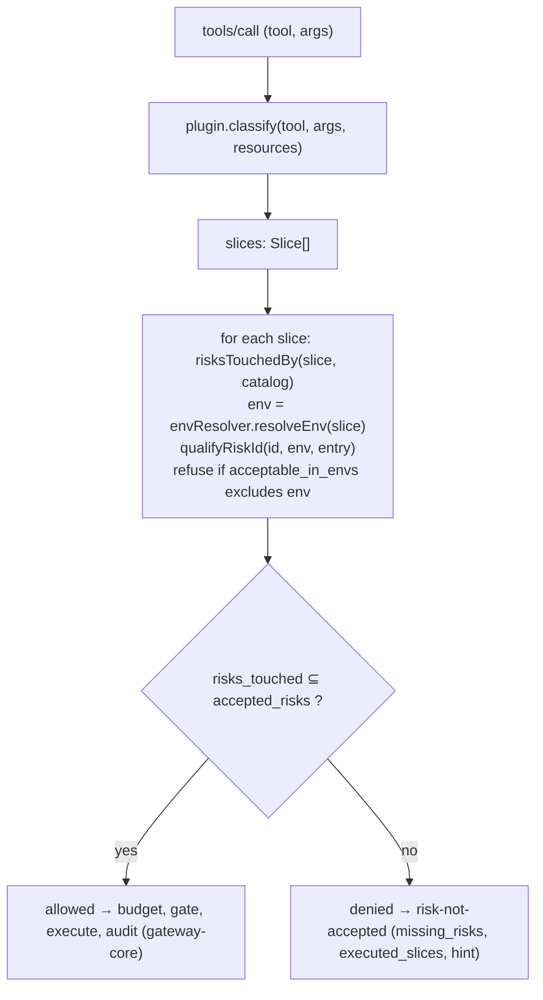

# Policy engine — `@vaubaan/policy-engine`

Pure modules around **slices** and **risk catalogs** (spec
[`gateway-risk-model.md`](../spec/gateway-risk-model.md) §3, §4, §8;
[`vaubaan-gateway.md`](../spec/vaubaan-gateway.md) §4.1). No IO, no state:
the gateway feeds it parsed objects (`IndexedRiskCatalog`, `Slice[]`,
`Resource[]`) and gets a decision back. The only dependency is
`@vaubaan/shared` — types from the barrel, values (`parseRiskId`,
`formatRiskId`, `isRiskId`) from the browser-safe subpath
`@vaubaan/shared/risk-id`, because the issuance UI bundles this package and
the barrel drags in argon2 through `api-key.ts`.

Rewritten in English at P0.2 (ADR
[plugin-contract-and-credential-spec](../decisions/plugin-contract-and-credential-spec.md)
D3, D8): the engine resolves environments through an `EnvResolver` over v5
`Resource`s instead of v4 bindings; the two v4 modules
(`legacy-bindings.ts`, `scope-injection.ts`) were deleted with the v4
application.

## Modules

| Module              | Responsibility                                                                                                                                                                              | Called from                                                              |
| ------------------- | ------------------------------------------------------------------------------------------------------------------------------------------------------------------------------------------- | ------------------------------------------------------------------------ |
| `slice-dsl.ts`      | Parse / serialize the slice grammar (path on the data model + action `R`/`W`).                                                                                                              | catalog loader (SDK), classifiers, audit, tests                          |
| `slice-matcher.ts`  | Predicates `matches` / `covers` / `intersects` between slice patterns.                                                                                                                      | `risk-evaluator`, lints                                                  |
| `risk-evaluator.ts` | `indexCatalog` (parse every `matches` once, unique ids) + `risksTouchedBy[All]` for executed slices + fallback detection (`isFallbackEntry`, `fallbackEntriesOf`, `hasFallbackRisk`).       | `risk-runtime`, `risk-policy`, SDK catalog loader, registry and test kit |
| `risk-policy.ts`    | `checkAcceptableInEnv` (issuance-time structural restriction) + `prepareCatalog` (boot checks, injectable `warn`).                                                                          | SDK catalog loader and registry, issuance                                |
| `budget.ts`         | `budgetIssues` — the one rule for a quota, a rate limit and a gate (spec §3.2), with `isValidBudget`, `ratePerMinute`, `exceedsRateCeiling`.                                                | SDK catalog loader and `presetIssues`; the issuance preview (to wire)    |
| `qualify.ts`        | Env-qualify a `RiskId` (`provider.name` → `provider[env].name`) and back; `EnvResolver` + `resourceEnvResolver` + `envResolverFor` (plugin `envOf` first, then the label); `resolveVector`. | `risk-runtime`, issuance UI, SDK                                         |
| `risk-runtime.ts`   | `evaluateCall` — the pure risk step of the call decision: strict-fail if `risks_touched ⊄ accepted`.                                                                                        | gateway-core `risk-gateway.ts` (with `envResolver`)                      |

The barrel `src/index.ts` re-exports all seven. The listing below names
functions; the exported types travel with them (`SliceSegment` lives in
`@vaubaan/shared`, plus `IndexedRiskCatalog`, `QualifiableRiskEntry`,
`PrepareCatalogOptions`, `EvaluateCallInput`, `EnvResolver`, `EnvDeriver`,
`BudgetInput`, `ValidBudget`, `BudgetField`, `BudgetIssue` and the
`BRACKET_IDENT_CHAR_CLASS`, `UNQUALIFIED` and `SECONDS_PER_MINUTE`
constants).

```
packages/policy-engine/
  src/
    slice-dsl.ts          parseSlice / serializeSlice / SliceParseError / BRACKET_IDENT_CHAR_CLASS
    slice-matcher.ts      matches / covers / intersects
    risk-evaluator.ts     indexCatalog / risksTouchedBy / risksTouchedByAll / findRiskEntry /
                          isFallbackEntry / fallbackEntriesOf / hasFallbackRisk /
                          fallbackRiskPrefix / isCatchAllWritePattern / hasCatchAllWritePattern
    risk-policy.ts        checkAcceptableInEnv / prepareCatalog
    budget.ts             budgetIssues / isValidBudget / isPositiveInteger / ratePerMinute /
                          exceedsRateCeiling
    qualify.ts            isEnvScopedEntry / isAcceptableInEnv / qualifyRiskId / unqualifyRiskId /
                          EnvResolver / noEnvResolver / resourceEnvResolver / envResolverFor /
                          EnvDeriver / resolveVector
    risk-runtime.ts       evaluateCall / evaluateCallSimple / UNQUALIFIED
  tests/unit/
    slice-dsl (23)  slice-matcher (29)  risk-evaluator (20)  risk-policy (9)
    qualify (29)    risk-runtime (25)   budget (25)
```

## Decision flow



The runtime is **stateless**. Budget, rate limit and gate are evaluated by
the gateway after an `allowed` outcome, with session counters as input;
they never run on a denied call.

## Modules in detail

### `slice-dsl.ts`

`parseSlice(input) → Slice` implements spec §3:

```
slice    ::= provider '.' segment ('.' segment)* '.' action
segment  ::= ident | '[' inner ']' | '*' | '**'
inner    ::= ident | ident (',' ident)* | '*' | '**'
ident    ::= [a-zA-Z0-9_/-]+   (inside brackets: [a-zA-Z0-9_./~-]+, glob `*` allowed)
action   ::= 'R' | 'W'
```

Accepted: `github.repo[sbw-vaubaan/gateway].branch[main].W`,
`supabase.project[**].schema[public].table[users].row[*].R`,
`github.repo[**].branch[feature/*,fix/*].file[**].W`, `github.**.W`.
`serializeSlice` produces the canonical form (no dot between a name and its
bracket, bare `*`/`**` normalized to `[*]`/`[**]`). `SliceParseError`
carries `input`, `position` and a short message. The parser reads one
segment at a time through `readBracketSegment` / `readBareToken` (which
also recognises the terminal action) and `skipSeparator`.

### `slice-matcher.ts`

- `matches(pattern, concrete)` — the pattern may hold wildcards, the
  concrete slice may not.
- `covers(a, b)` — partial order on patterns: every concrete matched by `b`
  is matched by `a`.
- `intersects(a, b)` — symmetric; true iff some concrete slice matches
  both. Used by `risksTouchedBy` because a classifier may itself emit a
  wildcard (`service-var[*].W`).

Segment-by-segment matching; `[**]` consumes zero or more segments with
backtracking; the in-bracket glob `*` expands over `BRACKET_IDENT_CHAR_CLASS`
(exported by `slice-dsl.ts`, `[a-zA-Z0-9_./~-]`), the same class the parser
accepts, so `branch[release-*]` matches `release-1.2` and `file[*]` matches
`a.ts`: a pattern never accepts less than an identifier may contain.
Glob × glob `intersects` is exact for globs with one `*` each (literal
prefixes and suffixes must extend one another) and fails closed (`true`)
when both sides carry several `*`; `covers` uses the same split (a glob
covers itself and any glob whose literals extend its own).

### `risk-evaluator.ts`

`indexCatalog(catalog) → IndexedRiskCatalog` parses every `matches` once
(string or list, OR semantics), enforces id uniqueness and provider
consistency of patterns, and marks the catalog's fallback entry
(`fallback: boolean` per indexed entry). `risksTouchedBy(slice, indexed) →
RiskId[]` returns, in catalog order, every non-fallback entry one of whose
patterns intersects the slice; **the fallback is included only when no
other entry matched** (ADR
[fallback-risk-only-when-uncategorized](../decisions/fallback-risk-only-when-uncategorized.md));
empty means nothing covers the slice, not even the fallback.
`risksTouchedByAll(slices, indexed)` unions and deduplicates, applying the
fallback rule per slice. `findRiskEntry(indexed, id)` is an O(N) lookup,
N small.

Fallback detection: `isFallbackEntry(entry, provider, patterns?)` — the
explicit `fallback` flag when present; otherwise a catch-all write pattern
(`<provider>.**.W`, `isCatchAllWritePattern`) or the id prefix
`fallbackRiskPrefix(provider)` = `<provider>.uncategorized-` — dash
included, so `github.uncategorizedfoo` is an ordinary risk.
`fallbackEntriesOf(catalog)` and `hasFallbackRisk(catalog)` derive from it
(moved here from `risk-policy.ts`, same barrel exports).
`hasCatchAllWritePattern(entry)` tells whether one of an entry's patterns
is the catch-all write; the SDK loader requires it of the fallback entry,
because the fallback is the one entry left out of the touched risks when
another entry matches.

### `risk-policy.ts`

- `checkAcceptableInEnv(entry, env)` — refuses at issuance when the entry
  is env-scoped and the resource's environment label is absent or not in
  the list. Returns a message or `null`. Built on `isAcceptableInEnv`.
- `prepareCatalog(catalog, { warn? })` — `indexCatalog` (patterns parsed,
  ids unique) + RiskId grammar (`isRiskId` from `@vaubaan/shared`); a
  missing fallback (`hasFallbackRisk`) calls `warn` (default
  `console.warn`). The SDK loader silences `warn` and re-checks the fallback
  itself (`fallbackIssues`, a hard error requiring exactly one); the SDK
  registry silences it too; here it stays a warning so partial catalogs
  can be indexed in tests and tooling.

### `budget.ts`

The budget rule of spec §3.2 ("always numbers, never unbounded"), in one
pure function shared by every place a budget is judged:

- `budgetIssues({ quota, rate_limit, gate }) → BudgetIssue[]` — the inputs
  are `unknown` (YAML, a TypeScript literal, a form). `quota`,
  `rate_limit.max` and `rate_limit.window_seconds` must be positive
  integers (`isPositiveInteger`: no `Infinity`, `NaN`, fraction, zero or
  negative), `rate_limit` a mapping, `gate` one of `GATES`. Each issue is
  `{ field, message }` with `field` one of `quota`, `rate_limit`,
  `rate_limit.max`, `rate_limit.window_seconds`, `gate`; the caller adds
  its own path prefix. An absent `gate` is an issue: the YAML loader
  defaults it to `auto` before calling.
- `isValidBudget(entry)` — type guard over the same rule
  (`entry is ValidBudget`).
- `ratePerMinute(rate)` and `exceedsRateCeiling(rate, ceilingPerMinute)` —
  the comparison of a rate limit with a catalog's per-minute ceiling
  (`null` / `undefined` ceiling: never exceeded).

Callers: the SDK's YAML loader (`presetEntryFrom`) and `presetIssues`, which
`definePlugin`, the registry and the test kit run on every catalog,
including one written in TypeScript. The issuance preview of the
application (`apps/gateway/src/server/missions/preview.ts`, `budgetProblem`)
still carries its own copy of the rule; it is meant to delegate to
`budgetIssues` and `exceedsRateCeiling`. The module is browser-safe: the
gate set comes from the subpath `@vaubaan/shared/domain`.

### `qualify.ts`

`isAcceptableInEnv(entry, env)` is the one rule for `acceptable_in_envs`:
an entry that is not env-scoped (no list, or an empty one) is acceptable
anywhere; an env-scoped entry only in a listed env, never without an env.
Issuance (`checkAcceptableInEnv`), the runtime (`evaluateCall`), the plugin
SDK's preset checks and the composition root's `RegistryCatalogIndex` (the
store's `CatalogIndex`, `apps/gateway/src/server/compose/registry.ts`) all
call it, so the four places cannot disagree (an empty list used to be refused by one of
them).

- `isEnvScopedEntry(entry)` — true iff `acceptable_in_envs` is non-empty;
  that is the marker of an env-scoped risk.
- `qualifyRiskId(baseId, env, entry)` — `supabase.bulk-row-write` →
  `supabase[staging].bulk-row-write` when the entry is env-scoped and `env`
  non-empty; already-qualified ids and account-scoped entries are returned
  unchanged. `unqualifyRiskId` is the inverse. Both are built on
  `parseRiskId` / `formatRiskId` from `@vaubaan/shared` — no string
  surgery here.
- `EnvResolver { resolveEnv(slice): string | null }` — the runtime's only
  notion of "which environment does this slice fall under".
  `noEnvResolver` resolves every slice to `null`; it is an ordinary
  resolver, not a mode switch (see `evaluateCall`). `resourceEnvResolver(resources)`
  applies the v4 rule to v5 `Resource`s: same provider, first `ident`
  segment equal to a `ref` wins; no ref in the path and exactly one
  resource of the provider → that resource's env; several resources and no
  ref → `null` (ambiguous).
- `EnvDeriver` = `(slice, resources) → env | null | undefined` — the shape
  of the SDK's `ProviderPlugin.envOf`, declared here so this package does
  not import the SDK. `envResolverFor(resources, derive?)` is the composed
  default resolver (ADR
  [fallback-risk-only-when-uncategorized](../decisions/fallback-risk-only-when-uncategorized.md)
  D4;
  spec vaubaan-gateway §0 "Resource"): the plugin's derivation when it
  returns a non-empty string (Vercel's `env[prod]` segment — the only
  shipped plugin with one), else the resource label
  (`resourceEnvResolver`), else `null`.
  Without a deriver it is exactly `resourceEnvResolver(resources)`.
- `resolveVector(entry, env)` — base vector with `vector_overrides[env]`
  applied.

### `risk-runtime.ts`

```ts
evaluateCall({
  executed_slices,            // Slice[] from the plugin
  token_accepted_risks,       // ReadonlySet<RiskId> — the keys of the mission policy
  token_denied_risks?,        // legacy explicit opt-outs — trump acceptance; v5 passes none
  catalog,                    // IndexedRiskCatalog of the provider
  envResolver?,               // an EnvResolver (host) | 'unqualified' (tooling, tests); omitted = 'unqualified'
}) → RiskDecision
```

```
executed_slices empty                                → denied (classification gap)
an env-scoped risk touched outside its envs          → denied (not acceptable here)
risks_touched empty                                  → denied (catalog gap — add a fallback)
any touched risk ∈ token_denied_risks                → denied (explicit deny, legacy input)
risks_touched ⊄ token_accepted_risks                 → denied (missing_risks)
otherwise                                            → allowed (risks_touched)
```

The mode is decided by the `envResolver` input alone, never by which
object is passed:

- an `EnvResolver` — the host mode. `collectQualifiedRisks` resolves each
  slice's environment, qualifies the touched risks and records every
  env-scoped risk whose `acceptable_in_envs` excludes that environment (or
  whose resource carries no label). Such a risk is **never dropped**: the
  call is refused, the risk listed in `missing_risks` under the id it
  would have there, and the hint names the environments it is acceptable
  in. Any resolver selects this mode, including `noEnvResolver` or a
  wrapper around it — those say "nothing is labelled" and therefore refuse
  every env-scoped risk;
- `'unqualified'` (the exported constant `UNQUALIFIED`) — catalog tooling
  and tests: no qualification, `acceptable_in_envs` not applied;
- omitted — the same as `'unqualified'`, kept so existing callers keep
  working. New code names the mode.

`token_denied_risks` is the v4 explicit-deny input. Spec §4.1 has no
explicit deny and the execution door always passes an empty list; the
branch stays while callers still pass the field (the application's risk
stage and one plugin test do, with `[]`). Removing it means dropping the
field from those callers first.

Every denial is built by one `denied(...)` helper and carries
`code: 'risk-not-accepted'` (the only code this step emits) and a `hint`
saying what to do (ask the mission creator to re-issue, or restrict the
operation); the structured refusal body is gateway-core's job (P0.5).
`evaluateCallSimple(catalog, slices, accepted)` is for tests and
integration code and runs in the unqualified mode; never on the hot path
(pre-index at boot).

### What was removed with the v4 application

`legacy-bindings.ts` (the `ProviderBinding` → `Resource` bridge and the
`bindings` input of `evaluateCall`) and `scope-injection.ts` (v4's auto-fill
of `owner`/`repo`, `projectId`, `project_ref`, `teamId` from project
bindings, which had been quarantined behind a flag that defaulted to off).
If plan §8-Q4 is answered "yes", the v5 form is the plugin hook
`normalizeArgs` behind the SDK's `argNormalization` flag
([plugin-sdk](./plugin-sdk.md)).

## Wiring

At boot the plugin SDK loads each YAML catalog and the registry calls
`prepareCatalog`; the execution door then evaluates:

```ts
import { envResolverFor, evaluateCall } from '@vaubaan/policy-engine';

const outcome = plugin.classify(tool, args, missionResources);
if ('denied' in outcome) return refuse(outcome.denied);
const decision = evaluateCall({
  executed_slices: outcome.slices,
  token_accepted_risks: new Set(acceptedRisksOf(mission)),
  catalog: registry.catalogOf(providerId),
  envResolver: envResolverFor(missionResources, plugin.envOf?.bind(plugin)),
});
if (decision.outcome === 'allowed') {
  /* budget, gate, execute, audit */
} else {
  /* risk-not-accepted */
}
```

`gateway-core`'s `evaluateCallForToken` does exactly this, with
`envResolverFor(resources, adapter.envOf?.bind(adapter))` as the default
resolver; the execution door reaches it through its risk stage
(`apps/gateway/src/server/execution/risk-stage.ts`). The v4 `bindings`
input and its bridge (`legacy-bindings.ts`) were deleted with the v4
application.

## How to debug

- **`risks_touched` empty, slice looks right** — no catalog pattern
  intersects it, not even the fallback. Check the slice against the
  plugin's `dataModel`; the fallback `<provider>.**.W` catches writes only,
  reads need their own entry.
- **The fallback is accepted but the call is denied** — the fallback no
  longer co-fires with a dedicated entry; `missing_risks` names the entry
  to accept. Conversely, the fallback appearing in `risks_touched` means no
  dedicated entry covers that write: add one to the catalog.
- **Denied although the risk is accepted** — qualification mismatch. The
  mission stores `supabase[staging].bulk-row-write`; the runtime qualifies
  with the env the resolver returns. Is the resource labelled? Does the
  slice path carry the resource `ref`? Is the entry env-scoped
  (non-empty `acceptable_in_envs`)? An account-scoped entry is never
  qualified and must be accepted unqualified.
- **Denied with "is touched on a resource … but is acceptable only in
  […]"** — the call touches an env-scoped risk in an environment its
  catalog entry excludes, or on an unlabelled resource. No mission can
  hold that risk there; label the resource if the label is what is
  missing, otherwise the operation is structurally refused.
- **`indexCatalog` / `prepareCatalog` throws at boot** — a `matches` pattern
  is malformed or names another provider; the message includes the risk id.
  With the SDK loader every issue is listed at once.

## Extension

- **New matching operator** — extend `slice-dsl.ts` (lexer + parser),
  `SliceSegment` in `@vaubaan/shared` `risk.ts`, every `*Segments` /
  `*One` helper of `slice-matcher.ts`, and the matcher tests.
- **Another environment source** — implement `EnvResolver`; do not touch
  `risk-runtime.ts`.
- **A new structural guardrail at issuance** — a sibling of
  `checkAcceptableInEnv` in `risk-policy.ts`, consumed by the issuance
  path, never by the runtime.
- **A new budget dimension** — add it to `Budget` (`@vaubaan/shared`), to
  `BudgetInput` / `BudgetField` and to `budgetIssues`; the loader, the
  preset checks and the test kit follow without a change.

## References

- Spec: [`gateway-risk-model.md`](../spec/gateway-risk-model.md) §3, §4,
  §8; [`vaubaan-gateway.md`](../spec/vaubaan-gateway.md) §3.1, §4.1.
- ADRs:
  [plugin-contract-and-credential-spec](../decisions/plugin-contract-and-credential-spec.md),
  [unified-gates-drop-confirm](../decisions/unified-gates-drop-confirm.md),
  [scope-caps-amplification-axis](../decisions/scope-caps-amplification-axis.md).
- Neighbours: [plugin-sdk](./plugin-sdk.md), [`providers/README.md`](./providers/README.md).
- Tests: `npx vitest run packages/policy-engine` — 160 tests.
