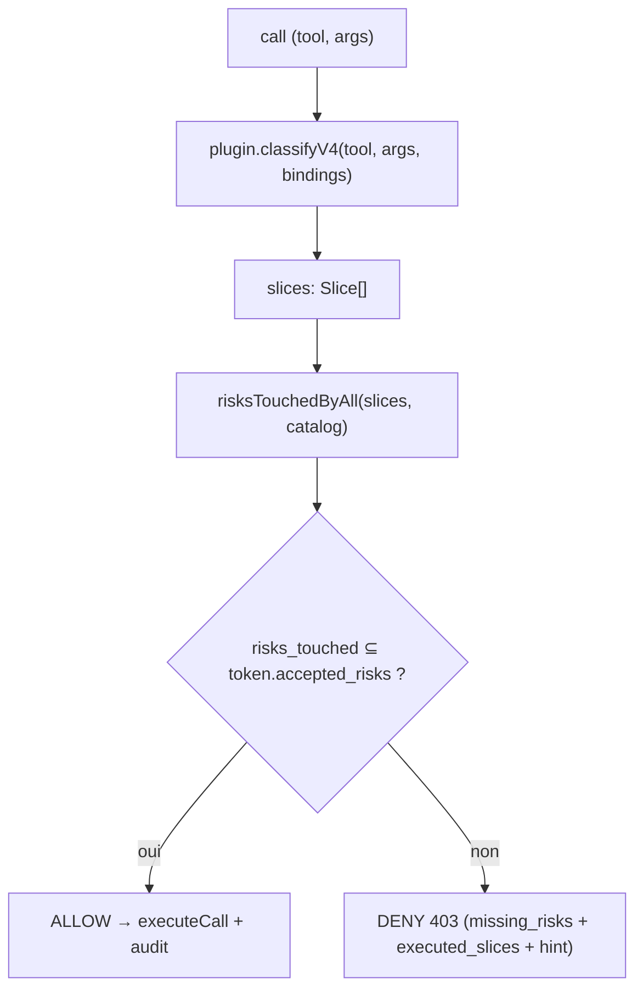

> **v4 document.** English rewrite scheduled by the v5 plan; `tracks` paths updated for the new layout.

# Policy engine — `@vaubaan/policy-engine`

Modules purs autour des **slices** et des **risk catalogs** Vaubaan
(cf. spec [`gateway-risk-model.md`](../spec/gateway-risk-model.md) §3,
§4, §6, §8). Le paquet a été entièrement réécrit lors du pivot v4
(`chore(v1-drop)`, 2026-06-15) : les modules v1 capability-based
(`policy.ts`, `evaluate.ts`, `tools-filter.ts`) ont été supprimés. Ce
qui survit : la totalité du runtime risk-based + le module
`scope-injection.ts` (inchangé, indépendant du modèle d'autorisation).

## Vue d'ensemble

Sept modules purs, étanches, sans état ni IO :

| Module               | Responsabilité                                                                                                                 | Appelé depuis                                   |
| -------------------- | ------------------------------------------------------------------------------------------------------------------------------ | ----------------------------------------------- |
| `slice-dsl.ts`       | Parser / sérialiser la grammaire des slices (chemin sur le data-model + action `R`/`W`).                                       | catalog YAML loader, audit log, tests           |
| `slice-matcher.ts`   | Prédicats `matches` / `covers` / `intersects` entre patterns de slices.                                                        | `risk-evaluator`, lints                         |
| `risk-evaluator.ts`  | Indexer un catalogue (parse les `matches`, vérifie l'unicité des ids) + calculer `risks_touched` pour une slice exécutée.      | `risk-runtime`, `mcp-gateway` (au boot)         |
| `risk-policy.ts`     | Helper mint-time `checkAcceptableInEnv` (structural restriction du catalog) + `prepareCatalog` (boot lint).                    | routes mint (`POST /tokens/preview`, `/tokens`) |
| `qualify.ts`         | Env-qualifier un `RiskId` (`base.name` → `provider[env].name`) et son inverse. Helper de cohérence mint ↔ runtime (spec §4.4). | `risk-runtime`, mint preview, UI mint-form      |
| `risk-runtime.ts`    | Décision pure `evaluateCall` au hot-path `/mcp` : strict-fail si `risks_touched ⊄ accepted`.                                   | `mcp-gateway` (`callTool`)                      |
| `scope-injection.ts` | Hide / auto-fill des arguments déterminés par les `provider_bindings` du projet (owner/repo, projectId, project_ref, teamId).  | `mcp-gateway` (`tools/list` + `tools/call`)     |

Le barrel `src/index.ts` re-exporte les 7 modules. Aucun module ne touche
au DB — la couche route ou le gateway les nourrit avec des objets
parsés (`RiskCatalog`, `ProviderBinding[]`).

## Layout

```
packages/policy-engine/
  src/
    slice-dsl.ts          # parseSlice / serializeSlice — DSL §3 spec
    slice-matcher.ts      # matches / covers / intersects (path-segment)
    risk-evaluator.ts     # indexCatalog / risksTouchedBy(All) / findRiskEntry
    risk-policy.ts        # checkAcceptableInEnv / prepareCatalog
    risk-runtime.ts       # evaluateCall — pure decision function
    scope-injection.ts    # injectionPlanFor / stripInjectedArgs / mergeInjectedArgs
    index.ts              # barrel
  tests/unit/
    slice-dsl.test.ts        (23 tests)
    slice-matcher.test.ts    (26 tests)
    risk-evaluator.test.ts   (10 tests)
    risk-policy.test.ts      (25 tests)
    risk-runtime.test.ts     (9  tests)
    scope-injection.test.ts  (12 tests)
```

## Décision flow

Le hot-path `/mcp` consume `risk-runtime` ; les routes mint consument
`risk-policy`. Schéma simplifié :



Le runtime est **stateless** : aucune résolution mint-time n'a lieu
hors du mint endpoint. Au call, on intersect slices ↔ catalogue, on
check appartenance, c'est tout.

## Modules

### `slice-dsl.ts` — parser/serializer

`parseSlice(input) → Slice` parse la grammaire spec §3 :

```
slice    ::= provider '.' segment ('.' segment)* '.' action
segment  ::= ident | '[' inner ']' | '*' | '**'
inner    ::= ident | ident (',' ident)* | '*' | '**'
ident    ::= [a-zA-Z0-9_/-]+  (avec `*` glob autorisé en bracket)
action   ::= 'R' | 'W'
```

Exemples acceptés :

- `github.repo[sbw-vaubaan/gateway].branch[main].W`
- `supabase.project[**].schema[public].table[users].row[*].R`
- `github.repo[**].branch[feature/*,fix/*].file[**].W`
- `github.**.W` (fallback catalog pattern)

`serializeSlice(slice) → string` produit la forme canonique : un
`name` segment suivi d'un bracket segment n'a **pas** de `.` entre les
deux (`repo[main]` pas `repo.[main]`). Bare `**`/`*` sont normalisés en
`[**]`/`[*]` à la sortie.

`SliceParseError` porte `input`, `position`, et un message court — les
catalogues YAML sont validés au boot et l'erreur remonte vers l'opérateur.

Tests : `slice-dsl.test.ts` (23) — happy path, errors (missing action,
unterminated bracket, empty bracket, invalid ident chars, double dot,
wrong provider chars), round-trip serialize.

### `slice-matcher.ts` — predicates

Trois prédicats, sémantiques distinctes :

- **`matches(pattern, concrete)`** — `pattern` peut contenir wildcards,
  `concrete` n'en contient pas. Vrai ssi le pattern accepte la slice.
  Utilisé au runtime quand le plugin émet une slice concrète.
- **`covers(a, b)`** — `a.covers(b)` ssi tout `concrete` matché par
  `b` est aussi matché par `a`. Partial order sur les patterns ;
  utilisé pour les lints (catalog vs catalog).
- **`intersects(a, b)`** — symétrique, vrai ssi `∃ concrete` matché par
  les deux. Utilisé par `risksTouchedBy` : le plugin peut émettre une
  slice avec wildcards (`service-var[*].W`) et on veut savoir si elle
  recoupe une entrée catalogue (qui contient aussi des wildcards).

Algorithme : matching path-segment par path-segment, avec
`wild-rec` (`[**]`) qui consomme 0+ segments via backtracking. Glob
inside-bracket : `*` matche `[a-zA-Z0-9_/-]+` (pas de regex utilisateur).

Tests : `slice-matcher.test.ts` (26) — matches simple/wild/list/glob,
covers `**` vs `*`, intersects glob×glob, intersects asymétriques.

### `risk-evaluator.ts` — touch detection

`indexCatalog(catalog: RiskCatalog) → IndexedRiskCatalog` parse chaque
`matches` du YAML une seule fois (gain hot-path). Une entrée peut
déclarer un pattern unique OU un tableau (OR-semantics — la slice
touche le risk si ≥1 pattern intersecte).

`risksTouchedBy(slice, catalog) → RiskId[]` retourne en ordre catalogue
toutes les entrées qui intersectent la slice. Vide ⇒ catalogue
incomplet (pas de fallback) → le runtime traite en `deny` (no silent
passthrough).

`risksTouchedByAll(slices[], catalog)` même chose pour un call
multi-slice (ex : `supabase__apply_migration` qui touche DDL+DML).
Dédupliqué, ordre stable.

`findRiskEntry(catalog, riskId)` lookup O(N), N petit (~10-20).

Tests : `risk-evaluator.test.ts` (10) — index une catalog YAML, touched
single/multi, fallback unique, deprecated entries préservés, multi-pattern
OR-semantics, empty catalog.

### `risk-policy.ts` — mint-time helpers

Post drop-confirm (ADR [[unified-gates-drop-confirm]]), ce module se
réduit à deux helpers utilisés au mint :

`checkAcceptableInEnv(entry, env)` — refuse au mint si le catalogue
déclare `acceptable_in_envs: ['preview', 'staging']` et que l'env
binding n'y figure pas. Renvoie un message ou `null`.

`prepareCatalog(catalog)` — wrapper `indexCatalog` + sanity checks
(ids uniques, regex `<provider>[<env>].<name>` ou `<provider>.<name>`,
fallback `<provider>.uncategorized-*` présent). Throw si IDs en doublon ;
warn si fallback absent.

Tests : `risk-policy.test.ts` — `checkAcceptableInEnv` (no-env,
env-not-in-list, ok), `prepareCatalog` (dup, regex fail).

### `risk-runtime.ts` — call-time decision

`evaluateCall({ executed_slices, token_accepted_risks, token_denied_risks,
catalog }) → RiskDecision` est la fonction de décision pure du runtime.
Strict-fail au MVP (spec §8) :

```
if executed_slices empty                        → DENY (classifier gap)
risks_touched = risksTouchedByAll(slices, catalog)
if risks_touched empty                          → DENY (catalog gap)
if any risk ∈ token_denied_risks                → DENY (explicit deny)
if risks_touched ⊄ token_accepted_risks         → DENY (missing_risks)
sinon                                            → ALLOW (risks_touched)
```

Pas de step-up runtime au MVP — le client doit re-minter avec les
`risks_touched` manquants accepted. Reporté en Phase 2 (cf. spec §8).

`evaluateCallSimple(catalog, slices, acceptedRisks)` est un convenience
pour les tests (pas pour le hot-path — pré-indexer au boot).

Tests : `risk-runtime.test.ts` (9) — allow happy, deny missing, deny
empty-slices, deny no-catalog-match, denied_risks override, multi-slice
union, hint message shape.

### `scope-injection.ts` — args hide & fill

Inchangé depuis v1 — indépendant du modèle d'autorisation. 3 fonctions :

- `injectionPlanFor(provider, scope) → InjectionPlan | null` — null si 0
  ou 2+ bindings (l'agent doit fournir). Sinon construit le plan : `owner`
  - `repo` (parse `resource_ref` `^[^/]+/[^/]+$` pour GitHub), `projectId`
    (Vercel/Railway), `project_ref` (Supabase), `teamId` (Vercel via
    `provider_admins.team_id`).
- `stripInjectedArgs(tool, plan) → McpToolDeclaration` — retire les keys
  injectées de `inputSchema.properties` ET de `required[]`. Pure, no-mutate.
- `mergeInjectedArgs(args, plan) → Record<string, unknown>` — auto-fill
  côté serveur avant dispatch. **Caller-provided wins** (un admin peut
  override en MCP Inspector ; l'auto-fill ne s'applique que sur
  undefined/null/'').

Mapping `provider → arg-name` centralisé ici — single source of truth.

Tests : `scope-injection.test.ts` (12) — chaque provider, null si 0/2+
bindings, null si malformed resource_ref, strip retire properties+required,
merge fill missing, caller-override wins, empty string treated as missing.

## Wiring côté gateway

Le gateway charge les catalogues au boot via
`apps/gateway/src/lib/risk-catalog/loader.ts` :

```ts
import { indexCatalog } from '@vaubaan/policy-engine';
import { githubRiskCatalog, vercelRiskCatalog, ... } from '@vaubaan/plugin-*';

// Une fois par runtime — TS imports, pas de YAML au runtime.
const catalogs: Record<Provider, IndexedRiskCatalog> = {
  github: indexCatalog(githubRiskCatalog),
  vercel: indexCatalog(vercelRiskCatalog),
  supabase: indexCatalog(supabaseRiskCatalog),
  railway: indexCatalog(railwayRiskCatalog),
  bash: indexCatalog(sshRiskCatalog),  // historic naming, bash = ssh package
};
```

Le YAML sibling (`plugins/<vendor>/src/risk-catalog.yaml`)
reste la forme canonique reviewable ; un test
`risk-catalog-sync.test.ts` lints que les deux restent en sync.

Au hot-path :

```ts
import { evaluateCall } from '@vaubaan/policy-engine';
const decision = evaluateCall({
  executed_slices: adapter.classifyV4(tool, args, bindings).slices,
  token_accepted_risks: new Set(token.accepted_risks),
  token_denied_risks: new Set(token.denied_risks),
  catalog: catalogs[provider],
});
if (decision.outcome === 'allowed') executeCall(...);
else return rpcDeny(decision);
```

Cf. [`mcp-gateway.md`](./mcp-gateway.md) §Decision flow pour le hot-path
intégral et [`gateway-risk-model.md`](../spec/gateway-risk-model.md) §8.

## Comment debug

- **Mint `400` `risks_touched empty`** → le catalogue du provider n'a
  pas de fallback ou la slice émise est hors-périmètre. Inspecter
  `plugins/<vendor>/src/risk-catalog.yaml` — il faut un
  `<provider>.uncategorized-*` qui matche `**.W` ou `**.R`.
- **`/mcp` renvoie 403 `risk-not-accepted` alors qu'on a le grant** →
  vérifier que le `RiskId` est qualifié de la même façon des deux côtés.
  Le token stocke `supabase[staging].bulk-row-write` ; le runtime
  qualifie via `qualifyRiskId(baseId, binding.environment, entry)`. Si
  l'entry n'a pas `acceptable_in_envs` non-vide, la qualification est
  no-op et le grant doit être non-qualifié.
- **`indexCatalog` throw au boot** → un pattern `matches` du YAML est
  malformé. Le message inclut le `risk.id` + position. Pas de hot-fix,
  ça remonte au commit qui a introduit le YAML.
- **`tools/call` denied `classify-denied`** → c'est le plugin (provider
  adapter) qui a refusé avant même d'arriver à la policy. Souvent un
  `projectId` non bindé ou un tool inconnu. Inspecter le message.
- **Empty `risks_touched` mais slice claire** → la pattern catalogue
  n'inclut pas la slice. Soit ajouter une entrée fine, soit étendre le
  fallback `**.W`. Lint au CI : `risk-catalog-sync.test.ts` vérifie que
  chaque tool MCP émet une slice qui matche ≥1 entrée.
- **`scope-injection` ne fill pas `owner`** → le binding GitHub a un
  `resource_ref` qui ne matche pas `^[^/]+/[^/]+$`. Re-créer le binding
  proprement.

## Extension

### Ajouter un risque au catalogue d'un provider

Toucher `plugins/<vendor>/src/risk-catalog.{yaml,ts}` :

```yaml
- id: <provider>.<name> # OU <provider>[<env>].<name> si env-scoped
  label: 'Libellé court (UI)'
  reason: "Pourquoi c'est un risque (≤ 2 phrases)"
  matches: '<slice-pattern>' # ou liste de patterns
  vector:
    reversibility: reversible|costly|irreversible
    blast: single|env|account|bulk
    data: metadata|data|secret|pii
    cost: free|moderate|unbounded
    visibility: internal|team|public
    persistence: stateless|session|posture
  acceptable_in_envs: [preview, staging] # optionnel — structural restriction
```

Le test `risk-catalog-sync.test.ts` du provider check :

- YAML ↔ TS export sync.
- Chaque tool MCP du provider émet au moins une slice qui intersect ≥1 entry.
- IDs uniques + matchent `RISK_ID_REGEX`.
- Fallback `<provider>.uncategorized-*` présent.

### Ajouter un nouvel opérateur de matching

Le matcher actuel supporte `name`, `ident exact`, `ident glob` (avec
`*`), `list`, `wild-one` (`*`), `wild-rec` (`**`). Pour ajouter un
opérateur (ex : negation, range), étendre :

- `slice-dsl.ts` (lexer + parser).
- `SliceSegment` dans `@vaubaan/shared/src/types.ts` (nouveau `kind`).
- Toutes les `*Segments` / `*One` de `slice-matcher.ts`.
- Couvrir par tests dans `slice-matcher.test.ts`.

### Ajouter un provider au plan d'injection

Étendre `scope-injection.ts:injectionPlanFor` avec une branche
`if (provider === '<new>')`. Définir quelles propriétés de
`InjectionPlan` (étendre l'interface si nécessaire) sont déterminées
par la binding ; mapper depuis `resource_ref` (ou via `ScopeContext`).

## Références

- Spec : [`docs/spec/gateway-risk-model.md`](../spec/gateway-risk-model.md)
  §3 (DSL), §4 (catalog), §6 (project policy), §8 (runtime).
- Handbooks voisins : [[mcp-gateway]] (hot-path orchestration),
  [[escalation]] (runtime escalation_channel out-of-gateway),
  [`providers/README.md`](./providers/README.md) (5 risk catalogs par
  provider).
- Tests : `npx vitest run packages/policy-engine` — 105 tests, ~50ms.
