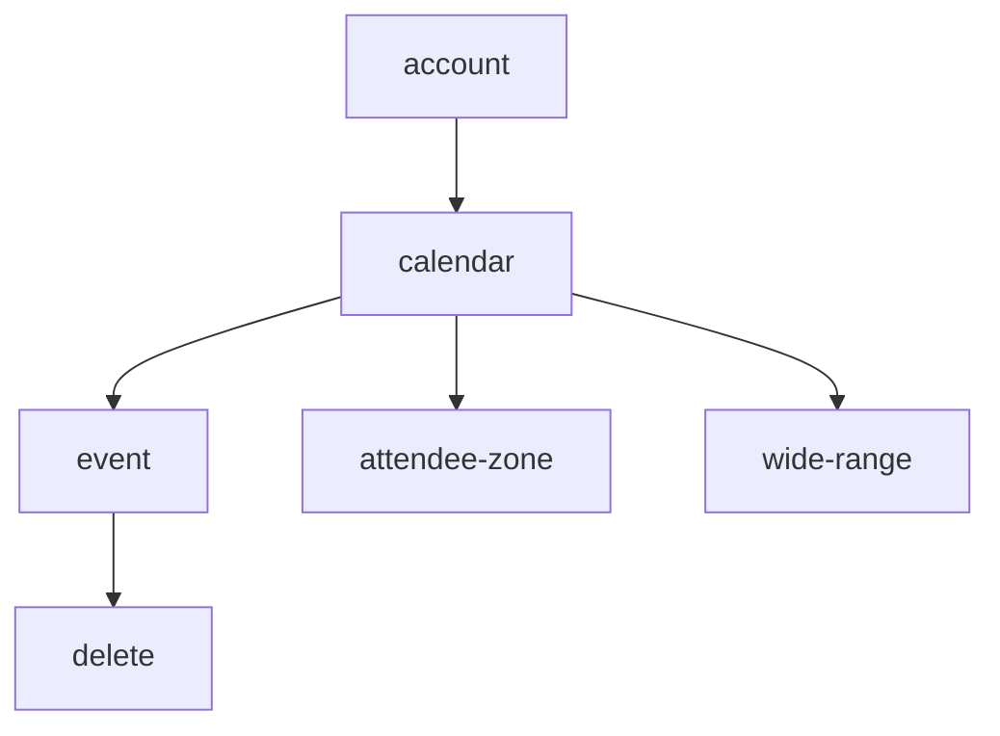

# CalDAV Calendar provider

`@vaubaan/plugin-caldav` (`plugins/caldav`), "CalDAV Calendar", version
`0.1.0`, catalog version 1. The generic calendar plugin: any **CalDAV** server
(RFC 4791, events in iCalendar, RFC 5545) reached with a **username and an app
password** over HTTP Basic authentication — iCloud, Fastmail, Nextcloud, and
the other servers that speak the standard (Zimbra, SOGo, Radicale, Baïkal…).
Six tools: the calendars, the events of a time range, one event, and
creating, changing and deleting an event.

**Google Calendar is not reachable here.** Google's CalDAV server refuses
Basic authentication, app passwords included (it answers `401` to anything
but OAuth 2.0); the plugin refuses a Google URL before sending anything.
Google Calendar is the separate `google-calendar` plugin, which relays
Google's own Calendar MCP server with a token from an OAuth broker.

Spec: [`vaubaan-gateway.md`](../../spec/vaubaan-gateway.md) §5,
[`gateway-risk-model.md`](../../spec/gateway-risk-model.md) §2, §4, §7. ADR:
[google-calendar-through-an-oauth-broker](../../decisions/google-calendar-through-an-oauth-broker.md)
D5 (this plugin), with the precedent of
[gmail-over-imap-with-an-app-password](../../decisions/gmail-over-imap-with-an-app-password.md)
(an app password, an identity-zoned catalog). How it is built — its own
requests, its iCalendar codec, the host check, the stated attendees — is ADR
[caldav-plugin-requests-codec-and-stated-attendees](../../decisions/caldav-plugin-requests-codec-and-stated-attendees.md)
(proposed).

## Shape

```
plugins/caldav/src/
  identity.ts         the id, the version, the six tool names, the credential field names
  data-model.ts       the `calendar` plane
  risk-catalog.yaml   9 risks + the fallback, presets read-only / own-agenda / assistant
  tools.ts            the six declarations ; tool-titles.ts their titles
  classify.ts         the classifier, the grammars and the zoning shared with execute
  address.ts          strict e-mail address parsing (attendees, calendar user addresses)
  times.ts            the time arguments and the times of an event
  ical.ts             the iCalendar codec (content lines, components, escaping, folding)
  event.ts            event views (read), event building and changes (write)
  dav.ts              requests over ctx.fetch, the host check, multistatus parsing
  credential.ts       the three fields, the guide, the server URL check
  execute.ts          verify, discovery, the six tools
  icon.ts             a calendar glyph drawn by hand (CalDAV has no brand mark)
  index.ts            definePlugin
```

### Libraries

One dependency beyond the SDK: **`@xmldom/xmldom`** (MIT, no dependency,
maintained; `npm audit` clean at 0.9.12) reads the WebDAV multistatus
answers, namespaces resolved. Choices weighed:

| Need                     | Chosen                                      | Rejected, and why                                                                                                                                                                                                                                                                          |
| ------------------------ | ------------------------------------------- | ------------------------------------------------------------------------------------------------------------------------------------------------------------------------------------------------------------------------------------------------------------------------------------------ |
| HTTP, WebDAV, CalDAV     | `ctx.fetch` and fixed XML bodies (`dav.ts`) | `tsdav` (MIT): calls the global `fetch`, so the host's injected `fetch`, `mockFetch` and the SDK's identifier proof would not see its requests; it follows redirects and builds URLs itself (the host check would have to be bolted on), and depends on `xml-js`, unmaintained since 2019. |
| XML answers              | `@xmldom/xmldom`                            | Hand-written parsing: WebDAV namespaces may use any prefix or none, so a text match is wrong by construction. `fast-xml-parser`: six dependencies for the same job.                                                                                                                        |
| iCalendar read and write | a small codec of the syntax (`ical.ts`)     | `ical.js`: MPL-2.0, not a permissive licence. `ts-ics` (MIT): converts to typed objects and back, dropping the properties it does not model (alarms, `X-` properties, attendees' answers) when a changed event is written back. `node-ical`: read only, and two dependencies.              |

The codec is the syntax only (RFC 5545 §3.1, §3.3.11): it unfolds, splits
content lines with a character scanner, keeps every component and property
in order, and writes `CRLF`, folded at 75 octets without splitting a UTF-8
character. It never expands a recurrence or converts a time zone: the
server filters the time range, and the plugin returns the times as written.

## 1. Data model

One plane, `calendar`. Every slice is rooted at `calendar[<ref>]`, a resource
of the mission.



| Entity          | Parent     | Cardinality | Notes                                                                                                                                                                  |
| --------------- | ---------- | ----------- | ---------------------------------------------------------------------------------------------------------------------------------------------------------------------- |
| `account`       | —          | one         | The principal the app password signs in as.                                                                                                                            |
| `calendar`      | `account`  | bounded     | **The resource.** A calendar collection that stores `VEVENT`s. `envScopable`: the owner may label it; no risk is env-scoped. Carries the zoning lists in its metadata. |
| `event`         | `calendar` | unbounded   | One calendar object resource (an `.ics` file): one event, its recurrence rule and its changed occurrences. The identifier is its file name.                            |
| `delete`        | `event`    | one         | Verb leaf: deleting an event. CalDAV keeps no bin and no history.                                                                                                      |
| `attendee-zone` | `calendar` | bounded     | Synthetic marker of a write that concerns people other than the account: `internal`, `allowlist`, `external`.                                                          |
| `wide-range`    | `calendar` | one         | Synthetic marker of a read over more than 31 days.                                                                                                                     |

A calendar resource's metadata, as discovery writes it:

| Key                                        | What                                                                                                        | Who edits it       |
| ------------------------------------------ | ----------------------------------------------------------------------------------------------------------- | ------------------ |
| `href`                                     | The calendar's absolute address on the server.                                                              | discovery (a fact) |
| `description`                              | The server's description of the calendar, capped at 300 characters.                                         | discovery          |
| `account_addresses`                        | The account's own e-mail addresses, space-separated (`calendar-user-address-set`; the username when empty). | discovery          |
| `internal_domains`                         | Domains whose people are colleagues.                                                                        | the owner          |
| `allowlist_domains`, `allowlist_addresses` | Pre-approved contacts outside the company.                                                                  | the owner          |

The three lists are discovered empty, so the owner can fill them on the
account's page (list values are the editable ones,
[connections](../connections.md)). Until the owner does, **every other
person is `external`**.

## 2. Tool → slice mapping

`<c>` is the calendar's ref, `<id>` the event's file name (or `*` when it
holds a character the slice grammar cannot carry, such as `@`).

| Tool                     | Slices                                                                            | Notes                                                                                                                           |
| ------------------------ | --------------------------------------------------------------------------------- | ------------------------------------------------------------------------------------------------------------------------------- |
| `caldav__list_calendars` | `calendar[<c>].R` for each calendar of the mission                                | Read live: one `PROPFIND` (depth 0) per calendar.                                                                               |
| `caldav__list_events`    | `calendar[<c>].event[*].R`, plus `calendar[<c>].wide-range.R` beyond 31 days      | `start` / `end`: dates or instants with an offset; at most 366 days (refused beyond); `max_results` 50 by default, 200 at most. |
| `caldav__get_event`      | `calendar[<c>].event[<id>].R`                                                     |                                                                                                                                 |
| `caldav__create_event`   | `calendar[<c>].event.W`, plus `calendar[<c>].attendee-zone[<z>].W` with attendees | `<z>` is the worst zone of the attendees other than the account.                                                                |
| `caldav__update_event`   | `calendar[<c>].event[<id>].W`, plus the zone of `attendees` ∪ `removed_attendees` | Requires the `etag` read; only the fields given change.                                                                         |
| `caldav__delete_event`   | `calendar[<c>].event[<id>].delete.W`, plus the zone of `attendees`                | Requires the `etag` read; `attendees` names the organizer and attendees `get_event` listed.                                     |

The calendar is the one `calendar` names (a calendar of the mission), or the
mission's single calendar when it is omitted; several calendars and none
named is refused, never resolved to one.

Reads return JSON fields, never the raw iCalendar: `event_id`, `etag`, `uid`,
`summary`, `start`, `end` (or `duration`), `timezone`, `all_day`, `location`,
`description` (2000 characters in a list, 8000 in `get_event`, with
`description_truncated`), `status`, `organizer`, `attendees` (address, name,
answer; 100 at most), `recurrence` (the `RRULE` as written),
`changed_occurrences`. A recurring event is returned once, as its series. An
object the plugin cannot read is listed as `{ event_id, etag, unreadable:
true }`.

Writes take fields and build the iCalendar themselves: `summary` (500),
`start`, `end`, `timezone`, `all_day`, `location` (500), `description`
(8000), `attendees`. Three spellings of a time, read strictly:

- an instant with its offset (`2026-10-27T09:30:00Z`,
  `2026-10-27T10:30:00+01:00`), written in UTC;
- a wall-clock time with `timezone` (`2026-10-27T10:30:00`, `Europe/Paris`),
  written with `TZID=Europe/Paris`;
- a date with `all_day: true`, the end exclusive (the day after the last
  day), as in RFC 5545 and Google Calendar.

## 3. Catalog and presets

Nine risks and the fallback. The vocabulary is the one a calendar catalog
shares with `google-calendar.*` (ADR D5): the calendars, events over a time
range and over a wide one, creating versus changing or deleting, and who the
write notifies.

| Risk                           | Matches                                         | Vector (rev / blast / data / visibility / persistence) | Why its own decision                                                                              |
| ------------------------------ | ----------------------------------------------- | ------------------------------------------------------ | ------------------------------------------------------------------------------------------------- |
| `caldav.read-calendars`        | `caldav.calendar[*].R`                          | reversible / single / metadata / internal / stateless  | Names and descriptions only.                                                                      |
| `caldav.read-events`           | `caldav.calendar[*].event[*].R`                 | reversible / single / data / internal / stateless      | What the account does and with whom; descriptions may be written by strangers (prompt injection). |
| `caldav.read-wide-range`       | `caldav.calendar[*].wide-range.R`               | reversible / bulk / data / internal / stateless        | Months of agenda at once: habits and relations.                                                   |
| `caldav.event-create`          | `caldav.calendar[*].event.W`                    | reversible / single / data / internal / session        | Adds an event; deletable.                                                                         |
| `caldav.event-change`          | `caldav.calendar[*].event[*].W`                 | costly / single / data / internal / session            | The previous version is not kept.                                                                 |
| `caldav.event-delete`          | `caldav.calendar[*].event[*].delete.W`          | irreversible / single / data / internal / session      | No bin, a series goes whole.                                                                      |
| `caldav.attendees-internal`    | `caldav.calendar[*].attendee-zone[internal].W`  | costly / single / data / team / session                | The server may mail colleagues.                                                                   |
| `caldav.attendees-allowlisted` | `caldav.calendar[*].attendee-zone[allowlist].W` | irreversible / single / data / public / session        | Mail to pre-approved outsiders cannot be taken back.                                              |
| `caldav.attendees-external`    | `caldav.calendar[*].attendee-zone[external].W`  | irreversible / single / data / public / session        | An invitation carrying the event's title, time, place and description to anybody.                 |
| `caldav.uncategorized-write`   | `caldav.[**].W` (fallback)                      | costly / account / data / public / posture             | No tool reaches it today.                                                                         |

Cost is `free` on every entry.

| Preset       | Risks (gate)                                                                                                                                       |
| ------------ | -------------------------------------------------------------------------------------------------------------------------------------------------- |
| `read-only`  | `read-calendars`, `read-events`                                                                                                                    |
| `own-agenda` | `read-only`, `event-create`, `event-change`, `event-delete` (ask me first) — events that concern nobody else                                       |
| `assistant`  | `own-agenda`, `read-wide-range`, `attendees-internal`, `attendees-allowlisted`, `attendees-external` (ask me first), `event-delete` (ask me first) |

Deliberately in no preset: the fallback. Quotas and rate limits are in the
YAML; they are a starting point.

## 4. Coverage

| Tool             | Named risks                          | Fallback |
| ---------------- | ------------------------------------ | -------- |
| `list_calendars` | `read-calendars`                     | never    |
| `list_events`    | `read-events` (+ `read-wide-range`)  | never    |
| `get_event`      | `read-events`                        | never    |
| `create_event`   | `event-create` (+ one `attendees-*`) | never    |
| `update_event`   | `event-change` (+ one `attendees-*`) | never    |
| `delete_event`   | `event-delete` (+ one `attendees-*`) | never    |

`plugin.test.ts` runs `assertCatalogCoverage` over samples reaching every
risk: no fallback hit, no risk untouched.

## 5. Edge cases

**Who a write notifies is what is priced.** A CalDAV server that implements
scheduling (RFC 6638; iCloud, Fastmail and Nextcloud do) mails the attendees
of an event the account organizes when it is created, changed or deleted, and
the organizer of an invitation when the account deletes its copy. That mail
is the risk the `attendees-*` permissions carry, zoned like Gmail's
recipients: the account itself is `none`, the internal domains `internal`, an
allowlisted address or domain `allowlist`, anybody else — or a calendar user
address that is not one `mailto:` address (`urn:uuid:…`) — `external`. The
zone of a call is the worst of its people.

**A change or a deletion states who it concerns, and the executor holds it to
that.** The classifier is pure and cannot read the event, so the call names
the people: `attendees` (for a change, the full list after it; for a
deletion, the organizer and attendees `get_event` listed) and, for a change,
`removed_attendees` (who is taken off and receives a cancellation). The
classifier prices that statement. Before writing, the executor reads the
event and declines when the people it already concerns — every `ORGANIZER`
and `ATTENDEE` of every `VEVENT` in it — reach a worse zone than the one
priced. Changing only the title of a meeting with an outside guest therefore
needs `attendees` repeated, and `attendees-external` held: the guest
receives the update.

**Invitations organized by somebody else are never changed.** Rewriting the
account's copy of somebody else's meeting would not change the meeting and
may send its organizer a reply: `update_event` declines it. Deleting it is
allowed — it declines the invitation — and needs the organizer's zone.

**Conditional writes.** `create_event` puts a new file with `If-None-Match:
*`; `update_event` and `delete_event` read the event, decline when its etag is
not the one the agent read, and write with `If-Match`. A write between the
read and the `PUT` is the server's `412`, thrown: nothing the agent did not
read is overwritten.

**Recurring events.** `list_events` returns the series once (the server
matches it when any occurrence overlaps the range; nothing is expanded). A
series with occurrences changed one by one (`RECURRENCE-ID`) can have its
title, place or description changed, but not its time or its attendees: the
changed occurrences are keyed by the original start times and carry their
own attendees, and rewriting them is a calendar application's job.
`delete_event` deletes the series whole.

**The account's address.** An event with attendees needs an organizer: the
account's first address from `calendar-user-address-set`, or the username
when it is an e-mail address and the server announced none. With neither,
a call with attendees is declined.

**Time zones are written by reference.** A wall-clock time is written with
`TZID=<IANA name>` and no `VTIMEZONE` component, the convention of CalDAV
time zones by reference (RFC 7809) that iCloud, Fastmail (Cyrus) and
Nextcloud (sabre/dav) resolve; a server that does not may show the time as
floating. An instant is written in UTC.

**Ranges.** A bound is a date (midnight UTC) or an instant with its offset;
a wall-clock time without offset is refused (the plugin does not guess a
zone). Over 31 days adds `wide-range`; over 366 is refused, so a whole agenda
is never one call.

**Untrusted text.** Invitations land in a calendar without being asked for:
a description may be a stranger's prompt injection, and the catalog says so.
Server text is unescaped and capped, and returned as data; the executor
never writes a value holding a control character (a line break in a summary
is written as the escape `\n`), so a field cannot open a new property.

### Identifiers

| Grammar       | Values                                                                                                | Lands in                                                                           |
| ------------- | ----------------------------------------------------------------------------------------------------- | ---------------------------------------------------------------------------------- |
| `calendarRef` | `[A-Za-z0-9_~-][A-Za-z0-9_.~-]{0,127}`: the last segment of the calendar's address, or `cal-<16 hex>` | the slice, and the choice of the resource (never a URL: the `href` is used)        |
| `eventId`     | `[A-Za-z0-9_~+=@-][A-Za-z0-9_.~+=@-]{0,254}`: an event's file name                                    | the slice (`*` when it holds `@` `+` `=`), one `encodeURIComponent`ed path segment |
| `etagValue`   | printable ASCII without space, 1 to 256 characters                                                    | the `If-Match` header                                                              |

None starts with a dot, so `.` and `..` are refused; `/`, `%`, `?`, `#` and
line breaks are outside every grammar. A calendar's address is the
resource's `href`, accepted by the executor only when it is on the
credential's server (below) and its last segment or digest is the
resource's ref. The plugin refuses an argument the tool does not declare, in
`classify` and again in `execute`; it builds every request field by field.

## 6. Credential, discovery, execution, tests

### Credential

SDK kind `api-key`, label "app password", three fields: **server URL**,
**username** (non-secret), **app password** (secret). `verify` signs in
with an authenticated `PROPFIND` and finds the principal and its calendar
home; a `401` is a `CredentialRefusal` (an `UpstreamAuthError`) with the
plugin's own sentence. The server URL must be `https` (`http` is accepted
for a loopback host only), carry no user name, and not be Google's. An app
password has no scopes: the guide lists no permission and says so.

### Where to get an app password

| Server         | App password                                                                                                                                     | Server URL                                                                                       | Username                  |
| -------------- | ------------------------------------------------------------------------------------------------------------------------------------------------ | ------------------------------------------------------------------------------------------------ | ------------------------- |
| iCloud         | account.apple.com → Sign-In and Security → App-Specific Passwords (two-factor authentication must be on).                                        | `https://caldav.icloud.com`                                                                      | the Apple Account e-mail  |
| Fastmail       | Settings → Privacy & Security → Manage app passwords → new app password with access to "Calendars (CalDAV)".                                     | `https://caldav.fastmail.com`                                                                    | the full Fastmail address |
| Nextcloud      | Personal settings → Security → Devices & sessions → Create new app password (with two-factor authentication on, the only way a client signs in). | `https://<your cloud>/remote.php/dav` (the bare host works when `/.well-known/caldav` redirects) | the Nextcloud login name  |
| Another server | Its documentation; many accept an app password or a dedicated account password.                                                                  | its address when it publishes `/.well-known/caldav`, otherwise the CalDAV URL it documents       | as it documents           |
| Google         | **Not possible.** Google refuses Basic authentication over CalDAV, app passwords included.                                                       | —                                                                                                | use `google-calendar`     |

Revocation is by hand only (`manualRevocation`): CalDAV has no endpoint that
deletes an app password, so the gateway erases its copy and the person
deletes the app password at the provider.

Sources: Nextcloud's documentation through Context7 (`/nextcloud/documentation`:
the `.well-known` redirects to `/remote.php/dav/`, device passwords under
Devices & sessions); Fastmail's developer documentation through Context7 (app
passwords for the open protocols); iCloud's and Fastmail's menu paths from
their help pages, to be checked at the first real connection (open point).

### Discovery

1. **Principal** (RFC 6764, RFC 5397). For a bare host, `PROPFIND
/.well-known/caldav` (depth 0, `current-user-principal`) first, then the
   URL itself; for a URL with a path, that URL. Redirects are returned to
   the plugin (`redirect: 'manual'`) and followed by it, at most five, each
   through the host check.
2. **Home and addresses**: `PROPFIND` of the principal for
   `calendar-home-set` and `calendar-user-address-set`.
3. **Calendars**: `PROPFIND` of the home at depth 1. A child that is a
   `calendar` collection and stores `VEVENT` (or says nothing of its
   components) is a resource; task lists, inboxes and plain collections are
   not. The ref is the last segment of its address when it is a ref, else
   `cal-` and 16 hexadecimal digits of the SHA-256 of its path (also when two
   calendars share a last segment). At most 50.

**The host check** (`isAllowedTarget`): a request goes to the scheme and port
of the server URL, on its host or on a sibling host under the same parent
domain (iCloud answers `caldav.icloud.com` with a home on
`p<nn>-caldav.icloud.com`). A parent of two labels or fewer, an IP literal
and a loopback host admit the host itself only. Anything else is refused
before a request is built, during discovery and at execution, so the
`Authorization` header never leaves for a host the person did not name,
whatever an answer says. A redirect from `https` to `http` (an nginx
configuration behind a TLS proxy) is refused too: type the CalDAV URL then.

### Execution

Every request goes through `ctx.fetch`, signed with the account's Basic
credential, `redirect: 'manual'`, the caller's `AbortSignal`. Bodies are
bounded (1 MB for discovery and an event, 10 MB for a `REPORT`), read as a
stream and abandoned beyond. XML answers are parsed by `@xmldom/xmldom`
with errors fatal; an answer declaring a document type is refused, so no
entity is ever expanded. `401` and `403` are `UpstreamAuthError`, another
unexpected status an `UpstreamHttpError` (`404`, `412` and `415` with a hint),
an unreadable answer a plain `Error`; what the executor declines itself is an
`isError` result (`declining`, `ExecutorRefusal`), with nothing sent.

| Tool             | Requests                                                                                     |
| ---------------- | -------------------------------------------------------------------------------------------- |
| `list_calendars` | `PROPFIND` depth 0 of each calendar                                                          |
| `list_events`    | `REPORT` depth 1, `calendar-query` with a `VEVENT` `time-range` in UTC                       |
| `get_event`      | `GET` of the event                                                                           |
| `create_event`   | `PUT <uuid>.ics`, `If-None-Match: *`, `text/calendar`; the UID is the same UUID              |
| `update_event`   | `GET`, then `PUT` with `If-Match`; `SEQUENCE` incremented, `DTSTAMP` and `LAST-MODIFIED` set |
| `delete_event`   | `GET`, then `DELETE` with `If-Match`                                                         |

### Tests

`plugins/caldav/tests/unit/`, no network outside the loopback:

- `fake-caldav.ts` — an in-memory CalDAV server (`FakeCaldavServer`):
  Basic authentication, `.well-known` redirect, principal, home, calendars,
  `calendar-query` with a time range, `GET`, conditional `PUT` and `DELETE`
  with etags; served as `fetch` or over a socket. Three profiles shaped after
  the servers' documented layouts — iCloud-like (home on a sibling host),
  Fastmail-like (an address in the path, UUID calendars), Nextcloud-like
  (`/remote.php/dav`, a calendar named with a space) — not recordings of
  real answers.
- `plugin.test.ts` — the SDK kit (well formed, presets, no wildcard,
  coverage with no fallback hit and no risk untouched), the presets, the
  credential spec and the server URL check, `verify` and discovery in every
  profile, a wrong password, redirects and principals to another site, a
  Google URL, an unreachable server.
- `classify.test.ts` — every branch: calendar selection, ranges, identifiers,
  event fields, attendee zones, what a change and a deletion state.
- `execute.test.ts` — each tool's requests and answers; the refusals with
  nothing sent; the etag, zone and organizer checks before any write; `401`,
  `403`, `412`, `500`, an answer too large, a document type.
- `injection.test.ts` — hostile identifiers in every position, both sides,
  and `assertIdentifiersRefused` on every sample.
- `ical.test.ts` — the codec (content lines, components, escaping, folding,
  a property-based round trip of any text) and the event views and writes.
- `protocol.test.ts` — the fake server's handler behind `node:http` on
  127.0.0.1 and Node's own `fetch`: one cycle from `verify` to `delete`, the
  `301` answered to the plugin, `Depth` / `If-Match` / `If-None-Match` and
  folded bodies on the wire.

## How to debug

- **"no CalDAV account answers at …"** — the URL is not a CalDAV endpoint
  and its host publishes no `/.well-known/caldav`: type the documented CalDAV
  URL (Nextcloud: `/remote.php/dav`).
- **"the server sends the account to a host outside …"** — a redirect, the
  principal or the home is on another site, or a redirect drops to `http`:
  type the final CalDAV URL.
- **A calendar is missing** — it stores no events (a task list), or it is
  shared read-only and the server does not list it under the home; the
  account's page "Refresh" runs discovery again.
- **`HTTP 403` on a write** — a read-only or subscribed calendar (birthdays,
  holidays).
- **"the event concerns people the call does not name"** — repeat the
  attendees `get_event` returned in `attendees` (and the organizer for a
  deletion).
