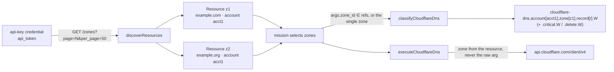

# Cloudflare DNS provider — modelling and runtime

`@vaubaan/plugin-cloudflare-dns` on the v5 Plugin SDK (feature P1.2g).
Contract : ADR [[plugin-contract-and-credential-spec]] ; spec
[`vaubaan-gateway.md`](../../spec/vaubaan-gateway.md) §3.2, §5 and
[`gateway-risk-model.md`](../../spec/gateway-risk-model.md) §2, §4, §7.
Contributor-facing details (fields, tools list, preset table) :
[`plugins/cloudflare-dns/README.md`](../../../plugins/cloudflare-dns/README.md).

## What changed from v4

| v4                                                                       | v5                                                                                                      |
| ------------------------------------------------------------------------ | ------------------------------------------------------------------------------------------------------- |
| One pasted secret per `provider_admins` row, API token or Global API Key | One `api-key` credential with a single `api_token` field ; the Global API Key form is refused           |
| `ProviderBinding` with `resource_ref` = **account id**                   | One `Resource` per **zone** : `ref` = zone id, `metadata.account_id`, `metadata.zone_name`              |
| `classifyCloudflareDnsV4(tool, args, bindings)`, `zone_id` taken as-is   | `classifyCloudflareDns(tool, args, resources)` ; `zone_id` must be a mission zone, or the single zone   |
| `record-write` for every record change                                   | Layered : `record-write` + `critical-record-write` (apex, wildcard, MX, NS) + `record-delete`           |
| `zone-delete` matched `zone[**].W` — every write under a zone touched it | `zone[*].W` : the zone itself only                                                                      |
| `list_zones` filtered by the binding's account                           | `list_zones` filtered to the mission's zones ; discovery lists every zone the token reaches, no account |
| `risk-catalog.ts` twin + sync test                                       | YAML loaded by `loadCatalogFile` at boot ; twin and sync test deleted                                   |
| No presets                                                               | `read-only`, `dns-operator`, `zone-admin`                                                               |

The v4 surface (the adapter, the binding-based classifier and the
deprecated aliases of `index.ts`) is deleted ; the plugin exports only the
v5 surface below. The per-tool security suite of the v4 classifier was
ported to `classifyCloudflareDns` (`tests/unit/classify.test.ts`).

## Layout

```
plugins/cloudflare-dns/src/
  resources.ts              CLOUDFLARE_DNS_PROVIDER, SAFE_IDENT, resolveZoneResource, accountIdOf,
                            zoneNameOf, isCriticalRecord, recordSensitivity
  tools.ts                  15 McpToolDeclaration (update_record requires type + name)
  classify.ts               classifyCloudflareDns — pure, (tool, args, resources) → slices | denied
  execute.ts                executeCloudflareDns, discoverCloudflareDnsResources, CLOUDFLARE_API_BASE,
                            MAX_DISCOVERED_ZONES
  data-model.ts             plane `dns`, 10 entities (critical + delete overlays under record)
  risk-catalog.yaml         11 risks + fallback, 3 presets, catalog_version 2
  index.ts                  definePlugin(...) → cloudflareDnsPlugin (default export)
```

## Resources and zone resolution



- `resolveZoneResource` : an explicit `zone_id` must be a ref among the
  mission's Cloudflare DNS resources ; absent, the mission's single zone ;
  otherwise `denied` (ambiguous, none, unknown, malformed).
- The account segment comes from `metadata.account_id` (`*` when absent) ;
  `list_zones` uses the account shared by the mission's zones, else
  `account[*]`.
- No env : DNS has no test/live mode. The owner may still label zones, but
  no catalog risk carries `acceptable_in_envs`.

## Classifier conventions

| Tool                                 | Slice(s)                                                                     |
| ------------------------------------ | ---------------------------------------------------------------------------- |
| `list_zones`                         | `account[A].zone[*].R` (denied when the mission has no zone)                 |
| `get_zone`                           | `zone[Z].R`                                                                  |
| `list_records` / `get_record`        | `zone[Z].record[*].R` / `zone[Z].record[R].R`                                |
| `export_records`                     | `zone[Z].zone-export.R`                                                      |
| `get_zone_settings` / `get_dnssec`   | `zone[Z].zone-settings.R` / `zone[Z].dnssec.R`                               |
| `create_record`                      | `zone[Z].record.W` **and**, when critical, `zone[Z].record.critical.W`       |
| `update_record`                      | `zone[Z].record[R].W` **and**, when critical, `zone[Z].record[R].critical.W` |
| `delete_record`                      | `zone[Z].record[R].delete.W`                                                 |
| `import_records`                     | `zone[Z].zone-import.W`                                                      |
| `edit_zone_settings` / `edit_dnssec` | `zone[Z].zone-settings.W` / `zone[Z].dnssec.W`                               |
| `purge_cache`                        | `zone[Z].cache.W`                                                            |
| `delete_zone`                        | `zone[Z].W`                                                                  |

**Critical** (`isCriticalRecord`) : type MX or NS whatever the name ; name
equal to the zone name or `@` ; wildcard at the apex (`*.zone`, `*`) ;
conservatively, an empty or non-ASCII name, an unknown zone name, or a
write whose arguments lack `type` or `name` (`recordSensitivity`).
`record_id` is required and validated (`SAFE_IDENT`) on `get_record`,
`update_record`, `delete_record`.

## Catalog and presets

11 named risks + `cloudflare-dns.uncategorized-write`, none env-scoped, no
caps. Patterns are recursive where layering is intended and exact where it
is not :

- `record[**].W` (`record-write`) also matches `record[R].critical.W` and
  `record[R].delete.W`, so every record write touches it and the sensitive
  ones touch their own risk on top.
- `zone[**].R` (`read-zone-metadata`) matches every read under a zone,
  record reads included — reading records needs both read risks (v4
  behaviour kept).
- `zone[*].W` (`zone-delete`) matches the zone write only. The v4 pattern
  `zone[**].W` made every record, settings or DNSSEC write touch the
  irreversible zone-deletion risk ; fixed in catalog version 2.

Presets : `read-only` (metadata + records), `dns-operator` (reads,
`record-write`, `cache-purge`, all `auto`), `zone-admin` (everything but
`zone-delete` ; `approval` on `critical-record-write`, `record-delete`,
`import-records`, `zone-settings-write`, `dnssec-write`). The fallback is
in no preset : the engine counts it only when no specific risk matched.
Values are a starting point — ADR `mission-presets-default-values` is
deferred.

## Execute

`ROUTES` in `execute.ts` maps each tool to method + path + payload kind
(query string, JSON body, multipart `file`, none). The zone in the URL is
the resolved resource's ref ; `zone_id` and `record_id` are removed from
the forwarded arguments. Bearer auth only. 401/403 → `UpstreamAuthError`.
Unknown tool → `isError` result.

Two guards beyond routing :

- `list_zones` : the upstream `result` is filtered to the mission's refs.
- `update_record` declared ordinary (`type` + `name` of a subdomain record)
  : `GET` the record first ; if it is critical today, throw before the
  `PATCH`. A call declared critical skips the read.

Discovery : `GET /zones` paginated, 50 per page, stops at
`result_info.total_pages` or at `MAX_DISCOVERED_ZONES` (500).

## How to debug

- **`zone_id: argument missing and the mission touches 2 Cloudflare DNS zones — name one`**
  — the agent must pass `zone_id`.
- **`zone_id: 'z9' is not a Cloudflare DNS zone of this mission`** — the
  zone exists upstream but was not selected for the mission ; the owner
  adds it, or the agent targets another zone.
- **A record update is refused with `critical-record-write` missing** —
  the arguments lack `type` / `name`, or name the apex / an MX / an NS ;
  the mission needs that risk (approval-gated in `zone-admin`).
- **`the record is a critical record (A example.com) but the call declared an ordinary one`**
  — the agent described the record as a subdomain while it is the apex ;
  repeat the call with the record's real type and name.
- **`list_zones` returns fewer zones than the dashboard** — expected : only
  the mission's zones are returned.
- **Discovery ends with `UpstreamAuthError 401`** — the token is invalid or
  revoked ; a Global API Key cannot be pasted (pattern refuses `|`).

## Tests

`npx vitest run plugins/cloudflare-dns` — 94 : `plugin.test.ts` (31 : kit,
classifier zone resolution and record writes, execute, discovery,
credential, presets), `classify.test.ts` (25 : the per-tool security suite
of `classifyCloudflareDns`), `risk-catalog.test.ts` (29 : invariants,
coverage lint, layering), `data-model.test.ts` (9).
