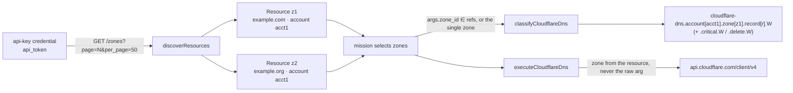

# Cloudflare DNS provider — modelling and runtime

`@vaubaan/plugin-cloudflare-dns` (version 3.0.0) on the v5 Plugin SDK
(feature P1.2g). Contract : ADR [[plugin-contract-and-credential-spec]] ;
the closed argument surface and what the executor declines : ADR
[`plugin-arguments-closed-surface-and-typed-refusals`](../../decisions/plugin-arguments-closed-surface-and-typed-refusals.md) ;
spec
[`vaubaan-gateway.md`](../../spec/vaubaan-gateway.md) §3.2, §5 and
[`gateway-risk-model.md`](../../spec/gateway-risk-model.md) §2, §4, §7.
Contributor-facing details (fields, tools list, preset table) :
[`plugins/cloudflare-dns/README.md`](../../../plugins/cloudflare-dns/README.md).

## What changed from v4

| v4                                                                       | v5                                                                                                      |
| ------------------------------------------------------------------------ | ------------------------------------------------------------------------------------------------------- |
| One pasted secret per `provider_admins` row, API token or Global API Key | One `api-key` credential with a single `api_token` field ; the Global API Key form is refused           |
| `ProviderBinding` with `resource_ref` = **account id**                   | One `Resource` per **zone** : `ref` = zone id, `metadata.account_id`, `metadata.zone_name`              |
| `classifyCloudflareDnsV4(tool, args, bindings)`, `zone_id` taken as-is   | `classifyCloudflareDns(tool, args, resources)` ; `zone_id` must be a mission zone, or the single zone   |
| `record-write` for every record change                                   | Layered : `record-write` + `critical-record-write` (apex, wildcard, MX, NS) + `record-delete`           |
| `zone-delete` matched `zone[**].W` — every write under a zone touched it | `zone[*].W` : the zone itself only                                                                      |
| `list_zones` filtered by the binding's account                           | `list_zones` filtered to the mission's zones ; discovery lists every zone the token reaches, no account |
| `risk-catalog.ts` twin + sync test                                       | YAML loaded by `loadCatalogFile` at boot ; twin and sync test deleted                                   |
| No presets                                                               | `read-only`, `dns-operator`, `zone-admin`                                                               |

The v4 surface (the adapter, the binding-based classifier and the
deprecated aliases of `index.ts`) is deleted ; the plugin exports only the
v5 surface below. The per-tool security suite of the v4 classifier was
ported to `classifyCloudflareDns` (`tests/unit/classify.test.ts`).

## Layout

```
plugins/cloudflare-dns/src/
  resources.ts              CLOUDFLARE_DNS_PROVIDER, PATH_IDENT, pathIdent, DNS_NAME, dnsName,
                            RECORD_TYPE, recordType, CRITICAL_RECORD_TYPES, resolveZoneResource,
                            accountIdOf, zoneNameOf, isCriticalRecord, recordSensitivity
  tools.ts                  15 McpToolDeclaration (update_record requires type + name ;
                            delete_record takes them as optional)
  classify.ts               classifyCloudflareDns — pure, (tool, args, resources) → slices | denied ;
                            undeclaredArgument, the argument rule `execute` shares
  execute.ts                executeCloudflareDns, discoverCloudflareDnsResources, CLOUDFLARE_API_BASE,
                            MAX_DISCOVERED_ZONES, API_TOKEN_FIELD
  data-model.ts             plane `dns`, 10 entities (critical + delete overlays under record)
  risk-catalog.yaml         11 risks + fallback, 3 presets, catalog_version 3
  index.ts                  definePlugin(...) → cloudflareDnsPlugin (default export)
```

## Resources and zone resolution



- `resolveZoneResource` : an explicit `zone_id` must be a ref among the
  mission's Cloudflare DNS resources ; absent, the mission's single zone ;
  otherwise `denied` (ambiguous, none, unknown, malformed). The resolved
  ref is always path-safe (`pathIdent`) : a zone whose ref is not is
  `denied` too, even as the mission's single zone.
- The account segment comes from `metadata.account_id` when it passes
  `pathIdent` (`*` when absent or malformed) ; `list_zones` uses the
  account shared by the mission's zones, else `account[*]`.
- No env : DNS has no test/live mode. The owner may still label zones, but
  no catalog risk carries `acceptable_in_envs`.

## Classifier conventions

| Tool                                 | Slice(s)                                                                            |
| ------------------------------------ | ----------------------------------------------------------------------------------- |
| `list_zones`                         | `account[A].zone[*].R` (denied when the mission has no zone)                        |
| `get_zone`                           | `zone[Z].R`                                                                         |
| `list_records` / `get_record`        | `zone[Z].record[*].R` / `zone[Z].record[R].R`                                       |
| `export_records`                     | `zone[Z].zone-export.R`                                                             |
| `get_zone_settings` / `get_dnssec`   | `zone[Z].zone-settings.R` / `zone[Z].dnssec.R`                                      |
| `create_record`                      | `zone[Z].record.W` **and**, when critical, `zone[Z].record.critical.W`              |
| `update_record`                      | `zone[Z].record[R].W` **and**, when critical, `zone[Z].record[R].critical.W`        |
| `delete_record`                      | `zone[Z].record[R].delete.W` **and**, when critical, `zone[Z].record[R].critical.W` |
| `import_records`                     | `zone[Z].zone-import.W`                                                             |
| `edit_zone_settings` / `edit_dnssec` | `zone[Z].zone-settings.W` / `zone[Z].dnssec.W`                                      |
| `purge_cache`                        | `zone[Z].cache.W`                                                                   |
| `delete_zone`                        | `zone[Z].W`                                                                         |

**Critical** (`isCriticalRecord`) : type MX or NS whatever the name ; name
equal to the zone name or `@` ; wildcard at the apex (`*.zone`, `*`) ;
conservatively, a type that `recordType` does not read, a name or a zone
name that `dnsName` does not read (see "Identifiers" below), an unknown
zone name, or a write whose arguments lack `type` or `name`
(`recordSensitivity`). A record is ordinary only when its type is a type
name, its name and the zone name are both DNS names, and the two differ.
Case and trailing dots are ignored (`Example.COM..` is the apex) ;
surrounding whitespace is not trimmed, it makes the name critical.

**Deleting a record is a record write like the others.** Removing the apex
`A`, the `MX` set or an `NS` delegation has the effect
`critical-record-write` describes, so `delete_record` goes through the same
`recordSensitivity` as `update_record` :

| `delete_record` arguments                                           | Slices                                       | Risks touched                                            |
| ------------------------------------------------------------------- | -------------------------------------------- | -------------------------------------------------------- |
| `record_id` + `type` / `name` of an ordinary record                 | `record[R].delete.W`                         | `record-write`, `record-delete`                          |
| `record_id` + `type` / `name` of an apex, wildcard, MX or NS record | `record[R].delete.W`, `record[R].critical.W` | `record-write`, `record-delete`, `critical-record-write` |
| `record_id` only (`type` or `name` missing)                         | `record[R].delete.W`, `record[R].critical.W` | `record-write`, `record-delete`, `critical-record-write` |

`type` and `name` stay **optional** in the tool schema : a call that does
not name the record is not refused, it is classified at the most severe
applicable risk. This was chosen over the two alternatives because it fails
closed with the smallest contract change — making the two arguments
required would break every existing `delete_record` call, and classifying
every deletion as critical would leave no way to delete an ordinary record
without holding `critical-record-write`. A declaration is never trusted on
its own : see the guard under "Execute".

## Only declared arguments

`execute` builds its query string and its JSON body from the arguments it
was given, so the argument surface of a tool is closed in the classifier :
after the zone is resolved, `undeclaredArgument(tool, args)` (over the SDK's
`undeclaredArgumentDenial` and the tools' input schemas) denies a call
carrying an argument the tool does not declare:
`<name>: not an argument of '<tool>' — nothing classifies it, so it is not sent.`
A field of Cloudflare's own API that no tool declares is therefore refused,
not forwarded. A call wrong on both counts is told about the zone first. `execute` applies
the same function again before it builds anything, as an `isError` refusal :
a caller that did not go through `classify` cannot widen the call either.

## Identifiers

One grammar function per kind of identifier, all in `resources.ts`, read by
`classify` and by `execute` alike ; a value outside its grammar is refused
or classified at the most severe risk, never escaped (ADR
[`plugin-identifiers-one-grammar-for-classify-and-execute`](../../decisions/plugin-identifiers-one-grammar-for-classify-and-execute.md)).

| Value                                            | Grammar                                                                                                                                                          | Where it lands                                                  | Outside the grammar                                                                               |
| ------------------------------------------------ | ---------------------------------------------------------------------------------------------------------------------------------------------------------------- | --------------------------------------------------------------- | ------------------------------------------------------------------------------------------------- |
| `zone_id` argument, zone resource ref            | `pathIdent` — `PATH_IDENT = ^[A-Za-z0-9_-]{1,64}$`                                                                                                               | URL path `/zones/<zone>`, slice `zone[Z]`                       | `denied` / refusal : `zone_id: malformed zone id`                                                 |
| `record_id` argument                             | `pathIdent`                                                                                                                                                      | URL path `/dns_records/<record>`, slice `record[R]`             | `denied` `record_id: malformed identifier` ; refusal `record_id: missing or malformed identifier` |
| `metadata.account_id` of a zone                  | `pathIdent` (`accountIdOf`)                                                                                                                                      | slice `account[A]` only, never a request                        | the glob `account[*]`                                                                             |
| record `name`, zone name                         | `dnsName` — `DNS_NAME` : lower-cased, trailing dots removed, dotted labels of letters, digits, `_` and inner hyphens, an optional leading `*.`, ≤ 253 characters | JSON body ; decides the critical-record verdict                 | the write is classified critical                                                                  |
| record `type`                                    | `recordType` — `RECORD_TYPE = ^[A-Za-z][A-Za-z0-9]{0,15}$`, upper-cased                                                                                          | JSON body ; decides the critical-record verdict                 | the write is classified critical                                                                  |
| list filters (`name`, `type`… on `list_records`) | none — never an identifier                                                                                                                                       | query string, percent-encoded (`toQueryString`), never the path | —                                                                                                 |

`pathIdent` is called by `classify` (`recordIdent`, `resolveZoneResource`)
and by `execute` (`recordIdArg`, `resolveZoneResource`, and once more in
`segment` when the path is built). `record_id` is required on `get_record`,
`update_record` and `delete_record` ; a missing one is `record_id: missing`.
`encodeURIComponent('..')` is `..`, and every URL parser removes dot
segments : without the grammar, `record_id: '..'` would be classified as a
record deletion while the request that leaves is `DELETE /zones/<zone>/` —
the zone endpoint. `dnsName` and `recordType` are the one reading of a
record name and type, in the classifier (`recordSensitivity`) and in the
read-back guard of `execute` : `@`, a bare `*`, an inner wildcard, an empty
label, whitespace, a control or non-ASCII character, a separator or an
escape is not a name, so the write needs `critical-record-write`. Service
labels (`_dmarc`, `_sip._tcp`) and punycode (`xn--…`) are names.

## Catalog and presets

11 named risks + `cloudflare-dns.uncategorized-write`, none env-scoped, no
caps. Patterns are recursive where layering is intended and exact where it
is not :

- `record[**].W` (`record-write`) also matches `record[R].critical.W` and
  `record[R].delete.W`, so every record write touches it and the sensitive
  ones touch their own risk on top.
- `zone[**].R` (`read-zone-metadata`) matches every read under a zone,
  record reads included — reading records needs both read risks (v4
  behaviour kept).
- `zone[*].W` (`zone-delete`) matches the zone write only. The v4 pattern
  `zone[**].W` made every record, settings or DNSSEC write touch the
  irreversible zone-deletion risk ; fixed in catalog version 2.

Presets : `read-only` (metadata + records), `dns-operator` (reads,
`record-write`, `cache-purge`, all `auto`), `zone-admin` (everything but
`zone-delete` ; `approval` on `critical-record-write`, `record-delete`,
`import-records`, `zone-settings-write`, `dnssec-write`). The fallback is
in no preset : the engine counts it only when no specific risk matched.
Values are a starting point — ADR `mission-presets-default-values` is
deferred.

## Execute

`ROUTES` in `execute.ts` maps each tool to method + path + payload kind
(query string, JSON body, multipart `file`, none). The zone in the URL is
the resolved resource's ref ; `zone_id` and `record_id` are removed from
the forwarded arguments. Bearer auth only. A provider failure is thrown:
401/403 → `UpstreamAuthError`, any other failed status → `UpstreamHttpError`.
What the executor declines itself — an unknown tool, a zone that is not
resolved, an argument the tool does not declare, a malformed identifier,
the record guard below — is an `isError` result (the SDK's
`ExecutorRefusal`, thrown inside the executor and turned into the result at
its entry point ; the unknown tool is answered directly): nothing failed at
Cloudflare, so the audit entry carries no `upstream_error`.

Three guards beyond routing :

- `list_zones` : the upstream `result` is filtered to the mission's refs.
- `update_record` and `delete_record` declared ordinary (`type` + `name`
  of a subdomain record) : `GET` the record first ; if it is critical
  today, or if the answer carries no type and name to compare, refuse (an
  `isError` result) before the `PATCH` / `DELETE`. A call classified critical (declared so, or
  undeclared) skips the read : it already needed `critical-record-write`.
  `type` and `name` are not forwarded on a deletion (no body).
- Path identifiers : a `record_id` or a zone ref that fails `pathIdent`
  is refused before any call, as an `isError` result (`record_id: missing or
malformed identifier`, `zone_id: malformed zone id`).

Discovery : `GET /zones` paginated, 50 per page, stops at a page shorter than 50, at
`result_info.total_pages` (the current page when the answer carries none) or at
`MAX_DISCOVERED_ZONES` (500). An answer whose `result` is neither a list nor absent
fails discovery ; an absent or `null` `result` is an empty page.

## How to debug

- **`zone_id: argument missing and the mission touches 2 Cloudflare DNS zones — name one`**
  — the agent must pass `zone_id`.
- **`zone_id: 'z9' is not a Cloudflare DNS zone of this mission`** — the
  zone exists upstream but was not selected for the mission ; the owner
  adds it, or the agent targets another zone.
- **A record update is refused with `critical-record-write` missing** —
  the arguments lack `type` / `name`, or name the apex / an MX / an NS ;
  the mission needs that risk (approval-gated in `zone-admin`).
- **`the record is a critical record (A example.com) but the call declared an ordinary one`**
  — the agent described the record as a subdomain while it is the apex ;
  repeat the call with the record's real type and name. Raised by
  `update_record` and `delete_record` ; an empty type and name in the
  message mean the record could not be read back.
- **A record deletion is refused with `critical-record-write` missing** —
  the call carries `record_id` only, or names an apex / wildcard / MX / NS
  record. For an ordinary record the agent adds its `type` and `name` ;
  for a critical one the mission needs that risk.
- **`record_id: malformed identifier`** / **`zone_id: malformed zone id`**
  — the identifier is not a single path-safe segment (letters, digits, `_`,
  `-`, at most 64 characters). Cloudflare ids are 32 hex characters.
- **`<name>: not an argument of 'cloudflare_dns__…'`** — the call carries
  an argument the tool's schema does not declare. Remove it ; to support it,
  declare it in `tools.ts` and decide how it is classified.
- **`list_zones` returns fewer zones than the dashboard** — expected : only
  the mission's zones are returned.
- **Discovery ends with `UpstreamAuthError 401`** — the token is invalid or
  revoked ; a Global API Key cannot be pasted (pattern refuses `|`).

## Tests

`npx vitest run plugins/cloudflare-dns` — 190 : `plugin.test.ts` (51 : kit,
classifier zone resolution and record writes, the undeclared arguments
refused by `classify` and by `execute`, execute including the
update / delete guard and the path-unsafe identifiers, discovery,
credential, presets), `classify.test.ts` (33 : the per-tool security suite
of `classifyCloudflareDns`, the deletion overlay, the identifiers that
reach the URL path), `risk-catalog.test.ts` (38 : invariants, the exact
risks every tool touches, layering), `identifiers.test.ts` (59 : the
grammars, then hostile `zone_id`, `record_id`, account id, record `name`
and `type` and list filters fed to `classify` and to `execute`),
`data-model.test.ts` (9).
