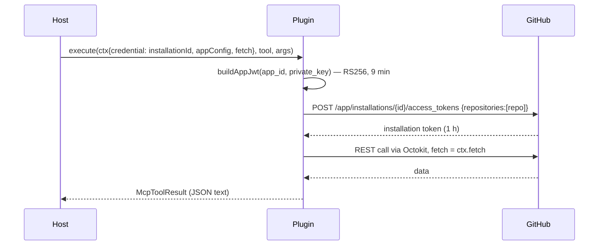

# GitHub provider plugin — `@vaubaan/plugin-github`

The GitHub plugin on the v5 SDK (feature P1.2a). Contract:
[[plugin-sdk]] and ADR [[plugin-contract-and-credential-spec]]. Spec:
[`vaubaan-gateway.md`](../../spec/vaubaan-gateway.md) §0 (Provider,
Connection, Resource, Preset), §3.2, §5;
[`gateway-risk-model.md`](../../spec/gateway-risk-model.md) §2, §4, §7.
Contributor guide: [`plugins/github/README.md`](../../../plugins/github/README.md).

The v4 modelling document this file replaces (French, 2026-06-15) is
superseded; its decisions that survive are restated here, the rest lives
in git history.

## What one connection is

A **GitHub App installation** on the company's organisation. The operator
registers the App once, with "Request user authorization (OAuth) during
installation" enabled, and gives the instance five app-config keys
(`app_id`, `private_key`, `app_slug`, `client_id`, `client_secret`); a user
connects by installing the App and the host stores the `installation_id` as
the connection's secret (`app-install` credential kind) — once it has
checked that this user can reach that installation. Resources are the
repositories the installation can reach, discovered as `owner/repo`; a
repository whose `full_name` is not `owner/repo` by the grammar of the
calls (`repoFullName`) is left out with a logger warning, since no call
could name it.

### Installation binding

`githubCredential.userVerification` (`src/credential.ts`) is the
declaration the host runs on the callback
([connections](../connections.md), "Installation binding"; the plugin
executes none of it):

| Member                   | Value                                                               |
| ------------------------ | ------------------------------------------------------------------- |
| `codeParam`              | `code`                                                              |
| `tokenUrl`               | `https://github.com/login/oauth/access_token`                       |
| `clientAuthMethod`       | `client_secret_post` (`client_id`, `client_secret`, `code` in body) |
| `installationsUrl`       | `https://api.github.com/user/installations`                         |
| `installationsHeaders`   | `GITHUB_API_HEADERS` (`Accept`, `User-Agent`, API version)          |
| `installationsListField` | `installations`                                                     |
| `installationIdField`    | `id`                                                                |
| `pagination`             | `page` / `per_page`, 100 per page                                   |

With the checkbox enabled, GitHub starts its web application flow right
after the installation and redirects to the App's first **callback URL**
with `code` next to `installation_id` (and no setup URL can be set). The
host exchanges the code for a user access token and calls
`GET /user/installations`, which lists the installations of this App the
token's user can reach; the claimed id must be among them. The user token
is then dropped. `client_secret` is used by the host only and is not in the
`ctx.appConfig` this plugin receives; `GITHUB_APP_CONFIG.clientId` /
`.clientSecret` name the keys for the spec, not for a reader.



The token is scoped to the repository the call names (installation-wide
for the two search tools). `installationTokenForCall(ctx, repo)`
(`src/token-cache.ts`) reuses it for up to 50 minutes per connection and
repository through the host-provided `ExecuteContext.credentialCache`, so
the diagram above is the cache-miss path; without a cache every call mints.
`github__mint_install_token` never uses the cache: the token it hands out
is always minted for that call. 401/403 anywhere → `UpstreamAuthError`;
any other failed status of the token mint or of the repository listing of
discovery → `UpstreamHttpError` carrying the status. No
PAT path. `execute` reads the call first (`readGithubCall`, see
"Identifiers") and declines on a refusal **before** the mint: a call without
a well-formed repository of the mission never obtains a token, scoped or
installation-wide. The installation id is a segment of the mint path and
must be decimal digits (`installationIdOf` in `src/app-install.ts`, at most
20); anything else throws `the installation id of the connection is not a
number` and nothing is sent.

## Files

| File                      | Role                                                                                                                                                                                                                                                                                                       |
| ------------------------- | ---------------------------------------------------------------------------------------------------------------------------------------------------------------------------------------------------------------------------------------------------------------------------------------------------------- |
| `src/index.ts`            | `definePlugin` → `githubPlugin` v3.0.0.                                                                                                                                                                                                                                                                    |
| `src/risk-catalog.yaml`   | 14 risks + fallback, 3 presets, `catalog_version: 4`.                                                                                                                                                                                                                                                      |
| `src/data-model.ts`       | Plane `repo`, 17 entities (`delete` under `release` is a verb leaf); `branch` is `envScopable`.                                                                                                                                                                                                            |
| `src/tools.ts`            | 26 tools. Retired by risk-model §7.2 #1 and not declared: `dispatch_workflow`, `cancel_workflow_run`, `rerun_workflow_run`.                                                                                                                                                                                |
| `src/call.ts`             | The grammar of every identifier (`ownerName`, `repoName`, `repoFullName`, `repoPath`, `revision`, `branchName`, `tagName`, `pullRequestHead`, `positiveInteger`, `workflowRef`) and `readGithubCall`, the one reader `classify` and `execute` share; the refusal wording (`repositoryNotSelectedMessage`). |
| `src/classify.ts`         | `classifyGithub(tool, args, resources)` = `readGithubCall` then `slicesOf(call)`; `isWorkflowPath`.                                                                                                                                                                                                        |
| `src/credential.ts`       | `githubCredential` (app-install spec), `installationTokenFor(ctx, scope)`.                                                                                                                                                                                                                                 |
| `src/app-install.ts`      | `buildAppJwt`, `mintInstallationToken`, `installationIdOf`, `GITHUB_API_BASE`, `GITHUB_API_HEADERS`.                                                                                                                                                                                                       |
| `src/execute.ts`          | `executeGithub` (the body run under the SDK's `declining`), `discoverGithubResources`, `MINT_PERMISSIONS`, discovery paging constants (100 per page, 10 pages at most).                                                                                                                                    |
| `src/token-cache.ts`      | `installationTokenForCall(ctx, repo)`: per-call token served from `ctx.credentialCache`, 50 min at most, 5 min expiry margin.                                                                                                                                                                              |
| `src/octokit-dispatch.ts` | `dispatchGithubTool(octokit, call, args)`: checked call → Octokit call; reads the pull request before a merge and declines (`ExecutorRefusal`) a base other than the declared one.                                                                                                                         |

## Tool → slice mapping

Every repo-scoped tool resolves `owner/repo` and refuses a repository that
is not among the mission's GitHub resources (`denied`), even though the
host already checked `resource-not-in-mission`. A checked identifier is
rendered to the slice ident class when it is embedded (`asIdent`: a
character outside `[a-zA-Z0-9_./~-]` becomes `-`); this only shapes the
slice, the request carries the identifier itself.

An argument that selects a risk class is either refused unless it has the
one spelling the classifier reasons about, or checked against GitHub:

- **File paths** of `get_file_contents`, `create_or_update_file`,
  `delete_file` and every `push_files` entry must be canonical: relative,
  `/`-separated, with no empty, `.` or `..` segment, no backslash and no
  control character. `/.github/workflows/ci.yml`,
  `./.github/…` or `.github//workflows/…` are refused, not normalised, so
  the `workflow-via-file` marker never depends on how GitHub resolves a
  path.
- **Branches** of `create_branch` (`branch`, `from_branch`),
  `create_or_update_file`, `delete_file`, `push_files`,
  `get_branch_protection`, `update_branch_protection`, `list_workflow_runs`
  and the `base` of a pull request or a merge must be branch names: a value
  starting with `refs/` or `heads/` is refused.
- **`files`** of `push_files` must be a non-empty array whose every entry
  has a string `path` and a string `content`; one malformed entry refuses
  the call. The dispatcher pushes the entries of the call the classifier
  read (`call.files`), so what is classified is what is pushed.
- **`base`** of `merge_pull_request` is never sent to GitHub (the merge
  endpoint takes none). The dispatcher first reads the pull request
  (`GET /repos/{owner}/{repo}/pulls/{n}`) and merges only when its real
  base equals the declared one (`main` when absent); otherwise the call
  is declined without a merge and the answer names the real base.

### Identifiers

What is classified is what is sent. `readGithubCall(tool, args,
missionRepos)` (`src/call.ts`) reads the arguments once, against the
mission's repositories, and returns a `GithubCall` whose every identifier
was checked by the grammar of its kind, or the refusal. `classifyGithub`
turns that call into slices (`slicesOf`), `executeGithub` hands the same
call to the dispatcher, which takes every identifier of its requests —
repository, branch, path, revision, number — from the call and never from
the raw arguments. `args` only supplies what is neither classified nor an
identifier: contents, titles, messages, flags, page sizes, the search
query `q`, and the blob `sha` of `create_or_update_file` / `delete_file`,
which is forwarded as given. Each request is built field by field from
those declared arguments: an argument no tool declares is never read, so it
is ignored, not refused. A value outside its grammar refuses the call —
`denied` for the classifier, an `isError` result before the token mint for
the executor; nothing is escaped, trimmed, repaired or defaulted on one side
only (ADR
[`plugin-identifiers-one-grammar-for-classify-and-execute`](../../decisions/plugin-identifiers-one-grammar-for-classify-and-execute.md)).

| Argument                                                        | Grammar (`src/call.ts`)                                                                                                                                                            | Where it lands                                                                |
| --------------------------------------------------------------- | ---------------------------------------------------------------------------------------------------------------------------------------------------------------------------------- | ----------------------------------------------------------------------------- |
| `owner`, `repo`                                                 | `ownerName` (`[A-Za-z0-9_-]`, ≤ 39) and `repoName` (`[A-Za-z0-9._-]`, ≤ 100, not `.` or `..`), together one of the mission's repositories                                          | URL path, token scope, slice `repo[X]`                                        |
| `repoFullName` (`mint_install_token`), a discovered `full_name` | `repoFullName` — `owner/repo`, exactly one separator, two well-formed names                                                                                                        | token scope, resource ref, slice `repo[X]`                                    |
| file `path`, `files[].path`                                     | `repoPath` — relative, `/`-separated, no empty, `.` or `..` segment, no backslash, no control character, ≤ 4096 characters                                                         | URL path (`/contents/{path}`) or tree body, slice `file[path]`                |
| `branch`, `from_branch`, `base`                                 | `branchName` — a git ref name (`git check-ref-format`: no `..`, no component starting with `.` or ending in `.lock`, no blank, none of `~ ^ : ? * [ \`), ≤ 255, not a ref spelling | URL path, query or body, slice `branch[b]` / `branch-protection[b]`           |
| `head` (`create_pull_request`)                                  | `pullRequestHead` — a `branchName`, or `owner:branch` for a fork                                                                                                                   | body, slice `branch[head]`                                                    |
| `tag_name`                                                      | `tagName` — a git ref name, never `refs/…`                                                                                                                                         | body, slice `tag[name]`                                                       |
| `ref`, `sha` (`list_commits`, `get_commit`), `target_commitish` | `revision` — a branch, a tag, a full ref or a SHA, optionally with `~N` / `^N`                                                                                                     | URL path (`/commits/{sha}`), query or body, slice `branch[…]` / `commit[sha]` |
| `pull_number`, `issue_number`, `release_id`                     | `positiveInteger` — a number, a positive safe integer                                                                                                                              | URL path, slice ident                                                         |
| `workflow_id`                                                   | `workflowRef` — a positive integer, or one file name (no `/` or `\`, not `.` or `..`, ≤ 255)                                                                                       | URL path, slice `workflow[id]`                                                |
| the installation id of the connection                           | `installationIdOf` (`src/app-install.ts`) — decimal digits, ≤ 20                                                                                                                   | URL path of the token mint                                                    |

Why a grammar per kind and not an escape: Octokit expands a path parameter
with `encodeURIComponent`, which leaves `.` and `..` untouched, and a URL
parser then removes those segments — `path: '..'` on `delete_file` would be
sent as `DELETE /repos/{owner}/{repo}/`, `workflow_id: '..'` would list the
runs of every workflow. Each grammar makes a dot-only segment impossible;
separators and everything else are percent-encoded by Octokit. An optional
identifier that is `undefined`, `null` or `''` is "not given"; one of the
wrong type is refused, not treated as absent. A value GitHub answers is
held to the same grammar before it reaches a path: the default branch read
for a `create_branch` without `from_branch` must be a `branchName`, or
nothing is created.

| Tool                                      | Slices                                                                                               |
| ----------------------------------------- | ---------------------------------------------------------------------------------------------------- |
| `list_branches`                           | `repo[X].branch.R`                                                                                   |
| `list_commits`                            | `repo[X].commit.R`, or `repo[X].branch[sha].commit.R` when `sha` is given                            |
| `get_file_contents`                       | `repo[X].branch[ref].file[path].R` (`branch.file[…]` without `ref`)                                  |
| `get_commit`                              | `repo[X].commit[sha].R`                                                                              |
| `list_tags`                               | `repo[X].tag.R`                                                                                      |
| `list_pull_requests` / `get_pull_request` | `repo[X].pull_request.R` / `repo[X].pull_request[N].R`                                               |
| `list_issues` / `get_issue`               | `repo[X].issue.R` / `repo[X].issue[N].R`                                                             |
| `list_releases`                           | `repo[X].release.R`                                                                                  |
| `list_workflows` / `list_workflow_runs`   | `repo[X].workflow.R` / `repo[X].workflow-run.R` or `repo[X].workflow[id].workflow-run.R`             |
| `get_branch_protection`                   | `repo[X].branch-protection[branch].R`                                                                |
| `search_code` / `search_issues`           | `github.search.code.R` / `github.search.issues.R` (no resource check)                                |
| `create_branch`                           | `repo[X].branch[name].W`                                                                             |
| `create_or_update_file` / `delete_file`   | `repo[X].branch[b].file[path].W` + `repo[X].branch[b].workflow-via-file.W` if path is a workflow     |
| `push_files`                              | one `file[path].W` per file (+ workflow marker), + `repo[X].branch[b].files-bulk.W` when 2+ files    |
| `create_pull_request`                     | `repo[X].pull_request.W` + `repo[X].branch[head].propose-to[base].W`                                 |
| `merge_pull_request`                      | `repo[X].pull_request[N].W` + `repo[X].branch[base ?? main].merge-into.W`                            |
| `add_issue_comment`                       | `repo[X].issue[N].comment.W` (issue/PR number space is unified)                                      |
| `create_release`                          | `repo[X].release.W` + `repo[X].tag[name].W`                                                          |
| `delete_release`                          | `repo[X].release[id].delete.W`                                                                       |
| `update_branch_protection`                | `repo[X].branch-protection[branch].W`                                                                |
| `mint_install_token`                      | `repo[X].install-token[clone\|push].W` for `repoFullName`, or one per GitHub resource of the mission |

Concrete slices never carry wildcards: a "list all" read emits the entity
name without a leaf and the catalog's terminal `[**]` absorbs it. A branch
or a revision cannot hold a `*` (its grammar refuses it); in a file path,
where `*` is an ordinary character, it is replaced like any character
outside the ident class before it reaches a slice.

## Catalog decisions

- **Protected branches by name**, not by the owner's environment label:
  `merge-protected` matches `main, master, prod, production, release-*`
  for direct writes, bulk writes and merges. A GitHub resource's `env`
  label (set by the owner on the repository) does not qualify GitHub
  risks; no GitHub risk is env-scoped.
- **`workflow-write-via-file` lost its v4 `acceptable_in_envs`
  (`feature, fix, chore`)**. Those were branch pseudo-envs that the v5
  resource-based `EnvResolver` never produces; kept, the risk would have
  been skipped from `risks_touched` and a workflow write on a feature
  branch would have passed on `feature-branch-write` alone. Without the
  field the risk is always touched and must be accepted explicitly; a
  workflow write on `main` additionally touches `merge-protected`.
- The fallback was widened to `github.**.W` (was `github.repo[**].W`), per
  the risk-model spec §4.3 wording. It counts only when no specific entry
  matched the write (policy-engine rule settled with P1.2-SDK); no preset
  offers it, the creator adds it for unconventional branch names
  (`risk-catalog.test.ts` pins a `wip-x` write on the fallback alone;
  `plugin.test.ts` checks that its slice is a fallback hit and that no
  preset lists the fallback).
- **Publishing and deleting a release are two risks, each touched by its own
  tool.** `create_release` emits `release.W` and `tag[name].W`, the patterns
  of `create-release` (`repo[**].release.W`, `repo[**].tag[**].W`).
  `delete_release` emits `release[id].delete.W`: `delete` is a verb leaf the
  data model declares under `release`, and `delete-release` matches
  `repo[**].release[**].delete.W`. Neither pattern matches the other tool's
  slice, so a mission that accepts `create-release` alone cannot delete a
  release, and the reverse; `release-manager` carries both, each under
  `approval`.
- Two mint risks (`clone` vs `push`): the push token leaves the gateway's
  perimeter with write permissions, hence a separate, approval-gated entry.
- `merge_pull_request` is classified on the declared `base`, `main` when
  the argument is absent — the conservative assumption — and the declaration
  is binding: the merge is refused when the pull request targets another
  branch. It also touches `create-pr`, whose `pull_request[**].W` pattern
  matches the `pull_request[N].W` slice.
- A merge into a branch that is not protected by name (`feature/x`,
  `develop`) has no named risk: its `merge-into` slice lands on the
  fallback. Whether it deserves an entry is an open catalog decision.

## Presets

| Preset            | Risks (quota / rate per 60 s)                                                                                                                                                                                                | Approval                                         |
| ----------------- | ---------------------------------------------------------------------------------------------------------------------------------------------------------------------------------------------------------------------------- | ------------------------------------------------ |
| `read-only`       | read-code 5000/120, read-meta 5000/120                                                                                                                                                                                       | —                                                |
| `developer`       | read-code 10000/240, read-meta 10000/240, search-global 500/30, feature-branch-write 3000/60, bulk-file-write 1000/30, create-pr 200/10, comment-write 500/20, workflow-write-via-file 50/5, mint clone 50/5, mint push 20/2 | workflow-write-via-file, mint-install-token-push |
| `release-manager` | read-code 5000/120, read-meta 5000/120, feature-branch-write 500/30, create-pr 100/10, comment-write 200/10, merge-protected 50/5, create-release 20/2, delete-release 5/1                                                   | merge-protected, create-release, delete-release  |

The numbers are defaults the creator adjusts at issuance; the deferred ADR
`mission-presets-default-values` (plan §5.5) will settle them across
plugins. `branch-protection-write` is in no preset.

## Tests

`npx vitest run plugins/github` — 585 tests, no network:

- `plugin.test.ts` (14): kit assertions, coverage with samples per tool
  (the 14 named risks touched, `fallbackHits` empty), the fallback catching
  a write on an unconventional branch and a merge into a non-protected one,
  preset invariants, credential spec, resource check.
- `risk-catalog.test.ts` (56): the table `[tool, arguments, risks touched]`
  evaluated through `classifyGithub` and the shipped catalog — at least one
  row per tool, every risk of the catalog named by a row (protected and
  feature branches, workflow files, bulk pushes, merges, both mint
  purposes, the fallback cases).
- `classify.test.ts` (69): the per-tool security suite of `classifyGithub`
  (reads, branch and file writes, pull requests, comments, releases, rules,
  mint, retired tools, structural denials: non-canonical paths, refs given
  as branches, malformed `files`, wildcard characters, repositories outside
  the mission).
- `execute.test.ts` (25): JWT claims (RS256, `iss`, 540 s), mint request
  (Bearer JWT, scoping body, PEM un-escaping, missing key names the key,
  kind mismatch, 401 → `UpstreamAuthError`), Octokit over `mockFetch`
  (per-call repository scoping, installation-wide for search, JSON body,
  403 → `UpstreamAuthError`), branch-protection and release tools, the merge
  bound to the declared base (read then merge; a mismatch is declined with
  no merge, an unreadable base throws), `push_files` declining malformed
  `files`, mint tool (clone/push permission sets, fan-out over mission
  resources, refusals before any call, as `isError` results), discovery
  (metadata, paging to `total_count`, 401).
- `injection.test.ts` (415): every identifier position fed `..`, `.`,
  `a/../b`, encoded forms, an empty, an overlong and a multi-line value, to
  `classify` and to `execute` — refused by both with nothing sent (not even
  the token mint), or sent as the exact path that was classified; numbers;
  the installation id of the connection and the repository names discovery
  returns.
- `token-cache.test.ts` (5): a mint per call without a host cache, one mint
  per repository scope with one, no token served or stored close to its
  expiry, lifetime bounded by what is left of the token,
  `github__mint_install_token` never cached.
- `data-model.test.ts` (1): data-model integrity.

## How to debug

- **`Invalid risk catalog` at boot** — read every bullet of the
  `CatalogError`; paths are exact. Presets must reference ids of this
  catalog only.
- **`github: app configuration key 'app_id' is missing`** — the instance
  configuration lacks one of the app-config keys; nothing was sent to
  GitHub.
- **"Not connected — the provider returned no user authorization"** — the
  App does not have "Request user authorization (OAuth) during
  installation" enabled, so GitHub came back without `code`.
- **"Not connected — … not among those the authorizing account can
  reach"** — the GitHub account signed in during the installation cannot
  reach the installation whose id came back; `GET /user/installations` with
  that account's token does not list it.
- **`token-exchange-failed` with `incorrect_client_credentials`** — the
  client ID or client secret entered for the App is wrong (the client ID is
  not the App ID).
- **`GitHub App token mint failed (404)`** — the installation id is unknown
  to this App (App uninstalled, or the wrong App's key); 401 means the key
  does not match `app_id`.
- **A call names a repository outside the mission** — the classifier
  refuses with the sentence below. Up to five selected repositories are
  named; above, the message ends with `N repositories are selected.` Add
  the repository to the mission (or the connection's discovered resources
  are stale: refresh them). `github__mint_install_token` with a foreign
  `repoFullName` gets the same sentence.

  ```text
  github repository 'acme/lib' is not selected in this mission. Selected: acme/app.
  ```

- **The mission holds no GitHub repository** — every repo-scoped tool is
  refused with the first line, the mint tool with the second.

  ```text
  no GitHub repository is selected in this mission.
  github__mint_install_token: no GitHub repository is selected in this mission.
  ```

- **A client still names `dispatch_workflow`, `cancel_workflow_run` or
  `rerun_workflow_run`** — retired tools, refused with:

  ```text
  tool retired: this gateway does not dispatch, cancel or re-run GitHub workflows — use the deployment tools of the provider that hosts the service.
  ```

- **The classifier refuses a spelling it cannot place exactly** — send the
  canonical path, the bare branch name, well-formed `files` entries.

  ```text
  tool 'github__create_or_update_file' path '/.github/workflows/ci.yml' must be relative, with no empty, '.' or '..' segment and no backslash
  tool 'github__create_branch' branch 'refs/heads/main' must be a branch name such as 'main', not a ref
  tool 'github__push_files' requires 'files' to be a non-empty array of { path, content } strings
  ```

- **A merge is declined although the mission accepts it** — the call was
  classified on the declared base and the pull request targets another
  branch; nothing was merged, and the answer is an `isError` result, not an
  upstream failure. Calling again with the real base classifies
  the merge on it (`merge-protected` for a protected branch).

  ```text
  github__merge_pull_request: pull request #7 targets 'main', not the declared base 'feature/x'. Call again with base 'main'.
  ```

- **A call the mission accepts comes back `isError` with no
  `upstream_error` in the audit** — the executor declined it
  (`ExecutorRefusal`): the reader refused an argument, or the merge guard
  did not hold. The text is the reason. What GitHub itself fails is thrown
  (`UpstreamAuthError`, `UpstreamHttpError`, Octokit's own error) and
  recorded as an upstream failure; so are the conditions the executor
  still throws as plain errors: an installation id that is not a number, a
  missing app-configuration key, a pull request whose base cannot be read
  and a default branch GitHub answers that is not a branch name.
- **`delete_release` is refused with `github.delete-release` missing on a
  mission that holds `create-release`** — they are separate risks (catalog
  v4); add `delete-release`.
- **A write is refused with `github.uncategorized-write` missing** — the
  branch matches neither the feature/\* conventions nor a protected name,
  so only the fallback caught it. Rename the branch, or have the creator
  add the fallback to the mission explicitly.
- **`mockFetch: unexpected GET …`** in tests — Octokit built a URL no route
  covers; the message names it.

## Not done, on purpose

- The `search_*` queries are not forced to `repo:<mission resource>`; the
  risk `search-global` (blast `account`) is the guard.
- The base check of `merge_pull_request` is a read followed by the merge,
  not one atomic call: GitHub's merge endpoint has no "expected base"
  parameter, so a pull request retargeted between the two requests is
  merged into its new base.
- Missing tools identified in v4 (`create_issue`, `update_issue`,
  `create_pull_request_review`, `delete_branch`, `get_repository`…) stay
  out; they would slot into existing risks without a new entry.
