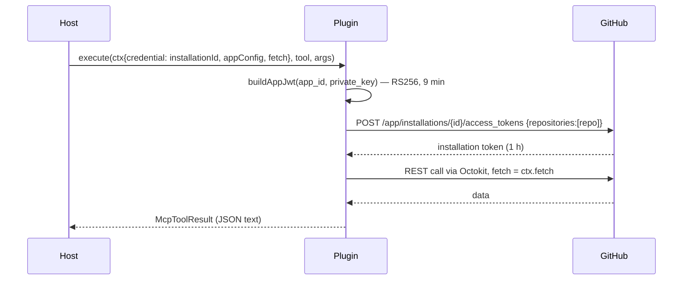

# GitHub provider plugin — `@vaubaan/plugin-github`

The GitHub plugin on the v5 SDK (feature P1.2a). Contract:
[[plugin-sdk]] and ADR [[plugin-contract-and-credential-spec]]. Spec:
[`vaubaan-gateway.md`](../../spec/vaubaan-gateway.md) §0 (Provider,
Connection, Resource, Preset), §3.2, §5;
[`gateway-risk-model.md`](../../spec/gateway-risk-model.md) §2, §4, §7.
Contributor guide: [`plugins/github/README.md`](../../../plugins/github/README.md).

The v4 modelling document this file replaces (French, 2026-06-15) is
superseded; its decisions that survive are restated here, the rest lives
in git history.

## What one connection is

A **GitHub App installation** on the company's organisation. An administrator
creates the App once — from Settings → Administration → Company apps through
GitHub's App manifest flow ("The company's App, created from the page"
below), or by hand at GitHub with "Request user authorization (OAuth) during
installation" enabled — and the instance holds five app-config keys
(`app_id`, `private_key`, `app_slug`, `client_id`, `client_secret`); a user
connects by installing the App and the host stores the `installation_id` as
the connection's secret (`app-install` credential kind) — once it has
checked that this user can reach that installation. Resources are the
repositories the installation can reach, discovered as `owner/repo`; a
repository whose `full_name` is not `owner/repo` by the grammar of the
calls (`repoFullName`) is left out with a logger warning, since no call
could name it.

### Installation binding

`githubCredential.userVerification` (`src/credential.ts`) is the
declaration the host runs on the callback
([connections](../connections.md), "Installation binding"; the plugin
executes none of it):

| Member                   | Value                                                               |
| ------------------------ | ------------------------------------------------------------------- |
| `codeParam`              | `code`                                                              |
| `tokenUrl`               | `https://github.com/login/oauth/access_token`                       |
| `clientAuthMethod`       | `client_secret_post` (`client_id`, `client_secret`, `code` in body) |
| `installationsUrl`       | `https://api.github.com/user/installations`                         |
| `installationsHeaders`   | `GITHUB_API_HEADERS` (`Accept`, `User-Agent`, API version)          |
| `installationsListField` | `installations`                                                     |
| `installationIdField`    | `id`                                                                |
| `pagination`             | `page` / `per_page`, 100 per page                                   |

With the checkbox enabled, GitHub starts its web application flow right
after the installation and redirects to the App's first **callback URL**
with `code` next to `installation_id` (and no setup URL can be set). The
host exchanges the code for a user access token and calls
`GET /user/installations`, which lists the installations of this App the
token's user can reach; the claimed id must be among them. The user token
is then dropped. `client_secret` is used by the host only and is not in the
`ctx.appConfig` this plugin receives; `GITHUB_APP_CONFIG.clientId` /
`.clientSecret` name the keys for the spec, not for a reader.



The token is scoped to the repository the call names (installation-wide
for the two search tools). `installationTokenForCall(ctx, repo)`
(`src/token-cache.ts`) reuses it for up to 50 minutes per connection and
repository through the host-provided `ExecuteContext.credentialCache`, so
the diagram above is the cache-miss path; without a cache every call mints.
`github__mint_install_token` never uses the cache: the token it hands out
is always minted for that call. 401/403 anywhere → `UpstreamAuthError`;
any other failed status of the token mint or of the repository listing of
discovery → `UpstreamHttpError` carrying the status. No
PAT path. `execute` reads the call first (`readGithubCall`, see
"Identifiers") and declines on a refusal **before** the mint: a call without
a well-formed repository of the mission never obtains a token, scoped or
installation-wide. The installation id is a segment of the mint path and
must be decimal digits (`installationIdOf` in `src/app-install.ts`, at most
20); anything else throws `the installation id of the connection is not a
number` and nothing is sent.

### The company's App, created from the page

`githubManifestRegistration` (`src/app-manifest.ts`, wired as
`githubCredential.manifestRegistration`; ADR
[company-app-created-from-a-manifest](../../decisions/company-app-created-from-a-manifest.md))
posts a manifest to `https://github.com/organizations/<org>/settings/apps/new`
or `https://github.com/settings/apps/new` (the login checked against
`GITHUB_LOGIN_PATTERN`): `name` (34 characters at most), `url` =
`public_url`, `redirect_url` = the instance's return route, `callback_urls` =
[the connection callback], `request_oauth_on_install: true`, `public: false`,
the chosen `default_permissions`; no `hook_attributes`, no `default_events`,
no `setup_url` (the gateway takes no webhook; with OAuth on install GitHub
sends the installing person to the callback). `POST
/app-manifests/{code}/conversions` (the code checked against
`[A-Za-z0-9_-]{1,128}`, no authentication) answers the App;
`githubRegisteredApp` keeps `id` → `app_id`, `pem` → `private_key`, `slug`,
`client_id`, `client_secret`, and drops `webhook_secret`.

`GITHUB_APP_PERMISSIONS` is the one declaration of what the App may request,
level by level, with the tools each level serves:

| Permission       | Read                                                                         | Write                                                                                              |
| ---------------- | ---------------------------------------------------------------------------- | -------------------------------------------------------------------------------------------------- |
| `metadata`       | `list_tags` — mandatory, GitHub grants it                                    | —                                                                                                  |
| `contents`       | branches, commits, files, `search_code`, releases, the clone token           | branch and file writes, `push_files`, merge, releases, the push token — **sensitive**              |
| `pull_requests`  | list, get, merge (reads the pull request first)                              | create, merge; on a push token when held                                                           |
| `issues`         | list, get, `search_issues`                                                   | `add_issue_comment`                                                                                |
| `actions`        | `list_workflows`, `list_workflow_runs`, `list_workflow_jobs`, `get_job_logs` | —                                                                                                  |
| `administration` | `get_branch_protection`                                                      | `update_branch_protection` — **sensitive**                                                         |
| `workflows`      | —                                                                            | a file write, push or delete under `.github/workflows/`; on a push token when held — **sensitive** |

The permissions of the App are the hard ceiling at GitHub, which matters
where a repository has no branch protection (private repositories on a free
plan). `src/permission-check.ts` checks every call against what the
installation holds — the `permissions` GitHub reports with the per-call
installation token, kept beside it in the cache — and declines a call that
lacks one with an `ExecutorRefusal` naming it (`github__create_branch needs
the GitHub App permission Contents (contents: write, “Read and write”)…`),
before anything is sent. A token whose permissions GitHub did not report
(an entry cached by an older build) declines nothing. The push token asks
for `contents: write` plus `pull_requests` and `workflows` (`MINT_PERMISSIONS`);
GitHub answers 422 when the installation lacks one, and the mint is retried
with `contents: write` and `metadata: read` only; a second 422 is declined by
name.

**A permission granted since the token was cached** (an administrator adds it
to the App, the organisation accepts it) is seen at the next call, not when
the cached entry expires (up to 50 minutes). `installationGrantForCall` says
whether the grant came from the cache (`cached`) and takes `{ fresh: true }`
to drop it and mint anew. `execute` (`sendThroughTheApp`) mints afresh
**once** when a cached grant lacks what the call needs, before declining it,
and when GitHub refuses the call for a missing permission
(`isMissingPermissionRefusal`: a 403 "Resource not accessible by
integration") it mints afresh once and sends the call once more. Refused
again — or refused with a grant minted for this very call — the call is
declined by name (`refusedForPermissionSentence`: `github__list_workflows was
refused by GitHub for a permission this installation of the company's App
lacks (GitHub: “…”), with a token minted afresh. It needs Actions (actions:
read, “Read”). …`). Any other 403 (a rate limit) stays an
`UpstreamAuthError`; a token connection is never re-minted.

## Connecting with a fine-grained token

Beside the App, the plugin declares a second way (`alternativeCredentials`,
`src/token.ts`, ADR [token-connections-beside-the-integration-app](../../decisions/token-connections-beside-the-integration-app.md)): a **fine-grained personal access token** pasted
by hand, the way offered when no GitHub App is registered. A classic token
(`ghp_`) is refused by the field's shape (`^github_pat_…`): it reaches every
repository and organisation of its account with coarse scopes.

- **Check at paste** (`verifyGithubToken`): `GET /user` → the login, kept as
  the account; the `github-authentication-token-expiration` header, when
  GitHub sends it (`2026-12-31 00:00:00 UTC`), → the expiry (`expiryOf`; an
  unreadable value is "not said"). 401 or 403 refuses the token.
- **Resources**: `GET /user/repos` (bare list, 100 per page, 10 pages at most).
- **Calls**: every tool sends the token as the bearer; no installation token
  is minted, nothing is cached. A 401 expires the account (a token cannot be
  refreshed).
- **`github__mint_install_token`** is `unavailableTools` for this way
  (`MINT_NEEDS_THE_APP`: "needs the GitHub App: …"): the host refuses it
  before the budget and does not list it; `execute` declines it too.
- **Guide**: the steps of GitHub's "Creating a fine-grained personal access
  token", and the permissions per tool read off `GITHUB_APP_PERMISSIONS`
  (`tokenPermissionsOf` of the SDK: a `read` level as read, any other level
  as read and write, the mint left out) — fine-grained tokens use the App's
  permission names, so the manifest and the guide have one source.
  `definePlugin` checks every API tool is served.
- **Removal**: nothing is sent to GitHub (`/credentials/revoke` is the
  leak-report endpoint); the person deletes the token under Settings,
  Developer settings, Personal access tokens, Fine-grained tokens.

## Files

| File                      | Role                                                                                                                                                                                                                                                                                                                                             |
| ------------------------- | ------------------------------------------------------------------------------------------------------------------------------------------------------------------------------------------------------------------------------------------------------------------------------------------------------------------------------------------------ |
| `src/index.ts`            | `definePlugin` → `githubPlugin` v3.3.0.                                                                                                                                                                                                                                                                                                          |
| `src/risk-catalog.yaml`   | 18 risks + fallback, 3 presets, `catalog_version: 8`.                                                                                                                                                                                                                                                                                            |
| `src/data-model.ts`       | Plane `repo`, 19 entities (`delete` under `release` is a verb leaf); `branch` is `envScopable`.                                                                                                                                                                                                                                                  |
| `src/tools.ts`            | 28 tools. Retired by risk-model §7.2 #1 and not declared: `dispatch_workflow`, `cancel_workflow_run`, `rerun_workflow_run`.                                                                                                                                                                                                                      |
| `src/call.ts`             | The grammar of every identifier (`ownerName`, `repoName`, `repoFullName`, `repoPath`, `revision`, `branchName`, `tagName`, `pullRequestHead`, `positiveInteger`, `workflowRef`) and `readGithubCall`, the one reader `classify` and `execute` share; the refusal wording (`repositoryNotSelectedMessage`).                                       |
| `src/classify.ts`         | `classifyGithub(tool, args, resources)` = `readGithubCall` then `slicesOf(call)`; `isWorkflowPath`.                                                                                                                                                                                                                                              |
| `src/credential.ts`       | `githubCredential` (app-install spec), `installationTokenFor(ctx, scope)`.                                                                                                                                                                                                                                                                       |
| `src/app-install.ts`      | `buildAppJwt`, `mintInstallationToken`, `installationIdOf`, `GITHUB_API_BASE`, `GITHUB_API_HEADERS`.                                                                                                                                                                                                                                             |
| `src/execute.ts`          | `executeGithub` (the body run under the SDK's `declining`), `discoverGithubResources`, `MINT_PERMISSIONS`, discovery paging constants (100 per page, 10 pages at most).                                                                                                                                                                          |
| `src/app-manifest.ts`     | `GITHUB_APP_PERMISSIONS`, `githubManifestRegistration`, `buildGithubManifest`, `githubRegisteredApp`, `GITHUB_LOGIN_PATTERN`.                                                                                                                                                                                                                    |
| `src/permission-check.ts` | `needsOf(call)`, `assertAppPermissions(call, granted)`, `assertGranted`, `missingPermissionSentence`, `declineMissingPermissions`, `mintPermissions`, `MINT_NEEDS`, `gitFetchNeeds`, `gitPushNeeds`, `isMissingPermissionRefusal`, `refusedForPermissionSentence`.                                                                               |
| `src/credential-keys.ts`  | `GITHUB_APP_CONFIG`, `GITHUB_WEB_BASE` (shared by the credential spec and the manifest flow).                                                                                                                                                                                                                                                    |
| `src/token-cache.ts`      | `installationTokenForCall(ctx, repo)`, `installationGrantForCall(ctx, repo, now, { fresh })`: per-call token served from `ctx.credentialCache` (`cached`), 50 min at most, 5 min expiry margin; `fresh` replaces the entry.                                                                                                                      |
| `src/octokit-dispatch.ts` | `dispatchGithubTool(octokit, call, args)`: checked call → Octokit call; reads the pull request before a merge and declines (`ExecutorRefusal`) a base other than the declared one.                                                                                                                                                               |
| `src/job-logs.ts`         | `readJobLogs`: `get_job_logs` — the API's redirect read with `redirect: 'manual'`, the https download fetched without the token, the body read bounded (`readBounded`: the first `max_bytes`, or with `tail` the last, at most `JOB_LOG_TAIL_READ_MAX` streamed).                                                                                |
| `src/git-call.ts`         | `GIT_FETCH_TOOL`, `GIT_PUSH_TOOL`, `readGitCall` (the one reader of the git tools' arguments, shared by `classify` and `execute`), `pushedRef` (branches and tags only, `refs/vaubaan/` reserved).                                                                                                                                               |
| `src/git-remote.ts`       | `githubGitRemoteOf(catalog)` (the plugin's `gitRemote`, built in `index.ts` as `githubGitRemote`): `upstream` (credential per access), `inspectPack`, `admitPush`, `review`, `compareUrl`, `insteadOf`, `abilities`; `workingBranchesOf(catalog)` (the branch list of `feature-branch-write`, read from the YAML); `executeGit` (the ref moves). |
| `src/git-inspect.ts`      | `inspectPack`: what each pushed tip changes under `.github/workflows/`, decided before the pack leaves the gateway; `workflowPathsOfCommit` (a commit GitHub lists 300 files of, read by its trees); `WORKFLOWS_UNVERIFIED`, `INSPECT_HEAD_BASES_MAX`, `INSPECT_WALK_MAX`.                                                                       |
| `src/git-credential.ts`   | `gitGrant(ctx, target, access, { fresh })` (the push or fetch token, cached per repository and access as `git-token:<repo>:<access>`, `cached` said), `GIT_TOKEN_PERMISSIONS`, `admitPush` (the push token against the inspection, before the pack leaves), `upstream`, `repositoryOf`.                                                          |

## The git remote

The plugin declares the instance's git remote (`gitRemote`, SDK
`GitRemoteCapability`; handbook [git-remote](../git-remote.md), ADR
[gateway-as-git-remote](../../decisions/gateway-as-git-remote.md)). Two tools
the pipeline decides and audits but that are **not MCP tools** (refused on
`/mcp`): `github__git_fetch { repository, step }` and
`github__git_push { repository, updates[] }`, whose arguments are the host's
review.

- **Credential** (`gitGrant`, `git-credential.ts`). An App connection mints a token for the one
  repository: `contents: read` to fetch and review; to push,
  `contents: write` + `workflows: write`, or `contents: write` alone when the
  installation lacks `workflows` (GitHub answers 422 to the first; the mint
  falls back, as `mint_install_token` does, and says so in the log — the
  permission names, never a token), and a refusal naming the
  permission when even that is refused. Cached per repository and access in
  `ctx.credentialCache` (`git-token:<repo>:<access>`, 50 minutes at most), with the permissions GitHub reported
  for the token: what the fallback left out is known, and `admitPush` acts on
  it. `{ fresh: true }` drops the cached grant and mints anew. A token
  connection (`api-key`, field `token`, the fine-grained personal access
  token) presents its token; its permissions are unknown, nothing is
  declined on a guess. The git transport is `Basic x-access-token:<token>` to
  `https://github.com/<owner>/<repo>.git`.
- **Inspect** (`inspectPack`, `git-inspect.ts`; ADR
  [git-push-inspected-before-it-leaves](../../decisions/git-push-inspected-before-it-leaves.md)),
  before the pack leaves the gateway. For each created or moved ref, the
  **guarded state** of its tip — every root entry named `.github` (any
  case) and every `workflows` (any case) in it, as name, mode and object id —
  read from the push's own objects (hashed by the host) or, when the pack
  does not carry them, from GitHub's git database (`GET git/commits|tags|trees/{sha}`,
  annotated tags peeled, 4 at most). Compared with the ref's current tip
  (`old`), or for a create the default branch's head (`GET /repos`,
  `GET git/ref`; none: no workflows); equal → no change. Otherwise the tip
  still passes when it equals a **current branch head** among what the push
  builds on directly (parents of its own commits the pack does not carry,
  walk of 10 000 commits, 5 heads; heads from the upload-pack advertisement,
  `branchHeads()`, shared with the review). A change is reported by path
  (`.github/workflows/<name>`: the names whose mode or id differ, both sides
  of a rename into or out of the directory); what cannot be read — an object
  neither in the pack nor at GitHub, an API error, a truncated tree —
  reports `.github/workflows/` (`WORKFLOWS_UNVERIFIED`). Only tips: GitHub
  runs the workflows of the pushed tip. A deletion changes nothing.
- **Admit** (`admitPush`, `git-credential.ts`; SDK `GitRemoteCapability.admitPush`),
  asked by the host **after** the mission's precheck on the inspection and
  **before** the pack is stored: the push token must cover
  `gitPushNeeds(inspected)` — `contents: write`, plus `workflows: write` when
  an update's tip changes `.github/workflows/`. A grant from the cache that
  falls short is minted afresh once (an administrator may have granted
  Workflows since); still short, the push is refused by the permission's name
  (`github__git_push needs the GitHub App permission Workflows (workflows:
write, …)`) and nothing reaches GitHub. Because the mission decides first,
  a mission without `github.workflow-write-via-file` is refused for that
  permission whatever the installation holds — the mission's decision never
  depends on the token (friction 12 of 2026-10-16). A token connection's
  permissions are unknown: nothing is declined on a guess. The host then asks
  `upstream` again, so the pack leaves with the token admitted.
- **Review** (`review`, `git-review.ts`). For each ref: `GET git/ref/<ref>`
  must equal the client's `old` (else stale info — a lie about `old` would
  keep commits out of the review); a tag's `new` and `old` are peeled to the
  commit they name (`peeledCommit`: `GET git/commits/{sha}`, then
  `git/tags/{sha}`, 4 deep at most) — an annotated tag is a tag object the
  compare API does not know, reviewed through its commit under the same
  `tag-write`; a tag naming no commit is refused; the ref itself is moved
  to the tag object; `GET compare/<base>...<head>` gives the
  status, commit count, the commits and the net files (renames: both names);
  a non-fast-forward is compared both ways. The base is the nearest existing
  branch head in the pushed commit's history (`BaseFinder`: the upload-pack
  advertisement's `refs/heads/*`, `GET commits?sha=`, up to 3 candidates, the
  narrowest comparison), and the default branch, always a candidate
  (`branchHeads()` in `git-heads.ts`): a created ref is compared with them;
  an update with `old`, or with a nearer head or the default branch when
  `old..new` brings more than one commit (ADR D4 ter and its amendment of
  2026-10-16). Each commit the range brings is read
  (`GET commits/{sha}`, at most 100 per push): its paths under
  `.github/workflows/` are workflow files of the update even when the tip
  takes them back. A commit GitHub lists 300 files of (a large merge) is read
  by its trees (`workflowPathsOfCommit`, `git-inspect.ts`): none when its
  `.github`/`workflows` entries equal one parent's, else the paths that
  differ from the first parent, `.github/workflows/` when unreadable.
  Workflow files: anything under `.github/workflows/`. 300 files or 250
  commits per comparison, an unrelated history, an empty repository: not
  reviewable, refused. The review does not read the push token's
  permissions: the decision comes next, on everything the review found, and
  the token is checked by `admitPush` before and by `executeGit` after it.
- **Execute** (`executeGit`, `git-moves.ts`), per ref, in order, reported
  per ref: create `POST git/refs`; fast-forward
  `PATCH git/refs/<ref> force:false`; force (accepted `force-push` only) and
  delete: one receive-pack command `<old> <new|0> <ref>` with an empty pack,
  whose `old` GitHub checks under the ref's lock (compare-and-swap). A 422 on
  a fast-forward reads "non-fast-forward … fetch first"; a 5xx on a ref after
  the first reports that ref and the next ones are tried; before any ref, it
  is an upstream error. Before any ref moves, the push token must cover
  `gitPushNeeds` of the reviewed updates (a workflow file found by the review
  in an intermediate commit included), a cached grant short of it minted
  afresh first, else the push is declined by name. A move GitHub refuses for
  a permission (`isMissingPermissionRefusal`: a REST 403 "Resource not
  accessible by integration", a receive-pack "refusing to allow a GitHub App
  to create or update workflow … without `workflows` permission") is retried
  once with a token minted afresh (`GithubRest.renew`) when the grant came
  from the cache; refused again, the ref's error names the permission.
- **Slices** (`gitSlicesOf`, `classify.ts`): fetch `repo[R].branch.R`,
  `repo[R].tag.R` (`read-code`); every pushed ref `<ref>.push.W`
  (`git-push`); a branch `branch[B].W` (`feature-branch-write`,
  `merge-protected` or the fallback); a tag `tag[T].W` (`create-release`'s
  pattern — the deliberate overlap with `tag-write`); not a fast-forward
  `<ref>.force.W` (`force-push`); a deletion `<ref>.delete.W`
  (`branch-delete`, `tag-write`; a deleted branch also writes `branch[B].W`);
  workflow files `<ref>.workflow-via-file.W` (`workflow-write-via-file`).
- **App permissions** (`app-manifest.ts`): `github__git_fetch` under
  `contents: read`, `github__git_push` under `contents: write`, and under
  `workflows: write` "for a git push that changes a file under
  .github/workflows/".
- **Interface**: `insteadOf: https://github.com/` (the setup kit's rewrite),
  `abilities` (what each permission means for git, for the mission page;
  the working-branch line lists the globs of `feature-branch-write`'s
  pattern, read from the catalog by `workingBranchesOf`, so the YAML is the
  one list),
  `compareUrl` (the request page's link to GitHub's comparison).

## Reading a workflow run: jobs and logs

A failed CI is diagnosed through the gateway with three reads of
`github.read-meta` (catalog v8 added the patterns
`repo[**].workflow-run[**].job[**].R` and `repo[**].job[**].log[**].R`), all
under the App permission Actions (read):

- `list_workflow_runs` finds the run;
- `list_workflow_jobs` (`run_id`, optional `filter: latest | all`, `per_page`)
  → `GET /repos/{owner}/{repo}/actions/runs/{run_id}/jobs`, answered cut down
  to `total_count` and, per job, `id`, `name`, `status`, `conclusion`,
  `started_at`, `completed_at`, `html_url`, `run_attempt` and its `steps`
  (`number`, `name`, `status`, `conclusion`);
- `get_job_logs` (`job_id`, `max_bytes`, `tail`) →
  `GET /repos/{owner}/{repo}/actions/jobs/{job_id}/logs`, which answers a 302
  to a short-lived download URL. The plugin reads that answer with
  `redirect: 'manual'`, requires an `https:` location, and fetches it
  **without** the installation token (the URL is signed; the token never
  leaves for another host). The body is streamed and at most `max_bytes` kept
  (default 65 536, at most 1 048 576): the beginning, the stream cancelled as
  soon as more arrives; or with `tail: true` the end, the whole log streamed
  and only its last bytes kept (a log over 256 MiB is refused in tail mode).
  The result is plain text; a truncated log starts with
  `[log truncated: the first N bytes; …]` or
  `[log truncated: the last N bytes of TOTAL]`. Neither the download URL nor
  the log is logged or put in an error message. An expired log is GitHub's
  410, thrown as `UpstreamHttpError`.

## Tool → slice mapping

Every repo-scoped tool resolves `owner/repo` and refuses a repository that
is not among the mission's GitHub resources (`denied`), even though the
host already checked `resource-not-in-mission`. A checked identifier is
rendered to the slice ident class when it is embedded (`asIdent`: a
character outside `[a-zA-Z0-9_./~-]` becomes `-`); this only shapes the
slice, the request carries the identifier itself.

An argument that selects a risk class is either refused unless it has the
one spelling the classifier reasons about, or checked against GitHub:

- **File paths** of `get_file_contents`, `create_or_update_file`,
  `delete_file` and every `push_files` entry must be canonical: relative,
  `/`-separated, with no empty, `.` or `..` segment, no backslash and no
  control character. `/.github/workflows/ci.yml`,
  `./.github/…` or `.github//workflows/…` are refused, not normalised, so
  the `workflow-via-file` marker never depends on how GitHub resolves a
  path.
- **Branches** of `create_branch` (`branch`, `from_branch`),
  `create_or_update_file`, `delete_file`, `push_files`,
  `get_branch_protection`, `update_branch_protection`, `list_workflow_runs`
  and the `base` of a pull request or a merge must be branch names: a value
  starting with `refs/` or `heads/` is refused.
- **`files`** of `push_files` must be a non-empty array whose every entry
  has a string `path` and a string `content`; one malformed entry refuses
  the call. The dispatcher pushes the entries of the call the classifier
  read (`call.files`), so what is classified is what is pushed.
- **`base`** of `merge_pull_request` is never sent to GitHub (the merge
  endpoint takes none). The dispatcher first reads the pull request
  (`GET /repos/{owner}/{repo}/pulls/{n}`) and merges only when its real
  base equals the declared one (`main` when absent); otherwise the call
  is declined without a merge and the answer names the real base.

### Identifiers

What is classified is what is sent. `readGithubCall(tool, args,
missionRepos)` (`src/call.ts`) reads the arguments once, against the
mission's repositories, and returns a `GithubCall` whose every identifier
was checked by the grammar of its kind, or the refusal. `classifyGithub`
turns that call into slices (`slicesOf`), `executeGithub` hands the same
call to the dispatcher, which takes every identifier of its requests —
repository, branch, path, revision, number — from the call and never from
the raw arguments. `args` only supplies what is neither classified nor an
identifier: contents, titles, messages, flags, page sizes, the search
query `q`, and the blob `sha` of `create_or_update_file` / `delete_file`,
which is forwarded as given. Each request is built field by field from
those declared arguments: an argument no tool declares is never read, so it
is ignored, not refused. A value outside its grammar refuses the call —
`denied` for the classifier, an `isError` result before the token mint for
the executor; nothing is escaped, trimmed, repaired or defaulted on one side
only (ADR
[`plugin-identifiers-one-grammar-for-classify-and-execute`](../../decisions/plugin-identifiers-one-grammar-for-classify-and-execute.md)).

| Argument                                                             | Grammar (`src/call.ts`)                                                                                                                                                            | Where it lands                                                                |
| -------------------------------------------------------------------- | ---------------------------------------------------------------------------------------------------------------------------------------------------------------------------------- | ----------------------------------------------------------------------------- |
| `owner`, `repo`                                                      | `ownerName` (`[A-Za-z0-9_-]`, ≤ 39) and `repoName` (`[A-Za-z0-9._-]`, ≤ 100, not `.` or `..`), together one of the mission's repositories                                          | URL path, token scope, slice `repo[X]`                                        |
| `repoFullName` (`mint_install_token`), a discovered `full_name`      | `repoFullName` — `owner/repo`, exactly one separator, two well-formed names                                                                                                        | token scope, resource ref, slice `repo[X]`                                    |
| file `path`, `files[].path`                                          | `repoPath` — relative, `/`-separated, no empty, `.` or `..` segment, no backslash, no control character, ≤ 4096 characters                                                         | URL path (`/contents/{path}`) or tree body, slice `file[path]`                |
| `branch`, `from_branch`, `base`                                      | `branchName` — a git ref name (`git check-ref-format`: no `..`, no component starting with `.` or ending in `.lock`, no blank, none of `~ ^ : ? * [ \`), ≤ 255, not a ref spelling | URL path, query or body, slice `branch[b]` / `branch-protection[b]`           |
| `head` (`create_pull_request`)                                       | `pullRequestHead` — a `branchName`, or `owner:branch` for a fork                                                                                                                   | body, slice `branch[head]`                                                    |
| `tag_name`                                                           | `tagName` — a git ref name, never `refs/…`                                                                                                                                         | body, slice `tag[name]`                                                       |
| `ref`, `sha` (`list_commits`, `get_commit`), `target_commitish`      | `revision` — a branch, a tag, a full ref or a SHA, optionally with `~N` / `^N`                                                                                                     | URL path (`/commits/{sha}`), query or body, slice `branch[…]` / `commit[sha]` |
| `pull_number`, `issue_number`, `release_id`, `run_id`, `job_id`      | `positiveInteger` — a number, a positive safe integer                                                                                                                              | URL path, slice ident                                                         |
| `workflow_id`                                                        | `workflowRef` — a positive integer, or one file name (no `/` or `\`, not `.` or `..`, ≤ 255)                                                                                       | URL path, slice `workflow[id]`                                                |
| `max_bytes`, `tail`, `filter` (`get_job_logs`, `list_workflow_jobs`) | `logByteCount` — an integer from 1 to 1 048 576 (default 65 536); a boolean; `latest` or `all`                                                                                     | how much of the log is returned; query string — not a slice segment           |
| the installation id of the connection                                | `installationIdOf` (`src/app-install.ts`) — decimal digits, ≤ 20                                                                                                                   | URL path of the token mint                                                    |

Why a grammar per kind and not an escape: Octokit expands a path parameter
with `encodeURIComponent`, which leaves `.` and `..` untouched, and a URL
parser then removes those segments — `path: '..'` on `delete_file` would be
sent as `DELETE /repos/{owner}/{repo}/`, `workflow_id: '..'` would list the
runs of every workflow. Each grammar makes a dot-only segment impossible;
separators and everything else are percent-encoded by Octokit. An optional
identifier that is `undefined`, `null` or `''` is "not given"; one of the
wrong type is refused, not treated as absent. A value GitHub answers is
held to the same grammar before it reaches a path: the default branch read
for a `create_branch` without `from_branch` must be a `branchName`, or
nothing is created.

| Tool                                      | Slices                                                                                               |
| ----------------------------------------- | ---------------------------------------------------------------------------------------------------- |
| `list_branches`                           | `repo[X].branch.R`                                                                                   |
| `list_commits`                            | `repo[X].commit.R`, or `repo[X].branch[sha].commit.R` when `sha` is given                            |
| `get_file_contents`                       | `repo[X].branch[ref].file[path].R` (`branch.file[…]` without `ref`)                                  |
| `get_commit`                              | `repo[X].commit[sha].R`                                                                              |
| `list_tags`                               | `repo[X].tag.R`                                                                                      |
| `list_pull_requests` / `get_pull_request` | `repo[X].pull_request.R` / `repo[X].pull_request[N].R`                                               |
| `list_issues` / `get_issue`               | `repo[X].issue.R` / `repo[X].issue[N].R`                                                             |
| `list_releases`                           | `repo[X].release.R`                                                                                  |
| `list_workflows` / `list_workflow_runs`   | `repo[X].workflow.R` / `repo[X].workflow-run.R` or `repo[X].workflow[id].workflow-run.R`             |
| `list_workflow_jobs`                      | `repo[X].workflow-run[run].job.R`                                                                    |
| `get_job_logs`                            | `repo[X].job[id].log.R`                                                                              |
| `get_branch_protection`                   | `repo[X].branch-protection[branch].R`                                                                |
| `search_code` / `search_issues`           | `github.search.code.R` / `github.search.issues.R` (no resource check)                                |
| `create_branch`                           | `repo[X].branch[name].W`                                                                             |
| `create_or_update_file` / `delete_file`   | `repo[X].branch[b].file[path].W` + `repo[X].branch[b].workflow-via-file.W` if path is a workflow     |
| `push_files`                              | one `file[path].W` per file (+ workflow marker), + `repo[X].branch[b].files-bulk.W` when 2+ files    |
| `create_pull_request`                     | `repo[X].pull_request.W` + `repo[X].branch[head].propose-to[base].W`                                 |
| `merge_pull_request`                      | `repo[X].pull_request[N].W` + `repo[X].branch[base ?? main].merge-into.W`                            |
| `add_issue_comment`                       | `repo[X].issue[N].comment.W` (issue/PR number space is unified)                                      |
| `create_release`                          | `repo[X].release.W` + `repo[X].tag[name].W`                                                          |
| `delete_release`                          | `repo[X].release[id].delete.W`                                                                       |
| `update_branch_protection`                | `repo[X].branch-protection[branch].W`                                                                |
| `mint_install_token`                      | `repo[X].install-token[clone\|push].W` for `repoFullName`, or one per GitHub resource of the mission |

Concrete slices never carry wildcards: a "list all" read emits the entity
name without a leaf and the catalog's terminal `[**]` absorbs it. A branch
or a revision cannot hold a `*` (its grammar refuses it); in a file path,
where `*` is an ordinary character, it is replaced like any character
outside the ident class before it reaches a slice.

## Catalog decisions

- **Working branches by name**: `feature-branch-write` matches
  `feature/*, feat/*, fix/*, chore/*, bug/*, docs/*, refactor/*` for branch,
  file and bulk writes (the three patterns carry the same list). `feat/*`
  came in catalog v7 (plugin 3.2.0): the Conventional Commits prefix, this
  repository's own convention, had fallen to the fallback. The other branch
  risks (`workflow-write-via-file`, `bulk-file-write`, `create-pr`'s
  `propose-to`, `git-push`, `force-push`, `branch-delete`) match `branch[**]`
  and enumerate no prefix.
- **Protected branches by name**, not by the owner's environment label:
  `merge-protected` matches `main, master, prod, production, release-*`
  for direct writes, bulk writes and merges. A GitHub resource's `env`
  label (set by the owner on the repository) does not qualify GitHub
  risks; no GitHub risk is env-scoped.
- **`workflow-write-via-file` lost its v4 `acceptable_in_envs`
  (`feature, fix, chore`)**. Those were branch pseudo-envs that the v5
  resource-based `EnvResolver` never produces; kept, the risk would have
  been skipped from `risks_touched` and a workflow write on a feature
  branch would have passed on `feature-branch-write` alone. Without the
  field the risk is always touched and must be accepted explicitly; a
  workflow write on `main` additionally touches `merge-protected`.
- The fallback was widened to `github.**.W` (was `github.repo[**].W`), per
  the risk-model spec §4.3 wording. It counts only when no specific entry
  matched the write (policy-engine rule); no preset
  offers it, the creator adds it for unconventional branch names
  (`risk-catalog.test.ts` pins a `wip-x` write on the fallback alone;
  `plugin.test.ts` checks that its slice is a fallback hit and that no
  preset lists the fallback).
- **Publishing and deleting a release are two risks, each touched by its own
  tool.** `create_release` emits `release.W` and `tag[name].W`, the patterns
  of `create-release` (`repo[**].release.W`, `repo[**].tag[**].W`).
  `delete_release` emits `release[id].delete.W`: `delete` is a verb leaf the
  data model declares under `release`, and `delete-release` matches
  `repo[**].release[**].delete.W`. Neither pattern matches the other tool's
  slice, so a mission that accepts `create-release` alone cannot delete a
  release, and the reverse; `release-manager` carries both, each under
  `approval`.
- Two mint risks (`clone` vs `push`): the push token leaves the gateway's
  perimeter with write permissions, hence a separate entry. Since catalog v6
  no preset carries either: the git remote gives git without a token leaving.
- **Catalog v6 — git through the remote.** `git-push` (every pushed ref,
  leaf `push`), `force-push` (leaf `force`), `branch-delete` (leaf `delete`
  on a branch), `tag-write` (leaves `push` and `delete` on a tag). Nothing
  renamed. A pushed tag also writes `tag[<name>]`, which `create-release`
  matches: a release mission accepts both, deliberately.
- `merge_pull_request` is classified on the declared `base`, `main` when
  the argument is absent — the conservative assumption — and the declaration
  is binding: the merge is refused when the pull request targets another
  branch. It also touches `create-pr`, whose `pull_request[**].W` pattern
  matches the `pull_request[N].W` slice.
- A merge into a branch that is not protected by name (`feature/x`,
  `develop`) has no named risk: its `merge-into` slice lands on the
  fallback. Whether it deserves an entry is an open catalog decision.

## Presets

| Preset            | Risks (quota / rate per 60 s)                                                                                                                                                                                                 | Approval                                                   |
| ----------------- | ----------------------------------------------------------------------------------------------------------------------------------------------------------------------------------------------------------------------------- | ---------------------------------------------------------- |
| `read-only`       | read-code 5000/120, read-meta 5000/120                                                                                                                                                                                        | —                                                          |
| `developer`       | read-code 10000/240, read-meta 10000/240, search-global 500/30, feature-branch-write 3000/60, bulk-file-write 1000/30, create-pr 200/10, comment-write 500/20, workflow-write-via-file 50/5, git-push 200/10, force-push 20/2 | workflow-write-via-file, force-push                        |
| `release-manager` | read-code 5000/120, read-meta 5000/120, feature-branch-write 500/30, create-pr 100/10, comment-write 200/10, merge-protected 50/5, create-release 20/2, delete-release 5/1, git-push 100/10, tag-write 20/2                   | merge-protected, create-release, delete-release, tag-write |

The numbers are defaults the creator adjusts at issuance; the deferred ADR
`mission-presets-default-values` (plan §5.5) will settle them across
plugins. `branch-protection-write`, `branch-delete` and both mint risks are in
no preset. Missions issued from the v5 `developer` keep their mint risks: a
policy is stored, not derived from the preset.

## Tests

`npx vitest run plugins/github` — 737 tests, no network:

- `plugin.test.ts` (17): kit assertions, coverage with samples per tool
  and per git tool (the 18 named risks touched, `fallbackHits` empty), the fallback catching
  a write on an unconventional branch and a merge into a non-protected one,
  preset invariants, credential spec, resource check.
- `risk-catalog.test.ts` (80): the table `[tool, arguments, risks touched]`
  evaluated through `classifyGithub` and the shipped catalog — at least one
  row per tool, every risk of the catalog named by a row (protected and
  feature branches, workflow files, bulk pushes, merges, both mint
  purposes, git fetches and pushes — every ref, force, deletion, tags,
  workflow files —, the fallback cases); the v6 presets (developer without
  the mint risks, force-push asking first; release-manager's tags).
- `classify.test.ts` (69): the per-tool security suite of `classifyGithub`
  (reads, branch and file writes, pull requests, comments, releases, rules,
  mint, retired tools, structural denials: non-canonical paths, refs given
  as branches, malformed `files`, wildcard characters, repositories outside
  the mission).
- `execute.test.ts` (25): JWT claims (RS256, `iss`, 540 s), mint request
  (Bearer JWT, scoping body, PEM un-escaping, missing key names the key,
  kind mismatch, 401 → `UpstreamAuthError`), Octokit over `mockFetch`
  (per-call repository scoping, installation-wide for search, JSON body,
  403 → `UpstreamAuthError`), branch-protection and release tools, the merge
  bound to the declared base (read then merge; a mismatch is declined with
  no merge, an unreadable base throws), `push_files` declining malformed
  `files`, mint tool (clone/push permission sets, fan-out over mission
  resources, refusals before any call, as `isError` results), discovery
  (metadata, paging to `total_count`, 401).
- `injection.test.ts` (425): every identifier position fed `..`, `.`,
  `a/../b`, encoded forms, an empty, an overlong and a multi-line value, to
  `classify` and to `execute` — refused by both with nothing sent (not even
  the token mint), or sent as the exact path that was classified; numbers;
  the installation id of the connection and the repository names discovery
  returns; `run_id` and `job_id` refused unless positive integers.
- `job-logs.test.ts` (22): the slices of `list_workflow_jobs` and
  `get_job_logs`, their arguments refused by both sides (run and job ids,
  `filter`, `max_bytes` out of range, a non-boolean `tail`); the jobs listing
  cut down to its diagnosis fields; the log redirect followed without the
  token, plain text, head and tail truncation with their note, the download
  URL in neither result nor failure, a non-https location not followed, an
  expired log (410); `readBounded` across chunks, the head read stopping
  early.
- `permission-remint.test.ts` (16): the family of GitHub refusals for a
  missing permission (and a rate limit, which is not one); API tools — a
  cached grant short of the call minted afresh before anything is sent, a
  403 "not accessible by integration" minted afresh and sent once more,
  refused again declined by name, a grant minted for the call not minted
  twice, another 403 left an `UpstreamAuthError`; `admitPush` — code admitted
  and a workflow change declined by name on an installation without
  Workflows, a permission granted since the grant was cached seen at once
  (the cache entry replaced), a fresh grant not minted twice; the ref moves —
  a fast-forward and a force-push refused for a permission moved with a
  token minted afresh, refused again named on the ref.
- `token-cache.test.ts` (5): a mint per call without a host cache, one mint
  per repository scope with one, no token served or stored close to its
  expiry, lifetime bounded by what is left of the token,
  `github__mint_install_token` never cached.
- `data-model.test.ts` (1): data-model integrity.
- `app-manifest.test.ts` (36): the declaration names every tool, its
  defaults, its three sensitive permissions and the tools lost per level;
  the manifest per permission choice; the registration URLs and the logins
  refused; the code grammar; the conversion answer read and refused field by
  field; a call without its permission declined by name with nothing sent
  past the token mint (a workflow file needs Workflows, another file does
  not); nothing declined when GitHub did not report the permissions; the push
  token's 422 fallback and its refusal; the git remote's two tools in the
  declaration.

- `git-inspect.test.ts` (19): `inspectPack` over packs of the real
  `git pack-objects` (every upstream ref left out, as `git push` does) and a
  real bare repository behind a fake git database: a change outside the
  directory is none; modify, add, delete, a rename into and out of
  `.github/workflows/`, a mode change, a directory in another case, a revert
  to an old workflows tree (also with the old tree absent from the pack), a
  merge with an old commit that is no branch head — each a change; a merge
  running what a current head runs, a new branch on another head, a deletion
  — none; creates against the default branch, an old commit, annotated tags,
  every ref of a push; fail closed: a garbled pack, a thin pack, GitHub
  failing, an `old` GitHub does not hold.
- `git-moves.test.ts` (11): the ref moves and the review against `mockFetch`
  (a commit of 300 files read by its trees: unchanged, changed; an annotated
  tag reviewed through its commit, a lightweight tag as the commit, an
  annotated tag of an unrelated commit refused, a tag naming no commit
  refused).

The git remote end to end (review, ref moves, permissions, token
connection) is tested by the host against a git-backed stand-in of GitHub:
`apps/gateway/tests/integration/git/` (handbook [git-remote](../git-remote.md)).

## How to debug

- **`Invalid risk catalog` at boot** — read every bullet of the
  `CatalogError`; paths are exact. Presets must reference ids of this
  catalog only.
- **`github: app configuration key 'app_id' is missing`** — the instance
  configuration lacks one of the app-config keys; nothing was sent to
  GitHub.
- **"Not connected — the provider returned no user authorization"** — the
  App does not have "Request user authorization (OAuth) during
  installation" enabled, so GitHub came back without `code`.
- **"Not connected — … not among those the authorizing account can
  reach"** — the GitHub account signed in during the installation cannot
  reach the installation whose id came back; `GET /user/installations` with
  that account's token does not list it.
- **`token-exchange-failed` with `incorrect_client_credentials`** — the
  client ID or client secret entered for the App is wrong (the client ID is
  not the App ID).
- **`GitHub App token mint failed (404)`** — the installation id is unknown
  to this App (App uninstalled, or the wrong App's key); 401 means the key
  does not match `app_id`.
- **A call names a repository outside the mission** — the classifier
  refuses with the sentence below. Up to five selected repositories are
  named; above, the message ends with `N repositories are selected.` Add
  the repository to the mission (or the connection's discovered resources
  are stale: refresh them). `github__mint_install_token` with a foreign
  `repoFullName` gets the same sentence.

  ```text
  github repository 'acme/lib' is not selected in this mission. Selected: acme/app.
  ```

- **The mission holds no GitHub repository** — every repo-scoped tool is
  refused with the first line, the mint tool with the second.

  ```text
  no GitHub repository is selected in this mission.
  github__mint_install_token: no GitHub repository is selected in this mission.
  ```

- **A client still names `dispatch_workflow`, `cancel_workflow_run` or
  `rerun_workflow_run`** — retired tools, refused with:

  ```text
  tool retired: this gateway does not dispatch, cancel or re-run GitHub workflows — use the deployment tools of the provider that hosts the service.
  ```

- **The classifier refuses a spelling it cannot place exactly** — send the
  canonical path, the bare branch name, well-formed `files` entries.

  ```text
  tool 'github__create_or_update_file' path '/.github/workflows/ci.yml' must be relative, with no empty, '.' or '..' segment and no backslash
  tool 'github__create_branch' branch 'refs/heads/main' must be a branch name such as 'main', not a ref
  tool 'github__push_files' requires 'files' to be a non-empty array of { path, content } strings
  ```

- **A merge is declined although the mission accepts it** — the call was
  classified on the declared base and the pull request targets another
  branch; nothing was merged, and the answer is an `isError` result, not an
  upstream failure. Calling again with the real base classifies
  the merge on it (`merge-protected` for a protected branch).

  ```text
  github__merge_pull_request: pull request #7 targets 'main', not the declared base 'feature/x'. Call again with base 'main'.
  ```

- **A call the mission accepts comes back `isError` with no
  `upstream_error` in the audit** — the executor declined it
  (`ExecutorRefusal`): the reader refused an argument, or the merge guard
  did not hold. The text is the reason. What GitHub itself fails is thrown
  (`UpstreamAuthError`, `UpstreamHttpError`, Octokit's own error) and
  recorded as an upstream failure; so are the conditions the executor
  still throws as plain errors: an installation id that is not a number, a
  missing app-configuration key, a pull request whose base cannot be read
  and a default branch GitHub answers that is not a branch name.
- **`delete_release` is refused with `github.delete-release` missing on a
  mission that holds `create-release`** — they are separate risks (catalog
  v4); add `delete-release`.
- **A write is refused with `github.uncategorized-write` missing** — the
  branch matches neither the working-branch prefixes (`feature/*`,
  `feat/*`, `fix/*`, `chore/*`, `bug/*`, `docs/*`, `refactor/*`) nor a
  protected name, so only the fallback caught it (a `git push` of
  `feat/<slug>` did, before catalog v7). Rename the branch, or have the
  creator add the fallback to the mission explicitly.
- **"needs the GitHub App permission Actions (actions: read) … does not hold"
  while the installation shows Actions "Read and write"** — fixed: a level
  above the declared one covers it (`accessCovers`). Before the fix, any
  installation granted more than the plugin declares was refused. A cached
  per-call token keeps the old answer for up to 50 minutes.
- **`mockFetch: unexpected GET …`** in tests — Octokit built a URL no route
  covers; the message names it.

## Not done, on purpose

- The `search_*` queries are not forced to `repo:<mission resource>`; the
  risk `search-global` (blast `account`) is the guard.
- The base check of `merge_pull_request` is a read followed by the merge,
  not one atomic call: GitHub's merge endpoint has no "expected base"
  parameter, so a pull request retargeted between the two requests is
  merged into its new base.
- Missing tools identified in v4 (`create_issue`, `update_issue`,
  `create_pull_request_review`, `delete_branch`, `get_repository`…) stay
  out; they would slot into existing risks without a new entry.
