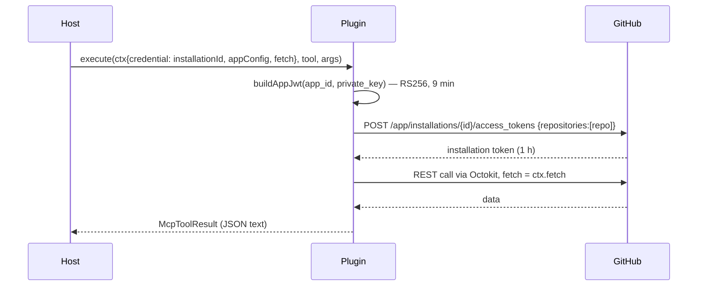

# GitHub provider plugin — `@vaubaan/plugin-github`

The GitHub plugin on the v5 SDK (feature P1.2a). Contract:
[[plugin-sdk]] and ADR [[plugin-contract-and-credential-spec]]. Spec:
[`vaubaan-gateway.md`](../../spec/vaubaan-gateway.md) §0 (Provider,
Connection, Resource, Preset), §3.2, §5;
[`gateway-risk-model.md`](../../spec/gateway-risk-model.md) §2, §4, §7.
Contributor guide: [`plugins/github/README.md`](../../../plugins/github/README.md).

The v4 modelling document this file replaces (French, 2026-06-15) is
superseded; its decisions that survive are restated here, the rest lives
in git history.

## What one connection is

A **GitHub App installation** on the company's organisation. The operator
registers the App once, with "Request user authorization (OAuth) during
installation" enabled, and gives the instance five app-config keys
(`app_id`, `private_key`, `app_slug`, `client_id`, `client_secret`); a user
connects by installing the App and the host stores the `installation_id` as
the connection's secret (`app-install` credential kind) — once it has
checked that this user can reach that installation. Resources are the
repositories the installation can reach, discovered as `owner/repo`.

### Installation binding

`githubCredential.userVerification` (`src/credential.ts`) is the
declaration the host runs on the callback
([connections](../connections.md), "Installation binding"; the plugin
executes none of it):

| Member                   | Value                                                               |
| ------------------------ | ------------------------------------------------------------------- |
| `codeParam`              | `code`                                                              |
| `tokenUrl`               | `https://github.com/login/oauth/access_token`                       |
| `clientAuthMethod`       | `client_secret_post` (`client_id`, `client_secret`, `code` in body) |
| `installationsUrl`       | `https://api.github.com/user/installations`                         |
| `installationsHeaders`   | `GITHUB_API_HEADERS` (`Accept`, `User-Agent`, API version)          |
| `installationsListField` | `installations`                                                     |
| `installationIdField`    | `id`                                                                |
| `pagination`             | `page` / `per_page`, 100 per page                                   |

With the checkbox enabled, GitHub starts its web application flow right
after the installation and redirects to the App's first **callback URL**
with `code` next to `installation_id` (and no setup URL can be set). The
host exchanges the code for a user access token and calls
`GET /user/installations`, which lists the installations of this App the
token's user can reach; the claimed id must be among them. The user token
is then dropped. `client_secret` is used by the host only and is not in the
`ctx.appConfig` this plugin receives; `GITHUB_APP_CONFIG.clientId` /
`.clientSecret` name the keys for the spec, not for a reader.

The token is scoped to the repository the call names (installation-wide
for the two search tools). `installationTokenForCall(ctx, repo)`
(`src/token-cache.ts`) reuses it for up to 50 minutes per connection and
repository through the host-provided `ExecuteContext.credentialCache`, so
the diagram above is the cache-miss path; without a cache every call mints.
`github__mint_install_token` never uses the cache: the token it hands out
is always minted for that call. 401/403 anywhere → `UpstreamAuthError`. No
PAT path.

## Files

| File                      | Role                                                                                                                          |
| ------------------------- | ----------------------------------------------------------------------------------------------------------------------------- |
| `src/index.ts`            | `definePlugin` → `githubPlugin` v1.0.0.                                                                                       |
| `src/risk-catalog.yaml`   | 14 risks + fallback, 3 presets, `catalog_version: 2`.                                                                         |
| `src/data-model.ts`       | Plane `repo`, 16 entities; `branch` is `envScopable`.                                                                         |
| `src/tools.ts`            | 26 tools. Retired by risk-model §7.2 #1 and not declared: `dispatch_workflow`, `cancel_workflow_run`, `rerun_workflow_run`.   |
| `src/classify.ts`         | `classifyGithub(tool, args, resources)`; core `classifyGithubRefs` over repo refs.                                            |
| `src/credential.ts`       | `githubCredential` (app-install spec), `installationTokenFor(ctx, scope)`.                                                    |
| `src/app-install.ts`      | `buildAppJwt`, `mintInstallationToken`, `GITHUB_API_BASE`, `GITHUB_API_HEADERS`.                                              |
| `src/execute.ts`          | `executeGithub`, `discoverGithubResources`, `MINT_PERMISSIONS`, discovery paging constants (100 per page, 10 pages at most).  |
| `src/token-cache.ts`      | `installationTokenForCall(ctx, repo)`: per-call token served from `ctx.credentialCache`, 50 min at most, 5 min expiry margin. |
| `src/octokit-dispatch.ts` | `dispatchGithubTool(octokit, tool, args)`.                                                                                    |

## Tool → slice mapping

Every repo-scoped tool resolves `owner/repo` and refuses a repository that
is not among the mission's GitHub resources (`denied`), even though the
host already checked `resource-not-in-mission`. Identifiers are sanitised
to the slice ident class before being embedded.

| Tool                                      | Slices                                                                                               |
| ----------------------------------------- | ---------------------------------------------------------------------------------------------------- |
| `list_branches`                           | `repo[X].branch.R`                                                                                   |
| `list_commits`                            | `repo[X].commit.R`, or `repo[X].branch[sha].commit.R` when `sha` is given                            |
| `get_file_contents`                       | `repo[X].branch[ref].file[path].R` (`branch.file[…]` without `ref`)                                  |
| `get_commit`                              | `repo[X].commit[sha].R`                                                                              |
| `list_tags`                               | `repo[X].tag.R`                                                                                      |
| `list_pull_requests` / `get_pull_request` | `repo[X].pull_request.R` / `repo[X].pull_request[N].R`                                               |
| `list_issues` / `get_issue`               | `repo[X].issue.R` / `repo[X].issue[N].R`                                                             |
| `list_releases`                           | `repo[X].release.R`                                                                                  |
| `list_workflows` / `list_workflow_runs`   | `repo[X].workflow.R` / `repo[X].workflow-run.R` or `repo[X].workflow[id].workflow-run.R`             |
| `get_branch_protection`                   | `repo[X].branch-protection[branch].R`                                                                |
| `search_code` / `search_issues`           | `github.search.code.R` / `github.search.issues.R` (no resource check)                                |
| `create_branch`                           | `repo[X].branch[name].W`                                                                             |
| `create_or_update_file` / `delete_file`   | `repo[X].branch[b].file[path].W` + `repo[X].branch[b].workflow-via-file.W` if path is a workflow     |
| `push_files`                              | one `file[path].W` per file (+ workflow marker), + `repo[X].branch[b].files-bulk.W` when 2+ files    |
| `create_pull_request`                     | `repo[X].pull_request.W` + `repo[X].branch[head].propose-to[base].W`                                 |
| `merge_pull_request`                      | `repo[X].pull_request[N].W` + `repo[X].branch[base ?? main].merge-into.W`                            |
| `add_issue_comment`                       | `repo[X].issue[N].comment.W` (issue/PR number space is unified)                                      |
| `create_release`                          | `repo[X].release.W` + `repo[X].tag[name].W`                                                          |
| `delete_release`                          | `repo[X].release[id].W`                                                                              |
| `update_branch_protection`                | `repo[X].branch-protection[branch].W`                                                                |
| `mint_install_token`                      | `repo[X].install-token[clone\|push].W` for `repoFullName`, or one per GitHub resource of the mission |

Concrete slices never carry wildcards: a "list all" read emits the entity
name without a leaf and the catalog's terminal `[**]` absorbs it.

## Catalog decisions

- **Protected branches by name**, not by the owner's environment label:
  `merge-protected` matches `main, master, prod, production, release-*`
  for direct writes, bulk writes and merges. A GitHub resource's `env`
  label (set by the owner on the repository) does not qualify GitHub
  risks; no GitHub risk is env-scoped.
- **`workflow-write-via-file` lost its v4 `acceptable_in_envs`
  (`feature, fix, chore`)**. Those were branch pseudo-envs that the v5
  resource-based `EnvResolver` never produces; kept, the risk would have
  been skipped from `risks_touched` and a workflow write on a feature
  branch would have passed on `feature-branch-write` alone. Without the
  field the risk is always touched and must be accepted explicitly; a
  workflow write on `main` additionally touches `merge-protected`.
- **Fallback widened to `github.**.W`** (was `github.repo[**].W`), per the
risk-model spec §4.3 wording. The fallback counts only when no specific
entry matched the write (policy-engine rule settled with P1.2-SDK); no
preset offers it, the creator adds it for unconventional branch names
(`plugin.test.ts`checks both: a`wip-x` write falls to the fallback alone,
  and no preset lists it).
- `create-release` and `delete-release` both match `release[**].W`: each of
  the two tools touches both risks, so a mission must accept both (the
  `release-manager` preset does).
- Two mint risks (`clone` vs `push`): the push token leaves the gateway's
  perimeter with write permissions, hence a separate, approval-gated entry.
- `merge_pull_request` defaults `base` to `main` when the argument is
  absent — the conservative assumption (the tool declares `base`).

## Presets

| Preset            | Risks (quota / rate per 60 s)                                                                                                                                                                                                | Approval                                         |
| ----------------- | ---------------------------------------------------------------------------------------------------------------------------------------------------------------------------------------------------------------------------- | ------------------------------------------------ |
| `read-only`       | read-code 5000/120, read-meta 5000/120                                                                                                                                                                                       | —                                                |
| `developer`       | read-code 10000/240, read-meta 10000/240, search-global 500/30, feature-branch-write 3000/60, bulk-file-write 1000/30, create-pr 200/10, comment-write 500/20, workflow-write-via-file 50/5, mint clone 50/5, mint push 20/2 | workflow-write-via-file, mint-install-token-push |
| `release-manager` | read-code 5000/120, read-meta 5000/120, feature-branch-write 500/30, create-pr 100/10, comment-write 200/10, merge-protected 50/5, create-release 20/2, delete-release 5/1                                                   | merge-protected, create-release, delete-release  |

The numbers are defaults the creator adjusts at issuance; the deferred ADR
`mission-presets-default-values` (plan §5.5) will settle them across
plugins. `branch-protection-write` is in no preset.

## Tests

`npx vitest run plugins/github` — 71 tests, no network:

- `plugin.test.ts` (14): kit assertions, coverage with a sample per tool
  (every catalog risk reachable), fallback-only lint, fallback catching an
  unconventional branch, preset invariants, credential spec, resource check.
- `classify.test.ts` (31): the per-tool security suite of `classifyGithub`
  (reads, branch and file writes, pull requests, comments, releases, rules,
  mint, retired tools, structural denials).
- `execute.test.ts` (20): JWT claims (RS256, `iss`, 540 s), mint request
  (Bearer JWT, scoping body, PEM un-escaping, missing key names the key,
  kind mismatch, 401 → `UpstreamAuthError`), Octokit over `mockFetch`
  (per-call repository scoping, installation-wide for search, JSON body,
  403 → `UpstreamAuthError`), branch-protection and release tools, mint tool
  (clone/push permission sets, fan-out over mission resources, refusals
  before any call), discovery (metadata, paging to `total_count`, 401).
- `token-cache.test.ts` (5): a mint per call without a host cache, one mint
  per repository scope with one, no token served or stored close to its
  expiry, lifetime bounded by what is left of the token,
  `github__mint_install_token` never cached.
- `data-model.test.ts` (1): data-model integrity.

## How to debug

- **`Invalid risk catalog` at boot** — read every bullet of the
  `CatalogError`; paths are exact. Presets must reference ids of this
  catalog only.
- **`github: app configuration key 'app_id' is missing`** — the instance
  configuration lacks one of the app-config keys; nothing was sent to
  GitHub.
- **"Not connected — the provider returned no user authorization"** — the
  App does not have "Request user authorization (OAuth) during
  installation" enabled, so GitHub came back without `code`.
- **"Not connected — … not among those the authorizing account can
  reach"** — the GitHub account signed in during the installation cannot
  reach the installation whose id came back; `GET /user/installations` with
  that account's token does not list it.
- **`token-exchange-failed` with `incorrect_client_credentials`** — the
  client ID or client secret entered for the App is wrong (the client ID is
  not the App ID).
- **`GitHub App token mint failed (404)`** — the installation id is unknown
  to this App (App uninstalled, or the wrong App's key); 401 means the key
  does not match `app_id`.
- **A repo-scoped call is `denied` by the classifier** — a repository
  outside the mission's selected resources is refused, and the message names
  the allowed ones; add the repository to the mission (or the connection's
  discovered resources are stale: refresh them).
- **A write is refused with `github.uncategorized-write` missing** — the
  branch matches neither the feature/\* conventions nor a protected name,
  so only the fallback caught it. Rename the branch, or have the creator
  add the fallback to the mission explicitly.
- **`mockFetch: unexpected GET …`** in tests — Octokit built a URL no route
  covers; the message names it.

## Not done, on purpose

- The `search_*` queries are not forced to `repo:<mission resource>`; the
  risk `search-global` (blast `account`) is the guard.
- Missing tools identified in v4 (`create_issue`, `update_issue`,
  `create_pull_request_review`, `delete_branch`, `get_repository`…) stay
  out; they would slot into existing risks without a new entry.
