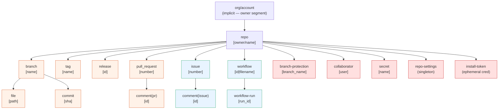

# GitHub provider — modélisation v4 (risk-based)

> Document de modélisation pour appliquer la spec v4
> [`gateway-risk-model.md`](../../spec/gateway-risk-model.md) au
> provider GitHub. Couvre : (1) data-model du plane `repo`, (2) mapping
> tool → slice, (3) catalogue de risks YAML, (4) lint coverage, (5) edge
> cases, (6) trous identifiés.
>
> **Premier énoncé** (spec v4 §2) :
> _"Un provider est une BDD mutable de `(entité_1, entité_2, …)` avec des
> side effects observables via `read` sur certaines entités."_
>
> Pour GitHub, le plane est unique : `repo`. Pas de plane `org` (les tools
> actuels ne touchent pas la surface compte/org). Les writes account-level
> rentreraient dans un futur plane `account` — hors scope ici.

---

## 1. Data-model — plane `repo`

### 1.1 Graphe d'entités



### 1.2 Tableau des entités

| Entité              | Parent           | Cardinalité             | Lecture (R) actuelle                     | Écriture (W) actuelle                                                         | Notes containment                                                            |
| ------------------- | ---------------- | ----------------------- | ---------------------------------------- | ----------------------------------------------------------------------------- | ---------------------------------------------------------------------------- |
| `org`               | (root, implicit) | `one`                   | implicit dans le selector `[owner/...]`  | non exposé                                                                    | Pas une entité matchable seule — toujours préfixe.                           |
| `repo`              | `org`            | `one` (par binding)     | `list_*` agrègent dessus, `get_*`        | non créable via nos tools (création hors-scope, manuelle ou via App install)  | Sélecteur de toutes les sous-entités. 1 binding = 1 repo (`owner/repo`).     |
| `branch`            | `repo`           | `bounded`/`unbounded`   | `list_branches`                          | `create_branch`                                                               | Cardinalité émerge du selector : `[main]` = one ; `[feature/*]` = unbounded. |
| `file`              | `branch`         | `unbounded`             | `get_file_contents` (env `ref`)          | `create_or_update_file`, `push_files`, `delete_file`                          | Le PARENT est la branche, pas le repo (spec v4 §2 — env = branche).          |
| `commit`            | `branch`         | `unbounded`             | `list_commits`, `get_commit`             | implicite (créé via `push_files`, `create_or_update_file`)                    | Read-only direct ; mutation observable seulement via parent branch.          |
| `tag`               | `repo`           | `bounded`               | `list_tags`                              | implicite via `create_release` (peut créer le tag)                            | Pas de tool `delete_tag` actuellement (cf. trous §6).                        |
| `release`           | `repo`           | `bounded`               | `list_releases`                          | `create_release`, `delete_release`                                            | Référence un tag. `create_release(generate_release_notes=true)` lit commits. |
| `pull_request`      | `repo`           | `bounded`               | `list_pull_requests`, `get_pull_request` | `create_pull_request`, `merge_pull_request`                                   | `merge_pull_request` est un **write sur branche cible** (env = `args.base`). |
| `comment(pr)`       | `pull_request`   | `unbounded`             | indirect (via `get_pull_request`)        | `add_issue_comment` (GitHub fait union issue/PR)                              | GitHub traite issue.number et pr.number dans le même espace pour comments.   |
| `issue`             | `repo`           | `bounded`               | `list_issues`, `get_issue`               | non exposé en write direct (cf. trous §6 — pas de `create_issue`)             |                                                                              |
| `comment(issue)`    | `issue`          | `unbounded`             | indirect                                 | `add_issue_comment`                                                           |                                                                              |
| `workflow`          | `repo`           | `bounded`               | `list_workflows`                         | **non exposé en W** (décision spec §7.2 #1)                                   | Le YAML lui-même est un `file` sous `.github/workflows/`.                    |
| `workflow-run`      | `workflow`       | `unbounded`             | `list_workflow_runs`                     | **retiré** : `dispatch_workflow`, `cancel_workflow_run`, `rerun_workflow_run` | Voir §5 Edge cases et §6 Trous.                                              |
| `branch-protection` | `repo`           | `bounded` (par branche) | `get_branch_protection`                  | `update_branch_protection`                                                    | Sélecteur = nom de branche protégée. Posture-shift.                          |
| `collaborator`      | `repo`           | `unbounded`             | non exposé                               | non exposé                                                                    | Présent dans le data-model pour exhaustivité (cf. trous §6).                 |
| `secret`            | `repo`           | `bounded`               | non exposé                               | non exposé                                                                    | Idem — réservé pour entrée future.                                           |
| `install-token`     | `repo`           | `bounded` (1 par mint)  | n/a (credential)                         | `mint_install_token` (purpose=clone OU push)                                  | Entité **éphémère** ; output = credential opaque utilisable hors-gateway.    |
| `repo-settings`     | `repo`           | `one` (singleton)       | non exposé direct                        | non exposé                                                                    | Inclut visibility, default-branch, archived, etc. Hors scope actuel.         |

### 1.3 Containment et env

Conformément à la spec v4 §2.4 et au choix existant (handbook
github-provider §"Capability surface"), **la branche EST l'env du file**.
Donc :

- `github.repo[X].branch[main].file[Y].W` ≠ `github.repo[X].branch[feature/Y].file[Y].W`
- Le selector de cardinalité émerge du chemin : `branch[main]` est un
  `one`, `branch[feature/*]` est `unbounded`.

Pour les entités sans hiérarchie branche (release, tag, PR, workflow,
issue), le chemin est `repo[X].<entity>[id].action`.

### 1.4 Side-effects non-observables

Slice émise par un tool peut avoir un **effet collatéral** observable
ailleurs (spec v4 §7.1) :

- `create_or_update_file@main` sur un fichier `.github/workflows/*.yml`
  → modifie le **workflow** (entité distincte) sans appeler de tool
  `workflow.W`. **Risk dérivé** : `github.workflow-write-via-file`.
- `merge_pull_request` → trigge CI/CD aval (Vercel, etc.). Effet
  cross-provider — capturé par le risk `github.merge-protected`.
- `create_release` non-draft + non-prerelease → publication publique,
  notifications watchers, déclenche workflows `on: release`.
- `push_files` ou `create_or_update_file` sur un fichier touchant le
  CI (`.github/workflows/*`) trigge des runs.

Ces effets sont capturés par des **risks** dédiés au catalogue,
indépendants des entités primaires touchées.

---

## 2. Mapping tool → slice(s)

Tous les ~27 tools MCP GitHub actuellement définis dans
[`tools.ts`](../../../packages/providers/github/src/tools.ts), avec leur
slice(s) émise(s) au call et leur env-resolution.

Notation : `slices` = liste de patterns DSL (spec v4 §3) émis par le
plugin pour ce call. `env-res` = `static` (pas de runtime arg pour
résoudre) ou `runtime` (le selecteur de branche/env vient d'un arg).

### 2.1 Reads (10 tools)

| Tool                            | Slices émises                                                    | env-res   | Notes                                                      |
| ------------------------------- | ---------------------------------------------------------------- | --------- | ---------------------------------------------------------- |
| `github__list_branches`         | `github.repo[O/R].branch[*].R`                                   | `static`  |                                                            |
| `github__list_commits`          | `github.repo[O/R].branch[sha?].commit[*].R`                      | `runtime` | `args.sha` peut être branche ou commit.                    |
| `github__list_pull_requests`    | `github.repo[O/R].pull_request[*].R`                             | `static`  |                                                            |
| `github__list_issues`           | `github.repo[O/R].issue[*].R`                                    | `static`  |                                                            |
| `github__get_file_contents`     | `github.repo[O/R].branch[args.ref?].file[args.path].R`           | `runtime` | `ref` peut être branche/tag/sha ; défaut = default branch. |
| `github__get_pull_request`      | `github.repo[O/R].pull_request[args.pull_number].R`              | `runtime` |                                                            |
| `github__get_issue`             | `github.repo[O/R].issue[args.issue_number].R`                    | `runtime` |                                                            |
| `github__get_commit`            | `github.repo[O/R].commit[args.sha].R`                            | `runtime` |                                                            |
| `github__list_workflows`        | `github.repo[O/R].workflow[*].R`                                 | `static`  |                                                            |
| `github__list_workflow_runs`    | `github.repo[O/R].workflow[args.workflow_id?].workflow-run[*].R` | `runtime` | Filtré par workflow_id ou branche optionnellement.         |
| `github__get_branch_protection` | `github.repo[O/R].branch-protection[args.branch].R`              | `runtime` |                                                            |
| `github__list_releases`         | `github.repo[O/R].release[*].R`                                  | `static`  |                                                            |
| `github__list_tags`             | `github.repo[O/R].tag[*].R`                                      | `static`  |                                                            |

### 2.2 Searches globaux (2 tools)

| Tool                    | Slices émises            | env-res  | Notes                                                                  |
| ----------------------- | ------------------------ | -------- | ---------------------------------------------------------------------- |
| `github__search_code`   | `github.search.code.R`   | `static` | NB : techniquement **non bornée aux bindings**, peut lire code public. |
| `github__search_issues` | `github.search.issues.R` | `static` | Idem.                                                                  |

> **Décision modélisation** : un nouveau préfixe `github.search.<kind>` distinct de `repo`
> car ces recherches **ne sont pas scopées à un repo bound**. À discuter §6 Trous.

### 2.3 Writes branch/files/commits (4 tools)

| Tool                            | Slices émises                                                                                                                                                        | env-res   | Notes                                                                             |
| ------------------------------- | -------------------------------------------------------------------------------------------------------------------------------------------------------------------- | --------- | --------------------------------------------------------------------------------- |
| `github__create_branch`         | `github.repo[O/R].branch[args.branch].W`                                                                                                                             | `runtime` | Crée la branche, ne touche pas encore le file/commit.                             |
| `github__create_or_update_file` | `github.repo[O/R].branch[args.branch].file[args.path].W` <br/> + si `args.path` ∈ `.github/workflows/*` : `github.repo[O/R].branch[args.branch].workflow-via-file.W` | `runtime` | **Slice dérivée** quand on touche un workflow file. Edge case majeur §5.          |
| `github__push_files`            | `github.repo[O/R].branch[args.branch].file[*].W` (file[*] = bulk, cardinalité unbounded) <br/> + dérivée workflow si tout `path` matche `.github/workflows/*`        | `runtime` | Cardinalité `bulk` émerge du `files[]`.                                           |
| `github__delete_file`           | `github.repo[O/R].branch[args.branch].file[args.path].W` (delete = sous-cas du W)                                                                                    | `runtime` | Pas de distinction `delete` vs `update` au niveau slice ; capturé via risk dédié. |

### 2.4 Writes PR / comments (3 tools)

| Tool                          | Slices émises                                                                                                           | env-res   | Notes                                                                      |
| ----------------------------- | ----------------------------------------------------------------------------------------------------------------------- | --------- | -------------------------------------------------------------------------- |
| `github__create_pull_request` | `github.repo[O/R].pull_request[*].W` <br/> + `github.repo[O/R].branch[args.head].propose-to[args.base].W`               | `runtime` | Slice dérivée capture l'intention "proposer un merge vers `base`".         |
| `github__merge_pull_request`  | `github.repo[O/R].pull_request[args.pull_number].W` <br/> + `github.repo[O/R].branch[args.base ?? 'main'].merge-into.W` | `runtime` | Le merge produit un commit sur la base branch — slice secondaire critique. |
| `github__add_issue_comment`   | `github.repo[O/R].issue[args.issue_number].comment[*].W`                                                                | `runtime` | Espace `issue` couvre aussi les PR (GitHub union).                         |

### 2.5 Writes releases / tags (2 tools)

| Tool                     | Slices émises                                                                                       | env-res   | Notes                                                                                      |
| ------------------------ | --------------------------------------------------------------------------------------------------- | --------- | ------------------------------------------------------------------------------------------ |
| `github__create_release` | `github.repo[O/R].release[*].W` <br/> + `github.repo[O/R].tag[args.tag_name].W` (si tag inexistant) | `runtime` | Publication publique si `draft=false && prerelease=false`. Trigge `on: release` workflows. |
| `github__delete_release` | `github.repo[O/R].release[args.release_id].W` (delete sous-cas)                                     | `runtime` | Ne supprime PAS le tag sous-jacent. **Irréversible côté audit/notifications**.             |

### 2.6 Writes CI — workflow-run (3 tools, **retirés** v4)

| Tool                          | Slices émises (théoriques)                                      | env-res   | Décision spec v4 §7.2 #1                                                      |
| ----------------------------- | --------------------------------------------------------------- | --------- | ----------------------------------------------------------------------------- |
| `github__dispatch_workflow`   | `github.repo[O/R].workflow[args.workflow_id].workflow-run[*].W` | `runtime` | **RETIRÉ.** Pas exposé. Voie de privilege escalation via secrets de workflow. |
| `github__cancel_workflow_run` | `github.repo[O/R].workflow-run[args.run_id].W`                  | `runtime` | **RETIRÉ.** Cohérence avec dispatch.                                          |
| `github__rerun_workflow_run`  | `github.repo[O/R].workflow-run[args.run_id].W`                  | `runtime` | **RETIRÉ.** Idem.                                                             |

> Le code actuel (`classify.ts`, `tools.ts`, `execute.ts`) **expose
> encore** ces 3 tools. Phase 6 de la migration (spec v4 §13) doit les
> retirer. Pour la modélisation v4 ci-dessous, ces tools sont
> **omis du catalogue** — le runtime renverra `unknown github tool` car
> ils n'existeront plus dans `availableTools`.

### 2.7 Writes rules — branch protection (1 tool)

| Tool                               | Slices émises                                       | env-res   | Notes                                        |
| ---------------------------------- | --------------------------------------------------- | --------- | -------------------------------------------- |
| `github__update_branch_protection` | `github.repo[O/R].branch-protection[args.branch].W` | `runtime` | Posture-shift. Persistance après la session. |

### 2.8 Credential mint (1 tool)

| Tool                         | Slices émises                                                                                                                                                   | env-res   | Notes                                                                                                                         |
| ---------------------------- | --------------------------------------------------------------------------------------------------------------------------------------------------------------- | --------- | ----------------------------------------------------------------------------------------------------------------------------- |
| `github__mint_install_token` | si `purpose=clone` : `github.repo[args.repoFullName?].install-token[clone].W` <br/> si `purpose=push` : `github.repo[args.repoFullName?].install-token[push].W` | `runtime` | **2 slices possibles distinctes** selon `purpose`. Le scope du credential fan-out à tous les bindings si `repoFullName` omis. |

### 2.9 Récap mapping (vue compacte)

**Total tools actifs après Phase 6 = 24** (27 - 3 workflow-run writes retirés).

| Tool                               | Slice principale (compactée)                                  |
| ---------------------------------- | ------------------------------------------------------------- |
| `github__list_branches`            | `repo[X].branch[*].R`                                         |
| `github__list_commits`             | `repo[X].commit[*].R`                                         |
| `github__list_pull_requests`       | `repo[X].pull_request[*].R`                                   |
| `github__list_issues`              | `repo[X].issue[*].R`                                          |
| `github__get_file_contents`        | `repo[X].branch[ref].file[path].R`                            |
| `github__get_pull_request`         | `repo[X].pull_request[N].R`                                   |
| `github__get_issue`                | `repo[X].issue[N].R`                                          |
| `github__get_commit`               | `repo[X].commit[sha].R`                                       |
| `github__list_workflows`           | `repo[X].workflow[*].R`                                       |
| `github__list_workflow_runs`       | `repo[X].workflow-run[*].R`                                   |
| `github__get_branch_protection`    | `repo[X].branch-protection[branch].R`                         |
| `github__list_releases`            | `repo[X].release[*].R`                                        |
| `github__list_tags`                | `repo[X].tag[*].R`                                            |
| `github__search_code`              | `search.code.R`                                               |
| `github__search_issues`            | `search.issues.R`                                             |
| `github__create_branch`            | `repo[X].branch[branch].W`                                    |
| `github__create_or_update_file`    | `repo[X].branch[branch].file[path].W` (+ workflow-via-file)   |
| `github__push_files`               | `repo[X].branch[branch].file[*].W` (+ workflow-via-file bulk) |
| `github__delete_file`              | `repo[X].branch[branch].file[path].W`                         |
| `github__create_pull_request`      | `repo[X].pull_request[*].W` + `propose-to[base].W`            |
| `github__merge_pull_request`       | `repo[X].pull_request[N].W` + `branch[base].merge-into.W`     |
| `github__add_issue_comment`        | `repo[X].issue[N].comment[*].W`                               |
| `github__create_release`           | `repo[X].release[*].W` (+ `tag[name].W`)                      |
| `github__delete_release`           | `repo[X].release[id].W`                                       |
| `github__update_branch_protection` | `repo[X].branch-protection[branch].W`                         |
| `github__mint_install_token`       | `repo[X?].install-token[clone\|push].W`                       |

---

## 3. Risk catalog (YAML) — spec v4 §4.1

> 14 risks fins + 1 catch-all (15 entrées) couvrant toutes les slices
> émises par le mapping §2. Chaque entry conforme au schéma `RiskEntry`
> de spec v4 §4.1. Vecteur 6D, `default_gate` seedé via formule §4.2.

```yaml
github:
  catalog_version: 1
  catalog_date: 2026-06-15

  risks:
    # ---------------------------------------------------------------
    # READS
    # ---------------------------------------------------------------
    - id: github.read-code
      label: 'Lire le code, branches, commits, files'
      reason: |
        Lectures peuvent leak des secrets via .env commit (rare mais
        non-nul). Le contenu des fichiers est injectable côté agent
        (OWASP LLM01) — un README malicieux peut influencer un modèle.
      matches:
        - 'github.repo[**].branch[**].R'
        - 'github.repo[**].branch[**].file[**].R'
        - 'github.repo[**].commit[**].R'
        - 'github.repo[**].tag[**].R'
      vector:
        reversibility: reversible
        blast: single
        data: data
        cost: free
        visibility: internal
        persistence: stateless
      default_gate: allow

    - id: github.read-meta
      label: 'Lire PR, issues, releases, workflows, branch-protection'
      reason: |
        Métadonnées du repo. Le body des issues/PR est attacker-controlled
        (OWASP LLM01) ; à manipuler avec prudence côté agent. Lecture des
        rules est utile pour le diagnostic, jamais dangereuse en soi.
      matches:
        - 'github.repo[**].pull_request[**].R'
        - 'github.repo[**].issue[**].R'
        - 'github.repo[**].issue[**].comment[**].R'
        - 'github.repo[**].release[**].R'
        - 'github.repo[**].workflow[**].R'
        - 'github.repo[**].workflow-run[**].R'
        - 'github.repo[**].branch-protection[**].R'
      vector:
        reversibility: reversible
        blast: single
        data: metadata
        cost: free
        visibility: internal
        persistence: stateless
      default_gate: allow

    - id: github.search-global
      label: 'Search global code/issues GitHub (hors bindings)'
      reason: |
        Recherche traverse tout GitHub public + tous les repos auxquels
        le token App a accès. Peut potentiellement leak des contenus
        d'autres orgs si l'App est installée largement. Faible
        sensibilité par défaut, mais sortable du périmètre projet.
      matches:
        - 'github.search.code.R'
        - 'github.search.issues.R'
      vector:
        reversibility: reversible
        blast: account
        data: data
        cost: free
        visibility: internal
        persistence: stateless
      default_gate: allow

    # ---------------------------------------------------------------
    # WRITES — branches feature/* (low-risk)
    # ---------------------------------------------------------------
    - id: github.feature-branch-write
      label: 'Créer/modifier des branches feature/*, fix/*, chore/*'
      reason: |
        Réversible (git revert ou delete de la branche). Pas de side
        effect prod tant que pas mergé. C'est le cœur du flow du
        coding agent.
      matches:
        - 'github.repo[**].branch[feature/*,fix/*,chore/*,bug/*,docs/*,refactor/*].W'
        - 'github.repo[**].branch[feature/*,fix/*,chore/*,bug/*,docs/*,refactor/*].file[**].W'
      vector:
        reversibility: reversible
        blast: single
        data: data
        cost: free
        visibility: internal
        persistence: session
      default_gate: allow

    # ---------------------------------------------------------------
    # WRITES — branches non-feature, non-protected (defaut, fallback)
    # ---------------------------------------------------------------
    - id: github.arbitrary-branch-write
      label: 'Créer/modifier une branche quelconque (hors feature/* et hors protected)'
      reason: |
        Branche custom (ex: `experiment-xyz`, `wip`, `agent-sandbox`).
        Pas de CI prod déclenchée tant que pas mergée, mais hors du
        pattern conventionnel — utile à observer en audit.
      matches:
        - 'github.repo[**].branch[*].W'
        - 'github.repo[**].branch[*].file[**].W'
      vector:
        reversibility: reversible
        blast: single
        data: data
        cost: free
        visibility: internal
        persistence: session
      default_gate: allow

    # ---------------------------------------------------------------
    # WRITES — branches protégées (main, master, release-*)
    # ---------------------------------------------------------------
    - id: github.merge-protected
      label: 'Écrire sur main/master/release-* (commit direct OU merge PR)'
      reason: |
        Branche canonique — trigge CI/CD prod en aval. Costly à reverter
        (release notes, communications, dependencies aval). Couvre les
        commits directs (create_or_update_file sans PR) ET les merges
        de PR sur ces branches.
      matches:
        - 'github.repo[**].branch[main,master,release-*,prod,production].W'
        - 'github.repo[**].branch[main,master,release-*,prod,production].file[**].W'
        - 'github.repo[**].branch[main,master,release-*,prod,production].merge-into.W'
      vector:
        reversibility: costly
        blast: env
        data: data
        cost: moderate
        visibility: team
        persistence: session
      default_gate: confirm

    # ---------------------------------------------------------------
    # WRITES — workflows YAML (via file)
    # ---------------------------------------------------------------
    - id: github.workflow-write-via-file
      label: 'Modifier un workflow GitHub Actions (.github/workflows/*.yml)'
      reason: |
        Le YAML CI définit ce qui s'exécute avec les secrets du repo.
        Modifier un workflow = potentiel privilege escalation
        (steal secrets via curl vers domaine attacker-controlled).
        Spec v4 §7.2 #1 : c'est précisément la raison pour laquelle
        on a retiré dispatch_workflow — mais l'attaque persiste via
        write sur le fichier.
      matches:
        - 'github.repo[**].branch[**].workflow-via-file.W'
      vector:
        reversibility: costly
        blast: account
        data: secret
        cost: free
        visibility: internal
        persistence: posture
      default_gate: deny
      # Acceptable seulement sur feature branches non-protected, JAMAIS
      # sur main directement (le merge passe par PR review humain).
      acceptable_in_envs:
        - feature
        - fix
        - chore

    # ---------------------------------------------------------------
    # WRITES — bulk file (push_files)
    # ---------------------------------------------------------------
    - id: github.bulk-file-write
      label: 'Push bulk multi-fichiers (push_files)'
      reason: |
        Cardinalité `unbounded` côté file[*]. Plus difficile à reviewer
        manuellement. Distinct du write file-by-file pour permettre au
        manager d'opt-in/out spécifiquement.
      matches:
        - 'github.repo[**].branch[**].file[*].W'
      vector:
        reversibility: reversible
        blast: single
        data: data
        cost: free
        visibility: internal
        persistence: session
      default_gate: allow

    # ---------------------------------------------------------------
    # WRITES — PR + comments
    # ---------------------------------------------------------------
    - id: github.create-pr
      label: 'Ouvrir une pull request'
      reason: |
        Pas de mutation prod. Notifie les reviewers (visibility=team).
        Le titre/body peuvent être injectables côté reviewer humain.
      matches:
        - 'github.repo[**].pull_request[*].W'
        - 'github.repo[**].branch[**].propose-to[**].W'
      vector:
        reversibility: reversible
        blast: single
        data: data
        cost: free
        visibility: team
        persistence: session
      default_gate: allow

    - id: github.comment-write
      label: 'Commenter sur une issue ou une PR'
      reason: |
        Comment sur une PR notifie reviewers. Comment sur une issue
        notifie subscribers. Bas risque mais peut polluer / spam
        si abusé.
      matches:
        - 'github.repo[**].issue[**].comment[**].W'
      vector:
        reversibility: reversible
        blast: single
        data: data
        cost: free
        visibility: team
        persistence: session
      default_gate: allow

    # ---------------------------------------------------------------
    # WRITES — releases (publication publique)
    # ---------------------------------------------------------------
    - id: github.create-release
      label: 'Créer une release (potentiellement publique)'
      reason: |
        Si draft=false && prerelease=false → publication publique +
        notifications watchers + trigge workflows `on: release`.
        Difficile à "rétracter" — même si delete, des consommateurs
        downstream ont pu déjà puller.
      matches:
        - 'github.repo[**].release[*].W'
        - 'github.repo[**].tag[**].W'
      vector:
        reversibility: costly
        blast: env
        data: metadata
        cost: free
        visibility: public
        persistence: session
      default_gate: confirm

    - id: github.delete-release
      label: 'Supprimer une release'
      reason: |
        Irréversible côté audit/notifications externes. Le tag persiste
        mais la release disparaît avec son body et ses assets.
        Consommateurs downstream peuvent voir un 404.
      matches:
        - 'github.repo[**].release[*].W' # delete = W sous-cas
      vector:
        reversibility: irreversible
        blast: env
        data: metadata
        cost: free
        visibility: public
        persistence: session
      default_gate: confirm

    # ---------------------------------------------------------------
    # WRITES — branch protection (posture-shift)
    # ---------------------------------------------------------------
    - id: github.branch-protection-write
      label: 'Modifier la branch protection'
      reason: |
        Posture-shift : ouvre la branche aux écritures hors-process
        (ex: désactiver required reviews). Persistance après la session.
        Même quand on DURCIT (ajoute required check), c'est une décision
        qui survit au token — donc confirm minimum.
      matches:
        - 'github.repo[**].branch-protection[**].W'
      vector:
        reversibility: costly
        blast: env
        data: metadata
        cost: free
        visibility: team
        persistence: posture
      default_gate: deny

    # ---------------------------------------------------------------
    # WRITES — credential mint (install token)
    # ---------------------------------------------------------------
    - id: github.mint-install-token-clone
      label: 'Minter un install token (purpose=clone, lecture seule)'
      reason: |
        Credential creation, mais portée `contents:read` uniquement.
        Le token a sa propre durée de vie (1h) et son propre scope.
        Risque modéré : extraction de code, pas de mutation.
      matches:
        - 'github.repo[**].install-token[clone].W'
      vector:
        reversibility: reversible
        blast: account
        data: secret
        cost: free
        visibility: internal
        persistence: session
      default_gate: confirm

    - id: github.mint-install-token-push
      label: 'Minter un install token (purpose=push, écriture)'
      reason: |
        Credential creation avec contents:write + pull_requests:write
        + workflows:write. Le token sort du périmètre gateway — une
        fois minté, plus aucun gating Vaubaan ne s'applique aux usages.
        Posture-shift de facto.
      matches:
        - 'github.repo[**].install-token[push].W'
      vector:
        reversibility: reversible
        blast: account
        data: secret
        cost: free
        visibility: internal
        persistence: posture
      default_gate: deny

    # ---------------------------------------------------------------
    # FALLBACK — catch-all (obligatoire par spec §4)
    # ---------------------------------------------------------------
    - id: github.uncategorized-write
      label: 'Écriture GitHub non catégorisée (fallback)'
      reason: |
        Catch-all pour les writes qui n'ont pas été explicitement
        catégorisés par les patterns ci-dessus. Si vu en prod, signale
        qu'il manque une entrée au catalogue — à ajouter avant prochain
        release.
      matches:
        - 'github.repo[**].W'
        - 'github.**.W'
      vector:
        reversibility: costly
        blast: env
        data: data
        cost: free
        visibility: internal
        persistence: session
      default_gate: confirm
```

### 3.1 Notes sur les seeds de `default_gate`

Formule spec v4 §4.2 appliquée :

| Risk                              | persistence | data     | reversibility / blast          | Seed calculé                                       | Override manuel ?         |
| --------------------------------- | ----------- | -------- | ------------------------------ | -------------------------------------------------- | ------------------------- |
| `github.read-code`                | stateless   | data     | reversible/single              | allow                                              | non                       |
| `github.read-meta`                | stateless   | metadata | reversible/single              | allow                                              | non                       |
| `github.search-global`            | stateless   | data     | reversible/account             | confirm (par blast=account) → relâché en **allow** | OUI (R-only, pas d'effet) |
| `github.feature-branch-write`     | session     | data     | reversible/single              | allow                                              | non                       |
| `github.arbitrary-branch-write`   | session     | data     | reversible/single              | allow                                              | non                       |
| `github.merge-protected`          | session     | data     | costly/env                     | confirm                                            | non                       |
| `github.workflow-write-via-file`  | posture     | secret   | costly/account                 | deny                                               | non                       |
| `github.bulk-file-write`          | session     | data     | reversible/single              | allow                                              | non                       |
| `github.create-pr`                | session     | data     | reversible/single              | allow                                              | non                       |
| `github.comment-write`            | session     | data     | reversible/single              | allow                                              | non                       |
| `github.create-release`           | session     | metadata | costly/env + visibility=public | confirm                                            | non                       |
| `github.delete-release`           | session     | metadata | irreversible/env               | confirm                                            | non                       |
| `github.branch-protection-write`  | posture     | metadata | costly/env                     | deny (posture)                                     | non                       |
| `github.mint-install-token-clone` | session     | secret   | reversible/account             | deny (data=secret) → relâché en **confirm**        | OUI (read-only purpose)   |
| `github.mint-install-token-push`  | posture     | secret   | reversible/account             | deny                                               | non                       |
| `github.uncategorized-write`      | session     | data     | costly/env                     | confirm                                            | non                       |

### 3.2 Notes sur `acceptable_in_envs`

Le champ est utilisé pour **bloquer structurellement** qu'un risk soit
accepté sur une branche/env qui n'a pas de sens (spec v4 §4.4, Q5).

Exemples appliqués :

- `github.workflow-write-via-file` n'a `acceptable_in_envs: [feature, fix, chore]` :
  on ne peut PAS accepter ce risk pour les branches main/release-\*/etc.
  → forcer le passage par PR + review humain. Cohérent : modifier un
  workflow directement sur main est toujours suspect.
- Les autres risks **ne déclarent pas** `acceptable_in_envs` → utilisables
  sur n'importe quelle env qualif.

**Question ouverte (Q5)** : faut-il déclarer `acceptable_in_envs: [staging]`
sur `github.merge-protected` quand le binding GitHub a un env declared ?
La spec v4 §4.4 qualifie le RiskId par env de binding (`<provider>[<env>]
.<name>`), mais GitHub n'a typiquement **pas** d'env sur le binding
(le repo lui-même n'a pas d'env, seule la branche en a — cf. §1.3).
→ Décision proposée : pour GitHub on **ne qualifie pas par binding-env**,
on laisse la branche elle-même porter la sémantique env via le selector
de slice. À valider §6 Trous.

---

## 4. Lint coverage — matrice tool × risk

> Spec v4 §13 Phase 1 : _"lint qui vérifie que chaque tool MCP est
> couvert par au moins un risk"_.

Pour chaque tool actif (Phase 6 post-retrait des workflow dispatch),
on liste les risks qui matchent **au moins une slice émise**. Le tool
est `OK` ssi au moins une cellule est cochée.

| Tool                                 | read-code | read-meta | search-global | feature-branch | arbitrary-branch | merge-protected | workflow-via-file | bulk-file | create-pr | comment | create-release | delete-release | branch-protection | mint-clone | mint-push | uncategorized |
| ------------------------------------ | :-------: | :-------: | :-----------: | :------------: | :--------------: | :-------------: | :---------------: | :-------: | :-------: | :-----: | :------------: | :------------: | :---------------: | :--------: | :-------: | :-----------: |
| `list_branches`                      |     X     |           |               |                |                  |                 |                   |           |           |         |                |                |                   |            |           |               |
| `list_commits`                       |     X     |           |               |                |                  |                 |                   |           |           |         |                |                |                   |            |           |               |
| `list_pull_requests`                 |           |     X     |               |                |                  |                 |                   |           |           |         |                |                |                   |            |           |               |
| `list_issues`                        |           |     X     |               |                |                  |                 |                   |           |           |         |                |                |                   |            |           |               |
| `get_file_contents`                  |     X     |           |               |                |                  |                 |                   |           |           |         |                |                |                   |            |           |               |
| `get_pull_request`                   |           |     X     |               |                |                  |                 |                   |           |           |         |                |                |                   |            |           |               |
| `get_issue`                          |           |     X     |               |                |                  |                 |                   |           |           |         |                |                |                   |            |           |               |
| `get_commit`                         |     X     |           |               |                |                  |                 |                   |           |           |         |                |                |                   |            |           |               |
| `list_workflows`                     |           |     X     |               |                |                  |                 |                   |           |           |         |                |                |                   |            |           |               |
| `list_workflow_runs`                 |           |     X     |               |                |                  |                 |                   |           |           |         |                |                |                   |            |           |               |
| `get_branch_protection`              |           |     X     |               |                |                  |                 |                   |           |           |         |                |                |                   |            |           |               |
| `list_releases`                      |           |     X     |               |                |                  |                 |                   |           |           |         |                |                |                   |            |           |               |
| `list_tags`                          |     X     |           |               |                |                  |                 |                   |           |           |         |                |                |                   |            |           |               |
| `search_code`                        |           |           |       X       |                |                  |                 |                   |           |           |         |                |                |                   |            |           |               |
| `search_issues`                      |           |           |       X       |                |                  |                 |                   |           |           |         |                |                |                   |            |           |               |
| `create_branch` (feature/\*)         |           |           |               |       X        |                  |                 |                   |           |           |         |                |                |                   |            |           |       X       |
| `create_branch` (other non-prot.)    |           |           |               |                |        X         |                 |                   |           |           |         |                |                |                   |            |           |       X       |
| `create_branch` (main/release-\*)    |           |           |               |                |                  |        X        |                   |           |           |         |                |                |                   |            |           |       X       |
| `create_or_update_file` (feature/\*) |           |           |               |       X        |                  |                 |                   |           |           |         |                |                |                   |            |           |       X       |
| `create_or_update_file` (main)       |           |           |               |                |                  |        X        |                   |           |           |         |                |                |                   |            |           |       X       |
| `create_or_update_file` (wf yaml)    |           |           |               |       X        |                  |                 |         X         |           |           |         |                |                |                   |            |           |       X       |
| `push_files` (feature/\*)            |           |           |               |       X        |                  |                 |                   |     X     |           |         |                |                |                   |            |           |       X       |
| `push_files` (main)                  |           |           |               |                |                  |        X        |                   |     X     |           |         |                |                |                   |            |           |       X       |
| `delete_file` (feature/\*)           |           |           |               |       X        |                  |                 |                   |           |           |         |                |                |                   |            |           |       X       |
| `delete_file` (main)                 |           |           |               |                |                  |        X        |                   |           |           |         |                |                |                   |            |           |       X       |
| `create_pull_request`                |           |           |               |                |                  |                 |                   |           |     X     |         |                |                |                   |            |           |       X       |
| `merge_pull_request` (base=main)     |           |           |               |                |                  |        X        |                   |           |           |         |                |                |                   |            |           |       X       |
| `merge_pull_request` (base=feature)  |           |           |               |       X        |                  |                 |                   |           |           |         |                |                |                   |            |           |       X       |
| `add_issue_comment`                  |           |           |               |                |                  |                 |                   |           |           |    X    |                |                |                   |            |           |       X       |
| `create_release`                     |           |           |               |                |                  |                 |                   |           |           |         |       X        |                |                   |            |           |       X       |
| `delete_release`                     |           |           |               |                |                  |                 |                   |           |           |         |                |       X        |                   |            |           |       X       |
| `update_branch_protection`           |           |           |               |                |                  |                 |                   |           |           |         |                |                |         X         |            |           |       X       |
| `mint_install_token` (purpose=clone) |           |           |               |                |                  |                 |                   |           |           |         |                |                |                   |     X      |           |       X       |
| `mint_install_token` (purpose=push)  |           |           |               |                |                  |                 |                   |           |           |         |                |                |                   |            |     X     |       X       |

**Lecture** :

- Chaque tool actif a **au moins** une croix → couverture intégrale prouvée.
- Le fallback `uncategorized-write` capte par construction toute slice
  `github.**.W` non couverte ailleurs — c'est le filet de sécurité.
- Les tools en R-only ne tombent **pas** dans le fallback `*.W` — c'est
  voulu, ils n'ont pas besoin de fallback (la lecture est traitée
  séparément via `read-code` / `read-meta` / `search-global`).

### 4.1 Pseudo-code du test de couverture

```ts
// packages/providers/github/tests/unit/risk-catalog.coverage.test.ts (à créer)
import { availableTools } from '../../src/tools';
import { classifyGithub } from '../../src/classify';
import { catalog } from '../../src/risk-catalog'; // YAML loadé

describe('GitHub risk catalog coverage', () => {
  for (const tool of availableTools) {
    test(`${tool.name} is covered by at least one risk`, () => {
      // Synthesize representative args from inputSchema
      const args = synthRepresentativeArgs(tool);
      const result = classifyGithub(tool.name, args, [
        /* mock binding */
      ]);
      if ('denied' in result) return; // structurally illegal — no coverage required
      const slices = 'slices' in result ? result.slices : [result.capability];
      const matched = catalog.risks.filter((r) => slices.some((s) => matchesPattern(s, r.matches)));
      expect(matched.length).toBeGreaterThan(0); // au moins 1, idéalement ≥ 2 (fin + fallback)
    });
  }
});
```

---

## 5. Edge cases — décisions à prendre

Les questions ouvertes qui n'ont pas de réponse triviale, classées par
priorité de décision.

### 5.1 `github__create_release` : confirm ou deny par défaut ?

**Faits** :

- Publication publique (si non draft, non prerelease) → notifications
  watchers.
- Crée un tag (immutable côté GitHub, mais on peut le force-push après).
- Trigge workflows `on: release`.
- Costly à rollback (release notes envoyées par email aux watchers, etc.).

**Vecteur** : `{ reversibility: costly, visibility: public, persistence: session }`.

**Proposition catalogue** : `confirm` (formule §4.2 donnerait confirm via
visibility=public + reversibility=costly — pas deny car aucun
{secret,pii} ni posture).

**Discussion** : un manager peut accepter ce risk pour une session "release
v1.2.3" sans escalader humain — c'est légitime. Si on met `deny`, on
force l'escalade pour chaque release → friction. **Décision suggérée :
`confirm`.**

### 5.2 `github__create_or_update_file@main` sans PR : `merge-protected` ?

**Faits** :

- Le tool permet de committer directement sur main (Octokit
  `createOrUpdateFileContents` avec `branch=main`).
- Si branch protection est active avec "Require PR before merging",
  l'API renverra 422 — mais on ne peut pas le présupposer.
- Côté slice, le selector est `branch[main].file[path].W` — matche
  `github.merge-protected` (qui couvre `branch[main,master,release-*].file[**].W`).

**Décision** : **OUI**, le risk `github.merge-protected` couvre les
commits directs sur main, pas seulement les merges PR. C'est le bon
comportement (l'effet est le même : trigge CI/CD). **Capturé dans le
catalogue §3.**

Le label "merge-protected" est légèrement trompeur (couvre aussi les
commits directs). Renommer en `github.protected-branch-write` ?
**Suggestion : oui, plus clair**. À acter §6 Trous.

### 5.3 `github__mint_install_token` : 1 ou 2 risks distincts ?

**Faits** :

- `purpose=clone` → token avec `contents:read` uniquement.
- `purpose=push` → token avec `contents:write + pull_requests:write +
workflows:write`.
- Une fois minté, le token **sort du périmètre gateway** — aucune
  classification ne s'applique aux calls faits avec ce token.

**Proposition catalogue** : **2 risks distincts** :

- `github.mint-install-token-clone` (default `confirm` — relâché du deny formel parce que c'est read-only)
- `github.mint-install-token-push` (default `deny` — posture-shift, scope large)

**Pourquoi 2 et pas 1 ?** Un manager qui setup un CI clone-only veut
accepter ce risk sans accepter le mint-push. Granularité utile.

### 5.4 `github.workflow-write-via-file` : `deny` même sur feature/\* ?

**Faits** :

- Modifier un workflow YAML sur une branche `feature/X` est nécessaire
  pour ajouter/changer un job CI. Bloquer ça en `deny` casse le flow
  développeur.
- Mais ce workflow ne s'exécute pas avec les secrets prod tant qu'il
  est sur une feature branch (sauf si l'attaquant met `pull_request_target`
  qui s'exécute avec les secrets du base repo — **piège majeur**).

**Décision** : `default_gate: deny` au catalogue, AVEC
`acceptable_in_envs: [feature, fix, chore]` — donc le manager **peut**
accepter ce risk pour une session ciblée (ajout d'un job CI) sans
ouvrir les vannes sur main.

**Sub-edge** : faut-il détecter `pull_request_target` dans le YAML
parsé ? Trop coûteux côté plugin (parser YAML, analyser le workflow).
**Décision** : non, on reste au niveau path. La détection
`pull_request_target` est un job du linter CI côté repo, pas du
gateway. Documenter ce trade-off.

### 5.5 Slice `merge-into` vs slice `file[**].W`

Quand `merge_pull_request` est appelé avec `base=main` :

- Option A : slice = `github.repo[X].pull_request[N].W` + `branch[main].merge-into.W`
- Option B : slice = `github.repo[X].pull_request[N].W` + `branch[main].file[**].W`

**Trade-off** :

- Option A est plus sémantique (l'intention est de merger, pas d'écrire
  des fichiers spécifiques) mais introduit un nouveau verbe `merge-into`.
- Option B est plus uniforme (tout write sur main = `file[**].W`) mais
  perd la distinction "merge PR" vs "commit direct".

**Décision proposée : Option A.** Permet au catalogue de cibler
finement `merge-protected` (qui couvre les deux variantes via le
selector `branch[main,...].W` étendu à `.merge-into.W`). Cf. catalogue §3.

### 5.6 Cardinalité `bulk` du `push_files`

Le `push_files` émet `branch[X].file[*].W` (file[*] = wildcard) qui
matche **aussi** `feature-branch-write` (large pattern `branch[feature/*]
.file[**].W`). C'est OK : `push_files` sur feature branch est couvert
par les 2 risks (`feature-branch-write` + `bulk-file-write`). Le token
doit avoir LES DEUX accepted.

**Question** : faut-il que `feature-branch-write` couvre
**implicitement** le bulk (drop `bulk-file-write` séparé) ? **Proposition** :
non, garder distinct. Un manager peut vouloir "OK pour push file-by-file
sur feature, mais pas pour bulk de 50 fichiers d'un coup" (signal de
malveillance ou de bug du modèle).

### 5.7 `github__add_issue_comment` ↔ `issue` ou `pull_request` ?

GitHub union l'espace des numéros entre issue et PR. L'API
`POST /repos/{owner}/{repo}/issues/{issue_number}/comments` fonctionne
pour les deux. Côté slice, on **ne peut pas savoir** si c'est une PR
ou une issue sans un read préalable.

**Décision** : émettre `repo[X].issue[N].comment[*].W` **uniformément**.
Le risk `github.comment-write` matche `issue[**].comment[**].W` et c'est
suffisant. **On perd la granularité** "comment PR vs comment issue"
mais c'est OK : la sensibilité est identique (notification team).

---

## 6. Trous identifiés

### 6.1 Tools manquants pour des intentions métier courantes

Si on regarde les intentions métier d'un coding agent typique vs le
mapping §2, il y a des manques :

| Intention métier                                 | Tool actuel ? | Proposition                                                                      |
| ------------------------------------------------ | :-----------: | -------------------------------------------------------------------------------- |
| Créer une issue (file a bug)                     |      NON      | Ajouter `github__create_issue` (write `issue[*].W` — bas risque, `allow`).       |
| Updater une issue (close, label)                 |      NON      | Ajouter `github__update_issue` (close/reopen ; risk `issue-state-write`).        |
| Ajouter une review sur une PR                    |      NON      | Ajouter `github__create_pull_request_review` (analogue à comment).               |
| Demander des reviewers                           |      NON      | Ajouter `github__request_reviewers` (notif team).                                |
| Lister/modifier les labels                       |      NON      | Ajouter `github__list_labels`, `add_labels` (metadata légère).                   |
| Update PR title/body                             |      NON      | Ajouter `github__update_pull_request` (utile pour l'agent qui itère).            |
| Close PR sans merge                              |      NON      | Ajouter `github__close_pull_request` (réversible — `feature-branch-write`).      |
| Lire un workflow run log                         |      NON      | Ajouter `github__get_workflow_run_logs` (debug CI). Risk : `read-meta`.          |
| Get repository info (default branch, visibility) |      NON      | Ajouter `github__get_repository` (utile pour `create_branch` from default).      |
| Delete branch (cleanup post-merge)               |      NON      | Ajouter `github__delete_branch` (réversible si feature, `confirm` si protected). |
| Delete tag                                       |      NON      | Ajouter `github__delete_tag` (mineur, `confirm`).                                |

→ Tous ces tools rentreraient naturellement dans les risks existants
(`read-meta`, `feature-branch-write`, `comment-write`, etc.) sans
créer de risk supplémentaire. **Phase 2 du backlog GitHub provider**.

### 6.2 Tools du code actuel à retirer (Phase 6 spec v4)

Conformément à la spec v4 §7.2 #1, ces 3 tools doivent disparaître
du `availableTools` :

- `github__dispatch_workflow`
- `github__cancel_workflow_run`
- `github__rerun_workflow_run`

Ils existent encore aujourd'hui dans
[`tools.ts:272-308`](../../../packages/providers/github/src/tools.ts) et
sont mappés dans
[`classify.ts:58-60`](../../../packages/providers/github/src/classify.ts).
Le PR de Phase 6 doit :

1. Supprimer ces entrées de `availableTools`.
2. Supprimer les `case` correspondants dans `execute.ts`.
3. Retirer la kind `write-ci` du `TOOL_KIND` dans `classify.ts`.
4. Mettre à jour le handbook (`docs/handbook/github-provider.md`).

### 6.3 Renaming proposés

| Actuel                           | Proposé                         | Raison                                                           |
| -------------------------------- | ------------------------------- | ---------------------------------------------------------------- |
| `github.merge-protected`         | `github.protected-branch-write` | Couvre aussi les commits directs sur main, pas que les merges.   |
| `github.read-code`               | `github.read-source`            | "code" est ambigu vs `code` plane de v1 — découplage cosmétique. |
| `github.workflow-write-via-file` | `github.workflow-yaml-write`    | Plus court, plus clair sur l'objet (le YAML).                    |

À discuter — non bloquant.

### 6.4 Slice `search.code.R` hors-périmètre bindings

`github__search_code` et `github__search_issues` cherchent **dans tout
ce que le token App voit** — pas restreint aux bindings du projet. Côté
runtime (`classify.ts:65`), on classifie `code:read` sans binding-check.

**Risque** : un agent peut faire `q: "STRIPE_SECRET_KEY org:other-org"`
et lire les résultats. Si l'App est installée largement, fuite cross-projet.

**Mitigation actuelle dans le catalogue v4** : risk `github.search-global`
avec `vector.blast = account` pour signaler que ce n'est PAS un risk
single-binding.

**Mitigation possible Phase 2** : filtrer le `q` côté plugin pour
forcer `repo:<bound-owner/repo>` dans la query (côté Octokit). À acter.

### 6.5 Pas de binding-env qualification pour GitHub

Spec v4 §4.4 dit : _"le RiskId est qualifié par env de binding (`<provider>
[<env>].<name>`)"_. Pour Supabase/Vercel c'est naturel (un binding =
un env). Pour GitHub, **un binding = un repo, sans env**.

**Question ouverte** : devrait-on qualifier les risks GitHub par
**l'owner** plutôt ? Ex: `github[sbw-vaubaan].merge-protected` vs
`github[other-org].merge-protected` ? Permettrait au manager d'accepter
sur un repo perso mais pas sur un repo client.

**Suggestion** : non au MVP. On reste à `github.<risk-name>` sans
qualification — le binding lui-même limite déjà au repo bound. Si
plusieurs repos bound dans le même projet, ils héritent du même profil
de risque accepté.

### 6.6 Pas de plane `org`/`account`

Si demain on ajoute des tools touchant `org` (`list_org_members`,
`invite_collaborator`, etc.), il faudra un plane séparé `account` avec
ses propres risks (`github.collaborator-write`, etc.). Le data-model
§1 est déjà préparé (entité `collaborator` présente dans le graphe
même si pas matchée par un tool actuel).

### 6.7 Comportement actuel `classifyGithub` ↔ besoin v4

Le `classify.ts` actuel renvoie `{ capability, binding }` ou
`{ denied }`. La spec v4 §7 attend `{ slices: Slice[] }` ou
`{ denied: string }`. **Phase 2 de la migration** (spec v4 §13).

Le refacto nécessaire :

1. Renommer `Capability` → `Slice` (struct interne, pas dans le wire).
2. Convertir `{plane, level, action, env}` → string DSL
   `github.repo[O/R].branch[X].file[Y].W`.
3. Émettre **un set** quand pertinent (cf. §2 — `create_pull_request`
   émet 2 slices, `merge_pull_request` aussi).

---

## 7. Résumé exécutif

- **15 entités** dans le graphe `repo` (org/repo/branch/file/commit/tag/
  release/pull_request/comment×2/issue/workflow/workflow-run/branch-protection/
  collaborator/secret/install-token/repo-settings).
- **27 tools MCP actifs** dans le code aujourd'hui, **24 après Phase 6**
  (retrait des 3 workflow-run writes).
- **15 risks** au catalogue : 14 fins + 1 fallback `github.uncategorized-write`.
- **Couverture lint** : 100 % des tools actifs ont au moins 1 risk
  matchant (matrice §4).
- **3 tools à retirer** (Phase 6 spec v4) : `dispatch_workflow`,
  `cancel_workflow_run`, `rerun_workflow_run`.
- **~10 tools manquants** identifiés (§6.1) — pas bloquants, à ajouter
  en Phase 2 si besoin métier.

### Questions ouvertes pour le humain

1. **Q5.1** — `github.create-release` : `confirm` (suggestion) ou `deny` ?
2. **Q5.4** — Garder `acceptable_in_envs: [feature, fix, chore]` strict
   sur `github.workflow-write-via-file`, ou autoriser branches
   arbitraires ?
3. **Q5.5** — Slice `merge-into` (Option A, suggérée) ou `file[**].W`
   uniforme (Option B) pour `merge_pull_request` ?
4. **Q6.3** — Renommer `merge-protected` → `protected-branch-write` ?
5. **Q6.4** — Filtrer le `q` de `search_code`/`search_issues` pour
   forcer `repo:<bound>` (Phase 2) ?
6. **Q6.5** — Qualifier les risks GitHub par owner (`github[org].name`)
   ou laisser plat (`github.name`) ?
7. **Catalogue versioning** — quand on ajoute un risk (ex: nouveau tool
   `create_issue`), les tokens existants tombent en `deny` au prochain
   match. Confirmer ce comportement fail-closed (spec v4 §4.5) est OK
   pour GitHub.

---

## Annexe — pseudo-data-model TypeScript (Phase 0)

À écrire dans `packages/providers/github/src/data-model.ts` lors de
Phase 0 :

```ts
// packages/providers/github/src/data-model.ts
import type { DataModel } from '@vaubaan/shared';

export const githubDataModel: DataModel = {
  provider: 'github',
  planes: {
    repo: {
      root: { name: 'repo', cardinality: 'one', parent: null },
      entities: [
        { name: 'branch', parent: 'repo', cardinality: 'unbounded' },
        { name: 'file', parent: 'branch', cardinality: 'unbounded' },
        { name: 'commit', parent: 'branch', cardinality: 'unbounded' },
        { name: 'tag', parent: 'repo', cardinality: 'bounded' },
        { name: 'release', parent: 'repo', cardinality: 'bounded' },
        { name: 'pull_request', parent: 'repo', cardinality: 'bounded' },
        { name: 'issue', parent: 'repo', cardinality: 'bounded' },
        { name: 'comment', parent: 'issue', cardinality: 'unbounded' },
        { name: 'workflow', parent: 'repo', cardinality: 'bounded' },
        { name: 'workflow-run', parent: 'workflow', cardinality: 'unbounded' },
        { name: 'branch-protection', parent: 'repo', cardinality: 'bounded' },
        { name: 'collaborator', parent: 'repo', cardinality: 'unbounded' },
        { name: 'secret', parent: 'repo', cardinality: 'bounded' },
        { name: 'install-token', parent: 'repo', cardinality: 'bounded', ephemeral: true }, // unique : sortie de credential, pas une entité persistante
        { name: 'repo-settings', parent: 'repo', cardinality: 'one' /*singleton*/ },
      ],
      // Verbes dérivés (pas des entités mais des intentions slice-level) :
      // - branch[X].merge-into        : Y mergé vers X
      // - branch[X].propose-to[Y]     : PR ouverte de X vers Y
      // - branch[X].workflow-via-file : modif d'un fichier sous .github/workflows
    },
  },
};
```

Ce module est consommé par :

1. Le runtime pour valider les slices émises (Phase 0).
2. Le test de coverage `risk-catalog.coverage.test.ts` (Phase 1).
3. L'auto-rendu mermaid dans le handbook (Phase 0).

---

_Document v1 — 2026-06-15. Aligné sur spec v4 du même mois. À reviewer
avec Renaud avant Phase 0/1 du chantier risk-model._
