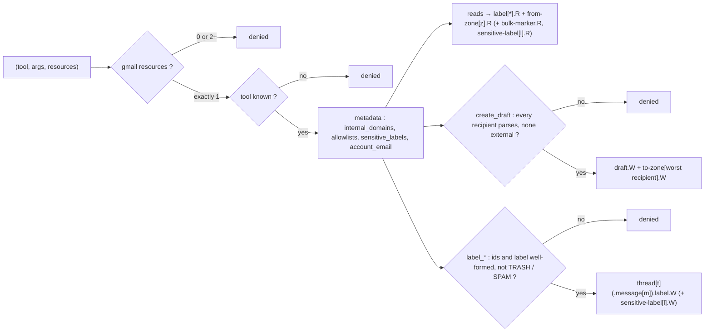

# Gmail provider

`@vaubaan/plugin-gmail` (`plugins/gmail`), on `@vaubaan/plugin-sdk` since
P1.2j. **Experimental, classifier-only** : the plugin classifies the ten
modelled tools into its catalog and discovers the mailbox, but exposes no
tool and executes nothing. Spec :
[`vaubaan-gateway.md`](../../spec/vaubaan-gateway.md) §5,
[`gateway-risk-model.md`](../../spec/gateway-risk-model.md) §2, §4, §4bis, §7.
ADRs : [[plugin-contract-and-credential-spec]],
[[scope-caps-amplification-axis]]. Contributor view :
[`plugins/gmail/README.md`](../../../plugins/gmail/README.md). The v4
modelling rationale (research questions Q1–Q11, scenarios) is preserved in
git history (`docs/handbook/providers/gmail.md` before 2026-10-13).

## Shape

| Member              | Where                   | Facts                                                                                                                                                                        |
| ------------------- | ----------------------- | ---------------------------------------------------------------------------------------------------------------------------------------------------------------------------- |
| `id` / `version`    | `src/index.ts`          | `gmail`, `0.1.0` (pre-1.0 while experimental). Default export `gmailPlugin`, typed `ProviderPlugin`.                                                                         |
| `experimental`      | `src/index.ts`          | `true` — `ProviderPlugin.experimental` of the SDK : the host registers the plugin, shows an "experimental" badge and keeps it out of the default connect and issuance flows. |
| `tools`             | `src/tools.ts`          | **Empty.** `gmailClassifiedToolDeclarations` holds the 10 modelled tools (9 official Gmail MCP + synthetic `gmail__describe_zones`).                                         |
| `dataModel`         | `src/data-model.ts`     | 1 plane `mailbox`, 7 Gmail entities + 4 synthetic markers ; `mailbox` is `envScopable`.                                                                                      |
| `catalog`           | `src/risk-catalog.yaml` | `catalog_version: 3`, 15 risks + `gmail.uncategorized-write`, 2 presets. Loaded by `loadCatalogFile` at import.                                                              |
| `credential`        | `src/credential.ts`     | `oauth2` Google : PKCE, `client_secret_post`, scopes `gmail.readonly` + `gmail.compose`, `access_type=offline`, `prompt=consent`.                                            |
| `classify`          | `src/classify.ts`       | Pure, fail-closed ; keyed on the mission's single mailbox resource and its `metadata`. Parsers : `src/q-parser.ts`, `src/address.ts`.                                        |
| `execute`           | `src/execute.ts`        | Returns `{ isError: true, structuredContent: { error: 'not_implemented', experimental: true, tool } }` for every tool ; no call.                                             |
| `discoverResources` | `src/execute.ts`        | `GET /gmail/v1/users/me/profile` → one resource, `ref` = lower-cased address ; `UpstreamAuthError` on 401/403.                                                               |
| `refresh`           | —                       | None : Google's refresh is the standard `refresh_token` grant the host performs from the spec (`refreshable: true`) ; P1.2-align.                                            |

## Classification rules

The plugin exposes no tool, so nothing below runs for an agent today ; the
classifier is nevertheless what an enablement will rely on, and it **fails
closed** : what it cannot read costs the worst case or refuses the call.

- **Identity zoning.** `from-zone` of a sender, which must be one full
  address : local part _equal to_ a known no-reply name (`no-reply`,
  `noreply`, `do-not-reply`, `donotreply`, `notifications`, `alerts`,
  `support`) → `automated`, before any domain rule ; domain in
  `internal_domains` → `internal` ; domain or address allowlisted →
  `known-external` ; else `unknown`. The match is exact, never a substring :
  `supportive.ceo@myorg.com` is `internal`. `to-zone` of a recipient set :
  the worst of `self` (= `account_email`), `internal`, `allowlist` ; an
  external recipient refuses the call (below).
- **`search_threads`** always emits `label[*].R`. The query parser
  (`q-parser.ts`) models `from:`, `to:`, `label:`, `newer_than:`, the
  implicit conjunction, `AND` and `-label:` ; it reports everything else. A
  query is **bounded** only when it is a pure conjunction holding at least
  one positive `from:` whose value is one full address ; it then emits one
  `from-zone[z].R` per sender zone. Any other query — an `OR` (any case), a
  grouping character (`( ) { } |`), a double quote, a `from:` that is not
  one address (`from:support`, `from:myorg.com`), or no positive `from:`
  (`to:` only, `label:` only, `-from:` only, empty) — emits
  `from-zone[unknown].R` **and** `bulk-marker.R`, on top of the zones it
  names. A negated term other than `-label:`, or an operator the parser does
  not model (`has:attachment`), adds `from-zone[unknown].R` to a bounded
  query.
- **`get_thread`** is worst-case : `thread[id].message[*].R` +
  `from-zone[unknown].R` (the sender is unknown before the fetch). `id` is
  required and must be an opaque id (`[A-Za-z0-9_-]+`) ; otherwise the call
  is denied.
- **Sensitive labels.** The labels of a thread are unknown before the fetch,
  so the marker is not opt-in. When the mailbox declares `sensitive_labels`,
  `get_thread` always emits `sensitive-label[*].R`, and a search emits
  `sensitive-label[l].R` for every declared label unless the query is a pure
  conjunction carrying `-label:<l>` for it and no positive `label:` on it or
  on a label nested under it (`legal/contracts`, written `legal-contracts`
  in a query). Names compare case-insensitively, spaces and `/` as `-`. A
  name that is not a legal slice identifier is emitted as `*`. Consequence :
  on such a mailbox a mission without `gmail.read-sensitive-label` cannot
  fetch a thread, and searches only with the exclusions written out. Limit :
  `-label:legal` does not exclude a nested label upstream ; the owner lists
  nested labels one by one.
- **`create_draft`.** Recipients are parsed by `address.ts`, strictly : each
  of `to` / `cc` / `bcc` is absent, one string, or a list of strings, and
  each string is exactly one address, `addr@example.com` or
  `Name <addr@example.com>` (no separator, `@` or inner quote in the display
  name). Every recipient counts. A field of another shape or an element that
  does not parse (two addresses in one string, an object, a bare word)
  **denies** the call. A recipient outside the internal domains and the
  allowlists **denies** the call too — the "never acceptable" rule.
  Otherwise : `draft.W` + `to-zone[self | internal | allowlist].W` ; no
  recipient at all is `self`.
- **`label_*` / `unlabel_*`.** `thread_id`, `message_id` (message tools) and
  `label` are required and validated ; a missing id is denied, never a
  wildcard. `TRASH` and `SPAM` (any case) are denied : a deletion is not a
  label write. The containment slice is `thread[t](.message[m]).label.W`. On
  a mailbox with `sensitive_labels`, a label that names one (or a label
  nested under it) adds `sensitive-label[l].W`, and any other label that is
  not a system label id (`INBOX`, `STARRED`, `UNREAD`, `IMPORTANT`, `SENT`,
  `DRAFT`, `CHAT`, `CATEGORY_*`) adds `sensitive-label[*].W` — a user label
  id (`Label_42`) cannot be mapped to a name by a pure classifier. That slice
  matches only the fallback `gmail.uncategorized-write`.
- **Mailbox selection.** Exactly one gmail resource ; two or more are denied
  as ambiguous (v4 silently took the first binding ; that path is deleted).
- **Metadata defaults.** Missing or ill-typed lists are empty, so an
  unconfigured mailbox classifies every sender `unknown` and refuses every
  draft but one addressed to the mailbox itself ; `account_email` falls back
  to the resource ref.

## Catalog decisions (v5)

- Ids are the v4 ids plus one : **`gmail.draft-write`** matches the
  containment slice `draft.W` ; in v4 only the fallback matched it, so no
  preset could ever grant a draft. **`gmail.read-mailbox`** also matches
  `thread[**].message[**].R` : the SDK coverage kit showed `get_thread`'s
  containment slice matched no risk at all.
- **`gmail.draft-to-zone-external-unbounded` is never acceptable, and the
  classifier enforces it.** The v5 loader refuses `acceptable_in_envs: []`
  and a mission may enumerate every risk id, so the catalog cannot carry the
  rule : `classifyGmail` denies a draft with an external recipient before
  any risk is evaluated. The entry is kept (ids are never deleted) with
  `deprecated: true`, so the issuance UI leaves it out of "select all" and
  the loader refuses it in a preset ; accepting it grants nothing.
- **`gmail.bulk-label-write` is in no preset** : no modelled tool can touch
  it (`label_thread` takes exactly one thread id and a call without one is
  denied). The entry stays for a future batch tool.
- **Sensitive-label writes have no dedicated risk.** `sensitive-label[l].W`
  lands on the fallback, which no preset offers — fail-loud until a catalog
  review adds an entry. Open point, with the resolution of user label ids
  (execution phase).
- No risk is env-scoped (Gmail has no environment), so the engine rule that
  refuses an env-scoped risk outside its `acceptable_in_envs` never applies
  here. Reasons rewritten in English ; vectors unchanged. The `caps` and
  `infra_limits` of `bulk-read` and `read-from-zone-unknown` were removed: the door has no
  cap stage, and a catalog only states what the gateway applies (the values are recorded in
  [the ADR](../../decisions/scope-caps-not-enforced-in-v5-0.md)).
- Presets : `read-only` (reads incl. `read-from-zone-unknown` at ≤ 20/min,
  no bulk, no sensitive label) and `developer` (reads + `draft-write` with
  self / internal / allowlist zones + `label-write` auto ; `bulk-read` on
  `approval`). Neither grants `read-sensitive-label` : on a mailbox that
  declares sensitive labels they allow searches that exclude them and no
  thread fetch. Values provisional until ADR
  `mission-presets-default-values`.

## Credential and discovery

The company creates a Google Cloud OAuth client (web application, Gmail API
enabled, consent screen configured) with the instance callback as redirect
URI and enters client id and secret in the instance configuration. The host
runs the authorization-code flow from `gmailCredentialSpec` ; the plugin
implements no provider-specific refresh. Scopes follow the v4 decision :
`gmail.readonly` + `gmail.compose`, **no `gmail.modify`** (required upstream
by the `label_*` tools, but it also unlocks sending) and no `gmail.send` —
widening is an incremental-authorization ADR for the execution phase.

`discoverResources` returns `{ ref: <address>, displayName: <address>,
metadata: { account_email, messages_total?, threads_total? } }`. It
pre-fills **no** zoning list (pre-filling `internal_domains` from the address
would make every `gmail.com` sender internal on a consumer mailbox) ; the
owner edits `internal_domains`, `allowlist_addresses`, `allowlist_domains`
and `sensitive_labels` on the resource (`GMAIL_METADATA_KEYS`).

## Tests

`npx vitest run plugins/gmail` — 214 tests : `plugin.test.ts` (26 : SDK kit,
experimental shape, coverage through a tool-exposing variant, mailbox
selection, credential spec, absence of a plugin refresh, discovery and execute
against `mockFetch`, presets), `risk-catalog.test.ts` (46 : loaded catalog
lint, pattern parsing, per-tool coverage, `risksTouchedBy` spot checks, the
refused external draft), `classify.test.ts` (105 : the per-tool suite of
`classifyGmail` — bounded and unbounded searches, sensitive labels,
strict recipients, label writes, automated senders), `q-parser.test.ts`
(32 : operators, disjunction / negation / unknown flags),
`data-model.test.ts` (5).

## How to debug

- **`Invalid risk catalog … acceptable_in_envs: expected a non-empty list`**
  — the v4 `[]` marker is not valid in v5 ; drop the key (see decisions).
- **A search is refused on `read-from-zone-unknown` / `bulk-read`** — the
  query is not a pure conjunction bounded by `from:<full address>` ; remove
  the `OR`, grouping, quotes or negation, or accept the two risks.
- **A read is refused on `read-sensitive-label`** — the mailbox declares
  `sensitive_labels` ; add `-label:<name>` for each to the search, or accept
  the risk (a thread fetch always needs it).
- **`to: '…' is not exactly one e-mail address`** — one address per array
  element ; no comma-separated string.
- **A label write is refused on `gmail.uncategorized-write`** — the label is
  or may be a sensitive one (any user label id on a mailbox with
  `sensitive_labels`).
- **`assertCatalogCoverage … no catalog risk matches it`** — a classifier
  slice outside every `matches`. Compare with `serializeSlice` output in
  `classify.test.ts` ; add a pattern to an existing entry or a new
  entry (and bump `catalog_version`).
- **`risksUntouched` lists more than
  `gmail.draft-to-zone-external-unbounded` and `gmail.bulk-label-write`** —
  a tool sample is missing in `plugin.test.ts` or a pattern drifted.
- **A draft is refused with `risk-not-accepted` on `draft-write`** — the
  mission accepted a `draft-to-zone-*` risk only ; both are needed.
- **`mockFetch: unexpected GET …/users/me/profile`** — `GMAIL_API_BASE`
  changed or the test route URL is stale.
