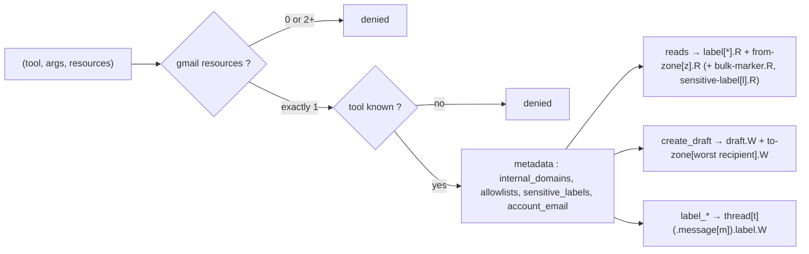

# Gmail provider

`@vaubaan/plugin-gmail` (`plugins/gmail`), on `@vaubaan/plugin-sdk` since
P1.2j. **Experimental, classifier-only** : the plugin classifies the ten
modelled tools into its catalog and discovers the mailbox, but exposes no
tool and executes nothing. Spec :
[`vaubaan-gateway.md`](../../spec/vaubaan-gateway.md) §5,
[`gateway-risk-model.md`](../../spec/gateway-risk-model.md) §2, §4, §4bis, §7.
ADRs : [[plugin-contract-and-credential-spec]],
[[scope-caps-amplification-axis]]. Contributor view :
[`plugins/gmail/README.md`](../../../plugins/gmail/README.md). The v4
modelling rationale (research questions Q1–Q11, scenarios) is preserved in
git history (`docs/handbook/providers/gmail.md` before 2026-10-13).

## Shape

| Member              | Where                   | Facts                                                                                                                                                                        |
| ------------------- | ----------------------- | ---------------------------------------------------------------------------------------------------------------------------------------------------------------------------- |
| `id` / `version`    | `src/index.ts`          | `gmail`, `0.1.0` (pre-1.0 while experimental). Default export `gmailPlugin`, typed `ProviderPlugin`.                                                                         |
| `experimental`      | `src/index.ts`          | `true` — `ProviderPlugin.experimental` of the SDK : the host registers the plugin, shows an "experimental" badge and keeps it out of the default connect and issuance flows. |
| `tools`             | `src/tools.ts`          | **Empty.** `gmailClassifiedToolDeclarations` holds the 10 modelled tools (9 official Gmail MCP + synthetic `gmail__describe_zones`).                                         |
| `dataModel`         | `src/data-model.ts`     | 1 plane `mailbox`, 7 Gmail entities + 4 synthetic markers ; `mailbox` is `envScopable`.                                                                                      |
| `catalog`           | `src/risk-catalog.yaml` | `catalog_version: 2`, 15 risks + `gmail.uncategorized-write`, 2 presets. Loaded by `loadCatalogFile` at import.                                                              |
| `credential`        | `src/credential.ts`     | `oauth2` Google : PKCE, `client_secret_post`, scopes `gmail.readonly` + `gmail.compose`, `access_type=offline`, `prompt=consent`.                                            |
| `classify`          | `src/classify.ts`       | Pure ; v4 emission rules kept ; keyed on the mission's single mailbox resource and its `metadata`.                                                                           |
| `execute`           | `src/execute.ts`        | Returns `{ isError: true, structuredContent: { error: 'not_implemented', experimental: true, tool } }` for every tool ; no call.                                             |
| `discoverResources` | `src/execute.ts`        | `GET /gmail/v1/users/me/profile` → one resource, `ref` = lower-cased address ; `UpstreamAuthError` on 401/403.                                                               |
| `refresh`           | —                       | None : Google's refresh is the standard `refresh_token` grant the host performs from the spec (`refreshable: true`) ; P1.2-align.                                            |

## Classification rules

- **Identity zoning.** `from-zone` of a sender : a known no-reply local part
  → `automated` ; domain in `internal_domains` → `internal` ; domain or
  address allowlisted → `known-external` ; else `unknown`. `to-zone` of a
  recipient set : the worst of `self` (= `account_email`), `internal`,
  `allowlist`, `external-unbounded`.
- **`search_threads`** always emits `label[*].R`, one `from-zone[z].R` per
  zone of its `from:` clauses, `unknown` when the query has operators the
  parser does not model, `bulk-marker.R` + `from-zone[unknown].R` when the
  query carries neither `from:` nor `to:` nor `label:`, and
  `sensitive-label[l].R` for each `label:` naming a sensitive label.
- **`get_thread`** is worst-case : `thread[id].message[*].R` +
  `from-zone[unknown].R` (the sender is unknown before the fetch).
- **Mailbox selection.** Exactly one gmail resource ; two or more are denied
  as ambiguous (v4 silently took the first binding ; that path is deleted).
- **Metadata defaults.** Missing or ill-typed lists are empty, so an
  unconfigured mailbox classifies every sender `unknown` and every recipient
  `external-unbounded` ; `account_email` falls back to the resource ref.

## Catalog decisions (v5)

- Ids are the v4 ids plus one : **`gmail.draft-write`** matches the
  containment slice `draft.W` ; in v4 only the fallback matched it, so no
  preset could ever grant a draft. **`gmail.read-mailbox`** also matches
  `thread[**].message[**].R` : the SDK coverage kit showed `get_thread`'s
  containment slice matched no risk at all.
- **`gmail.draft-to-zone-external-unbounded` lost `acceptable_in_envs: []`** :
  the v5 loader refuses an empty list and the engine has no other "never
  acceptable" marker. The risk stays in the catalog, unscoped, in no preset ;
  a mission grants it only by explicit enumeration. Open point for the catalog
  review.
- No risk is env-scoped (Gmail has no environment). Reasons rewritten in
  English ; vectors, caps and infra limits unchanged.
- Presets : `read-only` (reads incl. `read-from-zone-unknown` at ≤ 20/min,
  no bulk, no sensitive label) and `developer` (reads + `draft-write` with
  self / internal / allowlist zones + `label-write` auto ; `bulk-read` and
  `bulk-label-write` on `approval`). Values provisional until ADR
  `mission-presets-default-values`.

## Credential and discovery

The company creates a Google Cloud OAuth client (web application, Gmail API
enabled, consent screen configured) with the instance callback as redirect
URI and enters client id and secret in the instance configuration. The host
runs the authorization-code flow from `gmailCredentialSpec` ; the plugin
implements no provider-specific refresh. Scopes follow the v4 decision :
`gmail.readonly` + `gmail.compose`, **no `gmail.modify`** (required upstream
by the `label_*` tools, but it also unlocks sending) and no `gmail.send` —
widening is an incremental-authorization ADR for the execution phase.

`discoverResources` returns `{ ref: <address>, displayName: <address>,
metadata: { account_email, messages_total?, threads_total? } }`. It
pre-fills **no** zoning list (pre-filling `internal_domains` from the address
would make every `gmail.com` sender internal on a consumer mailbox) ; the
owner edits `internal_domains`, `allowlist_addresses`, `allowlist_domains`
and `sensitive_labels` on the resource (`GMAIL_METADATA_KEYS`).

## Tests

`npx vitest run plugins/gmail` — 124 tests : `plugin.test.ts` (25 : SDK kit,
experimental shape, coverage through a tool-exposing variant, mailbox
selection, credential spec, absence of a plugin refresh, discovery and execute
against `mockFetch`, presets), `risk-catalog.test.ts` (43 : loaded catalog
lint, pattern parsing, per-tool coverage, `risksTouchedBy` spot checks),
`classify.test.ts` (32 : the per-tool suite of `classifyGmail`),
`q-parser.test.ts` (19, unchanged), `data-model.test.ts` (5, unchanged).
Before the migration : 116 (the 18 YAML ↔ TS sync tests are gone with the
twin).

## How to debug

- **`Invalid risk catalog … acceptable_in_envs: expected a non-empty list`**
  — the v4 `[]` marker is not valid in v5 ; drop the key (see decisions).
- **`assertCatalogCoverage … no catalog risk matches it`** — a classifier
  slice outside every `matches`. Compare with `serializeSlice` output in
  `classify.test.ts` ; add a pattern to an existing entry or a new
  entry (and bump `catalog_version`).
- **`risksUntouched` lists more than `gmail.bulk-label-write`** — a tool
  sample is missing in `plugin.test.ts` or a pattern drifted.
- **A draft is refused with `risk-not-accepted` on `draft-write`** — the
  mission accepted a `draft-to-zone-*` risk only ; both are needed.
- **`mockFetch: unexpected GET …/users/me/profile`** — `GMAIL_API_BASE`
  changed or the test route URL is stale.
