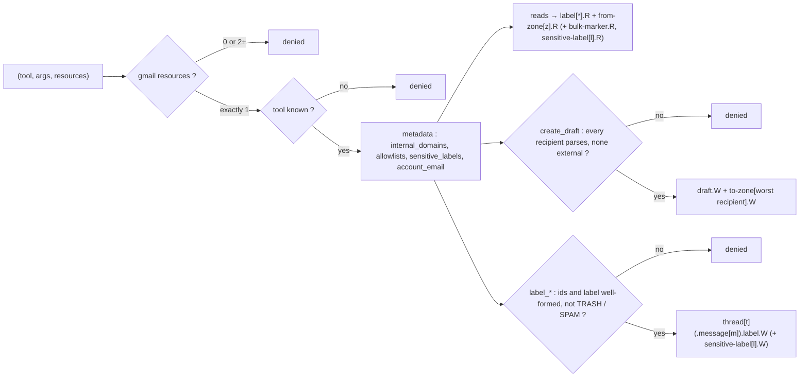

# Gmail provider

`@vaubaan/plugin-gmail` (`plugins/gmail`), on `@vaubaan/plugin-sdk` since
P1.2j. **Experimental** : the plugin classifies its twelve tools into its
catalog and executes them over **IMAP** (`imap.gmail.com:993`, implicit TLS),
signed in with the mailbox's **app password** ; it never sends mail. Spec :
[`vaubaan-gateway.md`](../../spec/vaubaan-gateway.md) §5,
[`gateway-risk-model.md`](../../spec/gateway-risk-model.md) §2, §4, §4bis, §7.
ADRs : [[gmail-over-imap-with-an-app-password]] (the credential, the IMAP
mapping, the removal of the OAuth way), [[plugin-contract-and-credential-spec]],
[[scope-caps-amplification-axis]],
[[plugin-identifiers-one-grammar-for-classify-and-execute]]. Contributor view :
[`plugins/gmail/README.md`](../../../plugins/gmail/README.md). The v4
modelling rationale (research questions Q1–Q11, scenarios) is preserved in
git history (`docs/handbook/providers/gmail.md` before 2026-10-13).

## Shape

| Member               | Where                                           | Facts                                                                                                                                                                                                           |
| -------------------- | ----------------------------------------------- | --------------------------------------------------------------------------------------------------------------------------------------------------------------------------------------------------------------- |
| Member               | Where                                           | Facts                                                                                                                                                                                                           |
| -------------------  | ----------------------------------------        | -------------------------------------------------------------------------------------------------------------------------------------------------------------------------------------------                     |
| `id` / `version`     | `src/index.ts`                                  | `gmail`, `0.5.0` (pre-1.0 while experimental). Default export `gmailPlugin` = `createGmailPlugin()` over the real transport ; `createGmailPlugin({ transport, now })` for tests.                                |
| `experimental`       | `src/index.ts`                                  | `true` — `ProviderPlugin.experimental` of the SDK : the host registers the plugin, shows an "experimental" badge and keeps it out of the default connect and issuance flows.                                    |
| `tools`              | `src/tools.ts`, `src/tool-titles.ts`            | The 12 tools of `gmailClassifiedToolDeclarations` (`gmailTools` is that list) : 11 that read (attachments included), draft, label and create labels, plus the synthetic `gmail__describe_zones`. No tool sends. |
| `dataModel`          | `src/data-model.ts`                             | 1 plane `mailbox`, 7 Gmail entities + 4 synthetic markers ; `mailbox` is `envScopable`.                                                                                                                         |
| `catalog`            | `src/risk-catalog.yaml`                         | `catalog_version: 5`, 15 live risks + 1 deprecated id (`gmail.draft-to-zone-external-unbounded`) + `gmail.uncategorized-write`, 2 presets. Loaded by `loadCatalogFile` at import.                               |
| `credential`         | `src/credential.ts`, `src/execute.ts`           | `api-key` : `email` and secret `app_password`, a `guide`, `createUrl` the app passwords page, and `verify` (an IMAP sign-in) bound to the transport by `createGmailRuntime`.                                    |
| `classify`           | `src/classify.ts`                               | Pure, fail-closed ; keyed on the mission's single mailbox resource and its `metadata`. Parsers : `src/q-parser.ts`, `src/address.ts`.                                                                           |
| `execute`            | `src/execute.ts`, `src/draft.ts`, `src/html.ts` | Over `GmailTransport` (`src/transport.ts`) : arguments checked first, then one IMAP session per call (below, "Execution").                                                                                      |
| `discoverResources`  | `src/execute.ts`                                | Signs in, checks the `\All` and `\Drafts` folders, returns one resource : `ref` = lower-cased address, `metadata.account_email`.                                                                                |
| `refresh` / `revoke` | —                                               | None : an app password does not expire and the gateway cannot delete it ; `manualRevocation` points the owner at myaccount.google.com/apppasswords.                                                             |

## Classification rules

The classifier **fails closed** : what it cannot read costs the worst case
or refuses the call. `execute` re-reads every argument with the same
functions, so a call `classify` refuses opens no IMAP connection.

- **Identity zoning.** `from-zone` of a sender, which must be one full
  address : domain in `internal_domains` → `internal` ; domain or address
  allowlisted → `known-external` ; else `unknown`. Among the senders the
  owner already knows — internal or allowlisted — a local part _equal to_ a
  known no-reply name (`no-reply`, `noreply`, `do-not-reply`, `donotreply`,
  `notifications`, `alerts`, `support`) is `automated` instead. On any other
  domain the local part is chosen by the sender and decides nothing :
  `noreply@` on a domain nobody listed is `unknown`. The match is exact,
  never a substring : `supportive.ceo@myorg.com` is `internal`. `to-zone` of a recipient set :
  the worst of `self` (= `account_email`), `internal`, `allowlist` ; an
  external recipient refuses the call (below).
- **`search_threads`** always emits `label[*].R`. The query parser
  (`q-parser.ts`) models `from:`, `to:`, `label:`, `newer_than:`, the
  implicit conjunction, `AND` and `-label:` ; it reports everything else. A
  query is **bounded** only when it is a pure conjunction holding at least
  one positive `from:` whose value is one full address ; it then emits one
  `from-zone[z].R` per sender zone. Any other query — an `OR` (any case), a
  grouping character (`( ) { } |`), a double quote, a `from:` that is not
  one address (`from:support`, `from:myorg.com`), or no positive `from:`
  (`to:` only, `label:` only, `-from:` only, empty) — emits
  `from-zone[unknown].R` **and** `bulk-marker.R`, on top of the zones it
  names. A negated term other than `-label:`, or an operator the parser does
  not model (`has:attachment`), adds `from-zone[unknown].R` to a bounded
  query.
- **`get_thread`** is worst-case : `thread[id].message[*].R` +
  `from-zone[unknown].R` (the sender is unknown before the fetch). `id` is
  required and must be a `gmailId` (see "Identifiers" below) ; otherwise
  the call is denied.
- **Sensitive labels.** The labels of a thread are unknown before the fetch,
  so the marker is not opt-in. When the mailbox declares `sensitive_labels`,
  `get_thread` always emits `sensitive-label[*].R`, and a search emits
  `sensitive-label[l].R` for every declared label unless the query is a pure
  conjunction carrying `-label:<l>` for it and no positive `label:` on it or
  on a label nested under it (`legal/contracts`, written `legal-contracts`
  in a query). Names compare case-insensitively, spaces and `/` as `-`. A
  name that is not a legal slice identifier is emitted as `*`. Consequence :
  on such a mailbox a mission without `gmail.read-sensitive-label` cannot
  fetch a thread, and searches only with the exclusions written out. Limit :
  `-label:legal` does not exclude a nested label upstream ; the owner lists
  nested labels one by one.
- **`create_draft`.** Recipients are parsed by `address.ts`, strictly : each
  of `to` / `cc` / `bcc` is absent, one string, or a list of strings, and
  each string is exactly one address, `addr@example.com` or
  `Name <addr@example.com>` (no separator, `@` or inner quote in the display
  name). Every recipient counts. A field of another shape or an element that
  does not parse (two addresses in one string, an object, a bare word)
  **denies** the call. A recipient outside the internal domains and the
  allowlists **denies** the call too — the "never acceptable" rule.
  Otherwise : `draft.W` + `to-zone[self | internal | allowlist].W` ; no
  recipient at all is `self`.
- **`label_*` / `unlabel_*`.** `thread_id`, `message_id` (message tools) and
  `label` are required and validated (`gmailId`, `labelRef`, `writableLabel`) ; a missing id
  is denied, never a wildcard. `TRASH` and `SPAM` (any case) are denied : a
  deletion is not a
  label write. The containment slice is `thread[t](.message[m]).label.W`. On
  a mailbox with `sensitive_labels`, a label that names one (or a label
  nested under it) adds `sensitive-label[l].W`, and any other label that is
  not a system label id (`INBOX`, `STARRED`, `UNREAD`, `IMPORTANT`, `SENT`,
  `DRAFT`, `CHAT`, `CATEGORY_PERSONAL`, `CATEGORY_SOCIAL`,
  `CATEGORY_PROMOTIONS`, `CATEGORY_UPDATES`, `CATEGORY_FORUMS`, compared
  exactly) adds `sensitive-label[*].W`, unless it names a sensitive label
  itself. Over IMAP a user label is addressed by its **name** (as
  `list_labels` returns it), which is what these comparisons read. That slice
  matches only the fallback `gmail.uncategorized-write`.
- **Identifiers.** One grammar function per kind, exported from
  `classify.ts` ; a value outside its grammar is denied (`<arg>: malformed.`),
  never escaped. `execute` takes its ids and labels from these functions and
  from nothing else (ADR
  [`plugin-identifiers-one-grammar-for-classify-and-execute`](../../decisions/plugin-identifiers-one-grammar-for-classify-and-execute.md)).

  | Argument                                                                     | Grammar                                                                                                                                                                                                                                                                                                                                                                                                                                                           | Where it lands                                                                                   |
  | ---------------------------------------------------------------------------- | ----------------------------------------------------------------------------------------------------------------------------------------------------------------------------------------------------------------------------------------------------------------------------------------------------------------------------------------------------------------------------------------------------------------------------------------------------------------- | ------------------------------------------------------------------------------------------------ |
  | `id` (`get_thread`), `thread_id`, `message_id` (`get_attachment`, `label_*`) | `gmailId` — `[0-9a-f]`, 1 to 16 characters (`MAX_GMAIL_ID_LENGTH`) : the lower-case hexadecimal of a 64-bit `X-GM-THRID` / `X-GM-MSGID`, as the Gmail API prints it                                                                                                                                                                                                                                                                                               | slice `thread[t]` / `message[m]` ; its decimal value in an IMAP `SEARCH X-GM-THRID / X-GM-MSGID` |
  | `part` (`get_attachment`)                                                    | `gmailPartId` — numbers from 1 separated by dots, at most 4 digits each, 32 characters (`MAX_PART_LENGTH`)                                                                                                                                                                                                                                                                                                                                                        | `FETCH BODY[<part>]` of the one message                                                          |
  | `label` (`label_*` / `unlabel_*`), `name` (`create_label`)                   | `labelRef` — letters, marks and digits of any script, the space and the punctuation of `LABEL_CHAR` ; at most 225 characters (`MAX_LABEL_LENGTH`) ; `/` for nesting ; no empty, `.` or `..` segment ; no blank at either end of the name or of a segment ; no control character, quote, backslash, `*` `%`, brace or bracket. `writableLabel` also refuses `TRASH` / `SPAM` ; `creatableLabel` a system label id as first segment and `[Gmail]` / `[Google Mail]` | the sensitive-label verdict ; `STORE ±X-GM-LABELS` (or `\Seen` for `UNREAD`) ; `CREATE`          |

- **`get_attachment`** is classified exactly like `get_thread` :
  `thread[t].message[m].R` + `from-zone[unknown].R` (+ `sensitive-label[*].R`
  on a mailbox that declares sensitive labels). `thread_id`, `message_id` and
  `part` are required and validated (`gmailId`, `gmailPartId`).
- **`create_label`** emits `label[<name>].W` (`label[*].W` when the name is
  not a slice identifier — a space, an accent), matched by
  `gmail.label-create` ; a name that is, or is nested under, a sensitive
  label adds `sensitive-label[l].W` (the fallback). `name` must pass
  `creatableLabel`.
- **Label names** compare in NFC, case-insensitively, a blank or `/` written
  `-` (`labelKey`), for the sensitive-label rules ; `Ressources Humaines` and
  `ressources-humaines` are one label.
- **Mailbox selection.** Exactly one gmail resource ; two or more are denied
  as ambiguous (v4 silently took the first binding ; that path is deleted).
- **Metadata defaults.** Missing or ill-typed lists are empty, so an
  unconfigured mailbox classifies every sender `unknown` — the no-reply
  names included, since `automated` needs a listed domain or address — and
  refuses every draft but one addressed to the mailbox itself (or with no
  recipient) ; `account_email` falls back to the resource ref.

## Catalog decisions (v5)

- Ids are the v4 ids plus one : **`gmail.draft-write`** matches the
  containment slice `draft.W` ; in v4 only the fallback matched it, so no
  preset could ever grant a draft. **`gmail.read-mailbox`** also matches
  `thread[**].message[**].R` : the SDK coverage kit showed `get_thread`'s
  containment slice matched no risk at all.
- **`gmail.draft-to-zone-external-unbounded` is never acceptable, and the
  classifier enforces it.** The v5 loader refuses `acceptable_in_envs: []`
  and a mission may enumerate every risk id, so the catalog cannot carry the
  rule : `classifyGmail` denies a draft with an external recipient before
  any risk is evaluated. The entry is kept (ids are never deleted) with
  `deprecated: true`, so the issuance UI leaves it out of "select all" and
  the loader refuses it in a preset ; accepting it grants nothing.
- **`gmail.bulk-label-write` is in no preset** : no modelled tool can touch
  it (`label_thread` takes exactly one thread id and a call without one is
  denied). The entry stays for a future batch tool.
- **Sensitive-label writes have no dedicated risk.** `sensitive-label[l].W`
  lands on the fallback, which no preset offers — fail-loud until a catalog
  review adds an entry.
- No risk is env-scoped (Gmail has no environment), so the engine rule that
  refuses an env-scoped risk outside its `acceptable_in_envs` never applies
  here. Reasons rewritten in English ; vectors unchanged. The `caps` and
  `infra_limits` of `bulk-read` and `read-from-zone-unknown` were removed: the door has no
  cap stage, and a catalog only states what the gateway applies (the values are recorded in
  [the ADR](../../decisions/scope-caps-not-enforced-in-v5-0.md)).
- **`gmail.label-create`** (catalog 5, 2026-10-24) matches
  `mailbox.label[**].W`, the slice of `create_label`, which only the fallback
  matched before ; ADR
  [gmail-over-imap-with-an-app-password](../../decisions/gmail-over-imap-with-an-app-password.md),
  amendment D7. `get_attachment` needed no risk : `read-mailbox` matches its
  `thread[t].message[m].R`.
- Presets : `read-only` (reads incl. `read-from-zone-unknown` at ≤ 20/min,
  no bulk, no sensitive label) and `developer` (reads + `draft-write` with
  self / internal / allowlist zones + `label-write` auto + `label-create`
  auto, 20 per period, 5 per minute ; `bulk-read` on `approval`). Neither grants `read-sensitive-label` : on a mailbox that
  declares sensitive labels they allow searches that exclude them and no
  thread fetch. Values provisional until ADR
  `mission-presets-default-values`.

## Credential and discovery

`credential.ts` declares the `api-key` way of ADR
[gmail-over-imap-with-an-app-password](../../decisions/gmail-over-imap-with-an-app-password.md) :

| Field          | Secret | Pattern (checked by the host)              | Read by `gmailAccount()`                                    |
| -------------- | ------ | ------------------------------------------ | ----------------------------------------------------------- |
| `email`        | no     | one `@`, no blank                          | `parseBareAddress` : one bare address, lower-cased          |
| `app_password` | yes    | 16 letters, with or without blanks between | `normalizeAppPassword` : blanks removed, exactly 16 letters |

The guide (`gmailGuide`) : 2-Step Verification, the app passwords page, the
name "Vaubaan Gateway", paste ; an app password has no scopes ; a Workspace
administrator can turn app passwords off ; IMAP must be on. `permissions: []`,
`recommendedExpiryDays: null`. `verify` and `discoverResources` both sign in
and look for the `\All` and `\Drafts` folders ; `verify` answers
`{ account: <address>, expiresAt: null }`. A refused sign-in is an
`UpstreamAuthError` (nothing is stored at connect ; a stored connection turns
"needs reconnecting"). A secret of another kind — an `oauth2` Gmail account of
an earlier build — throws `CredentialKindMismatch` in `gmailAccount`; the host
never gets there : such an account runs no tool and its discovery says to
reconnect (handbook [connections](../connections.md)).

`discoverResources` returns `{ ref: <address>, displayName: <address>,
metadata: { account_email } }`. It pre-fills **no** zoning list (pre-filling
`internal_domains` from the address would make every `gmail.com` sender
internal on a consumer mailbox) ; the owner edits `internal_domains`,
`allowlist_addresses`, `allowlist_domains` and `sensitive_labels` on the
resource (`GMAIL_METADATA_KEYS`).

## Execution

`createGmailRuntime({ transport, now })` (`execute.ts`). Each call :

1. an unknown tool, no single mailbox (`selectMailbox`) → tool error ;
   `describe_zones` answers from the resource's metadata, no connection ;
2. `gmailAccount(ctx.credential)` ; the mission's mailbox must be the
   credential's address ;
3. `planOf()` checks every argument (`gmailId`, `writableLabel`,
   `collectRecipients`, `draftProblem`, `max_results`, `q`) and returns the
   refusal or the work — **a refused call opens no connection** ;
4. the work runs in one `transport.session()` with a 60 s deadline
   (`SESSION_TIMEOUT_MS`) and the call's `AbortSignal`.

Folders are found by **SPECIAL-USE** as the server reports it
(`specialUseSource: 'extension'` in `imapflow`; a use guessed from a name is
dropped) : Gmail localizes `[Gmail]/All Mail` (`[Gmail]/Tous les messages`). A
missing `\All` or `\Drafts` is `folder_not_found`, naming Gmail's "Show in
IMAP" setting.

| Tool                    | IMAP                                                                                                                                                                                                                                                                                                                                                                                                                             |
| ----------------------- | -------------------------------------------------------------------------------------------------------------------------------------------------------------------------------------------------------------------------------------------------------------------------------------------------------------------------------------------------------------------------------------------------------------------------------- |
| `search_threads`        | `SEARCH X-GM-RAW <q>` in `\All` ; the newest 500 UIDs at most (`MAX_SEARCH_SCAN`), fetched by 50 (envelope, labels, thread id), grouped by `X-GM-THRID`, `max_results` 10 by default, 50 at most                                                                                                                                                                                                                                 |
| `get_thread`            | `SEARCH X-GM-THRID <decimal>` in `\All` ; the newest 50 messages (`MAX_THREAD_MESSAGES`) with headers, labels, the attachments of their structure (`attachmentsOf`) and a body (`bodyPartOf`) : the first inline text/plain part, 20 000 bytes (`MAX_TEXT_BYTES`), else the first inline text/html part, 200 000 bytes (`MAX_HTML_BYTES`) converted by `htmlToText()` and capped at 20 000 characters ; `text_format` says which |
| `get_attachment`        | the message by `X-GM-MSGID` inside the thread's UIDs, its structure, the listed part ; refused (`too_large`) above 5 MiB decoded (`MAX_ATTACHMENT_BYTES`) by the listed size, before any download, and again if the download passes the cap ; else `FETCH BODY[<part>]` decoded, returned as `content_base64`                                                                                                                    |
| `list_drafts`           | `SEARCH ALL` in `\Drafts`, the newest 50                                                                                                                                                                                                                                                                                                                                                                                         |
| `create_draft`          | `buildDraft()` (`draft.ts`) then `APPEND` to `\Drafts` with `\Draft \Seen` ; the result's ids read back by UID. No SMTP, nothing sent                                                                                                                                                                                                                                                                                            |
| `list_labels`           | `LIST` : `INBOX`, `STARRED`, `IMPORTANT`, `UNREAD`, then the user labels (`userLabels()`)                                                                                                                                                                                                                                                                                                                                        |
| `label_*` / `unlabel_*` | the thread's UIDs (and, for a message, `SEARCH X-GM-MSGID` inside them), then `STORE ±X-GM-LABELS`                                                                                                                                                                                                                                                                                                                               |
| `create_label`          | `LIST`, then `CREATE` of the name's segments (`imapflow` joins them with the server's delimiter) ; refused when a folder of that name exists (any case, NFC : `already_exists`), when it is a special-use folder or under the system container (`invalid_argument`)                                                                                                                                                              |

- **Ids** leave as `imapIdToHex(X-GM-*)` and come back through
  `hexToImapId()` (`null` beyond 64 bits).
- **Labels.** `INBOX`, `STARRED`, `IMPORTANT` → `\Inbox`, `\Starred`,
  `\Important` ; `UNREAD` → `∓\Seen` ; `SENT`, `DRAFT`, `CHAT`, `CATEGORY_*`
  → `unsupported_label`. A user label must be one of `userLabels()` :
  selectable, no special use, not `INBOX`, and not inside the system
  container — the parent of the `\All` folder, found by structure, never by
  the name `[Gmail]`. A missing label is `not_found` : a `STORE` would create
  it. The name is compared with the server's in NFC and the server's spelling
  is stored. In results, `\Inbox`… read back as the system ids and a message
  without `\Seen` carries `UNREAD`.
- **Drafts** (`draft.ts`). Recipients are the addresses `collectRecipients`
  parsed, display names dropped ; a subject with CR, LF or another control
  character is refused (`draftProblem`), encoded as RFC 2047 words when not
  ASCII ; the body is UTF-8 in base64 lines of 76, at most 1 MiB.
- **HTML** (`html.ts`). `html-to-text` (MIT, 10.0.1) over at most 200 000
  bytes : a link's target kept as `words [https://…]` (once when the words are
  the URL), images, `script`, `style` and `head` dropped, headings not
  upper-cased, no wrapping. Nothing is rendered.
- **Attachments.** A leaf part marked `attachment` or carrying a file name,
  but the body ; `size` is the decoded size estimated from the transfer size
  (`¾` of a base64 part).
- **On the wire.** `imapflow` 2.4.0 (read in its source) sends a mailbox or
  label name that is not a plain atom as a quoted string, `"` and `\`
  escaped, refuses CR, LF and NUL, and encodes non-ASCII names in modified
  UTF-7 (`encodePath`) unless the server enabled UTF-8 ; `labelRef` keeps
  quotes, backslashes and controls out anyway.
- **Errors.** An argument or a resource refused, a thread, message or label
  not found : `isError` results `{ error, message }`. A refused sign-in :
  `UpstreamAuthError`. A timeout, an abort, an unreachable server : a plain
  `Error` with an operator-readable message.

### Transport

`GmailTransport.session(account, { timeoutMs, signal, logger }, work)`
(`transport.ts`) ; `GmailImapSession` has `mailboxes`, `search`, `fetch`,
`append`, `store`. Ids cross it as IMAP's decimal strings. The real one,
`imapflowTransport`, opens one `imapflow` client per session :
`imap.gmail.com:993`, `secure: true`, `logger: false`, auto-IDLE off,
connection and greeting budgets 10 s, socket 30 s, lines and literals at most
8 MiB ; an `error` listener (an unhandled `error` event would end the
process) ; `logout()` after the work, `close()` on any failure, on the
deadline and on abort (`GmailSessionStopped`). Reads lock their folder
read-only (`EXAMINE`) ; `STORE` locks it read-write ; bodies are downloaded
after the fetch completes (`imapflow` forbids a command inside a fetch).
`imapflow` is kept external to the Next build (`apps/gateway/next.config.ts`,
`scripts/build-commands.mjs`).

## Tests

`npx vitest run plugins/gmail` — 574 tests, no network :
`plugin.test.ts` (26 : SDK kit, the twelve exposed tools, coverage, the
identifier kit against the fake transport, mailbox selection, the credential
spec and its guide, `verify` and discovery, presets), `execute.test.ts` (25 :
each tool against `fakeGmail()` — localized folder names, ids, labels by name,
drafts appended and never sent, header injection, refusals before any
connection), `attachments-labels.test.ts` (38 : HTML-only messages read as
text, links kept, script, style and images dropped, the cap ; attachments
listed and downloaded, the 5 MiB cap, a part outside the grammar ;
`get_attachment` classified like `get_thread` ; label names with spaces and
accents, NFD vs NFC, sensitive matching ; `create_label`), `transport.test.ts`
(11 : `imapflowTransport` over a fake client — options, refused sign-in,
abort, deadline, special use, the commands, `download`, `createMailbox`),
`risk-catalog.test.ts` (48), `classify.test.ts` (108), `q-parser.test.ts`
(32), `injection.test.ts` (281 : hostile values in every identifier position,
to `classify` and to `execute`, then the grammars — quotes, backslashes, CRLF,
`{literal}`, C1 controls, blanks at the ends ; `create_label` names),
`data-model.test.ts` (5). The fake mailbox is `tests/unit/fake-imap.ts`.

Not covered : a real Gmail account. The IMAP behaviour (`X-GM-RAW`,
`X-GM-THRID`, `X-GM-LABELS`, SPECIAL-USE, `CREATE`) is taken from Google's
documentation of its IMAP extensions and from `imapflow`'s ; the quoting and
the modified UTF-7 from `imapflow`'s source.

## How to debug

- **`Invalid risk catalog … acceptable_in_envs: expected a non-empty list`**
  — the v4 `[]` marker is not valid in v5 ; drop the key (see decisions).
- **A search is refused on `read-from-zone-unknown` / `bulk-read`** — the
  query is not a pure conjunction bounded by `from:<full address>` ; remove
  the `OR`, grouping, quotes or negation, or accept the two risks.
- **A read is refused on `read-sensitive-label`** — the mailbox declares
  `sensitive_labels` ; add `-label:<name>` for each to the search, or accept
  the risk (a thread fetch always needs it).
- **`to: '…' is not exactly one e-mail address`** — one address per array
  element ; no comma-separated string.
- **A label write is refused on `gmail.uncategorized-write`** — the label is
  or may be a sensitive one (any user label id on a mailbox with
  `sensitive_labels`).
- **`assertCatalogCoverage … no catalog risk matches it`** — a classifier
  slice outside every `matches`. Compare with `serializeSlice` output in
  `classify.test.ts` ; add a pattern to an existing entry or a new
  entry (and bump `catalog_version`).
- **`risksUntouched` lists more than
  `gmail.draft-to-zone-external-unbounded` and `gmail.bulk-label-write`** —
  a tool sample is missing in `plugin.test.ts` or a pattern drifted.
- **A draft is refused with `risk-not-accepted` on `draft-write`** — the
  mission accepted a `draft-to-zone-*` risk only ; both are needed.
- **`Gmail refused the IMAP sign-in of …`** — wrong or revoked app password,
  app passwords turned off by the Workspace administrator, or IMAP off in
  Gmail's settings. The account needs a new app password (Reconnect).
- **`folder_not_found` … "Show in IMAP"** — the account hides All Mail or
  Drafts from IMAP (Gmail settings → Labels).
- **`not_found` on a label write** — the label is addressed by its name
  (`list_labels`), and a label nobody created is never created by a write :
  `create_label` does that.
- **`too_large` on `get_attachment`** — above 5 MiB decoded ; nothing larger
  is returned.
- **`text_format: 'html'`** — the message had no text/plain part ; its HTML
  was converted, links kept as `[url]`.
- **`label: malformed.` on a name with a space** — check for a blank at
  either end of the name or of a segment, a quote, a backslash, a bracket or
  a brace : those stay refused.
- **`unsupported_label`** — `SENT`, `DRAFT`, `CHAT` and the `CATEGORY_*`
  tabs are not writable over IMAP.
- **A Gmail account says it was connected "a way Gmail no longer offers
  (oauth2)"** — connected by OAuth in an earlier build ; reconnect it with an
  app password.
- **`identifiers of plugin 'gmail'` … `execute sends 1 request(s) (IMAP
"imap:session")`** — a tool opened a session before refusing an argument :
  its check belongs in its `plan*` function.
