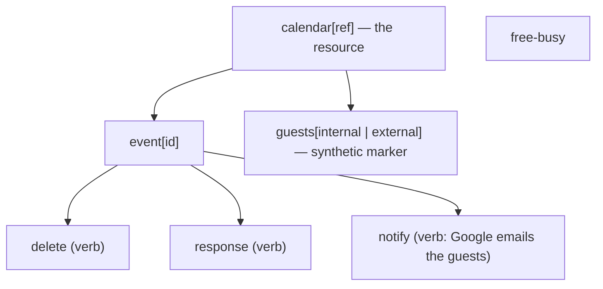

# Google Calendar provider plugin

`@vaubaan/plugin-google-calendar` 0.1.0, tool prefix `google_calendar__`. A
**rewrap of Google's official Calendar MCP server**
(`https://calendarmcp.googleapis.com/mcp/v1`, Developer Preview), reached
with an access token from the **OAuth broker** the instance is enrolled
with — no Google Cloud project, no redirect URI per instance, nothing to
paste. Decision: ADR
[google-calendar-through-an-oauth-broker](../../decisions/google-calendar-through-an-oauth-broker.md)
(D3: the brokered `oauth2` spec; D4: this plugin). The broker contract:
[oauth-broker-contract](../oauth-broker-contract.md). The host side of the
flow: [connections](../connections.md). Contributor view:
[`plugins/google-calendar/README.md`](../../../plugins/google-calendar/README.md).

The catalog was modelled before the code, following
[`docs/skills/provider-modeler.md`](../../skills/provider-modeler.md), from
Google's published tool reference (§6.4): the endpoint answers 401 without a
token, so no `tools/list` was captured yet.

## 0. Shape

| Member              | Where                                | Facts                                                                                                             |
| ------------------- | ------------------------------------ | ----------------------------------------------------------------------------------------------------------------- |
| `id` / `version`    | `src/index.ts`, `src/identity.ts`    | `google-calendar`, `0.1.0`. Tool prefix `google_calendar__` (the SDK writes `-` as `_`).                          |
| `tools`             | `src/tools.ts`, `src/tool-titles.ts` | 9 tools, one per upstream tool; `list_calendars` answered by the gateway.                                         |
| `dataModel`         | `src/data-model.ts`                  | 1 plane `calendar`: `calendar` (the resource), `event` and its verbs, the synthetic `guests` marker, `free-busy`. |
| `catalog`           | `src/risk-catalog.yaml`              | `catalog_version: 1`, 10 risks + `google-calendar.uncategorized-write`, presets `read-only` and `assistant`.      |
| `credential`        | `src/credential.ts`                  | `oauth2` with `broker: { provider: 'google' }` and four scopes; no endpoint, no client, no revocation declared.   |
| `classify`          | `src/classify.ts`, `src/call.ts`     | Pure, fail closed; one reader (`readCalendarCall`) for classify and execute.                                      |
| `execute`           | `src/execute.ts`, `src/mcp.ts`       | One `tools/call` to Google's server per call, the brokered token as the Bearer.                                   |
| `discoverResources` | `src/execute.ts`                     | Google's `list_calendars`, page by page; one resource per calendar; logs the drift of `tools/list`.               |
| icon                | `src/icon.ts`                        | Simple Icons `googlecalendar`, monochrome.                                                                        |

## 1. Data model



- **A calendar is the resource**: the primary calendar of the account, a
  secondary one or one shared with it. Its **ref** is the calendar id with
  its `@` written `~` (`alice~acme.example`,
  `c_0123abcd~group.calendar.google.com`), which a slice identifier carries.
  Calendars whose id holds a `#` (Google's subscribed holidays, birthdays,
  contacts) are not discovered.
- **No environment.** No entity is `envScopable`, no risk is env-scoped.
- **`guests`** is the zone of the people a call invites, decided like Gmail's
  recipients: an address on a domain of the calendar's `internal_domains`, or
  a meeting room (`…@resource.calendar.google.com`), is `internal`; any
  other is `external`; the account itself is no one.
- **`free-busy`** is people's availability: no calendar of the mission bounds
  who is asked about.

## 2. Tool → slice mapping

| Tool                                | Upstream           | Slices                                                                                            |
| ----------------------------------- | ------------------ | ------------------------------------------------------------------------------------------------- |
| `google_calendar__list_calendars`   | (gateway)          | `calendar[<refs>].R`                                                                              |
| `google_calendar__list_events`      | `list_events`      | `calendar[c].event[*].R`                                                                          |
| `google_calendar__search_events`    | `search_events`    | `calendar[<primary>].event[*].R`                                                                  |
| `google_calendar__get_event`        | `get_event`        | `calendar[c].event[e].R`                                                                          |
| `google_calendar__suggest_time`     | `suggest_time`     | `free-busy.R`                                                                                     |
| `google_calendar__create_event`     | `create_event`     | `calendar[c].event.W` + `calendar[c].guests[z].W` per zone invited                                |
| `google_calendar__update_event`     | `update_event`     | `calendar[c].event[e].W` + `guests[z].W` for `addedAttendees` + `event[e].notify.W` unless `NONE` |
| `google_calendar__delete_event`     | `delete_event`     | `calendar[c].event[e].delete.W` + `event[e].notify.W` unless `notificationLevel: NONE`            |
| `google_calendar__respond_to_event` | `respond_to_event` | `calendar[c].event[e].response.W`                                                                 |

`calendarId` takes a ref or an id; omitted (or `primary`), it is the primary
calendar, which must be in the mission. `search_events` searches the
primary calendar only (Google's rule). The executor writes `calendarId` as
the calendar's id.

### Arguments the gateway does not offer

| Tool             | Argument                | Why                                                |
| ---------------- | ----------------------- | -------------------------------------------------- |
| `list_calendars` | `pageSize`, `pageToken` | answered from the mission's calendars, in one page |
| `list_events`    | `eventTypeFilter`       | deprecated by Google (`eventType`)                 |
| `create_event`   | `attendeeEmails`        | deprecated by Google (`attendees`)                 |
| `update_event`   | `addedAttendeeEmails`   | deprecated by Google (`addedAttendees`)            |

An argument the declaration does not carry is refused (closed surface). An
attendee object carries `email`, `displayName` and `optional` only.

## 3. Catalog and presets

| Risk                                             | Matches                           | Vector (rev / blast / data / vis.)        | Why its own decision                                   |
| ------------------------------------------------ | --------------------------------- | ----------------------------------------- | ------------------------------------------------------ |
| `google-calendar.calendar-list`                  | `calendar[*].R`                   | reversible / single / metadata / internal | names of the mission's calendars only                  |
| `google-calendar.event-read`                     | `calendar[*].event[*].R`          | reversible / single / pii / internal      | an agenda is personal data and a prompt-injection path |
| `google-calendar.free-busy-read`                 | `free-busy.R`                     | reversible / single / metadata / internal | asks about people no calendar of the mission bounds    |
| `google-calendar.event-create`                   | `calendar[*].event.W`             | reversible / single / data / internal     | a new event reaches nobody by itself                   |
| `google-calendar.event-change`                   | `calendar[*].event[*].W`          | costly / single / data / team             | moves or rewrites what others rely on                  |
| `google-calendar.event-delete`                   | `calendar[*].event[*].delete.W`   | costly / single / data / team             | cancels for every guest                                |
| `google-calendar.event-respond`                  | `calendar[*].event[*].response.W` | reversible / single / metadata / team     | tells an organizer who may be outside                  |
| `google-calendar.invite-internal`                | `calendar[*].guests[internal].W`  | costly / env / data / team                | emails the event inside the company                    |
| `google-calendar.invite-external`                | `calendar[*].guests[external].W`  | irreversible / env / data / public        | the way calendar content leaves the company            |
| `google-calendar.notify-guests`                  | `calendar[*].event[*].notify.W`   | irreversible / env / data / public        | emails the current guests, unknown before the call     |
| `google-calendar.uncategorized-write` (fallback) | `google-calendar.**.W`            | costly / account / data / public          | reached by no offered tool; never in a preset          |

Writes are not layered: each write slice is matched by one risk, so deleting
does not need `event-change`.

| Preset      | Entries                                                                                                                                                                                                                    |
| ----------- | -------------------------------------------------------------------------------------------------------------------------------------------------------------------------------------------------------------------------- |
| `read-only` | `calendar-list` 500 / 20 per min, `event-read` 2000 / 60, `free-busy-read` 300 / 20 — all `auto`.                                                                                                                          |
| `assistant` | the three reads; `event-create` 100 / 10, `event-change` 200 / 10, `event-respond` 100 / 10, `invite-internal` 100 / 10, `notify-guests` 50 / 5 — `auto`; `event-delete` 30 / 5 and `invite-external` 30 / 5 — `approval`. |

Deliberately in no preset: the fallback.

## 4. Coverage

`assertCatalogCoverage` over one sample per tool (`tests/unit/fixtures.ts`)
touches all 10 named risks, the fallback never.

## 5. Edge cases

### 5.1 Who is invited decides the risk

Every attendee is parsed as exactly one address (`identifiers.ts`
`parseAddress`, the rules of Gmail's): a display name, a list in one string,
a non-address refuses the call. The zones present each emit their marker, so
a call inviting a colleague and a customer needs both `invite-internal` and
`invite-external`. A calendar without `internal_domains` takes every other
person as external (fail closed). Discovery seeds `internal_domains` with
the account's own domain, unless it is a consumer one (`gmail.com`); the
owner edits the list on the account page.

### 5.2 A change emails the current guests

Google emails an event's guests about a change or a cancellation unless the
call sets `notificationLevel: NONE` (`NOTIFICATION_LEVEL_UNSPECIFIED` is
treated as `ALL`, `EXTERNAL_ONLY` still emails outsiders). The guests are not
known before the call, so the classifier cannot zone them: any update or
delete without `NONE` adds `event[e].notify.W`, the `notify-guests` risk. An
agent that sets `NONE` does not need it. `removedAttendeeEmails` is part of
the change (they receive a cancellation under the same rule).

### 5.3 `list_calendars` is the gateway's

Google's `list_calendars` lists every calendar of the account; the agent's
tool answers from the mission's calendars (ref, id, name, primary, access
role), like Miro's `list_boards`. Discovery calls Google's.

### 5.4 Unknown tools

A tool Google adds is not offered: `tools.ts` refuses to load a list with an
unmodelled tool, and discovery logs it as drift.

## 6. Credential, discovery, execution, tests

### 6.1 Credential (`oauth2`, brokered)

```ts
{ kind: 'oauth2', broker: { provider: 'google' }, scopes: [
  'https://www.googleapis.com/auth/calendar.calendarlist.readonly',
  'https://www.googleapis.com/auth/calendar.events.readonly',
  'https://www.googleapis.com/auth/calendar.events.freebusy',
  'https://www.googleapis.com/auth/calendar.events' ] }
```

Never the full `calendar` scope. The host starts the flow at the broker that
serves `google` (`oauth_brokers`, handbook [configuration](../configuration.md)),
redeems the grant, refreshes and revokes through it. Without such a broker
the plugin is listed as **not configured**, with the reason. The plugin sees
an access token only.

### 6.2 Discovery

`list_calendars` with `pageSize: 250`, following `nextPageToken` (at most
five pages, 250 calendars). A calendar is an object whose `id` is in the
grammar; its name is `summaryOverride`, `summary` or `name`. Metadata:
`primary`, `access_role`, `account_email` (the primary calendar's id),
`internal_domains`. A 403 is a `CredentialRefusal` ("A Google Workspace
administrator may have to allow the app or the Calendar MCP server").
Then `tools/list` is compared with the model and the differences logged.

### 6.3 Execution

One JSON-RPC `tools/call` to `CALENDAR_MCP_URL` with `Authorization: Bearer
<access token>`; Google's result is passed through, `isError` included. 401
and 403 are `UpstreamAuthError` (the host refreshes through the broker and
retries once). The client initializes a session only when Google answers
400 or 404 to a bare request (⚠ not observed).

### 6.4 The tool list: modelled

`src/upstream-tools.json` holds Google's nine tools, modelled from "MCP
Reference: calendarmcp.googleapis.com"
(developers.google.com/workspace/calendar/api/v3/reference/mcp, one page per
tool) read through Context7 on 2026-10-27; `captured_at` is `null`. The
nested objects (attendee, reminder, attachment, guest permissions) carry the
fields the reference names. Once an account is connected, replace the file
with a captured `tools/list` and set `captured_at`; the schema check of
discovery says what differs meanwhile.

### 6.5 Tests

`npx vitest run plugins/google-calendar`: the SDK kit (well-formed, presets,
no wildcard, coverage, hostile identifiers), the schema check, one classifier
case per branch with the refusals, execution and discovery against a mock of
Google's server. The brokered flow itself is in
`apps/gateway/src/server/connections/oauth-broker.test.ts`.

## Sources

- Google, "MCP Reference: calendarmcp.googleapis.com" and its per-tool pages;
  "Configure the Calendar MCP server" — via Context7
  `/websites/developers_google_workspace_calendar_api`, 2026-10-27.
- ADR [google-calendar-through-an-oauth-broker](../../decisions/google-calendar-through-an-oauth-broker.md).
