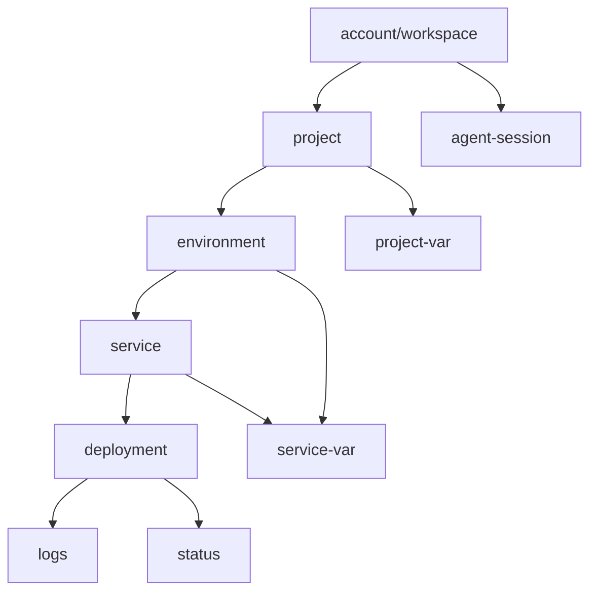
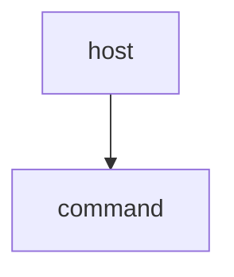

# Railway & SSH — modélisation v4 (data-model, slices, risk catalog)

> Cible : adapter Railway + SSH au modèle **risk-based v4** décrit dans
> `docs/spec/gateway-risk-model.md`. Les deux providers ont une surface
> volontairement étroite (Railway = un seul plane `runtime` avec ~14 tools,
> SSH = un seul tool `ssh__exec` + une whitelist regex). Ce document leur
> applique le même gabarit que GitHub / Supabase / Vercel.
>
> État courant — Railway : classifier v1 toujours en `{ provider, plane,
level, action, env? }` (`packages/providers/railway/src/classify.ts`).
> SSH : classifier legacy `ssh__exec` + `policy.ts:isReadAllowed()` (regex
> whitelist). Le provider `bash` (annotated scripts, cf.
> `docs/handbook/bash-provider.md`) sort du périmètre de ce doc — il sera
> traité dans un doc séparé quand le wiring `/mcp` bash sera en place.

---

## 1. Railway

### 1.1 Vue 30s

- **Plane unique** : `runtime` (déploiement + config + account).
- **Auth** : OAuth Auth app + PKCE, Bearer 1h refresh hot-path, audience
  `mcp.railway.com` (RFC 8707).
- **Tools (14)** : 10 rewrap MCP officiel + 4 custom GraphQL env-var
  (`list/upsert/upsert-bulk/delete variables`).
- **Containment ENV** : un Railway _project_ = un env (slug porté par
  `binding.environment`). Idem Supabase.
- **Cas particulier** : `railway__railway-agent` est un méta-tool
  conversationnel — l'upstream peut décider de muter à peu près n'importe
  quoi (deploy, redeploy, config, …). Il doit être catalogué comme un
  risque dédié et restreint par défaut.

### 1.2 Data-model — plane `runtime`



Notes :

- `environment` est un noeud Railway natif (production, staging, …). Une
  binding Vaubaan pointe sur **un project**, et l'env est soit le slug de
  l'environment Railway (mono-env) soit absent côté binding (multi-env).
- `service-var` vs `project-var` : les vars Railway peuvent être attachées
  au project (shared) OU à un service précis. On garde **une seule entité
  logique** `service-var` (avec `serviceId` optionnel) pour le data-model ;
  le catalogue qualifie par env (pas par service-vs-project).
- `agent-session` représente une invocation `railway__railway-agent` :
  c'est volontairement opaque (pas de containment) — il faut le coller au
  niveau `account` pour signaler que l'action peut traverser tout le graphe.

#### Cardinalités typiques

| Entité          | Selecteur usuel               | Cardinalité                                        |
| --------------- | ----------------------------- | -------------------------------------------------- |
| `project`       | `projectId` (UUID)            | `one`                                              |
| `environment`   | `environmentId` (UUID)        | `one`                                              |
| `service`       | `serviceId` (UUID, optionnel) | `one` ou `bounded`                                 |
| `deployment`    | `deploymentId` ou récent N    | `one` ou `bounded`                                 |
| `service-var`   | `name` ou liste `variables{}` | `one`, `bounded`, `unbounded` selon `replace=true` |
| `agent-session` | n/a                           | `unbounded`                                        |

### 1.3 Mapping tool → slice(s)

Notation : `railway.account.<entity>[<sel>].R|W` avec env injecté quand
project-scoped.

| Tool MCP                    | Kind interne       | Slice(s) émise(s)                                                                          | Notes                                    |
| --------------------------- | ------------------ | ------------------------------------------------------------------------------------------ | ---------------------------------------- |
| `railway__whoami`           | `read-account`     | `railway.account[*].R`                                                                     | env-less                                 |
| `railway__list-projects`    | `read-account`     | `railway.account[*].project[*].R`                                                          | env-less                                 |
| `railway__list-services`    | `read-deployment`  | `railway.project[<id>].environment[*].service[*].R`                                        | env from binding                         |
| `railway__list-deployments` | `read-deployment`  | `railway.project[<id>].environment[*].service[*].deployment[*].R`                          | env from binding                         |
| `railway__get-status`       | `read-deployment`  | `railway.project[<id>].environment[*].service[<id>].deployment[*].status.R`                | env from binding                         |
| `railway__get-logs`         | `read-deployment`  | `railway.project[<id>].environment[*].service[<id>].deployment[*].logs.R`                  | env from binding ; peut leak secrets     |
| `railway__redeploy`         | `write-deployment` | `railway.project[<id>].environment[<env>].service[<id>].deployment.W`                      | env from binding                         |
| `railway__accept-deploy`    | `write-deployment` | `railway.project[<id>].environment[<env>].service[<id>].deployment.W`                      | env from binding ; commit stagé          |
| `railway__railway-agent`    | `write-deployment` | `railway.account[*].agent-session.W` **+** wildcard `railway.project[**].**.W` (catch-all) | env-less ; méta-tool — voir §1.6         |
| `railway__create-project`   | `write-account`    | `railway.account[*].project.W`                                                             | env-less                                 |
| `railway__list-variables`   | `read-config`      | `railway.project[<id>].environment[<env>].service-var[*].R`                                | env from binding ; renvoie aussi secrets |
| `railway__upsert-variable`  | `write-config`     | `railway.project[<id>].environment[<env>].service-var[<name>].W`                           | env from binding                         |
| `railway__upsert-variables` | `write-config`     | `railway.project[<id>].environment[<env>].service-var[*].W` (si `replace:true`)            | env from binding ; DESTRUCTIF si replace |
|                             |                    | sinon `railway.project[<id>].environment[<env>].service-var[<n1,n2,...>].W`                | bulk borné                               |
| `railway__delete-variable`  | `write-config`     | `railway.project[<id>].environment[<env>].service-var[<name>].W` (`delete`)                | env from binding                         |

> Edge : aucune des slices "deployment" actuelles ne nomme un
> `deploymentId` précis — Railway expose une vue agrégée "le service a un
> déploiement courant". Cardinalité = `one` au niveau service, pas
> `unbounded` au niveau deployment.

### 1.4 Risk catalog (YAML)

```yaml
railway:
  risks:
    # ───── Reads ─────────────────────────────────────────────────────────
    - id: railway.read-account
      label: 'Lire compte & liste de projets'
      reason: 'Lecture metadata account. Aucun secret.'
      matches: 'railway.account[**].R'
      vector:
        {
          reversibility: reversible,
          blast: account,
          data: metadata,
          cost: free,
          visibility: internal,
          persistence: stateless,
        }
      default_gate: allow

    - id: railway.read-runtime
      label: 'Lire services, déploiements, statuts'
      reason: 'Lecture metadata runtime — pas de payload secret.'
      matches: 'railway.project[**].**.R'
      vector:
        {
          reversibility: reversible,
          blast: env,
          data: metadata,
          cost: free,
          visibility: internal,
          persistence: stateless,
        }
      default_gate: allow

    - id: railway.read-logs
      label: "Lire les logs d'un déploiement"
      reason: "Logs peuvent contenir des secrets imprimés par l'app
        (DSN, JWT loggés, stack-traces). À traiter comme `data`
        sensible côté audit."
      matches: 'railway.project[**].environment[**].service[**].deployment[**].logs.R'
      vector:
        {
          reversibility: reversible,
          blast: env,
          data: data,
          cost: free,
          visibility: internal,
          persistence: stateless,
        }
      default_gate: allow

    - id: railway.read-variables
      label: 'Lire les env vars (incluant secrets)'
      reason: "Retourne les valeurs en clair par défaut. C'est la principale
        surface d'exfiltration des credentials prod."
      matches: 'railway.project[**].environment[**].service-var[**].R'
      vector:
        {
          reversibility: reversible,
          blast: env,
          data: secret,
          cost: free,
          visibility: internal,
          persistence: stateless,
        }
      default_gate: confirm # qualifié par env → deny en prod via policy

    # ───── Deploys ───────────────────────────────────────────────────────
    - id: railway.deploy-staging
      label: 'Redeploy / accept-deploy sur un env non-prod'
      reason: "Reversible : un nouveau deploy peut tout corriger. Pas de
        communication aval. Coût Railway facturé à l'usage."
      matches: 'railway.project[**].environment[**].service[**].deployment.W'
      vector:
        {
          reversibility: reversible,
          blast: env,
          data: data,
          cost: moderate,
          visibility: internal,
          persistence: session,
        }
      default_gate: allow
      acceptable_in_envs: [staging, preview, dev]

    - id: railway.deploy-prod
      label: 'Redeploy / accept-deploy sur production'
      reason: 'Trigger un déploiement public, traffic switch immédiat,
        potentiel downtime + propagation aval. Costly à rollback
        (re-deploy précédent peut prendre quelques minutes).'
      matches: 'railway.project[**].environment[**].service[**].deployment.W'
      vector:
        {
          reversibility: costly,
          blast: env,
          data: data,
          cost: moderate,
          visibility: public,
          persistence: session,
        }
      default_gate: confirm # qualifié par env=prod uniquement

    # ───── Variables ─────────────────────────────────────────────────────
    - id: railway.upsert-variable-staging
      label: 'Modifier une env var (non-prod)'
      reason: "Modif scalaire d'une var. Trigge un redeploy implicite sauf
        skipDeploys=true. Reversible (réécrire l'ancienne valeur)."
      matches: 'railway.project[**].environment[**].service-var[**].W'
      vector:
        {
          reversibility: reversible,
          blast: env,
          data: secret,
          cost: moderate,
          visibility: internal,
          persistence: posture,
        }
      default_gate: confirm
      acceptable_in_envs: [staging, preview, dev]

    - id: railway.upsert-variable-prod
      label: 'Modifier une env var en production'
      reason: 'Posture-shift sur prod. Une valeur erronée peut briser
        immédiatement le service (Stripe, DB, OAuth).'
      matches: 'railway.project[**].environment[**].service-var[**].W'
      vector:
        {
          reversibility: costly,
          blast: env,
          data: secret,
          cost: moderate,
          visibility: internal,
          persistence: posture,
        }
      default_gate: deny

    - id: railway.bulk-variables-replace
      label: 'Remplacer en bulk toutes les env vars (replace=true)'
      reason: 'DESTRUCTIF : toute var absente du payload est supprimée.
        Détecté via `replace:true` côté upsert-variables. Tout
        env, prod ou pas.'
      matches: 'railway.project[**].environment[**].service-var[*].W'
      vector:
        {
          reversibility: irreversible,
          blast: env,
          data: secret,
          cost: moderate,
          visibility: internal,
          persistence: posture,
        }
      default_gate: deny

    # ───── Account ───────────────────────────────────────────────────────
    - id: railway.create-project
      label: 'Créer un nouveau projet Railway'
      reason: 'Account-level write. Pas réversible automatiquement
        (delete-project requiert UI). Peut générer du coût.'
      matches: 'railway.account[**].project.W'
      vector:
        {
          reversibility: costly,
          blast: account,
          data: metadata,
          cost: unbounded,
          visibility: internal,
          persistence: posture,
        }
      default_gate: confirm

    # ───── Agent (méta-tool) ─────────────────────────────────────────────
    - id: railway.agent-action
      label: 'Invocation railway-agent (méta-tool conversationnel)'
      reason: "L'agent upstream peut décider seul quoi muter — pas de
        classification fine possible. Catch-all `confirm` par
        construction. Tout usage doit être audité humain."
      matches: 'railway.account[**].agent-session.W'
      vector:
        {
          reversibility: costly,
          blast: account,
          data: secret,
          cost: unbounded,
          visibility: internal,
          persistence: posture,
        }
      default_gate: confirm

    # ───── Fallback ──────────────────────────────────────────────────────
    - id: railway.uncategorized-write
      label: 'Écriture Railway non catégorisée'
      reason: 'Catch-all. Si vu en prod, une entrée manque au catalogue.'
      matches: 'railway.**.W'
      vector:
        {
          reversibility: costly,
          blast: env,
          data: data,
          cost: moderate,
          visibility: internal,
          persistence: session,
        }
      default_gate: confirm
```

### 1.5 Lint coverage — matrice tool × risk

Chaque tool doit être couvert par ≥ 1 risk. Coches par slice typique.

| Tool                               | read-account | read-runtime | read-logs | read-variables | deploy-staging | deploy-prod | upsert-var-staging | upsert-var-prod | bulk-replace | create-project | agent-action | fallback |
| ---------------------------------- | :----------: | :----------: | :-------: | :------------: | :------------: | :---------: | :----------------: | :-------------: | :----------: | :------------: | :----------: | :------: |
| `whoami`                           |      ✓       |              |           |                |                |             |                    |                 |              |                |              |          |
| `list-projects`                    |      ✓       |              |           |                |                |             |                    |                 |              |                |              |          |
| `list-services`                    |              |      ✓       |           |                |                |             |                    |                 |              |                |              |          |
| `list-deployments`                 |              |      ✓       |           |                |                |             |                    |                 |              |                |              |          |
| `get-status`                       |              |      ✓       |           |                |                |             |                    |                 |              |                |              |          |
| `get-logs`                         |              |      ✓       |     ✓     |                |                |             |                    |                 |              |                |              |          |
| `redeploy` (staging)               |              |              |           |                |       ✓        |             |                    |                 |              |                |              |          |
| `redeploy` (prod)                  |              |              |           |                |                |      ✓      |                    |                 |              |                |              |          |
| `accept-deploy` (staging)          |              |              |           |                |       ✓        |             |                    |                 |              |                |              |          |
| `accept-deploy` (prod)             |              |              |           |                |                |      ✓      |                    |                 |              |                |              |          |
| `railway-agent`                    |              |              |           |                |                |             |                    |                 |              |                |      ✓       | ✓ (W\*)  |
| `create-project`                   |              |              |           |                |                |             |                    |                 |              |       ✓        |              |          |
| `list-variables`                   |              |              |           |       ✓        |                |             |                    |                 |              |                |              |          |
| `upsert-variable` (staging)        |              |              |           |                |                |             |         ✓          |                 |              |                |              |          |
| `upsert-variable` (prod)           |              |              |           |                |                |             |                    |        ✓        |              |                |              |          |
| `upsert-variables` (replace=true)  |              |              |           |                |                |             |                    |                 |      ✓       |                |              |          |
| `upsert-variables` (replace=false) |              |              |           |                |                |             |    ✓ (staging)     |    ✓ (prod)     |              |                |              |          |
| `delete-variable`                  |              |              |           |                |                |             |    ✓ (staging)     |    ✓ (prod)     |              |                |              |          |

Pas de tool non couvert. `railway-agent` est volontairement couvert
par `agent-action` ET le fallback générique pour garantir qu'aucune
slice émise par l'agent upstream ne passe sans match.

### 1.6 Edge cases

1. **`railway__railway-agent` — méta-tool.**
   L'upstream Railway expose ce tool comme un agent conversationnel : on
   lui envoie un prompt natural-language, il peut décider de redeploy, de
   modifier une var, de scale un service, etc. **Impossible de classifier
   précisément** au niveau du gateway — on ne voit que l'input texte.
   Stratégie v4 :
   - Émettre une slice spéciale `railway.account[*].agent-session.W` qui
     ne matche qu'un seul risk : `railway.agent-action`.
   - Émettre **en plus** une slice wildcard `railway.project[**].**.W`
     qui force le moteur à exiger que tous les risks `W` éventuels soient
     déjà acceptés par le token. Si un token n'a accepté que
     `agent-action` mais pas `deploy-prod`, et que l'agent décide de
     redeploy en prod, on intersect le wildcard → manque `deploy-prod`
     → 403. C'est la garantie de non-bypass.
   - `default_gate: confirm` sur `agent-action` force l'approval humaine
     systématique à l'usage du tool.
   - À évaluer en Phase 2 : **retirer purement** ce tool de la surface,
     même logique que `github__dispatch_workflow` (cf. spec v4 §7.2 #1).

2. **`upsert-variables` avec `replace:true`.**
   Le classifier doit lire `args.replace` et émettre la slice wildcard
   `service-var[*].W` (cardinalité `unbounded`) qui matche
   `railway.bulk-variables-replace` (deny par défaut). Sans cette logique,
   un agent qui passe `replace:true` ressemble à un bulk-upsert anodin.
   **TODO classifier : actuellement TOOL_KIND mappe juste à
   `write-config` — il manque la lecture de `replace` pour différencier.**

3. **`get-logs` peut leak des secrets.**
   Les logs applicatifs imprimés contiennent souvent des DSN, tokens,
   stack-traces avec PII. `read-logs` est classé `data: data` (pas
   `secret`) parce que c'est la **convention** Railway ; un projet bien
   géré ne logue pas ses secrets. Mais le risque réel est plus haut.
   Recommandation : laisser `default_gate: allow` côté staging, mais
   un opérateur paranoïaque peut overrider à `confirm` sur prod via
   project policy.

4. **`list-variables` retourne les secrets en clair.**
   C'est le tool le plus exfiltrable. Catalogué `data: secret`,
   `default_gate: confirm` par défaut. En prod, devrait être overridé en
   `deny` par project policy systématiquement (à documenter dans la UI
   "Recommended hardening").

5. **`environment` vs `binding.environment`.**
   Le slug Railway natif (`production`, `staging`) ne correspond pas
   toujours au slug Vaubaan (`prod`, `staging-vps`). Le classifier
   actuel stampe `binding.environment` sur la slice (cf.
   `classify.ts:136`). Quand on évalue `acceptable_in_envs: [staging,
preview, dev]`, la comparaison se fait sur le slug Vaubaan, pas sur
   le slug Railway natif. **Cohérent** avec les autres providers, mais
   à documenter explicitement dans le handbook.

6. **Account-level tools (`whoami`, `list-projects`, `create-project`,
   `railway-agent`) sans env.**
   Pas qualifiables par binding (pas de `projectId`). Les risks
   correspondants n'ont pas de qualification env (`railway.read-account`,
   `railway.create-project`, `railway.agent-action`). Le manager doit
   les accepter "globalement" — pas de granularité par projet. OK car
   la portée est intrinsèquement account-wide.

### 1.7 Trous (Railway)

- **Pas de tool `delete-project`** dans l'upstream MCP → l'agent ne peut
  pas supprimer un projet créé. Bonne nouvelle pour la safety, mais un
  agent qui `create-project` à boucle ouverte peut générer du coût
  unbounded. À mitiger : rate-limit côté gateway (out of v4 scope).
- **Pas de slice pour `domain.W`** : Railway gère les domaines custom
  côté UI uniquement, pas exposé par MCP. Si l'upstream l'ajoute, prévoir
  un risk `railway.domain-write` (posture, public).
- **`accept-deploy` vs `redeploy`** : le premier commit des changements
  stagés (suite à une UI edit) + déclenche un deploy ; le second redéploie
  la dernière commit sans staging. Sémantique W différente, mais le risk
  catalog les traite identiquement (slice = `deployment.W`). À raffiner
  si on veut distinguer "deploy d'un état non-revué" vs "redeploy d'un
  état stable".
- **`agent-session.W`** + wildcard catch-all : pattern intersect doit
  être validé en tests. Si l'algo de matching n'aime pas les multi-slices
  d'un même tool, ça casse silencieusement.
- **Pas de tool de rollback explicite** : un redeploy ramène la version
  buildée précédente, pas un revert atomique. Augmente `reversibility:
costly` réel.

---

## 2. SSH

### 2.1 Vue 30s

- **Plane unique** : `host` (un host = un env, identifié par `host_slug`).
- **Auth** : clé SSH stockée par binding (`ssh_bindings.ssh_private_key`
  bytea). Pas d'OAuth.
- **Tool unique** : `ssh__exec` (`host_slug, cmd, timeout_s`).
- **R vs W** : décidé au classify-time par `isReadAllowed(cmd)` —
  regex whitelist statique de ~22 patterns (`journalctl`, `cat`, `ls`,
  `tail`, `head`, `grep`, `ps`, `docker ps/inspect/logs`, `systemctl
status`, `df`, `free`, `uptime`, `ss -tlnp`, `md5sum`, `stat`). Tout
  ce qui ne matche pas est traité comme `W`.
- **Le provider bash** (annotated scripts, `host_slug` × ring × action)
  est hors-périmètre de ce doc.

### 2.2 Data-model — plane `host`



C'est tout. Aucune containment hierarchy — un host est une boîte noire,
on y lance des commandes. La granularité fine vit dans **le contenu**
de la commande, pas dans la structure.

#### Cardinalités

| Entité    | Selecteur                  | Cardinalité            |
| --------- | -------------------------- | ---------------------- |
| `host`    | `host_slug`                | `one`                  |
| `command` | regex pattern + cmd string | toujours `one` au call |

### 2.3 Mapping tool → slice(s)

| Tool        | Args clés          | Slice émise                                               | Notes                                       |
| ----------- | ------------------ | --------------------------------------------------------- | ------------------------------------------- |
| `ssh__exec` | `host_slug`, `cmd` | `ssh.host[<host_slug>].command.R` si `isReadAllowed(cmd)` | regex whitelist statique (`policy.ts`)      |
| `ssh__exec` | idem               | `ssh.host[<host_slug>].command.W` sinon                   | fallback W — toute commande non-whitelistée |

Pas de tool supplémentaire. Toute la "granularité" est portée par la
décomposition R/W du classifier, qui dépend uniquement de la regex.

### 2.4 Risk catalog (YAML)

```yaml
ssh:
  risks:
    - id: ssh.exec-read
      label: 'Exécuter une commande shell read-only whitelist'
      reason: 'Commandes en lecture seule (journalctl, cat, ls, ps,
        docker ps/inspect/logs, systemctl status, df, free,
        uptime, ss -tlnp, md5sum, stat). Pas de mutation.'
      matches: 'ssh.host[**].command.R'
      vector:
        {
          reversibility: reversible,
          blast: env,
          data: data,
          cost: free,
          visibility: internal,
          persistence: stateless,
        }
      default_gate: allow

    - id: ssh.exec-write-staging
      label: 'Exécuter une commande shell arbitraire (non-prod host)'
      reason: "Toute commande hors whitelist read → traitée W. Inclut
        sudo, install, rm, systemctl restart, docker run, etc.
        Sur un host non-prod c'est acceptable avec confirm."
      matches: 'ssh.host[**].command.W'
      vector:
        {
          reversibility: costly,
          blast: env,
          data: data,
          cost: moderate,
          visibility: internal,
          persistence: posture,
        }
      default_gate: confirm
      acceptable_in_envs: [staging-vps, dev-vps]

    - id: ssh.exec-write-prod
      label: 'Exécuter une commande shell arbitraire (prod host)'
      reason: "Mêmes commandes que ci-dessus mais sur un host prod.
        Posture-shift potentiel, downtime possible, surface
        d'attaque maximale. Deny par défaut."
      matches: 'ssh.host[**].command.W'
      vector:
        {
          reversibility: irreversible,
          blast: env,
          data: secret,
          cost: unbounded,
          visibility: internal,
          persistence: posture,
        }
      default_gate: deny

    - id: ssh.exec-read-secret-files
      label: 'Lire un fichier potentiellement sensible (cat /etc/..., stat key)'
      reason: 'Whitelist autorise `cat <path>` sans filtrer le path —
        donc `cat /etc/shadow`, `cat ~/.ssh/id_rsa` passent en R.
        Risque exfiltration credentials hôte.'
      matches: 'ssh.host[**].command.R'
      vector:
        {
          reversibility: reversible,
          blast: env,
          data: secret,
          cost: free,
          visibility: internal,
          persistence: stateless,
        }
      default_gate: confirm

    - id: ssh.uncategorized
      label: 'Exec SSH non catégorisé'
      reason: "Catch-all. Si vu, signale qu'une slice émise par le
        classifier n'a pas de risk associé."
      matches: 'ssh.**.*'
      vector:
        {
          reversibility: costly,
          blast: env,
          data: data,
          cost: moderate,
          visibility: internal,
          persistence: session,
        }
      default_gate: confirm
```

> **Remarque importante** : `ssh.exec-read` et `ssh.exec-read-secret-files`
> matchent **la même** slice (`ssh.host[**].command.R`). Les deux risks
> sont **co-touchés** à chaque call read. Le moteur intersect renvoie
> `risks_touched = [ssh.exec-read, ssh.exec-read-secret-files]` et le
> token doit accepter **les deux** pour passer. C'est intentionnel :
> ça force le manager à choisir explicitement "je consens à l'exfil
> potentielle de secrets fichiers". Si l'on veut éviter le couplage,
> il faut un classifier plus fin (regex sur le path), reporté.

### 2.5 Lint coverage — matrice tool × risk

| Tool / Cas                                       | exec-read | exec-write-staging | exec-write-prod | read-secret-files | fallback |
| ------------------------------------------------ | :-------: | :----------------: | :-------------: | :---------------: | :------: |
| `ssh__exec` cmd whitelist read (host=staging)    |     ✓     |                    |                 |   ✓ (co-match)    |          |
| `ssh__exec` cmd whitelist read (host=prod)       |     ✓     |                    |                 |   ✓ (co-match)    |          |
| `ssh__exec` cmd non-whitelist (host=staging-vps) |           |         ✓          |                 |                   |          |
| `ssh__exec` cmd non-whitelist (host=prod-host)   |           |                    |        ✓        |                   |          |

Couverture exhaustive (un seul tool, deux branches R/W, deux classes
d'env). Fallback `ssh.uncategorized` n'est jamais touché en pratique —
il sert de filet pour les futurs tools (ex. `ssh__sftp_put`).

### 2.6 Edge cases

1. **Regex whitelist incomplète / contournable.**
   Plusieurs trous connus :
   - `ls | rm` : la regex `^ls(\s+-[\w]+)*(\s+[\w/.-]+)?$` rejette
     `ls | rm` (`|` n'est pas dans la classe `[\w/.-]`). OK — bypass
     impossible par pipe.
   - `cat /etc/shadow` : la regex `^cat\s+[\w/.-]+$` accepte ce path.
     **Bypass effectif** d'un read "innocent" vers un secret hôte. C'est
     la raison du risk co-touché `ssh.exec-read-secret-files` (§2.4).
   - `grep -r foo /` : la regex `^grep\s+/` accepte n'importe quoi après
     `grep `. Idem — read potentiellement très large.
   - `journalctl -u nginx`: OK ; `journalctl -u nginx > /tmp/out` :
     rejeté (le `>` n'est pas matchable). Donc pas d'effet bord write
     via redirection. OK.
   - `tail -f /var/log/auth.log` : autorisé, peut tail-follow indéfiniment
     — mais bornée par `MAX_TIMEOUT_S = 300` (`execute.ts:18`).
   - `docker logs <container>` : autorisé. Peut leak des secrets loggés.
   - `head /dev/urandom` : rejeté par la regex (manque `-c`).

2. **La detection R vs W est imparfaite — par design.**
   La regex est conçue pour **élargir la zone confortable de "read sain"**,
   pas pour être un sandbox. Le vrai garde-fou est : l'utilisateur opte
   pour `ssh.exec-write-*` host par host via `acceptable_in_envs` du
   risk. Le `host_slug` joue le rôle d'`env`, et le manager déclare au
   mint quels hosts il accepte de muter.

3. **Aucun parsing AST shell.**
   On n'essaie pas de parser `cmd` comme un AST bash (trop fragile :
   subshells, `eval`, here-docs, …). Le classifier est purement
   regex-on-prefix. **Faiblesse acceptée** car la sécurité ultime repose
   sur l'authz par host (clé SSH par binding, isolé par projet) + le
   risk `exec-write-prod` deny-by-default.

4. **`host_slug` n'est pas un slug normalisé.**
   Chaque projet peut nommer ses hosts comme il veut (`vps-rp`,
   `prod-1`, `staging-vps`, `db-replica`). Le catalogue ne peut pas
   `acceptable_in_envs` sur des slugs arbitraires — il faut une
   **convention** documentée (`prod*` ⇒ deny, `staging-*`/`dev-*` ⇒
   confirm). À acter dans la project policy par défaut.

5. **`timeout_s` capé à 300s côté runtime.**
   Pas un risque mais un constraint utile. Documenté dans
   `execute.ts:19` (`MAX_TIMEOUT_S`).

6. **Pas d'env "system-wide".**
   Aucun équivalent d'un compte global SSH ; toutes les slices sont
   `ssh.host[<slug>]`. Pas de tool account-level. OK — c'est la
   structure naturelle du provider.

### 2.7 Trous (SSH)

- **Pas de scoping `cmd` plus fin que R/W.** On pourrait imaginer
  un catalogue avec des risks `ssh.docker-restart`, `ssh.systemctl-restart`,
  `ssh.package-install` détectés par regex au classify-time. Reporté —
  complexifie le classifier sans bénéfice clair tant que le manager
  accepte `exec-write-staging` "en bloc" pour une session.
- **`scp` / `sftp` non exposés** au gateway. Tout transfert de fichier
  passe par `cat`/`echo`/`base64 -d` côté ssh\_\_exec, ce qui est lent
  et limité. Si on ajoute un tool dédié, prévoir un risk
  `ssh.file-transfer` distinct.
- **Pas de differenciation `sudo` vs non-`sudo`.** Une commande
  `systemctl restart` simple échouera (permission denied) ; `sudo
systemctl restart` passera — toutes deux classées W. Pas d'effet
  côté risk catalog, mais l'audit pourrait flagger explicitement
  `cmd_starts_with_sudo: true` pour faciliter les revues post-mortem.
- **Pas de blocage de `rm -rf /`** au niveau du gateway. C'est de la
  responsabilité du `sudoers` host, pas du gateway. Documenter.

---

## 3. Synthèse cross-provider

| Aspect                                  | Railway                                 | SSH                              |
| --------------------------------------- | --------------------------------------- | -------------------------------- |
| Plane(s)                                | `runtime`                               | `host`                           |
| Tools exposés                           | 14 (10 MCP + 4 custom GraphQL)          | 1 (`ssh__exec`)                  |
| Auth                                    | OAuth + PKCE, refresh 1h hot-path       | clé SSH par binding (bytea)      |
| Containment env                         | binding → 1 Railway project = 1 env     | binding → 1 host = 1 env         |
| Risks catalog (cible)                   | 11 (incl. agent + fallback)             | 5 (incl. fallback)               |
| Méta-tool problématique                 | `railway-agent` → risk dédié + wildcard | aucun                            |
| Cas DESTRUCTIF requérant slice spéciale | `upsert-variables replace=true`         | aucun (regex catch via W)        |
| Trou principal connu                    | logs/variables peuvent leak secrets     | `cat <path>` sans filtre de path |

### 3.1 Pré-requis classifier v4 — Railway

- Renommer `classifyRailway` → renvoyer `{ slices: Slice[] }` au lieu de
  `{ capability: Capability }`.
- Lire `args.replace` sur `upsert-variables` pour distinguer la slice
  wildcard `service-var[*].W` de `service-var[<n1,n2,...>].W`.
- Émettre 2 slices pour `railway-agent` (account-level + wildcard).
- `binding.environment` reste le qualifieur env injecté dans la slice.

### 3.2 Pré-requis classifier v4 — SSH

- Renommer `classifySsh` → renvoyer `{ slices: Slice[] }`.
- Brancher `isReadAllowed(cmd)` inchangé — la regex devient la branche
  qui décide `.R` vs `.W` sur la slice unique.
- Le `host_slug` arg reste le qualifieur env.
- Pas de changement de surface (1 tool, 1 entité).

### 3.3 Pré-requis policy / UI

- Default policy par projet : pour les bindings tagged `env=prod` ou
  hosts tagged `prod*`, **forcer** :
  - `railway.read-variables` → deny (prod)
  - `railway.upsert-variable-prod` → deny
  - `railway.bulk-variables-replace` → deny
  - `ssh.exec-write-prod` → deny
  - `ssh.exec-read-secret-files` → confirm
- Recommended hardening pour staging :
  - `railway.read-variables` → confirm
  - `ssh.exec-write-staging` → confirm

### 3.4 Trous globaux

- **Pas de risk `cost-cap`** : un agent qui boucle `redeploy` ou
  `create-project` peut générer du coût Railway unbounded. Pas modélisé
  côté risk catalog v4 (la dim `cost: unbounded` flag le vecteur mais
  n'arrête pas l'action). Suggestion Phase 2 : rate-limit gateway-level
  ou compteur par token.
- **Pas de notion de "session continue" cross-provider** : si un agent
  utilise `railway__get-logs` puis `ssh__exec cat /var/log/...`, le
  cumul d'exfil n'est pas détecté. Hors-scope v4.
- **`ssh__exec` ne fournit pas de "preview" du résultat** : impossible
  de demander confirmation au humain en lui montrant "voici ce que la
  commande va faire". Limite inhérente.
