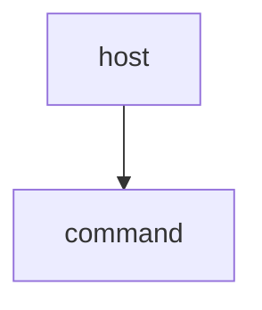

> **v4 document.** English rewrite scheduled by the v5 plan; `tracks` paths updated for the new layout.

# Railway & SSH — modélisation v4 (data-model, slices, risk catalog)

> Cible : adapter Railway + SSH au modèle **risk-based v4** décrit dans
> `docs/spec/gateway-risk-model.md`. Les deux providers ont une surface
> volontairement étroite (Railway = un seul plane `runtime` avec ~14 tools,
> SSH = un seul tool `ssh__exec` + une whitelist regex). Ce document leur
> applique le même gabarit que GitHub / Supabase / Vercel.
>
> État courant — Railway : migré sur le Plugin SDK v5, voir
> [`railway.md`](./railway.md) (la section 1 ci-dessous n'est plus qu'un
> renvoi). SSH : classifier legacy `ssh__exec` + `policy.ts:isReadAllowed()` (regex
> whitelist). Le provider `bash` (annotated scripts, cf.
> `docs/handbook/bash-provider.md`) sort du périmètre de ce doc — il sera
> traité dans un doc séparé quand le wiring `/mcp` bash sera en place.

---

## 1. Railway

> **Moved.** The Railway plugin migrated to the v5 Plugin SDK (feature
> P1.2d). Its current handbook is [`railway.md`](./railway.md) — data model,
> classification on `Resource[]`, catalog with presets, OAuth2 credential
> and refresh, execution, tests. The v4 modelling notes that used to live
> here (research §1.x : v1 classifier state, binding-based env stamping,
> `risk-catalog.ts` twin) are superseded ; the nine risk ids are unchanged.
> Section 3 below still mentions Railway where the cross-provider synthesis
> needs it.

---

## 2. SSH

### 2.1 Vue 30s

- **Plane unique** : `host` (un host = un env, identifié par `host_slug`).
- **Auth** : clé SSH stockée par binding (`ssh_bindings.ssh_private_key`
  bytea). Pas d'OAuth.
- **Tool unique** : `ssh__exec` (`host_slug, cmd, timeout_s`).
- **R vs W** : décidé au classify-time par `isReadAllowed(cmd)` —
  regex whitelist statique de ~22 patterns (`journalctl`, `cat`, `ls`,
  `tail`, `head`, `grep`, `ps`, `docker ps/inspect/logs`, `systemctl
status`, `df`, `free`, `uptime`, `ss -tlnp`, `md5sum`, `stat`). Tout
  ce qui ne matche pas est traité comme `W`.
- **Le provider bash** (annotated scripts, `host_slug` × ring × action)
  est hors-périmètre de ce doc.

### 2.2 Data-model — plane `host`



C'est tout. Aucune containment hierarchy — un host est une boîte noire,
on y lance des commandes. La granularité fine vit dans **le contenu**
de la commande, pas dans la structure.

#### Cardinalités

| Entité    | Selecteur                  | Cardinalité            |
| --------- | -------------------------- | ---------------------- |
| `host`    | `host_slug`                | `one`                  |
| `command` | regex pattern + cmd string | toujours `one` au call |

### 2.3 Mapping tool → slice(s)

| Tool        | Args clés          | Slice émise                                               | Notes                                       |
| ----------- | ------------------ | --------------------------------------------------------- | ------------------------------------------- |
| `ssh__exec` | `host_slug`, `cmd` | `ssh.host[<host_slug>].command.R` si `isReadAllowed(cmd)` | regex whitelist statique (`policy.ts`)      |
| `ssh__exec` | idem               | `ssh.host[<host_slug>].command.W` sinon                   | fallback W — toute commande non-whitelistée |

Pas de tool supplémentaire. Toute la "granularité" est portée par la
décomposition R/W du classifier, qui dépend uniquement de la regex.

### 2.4 Risk catalog (YAML)

```yaml
ssh:
  risks:
    - id: ssh.exec-read
      label: 'Exécuter une commande shell read-only whitelist'
      reason: 'Commandes en lecture seule (journalctl, cat, ls, ps,
        docker ps/inspect/logs, systemctl status, df, free,
        uptime, ss -tlnp, md5sum, stat). Pas de mutation.'
      matches: 'ssh.host[**].command.R'
      vector:
        {
          reversibility: reversible,
          blast: env,
          data: data,
          cost: free,
          visibility: internal,
          persistence: stateless,
        }

    - id: ssh.exec-write-staging
      label: 'Exécuter une commande shell arbitraire (non-prod host)'
      reason: 'Toute commande hors whitelist read → traitée W. Inclut
        sudo, install, rm, systemctl restart, docker run, etc.
        Risk distinct du write prod (acceptable_in_envs limite).'
      matches: 'ssh.host[**].command.W'
      vector:
        {
          reversibility: costly,
          blast: env,
          data: data,
          cost: moderate,
          visibility: internal,
          persistence: posture,
        }
      acceptable_in_envs: [staging-vps, dev-vps]

    - id: ssh.exec-write-prod
      label: 'Exécuter une commande shell arbitraire (prod host)'
      reason: "Mêmes commandes que ci-dessus mais sur un host prod.
        Posture-shift potentiel, downtime possible, surface
        d'attaque maximale. Deny par défaut."
      matches: 'ssh.host[**].command.W'
      vector:
        {
          reversibility: irreversible,
          blast: env,
          data: secret,
          cost: unbounded,
          visibility: internal,
          persistence: posture,
        }

    - id: ssh.exec-read-secret-files
      label: 'Lire un fichier potentiellement sensible (cat /etc/..., stat key)'
      reason: 'Whitelist autorise `cat <path>` sans filtrer le path —
        donc `cat /etc/shadow`, `cat ~/.ssh/id_rsa` passent en R.
        Risque exfiltration credentials hôte.'
      matches: 'ssh.host[**].command.R'
      vector:
        {
          reversibility: reversible,
          blast: env,
          data: secret,
          cost: free,
          visibility: internal,
          persistence: stateless,
        }

    - id: ssh.uncategorized
      label: 'Exec SSH non catégorisé'
      reason: "Catch-all. Si vu, signale qu'une slice émise par le
        classifier n'a pas de risk associé."
      matches: 'ssh.**.*'
      vector:
        {
          reversibility: costly,
          blast: env,
          data: data,
          cost: moderate,
          visibility: internal,
          persistence: session,
        }
```

> **Remarque importante** : `ssh.exec-read` et `ssh.exec-read-secret-files`
> matchent **la même** slice (`ssh.host[**].command.R`). Les deux risks
> sont **co-touchés** à chaque call read. Le moteur intersect renvoie
> `risks_touched = [ssh.exec-read, ssh.exec-read-secret-files]` et le
> token doit accepter **les deux** pour passer. C'est intentionnel :
> ça force le manager à choisir explicitement "je consens à l'exfil
> potentielle de secrets fichiers". Si l'on veut éviter le couplage,
> il faut un classifier plus fin (regex sur le path), reporté.

### 2.5 Lint coverage — matrice tool × risk

| Tool / Cas                                       | exec-read | exec-write-staging | exec-write-prod | read-secret-files | fallback |
| ------------------------------------------------ | :-------: | :----------------: | :-------------: | :---------------: | :------: |
| `ssh__exec` cmd whitelist read (host=staging)    |     ✓     |                    |                 |   ✓ (co-match)    |          |
| `ssh__exec` cmd whitelist read (host=prod)       |     ✓     |                    |                 |   ✓ (co-match)    |          |
| `ssh__exec` cmd non-whitelist (host=staging-vps) |           |         ✓          |                 |                   |          |
| `ssh__exec` cmd non-whitelist (host=prod-host)   |           |                    |        ✓        |                   |          |

Couverture exhaustive (un seul tool, deux branches R/W, deux classes
d'env). Fallback `ssh.uncategorized` n'est jamais touché en pratique —
il sert de filet pour les futurs tools (ex. `ssh__sftp_put`).

### 2.6 Edge cases

1. **Regex whitelist incomplète / contournable.**
   Plusieurs trous connus :
   - `ls | rm` : la regex `^ls(\s+-[\w]+)*(\s+[\w/.-]+)?$` rejette
     `ls | rm` (`|` n'est pas dans la classe `[\w/.-]`). OK — bypass
     impossible par pipe.
   - `cat /etc/shadow` : la regex `^cat\s+[\w/.-]+$` accepte ce path.
     **Bypass effectif** d'un read "innocent" vers un secret hôte. C'est
     la raison du risk co-touché `ssh.exec-read-secret-files` (§2.4).
   - `grep -r foo /` : la regex `^grep\s+/` accepte n'importe quoi après
     `grep `. Idem — read potentiellement très large.
   - `journalctl -u nginx`: OK ; `journalctl -u nginx > /tmp/out` :
     rejeté (le `>` n'est pas matchable). Donc pas d'effet bord write
     via redirection. OK.
   - `tail -f /var/log/auth.log` : autorisé, peut tail-follow indéfiniment
     — mais bornée par `MAX_TIMEOUT_S = 300` (`execute.ts:18`).
   - `docker logs <container>` : autorisé. Peut leak des secrets loggés.
   - `head /dev/urandom` : rejeté par la regex (manque `-c`).

2. **La detection R vs W est imparfaite — par design.**
   La regex est conçue pour **élargir la zone confortable de "read sain"**,
   pas pour être un sandbox. Le vrai garde-fou est : l'utilisateur opte
   pour `ssh.exec-write-*` host par host via `acceptable_in_envs` du
   risk. Le `host_slug` joue le rôle d'`env`, et le manager déclare au
   mint quels hosts il accepte de muter.

3. **Aucun parsing AST shell.**
   On n'essaie pas de parser `cmd` comme un AST bash (trop fragile :
   subshells, `eval`, here-docs, …). Le classifier est purement
   regex-on-prefix. **Faiblesse acceptée** car la sécurité ultime repose
   sur l'authz par host (clé SSH par binding, isolé par projet) + le
   fait que `ssh.exec-write-prod` doit être grant explicitement.

4. **`host_slug` n'est pas un slug normalisé.**
   Chaque projet peut nommer ses hosts comme il veut (`vps-rp`,
   `prod-1`, `staging-vps`, `db-replica`). Le catalogue ne peut pas
   `acceptable_in_envs` sur des slugs arbitraires — il faut une
   **convention** documentée (`prod*` ⇒ risk distinct, `staging-*` /
   `dev-*` ⇒ risk staging). À acter dans la convention de naming des
   hosts par projet.

5. **`timeout_s` capé à 300s côté runtime.**
   Pas un risque mais un constraint utile. Documenté dans
   `execute.ts:19` (`MAX_TIMEOUT_S`).

6. **Pas d'env "system-wide".**
   Aucun équivalent d'un compte global SSH ; toutes les slices sont
   `ssh.host[<slug>]`. Pas de tool account-level. OK — c'est la
   structure naturelle du provider.

### 2.7 Trous (SSH)

- **Pas de scoping `cmd` plus fin que R/W.** On pourrait imaginer
  un catalogue avec des risks `ssh.docker-restart`, `ssh.systemctl-restart`,
  `ssh.package-install` détectés par regex au classify-time. Reporté —
  complexifie le classifier sans bénéfice clair tant que le manager
  accepte `exec-write-staging` "en bloc" pour une session.
- **`scp` / `sftp` non exposés** au gateway. Tout transfert de fichier
  passe par `cat`/`echo`/`base64 -d` côté ssh\_\_exec, ce qui est lent
  et limité. Si on ajoute un tool dédié, prévoir un risk
  `ssh.file-transfer` distinct.
- **Pas de differenciation `sudo` vs non-`sudo`.** Une commande
  `systemctl restart` simple échouera (permission denied) ; `sudo
systemctl restart` passera — toutes deux classées W. Pas d'effet
  côté risk catalog, mais l'audit pourrait flagger explicitement
  `cmd_starts_with_sudo: true` pour faciliter les revues post-mortem.
- **Pas de blocage de `rm -rf /`** au niveau du gateway. C'est de la
  responsabilité du `sudoers` host, pas du gateway. Documenter.

---

## 3. Synthèse cross-provider

| Aspect                                  | Railway                                 | SSH                              |
| --------------------------------------- | --------------------------------------- | -------------------------------- |
| Plane(s)                                | `runtime`                               | `host`                           |
| Tools exposés                           | 14 (10 MCP + 4 custom GraphQL)          | 1 (`ssh__exec`)                  |
| Auth                                    | OAuth + PKCE, refresh 1h hot-path       | clé SSH par binding (bytea)      |
| Containment env                         | binding → 1 Railway project = 1 env     | binding → 1 host = 1 env         |
| Risks catalog (cible)                   | 11 (incl. agent + fallback)             | 5 (incl. fallback)               |
| Méta-tool problématique                 | `railway-agent` → risk dédié + wildcard | aucun                            |
| Cas DESTRUCTIF requérant slice spéciale | `upsert-variables replace=true`         | aucun (regex catch via W)        |
| Trou principal connu                    | logs/variables peuvent leak secrets     | `cat <path>` sans filtre de path |

### 3.1 Pré-requis classifier v4 — Railway

- Renommer `classifyRailway` → renvoyer `{ slices: Slice[] }` au lieu de
  `{ capability: Capability }`.
- Lire `args.replace` sur `upsert-variables` pour distinguer la slice
  wildcard `service-var[*].W` de `service-var[<n1,n2,...>].W`.
- Émettre 2 slices pour `railway-agent` (account-level + wildcard).
- `binding.environment` reste le qualifieur env injecté dans la slice.

### 3.2 Pré-requis classifier v4 — SSH

- Renommer `classifySsh` → renvoyer `{ slices: Slice[] }`.
- Brancher `isReadAllowed(cmd)` inchangé — la regex devient la branche
  qui décide `.R` vs `.W` sur la slice unique.
- Le `host_slug` arg reste le qualifieur env.
- Pas de changement de surface (1 tool, 1 entité).

### 3.3 Pré-requis UI mint

Post drop-confirm, plus de policy projet. La hardening passe par ce que
le manager **ne coche pas** au mint. Recommandations à surfacer dans
l'UI (presets / hint) :

- Bindings `env=prod` ou hosts `prod*` : **ne pas grant** par défaut
  `railway.read-variables`, `railway.upsert-variable-prod`,
  `railway.bulk-variables-replace`, `ssh.exec-write-prod`,
  `ssh.exec-read-secret-files`.
- Bindings staging : `railway.read-variables` et `ssh.exec-write-staging`
  sont à grant explicitement (pas un default).

Le garde-fou structurel reste `acceptable_in_envs` au catalog : un
risk `staging-only` ne peut **pas** être coché pour un binding prod,
même par l'opérateur qui le voudrait.

### 3.4 Trous globaux

- **Pas de risk `cost-cap`** : un agent qui boucle `redeploy` ou
  `create-project` peut générer du coût Railway unbounded. Pas modélisé
  côté risk catalog v4 (la dim `cost: unbounded` flag le vecteur mais
  n'arrête pas l'action). Suggestion Phase 2 : rate-limit gateway-level
  ou compteur par token.
- **Pas de notion de "session continue" cross-provider** : si un agent
  utilise `railway__get-logs` puis `ssh__exec cat /var/log/...`, le
  cumul d'exfil n'est pas détecté. Hors-scope v4.
- **`ssh__exec` ne fournit pas de "preview" du résultat** : impossible
  de demander confirmation au humain en lui montrant "voici ce que la
  commande va faire". Limite inhérente.
