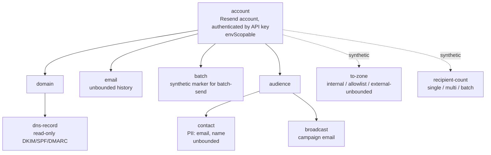

> **v4 document.** English rewrite scheduled by the v5 plan; `tracks` paths updated for the new layout.

# Resend provider — modelisation v4 + runtime

Neuvieme provider Vaubaan, premier a combiner **paste-credentials** (cle
API `re_*`) avec **identity-zoning** sur l'axe destinataire (to-zone :
`internal` / `allowlist` / `external-unbounded`). Cible : le **SaaS
operator** qui doit piloter emails transactionnels (confirmations,
notifications, resets), gestion de domaines, audiences/contacts, et
broadcasts/campagnes marketing, sans deborder vers un canal d'exfiltration
non controle.

- Un **data-model** explicite pour le plane unique `email` (10 entites
  dont 2 synthetiques `to-zone` et `recipient-count`).
- Un **axe `envScopable`** porte par `account` — un binding pin un
  compte Resend (et sa cle API), l'operateur peut separer staging/prod
  avec des comptes et domaines distincts.
- Un **mapping tool -> slice(s)** sur 25 tools MCP wraps sur Resend REST
  (9 reads + 16 writes dont 1 synthetique `describe_zones`).
- Un **catalogue de risks** (15 nommes + 1 fallback) avec vecteur 6D
  raisonne, `caps` + `infra_limits` sur `send-batch` et
  `broadcast-send`, et `acceptable_in_envs: [staging, dev]` sur
  `send-email-external-unbounded`.
- Un **classifier identity-based** qui calcule le `to-zone` a partir
  des recipients (to+cc+bcc) vs la binding metadata
  (`internal_domains`, `allowlist_domains`, `allowlist_addresses`),
  avec worst-case semantics.
- Un **denial structurel des attachments** en v1 — le classifier
  short-circuite avec `{ denied }` si `args.attachments` est non-vide.
- Un **runtime paste-token** : adapter, dispatcher REST JSON, gateway
  wiring via `build.ts` + `provider-info.ts`.

Sourcing :

- Spec v4 — `docs/spec/resend.md` (sections 0-9 + hors-scope).
- Spec risk-model — `docs/spec/gateway-risk-model.md` (DSL, catalog,
  runtime).
- ADR scope-caps — `docs/decisions/scope-caps-amplification-axis.md`
  (caps + infra_limits pattern).
- ADR unified-gates-drop-confirm —
  `docs/decisions/unified-gates-drop-confirm.md`.
- Gmail handbook — `docs/handbook/providers/gmail.md` (identity-zoning
  reference pattern).

---

## 0. Cadrage : pourquoi Resend est distinct

Les providers precedents zonent soit par containment technique
(GitHub/Vercel/Supabase/Railway/SSH/Upstash Redis) soit par identite
(Gmail). Stripe ajoute `cost: unbounded`. Resend combine **trois axes
inedits** :

1. **Identity-zoning sur l'axe destinataire.** Comme Gmail zone par
   `from-zone` (qui envoie), Resend zone par `to-zone` (a qui on
   envoie). Le classifier calcule la zone a partir de l'union des
   to+cc+bcc recipients de chaque email vs la binding metadata.
   Worst-case wins : un seul destinataire `external-unbounded` parmi
   20 `internal` => la zone est `external-unbounded`.

2. **Recipient-count comme axe blast distinct.** Envoyer 1 email a 1
   destinataire externe vs envoyer 100 emails en batch a 100 externes
   sont deux surfaces de risque differentes. Le classifier emet les
   deux slices (to-zone + recipient-count) pour que l'operateur puisse
   gater independamment.

3. **Broadcast bypass.** Les broadcasts ciblent une audience entiere
   (potentiellement des milliers de contacts). Le classifier n'essaie
   pas de classer les recipients individuels — il emet une seule
   slice `audience[A].broadcast[B].send.W` avec un risk dedie
   (`broadcast-send`, `cost: unbounded`, `blast: bulk`).

---

## 1. Data-model du plane `email`

Le code vit dans `plugins/resend/src/data-model.ts`.

Resend n'expose qu'**un seul plane** : `email`. Tout vit sous un
noeud racine `account` qui porte l'`envScopable` (un binding = un
compte Resend = une cle API = un environnement).

### 1.1 Graphe d'entites



### 1.2 Cardinalites declarees

| Path                                          | Cardinalite | Justification                                                      |
| --------------------------------------------- | ----------- | ------------------------------------------------------------------ |
| `resend.account`                              | `one`       | Un compte Resend par binding (= une cle API).                      |
| `resend.account[A].domain[*]`                 | `bounded`   | 1-5 domaines par compte en pratique.                               |
| `resend.account[A].domain[D].dns-record[*]`   | `bounded`   | 3-5 records DNS par domaine.                                       |
| `resend.account[A].email[*]`                  | `unbounded` | Historique d'envois potentiellement tres grand.                    |
| `resend.account[A].batch[*]`                  | `unbounded` | Marker synthetique pour chaque batch-send.                         |
| `resend.account[A].audience[*]`               | `bounded`   | Dizaines au plus en pratique.                                      |
| `resend.account[A].audience[AU].contact[*]`   | `unbounded` | Newsletters peuvent avoir des millions de subs.                    |
| `resend.account[A].audience[AU].broadcast[*]` | `unbounded` | Campagnes accumulees dans le temps.                                |
| `resend.account[A].to-zone[*]`                | `bounded`   | Synthetique : 3 valeurs (internal, allowlist, external-unbounded). |
| `resend.account[A].recipient-count[*]`        | `bounded`   | Synthetique : 3 valeurs (single, multi, batch).                    |

### 1.3 Les deux entites synthetiques

**`to-zone`** — marqueur synthetique emis par le classifier sur les
appels d'envoi transactionnel (`send_email`, `send_batch_emails`). Le
bracket porte le nom de zone : `internal`, `allowlist`, ou
`external-unbounded`. Calcule en croisant les recipients (to+cc+bcc)
avec la binding metadata. Emprunte le pattern de Gmail `from-zone`
mais applique a l'axe destinataire.

**`recipient-count`** — marqueur synthetique emis a cote du `to-zone`.
Le bracket porte `single` (1 destinataire), `multi` (2+), ou `batch`
(POST /emails/batch). Decouple le blast-radius de la zone pour
permettre un gating independant.

Ces deux entites n'ont pas de correspondance dans l'API Resend — elles
existent uniquement pour la classification slice-level.

---

## 2. Mapping tool -> slice(s)

25 tools MCP wraps sur Resend REST, definis dans
`plugins/resend/src/tools.ts`. Le classifier est dans
`plugins/resend/src/risk-classifier.ts`.

### 2.1 Reads (9 tools)

| Tool MCP                  | REST endpoint                 | Slice(s) emise(s)                                                               |
| ------------------------- | ----------------------------- | ------------------------------------------------------------------------------- |
| `resend__get_email`       | `GET /emails/:id`             | `resend.account[A].email[ID].R`                                                 |
| `resend__list_domains`    | `GET /domains`                | `resend.account[A].domain[*].R`                                                 |
| `resend__get_domain`      | `GET /domains/:id`            | `resend.account[A].domain[D].R` + `resend.account[A].domain[D].dns-record[*].R` |
| `resend__list_audiences`  | `GET /audiences`              | `resend.account[A].audience[*].R`                                               |
| `resend__get_audience`    | `GET /audiences/:id`          | `resend.account[A].audience[AU].R`                                              |
| `resend__list_contacts`   | `GET /audiences/:id/contacts` | `resend.account[A].audience[AU].contact[*].R`                                   |
| `resend__get_contact`     | `GET /contacts/:id`           | `resend.account[A].audience[*].contact[C].R`                                    |
| `resend__list_broadcasts` | `GET /broadcasts`             | `resend.account[A].audience[*].broadcast[*].R`                                  |
| `resend__get_broadcast`   | `GET /broadcasts/:id`         | `resend.account[A].audience[*].broadcast[B].R`                                  |

### 2.2 Writes (16 tools)

| Tool MCP                    | REST endpoint                    | Slice(s) emise(s)                                                           |
| --------------------------- | -------------------------------- | --------------------------------------------------------------------------- |
| `resend__send_email`        | `POST /emails`                   | `resend.account[A].to-zone[Z].W` + `resend.account[A].recipient-count[C].W` |
| `resend__send_batch_emails` | `POST /emails/batch`             | `to-zone[Z].W` + `recipient-count[batch].W` + `batch.W` (3 slices)          |
| `resend__create_domain`     | `POST /domains`                  | `resend.account[A].domain.W`                                                |
| `resend__update_domain`     | `PATCH /domains/:id`             | `resend.account[A].domain[D].W`                                             |
| `resend__delete_domain`     | `DELETE /domains/:id`            | `resend.account[A].domain[D].W`                                             |
| `resend__verify_domain`     | `POST /domains/:id/verify`       | `resend.account[A].domain[D].dns-record[*].W`                               |
| `resend__create_audience`   | `POST /audiences`                | `resend.account[A].audience.W`                                              |
| `resend__delete_audience`   | `DELETE /audiences/:id`          | `resend.account[A].audience[AU].W`                                          |
| `resend__create_contact`    | `POST /audiences/:id/contacts`   | `resend.account[A].audience[AU].contact.W`                                  |
| `resend__update_contact`    | `PATCH /contacts/:id`            | `resend.account[A].audience[*].contact[C].W`                                |
| `resend__delete_contact`    | `DELETE /contacts/:id`           | `resend.account[A].audience[*].contact[C].W`                                |
| `resend__create_broadcast`  | `POST /audiences/:id/broadcasts` | `resend.account[A].audience[AU].broadcast.W`                                |
| `resend__update_broadcast`  | `PUT /broadcasts/:id`            | `resend.account[A].audience[*].broadcast.W`                                 |
| `resend__send_broadcast`    | `POST /broadcasts/:id/send`      | `resend.account[A].audience[*].broadcast[B].send.W`                         |
| `resend__delete_broadcast`  | `DELETE /broadcasts/:id`         | `resend.account[A].audience[*].broadcast[B].delete.W`                       |
| `resend__describe_zones`    | _(synthetic, no API call)_       | `resend.account[A].domain[*].R` (classified as domain read)                 |

**Multi-slice emission :**

- `send_email` emet 2 slices : to-zone + recipient-count. Les deux
  risks correspondants doivent etre dans `accepted_risks` du token.
- `send_batch_emails` emet 3 slices : to-zone (worst-case across all
  emails) + `recipient-count[batch]` + `batch.W`. La zone est calculee
  sur l'union de tous les recipients de tous les emails du batch.
- `describe_zones` est synthetique : il ne fait pas d'appel API Resend.
  Il retourne la binding metadata (les listes de domaines/adresses
  configurees). Classe comme domain read.

---

## 3. Risk catalog

Le YAML vit dans `plugins/resend/src/risk-catalog.yaml`,
le miroir TS dans `risk-catalog.ts`. Le test
`risk-catalog-sync.test.ts` verifie l'identite entre les deux.

### 3.1 Resume des 16 risks

| RiskId                                 | Label abrege                     | Vector cardinal                     | Notes                                   |
| -------------------------------------- | -------------------------------- | ----------------------------------- | --------------------------------------- |
| `resend.read-email-status`             | Read email send status           | `R`, `metadata`                     |                                         |
| `resend.read-domains`                  | Read domains + DNS status        | `R`, `metadata`                     |                                         |
| `resend.read-audiences`                | Read audiences + contacts (PII)  | `R`, `pii`                          | RGPD-relevant                           |
| `resend.read-broadcasts`               | Read broadcast campaigns         | `R`, `metadata`                     |                                         |
| `resend.send-email-internal`           | Send to internal recipients      | `costly`, `data`                    | Stays in org boundary                   |
| `resend.send-email-allowlist`          | Send to pre-approved externals   | `costly`, `data`                    | Pre-approved but external               |
| `resend.send-email-external-unbounded` | Send to arbitrary external       | `irreversible`, `secret`, `public`  | `acceptable_in_envs: [staging, dev]`    |
| `resend.send-batch`                    | Batch send (up to 100 emails)    | `irreversible`, `bulk`              | `caps` + `infra_limits`                 |
| `resend.audience-write`                | Create/delete audience           | `costly`, `env`                     | Worst-case: audience delete = data loss |
| `resend.contact-write`                 | CRUD contacts (PII)              | `costly`, `pii`                     | RGPD-relevant                           |
| `resend.broadcast-draft`               | Create/update broadcast draft    | `reversible`                        | No side-effect until sent               |
| `resend.broadcast-send`                | Send broadcast (mass delivery)   | `irreversible`, `bulk`, `unbounded` | `caps` + `infra_limits`                 |
| `resend.broadcast-delete`              | Delete broadcast                 | `costly`                            |                                         |
| `resend.domain-write`                  | Add/update/remove sending domain | `costly`, `posture`                 | Posture-shift: changes sending surface  |
| `resend.domain-verify`                 | Trigger DNS verification         | `reversible`                        | Idempotent                              |
| `resend.uncategorized-write`           | Fallback catch-all               | `costly`, `env`                     | Fail-loud by design                     |

### 3.2 Caps et infra_limits

Deux risks portent des caps (per-token rate limits) et infra_limits
(hard upstream constraints) :

**`resend.send-batch`** :

```yaml
caps:
  items_per_call_max: 100
  calls_per_minute_max: 5
  calls_per_session_max: 50
infra_limits:
  items_per_call_max: 100
```

**`resend.broadcast-send`** :

```yaml
caps:
  calls_per_minute_max: 1
  calls_per_session_max: 5
infra_limits:
  calls_per_minute_max: 10
```

Le `broadcast-send` est le risk le plus contraint du provider : chaque
appel delivre potentiellement des milliers d'emails irreversiblement,
avec un cout proportionnel a la taille de l'audience (Resend facture
par email). Le cap a 1/min et 5/session est deliberement restrictif.

### 3.3 `acceptable_in_envs` restriction

`resend.send-email-external-unbounded` porte
`acceptable_in_envs: ['staging', 'dev']`. Consequence : un token lie
a un binding prod ne peut jamais accepter ce risk au mint. Seuls les
bindings staging/dev peuvent le faire. L'UI affiche le blocage en
preview, le mint retourne 403.

Le raisonnement est que l'envoi a un destinataire arbitraire est le
vecteur cardinal d'exfiltration de donnees par agent compromis — en
prod, le risk est trop eleve pour etre acceptable sans validation
humaine out-of-band.

---

## 4. Classifier — identity-zoning

Le classifier vit dans
`plugins/resend/src/risk-classifier.ts`. Fonction exportee :
`classifyResendV4(tool, args, bindings) -> ClassifyResult`.

### 4.1 Flow de classification d'un send

1. **Extraction du binding Resend** (`pickResendBinding`). Si absent,
   le classifier retourne `{ denied: 'no resend binding...' }`.

2. **Lecture de la binding metadata** (`readBindingMetadata`). Trois
   champs :
   - `internal_domains: string[]` — domaines internes (ex: `acme.com`)
   - `allowlist_domains: string[]` — domaines pre-approuves (ex:
     `partner.co`)
   - `allowlist_addresses: string[]` — adresses individuelles
     pre-approuvees

3. **Attachment check** (`hasAttachments`). Si `args.attachments` est
   un tableau non-vide, le classifier short-circuite avec
   `{ denied: 'attachments not supported in v1' }`.

4. **Collecte des recipients** (`collectRecipients`). Union de
   `args.to` + `args.cc` + `args.bcc`. Chaque champ peut etre un
   string ou un array de strings.

5. **Classification de chaque adresse** (`classifyAddress`).
   Cascade de priorite :
   - Domaine dans `internal_domains` => `internal`
   - Adresse dans `allowlist_addresses` => `allowlist`
   - Domaine dans `allowlist_domains` => `allowlist`
   - Sinon => `external-unbounded`

6. **Worst-case aggregation** (`classifyRecipients`). La zone la
   plus permissive l'emporte : `external-unbounded` > `allowlist` >
   `internal`. Un seul recipient externe parmi N internes => la zone
   est `external-unbounded`. Short-circuit : des qu'on atteint
   `external-unbounded`, on arrete.

7. **Emission des slices** :
   - `account[A].to-zone[ZONE].W` — identifie le risk de zone
   - `account[A].recipient-count[COUNT].W` — identifie le blast
     (`single` si 1 recipient, `multi` si 2+)
   - Pour `send_batch_emails` : ajout d'une troisieme slice
     `account[A].batch.W`

### 4.2 Batch sends

`send_batch_emails` (POST /emails/batch) recoit un tableau d'emails.
Le classifier :

1. Verifie les attachments sur CHAQUE email du batch.
2. Collecte les recipients de TOUS les emails pour calculer la
   worst-case zone.
3. Emet 3 slices : to-zone + `recipient-count[batch]` + `batch.W`.

### 4.3 Broadcast sends

`send_broadcast` ne fait PAS de classification par recipient. Les
broadcasts ciblent une audience entiere dont les contacts ne sont pas
connus au call-time. Le classifier emet une seule slice
`audience[*].broadcast[B].send.W` qui matche le risk
`resend.broadcast-send`.

### 4.4 Describe zones

`resend__describe_zones` est un outil synthetique qui retourne la
binding metadata (les listes de domaines/adresses configurees par
l'operateur). Il ne fait aucun appel a l'API Resend. Classe comme
domain read (metadata-level, pas de PII, pas de side-effect).

---

## 5. Adapter paste-token

Le code vit dans `plugins/resend/src/resend-adapter.ts`.
Classe `ResendAdapter`.

### 5.1 Auth model

Resend est un provider **paste-credentials** : l'utilisateur colle
une cle API (`re_*`) dans l'UI, stockee chiffree dans
`provider_admins.access_token_encrypted`. L'adapter decode le secret
via `TextDecoder` et le passe en `Authorization: Bearer <token>` a
chaque appel.

`mintUpstreamToken()` : decode `admin.access_token_encrypted` → renvoie
la cle brute avec une date d'expiration far-future (1 an). Les cles
Resend n'expirent pas — la date sert uniquement au cache du gateway.

### 5.2 Validation de binding

`validateBinding()` appelle `GET /domains` avec la cle. Si le status
est OK, la validation passe et le display name est le nom du premier
domaine retourne. Si aucun domaine n'existe, le `resource_ref` de la
binding est utilise comme fallback.

### 5.3 Execute

L'adapter delegue a `executeCall` dans
`plugins/resend/src/execute.ts`. Le dispatcher route les
25 tools vers les endpoints REST Resend :

- **GET** : pas de body, query-string pour les params.
- **POST/PUT/PATCH** : `Content-Type: application/json`, body JSON.
- **DELETE** : pas de body.
- **`describe_zones`** : synthetique, retourne la binding metadata
  sans appel upstream.

Base URL : `https://api.resend.com`.

### 5.4 ClassifyV4

Delegation directe a `classifyResendV4()`.

---

## 6. Gateway wiring

### 6.1 `build.ts` (l. 380-388)

```typescript
const resendAdapter = new ResendAdapter();
upstreamByProvider.resend = {
  provider: 'resend',
  availableTools: resendAvailableTools,
  classifyV4: (tool, args, bindings) => resendAdapter.classifyV4(tool, args, bindings),
  executeCall: (admin, binding, tool, args) =>
    resendAdapter.executeCall(admin, binding, tool, args),
  loadProviderAdmin,
};
```

Le pattern est identique a Upstash Redis : paste-token via
`provider_admins`, pas de `selfContained` flag (contrairement a Stripe
qui a sa propre table `stripe_bindings`).

### 6.2 `provider-info.ts`

Registre dans `PROVIDER_INFO.resend` avec :

- `kind: 'cloud'`
- 1 plane `email`
- Setup instructions pour paste API key + binding metadata config

### 6.3 `risk-catalog/loader.ts`

`resendRiskCatalog` importe depuis `@vaubaan/plugin-resend` et
enregistre dans `PROVIDER_CATALOGS.resend`. Le loader est consulte
par le policy-engine au runtime.

### 6.4 `catalog/route.ts`

`{ slug: 'resend', displayName: 'Resend', tools: resendAvailableTools }`
ajoute au tableau `PROVIDERS` expose par `GET /api/v1/catalog`.

### 6.5 Zod enums (preview + mint)

`'resend'` ajoute aux `z.enum()` dans :

- `apps/gateway/src/lib/mint/risk-preview.ts` (`PreviewBindingSchema`)
- `apps/gateway/src/app/api/v1/tokens/preview/route.ts` (`BindingSchema`)
- `apps/gateway/src/app/api/v1/tokens/mint/route.ts` (`BindingSchema`)

---

## 7. Comment l'utiliser

### 7.1 Setup d'un binding Resend

1. Creer un compte Resend, obtenir une cle API (`re_*`).
2. Configurer un domaine verifie (DKIM, SPF, DMARC).
3. Ajouter la cle API dans `provider_admins` (via l'UI ou l'API).
4. Creer une binding avec `provider: 'resend'`, un `resource_ref`
   choisi par l'operateur (ex: `prod-email`), et la metadata de
   zonage :

```json
{
  "provider": "resend",
  "resource_ref": "prod-email",
  "environment": "production",
  "metadata": {
    "internal_domains": ["acme.com"],
    "allowlist_domains": ["partner.co"],
    "allowlist_addresses": ["external-contact@gmail.com"]
  }
}
```

### 7.2 Mint d'un token

```bash
POST /api/v1/tokens/mint
{
  "projectSlug": "my-project",
  "bindings": [
    { "provider": "resend", "resource_ref": "prod-email", "env": "production" }
  ],
  "accepted_risks": [
    "resend.send-email-internal",
    "resend.send-email-allowlist",
    "resend.read-email-status",
    "resend.read-domains"
  ]
}
```

Note : `resend.send-email-external-unbounded` sera rejete au mint pour
un binding `production` a cause de `acceptable_in_envs: [staging, dev]`.

### 7.3 Appel d'un tool

```bash
POST /api/v1/tools/call
Authorization: Bearer vbn_live_...
{
  "tool": "resend__send_email",
  "args": {
    "from": "noreply@notifications.acme.com",
    "to": ["user@acme.com"],
    "subject": "Password reset",
    "html": "<p>Click here to reset...</p>"
  }
}
```

Le classifier emettra :

- `resend.account[prod-email].to-zone[internal].W`
- `resend.account[prod-email].recipient-count[single].W`

Les deux matchent `resend.send-email-internal` (to-zone) et aucun
recipient-count risk n'est requis pour single (le catalog n'a pas de
pattern sur `recipient-count[single]` — seul `batch` est gate).

---

## 8. Comment debug

- **Symptome : "no resend binding is attached"** — le token ne porte
  pas de binding `provider: 'resend'`. Verifier `provider_bindings`
  pour le projet et le token.

- **Symptome : "attachments not supported in v1"** — le tool call
  contient `args.attachments` non-vide. Retirer les attachments
  (denial structurel en v1).

- **Symptome : 403 "not acceptable" sur send-email-external-unbounded** —
  le binding est `production` et le risk a
  `acceptable_in_envs: [staging, dev]`. Utiliser un binding staging/dev
  ou retirer ce risk du token.

- **Symptome : "Resend API ... 401"** — la cle API est invalide ou
  revoquee. Verifier `provider_admins.access_token_encrypted` et
  decoder pour inspecter le prefixe `re_`.

- **Symptome : zone classee `external-unbounded` inattendue** — un
  destinataire en cc ou bcc n'est pas dans `internal_domains` ni dans
  l'allowlist. Le worst-case semantics fait que UN seul recipient
  externe suffit a upgrader la zone. Inspecter la binding metadata
  et les args du tool call.

- **Logs de classification** — le gateway audit trail enregistre les
  `slices_executed` et `risks_touched` pour chaque call. Comparer
  avec les patterns du YAML pour comprendre quel risk a matche.

---

## 9. Extension

### Ajouter un tool Resend

1. Ajouter la `McpToolDeclaration` dans `tools.ts` (section READ ou
   WRITE).
2. Ajouter le `case` dans le switch de `execute.ts` avec l'endpoint
   REST correspondant.
3. Ajouter le `case` dans le switch de `risk-classifier.ts` avec les
   slices emises.
4. Verifier que les slices sont couvertes par un risk existant ou
   ajouter un nouveau risk dans le YAML + TS.
5. Ajouter les tests unitaires dans les 4 suites (tools count,
   classifier, execute, catalog coverage).

### Ajouter des entites synthetiques

Si un futur axe de risque necessite un nouveau marker synthetique :

1. Ajouter l'entite dans `data-model.ts`.
2. Ajouter les risks correspondants dans le YAML + TS.
3. Emettre les slices dans le classifier.

### Levee du denial d'attachments

Quand les attachments seront supportes (v2+) :

1. Retirer le check `hasAttachments()` dans le classifier.
2. Ajouter un risk dedie (ex: `resend.send-email-with-attachment`)
   avec un vecteur `data: secret` (exfiltration via piece jointe).
3. Ajouter le pattern de slice correspondant.

---

## References

- Spec : [`../../spec/resend.md`](../../spec/resend.md)
- Spec risk-model :
  [`../../spec/gateway-risk-model.md`](../../spec/gateway-risk-model.md)
- ADR scope-caps :
  [`../../decisions/scope-caps-amplification-axis.md`](../../decisions/scope-caps-amplification-axis.md)
- ADR unified-gates-drop-confirm :
  [`../../decisions/unified-gates-drop-confirm.md`](../../decisions/unified-gates-drop-confirm.md)
- Gmail handbook :
  [`./gmail.md`](./gmail.md) (identity-zoning reference)
- Tests :
  [`../../tests/integration-tests.md`](../../tests/integration-tests.md)
