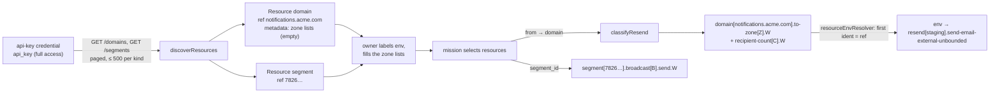

# Resend provider — modelling and runtime

`@vaubaan/plugin-resend` on the v5 Plugin SDK (feature P1.2f). Contract :
ADR [[plugin-contract-and-credential-spec]] ; spec
[`vaubaan-gateway.md`](../../spec/vaubaan-gateway.md) §0, §3.1, §3.2, §5 and
[`gateway-risk-model.md`](../../spec/gateway-risk-model.md) §2, §4, §7 ; the
provider's own v4 spec [`resend.md`](../../spec/resend.md) (zones, catalog
rationale). Contributor-facing details (fields, tool list, preset table) :
[`plugins/resend/README.md`](../../../plugins/resend/README.md).

## What changed from v4

| v4                                                                             | v5                                                                                                            |
| ------------------------------------------------------------------------------ | ------------------------------------------------------------------------------------------------------------- |
| One `ProviderBinding` per account, slug chosen by the operator, env on it      | One `Resource` per **sending domain** (ref = name, env labelled by the owner) and per **segment** (ref = id)  |
| Zone lists in `binding.metadata`                                               | Zone lists in the **domain resource** metadata ; empty at discovery (every recipient external until filled)   |
| Slices rooted at `account[<slug>]`                                             | Slices rooted at `domain[<name>]` / `segment[<id>]` ; `contact[…]`, `email[…]` account-level                  |
| `from` ignored by the classifier                                               | `from` **is** the resource : a send from a domain outside the mission is `denied`                             |
| Audiences, `/audiences/:id/contacts`, `PUT /broadcasts/:id`, batch body object | Segments (Resend renamed audiences, Nov 2025), `/contacts`, `/contacts/:id/segments/:id`, `PATCH`, bare array |
| `[**]` catalog patterns overlapping (`audience[**].W` caught contact writes)   | `[*]` + verb leaves : one named risk per write slice                                                          |
| 25 tools                                                                       | 27 : `add_contact_to_segment`, `remove_contact_from_segment` added ; audience tools renamed to segments       |
| `risk-catalog.ts` twin + sync test                                             | YAML loaded by `loadCatalogFile` at boot ; twin and sync test deleted                                         |
| No presets                                                                     | `read-only`, `developer`, `marketing-operator`, `domain-admin`                                                |

The v4 surface (`ResendAdapter`, `resendAvailableTools`, `resendExecuteCall`,
`resendRiskCatalog`, `classifyResendV4`) stays exported, `@deprecated`, until
P1.6. Because the slice shape changed, `classifyResendV4` is **kept verbatim**
(not delegated) with its own 46 tests ; the v2 catalog no longer matches its
`account[…]` slices, so the v4 app's Resend path only compiles.

## Layout

```
plugins/resend/src/
  resources.ts        kinds, SAFE_IDENT, zoneConfigOf, resolveDomain / resolveDomainArg / resolveSegmentArg
  zones.ts            parseAddress, collectRecipients, zoneOfAddress, worstZone, recipientCountOf
  tools.ts            27 McpToolDeclaration (`domain` / `segment_id` resource arguments)
  classify.ts         classifyResend — pure, (tool, args, resources) → slices | denied
  execute.ts          executeResend, discoverResendResources, RESEND_API_BASE, paging constants
  data-model.ts       plane `email`, 9 entities, `domain` and `segment` envScopable
  risk-catalog.yaml   16 risks + fallback + 2 deprecated v4 ids, 4 presets, catalog_version 2
  index.ts            definePlugin(...) → resendPlugin (default export) + legacy exports
  risk-classifier.ts  legacy classifyResendV4 (verbatim)        ┐
  legacy-tools.ts     legacy 25 audience-era declarations       │ deleted in P1.6
  legacy-execute.ts   legacy executeCall (one raw key)          │
  resend-adapter.ts   legacy ResendAdapter                      ┘
```

## Resources, zones and the environment



- **Zone of a send** = worst zone across `to` + `cc` + `bcc` against the
  sending domain's `internal_domains` / `allowlist_domains` /
  `allowlist_addresses` (exact, case-insensitive). Addresses are parsed
  (`"Alice <alice@acme.com>"`), a malformed one is `denied`. Empty lists
  mean every recipient is `external-unbounded` — fail closed.
- **Recipient count** : `single`, `multi`, or `batch` for
  `POST /emails/batch`. Only `batch` carries a risk (`send-batch`) ; the v4
  `batch.W` third slice, which only the fallback matched, is gone.
- **Batch** : emails grouped by `from` domain, one zone slice and one batch
  marker per domain, worst zone per group ; more than 100 emails `denied`.
- **Environment** : only `send-email-external-unbounded` is env-scoped
  (`acceptable_in_envs: [staging, dev]`). Env labels are the owner's free
  text, so no other risk is restricted to a closed env list.

## Classifier conventions

| Tool                                                    | Slice(s)                                                                            |
| ------------------------------------------------------- | ----------------------------------------------------------------------------------- |
| `send_email`                                            | `domain[D].to-zone[Z].W` **and** `domain[D].recipient-count[single\|multi].W`       |
| `send_batch_emails`                                     | per from-domain : `domain[D].to-zone[Z].W` and `domain[D].recipient-count[batch].W` |
| `get_domain`                                            | `domain[D].R` and `domain[D].dns-record[*].R`                                       |
| `list_domains`, `describe_zones`                        | `domain[*].R`                                                                       |
| `create_domain` / `update_domain`, `delete_domain`      | `domain.W` / `domain[D].W`                                                          |
| `verify_domain`                                         | `domain[D].dns-record[*].W`                                                         |
| `list_segments`, `get_segment`                          | `segment[*].R`, `segment[S].R`                                                      |
| `create_segment` / `delete_segment`                     | `segment.W` / `segment[S].W`                                                        |
| `list_contacts` (with / without `segment_id`)           | `segment[S].member[*].R` / `contact[*].R`                                           |
| `get_contact`, `update_contact`, `delete_contact`       | `contact[C].R` / `.W` — an email selector is `contact[*]`                           |
| `create_contact` (with `segment_id`)                    | `contact.W` (and `segment[S].member[*].W`)                                          |
| `add_contact_to_segment`, `remove_contact_from_segment` | `segment[S].member[C].W`                                                            |
| `list_broadcasts`, `get_broadcast`                      | `segment[*].broadcast[*].R`, `segment[S].broadcast[B].R`                            |
| `create_broadcast` / `update_broadcast`                 | `segment[S].broadcast.W` / `segment[S].broadcast[B].W`                              |
| `send_broadcast`, `delete_broadcast`                    | `segment[S].broadcast[B].send.W`, `….delete.W`                                      |

Refusals (`denied`, audited, never executed) : `from` outside the mission or
malformed ; malformed or absent recipients ; `attachments`, `scheduled_at`
(spec §10 : out of scope) ; `send` on a broadcast create or update (would
bypass `broadcast-send`) ; `domain` / `segment_id` outside the mission ;
malformed identifiers (`SAFE_IDENT`) ; unknown tool.

## Catalog and presets

16 live risks, `resend.uncategorized-write`, and the deprecated
`read-audiences` / `audience-write` with `replaced_by`. Patterns use `[*]`
(one identifier) and verb leaves so every write slice touches exactly one
named risk — `risk-catalog.test.ts` asserts it. `send-batch` and
`broadcast-send` keep their `caps` + `infra_limits`. No preset carries the
fallback (the engine counts it only when nothing named matched), a
deprecated id, or the env-scoped risk unqualified.

Presets : `read-only` (no PII), `developer` (reads + internal / allowlist
sends, generous), `marketing-operator` (`approval` on `broadcast-send`,
`send-batch`, `segment-write`), `domain-admin` (`approval` on
`domain-write`). Values are a starting point — ADR
`mission-presets-default-values` is deferred.

## Execute

JSON bodies, `Authorization: Bearer <api_key>`, `ctx.fetch` only. `execute`
re-runs `classifyResend` and throws on `denied` (fail closed whatever the
host did). Domain tools map the ref to `metadata.domain_id` (missing →
"refresh the connection's resources"). Every broadcast call first
`GET /broadcasts/:id` and refuses a broadcast whose `segment_id`
(`audience_id` on older payloads) differs from the one named. List tools
filter upstream results to the mission's resources. `create_contact` with
`segment_id` is two calls (`POST /contacts`, then
`POST /contacts/:id/segments/:segment_id`). 401 → `UpstreamAuthError` ;
403 → `UpstreamAuthError` unless Resend names a `validation_error` (an
unverified `from` domain is a 403 too). Unknown tool → `isError` result.

## How to debug

- **`from: 'x' is not a sending domain of this mission`** — the agent sends
  from a domain the mission did not select (or a subdomain : Resend needs
  the exact verified domain). Add the resource to the mission.
- **Every send is `external-unbounded`** — the domain resource's zone lists
  are empty (fresh discovery) or the recipient domain is not listed exactly.
  `describe_zones` shows what the classifier sees.
- **`broadcast 'b' targets segment 's1', not 's2'`** — the agent named the
  wrong `segment_id` ; nothing was sent.
- **Discovery fails with `UpstreamAuthError` 403** — a `sending_access` key
  : create a full-access key.
- **`carries no domain_id`** — a resource predating discovery metadata ;
  refresh the connection's resources.
- **A write is refused with `resend.uncategorized-write`** — a slice no
  named pattern covers (new tool without catalog entry) : add the entry.

## Tests

`npx vitest run plugins/resend` — 136 : `plugin.test.ts` (kit, v5
classifier, execute, discovery, credential, presets ; 40),
`risk-catalog.test.ts` (invariants and disjointness ; 32),
`data-model.test.ts` (6), and the unchanged v4 suites
`risk-classifier.test.ts` (46) and `adapter.test.ts` (12) on the legacy
exports. Before the migration : 149 (the 19 sync and 63 lint cases are
replaced by the kit and the invariants file).
