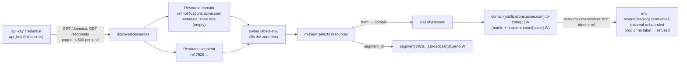

# Resend provider — modelling and runtime

`@vaubaan/plugin-resend` on the v5 Plugin SDK (feature P1.2f). Contract :
ADR [[plugin-contract-and-credential-spec]] ; spec
[`vaubaan-gateway.md`](../../spec/vaubaan-gateway.md) §0, §3.1, §3.2, §5 and
[`gateway-risk-model.md`](../../spec/gateway-risk-model.md) §2, §4, §7 ; the
provider's own spec [`resend.md`](../../spec/resend.md) (zones, catalog
rationale). Contributor-facing details (fields, tool list, preset table) :
[`plugins/resend/README.md`](../../../plugins/resend/README.md).

## What changed from v4

| v4                                                                             | v5                                                                                                            |
| ------------------------------------------------------------------------------ | ------------------------------------------------------------------------------------------------------------- |
| One `ProviderBinding` per account, slug chosen by the operator, env on it      | One `Resource` per **sending domain** (ref = name, env labelled by the owner) and per **segment** (ref = id)  |
| Zone lists in `binding.metadata`                                               | Zone lists in the **domain resource** metadata ; empty at discovery (every recipient external until filled)   |
| Slices rooted at `account[<slug>]`                                             | Slices rooted at `domain[<name>]` / `segment[<id>]` ; `contact[…]`, `email[…]` account-level                  |
| `from` ignored by the classifier                                               | `from` **is** the resource : a send from a domain outside the mission is `denied`                             |
| Audiences, `/audiences/:id/contacts`, `PUT /broadcasts/:id`, batch body object | Segments (Resend renamed audiences, Nov 2025), `/contacts`, `/contacts/:id/segments/:id`, `PATCH`, bare array |
| `[**]` catalog patterns overlapping (`audience[**].W` caught contact writes)   | `[*]` + verb leaves : one named risk per write slice                                                          |
| 25 tools                                                                       | 27 : `add_contact_to_segment`, `remove_contact_from_segment` added ; audience tools renamed to segments       |
| `risk-catalog.ts` twin + sync test                                             | YAML loaded by `loadCatalogFile` at boot ; twin and sync test deleted                                         |
| No presets                                                                     | `read-only`, `developer`, `marketing-operator`, `domain-admin`                                                |

The v4 surface (the adapter, the binding-based classifier, the audience-era
tool declarations and executor, the deprecated aliases of `index.ts`) is
deleted ; the plugin exports only the v5 surface below. The per-tool suite
of the v4 classifier was ported to `classifyResend`
(`tests/unit/classify.test.ts`).

## Layout

```
plugins/resend/src/
  resources.ts        kinds, SAFE_IDENT, zoneConfigOf, resolveDomain / resolveDomainArg / resolveSegmentArg
  zones.ts            parseAddress, collectRecipients, zoneOfAddress, worstZone
  tools.ts            27 McpToolDeclaration (`domain` / `segment_id` resource arguments), declaredFieldsOf
  classify.ts         classifyResend — pure, (tool, args, resources) → slices | denied
  execute.ts          executeResend, discoverResendResources, RESEND_API_BASE, paging constants
  data-model.ts       plane `email`, 9 entities, `domain` and `segment` envScopable
  risk-catalog.yaml   15 live named risks + 1 fallback + 2 deprecated ids (18 entries), 4 presets, catalog_version 3
  index.ts            definePlugin(...) → resendPlugin (default export)
```

## Resources, zones and the environment



- **Zone of a send** = worst zone across `to` + `cc` + `bcc` against the
  sending domain's `internal_domains` / `allowlist_domains` /
  `allowlist_addresses` (exact, case-insensitive). Addresses are parsed
  (`"Alice <alice@acme.com>"`), a malformed one is `denied`. Empty lists
  mean every recipient is `external-unbounded` — fail closed.
- **Recipient count** : the marker has one value, `batch`, emitted by
  `send_batch_emails` only and matched by `send-batch`. A single send emits
  no count marker, whatever its number of recipients : a slice no named risk
  matches touches the fallback, and no preset may carry the fallback — with
  a `single` / `multi` marker no preset could send an email.
- **Batch** : emails grouped by `from` domain, one zone slice and one batch
  marker per domain, worst zone per group ; more than 100 emails `denied`.
- **Environment** : only `send-email-external-unbounded` is env-scoped
  (`acceptable_in_envs: [staging, dev]`). Env labels are the owner's free
  text, so no other risk is restricted to a closed env list.

### An external send outside staging / dev

A send (single or batch) with at least one `external-unbounded` recipient
touches `resend.send-email-external-unbounded`, qualified by the label of
the sending domain. What happens next depends on that label :

| Label of the `from` domain | Risk touched                                 | Verdict                                                                 |
| -------------------------- | -------------------------------------------- | ----------------------------------------------------------------------- |
| `staging` or `dev`         | `resend[staging].…` / `resend[dev].…`        | allowed if the mission accepted that exact qualified id, refused if not |
| anything else (`prod`, …)  | `resend[prod].send-email-external-unbounded` | **refused**, whatever the mission accepted                              |
| no label                   | `resend.send-email-external-unbounded`       | **refused**, whatever the mission accepted                              |

The refusal is the engine's (`evaluateCall`, `risk-not-accepted`) : a touched
env-scoped risk outside its `acceptable_in_envs` refuses the call instead of
being dropped from the set, so `send-batch`, the other zone risks or the
fallback can never carry such a send alone. The classifier does **not**
refuse it itself : it reports the slice on every domain and leaves the
decision to the engine. Reasons : the environment list stays in one place
(the catalog — a second copy in the classifier could drift), and the
refusal reaches the audit log as a risk decision naming the risk and the
label, with a hint for the owner, instead of an opaque classifier denial.
Consequence for the owner : an unlabelled domain cannot send to an
unlisted recipient — label it, or fill its zone lists.
`tests/unit/mission-evaluation.test.ts` pins the three rows through the
real catalog.

## Classifier conventions

| Tool                                                    | Slice(s)                                                                            |
| ------------------------------------------------------- | ----------------------------------------------------------------------------------- |
| `send_email`                                            | `domain[D].to-zone[Z].W` — one slice, one risk                                      |
| `send_batch_emails`                                     | per from-domain : `domain[D].to-zone[Z].W` and `domain[D].recipient-count[batch].W` |
| `get_email`                                             | `email[E].R`                                                                        |
| `get_domain`                                            | `domain[D].R` and `domain[D].dns-record[*].R`                                       |
| `list_domains`, `describe_zones`                        | `domain[*].R`                                                                       |
| `create_domain` / `update_domain`, `delete_domain`      | `domain.W` / `domain[D].W`                                                          |
| `verify_domain`                                         | `domain[D].dns-record[*].W`                                                         |
| `list_segments`, `get_segment`                          | `segment[*].R`, `segment[S].R`                                                      |
| `create_segment` / `delete_segment`                     | `segment.W` / `segment[S].W`                                                        |
| `list_contacts` (with / without `segment_id`)           | `segment[S].member[*].R` / `contact[*].R`                                           |
| `get_contact`, `update_contact`, `delete_contact`       | `contact[C].R` / `.W` — an email selector is `contact[*]`                           |
| `create_contact` (with `segment_id`)                    | `contact.W` (and `segment[S].member[*].W`)                                          |
| `add_contact_to_segment`, `remove_contact_from_segment` | `segment[S].member[C].W`                                                            |
| `list_broadcasts`, `get_broadcast`                      | `segment[*].broadcast[*].R`, `segment[S].broadcast[B].R`                            |
| `create_broadcast` / `update_broadcast`                 | `segment[S].broadcast.W` / `segment[S].broadcast[B].W`                              |
| `send_broadcast`, `delete_broadcast`                    | `segment[S].broadcast[B].send.W`, `….delete.W`                                      |

Refusals (`denied`, audited, never executed) : `from` outside the mission or
malformed ; malformed or absent recipients ; `attachments` in any shape but
an empty list (a non-array value is unreadable, not absent), `scheduled_at`
(spec §10 : out of scope) ; a `headers` entry that names an envelope field —
`To`, `Cc`, `Bcc`, `From`, `Sender`, `Reply-To`, `Return-Path` and their
`Resent-*` forms, case-insensitive (`ENVELOPE_HEADERS`) — or whose name is
not a plain header token, or whose value is not a single-line string, or
`headers` that is not an object (the zone was computed from `from`, `to`,
`cc`, `bcc` alone) ; `send` on a broadcast create or update (would bypass
`broadcast-send`) ; `domain` / `segment_id` outside the mission ; malformed
identifiers (`SAFE_IDENT`, and an id made of dots only, which the URL parser
would collapse) ; a create without its `name` / `email` / `from` ;
`scheduled_at` on a broadcast send ; unknown tool.

## Catalog and presets

18 entries : 15 live named risks, 1 fallback (`resend.uncategorized-write`)
and 2 deprecated ids (`read-audiences` / `audience-write`, with
`replaced_by`). Patterns use `[*]` (one identifier) and verb leaves so every
slice the classifier emits touches exactly one named risk and never the
fallback — `risk-catalog.test.ts` asserts the first per pattern,
`plugin.test.ts` the second (`fallbackHits` is empty over the samples of
all 27 tools). `broadcast-send` declares the one limit the gateway enforces, the
rate ceiling `infra_limits.calls_per_minute_max: 10`; no entry declares `caps` (the door has
no cap stage, see [the ADR](../../decisions/scope-caps-not-enforced-in-v5-0.md)), and the
100-email limit of `send-batch` is refused by the classifier. No preset carries the fallback (the engine counts it only
when nothing named matched), a deprecated id, or the env-scoped risk
unqualified.

Presets, with what a mission built from each one alone allows
(`mission-evaluation.test.ts` evaluates the same nineteen calls under each) :

| Preset               | Allows                                                                                                                                                                                | Refuses                                                          |
| -------------------- | ------------------------------------------------------------------------------------------------------------------------------------------------------------------------------------- | ---------------------------------------------------------------- |
| `read-only`          | email status, domains, broadcast metadata                                                                                                                                             | contacts (PII), every write                                      |
| `developer`          | the same reads ; single sends to internal and allow-listed recipients, one or several                                                                                                 | external sends, batches, contacts, segments, broadcasts, domains |
| `marketing-operator` | reads including contacts ; internal and allow-listed sends, single or batch (`approval`) ; contact writes ; segment writes (`approval`) ; drafts, broadcast send (`approval`), delete | external sends (single or batch, any domain), domain writes      |
| `domain-admin`       | read and verify domains ; create and update them (`approval`)                                                                                                                         | every send, contacts, segments, broadcasts, email status         |

No preset can reach an `external-unbounded` recipient : a creator adds
`resend[staging].send-email-external-unbounded` (or `[dev]`) by hand, and
it only ever applies to a domain carrying that label. Values are a starting
point — ADR `mission-presets-default-values` is deferred.

## Execute

JSON bodies, `Authorization: Bearer <api_key>`, `ctx.fetch` only. `execute`
re-runs `classifyResend` and throws on `denied` (fail closed whatever the
host did). Only the fields a tool declares in its `inputSchema` are
forwarded (`declaredFieldsOf`, one list per tool derived from `tools.ts` ;
each email of a batch is reduced the same way) : an argument the schema
does not name — `audience_id`, a template id, anything Resend adds later —
was read by no classifier rule, so it is dropped before the call instead of
reaching Resend unseen. The resource arguments (`domain`, `segment_id`,
`id`) go in the path or are re-resolved against the mission, never copied
into the body. Domain tools map the ref to `metadata.domain_id` (missing →
"refresh the connection's resources"). Every broadcast call first
`GET /broadcasts/:id` and refuses a broadcast whose `segment_id`
(`audience_id` on older payloads) differs from the one named. List tools
filter upstream results to the mission's resources. `create_contact` with
`segment_id` is two calls (`POST /contacts`, then
`POST /contacts/:id/segments/:segment_id`) ; a create answer without an
`id` stops there with an error rather than building the second URL from a
missing value. 401 → `UpstreamAuthError` ;
403 → `UpstreamAuthError` unless Resend names a `validation_error` (an
unverified `from` domain is a 403 too). Unknown tool → `isError` result.

## How to debug

- **`from: 'x' is not a sending domain of this mission`** — the agent sends
  from a domain the mission did not select (or a subdomain : Resend needs
  the exact verified domain). Add the resource to the mission.
- **Every send is `external-unbounded`** — the domain resource's zone lists
  are empty (fresh discovery) or the recipient domain is not listed exactly.
  `describe_zones` shows what the classifier sees.
- **`broadcast 'b' targets segment 's1', not 's2'`** — the agent named the
  wrong `segment_id` ; nothing was sent.
- **Discovery fails with `UpstreamAuthError` 403** — a `sending_access` key
  : create a full-access key.
- **`carries no domain_id`** — a resource predating discovery metadata ;
  refresh the connection's resources.
- **A write is refused with `resend.uncategorized-write`** — a slice no
  named pattern covers (new tool without catalog entry) : add the entry.
  No shipped tool reaches it ; accepting the fallback by hand is never the
  fix.
- **`'resend[prod].send-email-external-unbounded' is touched on a resource
labelled 'prod', but is acceptable only in [staging, dev]`** (or `a
resource with no environment label`) — a recipient is in no zone list of
  the sending domain. No mission can send it from there : add the recipient
  or its domain to the zone lists, or send from a `staging` / `dev` domain.
- **`headers: 'Bcc' is an envelope header`** — recipients and sender go in
  `to` / `cc` / `bcc` / `from` / `reply_to`, where they are zoned.
- **A field the agent passed is missing upstream** — it is not declared by
  the tool (`tools.ts`) ; declare it and decide how it is classified.

## Tests

`npx vitest run plugins/resend` — 161 : `plugin.test.ts` (kit with
`fallbackHits` empty, cross-cutting classifier rules, execute and its
forwarded fields, discovery, credential, presets ; 43), `classify.test.ts`
(one scenario per tool on `classifyResend`, envelope headers, attachments,
identifiers ; 64), `risk-catalog.test.ts` (counts, invariants and
disjointness ; 33), `mission-evaluation.test.ts` (real catalog through
`evaluateCall` with the gateway's env resolver : external sends per domain
label, each preset call by call ; 15), `data-model.test.ts` (6).
