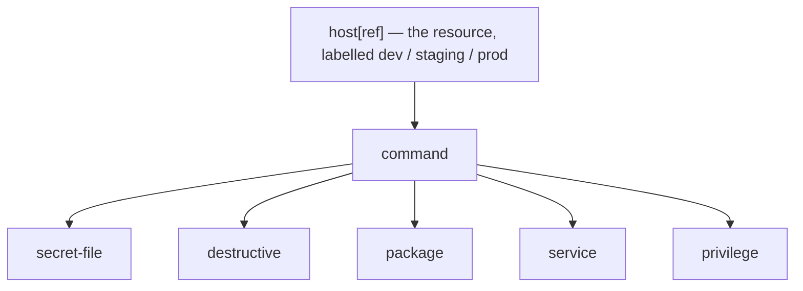
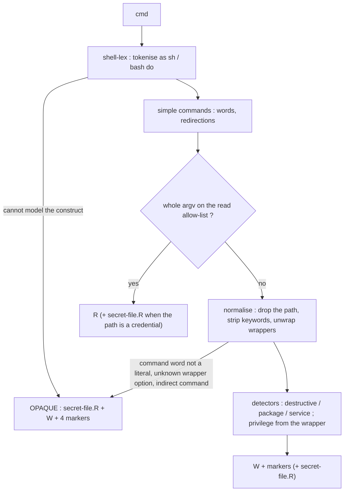
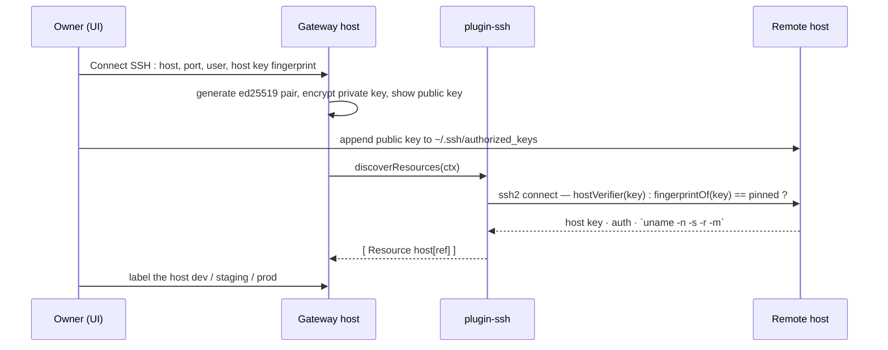

# SSH provider — bash over SSH

`@vaubaan/plugin-ssh` (`plugins/ssh`), on `@vaubaan/plugin-sdk` since P1.2i.
Spec: [`vaubaan-gateway.md`](../../spec/vaubaan-gateway.md) §5 (plugins),
§3.2 (presets); [`gateway-risk-model.md`](../../spec/gateway-risk-model.md)
§2, §4, §7. ADR: [[plugin-contract-and-credential-spec]]. Contributor view
(fields, setup commands, preset table):
[`plugins/ssh/README.md`](../../../plugins/ssh/README.md).

This handbook replaces the SSH half of [`railway-ssh.md`](../legacy/railway-ssh.md)
§2 and the v4 [`bash-provider.md`](../legacy/bash-provider.md) (annotated-script
dispatcher, removed — §6), both French and archived under
`docs/handbook/legacy/`. Their decisions that survive are listed in §7.

## 1. What changed from v4

| v4                                                                                       | v5                                                                                                                                                                      |
| ---------------------------------------------------------------------------------------- | ----------------------------------------------------------------------------------------------------------------------------------------------------------------------- |
| `ssh_bindings` row per host: address, port, user, private key as plain bytea             | `ssh-key` credential run by the host: ed25519 pair generated by the instance, stored encrypted                                                                          |
| Any host key accepted (trust on first use, never re-checked)                             | Host key fingerprint **pinned in the credential**, verified on every connection before authentication                                                                   |
| `classifySshV4(tool, args, bindings)` on `host_slug`; the slug was the env               | `classifySsh(tool, args, resources)`; the host is a `Resource`, the owner's label is the env                                                                            |
| `acceptable_in_envs: [staging-vps, dev-vps, prod-vps]` (host slugs)                      | `[dev, staging, prod]` (owner labels), `vector_overrides.prod`                                                                                                          |
| Two identical `R` slices on a credential-file read (co-touch)                            | A distinct `command.secret-file.R` slice → `exec-read` and `exec-read-secret-files` are separable                                                                       |
| Every non-whitelisted command was one undifferentiated `W`                               | `W` plus class markers: `destructive`, `package`, `service`, `privilege`, each its own risk                                                                             |
| Compound lines classified as a whole by prefix regex (`grep x; rm -rf /` was `R`)        | A lexer that tokenises the line as the shell does, a read allow-list on whole argument vectors, and a fail-closed rule: what cannot be seen through carries every class |
| `risk-catalog.yaml` with the legacy top-level `ssh:` key + `risk-catalog.ts` twin        | v5 YAML (`provider:`, `catalog_version`, `risks`, `presets`) loaded by the SDK; twin and its lint deleted                                                               |
| Annotated-script parser and runner in `apps/gateway/src/lib/bash`; not wired into `/mcp` | Deleted (§6); `ssh__exec` is the whole surface, a real plugin tool                                                                                                      |
| No presets                                                                               | `read-only`, `developer`, `operator`                                                                                                                                    |

The v4 surface (the `host_slug` tool declaration, `sshExec`, the
binding-based classifier, the deprecated aliases of `index.ts` and the
annotated-script modules) is deleted, together with the app-side
`apps/gateway/src/lib/bash/` shims and host loader ; the plugin exports only
the v5 surface below.

## 2. Layout

```
plugins/ssh/src/
  index.ts             createSshPlugin({ transport }) → definePlugin ; sshPlugin (default)
  risk-catalog.yaml    7 risks + fallback, 3 presets, catalog_version 3
  data-model.ts        plane host : host (envScopable) → command → secret-file | destructive | package | service | privilege
  tools.ts             ssh__exec (host?, cmd, timeout_s?)
  shell-lex.ts         lexCommandLine — words, redirections and simple commands as a POSIX shell builds them ; names what it cannot model
  policy.ts            the read allow-list on whole argument vectors : matchRead, readMatchOf, isReadAllowed ; parseOptions
  command-classes.ts   splitCommandLine, looksLikeSecretFileRead, stripPrivilegePrefix, isDestructive, isPackageInstall, isServiceControl, profileCommandLine
  classify.ts          classifySsh, resolveExecArgs — pure
  credential.ts        sshCredential (ssh-key spec), sshTarget, hostRef (SSH_HOST_PATTERN), fingerprintOf, hostKeyMatches, normalizeFingerprint
  transport.ts         SshTransport, ssh2Transport, SshHostKeyMismatchError, SshHostKeyNotPinnedError, output caps
  execute.ts           createSshRuntime → execute, discoverResources ; hostResource
```

## 3. Data model and slices



| Entity                                                          | Cardinality | Notes                                                                                                     |
| --------------------------------------------------------------- | ----------- | --------------------------------------------------------------------------------------------------------- |
| `host`                                                          | one         | `ref` = hostname or IPv4 of the credential. `envScopable`; the label qualifies write risks.               |
| `command`                                                       | one         | One shell line. `R` per whitelisted simple command, `W` for any other; never `R` when the line is opaque. |
| `secret-file`, `destructive`, `package`, `service`, `privilege` | one         | Classification markers, emitted next to `command.R` / `command.W`.                                        |

Slices emitted by `classifySsh` for `ssh__exec` on host `H`, in this order
when present:

| Condition                                                                                                                         | Slice                                             | Risk                             |
| --------------------------------------------------------------------------------------------------------------------------------- | ------------------------------------------------- | -------------------------------- |
| A simple command whose whole argument vector is on the read allow-list                                                            | `ssh.host[H].command.R`                           | `exec-read`                      |
| A credential-bearing path referenced, or a path that cannot be seen                                                               | `ssh.host[H].command.secret-file.R`               | `exec-read-secret-files`         |
| Any other simple command, a redirection to a file                                                                                 | `ssh.host[H].command.W`                           | `exec-write`¹                    |
| `rm -r/-f`, `mkfs`, `dd`, `shred`, reboot, `userdel`, `iptables -F`, `docker … prune/rm`, `find -delete`, `journalctl --vacuum-*` | `ssh.host[H].command.destructive.W`               | `exec-destructive`¹              |
| Package manager in a mutating mode, `npm -g`, `pipx`                                                                              | `ssh.host[H].command.package.W`                   | `exec-package-install`¹          |
| `systemctl` verbs, `service`, init scripts, Docker / Compose lifecycle, `pm2`, `kill`                                             | `ssh.host[H].command.service.W`                   | `exec-service-control`¹          |
| `sudo` / `doas` / `pkexec` on a non-whitelisted command                                                                           | `ssh.host[H].command.privilege.W`                 | `exec-sudo`¹                     |
| **An opaque line** (see "Fail-closed rule")                                                                                       | `secret-file.R`, `W` and the four markers; no `R` | all of the above but `exec-read` |

¹ env-scoped: qualified to `ssh[<label>].<risk>` by the runtime. The fallback
`ssh.uncategorized-write` (`ssh.**.W`) is counted only when no dedicated entry
matched, and is never in a preset.

**Host resolution.** `host` must be a resource of the mission; absent, the
mission's single SSH host applies; several hosts and no argument, a host the
mission does not hold, or a ref that is not a host (`host: malformed ref`)
are `denied`. An empty `cmd`, one longer than 16 KiB, or a non-positive
`timeout_s` is `denied` too. `execute` additionally refuses a host that is
not the credential's host (one connection = one host).

**Identifiers.** A host has one grammar, `hostRef` in `credential.ts`
(`SSH_HOST_PATTERN`: a hostname or an IPv4 address that starts and ends
with a letter or a digit, letters, digits, `.` and `-` in between, at most
253 characters). It is never an option (`-oProxyCommand=…`), never `.` or
`..`, and holds no separator, blank or control character. A value outside
it is refused, never escaped (ADR
[`plugin-identifiers-one-grammar-for-classify-and-execute`](../../decisions/plugin-identifiers-one-grammar-for-classify-and-execute.md)).

| Value                                    | Read by                                                                         | Where it lands                             | Outside the grammar                                    |
| ---------------------------------------- | ------------------------------------------------------------------------------- | ------------------------------------------ | ------------------------------------------------------ |
| `host` argument of `ssh__exec`           | `hostRef`, in `resolveHost`                                                     | slice `host[H]`                            | `host: malformed ref`                                  |
| ref of the mission's single SSH resource | `hostRef`, in `resolveHost`                                                     | slice `host[H]`                            | `host: the ref of the mission's SSH host is malformed` |
| `host` field of the credential           | `hostRef`, in `sshTarget` (and the pattern of the field in the credential spec) | what the transport dials; the resource ref | `sshTarget` throws; no connection                      |
| `cmd`                                    | not an identifier: the classified line                                          | sent to the transport as it was classified | —                                                      |

`classify` and `execute` both go through `resolveExecArgs`, so the host the
slices name is the host the call runs on, and a refused value opens no
connection.

### Fail-closed rule

A classification error is a security hole, so the classifier is built to
err in one direction. **A line is a read only when every simple command on
it is recognised in full; what the classifier cannot see through is
classified as the union of the classes** — `secret-file.R`, `W`,
`destructive.W`, `package.W`, `service.W`, `privilege.W` — so a `read-only`
or `developer` mission is refused and an `operator` mission goes through its
approval gates. It never falls back to a plain `W`, and never to an empty
list.



**The lexer** (`shell-lex.ts`) models exactly what it can: single and double
quotes, backslash escapes, `#` comments, the control operators and grouping
parentheses, plain redirections (`>`, `>>`, `>|`, `&>`, `<`, `<>`, `>&file`),
descriptor duplications (`2>&1`, `>&-`), `$name` and `${name}`. Everything else
is named in `opaque` rather than guessed:

| Reason                | Construct                                                                                                                                                                                                       |
| --------------------- | --------------------------------------------------------------------------------------------------------------------------------------------------------------------------------------------------------------- |
| `substitution`        | `$(…)`, backticks, `<(…)`, `>(…)`, `$[…]`                                                                                                                                                                       |
| `ansi-c-quoting`      | `$'…'`, `$"…"`                                                                                                                                                                                                  |
| `here-document`       | `<<`, `<<-`, `<<<`                                                                                                                                                                                              |
| `parameter-expansion` | a `${…}` holding more than a name and a plain operator                                                                                                                                                          |
| `control-character`   | any C0 control character but tab and newline, DEL (a shell does not treat them as blanks)                                                                                                                       |
| `line-continuation`   | a backslash-newline glued to a token or inside double quotes (the shell deletes it first, so `$\<newline>'…'` is ANSI-C quoting)                                                                                |
| `redirection`         | `<&word`; `>&` followed by a descriptor that is not the whole word (`>&2file`); `>&` or `<&` followed by `-` and more text (bash reads `>&--rf` as `>&-` then `-rf`). `>&file` is a plain redirection to a file |
| `malformed`           | an unterminated quote or `${`, a trailing backslash, a redirection without a target                                                                                                                             |

The lexer was checked against `bash` with a differential fuzzer (random lines
over the shell's special characters, a `command_not_found_handle` recording
each argv): every command bash ran on a non-opaque line was seen with the
same argument vector. Four desynchronisations found that way are pinned by
tests (`''2>f`, `2"">f`, `$\<newline>'…'`, `>&--rf`).

A word carries one "bare" flag per UTF-16 unit of its text, and `hasGlob` /
`hasBrace` walk it by unit, never by code point: a quoted character outside
the BMP (an emoji) does not shift the flags of what follows, so it cannot
hide a bare `*` or `{`.

**Normalisation** (`command-classes.ts`). Before the detectors look at a
write, the command word loses its quotes and its directory (`/bin/rm`,
`./rm`, `'rm'`, `\rm` are `rm`), keywords and group tokens are stripped
(`then`, `do`, `{`, `!`), assignments are skipped, and wrappers are unwrapped
with their options: `env`, `command`, `builtin`, `exec`, `nohup`, `setsid`,
`nice`, `ionice`, `time`, `timeout`, `stdbuf`, `xargs`, and `sudo` / `doas` /
`pkexec`, which add `privilege`. A wrapper option the table does not list
(`sudo -i`, `sudo -h host`, `env -S`) makes the line opaque (`wrapper-option`).
The verb of a package manager or of `systemctl` is looked for among all the
arguments (`apt-get -qq -y install`), and long options are matched by prefix
where the tool accepts abbreviations (`rm --rec`).

**Opaque commands.** Some commands decide what runs from something that is
not a command on the line:

| Reason             | Commands                                                                                                                                                                                       |
| ------------------ | ---------------------------------------------------------------------------------------------------------------------------------------------------------------------------------------------- |
| `command-word`     | the command word is not a literal: `$CMD`, a glob, a brace, a name with a character no command has                                                                                             |
| `inline-code`      | a shell or an interpreter that is not given a script file (`bash -c`, `sh` reading stdin, `python -c`, `perl -e`, `node -e`), `find -exec`, `npx -c`, `tar --to-command`                       |
| `indirect-command` | `eval`, `source`, `trap`, `alias`, `for` / `case` / `function`, `su`, `ssh`, `scp`, `nc`, `chroot`, `nsenter`, `awk`, `watch`, `flock`, `strace`, `busybox`, `at`, `tmux`, the dynamic loader… |
| `another-host`     | `systemctl -H` / `-M` / `--root`, a container client with a global option (`docker -H`), `rsync -e`                                                                                            |
| `container-exec`   | `docker` / `podman` / `nerdctl` `exec` or `run`, `compose exec` / `run`, `kubectl exec`                                                                                                        |
| `unseen-arguments` | arguments that are not on the line (`$X`, a brace, `xargs`) for a command whose arguments decide its sight: `systemctl`, `docker`, `find`, `tar`, `npm`…                                       |
| `wrapper-option`   | a wrapper carrying an option its table does not list (`sudo -i`, `env -S`), or an option written with an expansion, a glob or a brace                                                          |
| `wrapper-depth`    | more than 12 wrappers nested in front of the command (`MAX_WRAPPER_DEPTH`)                                                                                                                     |

For other commands, arguments that are not on the line give the classes the
command could reach: `rm $FLAGS` and `… | xargs rm` are `destructive`,
`kill $PID` is `destructive` and `service`, `apt-get $ARGS` is `package`.

**What stays a plain write.** `./deploy.sh`, `bash deploy.sh`, `python3
manage.py migrate`, `make`, `npm run build`, `git pull` are `W` and nothing
else: running a program on the host is what `exec-write` means, and that
program may do anything its user can — including what a marker prices. The
markers price the commands **written on the line**. The table of opaque
commands is a deny-list of launchers and cannot be complete (`sed` with the
`e` command, a database client's shell escape, a `git` alias are not on it).
The host-side boundary — the login user, its sudoers entry — is the last
word; give a `developer` mission an account that cannot `sudo`.

**Shell assumed.** A POSIX shell as the login shell of the account (`sh`,
`dash`, `bash`). Startup files the shell reads for a non-interactive SSH
command (`~/.bashrc` under `bash`) and the account's `PATH` are part of the
host-side boundary: a function named `ls` planted there by an earlier write
runs when a later mission calls `ls`.

### Reading the allow-list

`policy.ts` holds one rule per command, applied to the argument vector with
the quotes removed: every argument must be a known option, the value of a
known option, or an operand of the expected shape. There is no prefix
matching.

| Command                                              | Accepted                                                                                                                                                                                                                                                                                      |
| ---------------------------------------------------- | --------------------------------------------------------------------------------------------------------------------------------------------------------------------------------------------------------------------------------------------------------------------------------------------- |
| `journalctl`                                         | filtering and output options (`-u`, `-n`, `-p`, `-b`, `-f`, `-k`, `-g`, `-o`, `--since`, `--until`, `--no-pager`…), matches (`FIELD=value`). Not `--vacuum-*`, `--rotate`, `--flush`, `--sync`, `--setup-keys`, `--cursor-file`, `-D`, `--file`, `-M`                                         |
| `cat <path>`, `md5sum <file>`, `stat <file>`         | exactly one operand, no option                                                                                                                                                                                                                                                                |
| `ls`                                                 | option clusters and at most one path                                                                                                                                                                                                                                                          |
| `tail`, `head`                                       | option clusters with their counts and exactly one file (`tail -n 50` alone reads stdin and would hang)                                                                                                                                                                                        |
| `grep`                                               | its matching, output and context options; a recursive `grep` adds `secret-file` unless every path is under `/var/log`                                                                                                                                                                         |
| `pgrep`                                              | its selection options and at most one pattern; at least one argument                                                                                                                                                                                                                          |
| `ps`, `df`, `free`                                   | at most one option cluster                                                                                                                                                                                                                                                                    |
| `uptime`, `who`                                      | no argument                                                                                                                                                                                                                                                                                   |
| `ss -tlnp`                                           | exactly that                                                                                                                                                                                                                                                                                  |
| `docker ps`, `docker logs <c>`, `docker inspect <c>` | `docker ps`: long options only (`--all`, `--format`, `--filter`…), no operand; `docker logs`: long options (`--tail`, `--since`, `--follow`…) and exactly one container; `docker inspect`: exactly one operand and no option, and it adds `secret-file` (it prints the container environment) |
| `systemctl status \| is-active \| list-units`        | the verb first, then `--no-pager`, `-l`, `-n`, `-o`, `--type`, `--state`, `--failed`…, unit names. Not `-H`, `-M`, `--root`                                                                                                                                                                   |
| `sudo` + `journalctl`, `systemctl …`, `ss -tlnp`     | `sudo` with no option                                                                                                                                                                                                                                                                         |

A command is eligible only when the shell passes it exactly what the line
says: the command word is the bare name (`/bin/ls` and `./ls` are writes), no
word holds an expansion, a glob or a brace, no assignment precedes it
(`LD_PRELOAD=… ls`), and it redirects nothing to a file — `2>&1` and
`< file` are fine. A keyword in front (`if`, `then`, `!`, `{`) does not
change the verdict. Pipe into `grep` rather than `tail` to trim output, or
widen the list with a catalog review.

### Credential-bearing paths

`secret-file` is detected on every word and every redirection target of the
line, per path segment, after `//` and `/./` are collapsed — so the spelling
of the path does not matter:

- a directory `.ssh`, `.aws`, `.gnupg`, `.kube`, `.docker` anywhere
  (`.ssh/id_ed25519`, `/home/u//.ssh/x`, `~/.aws/credentials`);
- a file `.env*`, `id_rsa*` / `id_dsa*` / `id_ecdsa*` / `id_ed25519*`, `*.pem`,
  `*.key`, `*.p12`, `*.pfx`, `*.kdbx`, `ssh_host_*_key`, `authorized_keys`
  (and `authorized_keys2`), `shadow`, `gshadow`, `passwd`, `sudoers` (each
  also with a `.` or `-` suffix : `shadow-`, `sudoers.d`), `.netrc`,
  `.pgpass`, `.npmrc`, `.pypirc`, `.git-credentials`, `.htpasswd`, `.my.cnf`,
  `environ`;
- `/root`, `~root`, `/etc/ssl/private`, `/proc/…/mem` (and `kcore`, `kmem`),
  and anything under `/dev` but `null`, `zero`, `full`, `random`, `urandom`,
  `stdin`, `stdout`, `stderr`, `tty` and `/dev/fd/<n>` (a disk, memory, or
  bash's `/dev/tcp/<host>/<port>`);
- a path that cannot be seen: a `..` segment (resolving it would need the
  symlinks), an expansion (`$HOME/…`, `$FILE`), a brace, a glob that can match
  one of the names above (`/etc/shad?w`, `certs/*.pem`, `/srv/app/*`).

A word is also cut on `=`, `:` and `,`, so `--file=/etc/shadow`,
`dd if=/etc/shadow` and `host:/root/x` are examined. This is a list of names,
not a proof: a credential kept in `config.yml` is not on it.

## 4. Catalog and presets

`src/risk-catalog.yaml`, `catalog_version: 3`. Ids from v4 kept
(`exec-read`, `exec-read-secret-files`, `exec-write`, `uncategorized-write`);
four added (`exec-destructive`, `exec-package-install`, `exec-service-control`,
`exec-sudo`). Write risks: `acceptable_in_envs: [dev, staging, prod]`;
`exec-write` and `exec-destructive` escalate `data` / `cost` on `prod`
(`exec-write` also becomes `reversibility: irreversible` there),
`exec-service-control` becomes `visibility: public` on `prod`. Reads are
account-scoped (the same read is the same risk on every host).

| Preset      | Entries (gate)                                                                                                                                                                                                                                                          |
| ----------- | ----------------------------------------------------------------------------------------------------------------------------------------------------------------------------------------------------------------------------------------------------------------------- |
| `read-only` | `exec-read` (auto).                                                                                                                                                                                                                                                     |
| `developer` | `exec-read`; `ssh[dev].exec-write`, `ssh[staging].exec-write` (auto); `ssh[dev].exec-service-control` (auto); `ssh[staging].exec-service-control` (**approval**). No prod, no destructive, no package, no sudo, no credential files.                                    |
| `operator`  | `exec-read`; `exec-read-secret-files` (**approval**); `exec-write`, `exec-destructive`, `exec-package-install`, `exec-service-control`, `exec-sudo` on the three labels — `dev` auto, `staging` approval for the four destructive classes, every `prod` entry approval. |

Values: reads 2 000–10 000 per period at 60–120/min; dev writes 1 000–2 000
at 30/min; staging writes 500–1 000; prod writes 200 at 10/min;
`exec-destructive` and `exec-package-install` 10–100 at 2–10/min;
`exec-service-control` 20–500 at 5–20/min; `exec-sudo` 20–200 at 2–20/min.
The deferred ADR `mission-presets-default-values`
(plan §5.5) may revise the numbers.

### Environment axis

The environment is the **owner's label on the host resource**. The default
`resourceEnvResolver` of `@vaubaan/policy-engine` finds it from the
`host[<ref>]` segment (first `ident` equal to a resource ref), so no
`envOf(slice)` hook is needed — unlike Vercel, where the env lives in the
arguments. An unlabelled host never qualifies a write risk, so a mission on
it can only read; the owner labels it in the connection's resources page.
`acceptable_in_envs` closes the label set to `dev | staging | prod`: a host
labelled `qa` would not qualify either.

## 5. Credential, transport and discovery



- **Credential** (`credential.ts`): kind `ssh-key`, `algorithm: 'ed25519'`,
  fields `host` (hostname or IPv4, at most 253 characters, read by `hostRef`
  — IPv6 literals cannot be a slice ident),
  `port` (optional, 22), `user`, `host_key_fingerprint` (`SHA256:<base64>`,
  padding tolerated, **required**). `sshTarget(secret)` narrows with
  `expectCredentialKind` and refuses a missing or malformed field — the
  fingerprint included — with a plain `Error` (host bug, not an auth error),
  so `execute` and `discoverResources` never reach the transport without a
  pin.
- **Transport** (`transport.ts`): `SshTransport.exec(target, cmd, { timeoutMs,
signal?, logger? })`. The real one first refuses a target whose pin is not a
  well-formed `SHA256:` fingerprint (`SshHostKeyNotPinnedError`, no socket
  opened), then opens one `ssh2` client per command and passes a
  `hostVerifier` that compares `SHA256:` + base64(sha256(key blob)) — the
  OpenSSH fingerprint — with the pin; a mismatch ends the handshake during
  the key exchange, before the key pair is offered (ssh2
  `KEY_EXCHANGE_FAILED`), and the client's `error` event is turned into
  `SshHostKeyMismatchError { host, expected, actual }`, logged at `error`.
  There is no trust on first use and no path that skips the verifier.
  `level: 'client-authentication'` → `UpstreamAuthError(401)`; refused /
  reset / timeout / unresolvable → plain `Error` with an operator message.
  Caps: stdout 1 MiB (`truncated`), stderr 4 KiB, handshake 10 s, command
  `timeout_s` ≤ 300. The gateway's `AbortSignal` destroys the connection.
- **Discovery** (`execute.ts`): one connection with `uname -n -s -r -m`,
  which also proves the pin and the key; returns one `Resource`
  (`ref` = host, `displayName` = `user@host:port`, metadata user, port,
  fingerprint, hostname, kernel, machine). A failing probe still yields the
  resource; an auth failure or a wrong host key fails discovery with the
  typed error.
- **Execution**: `resolveExecArgs` (the classifier's validation) → host must
  be the connection's → clamp timeout → transport → `McpToolResult` with
  stdout, `[stderr]`, `[exit N · T ms]` and `structuredContent`. Non-zero
  exit is not `isError`.

The plugin is built by `createSshPlugin({ transport })`; the default export
uses `ssh2Transport`, the tests a recording fake. Nothing in the plugin uses
`ctx.fetch`.

**Proof of the pin.** `tests/unit/host-key-pinning.test.ts` runs the real
`ssh2Transport` against an in-process `ssh2.Server` on `127.0.0.1` (ephemeral
port, host key generated for the test, server closed after each test; no
external host, no `ssh` binary). The server counts connections,
authentication attempts and commands, so each refusal is asserted from the
host's side: a matching pin runs the command; a well-formed pin of another
key reaches the key exchange and is refused with zero authentication attempt
and zero command, twice in a row; twelve absent or malformed pins (empty,
blank, `undefined`, `null`, bare prefix, wildcard, truncated, wrong case, no
prefix, MD5, non-strings) never open a socket; seven credentials without a
usable pin make `execute` and `discoverResources` throw before the transport
is called.

## 6. Annotated scripts (removed)

The v4 dispatcher's modules (`bash/parse.ts`, `bash/args.ts`, `bash/exec.ts`:
a parser for `# @vaubaan: ring=… action=…` annotations, argument
materialisation and a base64 `bash -s --` invocation builder) were carried
into the plugin unwired, then deleted with their 24 tests at the end of
Phase 1: nothing in v5 called them, they spoke the v4 vocabulary (rings,
bindings, `host_slug`), the builder interpolated an unvalidated function
name, and its output — `echo <b64> | base64 -d | bash -s` — is exactly the
shape `classifySsh` treats as opaque.

The design question stays open and unscheduled: an owner-curated script is
per-connection configuration the v5 `Connection` does not carry, and a
script supplied by the agent cannot be trusted for its own `action=read`
annotation. A "script library" on the connection would need a spec; the v4
design is in [`bash-provider.md`](../legacy/bash-provider.md). Until then
`ssh__exec` is the whole surface.

## 7. Decisions carried from v4

1. The read whitelist is a comfort zone, not a sandbox; the host-side
   boundary (login user, sudoers) is the last word. Kept verbatim.
2. `cat <path>` without a path filter is the known hole; it is priced by
   `exec-read-secret-files`, now on its own slice.
3. No shell AST parsing — but the v4 "prefix regex on the whole line" let
   `grep x; rm -rf /` through as a read, and a first v5 splitter that
   honoured quotes only let `grep x #'⏎touch f #'` through as one. v5 now
   tokenises the way the shell does, matches reads on whole argument
   vectors, and classifies what it cannot model as every class (§3,
   "Fail-closed rule"). It is still not an interpreter: it follows no script
   and no expansion.
4. The v4 research's "holes" list (`ssh.docker-restart`, `ssh.systemctl-restart`,
   `ssh.package-install`, `sudo` not differentiated, `rm -rf` not blocked)
   became the four class risks. `rm -rf` is still not blocked — it is gated.
5. `scp` / `sftp` remain unexposed; a future `ssh__sftp_put` needs its own
   risk and would be caught by the fallback until then.

## How to debug

- **Boot fails with `Invalid risk catalog '…/plugins/ssh/src/risk-catalog.yaml'`** —
  a preset entry naming an env outside `[dev, staging, prod]`, or on a
  non-env-scoped risk (`ssh[prod].exec-read` is invalid: reads are not
  scoped).
- **A write refused with `risk-not-accepted` and `missing_risks: [ssh.uncategorized-write]`** —
  a `W` slice no dedicated entry covers (the fallback counts only then, ADR
  [[fallback-risk-only-when-uncategorized]]). Every `ssh__exec` write emits
  `command.W`, which `exec-write` covers, so this signals a classifier or
  catalog regression: add the entry, do not accept the fallback.
- **Write refused on a host that is labelled** — the label is not one of
  `dev | staging | prod`, or the mission's policy was issued before the label
  was set (policies are explicit enumerations; re-issue).
- **`SshHostKeyMismatchError`** — the host presented a key other than the
  pinned one. Re-run `ssh-keyscan -t ed25519 <host> | ssh-keygen -lf -` from
  a trusted machine; if the key really changed, the owner updates the
  connection; if not, treat it as an incident.
- **`UpstreamAuthError: ssh authentication failed`** — the public key is not
  in `authorized_keys` of `user`, or the account is locked; reconnect.
- **A read lands in `W`** — a `>` redirection, a `tail` without a file, a
  command path (`/bin/ls`), an option the allow-list does not know, a glob
  or a `$VAR` among the arguments. `classifySsh(...)` returns the slices;
  `profileCommandLine(cmd)` shows which class fired, `isReadAllowed(cmd)` the
  verdict on one simple command.
- **A harmless line is refused with six missing risks** — it is opaque:
  `profileCommandLine(cmd).opaque` names the reason (`substitution`,
  `here-document`, `inline-code`, `command-word`…, §3). Rewrite it plain: a
  literal instead of `$(…)` or `$VAR`, `printf '…' > file` instead of a
  here-document, a script file instead of `bash -c`.
- **`exec-read-secret-files` is missing on a line that reads no secret** —
  a word holds an expansion, a `..` segment or a glob that can match a
  credential name (`/srv/app/*`), or the line uses `xargs`, a recursive
  `grep` outside `/var/log`, or `docker inspect`. Name the path literally.
- **`host '…' is not a host of this mission`** — the agent named a ref that
  is not among the mission's selected resources. A value that is not a
  hostname or an IPv4 address (`user@host`, `host:22`) is refused earlier,
  with `host: malformed ref`.

## References

- Code: `plugins/ssh/src/`; tests `plugins/ssh/tests/unit/` (696 tests:
  299 kit / classifier / evaluated presets / lexer / allow-list /
  credential / fake transport in `plugin.test.ts`, 181 adversarial lines in
  `adversarial.test.ts`, 90 in `classify.test.ts`, 87 hostile `host` and
  `cmd` values fed to `classify` and to `execute` in `injection.test.ts`,
  37 on the real transport in `host-key-pinning.test.ts`, 2 data model).
- Neighbours: [[plugin-sdk]], [[policy-engine]],
  [`providers/README.md`](./README.md); legacy [`railway-ssh.md`](../legacy/railway-ssh.md) §2,
  [`bash-provider.md`](../legacy/bash-provider.md).
