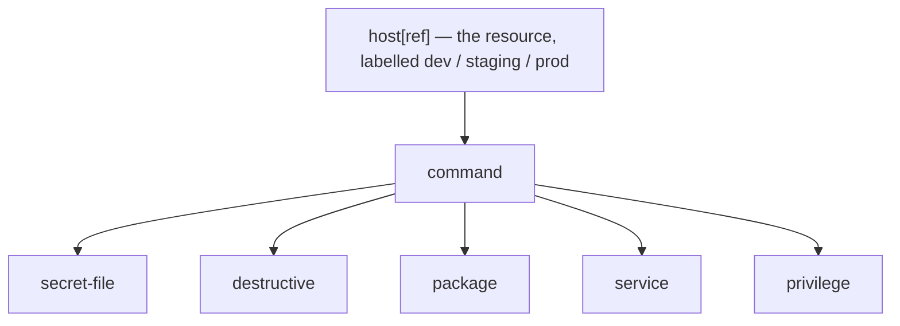
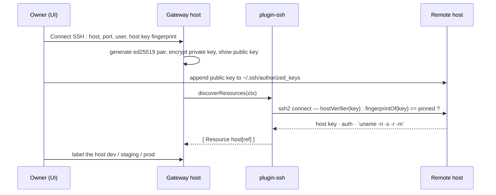

# SSH provider — bash over SSH

`@vaubaan/plugin-ssh` (`plugins/ssh`), on `@vaubaan/plugin-sdk` since P1.2i.
Spec: [`vaubaan-gateway.md`](../../spec/vaubaan-gateway.md) §5 (plugins),
§3.2 (presets); [`gateway-risk-model.md`](../../spec/gateway-risk-model.md)
§2, §4, §7. ADR: [[plugin-contract-and-credential-spec]]. Contributor view
(fields, setup commands, preset table):
[`plugins/ssh/README.md`](../../../plugins/ssh/README.md).

This handbook replaces the SSH half of [`railway-ssh.md`](./railway-ssh.md)
§2 and the v4 [`bash-provider.md`](../bash-provider.md) (annotated-script
dispatcher), both French and now marked legacy. Their decisions that survive
are listed in §7.

## 1. What changed from v4

| v4                                                                                | v5                                                                                                        |
| --------------------------------------------------------------------------------- | --------------------------------------------------------------------------------------------------------- |
| `ssh_bindings` row per host: address, port, user, private key as plain bytea      | `ssh-key` credential run by the host: ed25519 pair generated by the instance, stored encrypted            |
| Any host key accepted (trust on first use, never re-checked)                      | Host key fingerprint **pinned in the credential**, verified on every connection before authentication     |
| `classifySshV4(tool, args, bindings)` on `host_slug`; the slug was the env        | `classifySsh(tool, args, resources)`; the host is a `Resource`, the owner's label is the env              |
| `acceptable_in_envs: [staging-vps, dev-vps, prod-vps]` (host slugs)               | `[dev, staging, prod]` (owner labels), `vector_overrides.prod`                                            |
| Two identical `R` slices on a credential-file read (co-touch)                     | A distinct `command.secret-file.R` slice → `exec-read` and `exec-read-secret-files` are separable         |
| Every non-whitelisted command was one undifferentiated `W`                        | `W` plus class markers: `destructive`, `package`, `service`, `privilege`, each its own risk               |
| Compound lines classified as a whole by prefix regex (`grep x; rm -rf /` was `R`) | Quote-aware split into simple commands; substitutions and redirections force `W`                          |
| `risk-catalog.yaml` with the legacy top-level `ssh:` key + `risk-catalog.ts` twin | v5 YAML (`provider:`, `catalog_version`, `risks`, `presets`) loaded by the SDK; twin and its lint deleted |
| Parser and runner in `apps/gateway/src/lib/bash`; not wired into `/mcp`           | Parser, args, invocation builder in `plugins/ssh/src/bash/`; `ssh__exec` is a real plugin tool            |
| No presets                                                                        | `read-only`, `developer`, `operator`                                                                      |

The v4 surface (the `host_slug` tool declaration, `sshExec`, the
binding-based classifier and the deprecated aliases of `index.ts`) is
deleted, together with the app-side `apps/gateway/src/lib/bash/` shims and
host loader ; the plugin exports only the v5 surface below.

## 2. Layout

```
plugins/ssh/src/
  index.ts             createSshPlugin({ transport }) → definePlugin ; sshPlugin (default)
  risk-catalog.yaml    7 risks + fallback, 3 presets, catalog_version 2
  data-model.ts        plane host : host (envScopable) → command → secret-file | destructive | package | service | privilege
  tools.ts             ssh__exec (host?, cmd, timeout_s?)
  policy.ts            isReadAllowed — the read whitelist, unchanged since v4
  command-classes.ts   splitCommandLine, looksLikeSecretFileRead, isDestructive, isPackageInstall, isServiceControl, profileCommandLine
  classify.ts          classifySsh, resolveExecArgs — pure
  credential.ts        sshCredential (ssh-key spec), sshTarget, fingerprintOf, hostKeyMatches, normalizeFingerprint
  transport.ts         SshTransport, ssh2Transport, SshHostKeyMismatchError, output caps
  execute.ts           createSshRuntime → execute, discoverResources ; hostResource
  bash/parse.ts        parseAnnotatedBash (moved from apps/gateway/src/lib/bash)
  bash/args.ts         materializeArgs
  bash/exec.ts         buildToolInvocation
```

## 3. Data model and slices



| Entity                                                          | Cardinality | Notes                                                                                       |
| --------------------------------------------------------------- | ----------- | ------------------------------------------------------------------------------------------- |
| `host`                                                          | one         | `ref` = hostname or IPv4 of the credential. `envScopable`; the label qualifies write risks. |
| `command`                                                       | one         | One shell line. `R` iff every simple command is whitelisted and the line is not opaque.     |
| `secret-file`, `destructive`, `package`, `service`, `privilege` | one         | Classification markers, emitted next to `command.R` / `command.W`.                          |

Slices emitted by `classifySsh` for `ssh__exec` on host `H`, in this order
when present:

| Condition                                                                                | Slice                               | Risk                     |
| ---------------------------------------------------------------------------------------- | ----------------------------------- | ------------------------ |
| A simple command on the read whitelist                                                   | `ssh.host[H].command.R`             | `exec-read`              |
| A credential-bearing path referenced                                                     | `ssh.host[H].command.secret-file.R` | `exec-read-secret-files` |
| A non-whitelisted simple command, substitution, redirection                              | `ssh.host[H].command.W`             | `exec-write`¹            |
| `rm -r/-f`, `mkfs`, `dd`, `shred`, reboot, `userdel`, `iptables -F`, `docker … prune/rm` | `ssh.host[H].command.destructive.W` | `exec-destructive`¹      |
| Package manager in a mutating mode, `npm -g`, `pipx`                                     | `ssh.host[H].command.package.W`     | `exec-package-install`¹  |
| `systemctl` verbs, `service`, Docker / Compose lifecycle, `pm2`, `kill`                  | `ssh.host[H].command.service.W`     | `exec-service-control`¹  |
| `sudo` / `su` / `doas` / `pkexec` on a non-whitelisted command                           | `ssh.host[H].command.privilege.W`   | `exec-sudo`¹             |

¹ env-scoped: qualified to `ssh[<label>].<risk>` by the runtime. The fallback
`ssh.uncategorized-write` (`ssh.**.W`) matches every write too and is never in
a preset.

**Host resolution.** `host` must be a resource of the mission; absent, the
mission's single SSH host applies; several hosts and no argument, a host the
mission does not hold, or a ref outside `[a-zA-Z0-9_./~-]+` are `denied`.
`execute` additionally refuses a host that is not the credential's host (one
connection = one host).

**Reading the whitelist.** `policy.ts` is the v4 list, unchanged: `journalctl`,
`cat <path>`, `ls`, `tail`/`head` with a file, `grep …`, `pgrep`, `ps`,
`docker ps/inspect/logs`, `systemctl status|is-active|list-units`, `df`, `free`,
`uptime`, `who`, `ss -tlnp`, `md5sum`, `stat`; `sudo` admitted on
`journalctl`, `systemctl status`-like verbs and `ss`. `tail -n 50` without a
file is **not** on it (stdin would hang), so `… | tail -n 50` is a write;
pipe into `grep` instead or widen the list with a catalog review.

## 4. Catalog and presets

`src/risk-catalog.yaml`, `catalog_version: 2`. Ids from v4 kept
(`exec-read`, `exec-read-secret-files`, `exec-write`, `uncategorized-write`);
four added (`exec-destructive`, `exec-package-install`, `exec-service-control`,
`exec-sudo`). Write risks: `acceptable_in_envs: [dev, staging, prod]`;
`exec-write` and `exec-destructive` escalate `data` / `cost` on `prod`,
`exec-service-control` becomes `visibility: public` on `prod`. Reads are
account-scoped (the same read is the same risk on every host).

| Preset      | Entries (gate)                                                                                                                                                                                                                                                          |
| ----------- | ----------------------------------------------------------------------------------------------------------------------------------------------------------------------------------------------------------------------------------------------------------------------- |
| `read-only` | `exec-read` (auto).                                                                                                                                                                                                                                                     |
| `developer` | `exec-read`; `ssh[dev].exec-write`, `ssh[staging].exec-write` (auto); `ssh[dev].exec-service-control` (auto); `ssh[staging].exec-service-control` (**approval**). No prod, no destructive, no package, no sudo, no credential files.                                    |
| `operator`  | `exec-read`; `exec-read-secret-files` (**approval**); `exec-write`, `exec-destructive`, `exec-package-install`, `exec-service-control`, `exec-sudo` on the three labels — `dev` auto, `staging` approval for the four destructive classes, every `prod` entry approval. |

Values: reads 2 000–10 000 per period at 60–120/min; dev writes 1 000–2 000
at 30/min; staging writes 500–1 000; prod writes 200 at 10/min; destructive
classes 10–100 at 2–10/min. The deferred ADR `mission-presets-default-values`
(plan §5.5) may revise the numbers.

### Environment axis

The environment is the **owner's label on the host resource**. The default
`resourceEnvResolver` of `@vaubaan/policy-engine` finds it from the
`host[<ref>]` segment (first `ident` equal to a resource ref), so no
`envOf(slice)` hook is needed — unlike Vercel, where the env lives in the
arguments. An unlabelled host never qualifies a write risk, so a mission on
it can only read; the owner labels it in the connection's resources page.
`acceptable_in_envs` closes the label set to `dev | staging | prod`: a host
labelled `qa` would not qualify either.

## 5. Credential, transport and discovery



- **Credential** (`credential.ts`): kind `ssh-key`, `algorithm: 'ed25519'`,
  fields `host` (hostname or IPv4 — IPv6 literals cannot be a slice ident),
  `port` (optional, 22), `user`, `host_key_fingerprint` (`SHA256:<base64>`,
  padding tolerated). `sshTarget(secret)` narrows with `expectCredentialKind`
  and refuses a missing or malformed field with a plain `Error` (host bug,
  not an auth error).
- **Transport** (`transport.ts`): `SshTransport.exec(target, cmd, { timeoutMs,
signal?, logger? })`. The real one opens one `ssh2` client per command and
  passes a `hostVerifier` that compares `SHA256:` + base64(sha256(key blob))
  — the OpenSSH fingerprint — with the pin; a mismatch ends the handshake
  (ssh2 `KEY_EXCHANGE_FAILED`) and the client's `error` event is turned into
  `SshHostKeyMismatchError { host, expected, actual }`, logged at `error`.
  `level: 'client-authentication'` → `UpstreamAuthError(401)`; refused /
  reset / timeout / unresolvable → plain `Error` with an operator message.
  Caps: stdout 1 MiB (`truncated`), stderr 4 KiB, handshake 10 s, command
  `timeout_s` ≤ 300. The gateway's `AbortSignal` destroys the connection.
- **Discovery** (`execute.ts`): one connection with `uname -n -s -r -m`,
  which also proves the pin and the key; returns one `Resource`
  (`ref` = host, `displayName` = `user@host:port`, metadata user, port,
  fingerprint, hostname, kernel, machine). A failing probe still yields the
  resource; an auth failure or a wrong host key fails discovery with the
  typed error.
- **Execution**: `resolveExecArgs` (the classifier's validation) → host must
  be the connection's → clamp timeout → transport → `McpToolResult` with
  stdout, `[stderr]`, `[exit N · T ms]` and `structuredContent`. Non-zero
  exit is not `isError`.

The plugin is built by `createSshPlugin({ transport })`; the default export
uses `ssh2Transport`, the tests a recording fake. Nothing in the plugin uses
`ctx.fetch`.

## 6. Annotated scripts (parked)

`bash/parse.ts`, `bash/args.ts` and `bash/exec.ts` are the v4 dispatcher's
parser (`# @vaubaan-plane`, `# @vaubaan-rings`, `# @vaubaan: ring=… action=…`,
`# @vaubaan-doc`, `# @vaubaan-arg`), argument materialisation and the
base64 `bash -s --` invocation builder, moved with their 24 tests. They are
exported but no tool uses them: an owner-curated script is per-connection
configuration the v5 `Connection` does not carry, and an agent-supplied
script cannot be trusted for its own `action=read` annotation (the
classifier would have to profile every line of the body). Whether a
"script library" belongs on the connection is a question for P1.4; until
then `ssh__exec` is the whole surface.

## 7. Decisions carried from v4

1. The read whitelist is a comfort zone, not a sandbox; the host-side
   boundary (login user, sudoers) is the last word. Kept verbatim.
2. `cat <path>` without a path filter is the known hole; it is priced by
   `exec-read-secret-files`, now on its own slice.
3. No shell AST parsing — but the v4 "prefix regex on the whole line" let
   `grep x; rm -rf /` through as a read. v5 splits on control operators
   (quotes honoured) and treats substitutions, redirections and broken quotes
   as writes.
4. The v4 research's "holes" list (`ssh.docker-restart`, `ssh.systemctl-restart`,
   `ssh.package-install`, `sudo` not differentiated, `rm -rf` not blocked)
   became the four class risks. `rm -rf` is still not blocked — it is gated.
5. `scp` / `sftp` remain unexposed; a future `ssh__sftp_put` needs its own
   risk and would be caught by the fallback until then.

## How to debug

- **Boot fails with `Invalid risk catalog '…/plugins/ssh/src/risk-catalog.yaml'`** —
  a preset entry naming an env outside `[dev, staging, prod]`, or on a
  non-env-scoped risk (`ssh[prod].exec-read` is invalid: reads are not
  scoped).
- **Every write refused with `risk-not-accepted` and `missing_risks: [ssh.uncategorized-write]`** —
  the fallback matches every write and the engine keeps it in
  `risks_touched`; presets never include it by rule. Resolved by the
  policy-engine change of the P1.2 SDK fix (fallback counts only when no
  other risk matches).
- **Write refused on a host that is labelled** — the label is not one of
  `dev | staging | prod`, or the mission's policy was issued before the label
  was set (policies are explicit enumerations; re-issue).
- **`SshHostKeyMismatchError`** — the host presented a key other than the
  pinned one. Re-run `ssh-keyscan -t ed25519 <host> | ssh-keygen -lf -` from
  a trusted machine; if the key really changed, the owner updates the
  connection; if not, treat it as an incident.
- **`UpstreamAuthError: ssh authentication failed`** — the public key is not
  in `authorized_keys` of `user`, or the account is locked; reconnect.
- **A read lands in `W`** — a `>` redirection, a `$(…)`, a `tail` without a
  file, or an unterminated quote. `classifySsh(...)` returns the slices;
  `profileCommandLine(cmd)` shows which class fired.
- **`host '…' is not a host of this mission`** — the agent named a ref that
  is not among the mission's selected resources, or used `user@host`.

## References

- Code: `plugins/ssh/src/`; tests `plugins/ssh/tests/unit/` (163 tests: 96
  kit / classifier / credential / transport in `plugin.test.ts`, 24 moved
  bash suites, 42 in `classify.test.ts`, 1 data model).
- Neighbours: [[plugin-sdk]], [[policy-engine]],
  [`providers/README.md`](./README.md); legacy [`railway-ssh.md`](./railway-ssh.md) §2,
  [`bash-provider.md`](../bash-provider.md).
