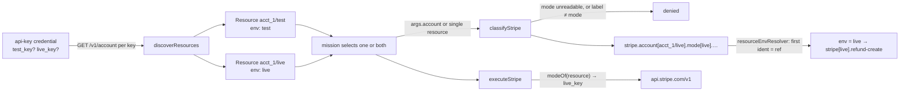

# Stripe provider — modelling and runtime

`@vaubaan/plugin-stripe` (version 0.4.0) on the v5 Plugin SDK (feature
P1.2e). Contract : ADR [[plugin-contract-and-credential-spec]] ; what the
executor declines : ADR
[`plugin-arguments-closed-surface-and-typed-refusals`](../../decisions/plugin-arguments-closed-surface-and-typed-refusals.md)
D3 ; spec
[`vaubaan-gateway.md`](../../spec/vaubaan-gateway.md) §3.2, §5 and
[`gateway-risk-model.md`](../../spec/gateway-risk-model.md) §2, §4, §7.
Contributor-facing details (fields, tools list, preset table) :
[`plugins/stripe/README.md`](../../../plugins/stripe/README.md).

## What changed from v4

| v4                                                                              | v5                                                                                            |
| ------------------------------------------------------------------------------- | --------------------------------------------------------------------------------------------- |
| One raw key per project in `stripe_bindings`, self-contained path in `build.ts` | One `api-key` credential with two optional secrets (`test_key`, `live_key`), run by the host  |
| `ProviderBinding` with `environment: 'test' \| 'live'`                          | One `Resource` per mode : `acct_1/test`, `acct_1/live`, `env` = mode                          |
| `classifyStripeV4(tool, args, bindings)`                                        | `classifyStripe(tool, args, resources)` ; optional `account` argument names the resource      |
| `risk-catalog.ts` twin + sync test                                              | YAML loaded by `loadCatalogFile` at boot ; twin and sync test deleted                         |
| No `acceptable_in_envs` → `stripe[live].*` never resolved                       | Every risk env-scoped on `[test, live]` ; presets reference `stripe[live].refund-create` etc. |
| 25 tools                                                                        | 27 : `create_payout` and `delete_customer` added, each behind its own irreversible risk       |
| No presets                                                                      | `read-only`, `test-mode-developer`, `finance-operator`                                        |

The v4 surface (the adapter, the binding-based classifier wrapper, the
25-tool list and the deprecated aliases of `index.ts`) is deleted ; the
plugin exports only the v5 surface below. The v4 classifier and dispatcher
suites were ported to `classifyStripe` and `stripePlugin.execute`
(`tests/unit/classify.test.ts`, `tests/unit/execute.test.ts`).

## Layout

```
plugins/stripe/src/
  resources.ts        STRIPE_MODES, stripeResourceRef, modeOf, resolveStripeResource, keyMatchesMode,
                      STRIPE_ID / stripeId, readIdArgs, STRIPE_ACCOUNT_REF / stripeAccountRef
  tools.ts            27 McpToolDeclaration (+ `account` arg), declaredArgsOf
  classify.ts         classifyStripe — pure, (tool, args, resources) → slices | denied
  execute.ts          executeStripe, discoverStripeResources, STRIPE_API_BASE
  data-model.ts       plane `billing`, 22 entities, `mode` envScopable
  risk-catalog.yaml   16 risks + fallback, 3 presets, catalog_version 4
  index.ts            definePlugin(...) → stripePlugin (default export)
```

## Resources and the mode



- `modeOf(resource)` reads, in order : the ref suffix (`/test`, `/live`),
  then `metadata.mode` — both written by discovery from the key itself. The
  `env` label is never a source of the mode. The classifier and `execute`
  both refuse a resource whose mode cannot be determined
  (`account: cannot determine the test/live mode of '<ref>'` from the
  classifier ; `execute` declines with the same text under the `stripe:`
  prefix instead of `account:`).
- **The label must equal the mode.** Every Stripe risk is env-scoped on
  `[test, live]` and the engine qualifies it from the resource's `env`
  label, while `execute` picks the key from the mode. The classifier
  refuses a resource whose label is not its mode (absent, `production`, or
  the other mode), so a live call can never be judged as
  `stripe[test].refund-create`. The plugin declares no `envOf` hook : the
  label discovery wrote is the environment, and this check keeps it honest.
  Should a slice reach the engine on an unlabelled resource anyway, the
  engine refuses it (an env-scoped risk touched outside its
  `acceptable_in_envs` refuses the call — `policy.test.ts` pins both
  layers).
- `resolveStripeResource` : explicit `account` ref must read as a resource
  ref (`stripeAccountRef`) and be one of the mission's Stripe resources ;
  absent, the mission's single Stripe resource ; otherwise `denied`
  (ambiguous, none, unknown, malformed). `classify` and `execute` call the
  same function.
- The host keeps a plugin-set label read-only. If the label of a Stripe
  resource were changed anyway, the key `execute` uses would not move and
  every call on that resource would be refused. The mode is a fact of the
  key, not an owner's label.

## Classifier conventions

All slices are rooted at `account[<ref>].mode[<mode>]`.

**Identifiers.** One grammar function per kind, in `resources.ts`, read by
`classify` and by `execute` alike ; a value outside its grammar is refused,
never escaped (ADR
[`plugin-identifiers-one-grammar-for-classify-and-execute`](../../decisions/plugin-identifiers-one-grammar-for-classify-and-execute.md)).

| Argument                                                    | Grammar                                                                           | Where it lands                             | Outside the grammar                                                                              |
| ----------------------------------------------------------- | --------------------------------------------------------------------------------- | ------------------------------------------ | ------------------------------------------------------------------------------------------------ |
| `id`                                                        | `stripeId` — `STRIPE_ID = ^[A-Za-z0-9][A-Za-z0-9_.-]{0,254}$`                     | URL path segment (as it is), slice ident   | `denied` `id: malformed identifier` ; `execute` declines with `stripe: id: missing or malformed` |
| `product`, `customer`, `coupon`, `charge`, `payment_intent` | `stripeId`                                                                        | query string or form body, slice ident     | `denied` `<arg>: malformed identifier` ; `execute` declines with the same, prefixed `stripe:`    |
| `account`                                                   | `stripeAccountRef` — `STRIPE_ACCOUNT_REF = ^[A-Za-z0-9_-]{1,64}(/(test\|live))?$` | slice `account[<ref>]` ; never the request | `denied` `account: malformed ref`                                                                |

`readIdArgs` reads the six identifier arguments at once, for the classifier
(which turns each into a slice ident) and for `execute` (which sends
nothing when one is refused, whether it would have landed in the path, the
query or the body). An absent, `null` or empty optional identifier is the
glob `*`. `STRIPE_ID` covers the ids Stripe issues (`cus_…`, `pi_…`) and
the ids an account chooses for its products and coupons (`SUMMER-25`,
`com.example.pro`) ; its leading letter or digit rules out `.` and `..`,
which `encodeURIComponent` leaves untouched and a URL parser removes —
`/customers/..` would be sent as `/v1/`.

**Only declared arguments.** The properties of a tool's `inputSchema` are
its whole argument surface (`declaredArgsOf` in `tools.ts`). The classifier
refuses a call carrying any other key
(`expand: not an argument of 'stripe__list_invoices' — nothing classifies it`)
and `execute` forwards the declared ones only, so a Stripe parameter nobody
classified — `expand`, `collection_method`, an undeclared filter — neither
passes nor is silently dropped. The refusal is the classifier's own check
(a key outside `declaredArgsOf(tool)`), not the SDK's
`undeclaredArgumentDenial` ; `execute`, called alone, builds its request
from the declared arguments and never reads another. Declaring a new
property means deciding, in `classify.ts`, what it costs.

| Tool                                  | Slice(s)                                                                                                        |
| ------------------------------------- | --------------------------------------------------------------------------------------------------------------- |
| `list_customers`, `retrieve_customer` | `customer[C].R` **and** `customer[C].pii.R`                                                                     |
| `list_invoices`                       | `customer[C\|*].invoice[*].R` **and** `customer[C\|*].pii.R`                                                    |
| `list_charges`                        | `payment-intent[PI\|*].charge[*].R` **and** `customer[C\|*].pii.R`                                              |
| `list_payment_intents`                | `payment-intent[*].R` **and** `customer[C\|*].pii.R`                                                            |
| `list_subscriptions`                  | `customer[C\|*].subscription[*].R` (a subscription names its customer by id only)                               |
| `list_events`                         | `event[*].R`, `balance-transaction[*].R` **and** `customer[*].pii.R` unless `type` is a family without customer |
| `create_subscription`                 | `customer[C].subscription.W` **and** `payment-intent.W`                                                         |
| `update_subscription`                 | `customer[*].subscription[S].W` ; with `cancel_at_period_end` or `cancel_at` set, **also** `….cancel.W`         |
| `pause_subscription`                  | `customer[*].subscription[S].W` (same risk as update ; declares no cancellation field)                          |
| `cancel_subscription`                 | `customer[*].subscription[S].cancel.W`                                                                          |
| `create_invoice`                      | `customer[C].invoice.W` ; with `auto_advance` set, **also** `customer[C].invoice[*].finalize.W`                 |
| `finalize_invoice` / `void_invoice`   | `customer[*].invoice[I].finalize.W` / `….void.W`                                                                |
| `create_refund`                       | `payment-intent[PI\|*].charge[CH\|*].refund.W`                                                                  |
| `create_payout`                       | `payout.W`                                                                                                      |
| `delete_customer`                     | `customer[C].delete.W` (`id` required)                                                                          |
| `create_webhook_endpoint`             | `webhook-endpoint.W` **and** `webhook-endpoint[*].secret.W`                                                     |

The other tools map one-to-one on their entity (see `classify.ts`).

**Customer PII overlay.** `read-billing-history` is meant to be acceptable
without identities, so every read whose answer carries customer fields also
emits `customer[C].pii.R` : invoices (`customer_email`, `customer_name`,
`customer_address`), charges (`billing_details`, `receipt_email`), payment
intents (`receipt_email`, `shipping`) and events, which embed the whole
object they are about. `list_events` drops the overlay only when `type` is a
string naming a family without customer payload (`balance.`, `payout.`,
`product.`, `price.`, `plan.`, `coupon.`, `promotion_code.`) ; any other
value, a wildcard or no filter keeps it. The answer of a write (an invoice
returned by `create_invoice`) is not modelled as a read.

**Arguments that change the nature of a call.** "Absent or an explicit no"
is the only reading that does not add the stronger slice :
`cancel_at_period_end` other than `false`, or a non-empty `cancel_at`, makes
`update_subscription` a cancellation ; `auto_advance` other than `false`
makes `create_invoice` a finalization (Stripe finalizes and collects on its
own). `execute` sends `auto_advance=false` when the call does not set it, so
a draft is a draft whatever default the account's API version applies.

A slice may touch more than the entry named after it : a trailing `[**]`
matches zero identifiers and deeper paths alike, so `subscription.W`
(creation) touches `subscription-create` **and** `subscription-update`,
`subscription[S].cancel.W` touches `subscription-update` **and**
`subscription-cancel`, `customer[C].pii.R` touches `read-billing-history`
**and** `read-customer-pii`, and `webhook-endpoint[*].secret.W` touches
`webhook-endpoint-write` **and** `mint-webhook-secret`
(`risk-catalog.test.ts` pins the exact sets).

## Catalog and presets

16 named risks + `stripe.uncategorized-write`, all with
`acceptable_in_envs: [test, live]` (the fallback too, so a test-mode preset
never accepts a live write). `refund-create` and `payout-create` (the two
money-out actions) carry the rate ceiling `infra_limits.calls_per_minute_max: 30`, the one
catalog limit the gateway enforces; no entry declares `caps` (the door has no cap stage,
see [the ADR](../../decisions/scope-caps-not-enforced-in-v5-0.md)): a mission bounds them
with its quota and rate limit. `subscription-create`
matches both slices of `create_subscription` (`customer[C].subscription.W`
and the bare `payment-intent.W` of the immediate charge) since catalog v3 :
the second used to reach only the fallback. The fallback pattern
`stripe.[**].W` (`fallback: true`) counts only when no dedicated entry
matched a write (ADR [[fallback-risk-only-when-uncategorized]]) : no preset
includes it (P1.2-align removed `stripe[<mode>].uncategorized-write` from
`test-mode-developer` and `finance-operator`), and its appearance in an audit
log means a catalog entry is missing.

Presets : `read-only` (no PII : catalog, subscriptions, balance and the
events of a family without customer payload — no customer, invoice, charge
or payment-intent read, since their answers carry customer fields),
`test-mode-developer` (everything on `[test]`, `auto`), `finance-operator`
(`[live]` ; `approval` on refund, payout, customer deletion, subscription
cancel, invoice void ; no catalog or webhook write). Values are a starting
point — ADR `mission-presets-default-values` is deferred.

`policy.test.ts` runs every tool through the classifier, the YAML catalog
and the engine's `evaluateCall` for each preset : what the preset describes
is allowed on the mode it names and refused on the other, and no allowed
call touches the fallback.

## Execute

Stripe takes form-urlencoded bodies with bracket notation
(`items[0][price]=…`) and query parameters on GET ; `ROUTES` in
`execute.ts` maps each tool to method + path, with the id in the path and
removed from the body. Only the arguments the tool declares are forwarded ;
`account` is consumed by the gateway. The path id is interpolated as it is.

**What the executor declines is an `isError` result, never a throw.** The
body of `executeStripe` runs under the SDK's `declining` : an account
outside the mission or ambiguous, a resource whose mode cannot be
determined, a mode the connection holds no key for, a path id that is
missing or not a `stripeId`, any other identifier argument `readIdArgs`
refuses — each is thrown inside as `ExecutorRefusal` and comes out as the
result carrying `stripe: <reason>`, before any request. An unknown tool is
the same kind of result (`refusalResult`) ; a tool name that is only an
inherited property (`constructor`) is unknown. What Stripe fails is thrown :
401/403 → `UpstreamAuthError`, any other failed status → `UpstreamHttpError`.
Discovery refuses a `GET /v1/account` answer without an account id.

## How to debug

- **`account: argument missing and the mission touches 2 Stripe resources — name one`**
  — the mission holds test and live ; the agent must pass `account`.
- **`this connection has no live-mode key`** — the mission selected the live
  resource of a connection whose credential has only `test_key` ; that
  resource should not exist (discovery creates one per key) : re-run
  discovery. Like every refusal of the executor it is an `isError` result :
  the audit shows no `upstream_error`, nothing was sent to Stripe.
- **`stripe: test_key must be a test-mode key (sk_test_… or rk_test_…)`** — the owner pasted a live key in
  the test field.
- **`<arg>: not an argument of '<tool>' — nothing classifies it`** — the
  agent passed a Stripe parameter the tool does not declare (`expand`, an
  extra filter). Declare it in `tools.ts` and classify it, or drop it.
- **`account: '<ref>' is a live-mode resource but its environment label is not 'live'`**
  — the stored label of the resource no longer matches the mode of its key ;
  re-run discovery on the connection.
- **`list_invoices` refused with `stripe[live].read-customer-pii` missing**
  — invoices, charges, payment intents and unfiltered events carry customer
  fields ; the mission needs the PII risk, which `read-only` leaves out.
- **A write is refused with `stripe[test].uncategorized-write` missing** —
  the tool classifies to a slice no dedicated entry covers : add the catalog
  entry (the fallback is never part of a preset).

## Tests

`npx vitest run plugins/stripe` — 219 : `plugin.test.ts` (31 : kit,
resource resolution, execute, discovery, credential, presets),
`classify.test.ts` (48 : the security suite of `classifyStripe`),
`policy.test.ts` (30 : classifier + catalog + `evaluateCall` — stronger
risk on `cancel_at*` / `auto_advance`, PII overlay, mode resolution, the
three presets on test and live), `execute.test.ts` (23 : REST routing,
form-encoding and declared-only forwarding through `stripePlugin.execute`),
`risk-catalog.test.ts` (20 : invariants, catalog v4, exact risk sets, no
preset on the fallback), `identifiers.test.ts` (59 : the grammars, then
hostile `id`, query / body identifiers and `account` fed to `classify` and
to `execute`), `data-model.test.ts` (8).
