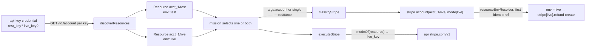

# Stripe provider — modelling and runtime

`@vaubaan/plugin-stripe` on the v5 Plugin SDK (feature P1.2e). Contract :
ADR [[plugin-contract-and-credential-spec]] ; spec
[`vaubaan-gateway.md`](../../spec/vaubaan-gateway.md) §3.2, §5 and
[`gateway-risk-model.md`](../../spec/gateway-risk-model.md) §2, §4, §7.
Contributor-facing details (fields, tools list, preset table) :
[`plugins/stripe/README.md`](../../../plugins/stripe/README.md).

## What changed from v4

| v4                                                                              | v5                                                                                            |
| ------------------------------------------------------------------------------- | --------------------------------------------------------------------------------------------- |
| One raw key per project in `stripe_bindings`, self-contained path in `build.ts` | One `api-key` credential with two optional secrets (`test_key`, `live_key`), run by the host  |
| `ProviderBinding` with `environment: 'test' \| 'live'`                          | One `Resource` per mode : `acct_1/test`, `acct_1/live`, `env` = mode                          |
| `classifyStripeV4(tool, args, bindings)`                                        | `classifyStripe(tool, args, resources)` ; optional `account` argument names the resource      |
| `risk-catalog.ts` twin + sync test                                              | YAML loaded by `loadCatalogFile` at boot ; twin and sync test deleted                         |
| No `acceptable_in_envs` → `stripe[live].*` never resolved                       | Every risk env-scoped on `[test, live]` ; presets reference `stripe[live].refund-create` etc. |
| 25 tools                                                                        | 27 : `create_payout` and `delete_customer` added, each behind its own irreversible risk       |
| No presets                                                                      | `read-only`, `test-mode-developer`, `finance-operator`                                        |

The v4 surface (the adapter, the binding-based classifier wrapper, the
25-tool list and the deprecated aliases of `index.ts`) is deleted ; the
plugin exports only the v5 surface below. The v4 classifier and dispatcher
suites were ported to `classifyStripe` and `stripePlugin.execute`
(`tests/unit/classify.test.ts`, `tests/unit/execute.test.ts`).

## Layout

```
plugins/stripe/src/
  resources.ts        STRIPE_MODES, stripeResourceRef, modeOf, resolveStripeResource, keyMatchesMode
  tools.ts            27 McpToolDeclaration (+ `account` arg)
  classify.ts         classifyStripe — pure, (tool, args, resources) → slices | denied
  execute.ts          executeStripe, discoverStripeResources, STRIPE_API_BASE
  data-model.ts       plane `billing`, 22 entities, `mode` envScopable
  risk-catalog.yaml   16 risks + fallback, 3 presets, catalog_version 3
  index.ts            definePlugin(...) → stripePlugin (default export)
```

## Resources and the mode



- `modeOf(resource)` reads, in order : the ref suffix (`/test`, `/live`),
  `metadata.mode`, then the owner's `env` label on the resource.
  `execute` refuses a resource whose mode cannot be determined ; the
  classifier emits `mode[*]` for it (harmless : patterns use `mode[**]`,
  env resolution comes from the ref).
- `resolveStripeResource` : explicit `account` ref must be one of the
  mission's Stripe resources ; absent, the mission's single Stripe resource
  ; otherwise `denied` (ambiguous, none, unknown, malformed).
- Relabelling `env` in the UI does not change the key `execute` uses, but it
  breaks `stripe[live].*` qualification (the catalog accepts `test` and
  `live` only). The mode is a fact of the key, not an owner's label.

## Classifier conventions

All slices are rooted at `account[<ref>].mode[<mode>]`. Identifiers from the
arguments must match `SAFE_IDENT` (`[a-zA-Z0-9_./~-]+`) ; a malformed one
is `denied`, an absent optional one is the glob `*`.

| Tool                                  | Slice(s)                                                    |
| ------------------------------------- | ----------------------------------------------------------- |
| `list_customers`, `retrieve_customer` | `customer[C].R` **and** `customer[C].pii.R`                 |
| `list_events`                         | `event[*].R` and `balance-transaction[*].R`                 |
| `create_subscription`                 | `customer[C].subscription.W` **and** `payment-intent.W`     |
| `pause_subscription`                  | `customer[*].subscription[S].W` (same risk as update)       |
| `cancel_subscription`                 | `customer[*].subscription[S].cancel.W`                      |
| `finalize_invoice` / `void_invoice`   | `customer[*].invoice[I].finalize.W` / `….void.W`            |
| `create_refund`                       | `payment-intent[PI\|*].charge[CH\|*].refund.W`              |
| `create_payout`                       | `payout.W`                                                  |
| `delete_customer`                     | `customer[C].delete.W` (`id` required)                      |
| `create_webhook_endpoint`             | `webhook-endpoint.W` **and** `webhook-endpoint[*].secret.W` |

The other tools map one-to-one on their entity (see `classify.ts`).

## Catalog and presets

16 named risks + `stripe.uncategorized-write`, all with
`acceptable_in_envs: [test, live]` (the fallback too, so a test-mode preset
never accepts a live write). `refund-create` and `payout-create` carry
`caps` + `infra_limits` (the two money-out actions). `subscription-create`
matches both slices of `create_subscription` (`customer[C].subscription.W`
and the bare `payment-intent.W` of the immediate charge) since catalog v3 :
the second used to reach only the fallback. The fallback pattern
`stripe.[**].W` (`fallback: true`) counts only when no dedicated entry
matched a write (ADR [[fallback-risk-only-when-uncategorized]]) : no preset
includes it (P1.2-align removed `stripe[<mode>].uncategorized-write` from
`test-mode-developer` and `finance-operator`), and its appearance in an audit
log means a catalog entry is missing.

Presets : `read-only` (no PII, hence no customer reads), `test-mode-developer`
(everything on `[test]`, `auto`), `finance-operator` (`[live]` ; `approval`
on refund, payout, customer deletion, subscription cancel, invoice void).
Values are a starting point — ADR `mission-presets-default-values` is
deferred.

## Execute

Stripe takes form-urlencoded bodies with bracket notation
(`items[0][price]=…`) and query parameters on GET ; `ROUTES` in
`execute.ts` maps each tool to method + path, with the id in the path and
removed from the body. 401/403 → `UpstreamAuthError`. The `account`
argument is stripped before the call. Unknown tool → `isError` result.

## How to debug

- **`account: argument missing and the mission touches 2 Stripe resources — name one`**
  — the mission holds test and live ; the agent must pass `account`.
- **`this connection has no live-mode key`** — the mission selected the live
  resource of a connection whose credential has only `test_key` ; that
  resource should not exist (discovery creates one per key) : re-run
  discovery.
- **`stripe: test_key must be a test-mode key (sk_test_… or rk_test_…)`** — the owner pasted a live key in
  the test field.
- **A write is refused with `stripe[test].uncategorized-write` missing** —
  the tool classifies to a slice no dedicated entry covers : add the catalog
  entry (the fallback is never part of a preset).

## Tests

`npx vitest run plugins/stripe` — 110 : `plugin.test.ts` (28 : kit,
resource resolution, execute, discovery, credential, presets),
`classify.test.ts` (41 : the security suite of `classifyStripe`),
`execute.test.ts` (17 : REST routing and form-encoding through
`stripePlugin.execute`), `risk-catalog.test.ts` (16 : invariants, catalog v3,
no preset on the fallback), `data-model.test.ts` (8).
