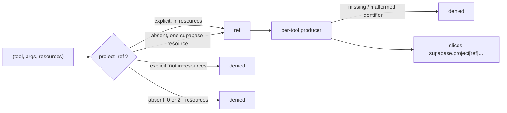

# Supabase provider

`@vaubaan/plugin-supabase` (`plugins/supabase`), on `@vaubaan/plugin-sdk`
since P1.2c. Spec : [`vaubaan-gateway.md`](../../spec/vaubaan-gateway.md)
§5, [`gateway-risk-model.md`](../../spec/gateway-risk-model.md) §2, §4, §7.
ADR : [[plugin-contract-and-credential-spec]]. Contributor view :
[`plugins/supabase/README.md`](../../../plugins/supabase/README.md). The v4
modelling rationale (research, edge cases) is preserved in git history
(`docs/handbook/providers/supabase.md` before 2026-10-13).

## Shape

| Member              | Where                                               | Facts                                                                                                              |
| ------------------- | --------------------------------------------------- | ------------------------------------------------------------------------------------------------------------------ |
| `id` / `version`    | `src/index.ts`                                      | `supabase`, `1.0.0`. Default export `supabasePlugin`.                                                              |
| `tools`             | `src/tools.ts`                                      | 44, prefix `supabase__`. The three v4 `*_to_venv` tools are gone (plan §8-Q5).                                     |
| `dataModel`         | `src/data-model.ts`                                 | 4 planes (`db`, `storage`, `auth`, `functions`) rooted on `project` (`envScopable`).                               |
| `catalog`           | `src/risk-catalog.yaml`                             | `catalog_version: 1`, 24 risks + `supabase.uncategorized-write`, 3 presets. Loaded by `loadCatalogFile` at import. |
| `credential`        | `src/credential.ts`                                 | `oauth2`, PKCE, `client_secret_basic`, scope `all`, `refreshable: true`.                                           |
| `classify`          | `src/classify.ts`                                   | Pure ; v4 emission rules kept, identifiers validated, missing identifiers denied.                                  |
| `execute`           | `src/execute.ts`                                    | Management API + per-project data plane ; `UpstreamAuthError` on 401/403 ; `fetch` and `signal` from the context.  |
| `discoverResources` | `src/execute.ts`                                    | One `Resource` per project of every organization, capped at 200.                                                   |
| `refresh`           | —                                                   | None : the standard `refresh_token` grant (Basic client auth) is performed by the host from the spec (P1.2-align). |
| legacy              | `src/risk-classifier.ts`, `src/supabase-adapter.ts` | `classifySupabaseV4(bindings)` and `SupabaseAdapter` as `@deprecated` shims over the v5 code ; deleted in P1.6.    |

## Classification rules

- **Cardinality markers** are literal identifiers : `row[one]` / `row[bulk]`,
  `object[one]` / `object[bulk]`, `user[one]` / `user[bulk]`. Catalog
  patterns use the same literals (`row-write-one` vs `bulk-row-write` are
  mutually exclusive). `any` stands for a value that does not matter for the
  risk ; the catalog uses `[*]` there.
- **`execute_sql` → `schema[any].row[bulk].R`, always.** Enforced at
  execution by the Management API read-only endpoint
  (`/database/query/read-only`) ; `list_tables` and `list_migrations` use it
  too. Nothing writes rows one by one today : `row-write-one` stays in the
  catalog for a future tool and no preset carries it.
- **`apply_migration`** → `schema[any].table[any].W`, plus `row[bulk].W` on a
  DML keyword, plus `policy[any].W` on a policy / RLS statement.
- **Cascades** : `delete_bucket` adds `object[bulk].W` ; `deploy_function`
  with files adds `edge-function[slug].W`.
- **Identifiers** must match `[a-zA-Z0-9_.@+:/~-]+` (emails, phone numbers,
  `dir/file.png` and secret names fit) ; a missing or malformed required
  identifier is a denial, never `any`.

## Catalog decisions (v5)

- Ids are the v4 ids, unchanged. **Every write risk is env-scoped**
  (`acceptable_in_envs`) ; the three bulk risks are acceptable on `preview`
  and `staging` only (a bulk write on a prod project is refused
  structurally). Reads are account-scoped except `auth.read-users` (PII).
- The fallback `supabase.uncategorized-write` is env-scoped and **counts only
  when no specific entry matched** the write (policy-engine rule, P1.2-SDK) ;
  no preset carries it.
- Presets : `read-only-analyst` (read-data, object-read), `staging-developer`
  (reads everywhere, every write on `[staging]`, `auto`), `migration-operator`
  (`[staging]` migrations auto ; `[prod]` migration-write and policy-write
  on `approval`). Values provisional until ADR
  `mission-presets-default-values`.

## Execution

- Management API base `https://api.supabase.com/v1` (constant of the plugin).
  Bearer = the OAuth access token.
- Data-plane tools (users, buckets, objects, signed URLs) first read the
  project `service_role` key from `/projects/{ref}/api-keys`, then call
  `https://{ref}.supabase.co/{auth|storage}/v1/...` with it as Bearer and
  `apikey`. The key is never returned ; `get_anon_key` strips it.
- 204 → `{ ok: true }` text result ; unknown tool → `isError` result without
  any call ; wrong credential kind → `CredentialKindMismatch` before any call.

## Credential and discovery

The company registers an OAuth app in its Supabase organization (dashboard →
OAuth Apps) with the instance callback URL, and enters the client id and
secret in the instance configuration. The host runs the authorization-code
flow from `supabaseCredential` and the refresh : Supabase's is the standard
RFC 6749 `refresh_token` grant with Basic client authentication, so the
plugin declares `refreshable: true` and implements nothing (P1.2-align
removed `refreshSupabaseCredential` and `shouldRefreshSupabaseCredential`).
`REFRESH_THRESHOLD_MS` (60 s) survives for the legacy v4 adapter only.
`discoverResources` reads `/organizations` and `/projects` (unpaged upstream,
capped at `MAX_DISCOVERED_PROJECTS` with a logger warning) and returns
`{ ref, displayName: "<org> / <project>", metadata: { organization,
organization_name, region, status } }` ; the owner labels `env`.

## Tests

`npx vitest run plugins/supabase` — 120 tests : `plugin.test.ts` (26 : SDK
kit with one sample per tool, presets, credential spec, execute and
discovery against `mockFetch`), `risk-catalog.test.ts`
(33 : loaded catalog lint, coverage, cardinality exclusion, spot checks),
`risk-classifier.test.ts` (30, v4 suite unchanged through the shim),
`adapter.test.ts` (30, v4 suite unchanged), `data-model.test.ts` (1).

## How to debug

- **`Invalid risk catalog` at boot** — read every bullet ; paths are exact.
  An env-qualified preset entry on a risk without `acceptable_in_envs` is
  the usual cause after adding a risk.
- **A write is refused with `risk-not-accepted` on `uncategorized-write`** —
  the tool emits a slice no fine-grained entry covers : add the catalog
  entry rather than accepting the fallback.
- **`assertCatalogCoverage` lists a new untouched risk** — either the tool's
  sample is missing in `plugin.test.ts` or the pattern does not match the
  emitted slice (compare with `serializeSlice` output in
  `risk-classifier.test.ts`).
- **`mockFetch: unexpected POST …/database/query`** — a read tool must use
  `/database/query/read-only` ; only `apply_migration` posts elsewhere.
