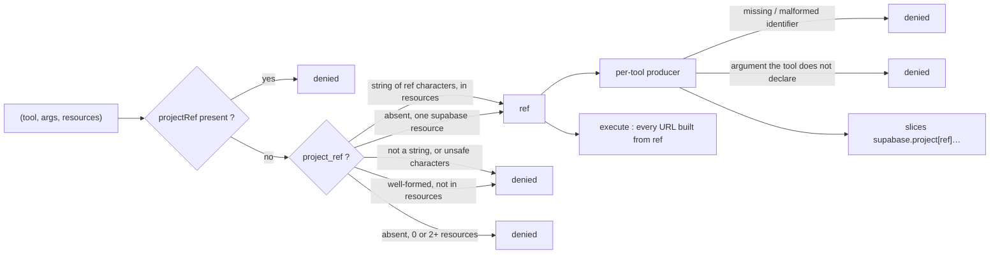

# Supabase provider

`@vaubaan/plugin-supabase` (`plugins/supabase`), on `@vaubaan/plugin-sdk`
since P1.2c. Spec : [`vaubaan-gateway.md`](../../spec/vaubaan-gateway.md)
§5, [`gateway-risk-model.md`](../../spec/gateway-risk-model.md) §2, §4, §7.
ADRs : [[plugin-contract-and-credential-spec]],
[`plugin-identifiers-one-grammar-for-classify-and-execute`](../../decisions/plugin-identifiers-one-grammar-for-classify-and-execute.md),
[`plugin-arguments-closed-surface-and-typed-refusals`](../../decisions/plugin-arguments-closed-surface-and-typed-refusals.md).
Contributor view :
[`plugins/supabase/README.md`](../../../plugins/supabase/README.md). The v4
modelling rationale (research, edge cases) is preserved in git history
(`docs/handbook/providers/supabase.md` before 2026-10-13).

## Shape

| Member              | Where                   | Facts                                                                                                                                                                                                           |
| ------------------- | ----------------------- | --------------------------------------------------------------------------------------------------------------------------------------------------------------------------------------------------------------- |
| `id` / `version`    | `src/index.ts`          | `supabase`, `3.0.0`. Default export `supabasePlugin`.                                                                                                                                                           |
| `tools`             | `src/tools.ts`          | 44, prefix `supabase__`. The three v4 `*_to_venv` tools are gone (plan §8-Q5).                                                                                                                                  |
| `dataModel`         | `src/data-model.ts`     | 4 planes (`db`, `storage`, `auth`, `functions` : 14 / 6 / 8 / 6 entities, 34 in all) rooted on `project` (`envScopable`).                                                                                       |
| `catalog`           | `src/risk-catalog.yaml` | `catalog_version: 3`, 23 live risks + the deprecated `supabase.row-write-one` + `supabase.uncategorized-write`, 3 presets. Loaded by `loadCatalogFile` at import.                                               |
| `credential`        | `src/credential.ts`     | `oauth2`, PKCE, `client_secret_basic`, scope `all`, `refreshable: true`.                                                                                                                                        |
| `classify`          | `src/classify.ts`       | Pure ; identifiers validated, missing identifiers denied, undeclared arguments denied. Exports `resolveProjectRef`, `readIdentifiers` and `tableSchemas`, which `execute` shares, and the grammar `base64Text`. |
| migration reading   | `src/migration-sql.ts`  | Pure allow-list reader of the SQL of `apply_migration` : the write classes it takes, every class when a statement is not recognised.                                                                            |
| `execute`           | `src/execute.ts`        | Management API + per-project data plane ; `UpstreamAuthError` on 401/403 ; `fetch` and `signal` from the context ; target from `resolveProjectRef`, identifiers from `readIdentifiers`.                         |
| `discoverResources` | `src/execute.ts`        | One `Resource` per project of every organization, capped at 200.                                                                                                                                                |
| `refresh`           | —                       | None : the standard `refresh_token` grant (Basic client auth) is performed by the host from the spec (P1.2-align).                                                                                              |

## Classification rules

- **One project resolution.** `resolveProjectRef(args, resources)`
  (`src/classify.ts`) is called by `classifySupabase` and, with
  `ctx.resources`, by `executeSupabase` ; `execute` builds every URL from its
  answer and never reads `args.project_ref`. A `project_ref` that is present
  must be a host label (`projectRefIdent` : lowercase letters, digits and
  inner hyphens, 63 characters at most — it becomes a path segment and the
  host label of `https://{ref}.supabase.co`) and one of the mission's
  Supabase resources ; an array, an object, a number or an unsafe string is a
  denial, never coerced and never skipped. The ref of the mission's single
  project goes through the same grammar. The camelCase `projectRef` is not
  an argument of any tool : a call carrying it is denied. When `execute`
  gets a denial it returns an `isError` result and sends nothing.
- **Cardinality markers** are literal identifiers : `row[bulk]`,
  `object[one]` / `object[bulk]`, `user[one]` / `user[bulk]`. Catalog
  patterns use the same literals (`storage.object-write-one` vs
  `storage.bulk-object-write` are mutually exclusive). `any` stands for a
  value that does not matter for the risk ; the catalog uses `[*]` there.
- **Only declared arguments.** After the project and the identifiers, the
  classifier calls the SDK's `undeclaredArgumentDenial` over the tool's input
  schema : an argument the schema does not declare is a denial,
  `<name>: not an argument of '<tool>' — nothing classifies it, so it is not sent.`
  `execute` builds most request bodies from the arguments, so an undeclared
  one would be priced by no rule and forwarded all the same. A call wrong on
  both counts is told about the identifier first. A tool name that is only
  an inherited property (`constructor`) is an unknown tool.
- **An identifier the slice grammar cannot carry is classified as "any".**
  Bucket ids, object paths, secret names and e-mail addresses may hold
  characters a slice has no place for (`@`, `+`, `:`). The value is still
  validated by its own grammar and still sent as it is ; in the slice it is
  written `[*]` (`isSliceIdent` of the SDK), so the slice reads back as
  itself and the call is classified on every instance of the entity. An
  e-mail address always holds `@` : `generate_link` emits
  `user[*].link[<type>].W`.
- **Single-user and single-object writes emit the marker slice alone** :
  `create_user`, `update_user`, `delete_user` → `user[one].W` ;
  `upload_object`, `delete_object` → `bucket[<id>].object[one].W`. The user
  id and the object path are validated (a malformed one is a denial) but are
  not slice segments : no catalog entry names an arbitrary id there, so the
  slice would land on the fallback, and an id spelled `bulk` would read as
  the bulk marker.
- **`execute_sql` → `schema[any].row[bulk].R`, always.** Enforced at
  execution by the Management API read-only endpoint
  (`/database/query/read-only`) ; `list_tables` and `list_migrations` use it
  too. Nothing writes rows one by one : `supabase.row-write-one` is
  `deprecated: true` (below). A `query` that is not a non-blank string is
  denied (and refused again by `execute`).
- **`apply_migration`** → `schema[any].table[any].W`, plus one slice per
  write class its SQL takes — see "Reading a migration" below.
- **Cascades** : `delete_bucket` adds `object[bulk].W`. `deploy_function`
  **always** emits two writes, `edge-function[slug].function-deployment[any].W`
  and `edge-function[slug].W` : a deployment replaces what runs (the code,
  in whatever shape the caller gave `files`) and how it is exposed
  (`verify_jwt`, the entrypoint), which is what `update_function` prices as a
  body write. It touches `functions.deploy` and `functions.body-write`
  whether or not `files` is given ; a `files` that is not an array is a
  denial.
- **Identifiers** have one grammar per kind — see "Identifiers" below ; a
  missing or malformed required identifier is a denial, never `any`.
- **No sample lands on the fallback** : `plugin.test.ts` asserts
  `fallbackHits` of the SDK kit is empty.

### Identifiers

Every argument that lands in a URL path, a query string, a host, a header
or the SQL text the plugin writes is read by `readIdentifiers(tool, args)`
(and `tableSchemas(args)` for `list_tables`), with the grammar of its kind.
It is the only place that reads them : `classifySupabase` builds its slices
from the answer and `executeSupabase` its paths, query strings and headers,
never from `args` ; a JSON body is built from `args` once the same reader
has accepted the call, and holds declared arguments only (above). A value
outside its grammar is a denial (`<arg>: missing or malformed.`) and an
`isError` refusal before any request — never escaped, never replaced by
another argument (ADR
[`plugin-identifiers-one-grammar-for-classify-and-execute`](../../decisions/plugin-identifiers-one-grammar-for-classify-and-execute.md)).

| Argument                                                                    | Grammar                                                                                                                                                                          | Where it lands                                                                                                                                                                                |
| --------------------------------------------------------------------------- | -------------------------------------------------------------------------------------------------------------------------------------------------------------------------------- | --------------------------------------------------------------------------------------------------------------------------------------------------------------------------------------------- |
| `project_ref`, the project resource ref                                     | `projectRefIdent` — a host label : `[a-z0-9]`, inner hyphens, ≤ 63 characters                                                                                                    | URL path and host `https://{ref}.supabase.co`, slice `project[ref]`                                                                                                                           |
| `user_id`, `provider_id`, `tpa_id`, `function_slug`, `slug`                 | `pathIdent` — `PATH_IDENT = ^[A-Za-z0-9_-]{1,64}$`                                                                                                                               | URL path segment, as it is — except `slug`, never a path segment (`create_function` : JSON body ; `deploy_function` : query) ; slice ident, except `user_id` of `update_user` / `delete_user` |
| `type` of `create_sso_provider`, `create_third_party_auth`, `generate_link` | `pathIdent`                                                                                                                                                                      | JSON body ; slice ident                                                                                                                                                                       |
| `type` of `get_advisors`                                                    | closed set `security` \| `performance` (`security` when absent)                                                                                                                  | URL path segment                                                                                                                                                                              |
| bucket `id`, `bucket`                                                       | `bucketId` — one segment of `[A-Za-z0-9_.@+:~-]`, ≤ 100 characters, never dots alone                                                                                             | URL path segment, percent-encoded (`create_bucket` : JSON body) ; slice `bucket[id]`, or `bucket[*]` when the id holds `@`, `+` or `:`                                                        |
| object `path`                                                               | `objectPath` — `/`-separated segments of the same characters, none empty, none dots alone, ≤ 1024 characters                                                                     | URL path, each segment percent-encoded ; slice of `create_signed_url`                                                                                                                         |
| `email` of `generate_link`                                                  | `emailAddress` — a local part, one `@`, a dotted domain, ≤ 254 characters                                                                                                        | JSON body ; slice `user[*]` (an address always holds `@`)                                                                                                                                     |
| `content_type` of `upload_object`                                           | a media type (`image/png`, `text/plain; charset=utf-8`) ; `application/octet-stream` when absent                                                                                 | `Content-Type` request header                                                                                                                                                                 |
| `content_base64` of `upload_object`                                         | `base64Text` — a string of the standard base64 alphabet, padded or not, possibly empty ; a length no encoding produces (one symbol over a multiple of four) is refused. Required | the request body, decoded : the bytes stored                                                                                                                                                  |
| `page`, `per_page` of `list_users`                                          | a positive integer up to 1 000 000 (1 and 50 when absent)                                                                                                                        | query string                                                                                                                                                                                  |
| `schemas` of `list_tables`                                                  | `tableSchemas` — unquoted SQL identifiers `[A-Za-z_][A-Za-z0-9_$]{0,62}` ; `public` when absent or empty                                                                         | SQL text of the read-only query, between quotes as they are                                                                                                                                   |
| secret names (`create_function_secrets`, `delete_function_secrets`)         | slice-safe name, `[a-zA-Z0-9_.@+:/~-]{1,256}` — not a path identifier                                                                                                            | JSON body ; slice `function-secret[name]`, or `function-secret[*]` when the name holds `@`, `+` or `:`                                                                                        |

`create_bucket` names the bucket after `id`, and after `name` only when
`id` is absent : a malformed `id` is a denial, `name` is not a second
chance. `get_function` and `get_function_body` read `function_slug` only.
`content_base64` is read by the same reader as the identifiers because of
what the absence of a check would store : `String(undefined)` is six
characters of valid base64, and would be uploaded over the object.
Why refuse rather than escape : `encodeURIComponent` leaves `.` and `..`
untouched and a URL parser removes them, so `delete_function` with `..`
would be classified as a function write and sent to the project endpoint,
and a `delete_object` path with a `..` segment would leave its bucket.

### Reading a migration

A migration is arbitrary SQL run as the database owner. `readMigrationSql`
(`src/migration-sql.ts`) is not a parser and not a keyword filter : it is an
**allow-list**. It strips comments and literals, splits on `;`, and
recognises a statement only when its leading keywords name one of the shapes
below and nothing in it can embed another command. A line comment (`--`)
ends at `\n` **or** `\r`, as it does for PostgreSQL : waiting for `\n` alone
would hide from the reader everything after a bare carriage return, which
the server executes.

| Slice added to `schema[any].table[any].W` | Risk              | Recognised statements                                                                                                                                                                                                                                                                  |
| ----------------------------------------- | ----------------- | -------------------------------------------------------------------------------------------------------------------------------------------------------------------------------------------------------------------------------------------------------------------------------------- |
| none                                      | `migration-write` | `CREATE TABLE` (not `AS`), `ALTER TABLE` `ADD` / `ALTER` (not a type change) / `RENAME` / `VALIDATE` / `DROP CONSTRAINT`, `CREATE` / `DROP INDEX`, `CREATE SCHEMA`, `CREATE SEQUENCE`, `CREATE TYPE … AS`, `DROP SEQUENCE` / `TYPE` without `CASCADE`, `COMMENT ON`, `BEGIN`, `COMMIT` |
| `…table[any].row[bulk].W`                 | `bulk-row-write`  | `INSERT`, `UPDATE`, `DELETE`, `TRUNCATE`, `DROP TABLE`, `ALTER TABLE … DROP [COLUMN]`, `ALTER TABLE … ALTER [COLUMN] c [SET DATA] TYPE t [USING expr]`, `DROP SEQUENCE` / `TYPE … CASCADE`                                                                                             |
| `policy[any].W`                           | `policy-write`    | `CREATE` / `ALTER` / `DROP POLICY`, `ALTER TABLE … ENABLE` / `DISABLE` / `FORCE ROW LEVEL SECURITY`                                                                                                                                                                                    |
| `db-role[any].W`                          | `db-role-write`   | `GRANT`, `REVOKE`, `CREATE` / `ALTER` / `DROP ROLE` / `USER` / `GROUP`, `ALTER DEFAULT PRIVILEGES`                                                                                                                                                                                     |
| `extension[any].W`                        | `extension-write` | `CREATE` / `ALTER` / `DROP EXTENSION`                                                                                                                                                                                                                                                  |

**Anything else makes the whole migration unrecognised, and the classifier
then emits all five slices**, so the mission needs every one of the five
risks : `DO` blocks and any dollar-quoted text, function, procedure,
trigger, view and rule definitions, CTEs (`WITH`), a bare `SELECT` (it calls
functions), `MERGE`, `COPY`, `SET`, `PREPARE` / `EXECUTE`, `CREATE TABLE …
AS`, `PARTITION OF` / `INHERITS`, ownership changes, `DROP SCHEMA`, any
command not listed, prefixed strings (`E'…'`, `U&"…"`), a backslash inside a
string, a control character, an unterminated string or comment. A
table-level statement (DDL or DML, policies excepted) whose target sits in a
schema Supabase manages (`auth`, `storage`, `vault`, `cron`, `net`,
`extensions`, `pg_*`, `supabase_*`, …) is unrecognised too : writing
`auth.users` is not an application row write.

A column type change is a bulk row write because it rewrites the column in
every row, and `USING` overwrites the values with any expression : the same
loss as dropping the column. The reader looks for `TYPE` or `USING` as a
bare word anywhere after the column name of an `ALTER [COLUMN]` action (a
column called "type" is quoted, hence never a keyword) ; anything else that
happens to carry the word is priced as one too, the costly side.

Known limit, by construction : a recognised statement may evaluate an
expression (`DEFAULT f()`, `CHECK (…)`, `SET a = f()`) and so run a function
that already exists in the database. Creating such a function is never a
recognised statement.

## Catalog decisions (v5)

- Ids are the v4 ids, unchanged. **Every write risk is env-scoped**
  (`acceptable_in_envs`) ; reads are account-scoped except `auth.read-users`
  (PII). The three bulk risks (`bulk-row-write`, `storage.bulk-object-write`,
  `auth.bulk-user-write`) are acceptable on `preview` and `staging` only.
- The fallback `supabase.uncategorized-write` is env-scoped and **counts only
  when no specific entry matched** the write (policy-engine rule, P1.2-SDK) ;
  no preset carries it and no tool reaches it today.
- `db-role-write` and `extension-write` are reached through
  `apply_migration` (they had no tool before the migration reader).
- `supabase.row-write-one` is `deprecated: true` and matches no call : no
  tool writes rows one by one (`execute_sql` runs on the read-only endpoint,
  and a migration that writes rows is a bulk write). Accepting it grants
  nothing and it has no successor ; the entry stays so that the id resolves
  in the shares and missions that name it. No preset carries it (the loader
  refuses a deprecated risk in a preset).

### Environment rule : refused, not dropped

The policy engine (`packages/policy-engine/src/risk-runtime.ts`) refuses a
call that touches an env-scoped risk on a project whose environment label is
absent or outside the risk's `acceptable_in_envs`. The risk is not removed
from the touched set, and no mission can hold it there. For Supabase :

| Project label                 | What goes through                                                                                                   | What is refused, whatever the mission accepted                                                                                                                                                     |
| ----------------------------- | ------------------------------------------------------------------------------------------------------------------- | -------------------------------------------------------------------------------------------------------------------------------------------------------------------------------------------------- |
| none (owner has not labelled) | Account-scoped reads : `get_project`, `list_tables`, `execute_sql`, `list_buckets`, `list_objects`, config reads, … | **Every write**, and `list_users` / `get_user` (`auth.read-users` is env-scoped).                                                                                                                  |
| `prod`                        | Reads, and the writes whose risks list `prod`, when the mission accepted them on `[prod]`.                          | **Every bulk write** : a migration that writes rows, drops a table or a column or changes a column type, a migration the reader does not recognise (it touches `bulk-row-write`), `delete_bucket`. |
| `preview`, `staging`          | Everything the mission accepted for that label.                                                                     | —                                                                                                                                                                                                  |
| any other label (`dev`, …)    | Account-scoped reads.                                                                                               | Every write and user read : no Supabase risk lists that label.                                                                                                                                     |

Before this rule, `supabase__list_users` on an unlabelled project passed
with `read-data` alone, and a migration embedding DML on a prod project
passed with `migration-write` alone. Both are pinned as refusals in
`mission-evaluation.test.ts`, through the real catalog and `evaluateCall`
with the resolver the gateway builds.

So on prod a migration is limited to what the reader recognises as plain
schema changes and RLS statements. A function, a trigger, a backfill, a
dropped column or a column type change has to be shipped another way, or the
project is not `prod`.
The refusal hint names the risk and the environments it is acceptable in ;
the owner's remedy for an unlabelled project is to label it on the
Connections page.

### Presets

| Preset               | Entries                                                                                                                                                                                                                                                                                                                                                                                   | Allows                                                                                                                                                                                                          | Does not allow                                                                                                                    |
| -------------------- | ----------------------------------------------------------------------------------------------------------------------------------------------------------------------------------------------------------------------------------------------------------------------------------------------------------------------------------------------------------------------------------------- | --------------------------------------------------------------------------------------------------------------------------------------------------------------------------------------------------------------- | --------------------------------------------------------------------------------------------------------------------------------- |
| `read-only-analyst`  | `read-data`, `storage.object-read`                                                                                                                                                                                                                                                                                                                                                        | Queries, schema and config reads, bucket and object listing on every selected project, labelled or not.                                                                                                         | Any write, user listing, signed URLs, function reads.                                                                             |
| `staging-developer`  | `read-data`, `storage.object-read`, `functions.read` ; on `[staging]`, all `auto` : `auth.read-users`, `bulk-row-write`, `migration-write`, `policy-write`, `db-role-write`, `extension-write`, `bucket-write`, `storage.object-write-one`, `storage.bulk-object-write`, `auth.user-write-one`, `auth.generate-link`, `functions.body-write`, `functions.deploy`, `function-secret-write` | On staging : any migration (unrecognised ones included), buckets and objects, users one by one, links, edge functions and secrets, user listing. Reads of data, schema, objects and functions on every project. | Auth, storage, SSO and third-party-auth configuration, bulk user writes, signed URLs ; any write or user listing outside staging. |
| `migration-operator` | `read-data` ; on `[staging]`, `auto` : `migration-write`, `bulk-row-write`, `policy-write`, `db-role-write`, `extension-write` ; on `[prod]`, `approval` : `migration-write`, `policy-write`                                                                                                                                                                                              | Any migration on staging. On prod, plain schema changes and RLS statements, each behind an approval.                                                                                                            | On prod : row writes, dropped tables or columns, grants, extensions, functions, anything unrecognised. Every non-migration write. |

`db-role-write` and `extension-write` sit in the two migration presets
because an unrecognised migration (a function body, a trigger) touches all
five db write risks : without them the presets would refuse the ordinary
Supabase migration on staging. Each row of the table is asserted call by
call in `mission-evaluation.test.ts`. Values provisional until ADR
`mission-presets-default-values`.

## Execution

- Management API base `https://api.supabase.com/v1` (constant of the plugin).
  Bearer = the OAuth access token.
- **Fail closed** : `executeSupabase` first runs `classifySupabase(tool,
args, ctx.resources)` and returns whatever it denies as an `isError`
  result, before any request — the `service_role` key lookup included. That
  is also the second lock of the argument rule : a caller of `execute` that
  did not go through `classify` cannot add an undeclared argument to a body
  either. Every refusal of the executor is an `isError` result carrying the
  classifier's sentence ; nothing it declines is thrown.
- **Identifiers** : every path segment, query parameter and header value
  that names something comes from `readIdentifiers` / `tableSchemas` (see
  "Identifiers"). An opaque id or a slug is interpolated as it is ; a bucket
  id and the segments of an object path are percent-encoded.
- **Target project** : `executeSupabase` calls `resolveProjectRef(args,
ctx.resources)` — the classifier's function, with the mission's
  resources — and passes the resolved ref down. A denial (project outside
  the mission, non-string `project_ref`, `projectRef` alias, several
  projects and no ref) is an `isError` result with the classifier's message
  and zero request. Without `project_ref` and with one project in the
  mission, that project is called.
- Data-plane tools (users, buckets, objects, signed URLs) first read the
  project `service_role` key from `/projects/{ref}/api-keys`, then call
  `https://{ref}.supabase.co/{auth|storage}/v1/...` with it as Bearer and
  `apikey`. The key is never returned ; `get_anon_key` strips it.
- `execute_sql` and `apply_migration` with a `query` that is not a non-blank
  string are an `isError` result without any call ; so is `upload_object`
  without `content_base64`, or with one that is not base64 text. The upload
  sends the decoded bytes (an empty string stores an empty object).
- 204 → `{ ok: true }` text result ; unknown tool → `isError` result without
  any call ; wrong credential kind → `CredentialKindMismatch` before any call.

## Credential and discovery

The company registers an OAuth app in its Supabase organization (dashboard →
OAuth Apps) with the instance callback URL, and enters the client id and
secret in the instance configuration. The host runs the authorization-code
flow from `supabaseCredential` and the refresh : Supabase's is the standard
RFC 6749 `refresh_token` grant with Basic client authentication, so the
plugin declares `refreshable: true` and implements nothing (P1.2-align
removed `refreshSupabaseCredential` and `shouldRefreshSupabaseCredential`).
`discoverResources` reads `/organizations` and `/projects` (unpaged upstream,
capped at `MAX_DISCOVERED_PROJECTS` with a logger warning) and returns
`{ ref, displayName: "<org> / <project>", metadata: { organization,
organization_name, region, status } }` ; the owner labels `env`. A project
whose ref is not a host label (`projectRefIdent`) fails discovery : no call
could name it.

## Tests

`npx vitest run plugins/supabase` — 1613 tests : `plugin.test.ts` (22 : SDK
kit with samples per tool and `fallbackHits` empty, presets, credential
spec, execute and discovery against `mockFetch`), `risk-catalog.test.ts`
(44 : loaded catalog lint, coverage without the fallback, exact risks of the
single-user / single-object writes and of migrations, cardinality exclusion,
spot checks), `classify.test.ts` (133 : the security suite of
`classifySupabase`, including the adversarial SQL table — the comment that
ends at a carriage return, the column type changes —, the project-ref
denials, the two writes of `deploy_function`, the undeclared arguments and
the identifiers written as `[*]`), `execute.test.ts` (42 : request shapes
sent to the Management API and the per-project data plane, the
target-project resolution — zero request on a denial —, and the body built
from declared arguments only, `upload_object` included), `mission-evaluation.test.ts` (34 : the engine decision
through the real catalog — unlabelled project, bulk writes on prod, each
preset call by call), `identifier-injection.test.ts` (1337 : hostile values
in every identifier position of `classify` and `execute`, the dot-segment
reproductions, one argument per target, legitimate dotted names, the query
strings and SQL text the plugin builds, the project ref as a host label),
`data-model.test.ts` (1).

## How to debug

- **`Invalid risk catalog` at boot** — read every bullet ; paths are exact.
  An env-qualified preset entry on a risk without `acceptable_in_envs` is
  the usual cause after adding a risk.
- **A write is refused with `risk-not-accepted` on `uncategorized-write`** —
  the tool emits a slice no fine-grained entry covers : add the catalog
  entry rather than accepting the fallback.
- **Refused with "is touched on a resource with no environment label"** —
  the project is not labelled : the owner labels it on the Connections
  page. **"… labelled 'prod', but is acceptable only in [preview,
  staging]"** — a bulk write on prod ; nothing to accept, restrict the
  operation.
- **A migration asks for `db-role-write`, `extension-write`,
  `policy-write` and `bulk-row-write` at once** — one statement is not on
  the allow-list of `migration-sql.ts` (a `$$` body, a CTE, `SET`, a
  command not listed). Split the migration, or run it where the mission
  holds the five risks.
- **`projectRef: unknown argument`** — the tool argument is `project_ref`.
- **`<name>: not an argument of '<tool>'`** — the call carries an argument
  the tool's schema does not declare (a field of Supabase's own API, a
  typo). Remove it ; to support it, declare it in `tools.ts` and classify it.
- **A slice shows `bucket[*]`, `user[*]` or `function-secret[*]` for a call
  that named one** — the name holds a character the slice grammar cannot
  carry. The request still targets that one object ; the mission needs a
  pattern that covers every instance.
- **A migration that only changes a column type asks for `bulk-row-write`** —
  by design : the change rewrites every row (see "Reading a migration").
- **`assertCatalogCoverage` lists a new untouched risk** — either the tool's
  sample is missing in `plugin.test.ts` or the pattern does not match the
  emitted slice (compare with `serializeSlice` output in
  `classify.test.ts`).
- **`mockFetch: unexpected POST …/database/query`** — a read tool must use
  `/database/query/read-only` ; only `apply_migration` posts elsewhere.
