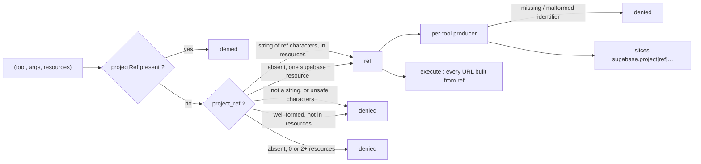

# Supabase provider

`@vaubaan/plugin-supabase` (`plugins/supabase`), on `@vaubaan/plugin-sdk`
since P1.2c. Spec : [`vaubaan-gateway.md`](../../spec/vaubaan-gateway.md)
§5, [`gateway-risk-model.md`](../../spec/gateway-risk-model.md) §2, §4, §7.
ADR : [[plugin-contract-and-credential-spec]]. Contributor view :
[`plugins/supabase/README.md`](../../../plugins/supabase/README.md). The v4
modelling rationale (research, edge cases) is preserved in git history
(`docs/handbook/providers/supabase.md` before 2026-10-13).

## Shape

| Member              | Where                   | Facts                                                                                                                                               |
| ------------------- | ----------------------- | --------------------------------------------------------------------------------------------------------------------------------------------------- |
| `id` / `version`    | `src/index.ts`          | `supabase`, `2.0.0`. Default export `supabasePlugin`.                                                                                               |
| `tools`             | `src/tools.ts`          | 44, prefix `supabase__`. The three v4 `*_to_venv` tools are gone (plan §8-Q5).                                                                      |
| `dataModel`         | `src/data-model.ts`     | 4 planes (`db`, `storage`, `auth`, `functions` : 14 / 6 / 8 / 6 entities, 34 in all) rooted on `project` (`envScopable`).                           |
| `catalog`           | `src/risk-catalog.yaml` | `catalog_version: 2`, 24 risks + `supabase.uncategorized-write`, 3 presets. Loaded by `loadCatalogFile` at import.                                  |
| `credential`        | `src/credential.ts`     | `oauth2`, PKCE, `client_secret_basic`, scope `all`, `refreshable: true`.                                                                            |
| `classify`          | `src/classify.ts`       | Pure ; identifiers validated, missing identifiers denied. Exports `resolveProjectRef`, the one project resolution `execute` shares.                 |
| migration reading   | `src/migration-sql.ts`  | Pure allow-list reader of the SQL of `apply_migration` : the write classes it takes, every class when a statement is not recognised.                |
| `execute`           | `src/execute.ts`        | Management API + per-project data plane ; `UpstreamAuthError` on 401/403 ; `fetch` and `signal` from the context ; target from `resolveProjectRef`. |
| `discoverResources` | `src/execute.ts`        | One `Resource` per project of every organization, capped at 200.                                                                                    |
| `refresh`           | —                       | None : the standard `refresh_token` grant (Basic client auth) is performed by the host from the spec (P1.2-align).                                  |

## Classification rules

- **One project resolution.** `resolveProjectRef(args, resources)`
  (`src/classify.ts`) is called by `classifySupabase` and, with
  `ctx.resources`, by `executeSupabase` ; `execute` builds every URL from its
  answer and never reads `args.project_ref`. A `project_ref` that is present
  must be a string matching `[a-zA-Z0-9_-]+` (it becomes a path segment and
  the host label of `https://{ref}.supabase.co`) and one of the mission's
  Supabase resources ; an array, an object, a number or an unsafe string is a
  denial, never coerced and never skipped. The camelCase `projectRef` is not
  an argument of any tool : a call carrying it is denied. When `execute`
  gets a denial it returns an `isError` result and sends nothing.
- **Cardinality markers** are literal identifiers : `row[one]` / `row[bulk]`,
  `object[one]` / `object[bulk]`, `user[one]` / `user[bulk]`. Catalog
  patterns use the same literals (`row-write-one` vs `bulk-row-write` are
  mutually exclusive). `any` stands for a value that does not matter for the
  risk ; the catalog uses `[*]` there.
- **Single-user and single-object writes emit the marker slice alone** :
  `create_user`, `update_user`, `delete_user` → `user[one].W` ;
  `upload_object`, `delete_object` → `bucket[<id>].object[one].W`. The user
  id and the object path are validated (a malformed one is a denial) but are
  not slice segments : no catalog entry names an arbitrary id there, so the
  slice would land on the fallback, and an id spelled `bulk` would read as
  the bulk marker.
- **`execute_sql` → `schema[any].row[bulk].R`, always.** Enforced at
  execution by the Management API read-only endpoint
  (`/database/query/read-only`) ; `list_tables` and `list_migrations` use it
  too. Nothing writes rows one by one today : `row-write-one` stays in the
  catalog for a future tool and no preset carries it. A `query` that is not
  a non-blank string is denied (and refused again by `execute`).
- **`apply_migration`** → `schema[any].table[any].W`, plus one slice per
  write class its SQL takes — see "Reading a migration" below.
- **Cascades** : `delete_bucket` adds `object[bulk].W` ; `deploy_function`
  with files adds `edge-function[slug].W`.
- **Identifiers** must match `[a-zA-Z0-9_.@+:/~-]+` (emails, phone numbers,
  `dir/file.png` and secret names fit) ; a missing or malformed required
  identifier is a denial, never `any`.
- **No sample lands on the fallback** : `plugin.test.ts` asserts
  `fallbackHits` of the SDK kit is empty.

### Reading a migration

A migration is arbitrary SQL run as the database owner. `readMigrationSql`
(`src/migration-sql.ts`) is not a parser and not a keyword filter : it is an
**allow-list**. It strips comments and literals, splits on `;`, and
recognises a statement only when its leading keywords name one of the shapes
below and nothing in it can embed another command.

| Slice added to `schema[any].table[any].W` | Risk              | Recognised statements                                                                                                                                                                                                  |
| ----------------------------------------- | ----------------- | ---------------------------------------------------------------------------------------------------------------------------------------------------------------------------------------------------------------------- |
| none                                      | `migration-write` | `CREATE TABLE` (not `AS`), `ALTER TABLE` `ADD` / `ALTER` / `RENAME` / `VALIDATE` / `DROP CONSTRAINT`, `CREATE` / `DROP INDEX`, `CREATE SCHEMA`, `CREATE SEQUENCE`, `CREATE TYPE … AS`, `COMMENT ON`, `BEGIN`, `COMMIT` |
| `…table[any].row[bulk].W`                 | `bulk-row-write`  | `INSERT`, `UPDATE`, `DELETE`, `TRUNCATE`, `DROP TABLE`, `ALTER TABLE … DROP [COLUMN]`, `DROP SEQUENCE` / `TYPE … CASCADE`                                                                                              |
| `policy[any].W`                           | `policy-write`    | `CREATE` / `ALTER` / `DROP POLICY`, `ALTER TABLE … ENABLE` / `DISABLE` / `FORCE ROW LEVEL SECURITY`                                                                                                                    |
| `db-role[any].W`                          | `db-role-write`   | `GRANT`, `REVOKE`, `CREATE` / `ALTER` / `DROP ROLE` / `USER` / `GROUP`, `ALTER DEFAULT PRIVILEGES`                                                                                                                     |
| `extension[any].W`                        | `extension-write` | `CREATE` / `ALTER` / `DROP EXTENSION`                                                                                                                                                                                  |

**Anything else makes the whole migration unrecognised, and the classifier
then emits all five slices**, so the mission needs every one of the five
risks : `DO` blocks and any dollar-quoted text, function, procedure,
trigger, view and rule definitions, CTEs (`WITH`), a bare `SELECT` (it calls
functions), `MERGE`, `COPY`, `SET`, `PREPARE` / `EXECUTE`, `CREATE TABLE …
AS`, `PARTITION OF` / `INHERITS`, ownership changes, `DROP SCHEMA`, any
command not listed, prefixed strings (`E'…'`, `U&"…"`), a backslash inside a
string, a control character, an unterminated string or comment. A
table-level statement (DDL or DML, policies excepted) whose target sits in a
schema Supabase manages (`auth`, `storage`, `vault`, `cron`, `net`,
`extensions`, `pg_*`, `supabase_*`, …) is unrecognised too : writing
`auth.users` is not an application row write.

Known limit, by construction : a recognised statement may evaluate an
expression (`DEFAULT f()`, `CHECK (…)`, `SET a = f()`) and so run a function
that already exists in the database. Creating such a function is never a
recognised statement.

## Catalog decisions (v5)

- Ids are the v4 ids, unchanged. **Every write risk is env-scoped**
  (`acceptable_in_envs`) ; reads are account-scoped except `auth.read-users`
  (PII). The three bulk risks (`bulk-row-write`, `storage.bulk-object-write`,
  `auth.bulk-user-write`) are acceptable on `preview` and `staging` only.
- The fallback `supabase.uncategorized-write` is env-scoped and **counts only
  when no specific entry matched** the write (policy-engine rule, P1.2-SDK) ;
  no preset carries it and no tool reaches it today.
- `db-role-write` and `extension-write` are reached through
  `apply_migration` (they had no tool before the migration reader).

### Environment rule : refused, not dropped

The policy engine (`packages/policy-engine/src/risk-runtime.ts`) refuses a
call that touches an env-scoped risk on a project whose environment label is
absent or outside the risk's `acceptable_in_envs`. The risk is not removed
from the touched set, and no mission can hold it there. For Supabase :

| Project label                 | What goes through                                                                                                   | What is refused, whatever the mission accepted                                                                                                                              |
| ----------------------------- | ------------------------------------------------------------------------------------------------------------------- | --------------------------------------------------------------------------------------------------------------------------------------------------------------------------- |
| none (owner has not labelled) | Account-scoped reads : `get_project`, `list_tables`, `execute_sql`, `list_buckets`, `list_objects`, config reads, … | **Every write**, and `list_users` / `get_user` (`auth.read-users` is env-scoped).                                                                                           |
| `prod`                        | Reads, and the writes whose risks list `prod`, when the mission accepted them on `[prod]`.                          | **Every bulk write** : a migration that writes rows or drops a table or a column, a migration the reader does not recognise (it touches `bulk-row-write`), `delete_bucket`. |
| `preview`, `staging`          | Everything the mission accepted for that label.                                                                     | —                                                                                                                                                                           |
| any other label (`dev`, …)    | Account-scoped reads.                                                                                               | Every write and user read : no Supabase risk lists that label.                                                                                                              |

Before this rule, `supabase__list_users` on an unlabelled project passed
with `read-data` alone, and a migration embedding DML on a prod project
passed with `migration-write` alone. Both are pinned as refusals in
`mission-evaluation.test.ts`, through the real catalog and `evaluateCall`
with the resolver the gateway builds.

So on prod a migration is limited to what the reader recognises as plain
schema changes and RLS statements. A function, a trigger, a backfill or a
dropped column has to be shipped another way, or the project is not `prod`.
The refusal hint names the risk and the environments it is acceptable in ;
the owner's remedy for an unlabelled project is to label it on the
Connections page.

### Presets

| Preset               | Entries                                                                                                                                                                                                                                                                                                                                                                                   | Allows                                                                                                                                                                                                          | Does not allow                                                                                                                    |
| -------------------- | ----------------------------------------------------------------------------------------------------------------------------------------------------------------------------------------------------------------------------------------------------------------------------------------------------------------------------------------------------------------------------------------- | --------------------------------------------------------------------------------------------------------------------------------------------------------------------------------------------------------------- | --------------------------------------------------------------------------------------------------------------------------------- |
| `read-only-analyst`  | `read-data`, `storage.object-read`                                                                                                                                                                                                                                                                                                                                                        | Queries, schema and config reads, bucket and object listing on every selected project, labelled or not.                                                                                                         | Any write, user listing, signed URLs, function reads.                                                                             |
| `staging-developer`  | `read-data`, `storage.object-read`, `functions.read` ; on `[staging]`, all `auto` : `auth.read-users`, `bulk-row-write`, `migration-write`, `policy-write`, `db-role-write`, `extension-write`, `bucket-write`, `storage.object-write-one`, `storage.bulk-object-write`, `auth.user-write-one`, `auth.generate-link`, `functions.body-write`, `functions.deploy`, `function-secret-write` | On staging : any migration (unrecognised ones included), buckets and objects, users one by one, links, edge functions and secrets, user listing. Reads of data, schema, objects and functions on every project. | Auth, storage, SSO and third-party-auth configuration, bulk user writes, signed URLs ; any write or user listing outside staging. |
| `migration-operator` | `read-data` ; on `[staging]`, `auto` : `migration-write`, `bulk-row-write`, `policy-write`, `db-role-write`, `extension-write` ; on `[prod]`, `approval` : `migration-write`, `policy-write`                                                                                                                                                                                              | Any migration on staging. On prod, plain schema changes and RLS statements, each behind an approval.                                                                                                            | On prod : row writes, dropped tables or columns, grants, extensions, functions, anything unrecognised. Every non-migration write. |

`db-role-write` and `extension-write` sit in the two migration presets
because an unrecognised migration (a function body, a trigger) touches all
five db write risks : without them the presets would refuse the ordinary
Supabase migration on staging. Each row of the table is asserted call by
call in `mission-evaluation.test.ts`. Values provisional until ADR
`mission-presets-default-values`.

## Execution

- Management API base `https://api.supabase.com/v1` (constant of the plugin).
  Bearer = the OAuth access token.
- **Target project** : `executeSupabase` calls `resolveProjectRef(args,
ctx.resources)` first — the classifier's function, with the mission's
  resources — and passes the resolved ref down. A denial (project outside
  the mission, non-string `project_ref`, `projectRef` alias, several
  projects and no ref) is an `isError` result with the classifier's message
  and zero request. Without `project_ref` and with one project in the
  mission, that project is called.
- Data-plane tools (users, buckets, objects, signed URLs) first read the
  project `service_role` key from `/projects/{ref}/api-keys`, then call
  `https://{ref}.supabase.co/{auth|storage}/v1/...` with it as Bearer and
  `apikey`. The key is never returned ; `get_anon_key` strips it.
- `execute_sql` and `apply_migration` with a `query` that is not a non-blank
  string are an `isError` result without any call.
- 204 → `{ ok: true }` text result ; unknown tool → `isError` result without
  any call ; wrong credential kind → `CredentialKindMismatch` before any call.

## Credential and discovery

The company registers an OAuth app in its Supabase organization (dashboard →
OAuth Apps) with the instance callback URL, and enters the client id and
secret in the instance configuration. The host runs the authorization-code
flow from `supabaseCredential` and the refresh : Supabase's is the standard
RFC 6749 `refresh_token` grant with Basic client authentication, so the
plugin declares `refreshable: true` and implements nothing (P1.2-align
removed `refreshSupabaseCredential` and `shouldRefreshSupabaseCredential`).
`discoverResources` reads `/organizations` and `/projects` (unpaged upstream,
capped at `MAX_DISCOVERED_PROJECTS` with a logger warning) and returns
`{ ref, displayName: "<org> / <project>", metadata: { organization,
organization_name, region, status } }` ; the owner labels `env`.

## Tests

`npx vitest run plugins/supabase` — 245 tests : `plugin.test.ts` (22 : SDK
kit with samples per tool and `fallbackHits` empty, presets, credential
spec, execute and discovery against `mockFetch`), `risk-catalog.test.ts`
(44 : loaded catalog lint, coverage without the fallback, exact risks of the
single-user / single-object writes and of migrations, cardinality exclusion,
spot checks), `classify.test.ts` (109 : the security suite of
`classifySupabase`, including the adversarial SQL table and the project-ref
denials), `execute.test.ts` (35 : request shapes sent to the Management API
and the per-project data plane, and the target-project resolution — zero
request on a denial), `mission-evaluation.test.ts` (34 : the engine decision
through the real catalog — unlabelled project, bulk writes on prod, each
preset call by call), `data-model.test.ts` (1).

## How to debug

- **`Invalid risk catalog` at boot** — read every bullet ; paths are exact.
  An env-qualified preset entry on a risk without `acceptable_in_envs` is
  the usual cause after adding a risk.
- **A write is refused with `risk-not-accepted` on `uncategorized-write`** —
  the tool emits a slice no fine-grained entry covers : add the catalog
  entry rather than accepting the fallback.
- **Refused with "is touched on a resource with no environment label"** —
  the project is not labelled : the owner labels it on the Connections
  page. **"… labelled 'prod', but is acceptable only in [preview,
  staging]"** — a bulk write on prod ; nothing to accept, restrict the
  operation.
- **A migration asks for `db-role-write`, `extension-write`,
  `policy-write` and `bulk-row-write` at once** — one statement is not on
  the allow-list of `migration-sql.ts` (a `$$` body, a CTE, `SET`, a
  command not listed). Split the migration, or run it where the mission
  holds the five risks.
- **`projectRef: unknown argument`** — the tool argument is `project_ref`.
- **`assertCatalogCoverage` lists a new untouched risk** — either the tool's
  sample is missing in `plugin.test.ts` or the pattern does not match the
  emitted slice (compare with `serializeSlice` output in
  `classify.test.ts`).
- **`mockFetch: unexpected POST …/database/query`** — a read tool must use
  `/database/query/read-only` ; only `apply_migration` posts elsewhere.
