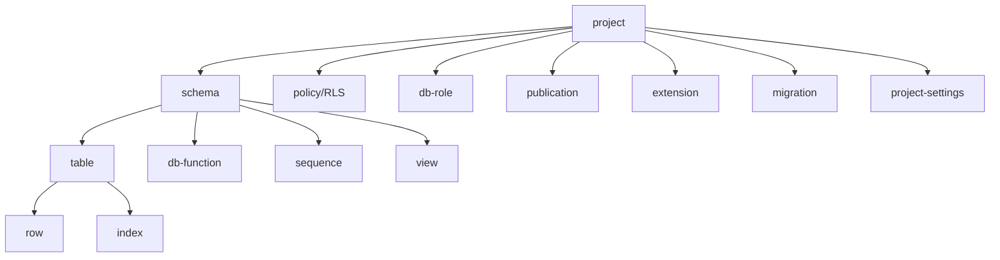
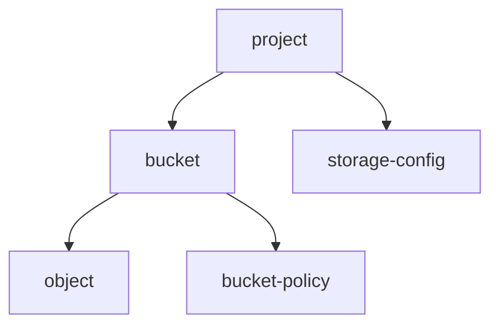
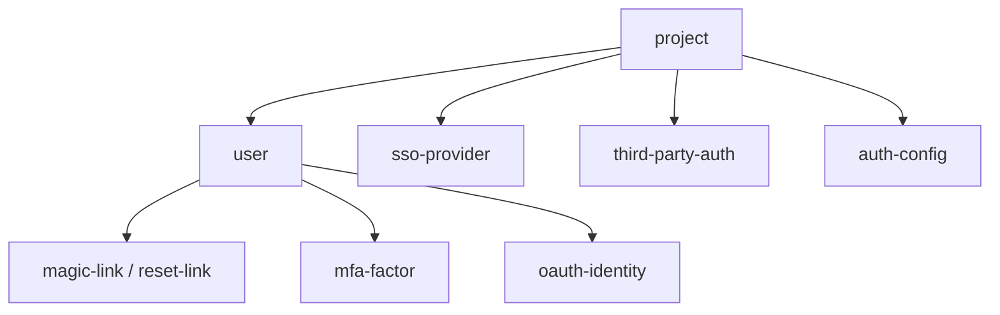
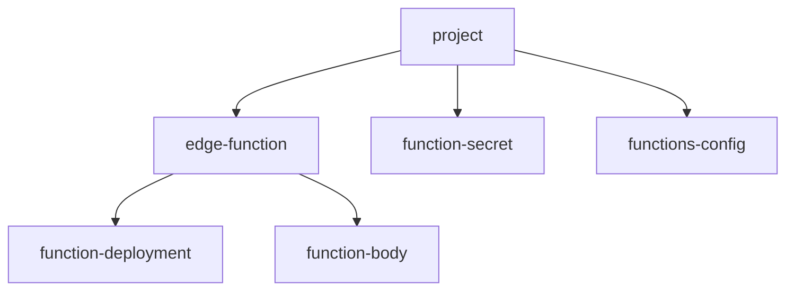

> **v4 document.** English rewrite scheduled by the v5 plan; `tracks` paths updated for the new layout.

# Supabase provider — modélisation v4 (4 planes)

> Cible : spec [`docs/spec/gateway-risk-model.md`](../../spec/gateway-risk-model.md) v4 (risk-based).
> Source code : [`plugins/supabase/src/`](../../../plugins/supabase/src/)
> (`classify.ts`, `sql-classify.ts`, `tools.ts`, `execute.ts`).
> Statut : draft de modélisation, à intégrer en Phase 0/1/2 de la migration v4.

## 0. Préambule — Supabase est un provider "multi-plane"

> _"Un provider est une BDD mutable de `(entité_1, entité_2, …)` avec des
> side effects observables via `read` sur certaines entités."_ (spec §2)

Supabase fédère sous un même `project_ref` **4 sous-systèmes hétérogènes** :

| Plane       | Sous-système                               | API physique        |
| ----------- | ------------------------------------------ | ------------------- |
| `db`        | Postgres + RLS + migrations                | mgmt-api + libpq    |
| `storage`   | Object storage S3-like avec buckets + ACL  | storage REST + mgmt |
| `auth`      | GoTrue : users, SSO, third-party providers | mgmt + admin REST   |
| `functions` | Edge Functions (Deno) + secrets de runtime | mgmt-api            |

Chaque plane a sa propre surface entités / cardinalités / risques. **Le
data-model v4 doit donc être déclaré plane-par-plane** ; le catalogue de
risques est unique au niveau provider mais namespacé par plane dans les
`RiskId`.

L'env est résolu par binding (un `project_ref` distinct par env :
`staging` vs `prod` sont des projets Supabase différents). Cf. spec §4.4
et `classify.ts` ligne 162-163.

## 1. Data-models — un graphe d'entités par plane

### 1.1 Plane `db` (Postgres + RLS)



**Cardinalités déclarées** :

| Entité                                     | Cardinalité typique       | Inférence depuis selecteur                |
| ------------------------------------------ | ------------------------- | ----------------------------------------- |
| `project`                                  | `one` par binding         | `project_ref` exact (résolu via binding)  |
| `schema`                                   | `bounded`                 | nom (`public`, `auth`, `storage`, custom) |
| `table`                                    | `bounded`                 | nom dans schema                           |
| `row`                                      | `unbounded`               | `*` (toujours wildcard côté slice)        |
| `index`, `db-function`, `view`, `sequence` | `bounded`                 | nom                                       |
| `policy`                                   | `bounded`                 | nom × table                               |
| `db-role`                                  | `bounded`                 | nom (`anon`, `authenticated`, custom)     |
| `extension`                                | `bounded`                 | nom (`pg_stat_statements`, `vector`, …)   |
| `migration`                                | `unbounded` (append-only) | version timestamp                         |
| `project-settings`                         | `one`                     | n/a                                       |

**Containment** : project → schema → table → row, le reste = enfants
directs de `project` (ou `schema` pour `db-function`, `view`,
`sequence`).

> Note v4 vs v1 : le `level` v1 (`rows`/`tables`/`rls`/`project`) **disparaît
> du wire**. Il reste utile uniquement au plugin pour ranker un statement
> SQL (cf. `sql-classify.ts`) mais ce ranking devient sans objet une fois
> `execute_sql` strictement read-only (§7.2 #2 de la spec).

### 1.2 Plane `storage`



**Cardinalités** :

| Entité           | Cardinalité      | Inférence                     |
| ---------------- | ---------------- | ----------------------------- |
| `bucket`         | `bounded`        | nom (`avatars`, `uploads`, …) |
| `object`         | `unbounded`      | path glob ou wildcard         |
| `bucket-policy`  | `bounded`        | RLS storage par bucket        |
| `storage-config` | `one` par projet | n/a                           |

**Note** : `bucket-policy` n'apparaît pas dans le code actuel (pas de
tool exposé) mais doit être déclaré pour la complétude du data-model et
pour anticiper un futur `supabase__update_bucket_policy`.

### 1.3 Plane `auth` (GoTrue)



**Cardinalités** :

| Entité             | Cardinalité            | Inférence                            |
| ------------------ | ---------------------- | ------------------------------------ |
| `user`             | `unbounded`            | `id` (uuid) ou `email`               |
| `sso-provider`     | `bounded`              | `id` (SAML / OIDC tenant)            |
| `third-party-auth` | `bounded`              | `id` (provider : firebase, auth0, …) |
| `auth-config`      | `one`                  | n/a (singleton par projet)           |
| `link`             | `unbounded` (éphémère) | n/a — émis par `generate_link`       |
| `mfa-factor`       | `bounded` par user     | n/a (pas de tool encore)             |
| `identity`         | `bounded` par user     | n/a (pas de tool encore)             |

**Note** : `mfa-factor` et `identity` sont déclarés pour le data-model
mais pas couverts par les tools actuels. Le data-model doit anticiper.

### 1.4 Plane `functions` (Edge Functions)



**Cardinalités** :

| Entité                | Cardinalité   | Inférence                        |
| --------------------- | ------------- | -------------------------------- |
| `edge-function`       | `bounded`     | `slug`                           |
| `function-deployment` | `unbounded`   | version timestamp                |
| `function-body`       | `one` par fct | n/a (le code TS courant)         |
| `function-secret`     | `bounded`     | nom (`STRIPE_WEBHOOK_SECRET`, …) |
| `functions-config`    | `one`         | n/a (singleton)                  |

**Note importante** : Supabase ne sépare pas `function-secret` par
fonction — c'est un namespace partagé au niveau projet. Le data-model
reflète ce containment (`project → function-secret`, pas
`edge-function → function-secret`).

## 2. Mapping tool → slice(s)

Les 44 tools Supabase actuels mappés en slices v4. Le format de slice :

```
supabase.project[<ref>].<plane-path...>.<R|W>
```

Le segment `[<ref>]` est résolu à partir du `project_ref` (arg explicite
ou binding unique). L'env est porté par le **binding**, pas par la slice
(cf. spec §4.4 : qualification par binding au mint).

### 2.1 Plane `db` — 6 tools statiques + 1 dynamique

| Tool                        | Slice(s) émise(s)                                                                 | Notes                                 |
| --------------------------- | --------------------------------------------------------------------------------- | ------------------------------------- |
| `supabase__get_project`     | `supabase.project[X].project-settings.R`                                          | metadata du projet                    |
| `supabase__get_anon_key`    | `supabase.project[X].project-settings.R`                                          | leak potentiel d'une clé (low : anon) |
| `supabase__list_tables`     | `supabase.project[X].schema[*].table[*].R`                                        | discovery                             |
| `supabase__list_migrations` | `supabase.project[X].migration[*].R`                                              | discovery historique                  |
| `supabase__get_advisors`    | `supabase.project[X].project-settings.R`                                          | linter de sécurité                    |
| `supabase__apply_migration` | `supabase.project[X].schema[*].table[*].W` + `supabase.project[X].migration[*].W` | **DDL — cf. edge case §5.2**          |
| `supabase__execute_sql`     | `supabase.project[X].schema[*].row[*].R` **(uniquement R post-§7.2 #2)**          | **cf. §3 & §5.1 — read-only forced**  |

### 2.2 Plane `storage` — 11 tools

| Tool                              | Slice                                                 | Notes                              |
| --------------------------------- | ----------------------------------------------------- | ---------------------------------- |
| `supabase__list_buckets`          | `supabase.project[X].bucket[*].R`                     | discovery                          |
| `supabase__get_storage_config`    | `supabase.project[X].storage-config.R`                |                                    |
| `supabase__update_storage_config` | `supabase.project[X].storage-config.W`                | **posture-shift**                  |
| `supabase__create_bucket`         | `supabase.project[X].bucket[<name>].W`                |                                    |
| `supabase__update_bucket`         | `supabase.project[X].bucket[<name>].W`                | peut basculer public ⇄ private     |
| `supabase__delete_bucket`         | `supabase.project[X].bucket[<name>].W`                | + cascade objets                   |
| `supabase__list_objects`          | `supabase.project[X].bucket[<name>].object[*].R`      |                                    |
| `supabase__upload_object`         | `supabase.project[X].bucket[<name>].object[<path>].W` | one path → `row-write-one`-like    |
| `supabase__delete_object`         | `supabase.project[X].bucket[<name>].object[<path>].W` | irréversible                       |
| `supabase__create_signed_url`     | `supabase.project[X].bucket[<name>].object[<path>].R` | **cf. edge case §5.4 (leak risk)** |

### 2.3 Plane `auth` — 14 tools

| Tool                                | Slice                                          | Notes                                      |
| ----------------------------------- | ---------------------------------------------- | ------------------------------------------ |
| `supabase__get_auth_config`         | `supabase.project[X].auth-config.R`            |                                            |
| `supabase__update_auth_config`      | `supabase.project[X].auth-config.W`            | **govern strict** (vecteur posture+secret) |
| `supabase__list_sso_providers`      | `supabase.project[X].sso-provider[*].R`        |                                            |
| `supabase__get_sso_provider`        | `supabase.project[X].sso-provider[<id>].R`     |                                            |
| `supabase__create_sso_provider`     | `supabase.project[X].sso-provider[<id>].W`     | **posture : ajoute un IdP fédéré**         |
| `supabase__update_sso_provider`     | `supabase.project[X].sso-provider[<id>].W`     |                                            |
| `supabase__delete_sso_provider`     | `supabase.project[X].sso-provider[<id>].W`     |                                            |
| `supabase__list_third_party_auth`   | `supabase.project[X].third-party-auth[*].R`    |                                            |
| `supabase__get_third_party_auth`    | `supabase.project[X].third-party-auth[<id>].R` |                                            |
| `supabase__create_third_party_auth` | `supabase.project[X].third-party-auth[<id>].W` | **posture**                                |
| `supabase__delete_third_party_auth` | `supabase.project[X].third-party-auth[<id>].W` |                                            |
| `supabase__list_users`              | `supabase.project[X].user[*].R`                | **data: pii**                              |
| `supabase__get_user`                | `supabase.project[X].user[<id>].R`             | **data: pii**                              |
| `supabase__create_user`             | `supabase.project[X].user[<id>].W`             | **cf. edge case §5.3**                     |
| `supabase__update_user`             | `supabase.project[X].user[<id>].W`             |                                            |
| `supabase__delete_user`             | `supabase.project[X].user[<id>].W`             | **irréversible**                           |
| `supabase__generate_link`           | `supabase.project[X].user[<id>].link[*].W`     | **cf. edge case §5.3 (= reset)**           |

### 2.4 Plane `functions` — 9 tools

| Tool                                | Slice                                                             | Notes                                            |
| ----------------------------------- | ----------------------------------------------------------------- | ------------------------------------------------ |
| `supabase__list_functions`          | `supabase.project[X].edge-function[*].R`                          |                                                  |
| `supabase__get_function`            | `supabase.project[X].edge-function[<slug>].R`                     | metadata                                         |
| `supabase__get_function_body`       | `supabase.project[X].edge-function[<slug>].function-body.R`       | **data: peut leaker logic + secrets inline**     |
| `supabase__list_function_secrets`   | `supabase.project[X].function-secret[*].R`                        | names only (Supabase ne renvoie pas les valeurs) |
| `supabase__create_function`         | `supabase.project[X].edge-function[<slug>].W`                     |                                                  |
| `supabase__update_function`         | `supabase.project[X].edge-function[<slug>].W`                     |                                                  |
| `supabase__delete_function`         | `supabase.project[X].edge-function[<slug>].W`                     | **irréversible si pas commit git**               |
| `supabase__deploy_function`         | `supabase.project[X].edge-function[<slug>].function-deployment.W` | **runtime mutation prod**                        |
| `supabase__create_function_secrets` | `supabase.project[X].function-secret[<name>].W`                   | **data: secret**                                 |
| `supabase__delete_function_secrets` | `supabase.project[X].function-secret[<name>].W`                   | **peut casser la fct en prod**                   |

### 2.5 Récap — couverture des 44 tools

| Plane       | Reads | Writes | Total                                |
| ----------- | ----- | ------ | ------------------------------------ |
| `db`        | 5     | 1      | 6 + `execute_sql` (R only) = **7**   |
| `storage`   | 4     | 6      | **10**                               |
| `auth`      | 7     | 7      | **14**                               |
| `functions` | 4     | 6      | **10**                               |
| **Total**   | 20    | 20     | **44 (avec `execute_sql` = R only)** |

## 3. Décision spec v4 §7.2 #2 — `execute_sql` strictement read-only

> Historique : la première itération avait essayé une classification
> syntaxique du SQL (ADR [[sql-classification-syntactic-only]]), avant
> que [[pivot-to-risk-based-model]] ne la remplace par le read-only
> strict. Les failure modes ci-dessous justifient le pivot.

### 3.1 Motivation

Le parser `classifySql` actuel (`sql-classify.ts`, ~300 lignes) tente de
ranker statiquement chaque statement SQL en `{rows, tables, rls,
project} × {read, write}`. Failure modes connus :

- **Faux négatifs** : un statement obscur (ex. `WITH x AS (DELETE …
RETURNING …) INSERT INTO y SELECT * FROM x`) qui passe pour `rows:read`
  parce que la tête est `WITH`. Mitigé par le default `project:write`
  sur unknown verb, mais reste fragile.
- **Faux positifs** : un statement légitime classé trop strict, friction
  pour l'agent.
- **Coût de maintenance** : 300 lignes de parser à maintenir + tests pour
  chaque verbe Postgres ajouté.

### 3.2 Nouvelle conception

**Postgres porte la garantie read-only**, pas notre parser. Deux options
d'implémentation (au runtime, dans `execute.ts`) :

1. **Wrapper transaction** : avant chaque query, `BEGIN; SET TRANSACTION
READ ONLY; <query>; COMMIT;` — Postgres refusera tout statement
   muteur (INSERT/UPDATE/DELETE/DDL) avec `ERROR: cannot execute … in
a read-only transaction`.
2. **Role read-only** : connecter avec un rôle Postgres dédié
   (`pg_read_all_data` built-in en Postgres 14+, ou rôle custom
   `vaubaan_readonly` avec `GRANT SELECT ON ALL TABLES IN SCHEMA …`).

**Option 1 recommandée** car portable, pas de SQL setup côté projet
Supabase, et compatible avec n'importe quel `service_role` ou Postgres
URL. Option 2 plus stricte (impossible d'écrire même si bug dans le
wrapper) mais demande un seed côté DB de chaque projet.

### 3.3 Conséquence catalog

`execute_sql` ne classe **plus jamais** en `W`. Une seule slice possible :

```
supabase.project[X].schema[*].row[*].R
```

Le tool tombe sous le risk `supabase.read-data`. On peut **supprimer** :

- `sql-classify.ts` complet (300 lignes),
- `supabaseToolCapabilities(tool)` branche `execute_sql` (lignes 108-117
  de `classify.ts`),
- le ranking multi-level `LEVEL_RANK`,
- l'attribut `EnvResolution` dynamique pour `execute_sql`.

Net : ~400 lignes en moins, surface d'attaque réduite, fail-closed garanti
par Postgres au lieu du parser.

### 3.4 Risque résiduel

Un `SELECT pg_sleep(99999)` ou `SELECT * FROM pg_stat_activity` reste
possible — donc `read-data` n'est pas zéro-risk (DoS / exfil metadata
serveur). À traiter via `statement_timeout` côté connection string +
risk distinct `supabase.read-internal-catalog` si besoin (Phase 2).

## 4. Risk catalog YAML — 4 planes namespacés

Format : un seul fichier `plugins/supabase/src/risk-catalog.yaml`,
~20 risks au total, namespacés par plane via le `RiskId`.

```yaml
supabase:
  risks:
    # ──────────────────────────────────────────────────────────────────
    # Plane `db`
    # ──────────────────────────────────────────────────────────────────

    - id: supabase.read-data
      label: 'Lire les données et le schéma'
      reason: 'Lectures SELECT + schema inspection. Peuvent leak PII via
        tables auth.users / app users si schema mal cloisonné.'
      matches: 'supabase.project[**].schema[**].**.R'
      vector:
        {
          reversibility: reversible,
          blast: single,
          data: data,
          cost: free,
          visibility: internal,
          persistence: stateless,
        }

    - id: supabase.row-write-one
      label: 'Écrire row par row (one or bounded)'
      reason: "INSERT/UPDATE/DELETE ciblé (par id, par clause WHERE
        bornée). Reversible via re-écriture si l'agent a tracé
        les valeurs avant."
      matches: 'supabase.project[**].schema[**].table[**].row[<bounded>].W'
      vector:
        {
          reversibility: costly,
          blast: single,
          data: data,
          cost: free,
          visibility: internal,
          persistence: session,
        }
      acceptable_in_envs: [preview, staging, prod]

    - id: supabase.bulk-row-write
      label: 'Écrire en bulk sur une table'
      reason: 'INSERT massif, UPDATE/DELETE sans WHERE ou WHERE large,
        TRUNCATE, COPY. Pas de rollback automatique. Blast élevé.'
      matches: 'supabase.project[**].schema[**].table[**].row[*].W'
      vector:
        {
          reversibility: costly,
          blast: bulk,
          data: data,
          cost: moderate,
          visibility: internal,
          persistence: session,
        }
      acceptable_in_envs: [preview, staging]
      # → structurellement non-grantable sur prod via le restrictor
      #   `acceptable_in_envs`.

    - id: supabase.migration.W
      label: 'Apply migration (DDL)'
      reason: 'CREATE/DROP/ALTER TABLE/INDEX. Costly à reverter (down
        migration manuelle). Peut casser les apps qui lisent.'
      matches: 'supabase.project[**].schema[**].table[**].W'
      vector:
        {
          reversibility: costly,
          blast: env,
          data: metadata,
          cost: free,
          visibility: internal,
          persistence: posture,
        }

    - id: supabase.policy.W
      label: 'Modifier la RLS (CREATE/ALTER POLICY)'
      reason: "Posture-shift critique : ouvre/ferme l'accès aux données
        pour tous les rôles. Une erreur ici = data leak public."
      matches: 'supabase.project[**].policy[**].W'
      vector:
        {
          reversibility: costly,
          blast: account,
          data: data,
          cost: free,
          visibility: public,
          persistence: posture,
        }

    - id: supabase.db-role.W
      label: 'Créer/modifier des rôles Postgres'
      reason: 'Posture credentials. CREATE ROLE / GRANT / REVOKE.'
      matches: 'supabase.project[**].db-role[**].W'
      vector:
        {
          reversibility: reversible,
          blast: account,
          data: metadata,
          cost: free,
          visibility: internal,
          persistence: posture,
        }

    - id: supabase.extension.W
      label: 'Activer/désactiver une extension Postgres'
      reason: "Posture-shift de la surface SQL disponible. Certaines
        extensions (pg_net, http) ouvrent l'exfiltration sortante."
      matches: 'supabase.project[**].extension[**].W'
      vector:
        {
          reversibility: reversible,
          blast: account,
          data: metadata,
          cost: free,
          visibility: internal,
          persistence: posture,
        }

    # ──────────────────────────────────────────────────────────────────
    # Plane `storage`
    # ──────────────────────────────────────────────────────────────────

    - id: supabase.storage.object.R
      label: 'Lister / télécharger des objets storage'
      reason: "Lectures de fichiers users (peut être PII : pièces d'ID,
        photos, exports). Selon ACL bucket, accès via clé service."
      matches: 'supabase.project[**].bucket[**].object[**].R'
      vector:
        {
          reversibility: reversible,
          blast: single,
          data: pii,
          cost: free,
          visibility: internal,
          persistence: stateless,
        }

    - id: supabase.storage.object-write-one
      label: "Upload/delete d'un objet ciblé"
      reason: "Mutation d'un path précis. Reversible si le path est
        bien identifié et l'agent garde une copie."
      matches: 'supabase.project[**].bucket[**].object[<bounded>].W'
      vector:
        {
          reversibility: costly,
          blast: single,
          data: data,
          cost: free,
          visibility: internal,
          persistence: session,
        }
      acceptable_in_envs: [preview, staging, prod]

    - id: supabase.storage.bulk-object-write
      label: "Upload/delete bulk d'objets"
      reason: 'List + delete via glob ou prefix-wide. Pas de
        retention/versioning par défaut côté Supabase Storage.'
      matches: 'supabase.project[**].bucket[**].object[*].W'
      vector:
        {
          reversibility: irreversible,
          blast: bulk,
          data: pii,
          cost: moderate,
          visibility: internal,
          persistence: session,
        }
      acceptable_in_envs: [preview, staging]

    - id: supabase.storage.signed-url.R
      label: 'Générer une URL signée'
      reason: 'READ sur le bucket MAIS exfiltre potentiellement la data
        vers un destinataire externe via URL temporaire. Risk
        distinct du simple list/download.'
      matches: 'supabase.project[**].bucket[**].object[**].signed-url[*].R'
      vector:
        {
          reversibility: reversible,
          blast: single,
          data: pii,
          cost: free,
          visibility: public,
          persistence: session,
        }
      # → l'URL est signée, donc auditable, mais le destinataire est
      #   choisi par l'agent → on ne traite pas ça comme un simple R.

    - id: supabase.bucket.W
      label: 'Créer/modifier/supprimer un bucket'
      reason: 'Posture-shift : un bucket public peut leaker des objets
        privés mal classés. Delete = cascade irréversible.'
      matches: 'supabase.project[**].bucket[**].W'
      vector:
        {
          reversibility: irreversible,
          blast: env,
          data: pii,
          cost: free,
          visibility: public,
          persistence: posture,
        }

    - id: supabase.storage-config.W
      label: 'Modifier la storage config globale'
      reason: 'Quotas, transformations, CDN. Affecte tout le projet.'
      matches: 'supabase.project[**].storage-config.W'
      vector:
        {
          reversibility: reversible,
          blast: env,
          data: metadata,
          cost: free,
          visibility: internal,
          persistence: posture,
        }

    # ──────────────────────────────────────────────────────────────────
    # Plane `auth`
    # ──────────────────────────────────────────────────────────────────

    - id: supabase.auth.read-users
      label: 'Lister/lire les utilisateurs'
      reason: 'PII : emails, providers, last_sign_in_at, metadata user.
        Volume potentiellement gros.'
      matches: 'supabase.project[**].user[**].R'
      vector:
        {
          reversibility: reversible,
          blast: bulk,
          data: pii,
          cost: free,
          visibility: internal,
          persistence: stateless,
        }
      acceptable_in_envs: [preview, staging, prod]

    - id: supabase.auth.user-write-one
      label: 'Créer/modifier/supprimer un user ciblé'
      reason: 'Affecte une identité unique. Reversible (re-create) sauf
        delete qui cascade sur owned rows.'
      matches: 'supabase.project[**].user[<bounded>].W'
      vector:
        {
          reversibility: costly,
          blast: single,
          data: pii,
          cost: free,
          visibility: internal,
          persistence: posture,
        }

    - id: supabase.auth.bulk-user-write
      label: "Manipulation bulk d'utilisateurs"
      reason: "Création / suppression massive. Risque d'exclusion accidentelle
        de vrais users en prod."
      matches: 'supabase.project[**].user[*].W'
      vector:
        {
          reversibility: irreversible,
          blast: bulk,
          data: pii,
          cost: moderate,
          visibility: internal,
          persistence: posture,
        }

    - id: supabase.auth.generate-link
      label: 'Générer un magic-link / reset password'
      reason: "L'URL retournée permet de se connecter en tant que cet
        utilisateur. Si elle leak (logs, audit), account takeover."
      matches: 'supabase.project[**].user[**].link[**].W'
      vector:
        {
          reversibility: reversible,
          blast: single,
          data: secret,
          cost: free,
          visibility: internal,
          persistence: session,
        }

    - id: supabase.sso-provider.W
      label: 'Configurer un IdP SAML / OIDC'
      reason: 'Posture identité fédérée. Une mauvaise config = toute
        personne avec un compte sur cet IdP peut se logger.'
      matches: 'supabase.project[**].sso-provider[**].W'
      vector:
        {
          reversibility: reversible,
          blast: account,
          data: metadata,
          cost: free,
          visibility: internal,
          persistence: posture,
        }

    - id: supabase.third-party-auth.W
      label: 'Configurer un provider tiers (Firebase, Auth0, etc.)'
      reason: "Idem SSO : posture identité, accepte de fédérer un IdP
        externe pour l'auth."
      matches: 'supabase.project[**].third-party-auth[**].W'
      vector:
        {
          reversibility: reversible,
          blast: account,
          data: metadata,
          cost: free,
          visibility: internal,
          persistence: posture,
        }

    - id: supabase.auth-config.W
      label: 'Modifier la config auth globale'
      reason: "JWT secret, expirations, allowed redirect URLs, signup
        policy. La moindre erreur ouvre/casse l'auth pour tous."
      matches: 'supabase.project[**].auth-config.W'
      vector:
        {
          reversibility: costly,
          blast: account,
          data: secret,
          cost: free,
          visibility: internal,
          persistence: posture,
        }

    # ──────────────────────────────────────────────────────────────────
    # Plane `functions`
    # ──────────────────────────────────────────────────────────────────

    - id: supabase.functions.read
      label: 'Lister / lire les Edge Functions (metadata + body)'
      reason: "Le body peut contenir des secrets inline si l'auteur a
        commit une clé en dur (anti-pattern fréquent)."
      matches: 'supabase.project[**].edge-function[**].R'
      vector:
        {
          reversibility: reversible,
          blast: single,
          data: secret,
          cost: free,
          visibility: internal,
          persistence: stateless,
        }

    - id: supabase.functions.body.W
      label: "Créer/modifier/supprimer le code d'une Edge Function"
      reason: 'Modifier le code = injecter un comportement custom à
        chaque invocation. Reversible si la source est en git.'
      matches: 'supabase.project[**].edge-function[**].W'
      vector:
        {
          reversibility: costly,
          blast: env,
          data: data,
          cost: free,
          visibility: internal,
          persistence: posture,
        }

    - id: supabase.functions.deploy
      label: "Deploy d'une nouvelle version d'Edge Function"
      reason: 'Bascule le runtime sur la nouvelle version. En prod = mutation
        immédiate du comportement public.'
      matches: 'supabase.project[**].edge-function[**].function-deployment.W'
      vector:
        {
          reversibility: costly,
          blast: env,
          data: data,
          cost: moderate,
          visibility: public,
          persistence: posture,
        }
      acceptable_in_envs: [preview, staging, prod]

    - id: supabase.function-secret.W
      label: 'Créer/modifier/supprimer un function-secret'
      reason: 'Secret prod consommé par les Edge Functions à runtime.
        Delete = peut casser la fct immédiatement.'
      matches: 'supabase.project[**].function-secret[**].W'
      vector:
        {
          reversibility: costly,
          blast: env,
          data: secret,
          cost: free,
          visibility: internal,
          persistence: posture,
        }

    # ──────────────────────────────────────────────────────────────────
    # Fallback
    # ──────────────────────────────────────────────────────────────────

    - id: supabase.uncategorized-write
      label: 'Écriture Supabase non catégorisée'
      reason: "Catch-all pour les writes qui n'ont pas été explicitement
        catégorisés. Signale qu'il manque une entrée au catalogue
        (lint CI doit pour empêcher d'arriver en prod)."
      matches: 'supabase.**.W'
      vector:
        {
          reversibility: costly,
          blast: env,
          data: data,
          cost: free,
          visibility: internal,
          persistence: session,
        }
```

### 4.1 Qualification par binding — exemples

Au mint, le moteur expose au manager **une entrée par binding** pour
les risks env-sensibles. Pour un projet avec bindings
`supabase(staging)` + `supabase(prod)` :

| RiskId catalogue               | RiskId(s) exposé(s) au mint                                                                                              |
| ------------------------------ | ------------------------------------------------------------------------------------------------------------------------ |
| `supabase.row-write-one`       | `supabase[staging].row-write-one`, `supabase[prod].row-write-one`                                                        |
| `supabase.bulk-row-write`      | `supabase[staging].bulk-row-write` (grantable), `supabase[prod].bulk-row-write` (non-grantable via `acceptable_in_envs`) |
| `supabase.policy.W`            | `supabase[staging].policy.W`, `supabase[prod].policy.W`                                                                  |
| `supabase.auth-config.W`       | `supabase[staging].auth-config.W`, `supabase[prod].auth-config.W`                                                        |
| `supabase.read-data`           | `supabase[staging].read-data`, `supabase[prod].read-data`                                                                |
| `supabase.uncategorized-write` | `supabase[staging].uncategorized-write`, `supabase[prod].uncategorized-write`                                            |

> Pour les risks **account-scoped** (ex. modif d'un SSO provider qui
> n'a de sens qu'à l'échelle de l'organisation Supabase), on peut
> envisager une qualification `supabase[<org_ref>].sso-provider.W`
> sans `env`. À trancher en Phase 1.

### 4.2 Grantabilité structurelle (`acceptable_in_envs`)

Post drop-confirm, la décision est binaire : un risk est dans
`accepted_risks` (allow) ou non (deny). Le seul garde-fou structurel
est `acceptable_in_envs`, qui empêche au mint de grant un risk sur
un env où il n'a structurellement pas de sens.

| Risk                                 | preview   | staging   | prod                                     |
| ------------------------------------ | --------- | --------- | ---------------------------------------- |
| `supabase.bulk-row-write`            | grantable | grantable | **non-grantable** (`acceptable_in_envs`) |
| `supabase.storage.bulk-object-write` | grantable | grantable | **non-grantable**                        |

Tous les autres risks sont grantables sur n'importe quel env — c'est
au manager de cocher ou non au mint selon la session.

> 22 risks utilisateurs + 1 fallback = 23 entrées au catalogue.

## 5. Lint coverage — matrice tool × risk

Vérifie qu'**aucun tool n'orphelin** (catch-all par `uncategorized-write`
est OK pour les writes mais doit être un signal, pas une norme).

| Tool                                | Risk principal                      | Risks alternatifs (selon args)                                                                                 |
| ----------------------------------- | ----------------------------------- | -------------------------------------------------------------------------------------------------------------- |
| `supabase__get_project`             | `supabase.read-data`                | —                                                                                                              |
| `supabase__get_anon_key`            | `supabase.read-data`                | —                                                                                                              |
| `supabase__list_tables`             | `supabase.read-data`                | —                                                                                                              |
| `supabase__list_migrations`         | `supabase.read-data`                | —                                                                                                              |
| `supabase__get_advisors`            | `supabase.read-data`                | —                                                                                                              |
| `supabase__apply_migration`         | `supabase.migration.W`              | + `supabase.policy.W` si la migration crée des policies (cf. §6.2) ; + `supabase.bulk-row-write` si DML inclus |
| `supabase__execute_sql`             | `supabase.read-data`                | — (read-only forced par §7.2 #2)                                                                               |
| `supabase__list_buckets`            | `supabase.read-data`                | —                                                                                                              |
| `supabase__get_storage_config`      | `supabase.read-data`                | —                                                                                                              |
| `supabase__update_storage_config`   | `supabase.storage-config.W`         | —                                                                                                              |
| `supabase__create_bucket`           | `supabase.bucket.W`                 | —                                                                                                              |
| `supabase__update_bucket`           | `supabase.bucket.W`                 | —                                                                                                              |
| `supabase__delete_bucket`           | `supabase.bucket.W`                 | + `supabase.storage.bulk-object-write` (cascade)                                                               |
| `supabase__list_objects`            | `supabase.storage.object.R`         | —                                                                                                              |
| `supabase__upload_object`           | `supabase.storage.object-write-one` | —                                                                                                              |
| `supabase__delete_object`           | `supabase.storage.object-write-one` | —                                                                                                              |
| `supabase__create_signed_url`       | `supabase.storage.signed-url.R`     | —                                                                                                              |
| `supabase__get_auth_config`         | `supabase.read-data`                | —                                                                                                              |
| `supabase__update_auth_config`      | `supabase.auth-config.W`            | —                                                                                                              |
| `supabase__list_sso_providers`      | `supabase.read-data`                | —                                                                                                              |
| `supabase__get_sso_provider`        | `supabase.read-data`                | —                                                                                                              |
| `supabase__create_sso_provider`     | `supabase.sso-provider.W`           | —                                                                                                              |
| `supabase__update_sso_provider`     | `supabase.sso-provider.W`           | —                                                                                                              |
| `supabase__delete_sso_provider`     | `supabase.sso-provider.W`           | —                                                                                                              |
| `supabase__list_third_party_auth`   | `supabase.read-data`                | —                                                                                                              |
| `supabase__get_third_party_auth`    | `supabase.read-data`                | —                                                                                                              |
| `supabase__create_third_party_auth` | `supabase.third-party-auth.W`       | —                                                                                                              |
| `supabase__delete_third_party_auth` | `supabase.third-party-auth.W`       | —                                                                                                              |
| `supabase__list_users`              | `supabase.auth.read-users`          | —                                                                                                              |
| `supabase__get_user`                | `supabase.auth.read-users`          | —                                                                                                              |
| `supabase__create_user`             | `supabase.auth.user-write-one`      | —                                                                                                              |
| `supabase__update_user`             | `supabase.auth.user-write-one`      | —                                                                                                              |
| `supabase__delete_user`             | `supabase.auth.user-write-one`      | — (single uid → "one", pas bulk)                                                                               |
| `supabase__generate_link`           | `supabase.auth.generate-link`       | —                                                                                                              |
| `supabase__list_functions`          | `supabase.functions.read`           | —                                                                                                              |
| `supabase__get_function`            | `supabase.functions.read`           | —                                                                                                              |
| `supabase__get_function_body`       | `supabase.functions.read`           | —                                                                                                              |
| `supabase__list_function_secrets`   | `supabase.read-data`                | (names only, pas valeur)                                                                                       |
| `supabase__create_function`         | `supabase.functions.body.W`         | —                                                                                                              |
| `supabase__update_function`         | `supabase.functions.body.W`         | —                                                                                                              |
| `supabase__delete_function`         | `supabase.functions.body.W`         | —                                                                                                              |
| `supabase__deploy_function`         | `supabase.functions.deploy`         | + `supabase.functions.body.W` si nouveau body                                                                  |
| `supabase__create_function_secrets` | `supabase.function-secret.W`        | —                                                                                                              |
| `supabase__delete_function_secrets` | `supabase.function-secret.W`        | —                                                                                                              |

### 5.1 Couverture du lint

Le lint CI doit vérifier pour chaque tool `supabase__*` :

1. `toolCoverage(tool)` renvoie au moins un `RiskId` du catalogue.
2. Le pattern `matches` du risk couvre toutes les slices que `classify(tool, *)` peut émettre.
3. Aucun tool ne tombe uniquement sur `supabase.uncategorized-write`
   (sinon = bug du catalogue).

**Tools potentiellement multi-risk** (slice plurale au call) :

- `supabase__apply_migration` : selon le contenu, `migration.W` +
  potentiellement `policy.W` (CREATE POLICY) + `bulk-row-write` (DML
  embarqué). Le plugin doit retourner un `Slice[]` (cf. spec §7.1).
  Cf. §6.2 pour la stratégie de classification.
- `supabase__delete_bucket` : `bucket.W` + `bulk-object-write` (cascade).
- `supabase__deploy_function` : si appelé avec `body` (ré-upload),
  `functions.body.W` + `functions.deploy`.

## 6. Edge cases

### 6.1 `execute_sql` post-§7.2 #2 — comment le plugin garantit R-only ?

**Question** : quelle slice exacte au runtime ? Comment le plugin sait
que c'est `R` only ?

**Réponse** : c'est **par construction au niveau du provider Supabase
(pas au niveau plugin)**.

1. **Au call** : `classifySupabase('supabase__execute_sql', args, bindings)`
   retourne **systématiquement** :

   ```
   supabase.project[<ref>].schema[*].row[*].R
   ```

   Plus de parsing SQL, plus de dispatch sur level/action.

2. **À l'execute** : `executeSupabase` (dans `execute.ts`) **enforce**
   le read-only :
   - Connection à libpq avec wrapper `BEGIN ISOLATION LEVEL SERIALIZABLE
READ ONLY; <query>; COMMIT;`,
   - Si le statement contient un write, Postgres erreur immédiatement :
     `ERROR: cannot execute INSERT in a read-only transaction`. Le tool
     renvoie cette erreur au call.

3. **Au catalog** : le risk `supabase.read-data` couvre cette slice.
   `execute_sql` tombe naturellement sous ce risk.

**Garantie de sécurité** : si jamais le wrapper Postgres rate (bug code),
le risk effectif resterait `supabase.read-data` même pour un statement
mutant — donc le token avec uniquement `read-data` accepté serait
"trompé". **Mitigation** : ajouter un test E2E qui envoie un `DELETE`
via `execute_sql` et vérifie qu'il est rejeté côté Postgres. Si on veut
defense-in-depth, classifier le 1er token de la query (regex simple,
pas un parser) et bloquer côté gateway si `INSERT|UPDATE|DELETE|TRUNCATE|
COPY|CREATE|DROP|ALTER|GRANT|REVOKE`. Mais c'est belt-and-braces.

### 6.2 `apply_migration` — DDL + DML mélangés

**Question** : une migration peut faire `ALTER TABLE … ADD COLUMN` (DDL,
= `schema.W` / `migration.W`) **et aussi** `UPDATE table SET …` (DML,
backfill). Comment classer ?

**Options** :

1. **Slice unique strict** = `supabase.project[X].schema[*].table[*].W`
   (matché par `migration.W` qui couvre le containment `schema/table`).
   Le risk `bulk-row-write` ne fire pas, le manager ne voit pas la
   différence avec une migration pure DDL.
2. **Multi-slice** = le plugin parse le SQL de la migration et émet
   `[migration.W, bulk-row-write]` si DML détecté. Le token doit
   couvrir les deux risks. **Recommandé** car explicite et aligné avec
   le fait que beaucoup de migrations réelles font du backfill.
3. **Migration agnostique** = on traite `migration.W` comme
   sur-ensemble (couvre forcément DDL + DML). Le risk `migration.W`
   absorbe alors `bulk-row-write`. Simple mais moins fin pour le manager.

**Recommandation** : option 2 — réutiliser un mini-parser (subset du
ex-`sql-classify`) **uniquement** pour détecter la présence de DML
dans une migration. Si DML détecté → émet `[migration.W, bulk-row-write]`.
Le manager qui n'accepte que `migration.W` (DDL only) est protégé d'une
migration qui ferait un `UPDATE` accidentel sur prod.

> Ironie : on supprime `sql-classify.ts` pour `execute_sql` (§3) mais
> on garde un sous-ensemble pour `apply_migration`. La nuance : on n'a
> plus besoin d'un parser **complet** (juste "y a-t-il un mot
> INSERT/UPDATE/DELETE/MERGE/TRUNCATE/COPY hors string ?").

### 6.3 `create_user` vs `generate_link` — même risk ou distincts ?

**Question** : `create_user` crée un compte ; `generate_link` génère un
lien magique (reset password, magic-link, etc.). Sont-ils du même risk ?

**Réponse** : **distincts**. Argumentation :

- `create_user` = pose une identité **persistante** dans le système.
  Risk = `auth.user-write-one` (data: pii, persistence: posture).
  Réversibilité difficile si l'agent a fait des liens FK ailleurs.
- `generate_link` = produit un **secret éphémère** qui permet à
  quelqu'un (le destinataire de l'URL) de **se connecter en tant que
  cet utilisateur**. Risk = `auth.generate-link` (data: secret,
  persistence: session). Le destinataire est choisi **par l'agent** dans
  les args. **C'est un canal d'exfiltration potentiel** (account
  takeover si l'URL leak).

**Conséquence catalog** : deux risks distincts (`auth.user-write-one`
et `auth.generate-link`). Le manager peut accepter l'un sans l'autre
("OK pour créer un user de test, pas OK pour générer un link prod qui
pourrait leak un compte client").

### 6.4 `create_signed_url` — R sur bucket mais leak via URL signée

**Question** : `create_signed_url` est techniquement `bucket.object.R`
(le plugin lit le path pour vérifier qu'il existe). Mais l'**effet de
bord** est de produire une URL accessible à n'importe qui, expirante
mais valide pendant la TTL signée. **C'est un risk d'exfiltration**.

**Réponse** : risk distinct du simple `storage.object.R`.

- Slice émise : `supabase.project[X].bucket[Y].object[Z].signed-url[*].R`
  (ajout d'un segment `signed-url[*]` pour le différencier d'un
  download direct).
- Risk : `supabase.storage.signed-url.R`, `visibility: public` dans le
  vecteur (l'URL fonctionne hors-session — le destinataire n'est pas dans
  l'audit).
- Mitigations runtime : capper le TTL signé côté gateway (ex. max
  15 min) ; auditer le path exfiltré ; ne jamais signer un path glob
  (`*`) — toujours un path concret.

### 6.5 `function-secret` — observer la couplée create + delete

**Question** : `create_function_secrets` et `delete_function_secrets`
sont marqués `function-secret.W` (vecteur `data: secret` + `posture`).
Mais un **rollover** légitime (rotation Stripe key) doit pouvoir
s'exécuter.

**Réponse** : un manager qui accepte `supabase.function-secret.W` au
mint le sait — c'est un risk explicite. À Phase 2 on pourrait
introduire un risk `supabase.function-secret.rotate` plus fin
(matché par un pattern `[create + delete consécutifs du même nom]`)
mais c'est du context-aware classification, hors scope MVP.

### 6.6 `apply_migration` créant une policy

Si une migration contient `CREATE POLICY` (RLS), c'est à la fois
`migration.W` et `policy.W`. Le plugin doit émettre les deux slices.
Si le token n'a pas accepté `supabase.policy.W` (risk distinct côté
catalogue), le call est denied — même si `migration.W` est accepté.

**Implémentation** : le mini-parser de §6.2 détecte aussi les mots-clés
`POLICY`, `RLS`, `ROW LEVEL SECURITY` et déclenche `[migration.W,
policy.W]`. Le détecteur n'a pas besoin d'être exhaustif — un faux
positif (ex. nom de colonne `policy_id`) sur-protège, ce qui est OK.

## 7. Trous — tools sans catégorie naturelle

### 7.1 Tools couverts mais sous-spécifiés

- `supabase__get_anon_key` : aujourd'hui `read-data`. Mais c'est **un
  secret** (la clé anon est connue publiquement par construction, mais
  reste un identifiant exploitable pour rate-limiting / fingerprinting).
  À considérer : risk dédié `supabase.read-credentials` distinct
  (audit explicite). Phase 2.
- `supabase__list_function_secrets` : renvoie les **noms** mais pas les
  valeurs. Aujourd'hui `read-data`. Sémantiquement un peu plus sensible
  (révèle quelles intégrations le projet utilise → reco recon). Idem :
  risk fin `supabase.function-secret.read` distinct. Phase 2.

### 7.2 Entités déclarées dans le data-model mais sans tool MCP

- `db-role`, `extension`, `publication` (plane db) : pas de tool dédié,
  seulement accessible historiquement via `execute_sql` muteur. Avec
  §7.2 #2 (read-only), ces opérations deviennent **impossibles via la
  gateway** sans ajouter de tool dédié. C'est OK pour MVP. Si besoin
  futur : ajouter `supabase__create_extension`, etc. → tomberont sur
  `extension.W`, `db-role.W` déjà déclarés.
- `mfa-factor`, `identity` (plane auth) : Supabase admin API les
  expose ; pas wrappé par les tools MCP actuels. Anticipé dans le
  data-model.
- `bucket-policy` (plane storage) : pas de tool actuel ; anticipé.

### 7.3 Risks orphelins (catalog → mais pas de tool qui les déclenche

aujourd'hui)

- `supabase.db-role.W` : pas de tool. Conservé pour cohérence + futur.
- `supabase.extension.W` : idem.

Ces entrées du catalogue sont **muettes** au runtime tant qu'aucun tool
ne les classifie. Pas un bug ; un capability pré-arrangé.

## 8. Récap décisions actées (référence v4)

| #   | Décision                                                                                                  | Source spec       |
| --- | --------------------------------------------------------------------------------------------------------- | ----------------- |
| 1   | `execute_sql` devient **R only**, enforced par Postgres `READ ONLY`                                       | §7.2 #2           |
| 2   | `classifySql` (300 lignes) **supprimé** ; on garde un mini-detector DML pour `apply_migration` uniquement | §7.2 #2 + §6.2    |
| 3   | Plugin émet `Slice[]`, **plus** `Capability` mono                                                         | §7.1, §13 Phase 2 |
| 4   | Catalog YAML versionné dans `plugins/supabase/src/risk-catalog.yaml`                                      | §13 Phase 1       |
| 5   | RiskId qualifié par binding au mint : `supabase[<env>].<name>`                                            | §4.4, §16 Q2      |
| 6   | `acceptable_in_envs` interdit d'accepter un risk sur prod (ex. `bulk-row-write`)                          | §4.1, §16 Q5      |
| 7   | Tools `dispatch_workflow`-like (côté GitHub) retirés ; **pas concerné Supabase** mais cohérent            | §7.2 #1           |
| 8   | Strict-fail au call : pas de step-up runtime au MVP                                                       | §8                |

## 9. Décisions résiduelles à acter pour Supabase

**Q1 — `apply_migration` : multi-slice (option 2) ou single super-risk (option 3) ?**
Reco : **option 2** (multi-slice). Le manager qui n'accepte que DDL
doit être protégé d'un DML embarqué.

**Q2 — `signed-url` : extension du data-model (`object → signed-url`) ou
risk standalone matché par tool name ?**
Reco : **extension du data-model**. Plus propre pour le lint et la
slice est explicite.

**Q3 — `read-data` vs `read-pii` — split sur les tables auth.users /
storage.objects qui contiennent de la PII ?**
Aujourd'hui `read-data` couvre tout. On peut imaginer un split
`auth.read-users` (déjà fait, vector PII) vs `db.read-tables`. À
trancher Phase 1 : le risk `auth.read-users` couvre déjà l'admin API
des users ; un SELECT direct sur `auth.users` via `execute_sql` tombe
sur `read-data` → **inconsistance**. Reco : Le risk `auth.read-users`
doit aussi couvrir `supabase.project[**].schema[auth].table[users].row[**].R`.

**Q4 — `apply_migration` sur prod : risk distinct
`supabase.migration-prod.W` ou simplement risk unique `migration.W` ?**
Reco : risk unique. Le manager qui ne veut pas autoriser la migration
prod ne coche pas `supabase[prod].migration.W` au mint. Post drop-confirm
plus de project policy override — la sévérité vit dans le catalog
(vecteur) et la décision au mint (cocher ou non).

**Q5 — `acceptable_in_envs` sur `bulk-row-write` : `[preview, staging]`
ou autoriser prod aussi ?**
Reco : `[preview, staging]` strict. Si un opérateur veut accepter
`bulk-row-write` en prod, il doit ouvrir un PR sur le catalogue (review
humain). Évite le "j'ai cliqué accept sur prod, je ne savais pas".

**Q6 — Risk `auth.generate-link` par type de link (magic vs recovery
vs invite) ?**
Aujourd'hui un seul risk. Supabase distingue `type: magiclink | recovery
| invite | signup`. Magic-link sur user existant = potential takeover.
Invite = création + invite (proche de `create_user`). Reco : un seul
risk pour MVP ; split en Phase 2 si demandes opérationnelles.

---

## Résumé final

Le provider Supabase v4 modélisé en **4 planes** (`db`, `storage`, `auth`,
`functions`) chacun avec son data-model mermaid. Au total **44 tools MCP**
mappés en slices via le DSL spec §3, avec containment explicite
`project → schema → table → row` (db) ou `project → bucket → object`
(storage) etc. Décision clé spec v4 §7.2 #2 actée : `execute_sql` devient
**strictement read-only enforced par Postgres** (`BEGIN READ ONLY`
wrapper) — le parser SQL `sql-classify.ts` (~300 lignes) est supprimé,
une seule slice possible `schema[*].row[*].R`. Le mini-parser reste
juste pour `apply_migration` afin de détecter du DML embarqué (multi-slice
`[migration.W, bulk-row-write]`). Le catalog YAML compte **23 risks**
namespacés `supabase.<plane>.<name>` + 1 fallback `uncategorized-write` ;
qualifiés par binding au mint (`supabase[staging].bulk-row-write` vs
`supabase[prod].bulk-row-write`). Les risks à vecteur critique
(`persistence: posture` + `data: secret/pii`) couvrent la posture
sensible : `policy.W` (RLS), `auth-config.W`, `sso-provider.W`,
`third-party-auth.W`, `function-secret.W`, `db-role.W`, `extension.W`,
`storage-config.W`, `auth.bulk-user-write` — un manager ne les coche
au mint qu'en connaissance de cause. Les risks env-restrictifs
(`acceptable_in_envs: [preview, staging]`) empêchent
structurellement d'accepter `bulk-row-write` ou `bulk-object-write` sur
prod. Trois edge cases doc : (1) `apply_migration` peut émettre
multi-slice si DDL+DML, (2) `create_signed_url` est un R mais avec
canal d'exfiltration → risk dédié `signed-url.R`, (3) `generate_link`
est distinct de `create_user` (secret éphémère vs identité persistante).
Trous identifiés : entités déclarées sans tool (`db-role`, `extension`,
`mfa-factor`, `bucket-policy`), à wirer en Phase 2 si besoin. Six
décisions résiduelles à trancher avec les opérateurs (multi-slice
migration, signed-url placement, read-pii split, prod migration scope,
acceptable_in_envs strictness, generate_link split par type).
