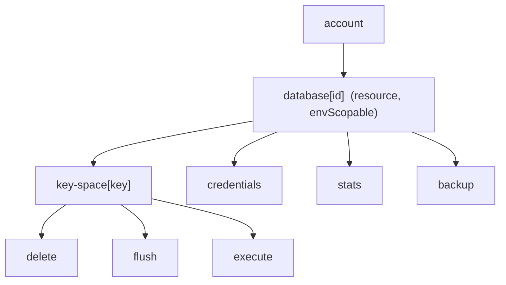

# Upstash Redis provider — plugin and risk model

`@vaubaan/plugin-upstash-redis` (`plugins/upstash-redis`), migrated to the v5
Plugin SDK in P1.2h. Spec: [`vaubaan-gateway.md`](../../spec/vaubaan-gateway.md)
§5 (plugins), §3.2 (presets); [`gateway-risk-model.md`](../../spec/gateway-risk-model.md)
§2, §4, §7. ADR: [[plugin-contract-and-credential-spec]]. Contributor guide:
[`plugins/upstash-redis/README.md`](../../../plugins/upstash-redis/README.md).

The v4 research document this handbook replaces (French, 2026-07-02) remains
in the git history; its decisions — two API layers under one plane, verb
routing of the generic `execute` tool, a dedicated `flush-database` risk —
are all implemented.

## 1. Data model

One plane, `cache`. The **database** is the resource; the **environment** is
the owner's label on it.

| Entity                 | Cardinality | Notes                                                                                                   |
| ---------------------- | ----------- | ------------------------------------------------------------------------------------------------------- |
| `account`              | one         | The account behind the Management API key of a connection.                                              |
| `database`             | bounded     | The resource (`ref` = Upstash database id). Discovered at connection time; labelled by the owner.       |
| `key-space`            | unbounded   | All Redis data structures. `delete`, `flush`, `execute` are literal markers appended by the classifier. |
| `credentials`, `stats` | one         | Rename touches `credentials`; `stats` is read-only.                                                     |
| `backup`               | bounded     | Declared, no tool yet.                                                                                  |

## 2. Tools → slices

21 custom tools (`src/tools.ts`), no upstream MCP server. The classifier
(`src/classify.ts`) is pure and emits exactly one slice per call.

**Database resolution.** `databaseId` (or `database_id`) must be a resource
of the mission; absent, the mission's single Upstash database applies;
several databases and no argument, a database the mission does not hold, or
a malformed ref are refused. Two account-level tools need no database
(`list_databases`, `create_database`) but still refuse a foreign `databaseId`.

| Tool                                                          | Slice                                                        |
| ------------------------------------------------------------- | ------------------------------------------------------------ |
| `list_databases`                                              | `account.database[*].R`                                      |
| `get_database`                                                | `database[D].R`                                              |
| `get_database_stats`                                          | `database[D].stats.R`                                        |
| `create_database`                                             | `account.database.W`                                         |
| `delete_database`                                             | `account.database[D].delete.W`                               |
| `rename_database`                                             | `database[D].credentials.W`                                  |
| `get`, `keys`, `scan`, `ttl`, `hgetall`, `lrange`, `smembers` | `database[D].key-space[K].R`                                 |
| `dbsize`                                                      | `database[D].key-space[*].R`                                 |
| `set`, `hset`, `lpush`, `sadd`, `expire`                      | `database[D].key-space[K].W`                                 |
| `del`                                                         | `database[D].key-space[K].delete.W` (`[*]` for several keys) |
| `execute` — known read verb                                   | `database[D].key-space[*].R`                                 |
| `execute` — known write verb                                  | `database[D].key-space[*].W`                                 |
| `execute` — FLUSHDB / FLUSHALL                                | `database[D].key-space.flush.W`                              |
| `execute` — anything else                                     | `database[D].key-space[*].execute.W`                         |

**Keys.** A key is embedded as `[K]` when it is a slice-DSL ident
(`[a-zA-Z0-9_./~-]+`); glob patterns, braces and keys with `:`
(`session:123`) fall back to `[*]`. v4 embedded colons and produced slices
`parseSlice` rejected; the catalog patterns match any ident there, so only
audit precision is lost.

**Verb sets.** `KNOWN_READS` (31), `KNOWN_WRITES` (30, DEL included — a DEL
through `execute` is a plain key-space write; the dedicated `del` tool
carries the `delete` marker), `KNOWN_DESTRUCTIVE` (FLUSHDB, FLUSHALL). The
verb is matched case-insensitively; an empty or non-array `command` is the
catch-all.

## 3. Catalog and presets (`src/risk-catalog.yaml`, v2)

Ids are the v4 ids, unchanged. `write-data` (`key-space[**].W`) is
deliberately broad: DEL, FLUSH and unknown verbs fire it next to their own,
more severe risk, so a mission accepting `write-data` alone cannot flush.

- **Every write risk is env-scoped** (`acceptable_in_envs: [development,
staging, prod]`) except `create-database`, which is account-rooted (the
  new database is not a resource yet). Reads are account-scoped.
- The fallback `uncategorized-write` is env-scoped and counts only when no
  specific entry matched (policy-engine rule, P1.2-SDK); no preset carries it.
- Presets: `read-only` (the three reads); `developer` (reads, `[development]`
  and `[staging]` `write-data` and `delete-data`, all `auto`); `operator`
  (everything: `prod` key writes `auto`, `[development].flush-database`
  `auto`, `approval` on FLUSH in `staging`/`prod`, every `delete-database`,
  every `modify-database`, `[prod].delete-data`, `[prod].execute-arbitrary`).
  Values provisional until ADR `mission-presets-default-values`.

## 4. Execution and discovery (`src/execute.ts`)

- Management API base `https://api.upstash.com/v2`, HTTP Basic auth built
  from the two credential fields (`basicAuthHeader`).
- Data tools first read `GET /v2/redis/database/{id}` for `rest_url` and
  `rest_token`, then `POST {rest_url}` the command as a JSON array with
  `Authorization: Bearer <rest_token>`. The token is never returned.
- Management API answers about a database are redacted (`rest_token`,
  `read_only_rest_token`, `password`) before reaching the agent.
- A `databaseId` that is not a mission resource, or a data tool on a mission
  holding several databases without `databaseId`, is an `isError` result
  before any network call. 401/403 on either surface throw
  `UpstreamAuthError`; other failures are `isError` results.
- `discoverResources`: `GET /v2/redis/databases` (unpaged upstream, capped
  at `MAX_DISCOVERED_DATABASES` = 200 with a logger warning) → one resource
  per database with `metadata: { region, primary_region?, read_regions?,
endpoint, state, database_type, tls }`; the owner labels `env`.

## 5. Credential (`src/credential.ts`)

`api-key`: `email` (not secret, loose email pattern) + `api_key` (secret),
created in the Upstash console → Account → Management API. No OAuth app, no
refresh. The v4 `email:api_key` concatenation survives only in the legacy
adapter (`parseLegacyCredentials`).

## 6. Legacy shims (deleted in P1.6)

`classifyUpstashRedisV4(tool, args, bindings)` maps `ProviderBinding[]` to
`Resource[]` and delegates to `classifyUpstashRedis`, keeping the v4 refusal
wording for an unbound database. `UpstashRedisAdapter` is a shell over
`callUpstashTool`. `upstashRedisAvailableTools`, `upstashRedisRiskCatalog`
(the loaded YAML) and `upstashRedisDataModel` keep their import paths.

## 7. Tests

`npx vitest run plugins/upstash-redis` — 120 tests: `plugin.test.ts` (24:
SDK kit with one sample per tool, presets, v5 classifier conventions, env
resolution through `resourceEnvResolver`, credential spec, execute and
discovery against `mockFetch`), `risk-classifier.test.ts` (30, v4 suite
unchanged through the shim), `risk-catalog.test.ts` (49, v4 lint on the
YAML), `adapter.test.ts` (16, v4 suite unchanged), `data-model.test.ts` (1).

## 8. How to debug

- **`Invalid risk catalog` at boot** — read every bullet; paths are exact. An
  env-qualified preset entry on a risk without `acceptable_in_envs` is the
  usual cause after adding a risk.
- **A key write is refused with `risk-not-accepted` on `[staging].write-data`
  although the mission holds the database** — the database has no env label
  (bare `write-data` is not in the policy) or the wrong one. Label it on the
  connection page.
- **`execute` lands on `execute-arbitrary` for a harmless verb** — add the
  verb to `KNOWN_READS` / `KNOWN_WRITES` in `classify.ts`, bump the plugin
  minor version, and add a classifier case.
- **`mockFetch: unexpected POST https://…upstash.io`** — the data route in
  the test must match `rest_url` exactly as the database route returned it.
