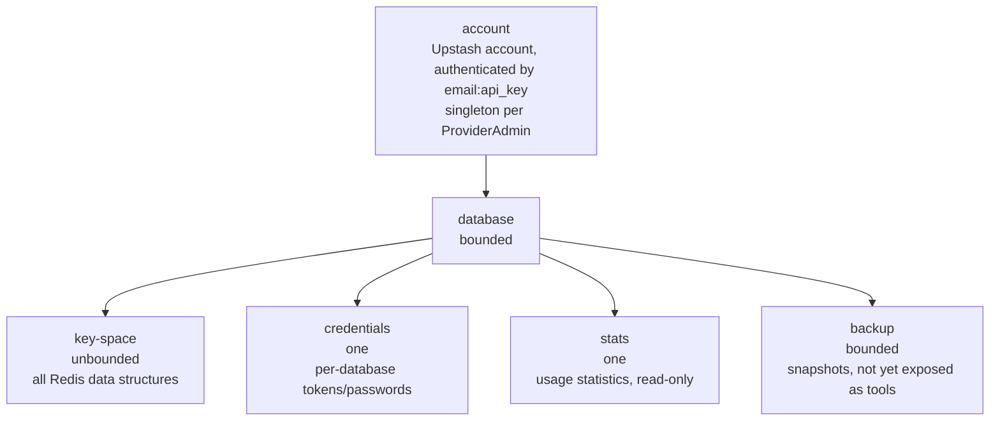

> **v4 document.** English rewrite scheduled by the v5 plan; `tracks` paths updated for the new layout.

# Upstash Redis provider — modelisation v4 + runtime

Sixieme provider Vaubaan, premier a combiner un **modele a deux couches
API** (Management + Data) et un **classifier smart-routing** sur le
tool generique `execute`. Cible : le **coding agent** qui manipule des
databases Redis hebergees (caching, session, queue), avec un gating
granulaire sur les operations destructives.

- Un **data-model** explicite pour le plane unique `cache` (6 entites :
  `account`, `database`, `key-space`, `credentials`, `stats`, `backup`).
- Un **mapping tool -> slice(s)** sur 21 tools MCP custom
  (6 management + 15 data), prefixes `upstash_redis__`.
- Un **catalogue de risks** (10 nommes + 1 fallback) avec vecteur 6D
  raisonne, couvrant reads, data writes, delete, flush, execute
  catch-all, et management writes.
- Un **classifier smart-routing** pour le tool `execute` : le verbe
  Redis est inspecte et classe dans `KNOWN_READS`, `KNOWN_WRITES`,
  `KNOWN_DESTRUCTIVE`, ou le fallback `execute-arbitrary`.
- Un **runtime paste-token** : le secret est `email:api_key`, split
  sur le premier `:`, avec Basic Auth pour la Management API et
  Bearer per-database pour la Data API.

Sourcing :

- Spec v4 — `docs/spec/gateway-risk-model.md` (DSL, catalog, runtime).
- ADR scope-caps — `docs/decisions/scope-caps-amplification-axis.md`
  (caps + infra_limits pattern).

---

## 0. Cadrage : pourquoi Upstash Redis est distinct

Les providers precedents zonent par repo (GitHub), projet (Vercel,
Supabase, Railway) ou host (SSH/bash). Upstash Redis introduit deux
axes inedits :

1. **Deux couches API independantes.** La Management API (`api.upstash.com`)
   gere les databases (CRUD, stats). La Data API (endpoint per-database)
   execute les commandes Redis. Chaque couche a son propre schema d'auth
   (Basic vs Bearer) et sa propre surface de risque.

2. **Classifier smart-routing sur `execute`.** Le tool generique
   `execute` peut envoyer n'importe quelle commande Redis. Plutot
   qu'un fallback aveugle, le classifier inspecte le verbe
   (`command[0]`) et route vers le risk correct : read, write,
   destructive (FLUSHDB), ou catch-all. Cela permet un gating fin
   sans multiplier les tools dedies.

---

## 1. Data-model du plane `cache`

Le code vit dans `plugins/upstash-redis/src/data-model.ts`.

Upstash Redis n'expose qu'**un seul plane** : `cache`. Tout vit sous
un noeud racine `account` qui porte l'`envScopable` implicitement
(un binding = une database Upstash = un `resource_ref` = un id de
database).

### 1.1 Graphe d'entites



### 1.2 Cardinalites declarees

| Path                                     | Cardinalite | Justification                                 |
| ---------------------------------------- | ----------- | --------------------------------------------- |
| `upstash-redis.account`                  | `one`       | Singleton per ProviderAdmin row.              |
| `upstash-redis.account[A].database[*]`   | `bounded`   | Dizaines au plus par compte.                  |
| `upstash-redis.database[D].key-space[*]` | `unbounded` | Nombre de cles potentiellement tres grand.    |
| `upstash-redis.database[D].credentials`  | `one`       | Un seul jeu de tokens/passwords par database. |
| `upstash-redis.database[D].stats`        | `one`       | Statistiques agregees, pas de sous-entites.   |
| `upstash-redis.database[D].backup[*]`    | `bounded`   | Snapshots, pas encore exposes comme tools.    |

---

## 2. Mapping tool -> slice(s)

21 tools MCP custom, definis dans
`plugins/upstash-redis/src/tools.ts`. Le classifier est dans
`plugins/upstash-redis/src/risk-classifier.ts`.

### 2.1 Management reads (3 tools)

| Tool MCP                            | REST endpoint                 | Slice(s) emise(s)                     |
| ----------------------------------- | ----------------------------- | ------------------------------------- |
| `upstash_redis__list_databases`     | `GET /v2/redis/databases`     | `upstash-redis.account.database[*].R` |
| `upstash_redis__get_database`       | `GET /v2/redis/database/{id}` | `upstash-redis.database[D].R`         |
| `upstash_redis__get_database_stats` | `GET /v2/redis/stats/{id}`    | `upstash-redis.database[D].stats.R`   |

### 2.2 Management writes (3 tools)

| Tool MCP                         | REST endpoint                    | Slice(s) emise(s)                            |
| -------------------------------- | -------------------------------- | -------------------------------------------- |
| `upstash_redis__create_database` | `POST /v2/redis/database`        | `upstash-redis.account.database.W`           |
| `upstash_redis__delete_database` | `DELETE /v2/redis/database/{id}` | `upstash-redis.account.database[D].delete.W` |
| `upstash_redis__rename_database` | `POST /v2/redis/rename/{id}`     | `upstash-redis.database[D].credentials.W`    |

### 2.3 Data reads (8 tools)

| Tool MCP                  | REST endpoint       | Slice(s) emise(s)                          |
| ------------------------- | ------------------- | ------------------------------------------ |
| `upstash_redis__get`      | Data API (GET)      | `upstash-redis.database[D].key-space[K].R` |
| `upstash_redis__keys`     | Data API (KEYS)     | `upstash-redis.database[D].key-space[K].R` |
| `upstash_redis__scan`     | Data API (SCAN)     | `upstash-redis.database[D].key-space[K].R` |
| `upstash_redis__ttl`      | Data API (TTL)      | `upstash-redis.database[D].key-space[K].R` |
| `upstash_redis__hgetall`  | Data API (HGETALL)  | `upstash-redis.database[D].key-space[K].R` |
| `upstash_redis__lrange`   | Data API (LRANGE)   | `upstash-redis.database[D].key-space[K].R` |
| `upstash_redis__smembers` | Data API (SMEMBERS) | `upstash-redis.database[D].key-space[K].R` |
| `upstash_redis__dbsize`   | Data API (DBSIZE)   | `upstash-redis.database[D].key-space[*].R` |

### 2.4 Data writes (4 tools + DEL)

| Tool MCP                | REST endpoint     | Slice(s) emise(s)                                 |
| ----------------------- | ----------------- | ------------------------------------------------- |
| `upstash_redis__set`    | Data API (SET)    | `upstash-redis.database[D].key-space[K].W`        |
| `upstash_redis__hset`   | Data API (HSET)   | `upstash-redis.database[D].key-space[K].W`        |
| `upstash_redis__lpush`  | Data API (LPUSH)  | `upstash-redis.database[D].key-space[K].W`        |
| `upstash_redis__sadd`   | Data API (SADD)   | `upstash-redis.database[D].key-space[K].W`        |
| `upstash_redis__expire` | Data API (EXPIRE) | `upstash-redis.database[D].key-space[K].W`        |
| `upstash_redis__del`    | Data API (DEL)    | `upstash-redis.database[D].key-space[K].delete.W` |

### 2.5 Execute — smart routing

Le tool `upstash_redis__execute` accepte un tableau `command` arbitraire.
Le classifier inspecte `command[0].toUpperCase()` et route :

| Verb category       | Exemples                               | Slice emise                                      |
| ------------------- | -------------------------------------- | ------------------------------------------------ |
| `KNOWN_READS`       | GET, SCAN, KEYS, HGETALL, DBSIZE, INFO | `database[D].key-space[*].R`                     |
| `KNOWN_WRITES`      | SET, DEL, HSET, LPUSH, INCR, RENAME    | `database[D].key-space[*].W`                     |
| `KNOWN_DESTRUCTIVE` | FLUSHDB, FLUSHALL                      | `database[D].key-space.flush.W`                  |
| Unknown             | tout le reste                          | `database[D].key-space[*].execute.W` (catch-all) |

---

## 3. Risk catalog

Le YAML vit dans `plugins/upstash-redis/src/risk-catalog.yaml`,
le miroir TS dans `risk-catalog.ts`. Le test `risk-catalog-sync.test.ts`
verifie l'identite entre les deux.

### 3.1 Resume des 11 risks

| RiskId                                 | Label abrege                              | Vector cardinal               | Notes                          |
| -------------------------------------- | ----------------------------------------- | ----------------------------- | ------------------------------ |
| `upstash-redis.read-database-metadata` | Read database list / details / stats      | `R`, `metadata`               | Always-on baseline             |
| `upstash-redis.read-data`              | Read Redis data (GET, KEYS, SCAN, etc.)   | `R`, `data`                   | May expose cached secrets      |
| `upstash-redis.write-data`             | Write Redis data (SET, HSET, LPUSH, etc.) | `reversible`, `data`          | Affects application state      |
| `upstash-redis.delete-data`            | Delete specific keys (DEL)                | `costly`, `data`              | Hard to reverse without backup |
| `upstash-redis.flush-database`         | FLUSHDB — mass data deletion              | `irreversible`, `account`     | Only via `execute` tool        |
| `upstash-redis.execute-arbitrary`      | Generic execute catch-all                 | `costly`, `env`               | Unknown blast radius           |
| `upstash-redis.create-database`        | Create a new database                     | `reversible`, `moderate cost` | May incur costs on paid plans  |
| `upstash-redis.delete-database`        | Delete an entire database                 | `irreversible`, `account`     | Drops all data permanently     |
| `upstash-redis.modify-database`        | Rename database                           | `costly`, `secret`            | Breaks downstream references   |
| `upstash-redis.read-stats`             | Read usage statistics                     | `R`, `metadata`               | No data exposure               |
| `upstash-redis.uncategorized-write`    | Fallback catch-all                        | `costly`, `env`               | Fail-loud by design            |

### 3.2 Risk escalation sur `execute`

Le tool `execute` est le seul outil qui peut traverser **cinq risks
differents** selon le verbe :

- `KNOWN_READS` → `read-data`
- `KNOWN_WRITES` → `write-data` (ou `delete-data` si DEL)
- `FLUSHDB/FLUSHALL` → `flush-database`
- Inconnu → `execute-arbitrary`

Un token qui n'accepte que `read-data` peut utiliser `execute` avec
GET/SCAN/KEYS etc., mais sera refuse sur SET/DEL/FLUSHDB. Le
classifier fournit la granularite, le risk catalog fournit le gating.

---

## 4. Classifier

Le classifier vit dans
`plugins/upstash-redis/src/risk-classifier.ts`. Fonction
exportee : `classifyUpstashRedisV4(tool, args, bindings) -> ClassifyResult`.

### 4.1 Binding check

Si `args.databaseId` est present et ne fait pas partie des databases
bindees (`bindings.filter(b => b.provider === 'upstash-redis')`), le
classifier retourne `{ denied }`. Les data tools sans `databaseId`
explicite resolvent vers le premier binding.

### 4.2 Key identification

Pour les data tools, le classifier extrait un `keyIdent` depuis
`args.key` quand il matche `/^[a-zA-Z0-9_:/-]+$/`. Les cles qui ne
matchent pas ce pattern sont remplacees par `[*]`. Cela permet au
risk catalog de produire des slices lisibles dans l'audit trail sans
exposer de cles a contenu arbitraire.

### 4.3 Sets de commandes

Trois `Set<string>` statiques classent les commandes Redis connues :

- **`KNOWN_READS`** (30 commandes) : GET, MGET, KEYS, SCAN, TTL,
  PTTL, TYPE, EXISTS, HGET, HGETALL, HMGET, HKEYS, HVALS, HLEN,
  LRANGE, LLEN, LINDEX, SMEMBERS, SISMEMBER, SCARD, SRANDMEMBER,
  ZRANGE, ZSCORE, ZRANK, ZCARD, ZRANGEBYSCORE, DBSIZE, STRLEN,
  GETRANGE, INFO, PING.
- **`KNOWN_WRITES`** (31 commandes) : SET, DEL, HSET, LPUSH, RPUSH,
  SADD, ZADD, EXPIRE, PEXPIRE, SETEX, SETNX, INCR, DECR, APPEND,
  MSET, HDEL, LREM, LPOP, RPOP, SREM, SPOP, ZREM, ZINCRBY, INCRBY,
  DECRBY, GETSET, PERSIST, RENAME, RENAMENX, SORT.
- **`KNOWN_DESTRUCTIVE`** (2 commandes) : FLUSHDB, FLUSHALL.

---

## 5. Adapter paste-token

Le code vit dans
`plugins/upstash-redis/src/upstash-redis-adapter.ts`.
Classe `UpstashRedisAdapter`.

### 5.1 Auth model

Upstash Redis est un provider **paste-credentials** : l'utilisateur
colle son email + cle API Management dans l'UI, concatenes sous forme
`email:api_key`, stockes chiffres dans
`provider_admins.access_token_encrypted`.

`mintUpstreamToken()` : decode `admin.access_token_encrypted` →
renvoie le secret brut (`email:api_key`) avec une date d'expiration
far-future (1 an). Les cles Upstash n'expirent pas — la date sert
uniquement au cache du gateway.

Pas de refresh token : Upstash n'a pas de flow OAuth. Si la cle est
revoquee cote Upstash, le gateway recoit un 401 et marque le provider
comme `expired` (cf. `docs/handbook/mcp-gateway.md` §Upstream
authentication failure).

### 5.2 Dispatch bi-couche (`execute.ts`)

Le dispatcher dans `plugins/upstash-redis/src/execute.ts`
distingue deux chemins :

**Management API** (`api.upstash.com/v2`, Basic Auth) :

- Le secret `email:api_key` est parse (split sur le premier `:`)
- Header `Authorization: Basic base64(email:apiKey)`
- 6 tools : `list_databases`, `get_database`, `create_database`,
  `delete_database`, `rename_database`, `get_database_stats`

**Data API** (endpoint per-database, Bearer token) :

- Le dispatcher appelle d'abord `GET /v2/redis/database/{id}` via la
  Management API pour obtenir `rest_url` + `rest_token`
- Puis envoie la commande Redis comme JSON array via
  `POST {rest_url}` avec `Authorization: Bearer {rest_token}`
- 15 tools : `execute`, `get`, `set`, `del`, `keys`, `scan`, `ttl`,
  `expire`, `hset`, `hgetall`, `lpush`, `lrange`, `sadd`, `smembers`,
  `dbsize`

### 5.3 Validation de binding

`validateBinding()` appelle `GET /v2/redis/database/{resourceRef}`
avec les credentials. Si le status est OK, la validation passe et le
display name est `database_name`. Si la database n'existe pas ou le
token est invalide, la validation echoue.

### 5.4 ClassifyV4

Delegation directe a `classifyUpstashRedisV4()`.

---

## 6. Gateway wiring

### 6.1 `build.ts` (l. 377-386)

```typescript
const upstashRedisAdapter = new UpstashRedisAdapter();
upstreamByProvider['upstash-redis'] = {
  provider: 'upstash-redis',
  availableTools: upstashRedisAvailableTools,
  classifyV4: (tool, args, bindings) => upstashRedisAdapter.classifyV4(tool, args, bindings),
  executeCall: (admin, binding, tool, args) =>
    upstashRedisAdapter.executeCall(admin, binding, tool, args),
  loadProviderAdmin,
};
```

Paste-token via `provider_admins`, pas de `selfContained` flag
(contrairement a Stripe qui a sa propre table `stripe_bindings`).
Pas de `retryAfterAuthFailure` — Upstash n'a pas d'OAuth, donc le
gateway marque directement `expired` en cas de 401/403.

### 6.2 `provider-info.ts`

Registre dans `PROVIDER_INFO['upstash-redis']` avec :

- `kind: 'cloud'`
- 1 plane `cache`
- Setup instructions pour paste email + API key

### 6.3 `risk-catalog/loader.ts`

`upstashRedisCatalog` importe depuis `@vaubaan/plugin-upstash-redis`
et enregistre dans `PROVIDER_CATALOGS['upstash-redis']`. Le loader
est consulte par le policy-engine au runtime.

### 6.4 `catalog/route.ts`

`{ slug: 'upstash-redis', displayName: 'Upstash Redis', tools: upstashRedisAvailableTools }`
ajoute au tableau `PROVIDERS` expose par `GET /api/v1/catalog`.

### 6.5 Zod enums (preview + mint)

`'upstash-redis'` ajoute aux `z.enum()` dans :

- `apps/gateway/src/lib/mint/risk-preview.ts` (`PreviewBindingSchema`)
- `apps/gateway/src/app/api/v1/tokens/preview/route.ts` (`BindingSchema`)
- `apps/gateway/src/app/api/v1/tokens/mint/route.ts` (`BindingSchema`)

---

## 7. Comment l'utiliser

### 7.1 Setup d'un binding Upstash Redis

1. Creer un compte Upstash, generer une Management API Key dans les
   settings du compte.
2. Dans Vaubaan, ajouter les credentials via l'UI providers : coller
   l'email du compte et la cle API. Stockes comme `email:api_key`
   dans `provider_admins.access_token_encrypted`.
3. Creer une binding avec `provider: 'upstash-redis'` et
   `resource_ref` = l'id de la database Upstash (visible dans le
   dashboard Upstash ou via `GET /v2/redis/databases`).

### 7.2 Mint d'un token

```bash
POST /api/v1/tokens/mint
{
  "projectSlug": "my-project",
  "bindings": [
    { "provider": "upstash-redis", "resource_ref": "eu1-abc-12345" }
  ],
  "accepted_risks": [
    "upstash-redis.read-database-metadata",
    "upstash-redis.read-data",
    "upstash-redis.write-data"
  ]
}
```

### 7.3 Appel d'un tool

```bash
POST /mcp
Authorization: Bearer vbn_live_...
{
  "jsonrpc": "2.0",
  "method": "tools/call",
  "params": {
    "name": "upstash_redis__set",
    "arguments": { "key": "user:session:abc", "value": "active", "ex": 3600 }
  },
  "id": 1
}
```

Le classifier emettra :

- `upstash-redis.database[eu1-abc-12345].key-space[user:session:abc].W`
- Matche le risk `upstash-redis.write-data`

### 7.4 Appel via `execute`

```bash
{
  "jsonrpc": "2.0",
  "method": "tools/call",
  "params": {
    "name": "upstash_redis__execute",
    "arguments": { "command": ["HGETALL", "config:app"] }
  },
  "id": 2
}
```

Le classifier detecte `HGETALL` dans `KNOWN_READS` → slice
`database[D].key-space[*].R` → matche `upstash-redis.read-data`.

---

## 8. Comment debug

- **Symptome : "Upstash Redis credentials must be in `email:api_key`
  format"** — le secret stocke ne contient pas de `:`. Verifier que
  le format est bien `email:api_key` dans `provider_admins`.

- **Symptome : "database 'xxx' is not bound to this project"** — le
  `databaseId` passe dans les args ne fait pas partie des bindings du
  token. Verifier `provider_bindings` pour le projet.

- **Symptome : "does not expose REST endpoint/token"** — la database
  Upstash n'a pas le REST API active. Verifier dans le dashboard
  Upstash que la database est active et le REST endpoint est
  disponible.

- **Symptome : 401 "Upstash Management API ... 401"** — la cle API
  est invalide ou revoquee. Le gateway marque automatiquement le
  provider comme `expired`. Decoder
  `provider_admins.access_token_encrypted` pour verifier le format
  `email:api_key`.

- **Symptome : risk-not-accepted sur un `execute` avec commande
  connue** — le token n'accepte pas le risk correspondant. Par
  exemple, `execute` avec `["SET", ...]` requiert `write-data`, pas
  seulement `read-data`. Verifier `accepted_risks` du token vs le
  routing du classifier.

- **Symptome : risk `execute-arbitrary` demande sur une commande
  commune** — la commande n'est pas dans `KNOWN_READS` ni
  `KNOWN_WRITES`. Verifier la casse (le classifier uppercases
  `command[0]`). Si la commande est legitime, l'ajouter au set
  correspondant dans le classifier.

- **Logs de classification** — le gateway audit trail enregistre les
  `slices_executed` et `risks_touched` pour chaque call. Comparer
  avec les patterns du YAML pour comprendre quel risk a matche.

---

## 9. Extension

### Ajouter un tool Upstash Redis

1. Ajouter la `McpToolDeclaration` dans `tools.ts` (section
   `MANAGEMENT_TOOLS` ou `DATA_TOOLS`).
2. Ajouter le `case` dans le switch de `execute.ts` — management tools
   dans `executeManagementTool`, data tools dans `buildCommand`.
3. Ajouter le `case` dans le switch de `risk-classifier.ts` avec les
   slices emises.
4. Verifier que les slices sont couvertes par un risk existant ou
   ajouter un nouveau risk dans le YAML + TS.
5. Si c'est un data tool, s'assurer que le `databaseId` est resolu
   correctement (via args ou binding fallback).
6. Ajouter les tests unitaires dans les 4 suites (tools count,
   classifier, execute, catalog coverage).

### Ajouter des commandes au smart-routing `execute`

Si une commande Redis reconnue tombe dans le fallback
`execute-arbitrary` :

1. Determiner si c'est un read, write, ou destructive.
2. Ajouter le verbe (en majuscules) dans le `Set` correspondant
   (`KNOWN_READS`, `KNOWN_WRITES`, ou `KNOWN_DESTRUCTIVE`).
3. Pas besoin de toucher le risk catalog — les patterns existants
   couvrent deja les slices emises.

### Exposer les backups

L'entite `backup` est declaree dans le data-model mais pas encore
exposee comme tools :

1. Ajouter les tools dans `tools.ts` (`list_backups`, `create_backup`,
   `restore_backup`).
2. Ajouter les risks correspondants dans le YAML (ex:
   `upstash-redis.backup-read`, `upstash-redis.backup-restore`).
3. Emettre les slices dans le classifier :
   `database[D].backup[*].R` / `database[D].backup[B].restore.W`.

---

## References

- Spec risk-model :
  [`../../spec/gateway-risk-model.md`](../../spec/gateway-risk-model.md)
- ADR scope-caps :
  [`../../decisions/scope-caps-amplification-axis.md`](../../decisions/scope-caps-amplification-axis.md)
- Resend handbook :
  [`./resend.md`](./resend.md) (meme pattern paste-token, identity
  zoning en plus)
- Tests :
  [`../../tests/integration-tests.md`](../../tests/integration-tests.md)
