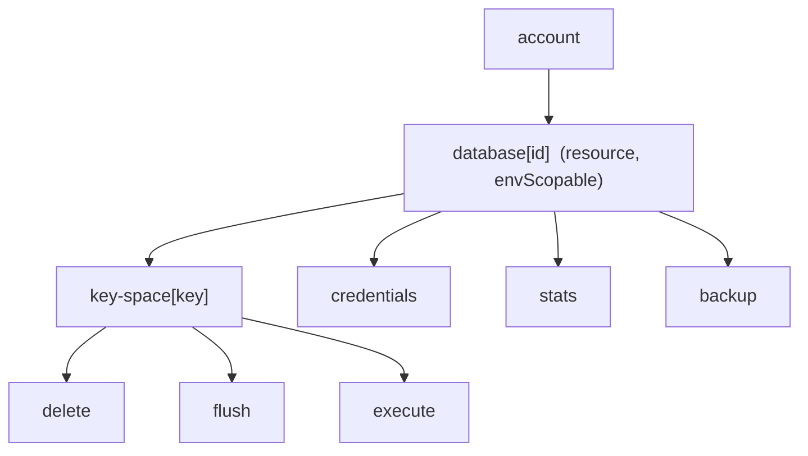

# Upstash Redis provider — plugin and risk model

`@vaubaan/plugin-upstash-redis` (`plugins/upstash-redis`), written against the
Plugin SDK. Spec: [`vaubaan-gateway.md`](../../spec/vaubaan-gateway.md)
§5 (plugins), §3.2 (presets); [`gateway-risk-model.md`](../../spec/gateway-risk-model.md)
§2, §4, §7. ADR: [[plugin-contract-and-credential-spec]]. Contributor guide:
[`plugins/upstash-redis/README.md`](../../../plugins/upstash-redis/README.md).

Three modelling choices shape everything below: two API layers under one
plane, a command table that routes the generic `execute` tool, and dedicated
risks for deletion, flush and arbitrary execution.

## 1. Data model

One plane, `cache`. The **database** is the resource; the **environment** is
the owner's label on it.

| Entity                 | Cardinality | Notes                                                                                                   |
| ---------------------- | ----------- | ------------------------------------------------------------------------------------------------------- |
| `account`              | one         | The account behind the Management API key of a connection.                                              |
| `database`             | bounded     | The resource (`ref` = Upstash database id). Discovered at connection time; labelled by the owner.       |
| `key-space`            | unbounded   | All Redis data structures. `delete`, `flush`, `execute` are literal markers appended by the classifier. |
| `credentials`, `stats` | one         | Rename touches `credentials`; `stats` is read-only.                                                     |
| `backup`               | bounded     | Declared, no tool yet.                                                                                  |

## 2. Tools → slices

21 custom tools (`src/tools.ts`), no upstream MCP server. The classifier
(`src/classify.ts`) is pure. A dedicated tool emits exactly one slice; the
generic `execute` tool emits one slice per class of command it carries (one
for a single command, several for a pipeline-shaped `command`).

**Database resolution.** `databaseId` (or `database_id`) must be a resource
of the mission; absent, the mission's single Upstash database applies;
several databases and no argument, a database the mission does not hold, or
a malformed ref are refused. Two account-level tools need no database
(`list_databases`, `create_database`) but still refuse a foreign `databaseId`.

| Tool                                                          | Slice                                                        |
| ------------------------------------------------------------- | ------------------------------------------------------------ |
| `list_databases`                                              | `account.database[*].R`                                      |
| `get_database`                                                | `database[D].R`                                              |
| `get_database_stats`                                          | `database[D].stats.R`                                        |
| `create_database`                                             | `account.database.W`                                         |
| `delete_database`                                             | `account.database[D].delete.W`                               |
| `rename_database`                                             | `database[D].credentials.W`                                  |
| `get`, `keys`, `scan`, `ttl`, `hgetall`, `lrange`, `smembers` | `database[D].key-space[K].R`                                 |
| `dbsize`                                                      | `database[D].key-space[*].R`                                 |
| `set`, `hset`, `lpush`, `sadd`                                | `database[D].key-space[K].W`                                 |
| `expire` — `seconds` a strictly positive integer              | `database[D].key-space[K].W`                                 |
| `expire` — `seconds` zero, negative, missing or unreadable    | `database[D].key-space[K].delete.W`                          |
| `del`                                                         | `database[D].key-space[K].delete.W` (`[*]` for several keys) |
| `execute` — read command                                      | `database[D].key-space[*].R`                                 |
| `execute` — write command                                     | `database[D].key-space[*].W`                                 |
| `execute` — delete command                                    | `database[D].key-space[*].delete.W`                          |
| `execute` — FLUSHDB / FLUSHALL                                | `database[D].key-space.flush.W`                              |
| `execute` — script, administration, unknown or unreadable     | `database[D].key-space[*].execute.W`                         |

**Keys.** A key is embedded as `[K]` when it is a slice-DSL ident
(`[a-zA-Z0-9_./~-]+`); glob patterns, braces and keys with `:`
(`session:123`) fall back to `[*]`, because a slice embedding them would not
parse back. The catalog patterns match any ident there, so only audit
precision is lost.

### The command table of `execute`

The rule: **the same Redis command costs the same risk whichever tool carries
it**, and a command the classifier cannot read is never cheaper than the
catch-all. Every command belongs to exactly one class; the six sets are
exported from `classify.ts`, and a verb listed in two of them fails the
import (that is, the gateway boot).

| Class       | Set                 | Marker     | Risk touched (next to `write-data` for every write) | What is in it                                                                                                                                                 |
| ----------- | ------------------- | ---------- | --------------------------------------------------- | ------------------------------------------------------------------------------------------------------------------------------------------------------------- |
| `read`      | `KNOWN_READS`       | —          | `read-data`                                         | Commands that change nothing: GET, MGET, SCAN, HGETALL, LRANGE, ZRANGE, XRANGE, JSON.GET, INFO, PING…                                                         |
| `write`     | `KNOWN_WRITES`      | —          | `write-data`                                        | Create, overwrite, modify: SET, MSET, INCR, HSET, LPUSH, SADD, ZADD, RENAME, PERSIST, EXPIRE with a positive TTL, XADD, JSON.SET…                             |
| `delete`    | `KNOWN_DELETES`     | `.delete`  | `delete-data`                                       | Remove keys, fields, members or entries: DEL, UNLINK, GETDEL, HDEL, LPOP, RPOP, LREM, LTRIM, SREM, SPOP, ZREM, ZPOPMIN, XDEL, XTRIM, JSON.DEL…                |
| `flush`     | `KNOWN_DESTRUCTIVE` | `.flush`   | `flush-database`                                    | FLUSHDB, FLUSHALL.                                                                                                                                            |
| `arbitrary` | `KNOWN_ARBITRARY`   | `.execute` | `execute-arbitrary`                                 | Code and sequences the classifier does not see: EVAL, EVALSHA, FCALL, FUNCTION, SCRIPT, MODULE, and transaction control alone (MULTI, EXEC, DISCARD, WATCH…). |
| `admin`     | `KNOWN_ADMIN`       | `.execute` | `execute-arbitrary`                                 | Server, connection and replication administration: CONFIG, ACL, CLIENT, DEBUG, SHUTDOWN, REPLICAOF, SWAPDB, MIGRATE, SELECT…                                  |
| (unknown)   | none                | `.execute` | `execute-arbitrary`                                 | Any verb the table does not hold, and any `command` that is not one readable command.                                                                         |

Edge cases, all on the severe side:

- **Deletions in disguise.** `KNOWN_DELETES` also holds the absolute expiries
  (`EXPIREAT`, `PEXPIREAT`, `HEXPIREAT`, `HPEXPIREAT`, `GETEX`): an instant in
  the past deletes at once, and the classifier is pure — it has no clock. It
  holds the `*STORE` family and `BITOP` too: an empty result deletes the
  destination key.
- **Writes that become deletions on their arguments** (`ESCALATIONS`):
  `EXPIRE` / `PEXPIRE` / `HEXPIRE` / `HPEXPIRE` whose TTL is not a strictly
  positive decimal integer (zero, negative, missing, signed, fractional);
  `SET … EXAT|PXAT`; `XADD … MAXLEN|MINID`; `SORT`, `GEORADIUS`,
  `GEORADIUSBYMEMBER` with `STORE` / `STOREDIST`. An option name found where
  a value may sit counts as the option.
- **Reading the verb.** A command name is ASCII (`[A-Za-z][A-Za-z0-9._-]*`)
  and is then matched case-insensitively. Anything else — a space, a
  newline, a letter of another script that upper-cases to an ASCII one
  (`ſet`, `ınfo`) — is not a known verb.
- **Reading the command** (`redisCommandOf`, shared with the executor): a
  flat, non-empty array whose first element is a non-empty string and whose
  other elements are strings or finite numbers (rendered as text). A missing
  or empty `command`, a string, an object, a `null` or boolean element, a
  non-string verb, a nested array among the words: unreadable, hence the
  catch-all.
- **Pipelines and MULTI / EXEC bodies.** A `command` whose elements are all
  arrays is a body: each command is classified and the call costs the union
  of the classes, one slice per class, least severe first
  (`classifyRedisCommands`). An unreadable command in the body is
  `arbitrary`. Transaction-control verbs add nothing to the commands they
  wrap; a body with nothing else is `arbitrary`. The executor does not run
  bodies today (§4) — the classification does not rely on that refusal.
- **What `write-data` still allows.** Overwriting a value or renaming over a
  key destroys the previous content without touching `delete-data`; that is
  what a Redis write is, and the `write-data` reason says so.
- **What `execute-arbitrary` means.** A script can delete or flush, and the
  classifier does not read scripts: accepting `execute-arbitrary` in an
  environment accepts everything a Redis command can do there. The `operator`
  preset therefore gates it like FLUSH (`approval` outside `development`).

## 3. Catalog and presets (`src/risk-catalog.yaml`, v2)

Risk ids are stable and never renamed. `write-data` (`key-space[**].W`) is
deliberately broad: deletions, FLUSH and arbitrary commands fire it next to
their own, more severe risk, so a mission accepting `write-data` alone can
neither delete nor flush, and a deletion needs both `write-data` and
`delete-data`.

- **Every write risk is env-scoped** (`acceptable_in_envs: [development,
staging, prod]`) except `create-database`, which is account-rooted (the
  new database is not a resource yet). Reads are account-scoped.
- **A write on a database with no label, or with a label outside that list,
  is refused** whatever the mission accepts: the engine does not drop an
  env-scoped risk it cannot place, it refuses the call
  (`packages/policy-engine/src/risk-runtime.ts`). The refusal names the
  unqualified risk (`upstash-redis.write-data`) or the misplaced one
  (`upstash-redis[dev].write-data`) and the accepted labels. Reads still pass.
- The fallback `uncategorized-write` is env-scoped and counts only when no
  specific entry matched (policy-engine rule, P1.2-SDK); no preset carries it.
- Presets: `read-only` (the three reads); `developer` (reads, `[development]`
  and `[staging]` `write-data` and `delete-data`, all `auto`); `operator`
  (everything: `prod` key writes `auto`, `[development].flush-database` and
  `[development].execute-arbitrary` `auto`, `approval` on FLUSH and on
  arbitrary execution in `staging`/`prod`, every `delete-database`, every
  `modify-database`, `[prod].delete-data`). Values provisional until ADR
  `mission-presets-default-values`.
- `tests/unit/policy.test.ts` runs each preset through the engine: what it
  allows and refuses per environment, by the dedicated tools and by
  `execute`.

## 4. Execution and discovery (`src/execute.ts`)

- Management API base `https://api.upstash.com/v2`, HTTP Basic auth built
  from the two credential fields (`basicAuthHeader`).
- Data tools first read `GET /v2/redis/database/{id}` for `rest_url` and
  `rest_token`, then `POST {rest_url}` the command as a JSON array with
  `Authorization: Bearer <rest_token>`. The token is never returned.
- `execute` sends the command exactly as the classifier read it
  (`redisCommandOf`): one flat command. A pipeline-shaped or otherwise
  unreadable `command` is an `isError` result before any network call — no
  pipeline endpoint is wired.
- Management API answers about a database are redacted (`rest_token`,
  `read_only_rest_token`, `password`) before reaching the agent.
- A `databaseId` that is not a mission resource, or a data tool on a mission
  holding several databases without `databaseId`, is an `isError` result
  before any network call. 401/403 on either surface throw
  `UpstreamAuthError` (the host treats a 401 as a rejected credential, a 403
  as a failed call); other failures are `isError` results.
- `discoverResources`: `GET /v2/redis/databases` (unpaged upstream, capped
  at `MAX_DISCOVERED_DATABASES` = 200 with a logger warning) → one resource
  per database with `metadata: { region, primary_region?, read_regions?,
endpoint, state, database_type, tls }`; the owner labels `env`.

## 5. Credential (`src/credential.ts`)

`api-key`: `email` (not secret, loose email pattern) + `api_key` (secret),
created in the Upstash console → Account → Management API. No OAuth app, no
refresh.

## 6. Tests

`npx vitest run plugins/upstash-redis` — 227 tests: `plugin.test.ts` (24:
SDK kit with samples for every tool, presets, classifier conventions, env
resolution through `resourceEnvResolver`, credential spec, execute and
discovery against `mockFetch`), `classify.test.ts` (30: the expected slice
of every tool, denials), `command-table.test.ts` (88: the adversarial table
of `execute` — one class per command, deletions in disguise, unreadable
verbs and commands, pipelines and MULTI / EXEC bodies, the dedicated tools
against the same command through `execute`), `policy.test.ts` (24: the
shipped catalog and presets through `evaluateCall` with the gateway's env
resolver — refusal on an unlabelled or mislabelled database, what each
preset allows and refuses), `risk-catalog.test.ts` (49: schema, pattern and
per-tool coverage lint of the loaded catalog), `execute.test.ts` (11:
request shapes of the management tools, the Redis commands of the data
tools, refusal of a command that is not one readable command),
`data-model.test.ts` (1).

## 7. How to debug

- **`Invalid risk catalog` at boot** — read every bullet; paths are exact. An
  env-qualified preset entry on a risk without `acceptable_in_envs` is the
  usual cause after adding a risk.
- **A key write is refused with `risk-not-accepted` although the mission
  holds the database and the risk** — the database has no env label (the
  hint reads "touched on a resource with no environment label") or a label
  outside `development` / `staging` / `prod` (`dev` is not `development`).
  Label it on the connection page.
- **A `DEL`, an `LPOP` or an `EXPIRE k 0` through `execute` is refused with
  `delete-data` missing** — intended: removing data needs `delete-data`
  whichever tool carries the command.
- **`execute` lands on `execute-arbitrary` for a harmless verb** — the verb
  is not in the command table. Add it to exactly one set in `classify.ts`
  (`KNOWN_READS` only if no argument can make it write), add a row to
  `tests/unit/command-table.test.ts`, bump the plugin minor version.
- **`mockFetch: unexpected POST https://…upstash.io`** — the data route in
  the test must match `rest_url` exactly as the database route returned it.
