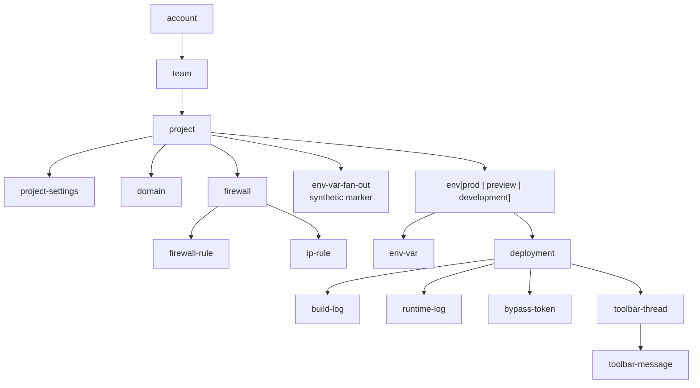

# Vercel provider — plugin and risk model

`@vaubaan/plugin-vercel` (`plugins/vercel`), migrated to the v5 Plugin SDK in
P1.2b. Spec: [`vaubaan-gateway.md`](../../spec/vaubaan-gateway.md) §5 (plugins),
§3.2 (presets); [`gateway-risk-model.md`](../../spec/gateway-risk-model.md) §2,
§4, §7. ADRs: [[plugin-contract-and-credential-spec]],
[[rewrap-official-mcps]], [[vercel-augment-with-rest-tools]]. Contributor
guide: [`plugins/vercel/README.md`](../../../plugins/vercel/README.md).

The v4 research document this handbook replaces (French, 2026-07-01) remains
in the git history; its decisions — four classifier bug fixes, one
`domain-write` risk, a dedicated `read-env-var-plaintext` risk, toolbar as
its own low risk — are all implemented and listed in §5.

## 1. Data model

One plane, `runtime`. The **project** is the resource; the **environment** is
a slice segment.

| Entity                                 | Cardinality  | Notes                                                                             |
| -------------------------------------- | ------------ | --------------------------------------------------------------------------------- |
| `account`, `team`                      | one, bounded | The token's account and the team the connection is pinned to (`team_id` field).   |
| `project`                              | bounded      | The resource (`prj_xxx`). Discovered at connection time; selected by the mission. |
| `project-settings`, `firewall`         | one          | Singletons per project. Writes affect every environment.                          |
| `domain`, `firewall-rule`, `ip-rule`   | bounded      | Project-scoped posture entities with public effect.                               |
| `env`                                  | bounded      | Closed triad. `envScopable: true`; its ident **is** the environment label.        |
| `deployment`, `runtime-log`            | unbounded    | Vercel keeps history.                                                             |
| `env-var`, `bypass-token`, `toolbar-*` | bounded      | Per environment / per deployment.                                                 |
| `env-var-fan-out`                      | one          | Emitted when one env-var write touches several environments in a single call.     |

## 2. Tools → slices

31 tools: 18 rewrapped from `mcp.vercel.com` (frozen in
`src/upstream-tools.json`), 13 custom REST (`src/custom-tools.ts`). The
classifier (`src/classify.ts`) is pure and emits one or more slices per call.

**Project resolution.** `projectId` (or `project_id`) must be a resource of
the mission; absent, the mission's single Vercel project applies; several
projects and no argument, a project the mission does not hold, or a malformed
ref are refused. Four account-level tools need no project
(`search_vercel_documentation`, `list_teams`, `list_projects`,
`check_domain_availability_and_price`) but still refuse a foreign `projectId`.

**Environment.** `target` (`production | preview | development`, `prod`
accepted) maps to `env[prod | preview | development]`. `deploy_to_vercel`
without a target defaults to **prod** (conservative). `upsert_env_var` honours
the whole `target` array — one slice per environment, plus the
`env-var-fan-out` marker when more than one; omitted or unknown targets mean
all three. `delete_env_var` always emits the three environments plus the
marker: the Vercel API removes the variable from every environment it lives
in, whatever the hint.

**Identifiers.** Deployment (`idOrUrl`, `deploymentId`, `url`), thread,
message, domain, rule and env-var ids are embedded when slice-safe
(`[a-zA-Z0-9_/-]+`) and replaced by `[*]` otherwise (URLs, FQDNs). Catalog
patterns match any ident there, so only audit precision is lost.

| Tool                                                                        | Slice                                                                       | Risk                                                |
| --------------------------------------------------------------------------- | --------------------------------------------------------------------------- | --------------------------------------------------- |
| `search_vercel_documentation`                                               | `account.docs.R`                                                            | read-account                                        |
| `list_teams` / `list_projects`                                              | `account.team[*].R` / `account.project[*].R`                                | read-account                                        |
| `check_domain_availability_and_price`                                       | `account.domain-registrar.R`                                                | read-account                                        |
| `get_project`                                                               | `project[P].project-settings.R`                                             | read-account                                        |
| `list_project_domains`                                                      | `project[P].domain[*].R`                                                    | read-account                                        |
| `list_deployments` / `get_deployment`                                       | `project[P].deployment[D].R`                                                | read-deployment                                     |
| `get_deployment_build_logs` / `get_runtime_logs`                            | `project[P].deployment[D].{build-log,runtime-log}.R`                        | read-deployment                                     |
| `web_fetch_vercel_url`                                                      | `project[P].deployment[D].fetch.R`                                          | fetch-deployment-url                                |
| `list_toolbar_threads` / `get_toolbar_thread`                               | `project[P].deployment[D].toolbar-thread[T].R`                              | read-deployment                                     |
| `list_env_vars`                                                             | `project[P].env-var[*].R` (+ `…env-var[*].plaintext.R` when `decrypt=true`) | read-env-var (+ read-env-var-plaintext)             |
| `get_firewall_config`                                                       | `project[P].firewall.R`                                                     | firewall-read                                       |
| `deploy_to_vercel`                                                          | `project[P].env[E].deployment.W`                                            | deploy (`vercel[E].deploy`)                         |
| `get_access_to_vercel_url`                                                  | `project[P].deployment[D].bypass-token.W`                                   | mint-bypass-token                                   |
| `upsert_env_var`                                                            | `project[P].env[E].env-var[K].W` × envs (+ `project[P].env-var-fan-out.W`)  | env-var-write (`vercel[E].env-var-write`) + fan-out |
| `delete_env_var`                                                            | `project[P].env[E].env-var[ID].W` × 3 + `project[P].env-var-fan-out.W`      | env-var-write × 3 + env-var-fan-out                 |
| `update_project_settings`                                                   | `project[P].project-settings.W`                                             | project-settings-write                              |
| `add_project_domain` / `verify_project_domain` / `remove_project_domain`    | `project[P].domain[N].W`                                                    | domain-write                                        |
| `toggle_firewall`                                                           | `project[P].firewall.W`                                                     | firewall-write                                      |
| `upsert_firewall_rule` / `remove_firewall_rule`                             | `project[P].firewall.firewall-rule[R].W`                                    | firewall-rule-write                                 |
| `manage_ip_blocking`                                                        | `project[P].firewall.ip-rule[I].W`                                          | ip-rule-write                                       |
| `change_toolbar_thread_resolve_status`                                      | `project[P].deployment[D].toolbar-thread[T].W`                              | toolbar-write                                       |
| `reply_to_toolbar_thread` / `edit_toolbar_message` / `add_toolbar_reaction` | `project[P].deployment[D].toolbar-thread[T].toolbar-message[M].W`           | toolbar-write                                       |

`assertCatalogCoverage` (kit) runs one sample per tool in
`tests/unit/plugin.test.ts`: every tool is covered by a dedicated risk; the
fallback `vercel.uncategorized-write` matches every write too and stays
mandatory for tools added later.

## 3. Catalog

`src/risk-catalog.yaml`, `catalog_version: 2`, loaded at boot by the SDK (the
v4 `risk-catalog.ts` twin and its sync test are gone). 16 risks + fallback,
ids unchanged since v4. Two risks are env-scoped —
`vercel.deploy` and `vercel.env-var-write`, `acceptable_in_envs: [preview,
development, prod]`, `vector_overrides.prod` raising reversibility (and, for
deploys, blast and visibility). Everything else is account-scoped: project
settings, domains and firewall affect every environment at once;
`env-var-fan-out` is by construction multi-environment.

### Presets

| Preset      | Entries                                                                                                                                                                                                                                                                  |
| ----------- | ------------------------------------------------------------------------------------------------------------------------------------------------------------------------------------------------------------------------------------------------------------------------ |
| `read-only` | read-account, read-deployment, read-env-var, fetch-deployment-url, firewall-read — all `auto`.                                                                                                                                                                           |
| `developer` | The reads above (larger quotas) + `vercel[preview].deploy`, `vercel[development].deploy`, `vercel[preview].env-var-write`, `vercel[development].env-var-write`, toolbar-write, mint-bypass-token — all `auto`. No production configuration of any kind.                  |
| `operator`  | Developer + `vercel[prod].deploy`, `vercel[prod].env-var-write`, env-var-fan-out, project-settings-write, domain-write, firewall-read, firewall-write, firewall-rule-write, ip-rule-write, read-env-var-plaintext. Every production-affecting entry is gated `approval`. |

Values: reads 2 000–5 000 per period at 120/min; preview writes 200 per
period at 10–20/min; production and posture writes 20–50 per period at
5/min. The deferred ADR `mission-presets-default-values` (plan §5.5) may
revise the numbers; the shape is fixed by [[plugin-contract-and-credential-spec]] D5.

### Environment axis — what the host must do

For Vercel the environment lives in the arguments, not in a resource label.
The default `resourceEnvResolver` of `@vaubaan/policy-engine` resolves the
environment from the **owner's label on the project resource**, which for a
Vercel project (spanning all three environments) is meaningless: a project
labelled `prod` would qualify a preview deploy as `vercel[prod].deploy`, and
an unlabelled project would never qualify anything, so the env-qualified
preset entries above would not match `risks_touched`. The plugin therefore
declares `envOf` (`vercelEnvOf(slice)`: reads the `env[<label>]` segment;
`null` when env-less), which the host's default resolver
(`envResolverFor(resources, plugin.envOf)`) asks before the resource label
([[plugin-sdk]], "Environment resolution"). `discoverResources` notes the
axis in `metadata.environments`.

## 4. Credential

`api-key` with `token` (secret) and `team_id` (`^team_[A-Za-z0-9]+$`). What
v4 did — a personal access token scoped to a team, team auto-detected through
`/v2/teams` — becomes a declarative form: the user pastes the token and the
team id, the host stores them encrypted, the plugin narrows them with
`vercelAuth()`. No refresh: the token expires on the date chosen at creation;
`UpstreamAuthError` on 401/403 lets the host mark the connection `expired`.
The team is pinned: an explicit `teamId` argument that differs from the
connection's team is refused by `execute` before any network call (v4
forwarded it).

## 5. Execution and discovery

- Rewrapped tools: `POST https://mcp.vercel.com/` with a JSON-RPC
  `tools/call` (prefix stripped), SSE-framed answer, one frame per response.
  The upstream result is already an `McpToolResult` and is passed through.
- Custom tools: REST on `https://api.vercel.com` (`/v9/projects`,
  `/v10/projects/{id}/env`, `/v9|v10/projects/{id}/domains`,
  `/v1/security/firewall/config`), bodies whitelisted field by field.
- Argument normalisation: `teamId` and `projectId` are filled from the
  connection and the mission's single project **only when the tool's schema
  declares them** (upstream tools declare `additionalProperties: false`).
- Errors: 401/403 → `UpstreamAuthError` (thrown); any other upstream failure
  (HTTP error, JSON-RPC error frame) → `isError: true` result the agent reads.
- `discoverResources`: `GET /v2/teams/{team_id}` then `GET /v10/projects`
  paged by `pagination.next` → `until`, 100 per page, 10 pages at most.

### Edge cases carried from v4 (all implemented, all tested)

1. `get_access_to_vercel_url` is a credential mint → `bypass-token.W`, not a read.
2. `list_env_vars decrypt=true` adds the plaintext slice → distinct risk.
3. `upsert_env_var` fans out; `delete_env_var` always touches the three environments.
4. One `domain-write` risk for add / verify / remove (option A of the research).
5. Deployment Protection (SSO / password) cannot be changed by API tokens; no tool.
6. `deploy_to_vercel` upstream declares no argument (it deploys "the current project" from CLI context); it is classified on `target` and the mission project, and its usefulness through a remote rewrap is doubtful — kept for parity, to be re-evaluated when the upstream tool list is refreshed.

## How to debug

- **Boot fails with `Invalid risk catalog '…/plugins/vercel/src/risk-catalog.yaml'`** —
  read every bullet; a preset entry naming an env on a non-env-scoped risk,
  or an env outside `acceptable_in_envs`, is the usual cause.
- **`projectId: argument missing and the mission touches N Vercel projects`** —
  the mission selects several projects; the agent must name one.
- **`teamId '…' is not the team of this connection`** — the agent copied a
  team id from elsewhere; omit it, the connection's team applies.
- **Every preview deploy refused as `vercel[prod].deploy` (or never qualified)** —
  a host that builds its own `EnvResolver` from the resource label alone;
  compose it with the plugin's `envOf` (see §3).
- **`next build` fails with `The "path" argument must be of type string or an instance of URL. Received an instance of URL`** —
  a plugin imported by `apps/gateway` used `new URL('./risk-catalog.yaml', import.meta.url)`;
  Turbopack rewrites that pattern into an asset URL of another realm. The
  plugin builds the path as a string instead (`VERCEL_CATALOG_PATH` in
  `src/index.ts`); keep it that way.
- **`mockFetch: unexpected GET …`** in tests — the plugin called a URL no
  route covers; the message names it.

## References

- Code: `plugins/vercel/src/`, tests `plugins/vercel/tests/unit/` (125 tests:
  33 `plugin.test.ts`, 31 `classify.test.ts`, 60 `risk-catalog.test.ts`,
  1 `data-model.test.ts`).
- Neighbours: [[plugin-sdk]], [[policy-engine]], [`providers/README.md`](./README.md).
