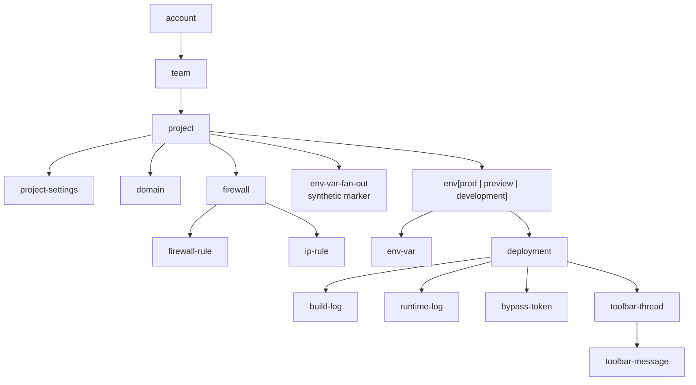

# Vercel provider — plugin and risk model

`@vaubaan/plugin-vercel` (`plugins/vercel`, version 3.0.0), migrated to the
v5 Plugin SDK in P1.2b. Spec: [`vaubaan-gateway.md`](../../spec/vaubaan-gateway.md) §5 (plugins),
§3.2 (presets); [`gateway-risk-model.md`](../../spec/gateway-risk-model.md) §2,
§4, §7. ADRs: [[plugin-contract-and-credential-spec]],
[[rewrap-official-mcps]], [[vercel-augment-with-rest-tools]],
[`plugin-arguments-closed-surface-and-typed-refusals`](../../decisions/plugin-arguments-closed-surface-and-typed-refusals.md),
[`decision-stages-fail-closed-and-audited`](../../decisions/decision-stages-fail-closed-and-audited.md)
(D3, the environment of a slice). Contributor
guide: [`plugins/vercel/README.md`](../../../plugins/vercel/README.md).

The v4 research document this handbook replaces (French, 2026-07-01) remains
in the git history; its decisions — four classifier bug fixes, one
`domain-write` risk, a dedicated `read-env-var-plaintext` risk, toolbar as
its own low risk — are all implemented and listed in §5.

## 1. Data model

One plane, `runtime`. The **project** is the resource; the **environment** is
a slice segment.

| Entity                                 | Cardinality  | Notes                                                                             |
| -------------------------------------- | ------------ | --------------------------------------------------------------------------------- |
| `account`, `team`                      | one, bounded | The token's account and the team the connection is pinned to (`team_id` field).   |
| `project`                              | bounded      | The resource (`prj_xxx`). Discovered at connection time; selected by the mission. |
| `project-settings`, `firewall`         | one          | Singletons per project. Writes affect every environment.                          |
| `domain`, `firewall-rule`, `ip-rule`   | bounded      | Project-scoped posture entities with public effect.                               |
| `env`                                  | bounded      | Closed triad. `envScopable: true`; its ident **is** the environment label.        |
| `deployment`, `runtime-log`            | unbounded    | Vercel keeps history.                                                             |
| `build-log`                            | one          | One build log per deployment.                                                     |
| `env-var`, `bypass-token`, `toolbar-*` | bounded      | Per environment / per deployment.                                                 |
| `env-var-fan-out`                      | one          | Emitted when one env-var write touches several environments in a single call.     |

## 2. Tools → slices

31 tools: 18 rewrapped from `mcp.vercel.com` (frozen in
`src/upstream-tools.json`), 13 custom REST (`src/custom-tools.ts`). The
classifier (`src/classify.ts`) is pure and emits one or more slices per call.

**Project resolution.** `projectId` must be a `pathIdent` and a resource of
the mission; absent, the mission's single Vercel project applies, provided
its ref is a `pathIdent` too; several projects and no argument, a project
the mission does not hold, or a malformed ref are refused.
Four account-level tools need no project (`search_vercel_documentation`,
`list_teams`, `list_projects`, `check_domain_availability_and_price`) but
still refuse a foreign `projectId`. `execute` resolves the project with the
same function (`resolveProject`) and overwrites the argument with the result,
so the slice and the request name the same project (§5).

**Only declared arguments.** The rewrapped tools forward their arguments
whole, so the argument surface of a tool is closed: once the rules below
have judged the arguments they read, in their own words,
`undeclaredArgument(tool, args)` (over the SDK's `undeclaredArgumentDenial`)
denies a call carrying an argument the tool's schema does not declare:
`<name>: not an argument of '<tool>' — nothing classifies it, so it is not sent.`
Another spelling is another argument: `project_id`, `thread_id`,
`message_id` are refused. `teamId` and `projectId` are the two routing
arguments, read for every tool whatever its schema declares and never
forwarded as given (§5). Two upstream schemas are open (`deploy_to_vercel`,
`list_teams`) and declare no property: apart from the two routing
arguments, they take none.

**Environment.** The environment is read from the arguments only where the
provider receives them. `upsert_env_var` honours the whole `target` array
(`production | preview | development`) — one slice per environment, plus the
`env-var-fan-out` marker when more than one; omitted or empty means all
three; a `target` that is not an array, or that holds any other literal, is
**refused** (the array is forwarded as is, so a part the classifier cannot
read is never dropped). `deploy_to_vercel` is **always classified on
`prod`**: the upstream tool declares no argument, so a `target` would select
the risk here and be ignored there — and a call carrying one is refused as
an undeclared argument. `delete_env_var` always emits the three
environments plus the marker: the Vercel API removes the variable from every
environment it lives in, whatever the hint.

**Identifiers.** An identifier that reaches a request path has one grammar
function per kind, exported from `classify.ts` and called by `execute` too:
a value outside its grammar — `..`, a separator, an encoded form — is denied
by `classify` and refused by `execute` before any request, never escaped
(ADR
[`plugin-identifiers-one-grammar-for-classify-and-execute`](../../decisions/plugin-identifiers-one-grammar-for-classify-and-execute.md)).

| Value                                                             | Grammar                                                                                                                                                             | Where it lands                                                                             | Outside the grammar                                                                                                                          |
| ----------------------------------------------------------------- | ------------------------------------------------------------------------------------------------------------------------------------------------------------------- | ------------------------------------------------------------------------------------------ | -------------------------------------------------------------------------------------------------------------------------------------------- |
| `projectId`, the project resource ref                             | `pathIdent` — `PATH_IDENT = ^[A-Za-z0-9_-]{1,64}$`, inside `resolveProject`                                                                                         | REST path `/projects/{id}`, query or arguments of the upstream tool, slice `project[P]`    | `projectId: malformed project ref` (the argument); `projectId: the project ref of this mission is not a path-safe identifier` (the resource) |
| `id` of `delete_env_var`                                          | `pathIdent`                                                                                                                                                         | REST path `/env/{id}`, slice `env-var[ID]`                                                 | `id: missing or malformed env var id`                                                                                                        |
| `domain` of `verify_project_domain` / `remove_project_domain`     | `domainName` — dot-separated labels of letters, digits and inner hyphens, optional leading `*.`, at most 253 characters                                             | REST path `/domains/{domain}` (as it is), slice `domain[*]` or `domain[N]`                 | `domain: missing or malformed domain name`                                                                                                   |
| `name` of `add_project_domain`                                    | `domainName`                                                                                                                                                        | JSON body, slice `domain[*]` or `domain[N]`                                                | `name: missing or malformed domain name`                                                                                                     |
| `idOrUrl`, `deploymentId`, `url` of a rewrapped tool              | `readDeploymentTargets` — a deployment id or hostname (`[A-Za-z0-9][A-Za-z0-9._-]{0,252}`), or a plain `http(s)` URL without credentials whose host is one of those | REST path of the ownership lookup (§5), then the upstream arguments; slice `deployment[D]` | `<arg>: malformed deployment id.` and its siblings; `<arg>: not an argument of <tool>.`                                                      |
| `key` of `upsert_env_var`, `ruleId`, `id` of `manage_ip_blocking` | none required — JSON body only                                                                                                                                      | JSON body; slice ident when a `pathIdent`, `[*]` otherwise                                 | —                                                                                                                                            |

`readDeploymentTargets` is schema-driven: every deployment argument the tool
declares is read (a required one must be there), and one the tool does
**not** declare is a denial, since it would be forwarded without the
ownership check. In a slice, a secondary identifier is embedded when it is a
`pathIdent` and replaced by `[*]` otherwise (a dotted domain, a deployment
hostname or URL, several deployment arguments). Catalog patterns match any
ident there, so only audit precision is lost. `manage_ip_blocking` embeds
`id` on a `remove` only: `execute` does not send it on an `insert`. The
deployment segment is not proof of ownership: `execute` verifies it before
the upstream call (§5, "Deployment binding").

**Refused tools.** Five declared tools address a toolbar thread by id
(`get_toolbar_thread`, `change_toolbar_thread_resolve_status`,
`reply_to_toolbar_thread`, `edit_toolbar_message`, `add_toolbar_reaction`).
Their upstream schema has no `projectId` and no lookup ties a thread to a
project, so a call classified on the mission's project could act on any
thread of the team. The classifier denies them (`UNBOUND_TOOLS`), and
`execute` refuses them too. They stay declared (tool names are stable);
`list_toolbar_threads`, which takes `projectId`, stays available. Re-enabling
them needs a verified thread → project lookup.

| Tool                                                                     | Slice                                                                       | Risk                                                |
| ------------------------------------------------------------------------ | --------------------------------------------------------------------------- | --------------------------------------------------- |
| `search_vercel_documentation`                                            | `account.docs.R`                                                            | read-account                                        |
| `list_teams` / `list_projects`                                           | `account.team[*].R` / `account.project[*].R`                                | read-account                                        |
| `check_domain_availability_and_price`                                    | `account.domain-registrar.R`                                                | read-account                                        |
| `get_project`                                                            | `project[P].project-settings.R`                                             | read-account                                        |
| `list_project_domains`                                                   | `project[P].domain[*].R`                                                    | read-account                                        |
| `list_deployments`                                                       | `project[P].deployment[*].R`                                                | read-deployment                                     |
| `get_deployment`                                                         | `project[P].deployment[D].R`                                                | read-deployment                                     |
| `get_deployment_build_logs` / `get_runtime_logs`                         | `project[P].deployment[D].{build-log,runtime-log}.R`                        | read-deployment                                     |
| `web_fetch_vercel_url`                                                   | `project[P].deployment[D].fetch.R`                                          | read-deployment + fetch-deployment-url              |
| `list_toolbar_threads`                                                   | `project[P].deployment[*].toolbar-thread[*].R`                              | read-deployment                                     |
| `list_env_vars`                                                          | `project[P].env-var[*].R` (+ `…env-var[*].plaintext.R` when `decrypt=true`) | read-env-var (+ read-env-var-plaintext)             |
| `get_firewall_config`                                                    | `project[P].firewall.R`                                                     | firewall-read                                       |
| `deploy_to_vercel`                                                       | `project[P].env[prod].deployment.W`                                         | deploy (`vercel[prod].deploy`)                      |
| `get_access_to_vercel_url`                                               | `project[P].deployment[D].bypass-token.W`                                   | mint-bypass-token                                   |
| `upsert_env_var`                                                         | `project[P].env[E].env-var[K].W` × envs (+ `project[P].env-var-fan-out.W`)  | env-var-write (`vercel[E].env-var-write`) + fan-out |
| `delete_env_var`                                                         | `project[P].env[E].env-var[ID].W` × 3 + `project[P].env-var-fan-out.W`      | env-var-write × 3 + env-var-fan-out                 |
| `update_project_settings`                                                | `project[P].project-settings.W`                                             | project-settings-write                              |
| `add_project_domain` / `verify_project_domain` / `remove_project_domain` | `project[P].domain[N].W`                                                    | domain-write                                        |
| `toggle_firewall`                                                        | `project[P].firewall.W`                                                     | firewall-write                                      |
| `upsert_firewall_rule` / `remove_firewall_rule`                          | `project[P].firewall.firewall-rule[R].W`                                    | firewall-rule-write                                 |
| `manage_ip_blocking`                                                     | `project[P].firewall.ip-rule[I].W` (`ip-rule[*]` on an `insert`)            | ip-rule-write                                       |
| `get_toolbar_thread` and the four thread-addressed writes                | — (denied)                                                                  | —                                                   |

Every read also touches `read-account`, whose pattern is `vercel.[**].R`; the
column names the dedicated risk a mission adds to it.

`assertCatalogCoverage` (kit) runs at least one sample per tool in
`tests/unit/plugin.test.ts`: every classified tool is covered by a dedicated
risk; the fallback `vercel.uncategorized-write` is counted only when no
dedicated entry matched (ADR [[fallback-risk-only-when-uncategorized]]) and
stays mandatory for tools added later. Two catalog entries are reached by no
tool today: `vercel.toolbar-write` (the thread tools are refused) and the
`preview` / `development` qualifications of `vercel.deploy` (the only deploy
tool is classified on prod). Risk ids are stable, so they stay in the catalog
and in the presets, where they grant nothing.

## 3. Catalog

`src/risk-catalog.yaml`, `catalog_version: 2`, loaded at boot by the SDK (the
v4 `risk-catalog.ts` twin and its sync test are gone). 16 risks + fallback,
ids unchanged since v4. Two risks are env-scoped —
`vercel.deploy` and `vercel.env-var-write`, `acceptable_in_envs: [preview,
development, prod]`, `vector_overrides.prod` raising reversibility (and, for
deploys, blast and visibility). Everything else is account-scoped: project
settings, domains and firewall affect every environment at once;
`env-var-fan-out` is by construction multi-environment.

### Presets

| Preset      | Entries                                                                                                                                                                                                                                                                                                                                                                                                                                                                       |
| ----------- | ----------------------------------------------------------------------------------------------------------------------------------------------------------------------------------------------------------------------------------------------------------------------------------------------------------------------------------------------------------------------------------------------------------------------------------------------------------------------------- |
| `read-only` | read-account, read-deployment, read-env-var, fetch-deployment-url, firewall-read — all `auto`.                                                                                                                                                                                                                                                                                                                                                                                |
| `developer` | read-account, read-deployment, read-env-var, fetch-deployment-url (larger quotas) — **not** firewall-read, so `get_firewall_config` is refused under this preset — + `vercel[preview].deploy`, `vercel[development].deploy`, `vercel[preview].env-var-write`, `vercel[development].env-var-write`, toolbar-write, mint-bypass-token — all `auto`. No production configuration of any kind, so `deploy_to_vercel` (always `vercel[prod].deploy`) is refused under this preset. |
| `operator`  | Developer + `vercel[prod].deploy`, `vercel[prod].env-var-write`, env-var-fan-out, project-settings-write, domain-write, firewall-read, firewall-write, firewall-rule-write, ip-rule-write, read-env-var-plaintext. Every production-affecting entry is gated `approval`.                                                                                                                                                                                                      |

Values: account and deployment reads 2 000–5 000 per period at 120/min, the
other encrypted reads (env vars, URL fetch, firewall) 200–1 000 at
30–60/min, the plaintext env-var read 20 at 5/min under `approval`; preview
and development writes 200 per period at 10–20/min; `toolbar-write` 500 at
30/min and `mint-bypass-token` 50–100 at 5–10/min; production and posture
writes 20–50 per period at 5/min, except `firewall-rule-write` (50 at
10/min) and `ip-rule-write` (100 at 20/min). The deferred ADR `mission-presets-default-values` (plan §5.5) may
revise the numbers; the shape is fixed by [[plugin-contract-and-credential-spec]] D5.

### Environment axis — what the host must do

For Vercel the environment lives in the arguments, not in a resource label.
The default `resourceEnvResolver` of `@vaubaan/policy-engine` resolves the
environment from the **owner's label on the project resource**, which for a
Vercel project (spanning all three environments) is meaningless: a project
labelled `prod` would qualify a preview deploy as `vercel[prod].deploy`, and
an unlabelled project would never qualify anything, so the env-qualified
preset entries above would not match `risks_touched`. The plugin therefore
declares `envOf`, wired as
`envOf: (slice) => vercelEnvOf(slice) ?? undefined`, which the host's default resolver
(`envResolverFor(resources, plugin.envOf)`) asks before the resource label
([[plugin-sdk]], "Environment resolution"). `vercelEnvOf(slice)` has three
answers:

| The slice                                                                                                                                  | `vercelEnvOf`                      | The host                                                                                                   |
| ------------------------------------------------------------------------------------------------------------------------------------------ | ---------------------------------- | ---------------------------------------------------------------------------------------------------------- |
| has `env` followed by one label of the triad (`env[prod]`)                                                                                 | that label                         | qualifies the touched risks with it                                                                        |
| has no `env` segment, or `env` followed by another entity name (project settings, domains, firewall, env-less deployment reads)            | `null`, handed over as `undefined` | falls back to the owner's label on the project                                                             |
| has `env` followed by anything else: a wildcard, a list, a glob, a label outside the triad (`env[*]`, `env[prod,preview]`, `env[staging]`) | `NO_SINGLE_ENV`                    | resolves no environment and does not consult the label: every env-scoped risk the slice touches is refused |

The third answer exists because such a slice reaches several environments,
or one the provider does not have: no env-scoped risk can be priced on it,
and the owner's label must not stand in. The classifier emits no such slice
today (a multi-environment write is one slice per environment plus the
fan-out marker); the rule is what keeps a future one from failing open.
`discoverResources` notes the axis in `metadata.environments`.

## 4. Credential

`api-key` with `token` (secret) and `team_id` (`^team_[A-Za-z0-9]+$`). What
v4 did — a personal access token scoped to a team, team auto-detected through
`/v2/teams` — becomes a declarative form: the user pastes the token and the
team id, the host stores them encrypted, the plugin narrows them with
`vercelAuth()`. No refresh: the token expires on the date chosen at creation.
`UpstreamAuthError` is thrown on 401 and 403; the host marks the connection
`expired` on a 401 only (a 403 is a failed call).
**The team is pinned to the credential.** No call reaches Vercel on behalf of
another team, and a team id never comes from the tool arguments:

- a `teamId` argument that is not exactly the credential's `team_id` —
  another string, or any non-string (`null`, a number, an array) — is refused
  by `execute` before any network call, on every tool;
- the value sent is always written from the credential: in the query of every
  REST call (custom tools, discovery, the deployment lookup), and in the
  arguments of every rewrapped tool that can receive it — the schema declares
  `teamId`, or the schema is open (`deploy_to_vercel`, `list_teams`);
- four rewrapped tools have a closed schema without `teamId` and cannot carry
  it. They are listed with their reason in `TEAMLESS_UPSTREAM_TOOLS`
  (`src/execute.ts`): `search_vercel_documentation` and
  `check_domain_availability_and_price` read no team data;
  `get_access_to_vercel_url` and `web_fetch_vercel_url` are forwarded only
  after the deployment was resolved under the pinned team (§5). A rewrapped
  tool in that situation and absent from the list is refused.

`tests/unit/team-pin.test.ts` proves it over every declared tool, and checks
the list against the schemas, so a tool added later is covered or fails.

## 5. Execution and discovery

- Rewrapped tools: `POST https://mcp.vercel.com/` with a JSON-RPC
  `tools/call` (prefix stripped), SSE-framed answer, one frame per response.
  The upstream result is already an `McpToolResult` and is passed through.
- Custom tools: REST on `https://api.vercel.com` (`/v9/projects/{id}`,
  `/v10/projects/{id}/env`, `/v9/projects/{id}/env/{envVarId}` for the
  delete, `/v9|v10/projects/{id}/domains`, `/v1/security/firewall/config`
  and `…/config/active` for the read), bodies whitelisted field by field. The
  project, the env var id and the domain are read again with the
  classifier's `pathIdent` / `domainName` and interpolated as they are —
  nothing is percent-encoded, since `encodeURIComponent` leaves `.` and `..`
  untouched.
- Argument pinning (`pinArgs`, no network): an unknown tool and the five
  thread-addressed tools are refused; `teamId` is checked against the
  credential (§4); the project is resolved by `resolveProject`, the function
  the classifier uses; then an argument the tool does not declare is refused
  by the classifier's own `undeclaredArgument` — the second lock, for a
  caller that did not go through `classify`. The caller's `teamId` and `projectId` are then dropped
  and written again — `teamId` from the credential wherever the tool can
  receive it (declared property, or open schema), `projectId` from the
  resolved project on a project-rooted tool that can receive it. The four
  account-level tools never get a `projectId`, even one that was checked. A
  closed schema without the property gets neither, so `projectId` may be
  passed to any project-rooted tool to name the project of a multi-project
  mission. Everything else is forwarded as given, which is why only declared
  arguments may be there.
- Deployment binding (`bindDeployments`): a rewrapped tool whose schema
  declares `idOrUrl`, `deploymentId` or `url` (`get_deployment`,
  `get_deployment_build_logs`, `get_runtime_logs`,
  `get_access_to_vercel_url`, `web_fetch_vercel_url`) is forwarded only after
  `GET /v13/deployments/{id or hostname}?teamId=<pinned>` answered with a
  `projectId` equal to the resolved project (and an `ownerId`, when present,
  equal to the pinned team). Anything else is a refusal the agent reads (an
  `isError` result): a 404 or 403 on the lookup, an answer without
  `projectId` (the reduced view of a deployment the team does not own),
  another project. A lookup the provider fails otherwise (401, 5xx, the
  network) is not a refusal: it is thrown as an upstream failure, and
  nothing is forwarded either. `idOrUrl` and
  `deploymentId` are replaced by the verified deployment id; `url` must be a
  plain `http(s)` URL without credentials and is forwarded re-serialised, so
  the host that was verified is the host the upstream tool receives. The
  arguments are read by the classifier's own `readDeploymentTargets` (§2):
  what it denies is refused here before the first lookup, so a malformed or
  undeclared deployment argument costs no network call. The check is
  schema-driven: a tool added upstream with one of these arguments is bound
  without a code change. Cost: one REST call per deployment-addressed call. A custom domain
  or alias the lookup does not resolve is refused (fail closed). A 403 on
  the lookup does not expire the connection; a 401 does.
- Errors: a provider failure is **thrown** — 401/403 → `UpstreamAuthError`,
  any other failed status → `UpstreamHttpError` (with the status), a JSON-RPC
  error frame or a missing frame of the MCP server → a plain `Error`, a
  network failure → as it comes. The host records it as `upstream_error` in
  the audit (`vercel answered HTTP 500 (UpstreamHttpError)`) and tells the
  agent `Upstream error: …`. An `isError: true` result is returned only for
  what the executor declines itself (`ExecutorRefusal`, a class local to
  `src/execute.ts` with the shape of the SDK's, caught at the entry point):
  `pinArgs` refusals — an undeclared argument among them —, an unreadable or
  unbound deployment argument, a missing or malformed argument of a custom
  tool. A rewrapped tool whose upstream
  answers an `isError` result is passed through as it is.
- `discoverResources`: `GET /v2/teams/{team_id}` then `GET /v10/projects`
  paged by `pagination.next` → `until`, 100 per page, 10 pages at most. A
  project whose id is not a `pathIdent` fails discovery (`project id "…" is
not a path-safe identifier`): no call could name it.

### Edge cases carried from v4 (all implemented, all tested)

1. `get_access_to_vercel_url` is a credential mint → `bypass-token.W`, not a read.
2. `list_env_vars decrypt=true` adds the plaintext slice → distinct risk.
3. `upsert_env_var` fans out; `delete_env_var` always touches the three environments.
4. One `domain-write` risk for add / verify / remove (option A of the research).
5. Deployment Protection (SSO / password) cannot be changed by API tokens; no tool.
6. `deploy_to_vercel` upstream declares no argument (it deploys "the current project" from CLI context); it is classified on **prod** and the mission project, takes no argument but the two routing ones (anything else is refused as undeclared), and is forwarded with the pinned `teamId` and the resolved `projectId` (its schema is open; whether the upstream tool honours them is not verified). Its usefulness through a remote rewrap is doubtful — kept for parity, to be re-evaluated when the upstream tool list is refreshed.
7. A second identifier is never trusted: deployments are verified against the mission project before the call, thread-addressed tools are refused (§2, §5).
8. `upsert_env_var` with a `target` the classifier cannot read is refused, not classified on the readable part.

## How to debug

- **Boot fails with `Invalid risk catalog '…/plugins/vercel/src/risk-catalog.yaml'`** —
  read every bullet; a preset entry naming an env on a non-env-scoped risk,
  or an env outside `acceptable_in_envs`, is the usual cause.
- **`projectId: argument missing and the mission touches N Vercel projects — name one`** —
  the mission selects several projects; the agent must name one.
- **`teamId is fixed by the connection ('team_…')`** — the agent passed a
  team id that is not the connection's (or a non-string); omit it, the
  connection's team applies.
- **`deployment '…' does not belong to vercel project '…' of this mission`** —
  the id or URL names a deployment of another project of the team; with a
  multi-project mission, pass the right `projectId`.
- **`deployment '…' could not be verified …`** — the pinned team cannot see
  the deployment (another team, a deleted deployment, a custom domain the
  lookup does not resolve); use the deployment id or its `*.vercel.app` URL.
- **`… a toolbar thread cannot be bound to a project of this mission`** — the
  five thread-addressed tools are refused (§2); `list_toolbar_threads` works.
- **`target: expected an array of 'production', 'preview' or 'development'`** —
  `upsert_env_var` received another literal (`prod`, `Production`) or a
  non-array.
- **`<name>: not an argument of 'vercel__…'`** — the call carries an
  argument the tool's schema does not declare: another spelling
  (`project_id`), a `target` on `deploy_to_vercel`, a field of Vercel's own
  API. Remove it.
- **`get_firewall_config` refused under the `developer` preset** — that
  preset does not carry `firewall-read`; `read-only` and `operator` do.
- **`deploy_to_vercel` refused under the `developer` preset** — it is always
  `vercel[prod].deploy`; use `operator` or add that risk to the mission.
- **Every preview deploy refused as `vercel[prod].deploy` (or never qualified)** —
  a host that builds its own `EnvResolver` from the resource label alone;
  compose it with the plugin's `envOf` (see §3).
- **`next build` fails with `The "path" argument must be of type string or an instance of URL. Received an instance of URL`** —
  a plugin imported by `apps/gateway` used `new URL('./risk-catalog.yaml', import.meta.url)`;
  Turbopack rewrites that pattern into an asset URL of another realm. The
  plugin builds the path as a string instead, through the SDK's
  `catalogPathNextTo` (`VERCEL_CATALOG_PATH` in `src/index.ts`); keep it that
  way.
- **`mockFetch: unexpected GET …`** in tests — the plugin called a URL no
  route covers; the message names it.

## References

- Code: `plugins/vercel/src/`, tests `plugins/vercel/tests/unit/` (622 tests:
  48 `plugin.test.ts` — the undeclared arguments on `classify` and `execute`
  and the three answers of `vercelEnvOf` among them —, 43 `classify.test.ts`, 55 `risk-catalog.test.ts`,
  99 `team-pin.test.ts`, 50 `binding.test.ts`, 11 `firewall.test.ts`,
  315 `identifier-injection.test.ts` — dot segments, separators and encoded
  forms in every identifier position of `classify` and `execute` —,
  1 `data-model.test.ts`; shared fixtures in `fixtures.ts`).
- Neighbours: [[plugin-sdk]], [[policy-engine]], [`providers/README.md`](./README.md).
