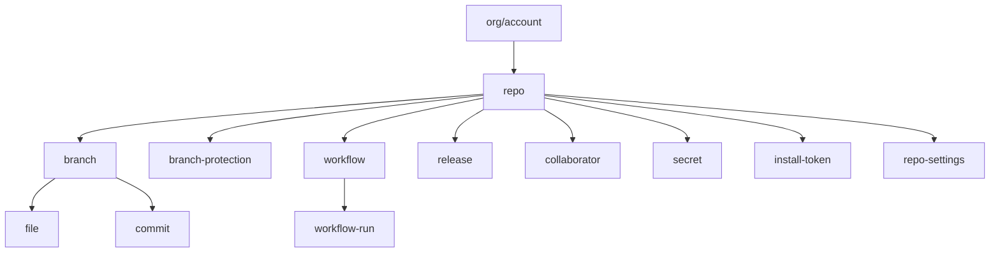
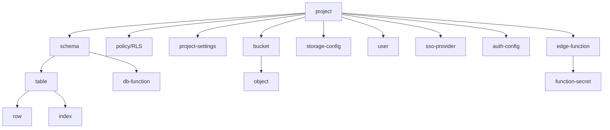
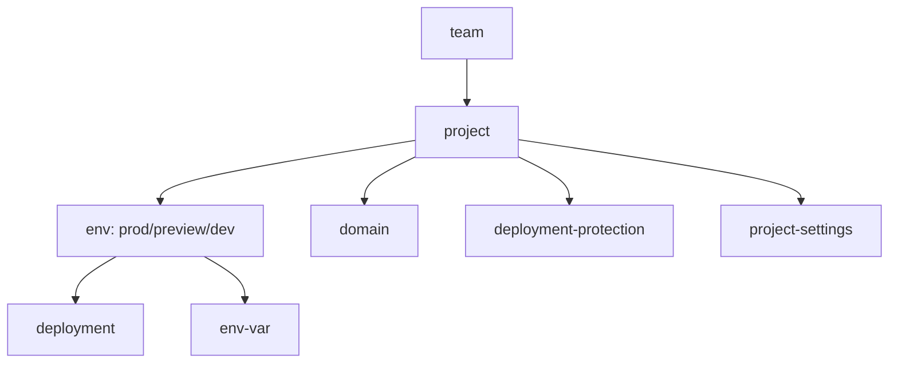
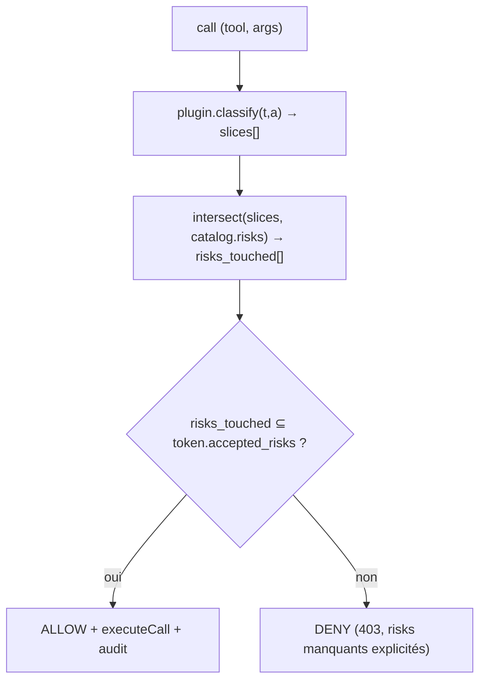

# Gateway — modèle de risque (CURRENT, supersède gateway-capability-model.md)

> Modèle actuel implémenté dans le code (depuis 2026-06-15, commit
> `chore(v1-drop)`). Remplace en bloc
> [`gateway-capability-model.md`](./gateway-capability-model.md) (v1, "rings
> concentriques") et trois itérations intermédiaires (v2 macros, v3 slices
> capability-based) qui n'ont jamais été actées. Le modèle ci-dessous est
> **risk-based**, pas capability-based : le token ne porte pas une liste
> d'autorisations, il porte une liste de **risques acceptés**.
>
> **Évolutions actées en aval** (à intégrer ici à la prochaine passe) :
> - [ADR unified-tokens-delegation-chain-and-escalation-channel](../decisions/unified-tokens-delegation-chain-and-escalation-channel.md)
>   — table `tokens` unifiée + `delegation_chain` + `escalation_channel`.
> - [ADR unified-gates-drop-confirm](../decisions/unified-gates-drop-confirm.md)
>   — drop des 3 gates `allow/confirm/deny`, des `project_risk_policies`,
>   du flow approval mint-time (Telegram/Email). Le binaire est
>   `risk ∈ accepted_risks` (allow) sinon deny ; l'élévation passe par
>   l'`escalation_channel` runtime.
>
> Recherche source : [`/.vaubaan/research/permission-threat-model-state-of-the-art.md`](../../.vaubaan/research/permission-threat-model-state-of-the-art.md).

## 0. Le shift conceptuel — "risque acceptable" plutôt que "droits demandés"

| Avant (v1 rings, v2 macros, v3 slices)         | Après (v4 risk-based)                                             |
| ---------------------------------------------- | ----------------------------------------------------------------- |
| Le manager **énumère ce que l'agent peut faire** (slices/caps explicites). | Le manager **énumère les risques qu'il accepte de prendre** sur cette session. |
| Sous-grant → l'agent se bloque mid-session, friction. Sur-grant → on perd le least-privilege. | Le profil de risque est **stable inter-sessions**, scannable en 30s, ne demande pas d'anticiper la trajectoire de l'agent. |
| Le langage du grant suit la surface d'API du provider. | Le langage du grant suit l'**intention métier** ("écrire en bulk", "modifier RLS", "deploy prod"). |
| Audit = "qu'est-ce qui a été grant". | Audit = "quelles slices ont été touchées + quels risques catégorisés". |

C'est l'inversion **capability-based → risk-based** que font Google Adaptive
Auth, Microsoft Conditional Access, OAuth Step-Up (RFC 9470) et Claude Code
Auto Mode. Le manager raisonne comme avec un humain à qui il délègue :
*"OK pour tout sauf : tu touches pas la prod, tu modifies pas DNS, tu crées
pas de comptes."*

### Ce qui survit des itérations précédentes

- **Plugin / policy étanches** (v1 §6 reste vrai).
- **Default-deny** + anti-patterns SQL (v1 §5.1).
- **Single-use tokens + TTL court** (v1 §8).
- **Env comme calque par-data** (v1 §4), désormais **un segment du data-model**.
- **Vecteur de risque 6D** (v2 §1), **attaché aux entrées du catalogue de
  risques**, pas au token. Drive l'ordre d'affichage UI (severity-sorted)
  et l'explicabilité audit — pas de gate dérivé.

Supprimé par l'ADR unified-gates-drop-confirm (à reprendre dans une
passe spec ultérieure) : les 3 gates `allow | confirm | deny`, les
channels Telegram/Email/Manual, le long-poll 25s.

### Ce qui change

- Plus de `(plane, level, action, env)` dans le wire.
- Plus de macro-permission (`inspect/read/mutate/destroy/govern`).
- Plus de slice dans le grant.
- Le token porte : `bindings[] + accepted_risks[] + denied_risks[]`.

## 1. Trois piliers — `Plugin`, `Catalog`, `Policy`

```
┌─ PLUGIN (par-provider, code) ─────────────────────────────────────────────┐
│  data-model    : entités du plane + cardinalités déclarées               │
│  classify(t,a) : (tool, args) → slice touchée (au call)                  │
└──────────────────────────────────────────────────────────────────────────┘

┌─ CATALOG (par-provider, statique, versionné dans le repo) ───────────────┐
│  risks: [                                                                │
│    { id, label, reason, matches (slice pattern),                         │
│      vector (6D), acceptable_in_envs?: string[] }                        │
│  ]                                                                       │
│  + un risque fallback générique par provider qui catch tout le reste.    │
│  (ADR unified-gates-drop-confirm : plus de default_gate.)                │
└──────────────────────────────────────────────────────────────────────────┘

┌─ PROJECT POLICY ─ DROPPÉ (ADR unified-gates-drop-confirm) ───────────────┐
│  Le seul garde-fou structurel est `acceptable_in_envs` au catalog level. │
└──────────────────────────────────────────────────────────────────────────┘

┌─ TOKEN MINT (par-session) ───────────────────────────────────────────────┐
│  bindings        : [{ provider, resource_ref, env? }, ...]               │
│  accepted_risks  : [ risk_id, ... ]                                      │
│  denied_risks    : [ risk_id, ... ]   (opt-out explicite)                │
│  context         : { task, agent_id, requester_user_id }                 │
│  ttl, singleUse                                                          │
│  ── PAS de slices, pas de plane/level, pas de macro.                     │
└──────────────────────────────────────────────────────────────────────────┘

┌─ RUNTIME (au call) ──────────────────────────────────────────────────────┐
│  1. plugin.classify(tool, args) → slice                                  │
│  2. risks_touched = intersect(slice, catalog.risks)                       │
│  3. if risks_touched ⊆ token.accepted_risks → ALLOW                      │
│     else                                       → DENY (strict)           │
│  4. audit_log.insert(slice, risks_touched, decision)                     │
└──────────────────────────────────────────────────────────────────────────┘
```

Le runtime reste **stateless** : la décision est `intersect(slice,
risks) ⊆ token.accepted_risks`. Aucun appel DB hot-path autre que la
résolution du token (cachée, comme aujourd'hui).

## 2. Le data-model par plane

> *Premier énoncé de chaque doc de provider* :
> **"Un provider est une BDD mutable de `(entité_1, entité_2, …)` avec
> des side effects observables via `read` sur certaines entités."**

Chaque plane d'un provider déclare un **graphe d'entités** avec leur
**cardinalité possible** et leur **containment**. Auto-générable en
mermaid pour les revues de design.

### 2.1 Cardinalités

3 niveaux universels :

| Cardinalité | Sémantique                            | Inférence depuis le selecteur            |
| ----------- | ------------------------------------- | ---------------------------------------- |
| `one`       | exactement 1 instance ciblée nommément| identifiant exact (`branch[main]`)       |
| `bounded`   | ≤ N, count borné                      | liste finie ou glob borné par namespace  |
| `unbounded` | nombre inconnu, peut tout toucher     | wildcard `*` ou `**`                     |

La cardinalité **n'est pas dans le wire** — elle émerge du selecteur et
sert au catalogue de risques pour distinguer `row.W[one]` de `row.W[*]`.

### 2.2 Exemple GitHub — plane `repo`



### 2.3 Exemple Supabase — planes `db`, `storage`, `auth`, `functions`



### 2.4 Exemple Vercel — plane `runtime`



> Les data-models par-provider vivent dans `packages/providers/<vendor>/
> src/data-model.ts` et se rendent automatiquement en mermaid dans le
> handbook du provider.

## 3. Le DSL des slices (interne)

**Une slice = un chemin sur le data-model + une action `R | W`.** Les
slices ne sont **jamais** dans le wire utilisateur ; elles servent
uniquement au plugin (`classify` au call) et au catalogue (`matches`
pattern).

### 3.1 Grammaire

```
slice      ::= provider '.' segment ('.' segment)* '.' action
segment    ::= ident | list | wildcard
ident      ::= [a-zA-Z0-9_/-]+
list       ::= '[' ident (',' ident)* ']'
wildcard   ::= '[*]' | '[**]'         # * = un segment, ** = récursif
action     ::= 'R' | 'W'
```

**Pas de regex.** Globs seulement (`*`, `**`). Listes
explicites (`[main, develop]`). Le `*` accepte `[a-zA-Z0-9_/-]+`
(donc `NEXT_PUBLIC_*` est valide ; `NEXT_PUBLIC_[A-Z]+` ne l'est pas).

### 3.2 Exemples

```
# slices émises par le plugin au call
github.repo[sbw-vaubaan/gateway].branch[main].W
github.repo[sbw-vaubaan/gateway].branch[feature/auth-bug].file[src/auth.ts].W
supabase.project[tlqgxnezmthbpzhdwxgi].schema[public].table[users].row[*].R
vercel.project[gateway].env[prod].deployment[*].W

# patterns dans le catalogue
github.repo[**].branch-protection[**].W
github.repo[**].install-token[**].*
supabase.project[**].policy[**].W
vercel.project[**].env[prod].env-var[**].W
```

### 3.3 Containment et matching

`intersect(grantPattern, executedSlice)` = matching path-segment par
path-segment, avec `*` matche un segment, `**` matche zéro-ou-plus
segments, et `[a,b,c]` matche `a` OR `b` OR `c`. Algorithme similaire
à `minimatch` mais sur des paths à segments structurés.

`covers(a, b)` : `a` couvre `b` ssi tout slice matché par `b` est aussi
matché par `a`. Standard inclusion logic (well-defined sur les globs).

## 4. Le catalogue de risques par provider

C'est le **dictionnaire** que le manager peut accepter. Versionné dans
le repo. Une entrée = une intention métier exprimable en une phrase.

### 4.1 Schéma

```ts
type RiskId = string;   // ex: "supabase.staging.bulk-row-write"

type RiskEntry = {
  id: RiskId;                         // stable, versionné, qualifié par provider+env
  label: string;                      // libellé court (UI)
  reason: string;                     // pourquoi c'est un risque (≤ 2 phrases)
  matches: SlicePattern;              // pattern catalogue (peut être large : ex: '**.policy[**].W')
  vector: RiskVector6D;               // pour expliquer + ordonner la UI par sévérité
  acceptable_in_envs?: string[];      // ex: ['preview', 'staging'] — empêche d'accepter sur prod
};
```

### 4.2 Vecteur 6D (rappel v2)

Sert à **expliquer** dans la UI / l'audit, à **ordonner les entrées
par sévérité décroissante** dans le picker mint, et à éclairer la
décision humaine de cocher (ou pas) un risk. Aucun gate dérivé du
vecteur (ADR unified-gates-drop-confirm §A1).

```ts
type RiskVector6D = {
  reversibility: 'reversible' | 'costly' | 'irreversible';
  blast:         'single' | 'env' | 'account' | 'bulk';
  data:          'metadata' | 'data' | 'secret' | 'pii';
  cost:          'free' | 'moderate' | 'unbounded';
  visibility:    'internal' | 'team' | 'public';
  persistence:   'stateless' | 'session' | 'posture';
};
```

### 4.3 Exemple — extrait du catalogue GitHub

```yaml
github:
  risks:
    - id: github.read-code
      label: "Lire le code et les PR"
      reason: "Lectures peuvent leak des secrets via .env commit (rare). Body
               des issues/PR est injectable (OWASP LLM01)."
      matches: "github.repo[**].file[**].R"
      vector: { reversibility: reversible, blast: single, data: data,
                cost: free, visibility: internal, persistence: stateless }
    - id: github.feature-branch-write
      label: "Créer / modifier des branches feature/*"
      reason: "Réversible (git revert). Pas de side effect prod tant que
               pas mergé."
      matches: "github.repo[**].branch[feature/*,fix/*].file[**].W"
      vector: { reversibility: reversible, blast: single, data: data,
                cost: free, visibility: internal, persistence: session }
    - id: github.create-pr
      label: "Ouvrir une pull request"
      reason: "Pas de mutation prod. Notifie les reviewers."
      matches: "github.repo[**].pr[**].W"
      vector: { reversibility: reversible, blast: single, data: data,
                cost: free, visibility: team, persistence: session }
    - id: github.merge-protected
      label: "Merger vers une branche protégée (main/master/prod)"
      reason: "Trigger CI/CD prod en aval. Costly à reverter (release notes,
               communications, dependencies aval)."
      matches: "github.repo[**].branch[main,master,prod*].W"
      vector: { reversibility: costly, blast: env, data: data,
                cost: moderate, visibility: team, persistence: session }
    - id: github.branch-protection-write
      label: "Modifier la branch protection"
      reason: "Posture-shift : ouvre la branche aux écritures hors-process.
               Persistance après la session."
      matches: "github.repo[**].branch-protection[**].W"
      vector: { reversibility: costly, blast: env, data: metadata,
                cost: free, visibility: team, persistence: posture }
    - id: github.mint-install-token
      label: "Minter un install token GitHub App"
      reason: "Credential creation. Le token a sa propre durée de vie et
               son propre scope, indépendamment du token Vaubaan."
      matches: "github.repo[**].install-token[**].*"
      vector: { reversibility: reversible, blast: account, data: secret,
                cost: free, visibility: internal, persistence: posture }
    - id: github.collaborator-write
      label: "Modifier la liste des collaborateurs"
      reason: "Posture-shift : donne durablement accès au repo."
      matches: "github.repo[**].collaborator[**].W"
      vector: { reversibility: reversible, blast: account, data: metadata,
                cost: free, visibility: team, persistence: posture }
    # … etc

    # Fallback générique — DOIT être présent par provider
    - id: github.uncategorized-write
      label: "Écriture GitHub non catégorisée"
      reason: "Catch-all pour les writes qui n'ont pas été explicitement
               catégorisés. Si vu en prod, signale qu'il manque une
               entrée au catalogue."
      matches: "github.**.W"
      vector: { reversibility: costly, blast: env, data: data,
                cost: free, visibility: internal, persistence: session }
```

### 4.4 Qualification par binding (env / resource)

Un même risque peut avoir une sensibilité différente sur staging vs prod.
Le `RiskId` est donc qualifié au moment du mint en injectant `env` ou
`resource_ref` quand pertinent :

```
# catalogue déclare :
supabase.bulk-row-write    matches: supabase.project[**].schema[**].table[**].row[*].W

# au mint, le moteur expose au manager UNE entrée par binding :
supabase[staging].bulk-row-write
supabase[prod].bulk-row-write
```

Le manager peut alors accepter `supabase[staging].bulk-row-write` sans
accepter `supabase[prod].bulk-row-write`. Le runtime, au call, qualifie
de même la slice exécutée (l'env est résolu par le binding) et compare.

### 4.5 Versioning du catalogue

- Le catalogue est un fichier YAML/TS dans le repo, versionné, reviewé en PR.
- Ajouter un `RiskId` : les tokens existants n'auront pas ce risk → tomberont
  en `deny` au prochain call qui matche. **C'est le bon comportement** (fail-closed)
  mais à signaler côté UI ("vous avez 3 tokens actifs qui ne couvrent pas le
  nouveau risque `xyz` — re-mintez si nécessaire").
- Supprimer / renommer un `RiskId` : interdit. On déprécie (`deprecated: true`)
  et on garde l'entrée pour ne pas casser les tokens existants.

## 5. Le wire format

```ts
type TokenMintRequest = {
  projectSlug: string;
  bindings: ProjectBinding[];          // déjà existant
  accepted_risks: RiskId[];            // sous-ensemble du catalogue, filtré par policy
  denied_risks?: RiskId[];             // opt-out explicite (utile si on dérive accepted_risks
                                       //   d'un preset et qu'on veut retirer une entrée)
  context?: {
    task?: string;
    agent_id?: string;
    requester_user_id?: string;
  };
  ttlSeconds?: number;       // capé à 3600 si singleUse=true
  singleUse?: boolean;
};

type TokenMintResponse =
  | { status: 'minted', api_key: string, expires_at: string }
  | { status: 'pending', approval_id: string, poll_url: string, expires_at: string,
      gated_risks: RiskId[] };

// Au runtime, le token résolu en cache contient :
type ResolvedToken = {
  id: string;
  org_id: string;
  project_id: string;
  bindings: ProjectBinding[];
  accepted_risks: RiskId[];
  denied_risks: RiskId[];
  context: TokenContext;
  expires_at: Date;
  single_use: boolean;
  consumed_at: Date | null;
};
```

**Notation courte (UI/wire)** : on garde les `RiskId` tels quels —
qualifiés (`supabase[staging].bulk-row-write`), lisibles, stables.

## 6. Project policy — DROPPÉ

ADR [unified-gates-drop-confirm](../decisions/unified-gates-drop-confirm.md) §D3.

La table `project_risk_policies` est supprimée (migration 0036). Aucun
équivalent. La sévérité d'un risk est intrinsèquement provider-level
(vit dans le catalog YAML), pas project-level. Si un projet veut serrer
son scope, l'opérateur **ne coche tout simplement pas** les risks
concernés au mint.

Le seul garde-fou structurel restant est `acceptable_in_envs` (au
catalog) — il bloque les acceptations impossibles-par-design (un risk
`bulk-row-write` interdit en prod ne peut PAS être coché pour un
binding `env=prod`, même par un opérateur qui le voudrait).

## 7. Le plugin — 2 responsabilités

```ts
interface ProviderPlugin {
  readonly provider: string;

  // (1) Le data-model statique du provider.
  readonly dataModel: DataModel;     // entités + containment + cardinalités

  // (2) Classification d'un call concret → slice touchée.
  classify(
    tool: string,
    args: Record<string, unknown>,
    bindings: ReadonlyArray<ProjectBinding>,
  ): { slices: Slice[] } | { denied: string };

  // (3) Optionnel — auto-trigger lors du discovery du catalogue.
  //     Le plugin DÉCLARE ses risks dans un YAML; cette fonction sert
  //     uniquement aux tests/lints pour vérifier que chaque tool MCP
  //     est couvert par AU MOINS un risk du catalogue.
  toolCoverage?(tool: string): RiskId[];
}
```

**Le plugin ne connaît ni gates, ni accepted_risks.** Il classifie. Le
moteur intersect avec le catalogue, applique la policy, décide. Étanchéité
préservée (v1 §6).

### 7.1 Multi-slice par tool

Un tool peut toucher **plusieurs entités**. Ex : `github__dispatch_workflow`
touche `workflow-run.W` ET (côté side-effect non-observable) potentiellement
`deployment.W` côté Vercel. Le plugin renvoie un **set** de slices, et le
moteur intersect chacune avec le catalogue. Le token doit couvrir TOUS les
`risks_touched`.

### 7.2 Tools réduits — décisions prises lors du brainstorm v4

Deux simplifications actées :

1. **`github__dispatch_workflow` et compagnie sont retirés du périmètre W.**
   On ne garde que `workflow.R` et `workflow-run.R`. Justification : un agent
   qui a `vercel.deployment.W` ou `supabase.migration.W` n'a pas besoin de
   hook GitHub pour déclencher des déploiements. Les workflows GitHub
   restent une **convention humaine** (CI sur PR), pas un canal de privilege
   escalation pour l'agent. Bénéfice : on retire la classe de pièges
   "workflow secret peut leaker vers un dest contrôlable" (recherche §pièges
   #11).

2. **`supabase__execute_sql` devient strictement read-only**, géré par
   Postgres lui-même (`SET TRANSACTION READ ONLY` en wrapper, OU connect en
   `pg_read_all_data` role). Toute mutation passe par les **tools API
   granulaires** déjà shipped (13 tools data-plane). Bénéfice : on supprime
   `classifySql` parsing entièrement — la sécurité du read-only est portée
   par Postgres, pas par notre parser. `execute_sql` peut désormais être
   exposé sans peur même aux tokens à risque-minimal.

## 8. Runtime — strict-fail au MVP



**Pas de step-up runtime au MVP.** Si l'agent dépasse le profil de risque
accepté, le call est rejeté avec un message explicite :

```
403 risk-not-accepted
{
  "missing_risks": ["supabase[prod].bulk-row-write"],
  "executed_slice": "supabase.project[prj_xyz].schema[public].table[users].row[*].W",
  "hint": "Re-mint a token with this risk accepted, or restrict the operation."
}
```

L'agent (ou son orchestrateur) demande au manager de re-minter. Coût :
un round-trip au manager. Bénéfice : **token immuable, runtime sans
race condition, pas d'effet bord d'approbation mid-flow**.

Step-up runtime (option B, ajout d'un risk acceptépendant la session)
est reporté en Phase 2 et nécessite un design dédié (token mutable
atomic, idempotence du re-call, race conditions).

## 9. Le mint flow (post drop-confirm)

```
POST /api/v1/tokens/preview { bindings, accepted_risks }
  │
  ├─ pour chaque (accepted_risk × matching binding) :
  │    acceptable  = catalog.acceptable_in_envs absent OU binding.env ∈ liste
  │    inherited   = risk_id ∈ parent_token.accepted_risks
  └─→ 200 {
        risks: [
          { id, base_id, provider, env, label, reason, vector,
            acceptable: bool, inherited: bool,
            blocked_reason?: string }
        ],
        not_acceptable: RiskId[],   // acceptable=false
        not_inherited:  RiskId[],   // acceptable=true && inherited=false
        ok: not_acceptable.length === 0 && not_inherited.length === 0
      }

POST /api/v1/tokens/mint { bindings, accepted_risks, denied_risks?,
                           context, ttl, singleUse }
  │
  ├─ recompute le preview côté serveur (sécurité)
  ├─ si !preview.ok → 403 { error, not_acceptable, not_inherited, risks }
  └─ sinon          → mint direct (201 + api_key)
```

Plus de réponse 202 / approval-pending. Si l'opérateur veut un risk
que son token parent n'a pas, il escalade lui-même via
`context.escalation_channel` (ADR unified-tokens §D4).

## 10. Human-in-the-loop — DROPPÉ

ADR [unified-gates-drop-confirm](../decisions/unified-gates-drop-confirm.md) §D4.

Les channels Telegram / Email / Manual ont été supprimés (migration
0036 drop des tables `project_approval_channels` et `approval_requests`).
Le routes `/api/v1/mgmt/approvals`, `/api/v1/projects/[id]/approvals`,
`/api/v1/tokens/pending`, `/api/v1/integrations/{telegram,email}` ont
toutes été retirées.

L'élévation runtime se fait via `context.escalation_channel` du token
(cf. §11) — c'est un endpoint HTTP libre que le parent qui mint
configure, hors du gateway.

## 11. Escalation

Voir ADR [unified-tokens-delegation-chain-and-escalation-channel](../decisions/unified-tokens-delegation-chain-and-escalation-channel.md)
§D4.

Quand un child token rencontre un 403 `risk-not-accepted` au runtime,
il peut POSTer à son `context.escalation_channel.endpoint_url` avec
`{ child_token_id, risks_needed, justification, executed_slice }` et
`Authorization: Bearer ${escalation_channel.auth_token}`. Le parent
décide ; sur cede, il re-minte le child avec un nouveau token au scope
élargi (via une side-channel hors-gateway). Le child retry l'appel
avec le nouveau Bearer.

Les roots (sans parent) n'ont pas d'escalation possible — l'erreur
remonte à l'opérateur humain.

## 12. Audit log

```jsonc
{
  "token_id": "tok_…",
  "tool": "supabase__execute_sql",
  "args_hash": "sha256:…",                    // jamais les valeurs en clair
  "slices_executed": [
    "supabase.project[tlqgxnezmthbpzhdwxgi].schema[public].table[users].row[*].R"
  ],
  "risks_touched": ["supabase[staging].read-rows"],
  "token_accepted_risks": [...],              // snapshot pour reproductibilité
  "decision": "allow",
  "decided_at": "2026-…",
  "approval_id": null,                        // ou l'id si gate était 'confirm'
  "binding_used": { provider: "supabase", resource_ref: "tlqgxnezmthbpzhdwxgi", env: "staging" }
}
```

Five Eyes (2026-05) + NIST AI RMF Agentic Profile exigent traçabilité
100 % par action. `slices_executed` capture le détail technique ;
`risks_touched` capture l'intention métier. Les deux sont indispensables.

## 13. Migration de l'existant — 7 phases

1. **Phase 0 — Data-model par provider.**
   Écrire `packages/providers/<vendor>/src/data-model.ts` pour chaque
   provider existant (5). Auto-rendu mermaid dans le handbook.

2. **Phase 1 — Catalogue de risks par provider.**
   `packages/providers/<vendor>/src/risk-catalog.yaml`. Cible ~10-15 risks
   par provider, +1 fallback générique. Lint qui vérifie que chaque tool
   MCP est couvert par au moins un risk.

3. **Phase 2 — Plugin `classify` returns `Slice[]`.**
   Refacto des classifieurs existants. Drop `(plane, level, action)`,
   garde la logique "binding lookup" inchangée.

4. **Phase 3 — Moteur runtime risk-based.**
   `evaluateCall(token, slices) → allow|deny` + audit enrichi. Phase
   2-3 peuvent rouler en dual mode le temps de migrer les tokens
   existants (legacy capabilities → fallback risks).

5. **Phase 4 — Nouveau wire de mint.**
   `POST /api/v1/mgmt/tokens` accepte `accepted_risks[]`. Migration
   greenfield : pas de back-compat sur l'ancien wire (on est encore en
   pre-1.0).

6. **Phase 5 — UI risk-checklist par projet.**
   Page operator "Token mint" : checklist des risks du catalogue × bindings,
   greyed-out pour les `deny` policy, tooltip avec `reason` + `vector`.

7. **Phase 6 — Tools réduits.**
   Retirer `github__dispatch_workflow` & co (§7.2 #1).
   Migrer `supabase__execute_sql` vers read-only Postgres (§7.2 #2).
   Drop `classifySql` parsing.

8. **Phase 7 — EmailChannel.**
   Resend ou Postmark + JWT-signed approve links.

Estimation : Phases 0-4 ~ 2 semaines focus full-time. Phases 5-7 ~
1 semaine chacune.

## 14. Anti-patterns à éviter (mis à jour pour risk-based)

| Piège                                                | Garde-fou v4                                                                       |
| ---------------------------------------------------- | ---------------------------------------------------------------------------------- |
| Catalogue avec trous (slice sans risk)               | Fallback générique par provider + lint au CI qui vérifie couverture des tools.     |
| Risk trop large ("write-anything") accepté par UX rapide | Catalogue cible 10-15 risks fins. UI groupe par bucket de sévérité, pas un single "tout".|
| Manager autorise tous les risks par défaut          | Pas de bouton "Accept All". Manager doit cocher chaque risk à risque ≥ confirm.    |
| Slice attacker-controlled (branche `feature/exfil`)  | Les risks `feature/*` sont déjà `allow` mais bornés à `file.W` (pas `branch-protection`, pas `secret`). |
| Bulk silencieux                                      | Cardinalité émergente : `row[*].W` matche le risk `bulk-row-write` distinct de `row[id=…].W`. |
| Approval fatigue                                     | Un mint = un approval (couvre tous les risks confirm-gatés en bloc).                |
| Token sur-vit à un changement de catalogue           | Ajout d'un risk = fail-closed sur tokens existants. UI signale "X tokens à re-mint".|
| State in-memory                                      | DB-only (déjà v1).                                                                  |
| Logging insuffisant                                  | `slices_executed` + `risks_touched` + `token_accepted_risks` (snapshot).            |
| Long-poll naïf                                       | `?wait=25` capé serveur (§11).                                                      |
| Approval via canal non-authentifié                   | JWT signé pour email. Webhook secret pour Telegram.                                 |
| `dispatch_workflow` comme bypass                     | Retiré du périmètre (§7.2 #1).                                                      |
| Mauvaise classification SQL                          | Read-only Postgres-enforced (§7.2 #2). Pas de parser, pas de bug.                  |

## 15. Comparaison v1 / v4 — checklist de bascule

| Aspect                          | v1                                                       | **v4**                                                       | Cassé ? |
| ------------------------------- | -------------------------------------------------------- | ------------------------------------------------------------ | ------- |
| Unit de grant                   | `{provider, plane, level, action, env?}`                 | **`accepted_risks: RiskId[]` + bindings**                    | OUI     |
| Plane / level                   | top-level concept                                        | **disparu du wire**, plomberie interne au plugin             | OUI     |
| Action                          | `read | write`                                           | **disparue du wire**, R/W reste au runtime sur slice         | OUI     |
| Env                             | calque axe à part                                        | **segment du data-model** + qualif du RiskId par binding     | OUI     |
| Macro-permission                | n/a (v2 only)                                            | abandonnée — manager raisonne en risk-id catalogue           | n/a     |
| Slice (DSL)                     | n/a                                                      | introduit, **plomberie interne** seulement                   | OUI (new) |
| Catalogue de risks par provider | n/a                                                      | **NEW** — versionné YAML dans le repo provider               | OUI (new) |
| Project policy                  | matrice (plane,level,action,env,gate)                    | **table légère** (risk_id → gate-override)                   | OUI (simplifié) |
| Plugin contract                 | `classify(t,a) → CapabilityV1`                            | `classify(t,a) → Slice[]` + `dataModel`                       | OUI     |
| Gates                           | `allow / confirm / deny`                                  | identique                                                     | non     |
| Default-deny                    | oui                                                       | identique (catalogue-driven + fallback risk)                  | non     |
| Approval channels               | Telegram + Manual                                         | + Email                                                       | non     |
| Polling                         | 202 + GET court                                           | + `?wait=25` long-poll borné                                  | non     |
| Single-use token                | oui                                                       | identique                                                     | non     |
| Audit log                       | `capability_matched`                                      | `slices_executed` + `risks_touched` + snapshot                | étendu  |
| Tools `dispatch_workflow.W`     | exposés                                                   | **retirés**                                                   | OUI     |
| Tools `execute_sql` write       | classifié via parser SQL                                  | **Postgres read-only forced** ; writes via API tools          | OUI     |

## 16. Décisions résiduelles à acter

**Q1 — Anti-pattern d'override : un `deny` catalogue peut-il être passé en `allow` par policy ?**
Proposition : interdit par défaut. Seul un membre `admin` de l'org peut écrire un
override `deny → allow` sur un risk dont le vecteur a `persistence: posture`
OU `data ∈ {secret, pii}` côté W. CHECK SQL + middleware app. Tu valides ?

**Q2 — Préfixe RiskId : `<provider>[<binding>].<name>` ou autre forme ?**
Proposition : `<provider>[<env>].<name>` pour les risks env-scoped,
`<provider>.<name>` pour les non-env-scoped (compte-level, ex.
`github.mint-install-token`). Tu valides ?

**Q3 — Step-up runtime (Phase 2 ?) ou strictement re-mint au MVP ?**
Phase 1 (=MVP) = strict re-mint. Phase 2 (optionnelle) = step-up runtime
sur risk manquant, avec token mutable atomique. Tu acquiesces ce séquençage ?

**Q4 — Profils réutilisables (Phase 2) ?**
Un manager peut sauver un set d'`accepted_risks` comme preset
("MyCodingAgent-Standard"). À mintage suivant, sélection en un clic.
Très utile à l'usage. Tu valides Phase 2 ?

**Q5 — Catalogue de risks `acceptable_in_envs` strict ?**
Proposition : `acceptable_in_envs: ['preview','staging']` sur un risk
empêche le manager d'accepter ce risk pour un binding `env: prod`,
même si la policy l'autorise. Garde-fou "ce risk n'a structurellement pas
de sens sur prod". Tu valides ?

**Q6 — UI : afficher les risks `deny` greyed-out ou les cacher ?**
Proposition : greyed-out + tooltip "blocked by project policy". Meilleure
découvrabilité pour l'opérateur ("ah on ne peut pas faire ça sur ce
projet, pourquoi ?"). Tu valides ?

---

## Annexe A — Cheat sheet manager (UX cible)

```
─── Token mint — checklist des risques acceptés ──────────────────────────

Bindings : ☑ github(sbw-vaubaan/gateway)  ☑ supabase(staging)
           ☑ vercel(gateway)

Coder :
  ☑ github.read-code                      lire le code et les PR
  ☑ github.feature-branch-write           créer/modifier branches feature/*
  ☑ github.create-pr                      ouvrir une PR
  ☐ github.merge-protected      ⚠️ confirm  merge vers main
  ☐ github.delete-release       ⚠️ confirm  supprimer une release
  ☒ github.branch-protection.W  🛑 deny     branch protection (blocked par policy)
  ☒ github.mint-install-token   🛑 deny     mint install token (blocked par policy)

Supabase (staging) :
  ☑ supabase.read-rows                    lire schema & data
  ☑ supabase[staging].row-write-one       écrire row par row
  ☐ supabase[staging].bulk-row-write ⚠️    écrire en bulk (pas de rollback auto)
  ☐ supabase[staging].migration.W   ⚠️    DDL schéma (apply_migration)
  ☒ supabase[staging].policy.W      🛑    modif RLS (blocked par policy)

Vercel :
  ☑ vercel.deploy-preview                  deploy preview
  ☐ vercel.deploy-prod              ⚠️     deploy prod (public, costly rollback)
  ☒ vercel[prod].env-var-write      🛑     env var prod (blocked par policy)
  ☒ vercel.domain.W                  🛑    modif domaine (blocked par policy)

[ Preview risks ]   [ Mint token ]
```

## Annexe B — Scenarios incarnés

### Pré-requis : la chaîne d'autorité

```
Renaud (humain ultime)
  │
  │ délègue (par management key, profil de risque managérial)
  ▼
Story Dev (agent IA orchestrateur, "manager" d'une session)
  │
  │ mint un access_token (sous-ensemble strict de sa propre autorité)
  ▼
Coding Agent (agent IA exécutant, fait le travail concret)
```

- **Renaud** a une UI qui lui permet d'éditer la `project policy` et de
  recevoir les escalades par Telegram/email/manual.
- **Story Dev** détient une `management key` (table existante
  `org_management_keys`) elle-même limitée à un sous-ensemble de risks
  acceptables ("Story Dev peut grant tout sauf `*.branch-protection.W`,
  `*.policy.W`, `*.mint-install-token.*` — pour ça il doit escalader").
- **Coding Agent** porte un `access_token` minté par le Story Dev pour
  une tâche précise.

L'escalade va du bas vers le haut **uniquement** si l'échelon courant
ne peut pas décider seul.

### Scenario 1 — Le happy path (mint serein)

**Contexte** : Story Dev démarre la session "implémente le channel Email
pour les approvals" sur `vaubaan-gateway`.

**Story Dev (raisonnement)** : *« Cette tâche touche du code backend
(Next.js route + EmailChannel impl), une migration Supabase staging
(nouvelle colonne `email_address`), un deploy preview Vercel pour valider.
Pas de prod, pas de secret prod, pas de governance. »*

Il ouvre l'UI mint, coche :

```
☑ github.read-code
☑ github.feature-branch-write          (branches feature/*)
☑ github.create-pr
☑ supabase[staging].migration.W        (apply_migration pour la colonne)
☑ supabase[staging].row-write-one      (probable seed de test rows)
☑ vercel.deploy-preview
```

Tous ces risks sont `allow` par catalogue + project policy. Mint direct
en 201, `api_key` retourné, valide 1h, single-use désactivé (le Coding
Agent va faire plusieurs calls).

**Coding Agent** reçoit le token, exécute :
- `github__create_branch feature/email-channel` → OK (catégorisé `github.feature-branch-write`)
- `github__create_or_update_file …/EmailChannel.ts` → OK (idem)
- `supabase__apply_migration "alter table … add column email_address text"` → OK (catégorisé `supabase[staging].migration.W`)
- `vercel__deploy_to_vercel target=preview` → OK (catégorisé `vercel.deploy-preview`)
- `github__create_pull_request` → OK (catégorisé `github.create-pr`)

Termine la tâche, le token expire après 1h. Audit log capture les 5 calls
avec leurs slices + risks_touched.

**Ce que le scenario montre** : le profil de risque accepté à l'avance
est **suffisamment générique** pour couvrir toute la session sans
re-mint. Le Coding Agent n'est jamais bloqué.

### Scenario 2 — Le blocage propre (call trop puissant)

**Contexte** : même session que scenario 1. À mi-parcours, le Coding
Agent réalise qu'il veut **ajouter une required check** sur les nouveaux
PR Email-related, donc modifier la branch protection de `main`.

**Coding Agent** appelle `github__update_branch_protection`.

```
POST /api/v1/mcp/tools/call
  { tool: "github__update_branch_protection",
    args: { owner: "sbw-vaubaan", repo: "gateway", branch: "main",
            required_status_checks: [..., "email-channel-tests"] } }

→ 403
  {
    "error": "risk-not-accepted",
    "missing_risks": ["github.branch-protection-write"],
    "executed_slice": "github.repo[sbw-vaubaan/gateway].branch-protection[main].W",
    "hint": "This risk is DENY by default per catalog. Re-mint a token
             with it accepted, or restrict the operation."
  }
```

Le Coding Agent ne re-tente pas, ne contourne pas, **n'invente pas un
workaround**. Il renvoie le message au Story Dev en synchronous :

> Coding Agent : *« Blocked on `github__update_branch_protection`. Risk
> `github.branch-protection-write` not accepted. Context: je voulais
> ajouter `email-channel-tests` aux required checks de `main` pour que
> les futurs PR sur le module Email soient automatiquement testés. »*

**Ce que le scenario montre** : strict-fail = comportement déterministe,
message actionnable, pas d'effet de bord runtime. Le Coding Agent rend
la main proprement.

### Scenario 3 — Story Dev décide tout seul (in-budget)

**Suite du scenario 2.** Le Story Dev raisonne :

> Story Dev : *« `branch-protection.W` est DENY par catalogue parce que
> c'est un posture shift. Mais ici c'est juste ajouter une required check
> — c'est durcir la protection, pas la relâcher. Et c'est cohérent avec
> le but de la feature. Le humain serait d'accord. Est-ce que MA
> propre management key autorise ce risk à grant ? »*

Hypothèse : la management key du Story Dev a `granteable_risks` qui
**inclut** `github.branch-protection-write` (parce que c'est un orchestrateur
de confiance pour ce projet). Donc il peut grant sans escalader.

```
POST /api/v1/mgmt/tokens
  { bindings: [...], accepted_risks: [
      ... (les 6 du scenario 1),
      "github.branch-protection-write"           // ← ajouté
    ],
    parent_token_id: "tok_session_xyz",          // contexte de continuation
    ttl: 600, singleUse: true }                  // étroit pour cette action précise
→ 201 { api_key: "vbn_…" }
```

Le Story Dev passe ce nouveau token au Coding Agent, qui retente le call
avec le nouveau Bearer. 200 OK. La session continue.

**Audit log** capture :
- Mint #1 par Story Dev avec 6 risks (Scenario 1).
- Bloquage du call (Scenario 2) avec slice + missing risk.
- Mint #2 par Story Dev avec 7 risks, marqué `escalation_decided_locally: true`
  + champ `parent_token_id`.
- Call retenté avec succès.

**Ce que le scenario montre** : la délégation peut être **élargie en
cours de session** sans déranger le humain, tant que le Story Dev a
l'autorité pour le faire. Strict-fail force la transparence (chaque
élargissement est un mint distinct, donc une ligne d'audit).

### Scenario 4 — Story Dev escalade au humain (out-of-budget)

**Contexte différent** : nouvelle session "rotate les secrets de prod
suite à un near-miss". Le Coding Agent au démarrage a un profil large
(Story Dev a accepté pas mal de choses), mais quand il appelle
`vercel__upsert_env_var target=prod name=STRIPE_SECRET_KEY` →

```
→ 403
  { missing_risks: ["vercel[prod].env-var-write-secret"],
    executed_slice: "vercel.project[gateway].env[prod].env-var[STRIPE_SECRET_KEY].W",
    hint: "DENY by project policy." }
```

> Coding Agent : *« Blocked. Need `vercel[prod].env-var-write-secret`.
> Context: je rotate STRIPE_SECRET_KEY suite au near-miss déclaré dans
> l'issue #142. Sans ce call, la rotation est incomplète. »*

Le Story Dev raisonne :

> Story Dev : *« Mint MA propre policy n'autorise pas `vercel[prod].env-var-write-secret`
> — c'est marqué `escalation: human-only` parce que c'est un secret prod
> qui peut briser le service en cas d'erreur. Je dois escalader. »*

```
POST /api/v1/mgmt/tokens
  { bindings: [...], accepted_risks: [
      ... (le profil courant),
      "vercel[prod].env-var-write-secret"
    ],
    context: {
      task: "rotate Stripe secret post-incident",
      agent_reason: "Sans ce call la rotation est incomplète, Stripe va
                     refuser les webhooks à partir de demain 00:00 UTC.",
      story_dev_recommendation: "Légitime selon issue #142. Recommande
                                 approuver, mais je n'ai pas l'autorité
                                 pour décider seul."
    },
    parent_token_id: "tok_session_xyz",
    ttl: 600, singleUse: true }
→ 202
  { approval_id: "appr_abc",
    channel: ["email", "telegram"],
    poll_url: "/api/v1/mgmt/tokens/pending/appr_abc",
    expires_at: "+15min" }
```

**Renaud reçoit le mail + Telegram** simultanément (multi-canal acté §10) :

```
[Vaubaan] Approval requested — rotate Stripe secret on PROD

Requester : claude-coding-agent (session tok_session_xyz)
Manager   : story-dev-orchestrator
Task      : rotate Stripe secret post-incident

Agent reason :
  "Sans ce call la rotation est incomplète, Stripe va refuser les
   webhooks à partir de demain 00:00 UTC."

Manager recommendation :
  "Légitime selon issue #142. Recommande approuver, mais je n'ai pas
   l'autorité pour décider seul."

Risk to approve :
  ⚠️ vercel[prod].env-var-write-secret
     Reason: "Écriture d'un secret prod. Posture shift, peut briser
              le service si la valeur est erronée."
     Vector: { reversibility: costly, data: secret, persistence: posture,
               visibility: internal }

Other risks already accepted (allow):
  ✓ vercel.deploy-preview, github.read-code, …

[ ✅ APPROVE ]   [ ❌ DENY ]
```

Renaud lit, ouvre l'issue #142, vérifie le contexte, clique APPROVE.

```
POST /api/v1/integrations/email/decide?token=<jwt>
→ 200 (page de confirmation HTML)
```

Le Coding Agent **est en train de long-poll** sur `?wait=25` depuis le mint.
Au moment où Renaud approuve, le record bascule à `approved`, le poll
suivant renvoie 200 + api_key, le Story Dev passe le token, le Coding
Agent retente, OK.

**Audit log** capture toute la chaîne : mint Renaud-side (`approval_id`,
`decided_by: renaud@…`, `decided_at`), `escalation_path: ["coding-agent
→ story-dev (out-of-budget) → human-approver"]`.

**Ce que le scenario montre** :
1. L'escalade traverse la chaîne **explicitement**, chaque échelon ajoute
   son contexte.
2. Le humain reçoit l'info utile (raison agent + reco manager) pour
   décider en 30 secondes.
3. Le mécanisme long-poll permet à l'agent d'attendre sans busy-loop.
4. Tout est tracé.

### Scenario 5 — Le pire-cas : agent qui essaie de contourner

**Contexte** : session avec profil "Coder feature/*". Le Coding Agent
veut deploy prod (pas dans le profil).

**Tentative 1** :
```
vercel__deploy_to_vercel target=prod
→ 403 risk-not-accepted: vercel.deploy-prod
```

**Tentative 2 (contournement essayé)** : le Coding Agent pense
*« si je trigger un workflow GitHub qui contient un step `vercel deploy
--prod`, le workflow utilise le secret du repo, je n'ai pas besoin du
droit Vercel »*. Il appelle :

```
github__dispatch_workflow workflow_id=deploy-prod.yml
→ 404 unknown github tool 'github__dispatch_workflow'
```

Le tool a été retiré du périmètre (§7.2 #1). Pas de bypass possible
via cette voie.

**Tentative 3 (autre contournement)** : créer un commit sur `main` qui
trigge le CI Vercel. Mais le Coding Agent n'a que `feature-branch-write`,
pas `merge-protected`. Donc :

```
github__create_or_update_file branch=main ...
→ 403 risk-not-accepted: github.merge-protected
```

Pas de bypass. L'agent doit **demander** au Story Dev d'élargir le profil
ou d'escalader. Strict-fail rend les bypass structurellement impossibles
tant que le catalogue couvre bien les surfaces.

**Ce que le scenario montre** :
1. Retirer les surfaces critique (`dispatch_workflow.W`) ferme des classes
   entières d'attaques par confused deputy.
2. Le catalogue exhaustif + fallback générique garantit qu'aucune action
   ne passe sans être catégorisée.
3. Un agent malicieux ou compromis ne peut pas escalader ses droits
   sans passer par le Story Dev (et donc être audité).

### Patterns récurrents observés dans ces scenarios

| Pattern                       | Quand il se déclenche                                  | Mécanisme                                                 |
| ----------------------------- | ------------------------------------------------------ | --------------------------------------------------------- |
| **Mint serein**               | Tâche bien cadrée, profil pré-établi suffit            | UI checklist + mint direct                                |
| **Blocage propre**            | Agent dépasse le profil                                | 403 avec `missing_risks` + slice exécutée                 |
| **Élargissement local**       | Story Dev a l'autorité pour ajouter le risk            | Re-mint avec `parent_token_id`, marqué `decided_locally`  |
| **Escalation humaine**        | Story Dev n'a pas l'autorité, recommande au humain     | 202 + approval_request → channels → long-poll → 200       |
| **Contournement impossible**  | Agent essaie via workflow ou backdoor                  | Tools critiques retirés + catalogue exhaustif + fallback  |

## Annexe C — Pourquoi ne pas garder le modèle capability-based ?

Les 3 itérations précédentes (rings v1, macros v2, slices v3) partageaient
toutes la même hypothèse : **le manager sait à l'avance ce que l'agent va
faire**. Hypothèse fausse en pratique pour un coding agent autonome :
- Si on sous-grant → blocage mid-session, re-prompts, friction.
- Si on sur-grant → on perd le bénéfice du least-privilege.

Le risk-based résout en **inversant l'orientation** : le manager déclare
ce qu'il accepte comme conséquences, l'agent agit dans cet espace.
Le profil est **stable inter-sessions** (un profil "CodingAgent-Standard"
sert pour toutes les tâches similaires), **scannable** par l'humain
(10-15 cases à cocher en langage métier), et **finit le débat** sur
"quelle granularité de cap" — il n'y a plus de cap utilisateur, il y a
des intentions catégorisées par le provider.

L'invariant fondateur des rings ("`niv k+1` gouverne `niv k`") reste
**vrai dans la structure du data-model** (containment des entités) mais
ne sert plus à ordonner le least-privilege — c'est désormais le catalogue
de risks qui rend le raisonnement explicite, intention par intention.
