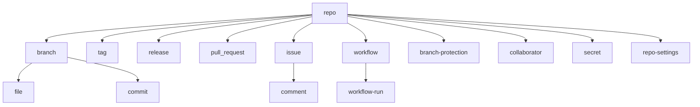

# Gateway — risk model

> **Status:** current. This document describes the risk model as v5
> implements it. It answers one question: _which risks does a call touch,
> and does the mission accept them?_ Who may accept a risk, how many
> times, how fast and under whose eyes is the subject of
> [vaubaan-gateway](./vaubaan-gateway.md), which builds on this document.
>
> It replaces the French text of June 2026, kept unchanged as
> [legacy/gateway-risk-model.md](./legacy/gateway-risk-model.md). Founding
> decision: ADR
> [pivot-to-risk-based-model](../decisions/pivot-to-risk-based-model.md).
> Later decisions folded in here:
> [unified-gates-drop-confirm](../decisions/unified-gates-drop-confirm.md),
> [plugin-contract-and-credential-spec](../decisions/plugin-contract-and-credential-spec.md),
> [fallback-risk-only-when-uncategorized](../decisions/fallback-risk-only-when-uncategorized.md),
> [scope-caps-amplification-axis](../decisions/scope-caps-amplification-axis.md)
> and
> [scope-caps-not-enforced-in-v5-0](../decisions/scope-caps-not-enforced-in-v5-0.md).
>
> **Section numbers.** §1 to §4bis, §7, §8, §12 and §14 keep the numbers
> and subjects of the earlier text at the top level, because code,
> catalogs and other documents cite them; so do §3.1, §3.3, §4.3 (the
> mandatory fallback), §4.4 and §7.2. §5, §6, §9, §10, §11, §13, §15 and §16 carry new
> content: what stood there described mechanisms v5 does not have (§13).

## 0. The idea — accepted risks, not granted capabilities

A capability model asks the person who delegates to enumerate what the
agent may do: which endpoints, which objects, which verbs. For an
autonomous coding agent that list cannot be written in advance. Grant
too little and the agent stops mid-task; grant too much and least
privilege is gone.

The risk model turns the question around. The person who delegates
states **which consequences they accept**: "it may write on feature
branches", "it may apply a migration on staging", "it may not change
row-level security". The vocabulary is a short list of named risks per
provider, written once by the plugin author and reviewed like code.

|                       | Capability-based                    | Risk-based (this model)                                   |
| --------------------- | ----------------------------------- | --------------------------------------------------------- |
| What is enumerated    | What the agent may do               | What the delegating human accepts as a consequence        |
| Language of the grant | The provider's API surface          | Business intent, one sentence per risk                    |
| Stability             | Rewritten for every task            | The same profile serves every task of the same kind       |
| Audit                 | "What was granted"                  | Which slices were executed, which risks they touched      |
| Unknown operation     | Depends on how the grant is written | Refused, or caught by the catalog's fallback entry (§4.3) |

Three properties hold throughout:

- **Default deny.** A call is allowed only if every risk it touches is
  accepted. A call that touches nothing the catalog knows is refused.
- **Plugins classify, the gateway decides.** A plugin knows its provider
  and nothing about missions, accepted risks or budgets.
- **Always an enumeration.** Accepted risks are a list of explicit
  identifiers. No wildcard, no "everything" sentinel, at any level.

## 1. Three pillars and one decision

```
PLUGIN (per provider, code)
  data model     the entities of each plane, their containment
  classify       (tool, arguments, resources) → the slices the call touches

CATALOG (per provider, static, versioned in the repository)
  risks          { id, label, reason, matches, vector, acceptable_in_envs?, … }
  one fallback   catches the writes no other entry names
  presets        named policy fragments offered at issuance

MISSION POLICY (per mission, written by its creator)
  RiskId → (budget, gate)     the keys are the accepted risks

DECISION (per call)
  1. slices        = plugin.classify(tool, arguments, resources)
  2. risks_touched = the catalog entries those slices match,
                     each qualified by the environment of its slice
  3. risks_touched ⊆ accepted risks ?   no  → refused, risk-not-accepted
                                        yes → budget, gate, execution
  4. one audit entry, allowed or refused
```

Steps 1 to 3 are **stateless**: they read the call, the catalog and the
mission, and nothing else. Budget, rate limit and gate come after an
allowed outcome and are described in
[vaubaan-gateway](./vaubaan-gateway.md) §3.

## 2. The data model, per plane

A provider is described as a mutable store of entities. Each **plane** of
a provider (a repository, a database, a runtime, a mailbox) declares the
entities it contains and how they nest. The data model is the vocabulary
of slices: a slice path names entities of the data model, and a catalog
pattern matches paths over them.

### 2.1 Entities, containment, cardinality

Each entity declares:

- a **name**, as it appears in slices (`branch`, `env-var`, `row`);
- its **parent** in the plane, or none at the root. Every parent must be
  an entity of the same plane; a plugin with a dangling parent does not
  load;
- the **cardinalities** that make sense for it, as documentation for the
  reader of the model:

  | Cardinality | Meaning                         |
  | ----------- | ------------------------------- |
  | `one`       | exactly one instance, named     |
  | `bounded`   | a finite, known set             |
  | `unbounded` | an unknown number, possibly all |

- optionally, that it **carries the environment** of the provider (§2.3).

Cardinality is not a field of a slice. When the difference between "one"
and "many" changes the risk, the plugin makes it visible in the slice
itself, with a literal marker the catalog can match exactly: Supabase
emits `object[one]` for a write on one stored object and `object[bulk]`
for a write on a whole bucket, and a different catalog entry matches
each.

A plugin may also emit **virtual leaves**: path segments that are not
entities but name an act the catalog must tell apart. GitHub emits
`branch[main].merge-into` for a merge and `branch[x].workflow-via-file`
when a file write targets a workflow definition.

### 2.2 Example — GitHub, plane `repo`



The data model of each provider lives with its plugin and is described in
the provider's handbook
([providers](../handbook/providers/README.md)).

### 2.3 The environment carrier

Environment is not an axis beside the data model; it is carried by one of
its entities, and which one depends on the provider:

| Provider       | Carrier of the environment                                       |
| -------------- | ---------------------------------------------------------------- |
| Supabase       | the project (one project per environment)                        |
| Vercel         | the `env` entity under a project (`prod`, `preview`, …)          |
| Railway        | the `environment` entity, identified by the label of the project |
| Stripe         | the mode of the account (`test`, `live`)                         |
| Upstash Redis  | the database                                                     |
| Resend         | the sending domain, and the segment                              |
| SSH            | the host                                                         |
| Gmail          | the mailbox                                                      |
| GitHub         | the branch, in the data model only (see §6)                      |
| Cloudflare DNS | none: no entity carries an environment                           |

How a slice gets its environment at call time is §6.

## 3. Slices

**A slice is a path over the data model plus an action, read or write.**
Slices are internal plumbing: the plugin emits them, the catalog matches
them, the audit records them. A human who creates a mission never writes
one.

### 3.1 Grammar

```
slice    ::= provider '.' segment ('.' segment)* '.' action
segment  ::= name | '[' inner ']' | '*' | '**'
inner    ::= '*' | '**' | item (',' item)*
name     ::= [a-zA-Z0-9_/-]+              an entity or a virtual leaf
item     ::= [a-zA-Z0-9_./~*-]+           an identifier; '*' inside it is a glob
action   ::= 'R' | 'W'
```

- A **name** is written bare; an **identifier** is written in brackets,
  directly after the name it qualifies, with no dot between them:
  `branch[main]`.
- `[*]` stands for exactly one identifier. `[**]`, or a bare `**`, stands
  for any number of segments, including none.
- Inside brackets, `*` within an identifier is a glob over one or more
  identifier characters: `[feature/*]`, `[NEXT_PUBLIC_*]`,
  `[release-*]`. A list may mix exact identifiers and globs:
  `[main,master,release-*]`.
- There are no regular expressions, no predicates and no operators.
- The provider and the action are never wildcards: another provider or
  another action is never the same risk.

### 3.2 Examples

```
# emitted by a plugin for one call
github.repo[acme/api].branch[main].merge-into.W
github.repo[acme/api].branch[feature/login].file[src/auth.ts].W
supabase.project[abcd1234].schema[any].table[any].row[bulk].W
vercel.project[prj_1].env[prod].env-var[API_KEY].W

# patterns of a catalog
github.repo[**].branch[main,master,prod,production,release-*].W
github.repo[**].branch-protection[**].W
supabase.project[**].policy[**].W
github.**.W
```

### 3.3 Matching

Matching compares two slices segment by segment:

- a name matches the same name only;
- `[*]` matches one identifier, never a name;
- `[**]` matches zero or more segments;
- an identifier with a glob matches the identifiers the glob accepts; a
  list matches when one of its items does.

Three relations are defined on slices:

- **matches** — a pattern accepts a concrete slice;
- **covers** — every slice one pattern accepts, the other accepts too;
- **intersects** — at least one slice is accepted by both.

The decision uses _intersects_, because a plugin may itself emit a slice
with a wildcard when a call touches a set it cannot enumerate ("every
variable of this service"). Such a slice touches every entry that could
be concerned. When two globs cannot be compared exactly, they are held to
intersect: the model errs towards requiring one risk too many, never one
too few.

## 4. The risk catalog

The catalog is the dictionary of what a human may accept for one
provider. One entry is one business intent that fits in a sentence.

### 4.1 An entry

| Field                  | Meaning                                                                                                         |
| ---------------------- | --------------------------------------------------------------------------------------------------------------- |
| `id`                   | The `RiskId`: `<provider>.<name>`. Stable; never renamed, never removed (§4.5).                                 |
| `label`                | Short text shown to the human.                                                                                  |
| `reason`               | Why this is a risk, in a sentence or two.                                                                       |
| `matches`              | One slice pattern, or a list of patterns. The entry is touched when any of them intersects a slice.             |
| `vector`               | The six-axis profile of the risk (§4.2).                                                                        |
| `vector_overrides`     | Per environment, the axes that differ from `vector` ([per-env vector](./risk-entry-per-env-vector.md)).         |
| `acceptable_in_envs`   | The environments in which the risk may be accepted and touched. Its presence makes the entry env-scoped (§4.4). |
| `fallback`             | Marks the one catch-all entry of the catalog (§4.3).                                                            |
| `deprecated`           | The entry is kept for existing missions and no longer offered (§4.5).                                           |
| `replaced_by`          | For a deprecated entry, the `RiskId` that replaces it. Informational.                                           |
| `caps`, `infra_limits` | Scope caps (§4bis).                                                                                             |

Entries may overlap, and that is deliberate. One slice may touch several
entries (a broad read risk and a narrower one for sensitive files), and
all of them must be accepted. Only the fallback behaves differently.

An abridged extract of the GitHub catalog:

```yaml
- id: github.feature-branch-write
  label: 'Create/modify branches under feature/*, fix/*, chore/*, …'
  reason: Reversible. No production side effect until merged.
  matches:
    - 'github.repo[**].branch[feature/*,fix/*,chore/*,bug/*,docs/*,refactor/*].W'
    - 'github.repo[**].branch[feature/*,fix/*,chore/*,bug/*,docs/*,refactor/*].file[**].W'
  vector:
    reversibility: reversible
    blast: single
    data: data
    cost: free
    visibility: internal
    persistence: session

- id: github.branch-protection-write
  label: 'Modify branch protection'
  reason: Opens the branch to out-of-process writes. Outlives the session.
  matches:
    - 'github.repo[**].branch-protection[**].W'
  vector:
    reversibility: costly
    blast: env
    data: metadata
    cost: free
    visibility: team
    persistence: posture
```

### 4.2 The vector

Six independent axes, each a closed scale ordered from mildest to most
severe:

| Axis            | Values                                   | Question it answers                  |
| --------------- | ---------------------------------------- | ------------------------------------ |
| `reversibility` | `reversible` · `costly` · `irreversible` | Can it be undone, and at what price? |
| `blast`         | `single` · `env` · `account` · `bulk`    | How much does one action reach?      |
| `data`          | `metadata` · `data` · `secret` · `pii`   | What kind of data is exposed?        |
| `cost`          | `free` · `moderate` · `unbounded`        | Can it spend money?                  |
| `visibility`    | `internal` · `team` · `public`           | Who sees the effect?                 |
| `persistence`   | `stateless` · `session` · `posture`      | Does the effect outlive the mission? |

The vector **explains** a risk and **orders** risks by severity where
they are listed. No decision is derived from it: a risk is accepted or it
is not, whatever its vector.

### 4.3 The fallback entry

Every catalog declares **exactly one** fallback entry:

- named `<provider>.uncategorized-…` (in every shipped catalog,
  `<provider>.uncategorized-write`), so that audit entries read alike
  across providers;
- matching the catch-all write `<provider>.**.W`;
- flagged `fallback: true`. A catalog that omits the flag is still
  recognised by the name or the pattern, with a warning; the catalogs
  shipped with the gateway must carry the flag.

A catalog with no fallback, or with two, does not load.

**The fallback counts only when nothing else matched.** For each slice:

1. if one or more ordinary entries match, those are the risks touched,
   and the fallback is not;
2. otherwise, if the fallback matches (the slice is a write), the
   fallback is the risk touched;
3. otherwise nothing is touched, and the call is refused as a gap in the
   catalog.

The rule applies slice by slice: a call with one categorized write and
one uncategorized write touches the named entry and the fallback.

Two consequences:

- Accepting the fallback means accepting _writes the catalog has not
  reviewed_, not "any write". Its appearance in the audit means an entry
  is missing from the catalog.
- **A preset never includes the fallback**; a catalog whose preset does is
  refused. A mission creator may still accept it by hand.

The fallback catches writes only. A read that no entry names touches
nothing and is refused.

### 4.4 Qualification by environment

The same act can be acceptable on staging and not on production. An
entry that declares `acceptable_in_envs` is **env-scoped**; an entry that
does not is **account-scoped**.

- The catalog stores the unqualified id: `supabase.bulk-row-write`.
- An env-scoped entry is offered, accepted and compared in its qualified
  form, one id per environment it lists:
  `supabase[staging].bulk-row-write`,
  `supabase[preview].bulk-row-write`. A mission may accept one and not
  the other.
- An account-scoped entry is never qualified: `github.merge-protected`.
- An environment label is a lowercase slug (`prod`, `staging`,
  `preview-eu`).

`acceptable_in_envs` is the one structural guard of the catalog: it holds
whatever a human would like to accept. An entry listing
`[preview, staging]` has no `…[prod]…` form at all: it cannot be put in a
share or a mission for production, and a call that touches it on a
production resource is refused (§8).

### 4.5 Versioning and deprecation

- The catalog is a file in the plugin, changed by pull request. It
  carries a `catalog_version`, an integer raised on every reviewed
  change, and the date of that change.
- **Adding** an entry narrows nothing by itself, but slices the new entry
  matches now touch a risk existing missions and shares do not hold.
  Those calls are refused until the creator accepts the new risk. This is
  the intended behaviour: a new risk is never accepted by default.
- **Renaming or removing** an entry is forbidden: existing missions and
  shares reference it. An entry that must go is marked `deprecated`,
  with `replaced_by` when there is a successor. A deprecated entry still
  matches at call time, so missions that hold it keep working; it is no
  longer proposed by "select all", and a catalog whose preset references
  it is refused.

### 4.6 Presets

A catalog ships **at least one preset**: a named list of `RiskId`s of
that catalog, each with a default quota, rate limit and gate, plus a
label and a one-line description. A preset may name an env-scoped risk
without an environment; the entry then stands for that risk in each
environment the mission can reach. A preset pre-fills the policy of a
mission for one connection; what is stored is always the resulting
explicit list ([vaubaan-gateway](./vaubaan-gateway.md) §3.2).

A catalog is refused when a preset:

- references a risk of another provider, or one the catalog does not
  declare;
- contains anything but explicit ids (a pattern, a sentinel);
- qualifies an environment the entry does not list, or qualifies an
  account-scoped entry;
- references the fallback or a deprecated entry;
- repeats a risk, is empty, or shares its identifier with another preset;
- carries a budget that is not a positive whole quota, a positive whole
  rate over a positive whole window, and a gate of the closed set.

## 4bis. Scope caps — designed, not enforced in v5.0

Accepted risks say _what kind_ of action is acceptable. They do not say
_how much_ one call may reach, nor how fast calls may follow one another.
Scope caps were designed as that second axis, with two families:

- **stateless** caps, enforced on one call by narrowing its arguments: a
  time window, a number of items per call, a number of bytes per call;
- **stateful** caps, counted by the gateway: calls per minute, calls per
  session.

A catalog entry may carry them in two blocks: `caps`, a default that
could only be tightened further down, and `infra_limits`, a ceiling
nobody may raise.

**What v5.0 enforces:**

- **Speed and volume are bounded by the mission**, per accepted risk: a
  quota per period and a rate limit per sliding window
  ([vaubaan-gateway](./vaubaan-gateway.md) §3.2). The rate limit is the
  one speed mechanism of the risk model. The gateway also limits the
  number of requests a mission may send to its endpoint, whatever they
  touch; that protects the instance and is not part of this model
  ([vaubaan-gateway](./vaubaan-gateway.md) §6).
- **One catalog limit is applied:** the per-minute ceiling of
  `infra_limits`. A mission cannot be issued with a rate limit above the
  ceiling of the risk it applies to.
- **Nothing else.** No stage narrows the arguments of a call, so the
  stateless caps are applied nowhere, and neither are the `caps` block or
  the other keys of `infra_limits`.

Because a declared limit that is not applied would be believed, the
catalogs shipped with the gateway may declare only the limit that is
enforced; a structural check fails otherwise. The catalog format still
accepts the other keys, so that enforcing them later does not change the
format. What enforcing them requires is listed in ADR
[scope-caps-not-enforced-in-v5-0](../decisions/scope-caps-not-enforced-in-v5-0.md).

## 5. What a mission carries

For the risk decision, a mission is three things:

- its **connections**, one provider each;
- per connection, the **resources** it may touch: a subset of the
  resources of the connection, each with a ref and an optional
  environment label;
- its **policy**: one entry per accepted risk, `RiskId → (budget, gate)`.
  The accepted risks are the keys of the policy. Each id is explicit and
  appears once; env-scoped risks appear qualified.

A mission carries no slice, no pattern, no plane, no level, no explicit
deny, and no reference to a preset. What it accepts is bounded by the
authority of its creator on each connection: the full catalog for an
owner, the restriction of the shares received otherwise
([vaubaan-gateway](./vaubaan-gateway.md) §3.1).

## 6. Environment resolution

At call time, each slice is given at most one environment, in this
order:

1. **Derived by the plugin**, when the environment is part of the call
   itself. Vercel is the provider that does so today: the environment is
   a segment of the slice (`env[prod]`), whatever label the project
   carries. A slice that spans several environments at once derives none.
2. **Otherwise, the label of the resource the slice names.** The first
   identifier of the slice that equals the ref of one of the mission's
   resources for that provider designates the resource; its label, set by
   the owner of the connection, is the environment. When the slice names
   no resource and the mission holds exactly one resource of that
   provider, that resource's label applies. With several resources and
   none named, there is no environment.
3. **Otherwise, none.**

The environment found is used twice: to qualify the env-scoped risks the
slice touches (§4.4), and to check them against `acceptable_in_envs`.

**An unlabelled resource is never a safe default.** A call that touches
an env-scoped risk on a resource with no label, or with a label the
entry does not list, is refused. On a database project its owner has not
labelled, every env-scoped risk is out of reach; only account-scoped
risks pass.

GitHub: the data model marks the branch as the carrier of the
environment, but the GitHub catalog has no env-scoped entry. Protected
and working branches are told apart by the patterns of two different
risks, not by qualification.

## 7. The plugin — classification

A plugin has two responsibilities towards this model:

1. declare its **data model** (§2);
2. **classify** a concrete call: from the tool name, the arguments and
   the mission's resources on the connection, return either the slices
   the call touches, or a refusal of its own.

Classification is pure: no network, no credential, no state. The plugin
refuses by itself a tool it does not know, a tool that was retired, and
arguments from which no slice can be built. It never sees the accepted
risks and never decides.

**A classification error is a security hole.** A write classified as a
read passes under a read risk. Classifiers are unit-tested tool by tool,
and when a classifier cannot read what a call will do, it must fail
closed: emit every slice the call could touch. The Supabase plugin does
this for a migration it cannot fully read, which then requires all the
write risks a migration may carry.

### 7.1 Several slices per call

One call may touch several entities. Opening a pull request touches the
pull request and the pair of branches; a multi-file push touches each
file and the "bulk" leaf. The plugin returns every slice, the risks
touched are the union over the slices, and the mission must accept all
of them.

### 7.2 Tools deliberately left out

Two families of operation are kept out of the tool surface because no
catalog entry could bound them:

1. **Dispatching, cancelling or re-running a CI workflow on GitHub.** A
   workflow runs with the repository's secrets and can deploy anywhere;
   triggering one would be a path around every other risk. The tools are
   not exposed, and the classifier refuses them by name. Reading
   workflows and their runs remains. The same escalation through a
   _file write_ on a workflow definition is a named risk of its own.
2. **Arbitrary SQL that writes, on Supabase.** The free-form SQL tool is
   read-only, and the guarantee comes from the provider: the query runs
   on an endpoint where the database itself refuses mutations. The
   classifier does not try to prove a query harmless. Writes go through
   dedicated tools; migrations are read statement by statement against a
   list of known shapes and fail closed as described above.

   Read-only is not "harmless to read". A database also holds what the
   provider keeps for itself: the users and sessions of its
   authentication service, its secret vault, the internals of its
   storage. **Reading those is a risk of its own**, distinct from reading
   application data and absent from every read preset. The classifier
   decides by what the SQL **names**, never by what the database role
   may read: a query that names a provider-managed schema touches that
   risk. A query the classifier cannot read with confidence (a
   statement that is not a plain query, a function outside the list it
   knows to be inert, text it cannot tokenise) touches it too. The list
   of managed schemas belongs to the plugin's data model.

## 8. The decision

For one call, after the plugin returned its slices:

| Situation                                                                            | Outcome                                                 |
| ------------------------------------------------------------------------------------ | ------------------------------------------------------- |
| The plugin refused the call                                                          | Refused, with the plugin's reason                       |
| The plugin returned no slice                                                         | Refused: classification gap                             |
| An env-scoped risk is touched outside its environments, or on an unlabelled resource | Refused: no mission can hold that risk there            |
| The slices touch no entry at all                                                     | Refused: catalog gap                                    |
| A touched risk is not accepted by the mission                                        | Refused: `risk-not-accepted`, listing the missing risks |
| Every touched risk is accepted                                                       | Allowed; budget, rate limit and gate follow             |

Rules:

- **All or nothing.** The call needs every risk it touches. There is no
  partial execution.
- **A risk is never dropped to make a call pass.** In particular, an
  env-scoped risk touched where it is not acceptable is not removed from
  the set: if it were, a broader risk touched by the same slice would
  carry the call alone, exactly where the catalog says it must not go.
- **No step-up.** The decision does not wait, ask or widen. The mission
  is not modified by a call.
- **One code.** Every refusal of this step carries the code
  `risk-not-accepted`, including the two gaps and the environment case;
  the list of missing risks is empty for a gap. Only the plugin's own
  refusal carries no code.

The refusal `risk-not-accepted` carries the missing risks, the slices
executed, and a hint for the agent: ask the mission creator to issue the
mission again with those risks, or restrict the operation. When the
cause is an environment, the hint names the environments the risk is
acceptable in.

This step happens after the gateway has checked that the mission is
active, that the resources named by the call belong to the mission, and
that the connection is usable; those checks and their refusals are
defined in [vaubaan-gateway](./vaubaan-gateway.md) §4.1.

## 9. Checking a policy before issuance

A policy is checked when a mission is drafted, and again when it is
issued; the result of the first is never trusted for the second. For
each connection of the draft, each requested risk is sorted:

| Finding           | Meaning                                                                                           |
| ----------------- | ------------------------------------------------------------------------------------------------- |
| unknown           | not an explicit id of the provider's catalog                                                      |
| duplicate         | requested twice                                                                                   |
| exceeds authority | not held by the creator on that connection                                                        |
| unresolvable      | qualified for an environment no selected resource carries, for a provider that does not derive it |
| budget missing    | no quota or rate limit, neither given nor supplied by the chosen preset                           |
| budget invalid    | not positive whole numbers, gate outside the closed set, or rate limit above the catalog ceiling  |

Any finding blocks issuance and is reported with the risks concerned.
There is no pending state and nobody to ask: the creator corrects the
draft, or obtains more authority from the owner of the connection.

One case is not a finding. When a connection's policy is taken from a
preset as is, the preset's entries that exceed the creator's authority or
cannot resolve are left out and reported as such; the rest of the preset
passes. A preset is a suggestion, intersected with what the creator
holds.

The same enumeration of explicit ids serves a share: the restriction of
a share is a list of ids of the connection's catalog, each one valid by
the rules of §4.4.

## 10. After the risk decision — budget and gate

This model stops at "allowed". What v5 adds on top, per accepted risk:

- a **quota** per period and a **rate limit** per sliding window. An
  allowed call that touches N risks counts against N budgets; a refused
  call counts against none;
- a **gate**, `auto` or `approval`. Under `approval`, each call must be
  approved by the mission creator before it runs, for these exact
  arguments, unless the creator opened the gate for the rest of the
  period.

These are defined in [vaubaan-gateway](./vaubaan-gateway.md) §3.2 to
§3.5. They never change which risks a call touches.

## 11. Refusals go up to a human

The agent that executes a mission cannot widen it, and no machine can
widen it on its behalf:

- `risk-not-accepted`: the creator issues the mission again with the
  missing risks, within their authority;
- an exhausted budget, or an action to approve: the creator answers a
  request from their inbox ([vaubaan-gateway](./vaubaan-gateway.md) §3.4,
  §3.5).

There is no escalation channel between tokens and no parent token to
turn to.

## 12. Audit

Every call produces one entry, allowed or refused. The fields this model
defines:

| Field                    | Content                                                                                      |
| ------------------------ | -------------------------------------------------------------------------------------------- |
| tool                     | The tool called.                                                                             |
| arguments hash           | A fingerprint of the arguments. Never the arguments.                                         |
| slices executed          | The slices the plugin returned; empty when the call was refused before classification.       |
| risks touched            | The risks those slices matched, qualified.                                                   |
| accepted risks, snapshot | The mission's accepted risks at the time of the call, so the decision can be replayed later. |
| decision, refusal        | Allowed or refused; the refusal code and its hint, or the reason when there is no code.      |

Slices executed record the technical fact, risks touched the business
intent, the snapshot what the mission allowed at that moment. The three
together make a decision reproducible. The other fields of an entry
(mission, connection, resource, remaining budget, approval, agent label,
upstream outcome) are defined in
[vaubaan-gateway](./vaubaan-gateway.md) §8.

The audit carries no field for scope caps: none is applied (§4bis).

## 13. Reading older documents

Decisions and documents written before v5 use the vocabulary of the
hosted, multi-tenant version. They read with this mapping:

| Earlier term                                  | In v5                                                                   |
| --------------------------------------------- | ----------------------------------------------------------------------- |
| binding (of a project to a provider resource) | a **resource** of a connection, selected by the mission                 |
| project policy                                | the **restriction** of a share                                          |
| root token, project-scoped token              | a **mission**                                                           |
| child token, delegation chain                 | none: one token per mission, shared by its agents                       |
| mint, re-mint                                 | issue a mission, issue it again                                         |
| denied risks (explicit opt-out)               | none: a risk that is not accepted is not in the policy                  |
| escalation channel                            | none: a refusal goes to the mission creator (§11)                       |
| gates `allow` / `confirm` / `deny`            | accepted or not; then the gate `auto` / `approval` of the mission (§10) |

The sections of the earlier text on the project policy, mint-time
approval channels, the escalation channel and the migration plan have no
counterpart here: those mechanisms do not exist in v5.

## 14. Pitfalls and guards

| Pitfall                                                     | Guard                                                                                                                                                                      |
| ----------------------------------------------------------- | -------------------------------------------------------------------------------------------------------------------------------------------------------------------------- |
| A write no entry names                                      | The mandatory fallback, touched only then (§4.3). A read no entry names is refused.                                                                                        |
| A tool that classifies to nothing, or to an unmatched slice | Checked per plugin: every tool has sample calls, every sample yields slices a catalog entry matches (§15).                                                                 |
| The fallback turning into "allow any write"                 | It never co-fires with a named entry; no preset includes it.                                                                                                               |
| One broad risk that covers everything                       | Catalogs are written as fine-grained intents; risks are listed by severity, and "select all" records the explicit list and leaves out the fallback and deprecated entries. |
| A branch or path name chosen by the agent                   | A pattern on a naming convention bounds the entity, not the act: writing a file under `feature/*` never touches branch protection or secrets.                              |
| A silent bulk operation                                     | The plugin marks bulk in the slice, and a separate entry matches it (§2.1).                                                                                                |
| A mission outliving a catalog change                        | A new risk is not held by existing missions; ids are never renamed or removed (§4.5).                                                                                      |
| An environment assumed from a missing label                 | No label, no env-scoped risk (§6).                                                                                                                                         |
| A trigger used as a bypass                                  | Workflow dispatch is not exposed (§7.2).                                                                                                                                   |
| SQL misread as harmless                                     | The read-only guarantee comes from the provider; unread migrations and unread queries fail closed, and provider-managed schemas are a read risk of their own (§7.2).       |
| A limit declared and not applied                            | Shipped catalogs declare only the enforced limit (§4bis).                                                                                                                  |

## 15. What is checked mechanically

**When a catalog is loaded**, at startup. Any finding stops the gateway,
and the problems found are reported with their location:

- unknown fields; a missing or malformed field;
- an id that is not `<provider>.<name>` of this provider, a duplicate id,
  an id that contains a wildcard;
- a pattern that does not parse, or names another provider;
- a vector with a missing axis or a value outside its scale;
- an invalid environment label;
- zero or several fallback entries, a fallback not named or not matching
  as §4.3 requires;
- no preset, or a preset breaking a rule of §4.6.

**In each plugin's tests**: the plugin is well formed and its fallback
is flagged; no wildcard anywhere; presets are valid; every declared tool
has at least one sample call, and every sample yields slices matched by
the plugin's own catalog. The samples that land on the fallback are
reported, as the sign of a missing entry.

**Across the shipped plugins**: no catalog declares a limit the gateway
does not enforce (§4bis).

## 16. Open points

- **Stateless scope caps.** Enforcing them needs decisions this document
  does not make: whether the narrowed or the original arguments are
  fingerprinted for audit and approvals, and how a capped risk is refused
  when its plugin cannot narrow the call.
- **A finer `tools/list`.** A plugin does not declare which risks a tool
  may touch, since that depends on the arguments. Discovery therefore
  cannot be filtered tool by tool from the accepted risks alone.
- **Environment from the branch, for GitHub.** The data model allows it;
  no catalog entry uses it. Introducing env-scoped GitHub risks would
  need the plugin to derive the environment from the branch.
- **Explicit deny.** Not part of v5. The decision still accepts an
  explicit list of denied risks as an input, always empty.
- **Identifier characters.** The grammar of §3.1 is that of the written
  form. A plugin builds its slices directly and may put in an identifier
  a character the written form does not accept (an email address); such a
  slice matches and is audited, but its written form cannot be read back.
  The two should be one set.

---

_Date: 2026-10-13. English rewrite of the June 2026 text, checked against
the implementation._
