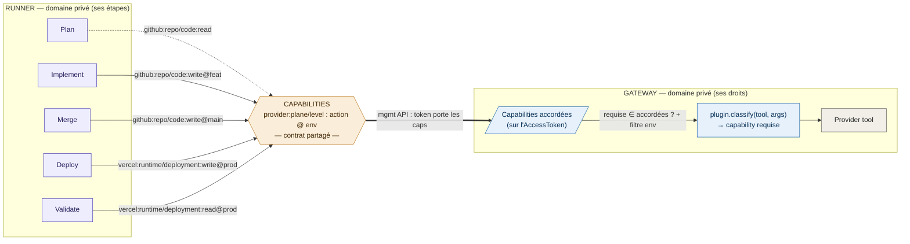
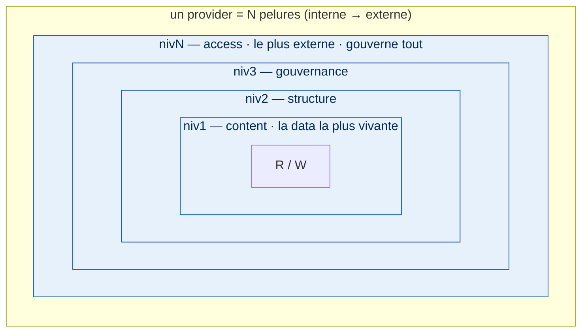
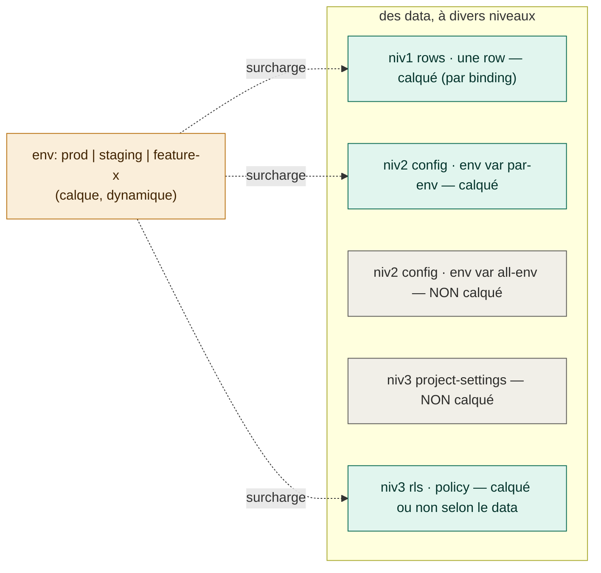
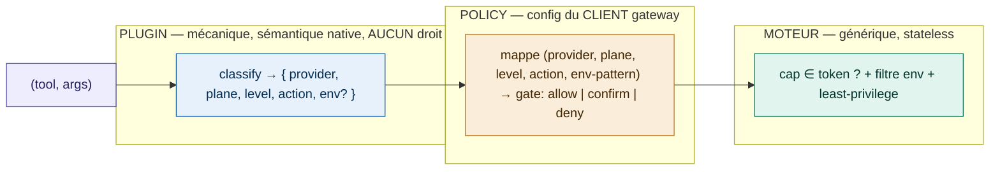
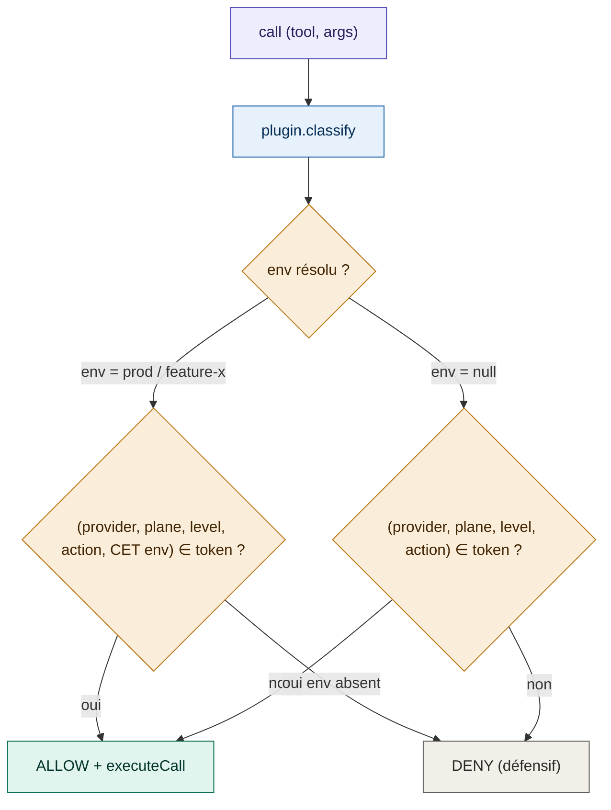
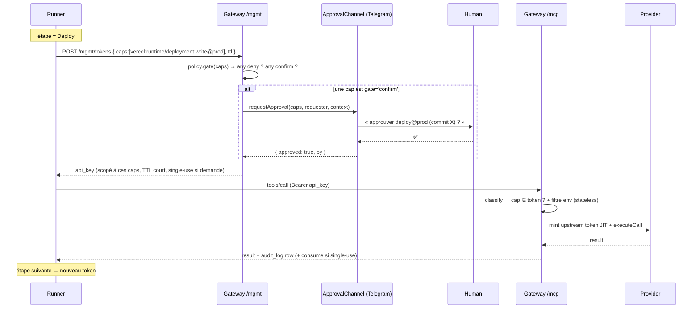

> **Legacy v4 document.** Kept for history; superseded by the v5 spec. Not maintained.

# Gateway — modèle de capabilities (DRAFT — SUPERSEDED)

> **⚠️ 2026-06-15 — Ce document est SUPERSEDED par
> [`gateway-risk-model.md`](../gateway-risk-model.md) (v4 risk-based).**
> Le tuple `(provider, plane, level, action, env?)` qu'il décrit a été
> abandonné au profit de `accepted_risks: RiskId[]` qualifié par binding.
> Conservé pour archive et pour visualiser l'historique du raisonnement
> (rings v1 → capabilities v2 → slices v3 → risk-based v4).
> Audit de cohérence : `/.vaubaan/reports/v4-coherence-audit.md`.
>
> **⚠️ 2026-06-19 — Le wire `/mgmt/tokens` mentionné ci-dessous est lui
> aussi obsolète.** Le mint unifié vit désormais sur
> `POST /api/v1/tokens/mint` (tout `vbn_live_*` peut mint un child),
> et il n'y a plus de scope org (project-scoped roots only). Cf. ADR
> [[unified-tokens-delegation-chain-and-escalation-channel]] + amendement
> 2026-06-19. Les refs `/mgmt/*` ci-dessous restent comme artefacts
> historiques de la grammaire capabilities.
>
> ---
>
> Brouillon de modélisation, pas encore une spec scellée ni un ADR. Sert à
> visualiser la frontière runner ↔ gateway et la grammaire de capabilities qui la
> traverse.
>
> **Décisions actées (2026-06-08)** :
> 1. `/mgmt/tokens` prend `capabilities[]`, plus de `roleIds[]`. On casse, pas de
>    rétro-compat.
> 2. **Les roles disparaissent.** La classification `(tool, args) → capability` est
>    portée par le **plugin du provider** (code, écrit par son dev).
> 3. **Capability = un tuple plat** : `{ provider, plane, level, action, env? }`.
>    **Deux actions seulement : `read` · `write`.** Plus d'`operand`, plus de
>    `propose`/`apply`/`provision`, plus d'`output`. Tout n'est que du R/W sur un
>    niveau de data.
> 4. **Un `plane` = une pile concentrique de niveaux ; un provider en expose
>    plusieurs** (`plane ≠ provider`). Supabase = `db` + `storage` + `auth` +
>    `functions` (cf. §2.1). Les niveaux sont numérotés (ordonnés) **par plane**,
>    pas d'archetype universel ; chaque niveau a un **slug métier** (`code`, `rows`,
>    `tables`…). Le **rang** (niv1 interne → nivN externe) ordonne le blast **à
>    l'intérieur d'une pile** — deux piles parallèles ne sont pas comparables.
>    **Invariant plugin : `niv(k+1)` gouverne `niv(k)`.**
> 5. **L'env est un calque** (une variante) qui surcharge **des data précises** :
>    **n'importe quel data, à n'importe quel niveau, peut être calqué ou non** — il
>    n'y a **pas** de frontière par-niveau. La sensibilité env est une propriété
>    **par-data**, résolue par le plugin. **Dynamique** : un env se crée à la volée
>    comme une branche git.
> 6. **Deux couches étanches.** Le **plugin** est purement mécanique (déclare les
>    niveaux + `classify`, ne connaît aucun droit). La **policy client** mappe
>    `(provider, plane, level, action, env_pattern)` → un `gate` au mint. La
>    **sensibilité d'un env vit côté client**, pas côté provider (« ton prod ≠ mon
>    prod »).
> 7. **Triage au mint, pas au call.** `/mgmt/tokens` consulte `policy_rules`
>    et résout chaque cap demandée à un des trois gates : **`allow`** (mint
>    immédiat, 201), **`confirm`** (Telegram/UI, 202 + approval), **`deny`**
>    (403 final, aucun override). Default no-match → `deny`. Le moteur `/mcp`
>    reste **stateless** (`cap ∈ token`). Pour le grain par-acte : **token
>    single-use** + TTL court ⟹ « approuver le mint » ≡ « approuver l'acte ».
> 8. **Canal gateway ↔ humain pluggable.** **Telegram** en premier ; l'abstraction
>    `ApprovalChannel` permet de diversifier ensuite (Slack, e-mail, webhook…).
>
> Supersède (à ADRifier) : `policy-dsl-declarative-jsonb`,
> `rbac-org-role-bot-project`, `roles-naming-provider-scoped`,
> partiellement `mint-install-token-credential`.

## 1. La frontière : deux domaines qui ne se connaissent pas

La gateway n'est pas un flux temporel comme le runner — c'est une **couche de
traduction**. Le runner sait *quoi il fait* ; la gateway sait *quels droits elle
accorde*. Le seul vocabulaire autorisé à traverser : la **capability**.



Le runner compile `étape → capabilities[]` **dans son domaine** (invisible de la
gateway) ; la gateway vérifie `classify(tool, args) ∈ caps accordées` **dans le
sien**.

**Litmus de non-contamination** : un vocabulaire traverse la frontière *s'il est
porteur de sens pour n'importe quel agent actionnant une surface* (humain, CI, autre
runner — pas seulement coding). `vercel:runtime/deployment:write@prod` passe.
`token-pour-l-étape-review` échoue → c'est ce qui interdit à
`plan/implement/merge/validate` de fuiter côté gateway.

## 2. La fondation : un provider est du state en pelures concentriques

Un provider ne « stocke » pas des tools, et il ne *transforme* rien qu'on pourrait
lire en sortie. Il expose du **state organisé en pelures emboîtées**, et tout ce
qu'on peut faire dessus, c'est **du CRUD — `read` ou `write`** — pelure par pelure.
La « fonction » du provider est inobservable ; on n'observe que les niveaux qui la
définissent. (Les logs / metrics / status d'un runtime ne sont pas un « output » :
c'est la pelure la plus interne, *read-only car émergente*.)



**Invariant : la pelure externe gouverne l'interne.** Une row obéit à sa table ; une
table à son schéma ; le code à la branch protection. Donc le **rang** ordonne le
**blast radius** : `write(niv k+1)` domine en danger `write(niv k)` — c'est ce qui
fonde le least-privilege (§7). Le plugin **doit** numéroter dans cet ordre.

Le nombre de pelures **n'est pas fixe** (pas forcément 4) et il n'y a **pas
d'archetype universel** : chaque plane déclare *ses* niveaux, avec un **slug métier**
que l'utilisateur voit. Une pile (= un plane) :

| plane | niv1 (content) | niv2 (structure) | niv3 (gouvernance) | niv4 (access) |
|---|---|---|---|---|
| **repo** (github) | `code` — fichiers, commits | `ci` — workflows Actions | `rules` — branch protection, reviews | `access` — repo, collaborateurs, install token, secrets |
| **runtime** (vercel) | `deployment` — build servi, logs *(R)* | `config` — env vars, build settings | `project-settings` — domaines, protection | `account` — projet, team, tokens |
| **db** (supabase) | `rows` — données (`execute_sql`) | `tables` — tables, colonnes, migrations | `rls` — policies, roles, advisors | `project` — projet, clés, conn string |

> Les noms de colonnes `content/structure/gouvernance/access` sont un **commentaire
> de lecture**, pas une couche du modèle. Le moteur ne connaît que `(provider, plane)`,
> le slug, et le rang.

### 2.1 Un `plane` = une pile ; un provider en expose plusieurs

Un **plane** est *une* pile concentrique. Un **provider** est un vendor qui peut
exposer **plusieurs piles indépendantes** — c'est pour ça que `plane ≠ provider`.

**Supabase** le montre bien : un seul provider, plusieurs piles parallèles.

| plane (pile) | niveaux (interne → externe) |
|---|---|
| **db** | `rows` → `tables` → `rls` |
| **storage** | `objects` → `buckets` → `storage-config` |
| **auth** | `users` → `providers` → `auth-config` |
| **functions** *(un runtime !)* | `deployment` → `config` |

> Le `project` (clés, facturation, conn string) est la **racine partagée** par toutes
> les piles — une pile `account` à part, la plus externe de toutes.

Pourquoi la séparation est **nécessaire** et pas cosmétique : l'invariant de rang
(« `niv(k+1)` gouverne `niv(k)` ») n'a de sens **qu'à l'intérieur d'une pile**. Un
`bucket` (storage) ne gouverne pas une `row` (db) — ce sont deux ladders parallèles,
**non comparables par rang**. On ne peut donc pas les aplatir dans un seul `levels[]` ;
le plane est précisément l'unité dans laquelle le rang — et donc le least-privilege
(§7) — est défini. (Idem GitHub : `repo` **+** `actions` **+** `packages`. Railway :
`runtime` **+** `db`.)

> ⚠️ `plane` est un **label provider-local** : le `db` de Supabase et le `db` d'un
> futur Neon n'ont pas à s'aligner (décision #4 — pas d'archetype universel). D'où le
> `provider` dans le tuple (§3).

## 3. La grammaire : `read | write` sur un niveau, dans un env

Une capability = `{ provider, plane, level, action, env? }`, notée
**`provider:plane/level:action@env`**.

| Axe | Valeurs | Sens |
|---|---|---|
| **provider** | `github` · `vercel` · `supabase` · `railway`… | le vendor ; routing + namespace des planes |
| **plane** | une **pile** déclarée par le provider (`repo`, `runtime`, `db`, `storage`…) | quelle pile concentrique ; l'unité où le rang est défini |
| **level** | un **slug** rangé niv1→nivN *dans cette pile* (`code`, `rows`, `rls`…) | quelle pelure de state |
| **action** | `read` · `write` | observer / muter cette pelure |
| **env** | un slug d'instance/variante (`prod`, `staging`, `feature-x`…), **dynamique** | quel calque ; absent = data non calqué |

Il n'y a **que deux verbes**. Ce que l'ancien modèle appelait `propose` / `apply`
n'était qu'un `write` visant un env plus ou moins exposé ; `provision` n'était qu'un
`write` sur la pelure `access` ; `output:read` n'était qu'un `read` sur la pelure
interne. La promotion d'un changement à travers les envs = un `write` qui **vise une
autre branche** (cf. §4).

Exemples :

| forme écrite | sens natif |
|---|---|
| `github:repo/code:read` | lire le code / un diff |
| `github:repo/code:write@main` | écrire sur la branche protégée (= merge) |
| `vercel:runtime/deployment:write@prod` | déployer en prod |
| `vercel:runtime/deployment:read@prod` | lire logs/status prod *(émergent, bénin)* |
| `vercel:runtime/config:write@prod` | poser un env var prod *(secrets — haut blast)* |
| `supabase:db/rows:read@staging` | lire des rows sur le projet staging |
| `supabase:storage/objects:write` | écrire un objet dans un bucket |
| `github:repo/access:write` | provisionner / muter le repo, minter un token |

## 4. L'env est un calque — par data, pas par niveau

L'env n'est ni un axe de plus ni une propriété d'un niveau : c'est un **calque** (une
variante). Comme un calque graphique, il **surcharge des data précises** — et
**n'importe quel data, à n'importe quel niveau, peut être calqué ou non**,
indépendamment de son rang. Il n'existe **pas** de frontière propre « ce niveau est
env-scopé, celui-là non » : la sensibilité à l'env est une propriété **par-data**,
résolue par le classifieur.

Preuve que ce n'est pas par-niveau : chez Vercel un env var (niveau `config`) peut
être posé **« for all environments »** (non calqué) **ou** par-env (calqué) — *même
niveau, même action, sensibilité différente*. Seul le data tranche, pas son rang.



**Conséquence — le moteur ne dérive rien ; il lit ce que `classify` renvoie :**

- `classify(tool, args)` renvoie `env?` **par call**. `env` présent ⟺ ce data est
  calqué sur cet env.
- Une même `(provider, plane, level, action)` peut donc exister **calquée et
  non-calquée** : `vercel:runtime/config:write@prod` (var par-env) et
  `vercel:runtime/config:write` (var all-env) sont **deux capabilities distinctes**.
  Un token qui porte l'une n'autorise pas l'autre (filtre défensif, §7). ⚠️ Le cas
  *all-env* « fane out » vers **tous** les envs, prod compris — voir §5.1 (policy par
  défaut) pour pourquoi il ne doit pas être plus laxiste que le plus strict des envs
  couverts.
- Les envs sont **créés dynamiquement** (comme des branches git) : le plugin les
  *résout*, ne les énumère pas. La policy (§5) matche donc des **patterns** de slug,
  pas une liste figée.

| provider:plane | envs exemples | où s'accroche le calque (par-data) |
|---|---|---|
| **github:repo** | `main`, `feature/*` | le code lui-même (la branche **est** l'env) ; `ci` / `rules` / `access` non |
| **vercel:runtime** | `prod`, `preview`, `development` | un deployment, un env var *par-env* ; un env var *all-env* / `project-settings` / `account` non |
| **supabase:db** | `staging`, `prod` | tout ce qui pend au projet ciblé (résolu par le binding) |

> Ton code actuel le fait **déjà par-data** : Vercel renvoie `env` pour
> `upsert_env_var` mais pas pour `update_project_settings` — c'est `classify` qui
> tranche call par call, jamais une règle de rang.

## 5. Deux couches étanches : plugin mécanique vs policy client

C'est le cœur de la décision #6. **L'env ne porte aucune sensibilité intrinsèque.**
Le provider sait *quel* env un call touche ; le **client** décide *ce que ça vaut*.



- **Plugin** : déclare les niveaux + `classify`. Ne connaît ni env-sensibilité ni
  gating.
- **Policy client** (table `policy_rules`) : 3 gates possibles —
  **`allow`** (mint immédiat), **`confirm`** (Telegram/UI), **`deny`** (403
  final, aucun override). Exemple :

  ```
  # default no-match → deny. Le moteur consulte les règles dans l'ordre :
  # most-specific wins, ties par priority desc.
  supabase  db  rows  read   @ *          → allow
  supabase  db  rows  write  @ feature/*  → allow
  supabase  db  rows  write  @ prod       → confirm
  supabase  db  rls   write  @ *          → confirm   # gouvernance = haut blast
  github    repo access write @ *          → deny      # jamais d'install token via IA
  ```

  Les envs sont dynamiques → les règles sont des **patterns** (avec `*` =
  glob matching dans un champ donné). Un `feature/x` neuf hérite de la règle
  `feature/*` sans saisie manuelle.

- **Moteur** : ne fait que matcher (cf. §7). Le triage (§8) est appliqué
  **au mint**, pas au call.

### 5.1 Policy par défaut, `*`, et la protection de prod

Le couple `…:write@prod` (par-env) vs `…:write` (env-less) pose la question :
**que couvre `*`, et qu'est-ce qui protège prod ?** Trois règles ferment le trou :

1. **Default-deny.** La policy est une **allow-list**. En l'absence d'une règle
   qui matche, une capability tombe sur **`deny`** (403 final). Prod n'est jamais
   ouvert « par oubli » : pour que l'IA écrive prod, il faut une règle *explicite*
   `write@prod → allow` — qu'on n'écrit pas.
2. **`*` est un glob de matching, pas « tout est ouvert ».** `@ *` dans une règle =
   « cette règle s'applique à n'importe quel slug d'env ». Combiné au default-deny, un
   `* → allow` sur un `write` serait une faute énorme (il engloberait prod) : le moteur
   **refuse au mint** un `(action='write', env_pattern='*', gate='allow')` via la CHECK
   constraint SQL (anti-pattern). On scope toujours (`feature/* → allow`), jamais
   `* → allow` en écriture.
3. **L'env-less *grant* = fan-out réel.** Une grant `vercel:runtime/config:write`
   sans `@` couvre **n'importe quel env requis** au runtime (`@prod` compris).
   `covers()` autorise donc une grant env-less à matcher un required `@X` quel
   que soit X — c'est ça, le fan-out. Combiné au default-deny côté policy : pour
   que l'IA tire une grant env-less, la règle qui l'a mintée doit avoir explicitement
   accepté l'écriture all-env (en pratique seed `*:*:*:write:* → confirm` → toute
   grant env-less write pop pour confirmation humaine).
4. **Exclusion par binding (opt-in, github-only en MVP).** Chaque binding
   `provider_bindings` peut déclarer un *exclude set* qui retire des envs du
   fan-out d'une grant env-less. Sur GitHub :
   - `env_less_exclude_branch text` : un nom de branche unique à exclure (typiquement
     `main`) ; **ou**
   - `env_less_exclude_protected boolean` : exclut la liste des **protected
     branches** du repo, résolue au moment du call via Octokit
     `repos.listBranches({protected:true})` avec un cache 60s (in-memory dans
     l'instance gateway). Les deux options sont mutuellement exclusives (XOR
     enforcé par CHECK constraint SQL).

   L'adapter provider expose `resolveExcludeEnvs(admin, binding) →
   Promise<string[]>` ; le gateway l'appelle juste après `loadProviderAdmin`,
   avant `evaluateCapability`. Le coût hot-path : un GET cache (hit la plupart
   du temps) ou un GitHub API call par minute par repo (miss).

   Au runtime, `covers(granted, required, { excludeEnvs })` retourne `false`
   quand `granted.env === undefined && required.env ∈ excludeEnvs`. Net : une
   grant env-less sur un repo avec `exclude_protected=true` peut écrire sur
   `feature/*` mais 403 sur n'importe quelle branche que GitHub déclare
   protected — l'opérateur n'a pas besoin de doubler avec des règles policy
   par-branche, et les toggles de protection sur github.com sont reflétés en
   moins d'une minute.

> Net : prod / main / branches protégées sont protégés par la **couche policy**
> au mint (default-deny + interdiction `*→allow` en write) ET par la **couche
> binding** au runtime (exclude set qui rétrécit le fan-out d'une grant env-less).
> Les deux couches sont indépendantes ; chacune peut suffire selon le scenario.

## 6. Le classifieur : le cœur déplacé dans le plugin

```ts
type Capability = {
  provider: string;         // 'github' | 'vercel' | 'supabase' | … (routing + namespace)
  plane: string;            // pile : 'repo' | 'runtime' | 'db' | 'storage' | …
  level: string;            // slug du niveau DANS cette pile : 'code' | 'rows' | …
  action: 'read' | 'write';
  env?: string;             // slug d'env (dynamique) ; absent ⟺ data non calqué
};

interface ProviderModel {
  readonly provider: string;

  /**
   * Les piles exposées par ce provider. Chaque pile = un plane avec son ladder
   * ordonné interne → externe (index = rang/blast). INVARIANT : dans une pile,
   * levels[k+1] gouverne levels[k]. Deux piles ne sont PAS comparables par rang.
   */
  readonly planes: ReadonlyArray<{ slug: string; levels: readonly string[] }>;

  /** Surface statique des capabilities émissibles (tools/list, discovery). */
  capabilities(tool: string): readonly Capability[];

  /** Classe un call concret. plane + level + action + env résolus ici, sémantique native. */
  classify(
    tool: string,
    args: Record<string, unknown>,
    bindings: ReadonlyArray<ProviderBinding>,
  ): { capability: Capability } | { denied: string };
}
```

**Règle d'or — sémantique native :**

| Au lieu de (house-style hardcodé) | Le classifieur dit (sémantique provider) |
|---|---|
| `branch ∈ {feature/*, fix/*}` | écrire branche **non protégée** → `github:repo/code:write@<branche>` |
| merge / write `main` | écrire branche **protégée** → `github:repo/code:write@main` |
| deploy `target: production` | `vercel:runtime/deployment:write@prod` |
| set env var prod | `vercel:runtime/config:write@prod` |
| `get_advisors` (lint sécu) | `supabase:db/rls:read` |

## 7. Le moteur : stateless + filtre env + least-privilege



- **Stateless** : le hot-path ne fait que comparer la capability requise aux
  capabilities du token. Aucun état d'approbation ici (tout est joué au mint, §8).
- **Filtre env défensif, asymétrique** :
  - Grant **calqué** (`@X`) → couvre exactement le required `@X`. `@prod` ne
    couvre pas `@staging`, et ne couvre pas non plus un required env-less : ce
    sont deux capabilities distinctes (la première borne à prod, la seconde
    traite des data non-calqués).
  - Grant **env-less** → couvre n'importe quel required env (fan-out, cf. §5.1 #3)
    sauf les envs listés dans l'`excludeEnvs` du binding matché. Cf. §5.1 #4.
- **Least-privilege par le rang** : une grant `niv k` n'implique **jamais** `niv k±1`.
  L'ordre sert au raisonnement de blast, pas à un héritage.
- **Validation au mint** : une capability demandée doit appartenir à la surface
  émissible par le plugin (`capabilities()`). Un `env` sur un data qui n'est jamais
  calqué est rejeté — mais c'est le **plugin** qui le sait (par-data), pas une règle
  de rang.

### 7.1 Filtre statique = filtre runtime, modulo `EnvResolution`

`tools/list` et la flag `callable` du catalog (`/api/v1/catalog`) doivent rester
**lockstep** avec la décision runtime — sinon le gateway promettrait au caller des
tools qui 403 à `tools/call`. Or la surface statique d'un tool est toujours
énumérée **sans env** (le calque dépend des args). Pour réconcilier les deux
couches, chaque tool porte un tag `EnvResolution` :

| mode | sémantique | filtre statique | runtime |
|---|---|---|---|
| `static` | le classifieur émet une capability **non calquée** quels que soient les args (ex: `vercel__list_deployments` → `vercel:deployment:read`). | grant `@X` denied (env-less requis), grant env-less ALLOW. | `covers()` autorise grant env-less ↔ required env-less ; grant `@X` ne couvre pas un required env-less. |
| `runtime` | le classifieur résout `env` depuis les args ou le binding matché (ex: `vercel__upsert_env_var` lit `args.target` ; les tools Supabase lisent l'`environment` du binding). | un grant matche dès que le 4-tuple `(provider, plane, level, action)` coïncide — n'importe quel `@env` côté grant est un match potentiel. | `covers()` re-mord avec : grant `@X` couvre required `@X` exact ; grant env-less couvre required `@*` (fan-out §5.1 #3) modulo `excludeEnvs` du binding (§5.1 #4). |

Le mode est **par-tool**, pas par-cap : chaque provider expose un
`<provider>ToolEnvResolution(tool): 'static' | 'runtime'` à côté de
`toolCapabilities`. Les deux callsites (`tools/list` filter + catalog `callable`)
utilisent le même prédicat `isToolPotentiallyCallable(granted, surface, envResolution)`
défini dans `@vaubaan/policy-engine/tools-filter.ts`.

Conséquence opérationnelle : si un tool est listé `callable: true` dans le
catalog, le runtime garantit **soit** ALLOW soit DENY-pour-mauvais-env (jamais
ALLOW pour `bad-shape`). Pour les tools env-static, `callable: true` ⟹ ALLOW
direct — pas de second filtre.

## 8. Human-gate au mint + token jetable + canal pluggable

Le gating ne mord **pas** au call (`/mcp` reste stateless) mais au **mint**
(`/mgmt/tokens`). C'est la décision (a).



- **Token jetable** : `singleUse: true` + TTL de quelques secondes. Le moteur
  *consomme* le token au premier call qui matche. ⟹ « approuver le mint » ≡
  « approuver l'acte » : on récupère le grain par-acte **sans** rendre `/mcp`
  stateful.
- **Canal d'approbation pluggable** :

  ```ts
  interface ApprovalChannel {
    requestApproval(req: {
      capabilities: Capability[];
      requester: string;           // qui demande (runner, étape, projet)
      context: Record<string, unknown>; // commit, target, diff résumé…
    }): Promise<{ approved: boolean; by: string }>;
  }
  ```

  **MVP : `TelegramChannel`** (message au chat configuré, boutons inline ✅/❌). La
  config du canal (chat id, token bot) vit côté policy client. Diversification
  ultérieure (Slack, e-mail, webhook) = nouvelles implémentations, contrat inchangé.

## 9. Mapping étape runner → capabilities (table privée du runner)

> Cette table vit **dans le runner**. La gateway ne la voit jamais. Le least-privilege
> que le rang rend possible : Implement ne touche **pas** `config` (secrets) ; Deploy
> écrit `deployment@prod` mais **pas** `config@prod` (changer la config prod).

| Étape runner | Capabilities requises |
|---|---|
| Plan | `github:repo/code:read` |
| Implement | `github:repo/code:write@<branche>`, `supabase:db/rows:read@staging` |
| Test | `vercel:runtime/deployment:write@staging`, `vercel:runtime/deployment:read@staging`, `supabase:db/rows:read@staging` |
| Review | `github:repo/code:read`, `vercel:runtime/deployment:read@staging` |
| Merge | `github:repo/code:write@main` |
| Deploy | `vercel:runtime/deployment:write@prod`, `supabase:db/rows:write@prod` *(gate='confirm' par défaut)* |
| Validate | `vercel:runtime/deployment:read@prod`, `supabase:db/rows:read@prod`, `github:repo/code:read` |

## 10. Impact data model (greenfield, on casse tout)

- **Supprimer** : `roles`, `access_token_roles`, colonne `roles.permissions`.
- **Ajouter** : `capabilities jsonb` sur `access_tokens` (array de tuples complets
  `{provider, plane, level, action, env?}` ; la notation courte n'est que le wire
  format mgmt + l'affichage), lu au hot-path + caché Redis 60s. + `single_use bool`,
  `consumed_at`.
- **`provider_bindings`** : drop `unique(project_id, provider)` →
  `unique(project_id, provider, environment)` ; `environment` nullable (providers où
  l'env = ressource distincte, ex. Supabase ; pour Vercel/Railway l'env vient des
  args, résolu par le classifieur).
- **`/mgmt/tokens`** : body `{ projectSlug, capabilities[], ttlHours?, singleUse? }`
  (notation courte acceptée, expandée en tuples au parse).
- **`audit_log`** : remplacer `role_matched` par `capability_matched` (notation courte
  aplatie `vercel:runtime/deployment:write@prod`, filtrable au dashboard).
- **Nouveau — policy client** : table/JSONB `(provider, plane, level, action,
  env_pattern, gate)` par projet (ou org), **default-deny**. Lue au **mint**
  uniquement (cf. §5.1).
- **Nouveau — approbations** : table `approval_requests` (caps, requester, context,
  channel, status, decided_by, decided_at) + config canal (`telegram_chat_id`,
  bot token en secret).
