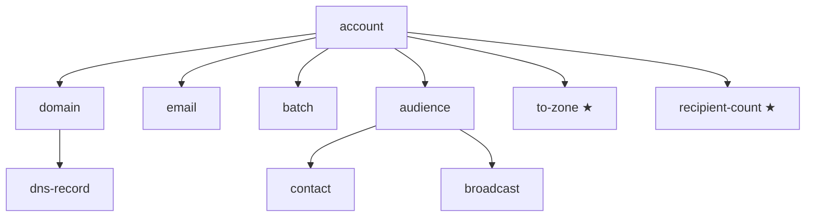

# Provider spec — Resend

> **Status** : draft (2026-06-23).
> **Author** : rpelissier + Claude.
> **Upstream** : `docs/spec/gateway-risk-model.md` (v4 risk-based model).
> **Pattern** : paste-credentials (API key `re_*`), not OAuth.
> **Provider slug** : `resend`.

## 0. Vision

**Why Resend.** Resend is the modern transactional-and-broadcast email
API for developers. It fills a gap in the Vaubaan provider catalog :
**outbound email as a first-class cloud surface**. Gmail covers *inbox
reads + drafts* (inbound + compose-but-not-send) ; Resend covers
*email delivery* (outbound). The two are complementary, not competing.

**Use cases :**

1. **Transactional email** — confirmation, password reset, magic-link,
   invoice, order notification. An agent running a deploy or a user
   lifecycle script needs to send targeted one-off emails via a verified
   domain.
2. **Broadcast / marketing** — newsletter, product update, changelog
   announcement. An agent managing a content pipeline can draft, schedule,
   and send broadcast campaigns to curated audience segments.
3. **Domain management** — add a sending domain, trigger DNS verification
   (DKIM, SPF, DMARC), check verification status. A provisioning agent
   that sets up a new project needs to wire up email infrastructure.

**Positioning within the gateway.** Resend is the first provider whose
primary action is *sending messages to external recipients*. This makes
identity-zoning (who the email goes to) and blast-radius control
(how many recipients per call) cardinal risk axes — borrowed from the
Gmail research but adapted for outbound semantics.

## 1. Vocabulary

| Resend concept       | Vaubaan data-model entity | Notes                                                                                       |
| -------------------- | ------------------------- | ------------------------------------------------------------------------------------------- |
| Account              | `account`                 | The Resend account backing the API key. Singleton per binding.                              |
| API Key              | (binding credential)      | `re_*` key pasted by the operator. Stored encrypted in `provider_admins.access_token_encrypted`. Not an entity — it *is* the binding credential. |
| Domain               | `domain`                  | A verified sending domain (e.g. `notifications.acme.com`). Carries DNS records (DKIM, SPF, DMARC). |
| DNS record           | `dns-record`              | Synthetic child of `domain` — the individual TXT/CNAME records the operator must configure. Read-only from Resend's perspective (Resend tells you *what* to set, the human does it in their DNS). |
| Email                | `email`                   | A single transactional email (sent or in-flight). Carries `id`, `from`, `to`, `subject`, status. |
| Batch                | `batch`                   | A set of emails sent in a single API call (`POST /emails/batch`). Synthetic marker for blast-radius gating. |
| Audience             | `audience`                | A named contact list (e.g. "Newsletter subscribers", "Beta users"). Container for contacts. |
| Contact              | `contact`                 | A subscriber in an audience. Carries PII : email, first_name, last_name, custom properties.  |
| Broadcast            | `broadcast`               | A campaign email destined to an audience/segment. Can be created, updated, scheduled, sent, deleted. |
| Webhook (future)     | (out of scope v1)         | Resend webhook endpoints for delivery events. Deferred — see hors-scope.                    |

## 2. Data-model

Resend exposes a single plane (`email`). There is no parallel split —
domains, transactional emails, audiences/contacts, and broadcasts all
live under one account namespace.

The `envScopable` axis is not on a native Resend entity (Resend has no
test/live mode like Stripe). Instead, it is carried at the **`account`**
level via the binding's `environment` field — an organisation may create
separate Resend accounts (and API keys) for staging vs production, each
with its own verified domain. This mirrors the Supabase pattern (one
project_ref per env) rather than the Stripe pattern (one key = one mode).

### 2.1 Entity graph



> Entities marked ★ are **synthetic risk-zone markers** (not real Resend
> resources). They are emitted by the classifier to gate recipient-zone
> and blast-radius risks distinctly, following the Gmail identity-zoning
> pattern.

### 2.2 Entity details

```ts
// Pseudo-TypeScript — the actual DataModel declaration will live in
// packages/providers/resend/src/data-model.ts.

export const dataModel: DataModel = {
  provider: 'resend',
  planes: [
    {
      slug: 'email',
      description:
        'The only Resend plane Vaubaan exposes — the authenticated Resend ' +
        'account and the transactional emails, audiences, contacts, broadcasts, ' +
        'and domains contained within.',
      entities: [
        {
          name: 'account',
          parent: null,
          cardinalities: ['one'],
          envScopable: true,
          description:
            'The Resend account backing the API key. Singleton per binding. ' +
            'Carries the envScopable axis — an org may have separate bindings ' +
            'for staging (test account) vs prod (live account).',
        },
        // ─── Domains cluster ─────────────────────────────────────────────────
        {
          name: 'domain',
          parent: 'account',
          cardinalities: ['bounded'],
          description:
            'A verified sending domain. Bounded — an account typically has a ' +
            'handful of domains (1-5). Cardinal posture-shift surface : adding ' +
            'a domain and verifying it changes what the account can send from.',
        },
        {
          name: 'dns-record',
          parent: 'domain',
          cardinalities: ['bounded'],
          description:
            'Synthetic read-only child of domain — the DKIM/SPF/DMARC DNS ' +
            'records Resend requires the operator to set. Bounded per domain ' +
            '(3-5 records). Read-only from Resend API — the human configures ' +
            'them in their DNS provider.',
        },
        // ─── Transactional email cluster ─────────────────────────────────────
        {
          name: 'email',
          parent: 'account',
          cardinalities: ['unbounded'],
          description:
            'A single transactional email (confirmation, reset, notification). ' +
            'Unbounded history — a busy SaaS can send millions over time. ' +
            'Carries from, to, subject, html/text, status, tags.',
        },
        {
          name: 'batch',
          parent: 'account',
          cardinalities: ['unbounded'],
          description:
            'Synthetic marker for a batch-send call (POST /emails/batch). ' +
            'A batch can contain up to 100 emails. Distinct from single-email ' +
            'to gate bulk-send risk explicitly.',
        },
        // ─── Audience / contact / broadcast cluster ──────────────────────────
        {
          name: 'audience',
          parent: 'account',
          cardinalities: ['bounded'],
          description:
            'A named contact list (newsletter subscribers, beta users, etc.). ' +
            'Bounded — dozens at most in practice.',
        },
        {
          name: 'contact',
          parent: 'audience',
          cardinalities: ['unbounded'],
          description:
            'A subscriber in an audience. Unbounded — a large newsletter can ' +
            'have millions of contacts. Carries PII : email, first_name, ' +
            'last_name, custom properties. RGPD-relevant.',
        },
        {
          name: 'broadcast',
          parent: 'audience',
          cardinalities: ['unbounded'],
          description:
            'A campaign email created for an audience. Can be draft, scheduled, ' +
            'or sent. Unbounded over time — an active marketing team sends ' +
            'weekly or daily.',
        },
        // ─── Synthetic risk-zone markers ─────────────────────────────────────
        {
          name: 'to-zone',
          parent: 'account',
          cardinalities: ['bounded'],
          description:
            'Synthetic marker emitted by the classifier on send calls. The ' +
            'bracketed identifier carries the zone name : `internal` / ' +
            '`allowlist` / `external-unbounded`. Computed from the union of ' +
            'to+cc+bcc recipients vs the binding metadata ' +
            '(`internal_domains`, `allowlist_addresses`, `allowlist_domains`).',
        },
        {
          name: 'recipient-count',
          parent: 'account',
          cardinalities: ['bounded'],
          description:
            'Synthetic marker emitted by the classifier to distinguish ' +
            'single-recipient sends from multi-recipient or batch sends. ' +
            'Brackets carry `single` / `multi` / `batch`. Gates blast-radius ' +
            'amplification distinctly from the to-zone.',
        },
      ],
    },
  ],
};
```

### 2.3 Cardinalities summary

| Entity           | Cardinality | Rationale                                    |
| ---------------- | ----------- | -------------------------------------------- |
| `account`        | `one`       | Singleton per binding (one API key = one account). |
| `domain`         | `bounded`   | A handful per account (1-5 typically).       |
| `dns-record`     | `bounded`   | 3-5 per domain (DKIM x2 + SPF + DMARC).     |
| `email`          | `unbounded` | Millions over a SaaS lifetime.               |
| `batch`          | `unbounded` | One per batch-send call, accumulates.        |
| `audience`       | `bounded`   | Dozens at most.                              |
| `contact`        | `unbounded` | Can grow to millions (large newsletter).     |
| `broadcast`      | `unbounded` | Accumulates over time.                       |
| `to-zone`        | `bounded`   | 3 synthetic zone values.                     |
| `recipient-count`| `bounded`   | 3 synthetic count values.                    |

## 3. Binding model

### 3.1 ProviderAdmin (paste-credentials)

Resend uses the **paste-credentials** pattern (like Stripe, unlike
GitHub/Vercel/Supabase which use OAuth).

The operator pastes a Resend API key (`re_*`) into the Vaubaan UI.
This key is stored encrypted in `provider_admins.access_token_encrypted`
via Supabase Vault. No OAuth flow, no refresh dance, no
`installation_id`.

```
provider_admins row:
  provider            = 'resend'
  status              = 'connected'
  access_token_encrypted = vault.encrypt('re_xxxxxxxxxx...')
  refresh_token_encrypted = NULL
  installation_id     = NULL
  team_id             = NULL
  expires_at          = NULL           -- Resend API keys do not expire
```

### 3.2 ProviderBinding

```
provider_bindings row:
  provider      = 'resend'
  resource_ref  = '<operator-chosen-slug>' -- e.g. 'prod-email', 'staging-notif'
  environment   = 'prod' | 'staging' | NULL
  display_name  = 'Acme Prod Email'
  metadata      = {
    "internal_domains":    ["acme.com", "acme.io"],
    "allowlist_domains":   ["partner.com"],
    "allowlist_addresses": ["support@vendor.com"],
    "sending_domains":     ["notifications.acme.com"]
  }
```

**`metadata` fields :**

| Field                  | Type       | Purpose                                                    |
| ---------------------- | ---------- | ---------------------------------------------------------- |
| `internal_domains`     | `string[]` | Domains considered "internal" for to-zone classification. Emails to `*@acme.com` are `internal`. |
| `allowlist_domains`    | `string[]` | External domains pre-approved for sending. Emails to `*@partner.com` are `allowlist`. |
| `allowlist_addresses`  | `string[]` | Individual external addresses pre-approved. `support@vendor.com` is `allowlist`. |
| `sending_domains`      | `string[]` | Informational — the verified Resend domains this binding is expected to send from. Used for UI display and future validation. |

### 3.3 Upstream token minting

Resend API keys do not expire. `mintUpstreamToken()` returns the raw
stored key with a far-future expiry (same pattern as Stripe).

```ts
async mintUpstreamToken(admin: ProviderAdmin): Promise<{ token: string; expiresAt: Date }> {
  const token = decrypt(admin.access_token_encrypted);
  return { token, expiresAt: new Date(Date.now() + 365 * 24 * 3600 * 1000) };
}
```

### 3.4 Binding validation

`validateBinding` calls `GET /domains` with the API key to verify it is
valid and has at least one domain configured. Returns the account
display name from the first domain or the key prefix.

## 4. Identity-zoning

Resend is an **outbound** email provider. The cardinal risk is *who the
email goes to*, not who it comes from (that is fixed by the verified
sending domain). The zoning model is therefore a simplified version of
Gmail's, focused on **recipients** (the `to-zone` axis).

### 4.1 Recipient zones

| Zone                  | Criteria                                               | Risk profile          |
| --------------------- | ------------------------------------------------------ | --------------------- |
| `internal`            | All recipients match `internal_domains` from metadata. | Low — internal comms. |
| `allowlist`           | All recipients match `allowlist_domains` or `allowlist_addresses`, none is `internal`. | Medium — pre-approved external contacts. |
| `external-unbounded`  | At least one recipient matches neither `internal_domains` nor `allowlist_*`. | High — arbitrary external recipient. Exfiltration vector. |

**Classification rule :** The classifier examines the union of `to` +
`cc` + `bcc` fields. The zone is the **worst-case** (most permissive)
across all recipients : if even one recipient is `external-unbounded`,
the whole call is classified as `external-unbounded`.

### 4.2 Recipient count

| Count     | Criteria                                               | Risk profile          |
| --------- | ------------------------------------------------------ | --------------------- |
| `single`  | Exactly 1 recipient total across `to` + `cc` + `bcc`. | Baseline.             |
| `multi`   | 2+ recipients in a single `send_email` call.           | Amplified blast.      |
| `batch`   | Call to `POST /emails/batch` (up to 100 emails).       | Bulk amplification.   |

### 4.3 Broadcast sends

Broadcasts bypass individual recipient classification because they
target an **audience** (potentially thousands of contacts). A broadcast
send is always classified as `external-unbounded` with `batch` count,
regardless of the audience composition. This is the conservative
default — the blast radius of a broadcast is structurally unbounded.

## 5. Risk catalog (draft)

15 named risks + 1 fallback = 16 total.

### 5.1 READS

```yaml
resend:
  risks:
    # ─── READS ─────────────────────────────────────────────────────────────

    - id: resend.read-email-status
      label: 'Read email send status and metadata'
      reason: >-
        Retrieve the status, subject, from/to, and tags of sent emails.
        Metadata-level : no body content returned by GET /emails/:id
        (Resend does not store the full HTML body post-send). Low risk.
      matches: 'resend.account[**].email[**].R'
      vector:
        reversibility: reversible
        blast: single
        data: metadata
        cost: free
        visibility: internal
        persistence: stateless

    - id: resend.read-domains
      label: 'Read domains and DNS verification status'
      reason: >-
        List/retrieve domains and their DNS records (DKIM, SPF, DMARC
        status). Reveals the sending infrastructure posture. Metadata
        only — no secrets exposed (DNS records are public by nature).
      matches:
        - 'resend.account[**].domain[**].R'
        - 'resend.account[**].domain[**].dns-record[**].R'
      vector:
        reversibility: reversible
        blast: single
        data: metadata
        cost: free
        visibility: internal
        persistence: stateless

    - id: resend.read-audiences
      label: 'Read audiences and contacts (PII)'
      reason: >-
        List/retrieve audiences and their contacts. Contacts carry PII
        (email, first_name, last_name, custom properties). RGPD-relevant
        — any consumption by an agent triggers minimisation obligations.
        Distinct from read-email-status so an agent can check send status
        without unlocking the contact database.
      matches:
        - 'resend.account[**].audience[**].R'
        - 'resend.account[**].audience[**].contact[**].R'
      vector:
        reversibility: reversible
        blast: account
        data: pii
        cost: free
        visibility: internal
        persistence: stateless

    - id: resend.read-broadcasts
      label: 'Read broadcast campaigns'
      reason: >-
        List/retrieve broadcast metadata (name, subject, status,
        schedule). Does not expose contact-level PII — only aggregate
        campaign info.
      matches: 'resend.account[**].audience[**].broadcast[**].R'
      vector:
        reversibility: reversible
        blast: single
        data: metadata
        cost: free
        visibility: internal
        persistence: stateless
```

### 5.2 WRITES — Transactional email

```yaml
    # ─── WRITES — TRANSACTIONAL EMAIL ──────────────────────────────────────

    - id: resend.send-email-internal
      label: 'Send a transactional email to internal recipients only'
      reason: >-
        Single email to recipients matching internal_domains. Low
        exfiltration risk — stays within the organisation boundary.
        Side effect : real email delivered to a real inbox.
      matches: 'resend.account[**].to-zone[internal].W'
      vector:
        reversibility: costly
        blast: single
        data: data
        cost: free
        visibility: internal
        persistence: session

    - id: resend.send-email-allowlist
      label: 'Send a transactional email to pre-approved external contacts'
      reason: >-
        Email to recipients matching allowlist_domains or
        allowlist_addresses. Pre-approved but external — the email
        leaves the org boundary. Reversible only in the sense that
        the content is already delivered (email is fire-and-forget).
      matches: 'resend.account[**].to-zone[allowlist].W'
      vector:
        reversibility: costly
        blast: single
        data: data
        cost: free
        visibility: team
        persistence: session

    - id: resend.send-email-external-unbounded
      label: 'Send a transactional email to an arbitrary external recipient'
      reason: >-
        Email to an address not in internal_domains or allowlist. Cardinal
        exfiltration vector — an agent could embed sensitive data in the
        email body and send it to an attacker-controlled address. The
        email is irreversibly delivered. Never acceptable on prod at MVP.
      matches: 'resend.account[**].to-zone[external-unbounded].W'
      vector:
        reversibility: irreversible
        blast: single
        data: secret
        cost: free
        visibility: public
        persistence: session
      acceptable_in_envs: ['staging', 'dev']

    - id: resend.send-batch
      label: 'Send a batch of transactional emails (up to 100 per call)'
      reason: >-
        POST /emails/batch sends up to 100 emails in one API call. Bulk
        amplification regardless of recipient zone — the classifier
        additionally emits the to-zone slice so both risks must be
        accepted. Distinct marker so the operator explicitly consents to
        bulk sending.
      matches: 'resend.account[**].recipient-count[batch].W'
      vector:
        reversibility: irreversible
        blast: bulk
        data: data
        cost: moderate
        visibility: team
        persistence: session
      caps:
        items_per_call_max: 100
        calls_per_minute_max: 5
        calls_per_session_max: 50
      infra_limits:
        items_per_call_max: 100
```

### 5.3 WRITES — Audiences, contacts, broadcasts

```yaml
    # ─── WRITES — AUDIENCES & CONTACTS ─────────────────────────────────────

    - id: resend.audience-write
      label: 'Create or delete an audience'
      reason: >-
        Structural change to the contact database. Creating an audience
        is low risk ; deleting one removes all contained contacts
        (irreversible data loss). Conservative vector reflects the
        worst case (delete).
      matches: 'resend.account[**].audience[**].W'
      vector:
        reversibility: costly
        blast: env
        data: metadata
        cost: free
        visibility: internal
        persistence: posture

    - id: resend.contact-write
      label: 'Create, update, or delete contacts in an audience'
      reason: >-
        Mutate the contact list — add subscribers, update PII fields,
        remove contacts. PII-carrying operation (email, name, custom
        properties). Reversible for creates (delete the contact) but
        not for deletes (data loss).
      matches: 'resend.account[**].audience[**].contact[**].W'
      vector:
        reversibility: costly
        blast: env
        data: pii
        cost: free
        visibility: internal
        persistence: posture

    # ─── WRITES — BROADCASTS ───────────────────────────────────────────────

    - id: resend.broadcast-draft
      label: 'Create or update a broadcast (draft, not sent)'
      reason: >-
        Draft a campaign email. No side effect until sent — the broadcast
        sits in draft status. Reversible (delete the broadcast).
      matches: 'resend.account[**].audience[**].broadcast.W'
      vector:
        reversibility: reversible
        blast: single
        data: data
        cost: free
        visibility: internal
        persistence: session

    - id: resend.broadcast-send
      label: 'Send a broadcast to its audience (mass email delivery)'
      reason: >-
        Trigger delivery of a broadcast to all contacts in the audience
        (or a segment). Cardinal bulk action — potentially thousands of
        real emails delivered irreversibly. Cost scales with audience
        size (Resend pricing is per-email). The highest-risk operation
        in this provider.
      matches: 'resend.account[**].audience[**].broadcast[**].send.W'
      vector:
        reversibility: irreversible
        blast: bulk
        data: data
        cost: unbounded
        visibility: public
        persistence: posture
      caps:
        calls_per_minute_max: 1
        calls_per_session_max: 5
      infra_limits:
        calls_per_minute_max: 10

    - id: resend.broadcast-delete
      label: 'Delete a broadcast'
      reason: >-
        Remove a broadcast. If the broadcast was already sent, this only
        removes the campaign record — emails already delivered are not
        recalled. If the broadcast was scheduled, this cancels it.
      matches: 'resend.account[**].audience[**].broadcast[**].delete.W'
      vector:
        reversibility: costly
        blast: single
        data: metadata
        cost: free
        visibility: internal
        persistence: session
```

### 5.4 WRITES — Domains

```yaml
    # ─── WRITES — DOMAINS ──────────────────────────────────────────────────

    - id: resend.domain-write
      label: 'Add, update, or remove a sending domain'
      reason: >-
        Posture-shift : adding a domain changes the sending surface of
        the account. Removing a domain breaks email delivery for all
        messages using that sender. Requires DNS configuration outside
        Resend (DKIM, SPF, DMARC) — the operator must complete
        verification manually.
      matches: 'resend.account[**].domain[**].W'
      vector:
        reversibility: costly
        blast: account
        data: metadata
        cost: free
        visibility: public
        persistence: posture

    - id: resend.domain-verify
      label: 'Trigger DNS verification of a domain'
      reason: >-
        Idempotent call that asks Resend to re-check the DNS records.
        No side effect beyond the verification attempt. Low risk but
        grouped with domain-write because it is a step in the domain
        setup posture-shift.
      matches: 'resend.account[**].domain[**].dns-record[**].W'
      vector:
        reversibility: reversible
        blast: single
        data: metadata
        cost: free
        visibility: internal
        persistence: stateless
```

### 5.5 FALLBACK

```yaml
    # ─── FALLBACK (required) ───────────────────────────────────────────────

    - id: resend.uncategorized-write
      label: 'Uncategorized Resend write'
      reason: >-
        Catch-all for writes not covered by a named risk. If Resend
        adds new API surfaces (webhooks, API key management, templates)
        and Vaubaan wraps them before the catalog is updated, calls
        land here — fail-loud by design.
      matches: 'resend.[**].W'
      vector:
        reversibility: costly
        blast: env
        data: data
        cost: moderate
        visibility: internal
        persistence: posture
```

### 5.6 Catalog summary

| # | RiskId                              | Kind   | Cardinal axis                   |
|---|-------------------------------------|--------|---------------------------------|
| 1 | `resend.read-email-status`          | read   | email metadata                  |
| 2 | `resend.read-domains`               | read   | domain + DNS status             |
| 3 | `resend.read-audiences`             | read   | contacts PII                    |
| 4 | `resend.read-broadcasts`            | read   | campaign metadata               |
| 5 | `resend.send-email-internal`        | write  | to-zone internal                |
| 6 | `resend.send-email-allowlist`       | write  | to-zone allowlist               |
| 7 | `resend.send-email-external-unbounded` | write | to-zone external (exfil vector) |
| 8 | `resend.send-batch`                 | write  | bulk amplification              |
| 9 | `resend.audience-write`             | write  | audience structure              |
|10 | `resend.contact-write`              | write  | contact PII mutation            |
|11 | `resend.broadcast-draft`            | write  | campaign creation               |
|12 | `resend.broadcast-send`             | write  | mass email delivery (cardinal)  |
|13 | `resend.broadcast-delete`           | write  | campaign removal                |
|14 | `resend.domain-write`               | write  | sending posture-shift           |
|15 | `resend.domain-verify`              | write  | DNS verification trigger        |
|16 | `resend.uncategorized-write`        | write  | fallback catch-all              |

## 6. Tools list

25 tools total : 9 reads + 16 writes. Names prefixed `resend__` per
Vaubaan convention.

### 6.1 Read tools

| Tool                            | Resend API              | Risk(s) touched              |
| ------------------------------- | ----------------------- | ---------------------------- |
| `resend__get_email`             | `GET /emails/:id`       | `read-email-status`          |
| `resend__list_domains`          | `GET /domains`          | `read-domains`               |
| `resend__get_domain`            | `GET /domains/:id`      | `read-domains`               |
| `resend__list_audiences`        | `GET /audiences`        | `read-audiences`             |
| `resend__get_audience`          | `GET /audiences/:id`    | `read-audiences`             |
| `resend__list_contacts`         | `GET /audiences/:id/contacts` | `read-audiences`        |
| `resend__get_contact`           | `GET /contacts/:id`     | `read-audiences`             |
| `resend__list_broadcasts`       | `GET /broadcasts`       | `read-broadcasts`            |
| `resend__get_broadcast`         | `GET /broadcasts/:id`   | `read-broadcasts`            |

### 6.2 Write tools

| Tool                            | Resend API                     | Risk(s) touched                                       | Notes                              |
| ------------------------------- | ------------------------------ | ----------------------------------------------------- | ---------------------------------- |
| `resend__send_email`            | `POST /emails`                 | `send-email-{zone}` + `recipient-count[single\|multi]`| Zone resolved from to/cc/bcc.     |
| `resend__send_batch_emails`     | `POST /emails/batch`           | `send-email-{zone}` + `send-batch`                    | Worst-case zone across all emails. |
| `resend__create_domain`         | `POST /domains`                | `domain-write`                                         |                                    |
| `resend__update_domain`         | `PATCH /domains/:id`           | `domain-write`                                         |                                    |
| `resend__delete_domain`         | `DELETE /domains/:id`          | `domain-write`                                         |                                    |
| `resend__verify_domain`         | `POST /domains/:id/verify`     | `domain-verify`                                        |                                    |
| `resend__create_audience`       | `POST /audiences`              | `audience-write`                                       |                                    |
| `resend__delete_audience`       | `DELETE /audiences/:id`        | `audience-write`                                       |                                    |
| `resend__create_contact`        | `POST /audiences/:id/contacts` | `contact-write`                                        |                                    |
| `resend__update_contact`        | `PATCH /contacts/:id`          | `contact-write`                                        |                                    |
| `resend__delete_contact`        | `DELETE /contacts/:id`         | `contact-write`                                        |                                    |
| `resend__create_broadcast`      | `POST /audiences/:id/broadcasts` | `broadcast-draft`                                    |                                    |
| `resend__update_broadcast`      | `PUT /broadcasts/:id`          | `broadcast-draft`                                      |                                    |
| `resend__send_broadcast`        | `POST /broadcasts/:id/send`    | `broadcast-send`                                       | Cardinal risk.                     |
| `resend__delete_broadcast`      | `DELETE /broadcasts/:id`       | `broadcast-delete`                                     |                                    |
| `resend__describe_zones`        | (synthetic — no upstream call)  | (no risk — read-only binding metadata) | Returns the to-zone config from binding metadata. |

## 7. Classifier design

### 7.1 Slice emission rules

The classifier resolves the `account` identifier from the binding's
`resource_ref`. The `mode`/`environment` is resolved from
`binding.environment` (if set) and qualifies the RiskId at runtime.

**Transactional sends** emit 2 slices :

1. **To-zone slice** : `resend.account[A].to-zone[ZONE].W` where `ZONE`
   is the worst-case across all `to` + `cc` + `bcc` recipients.
2. **Recipient-count slice** : `resend.account[A].recipient-count[COUNT].W`
   where `COUNT` = `single` (1 recipient total), `multi` (2+), or
   `batch` (batch endpoint).

**Batch sends** additionally emit a third slice :
`resend.account[A].batch.W`.

**Broadcast sends** emit :
`resend.account[A].audience[AUD].broadcast[B].send.W`

**Domain operations** emit :
`resend.account[A].domain[D].W` (or `.dns-record[*].W` for verify).

**Attachment denial (v1)** : before emitting any slice, the classifier
checks `args.attachments`. If the array is non-empty, the classifier
short-circuits with `{ denied: 'attachments not supported in v1' }`.
This ensures the denial is audited as a DENY in the trail (not a runtime
error) and the agent gets an actionable message. Precedent : Gmail's
classifier inspects recipients beyond pure slice emission.

### 7.2 Multi-slice examples

```
# Single transactional email to an internal recipient
resend__send_email { to: "alice@acme.com", ... }
  → resend.account[acct_xxx].to-zone[internal].W
  → resend.account[acct_xxx].recipient-count[single].W
  risks_touched: [resend.send-email-internal]

# Single email to an external recipient
resend__send_email { to: "unknown@attacker.com", ... }
  → resend.account[acct_xxx].to-zone[external-unbounded].W
  → resend.account[acct_xxx].recipient-count[single].W
  risks_touched: [resend.send-email-external-unbounded]

# Batch send to mixed recipients
resend__send_batch_emails { ... 50 emails, some external ... }
  → resend.account[acct_xxx].to-zone[external-unbounded].W
  → resend.account[acct_xxx].recipient-count[batch].W
  → resend.account[acct_xxx].batch.W
  risks_touched: [resend.send-email-external-unbounded, resend.send-batch]

# Broadcast send
resend__send_broadcast { id: "brd_xxx" }
  → resend.account[acct_xxx].audience[aud_xxx].broadcast[brd_xxx].send.W
  risks_touched: [resend.broadcast-send]

# Add a new sending domain
resend__create_domain { name: "mail.acme.com" }
  → resend.account[acct_xxx].domain[*].W
  risks_touched: [resend.domain-write]
```

## 8. Adapter design

### 8.1 Pattern

Same paste-token adapter as Stripe : no OAuth, no refresh, no
`authorizationUrl()`. The adapter throws on OAuth-related methods.

```ts
export class ResendAdapter {
  readonly provider = 'resend' as const;

  authorizationUrl(): string {
    throw new Error('ResendAdapter: use paste-token mode.');
  }

  async handleCallback(): Promise<never> {
    throw new Error('ResendAdapter: OAuth not supported.');
  }

  async mintUpstreamToken(admin: ProviderAdmin): Promise<{ token: string; expiresAt: Date }> {
    // Decrypt and return the stored API key.
    // Resend keys do not expire — far-future date.
  }

  async validateBinding(admin: ProviderAdmin, resourceRef: string): Promise<ValidateResult> {
    // GET /domains with the API key → verify key is valid.
    // Return ok + display name from first domain or account info.
  }

  async executeCall(
    admin: ProviderAdmin,
    binding: ProviderBinding,
    tool: string,
    args: Record<string, unknown>,
  ): Promise<unknown> {
    // Dispatch to the Resend REST API based on tool name.
  }

  classifyV4(
    tool: string,
    args: Record<string, unknown>,
    bindings: ReadonlyArray<ProviderBinding>,
  ): ClassifyResult {
    // Emit slice(s) per §7.1 rules.
  }
}
```

### 8.2 Upstream dispatch

All tools are **synthesis** style (direct REST calls to
`https://api.resend.com/...`), not rewrap. There is no official Resend
MCP server to forward to. Auth is via `Authorization: Bearer re_*`
header on every upstream call.

## 9. Env qualification

Resend has no native test/live mode. The env qualification is carried
by the **binding's `environment` field** (same as Supabase — one
binding per env). An org that wants staging vs prod isolation creates
two Resend accounts with two API keys and two bindings :

```
binding A : provider=resend, resource_ref=acct_staging, environment=staging
binding B : provider=resend, resource_ref=acct_prod,    environment=prod
```

At runtime, the qualified RiskId becomes
`resend[staging].send-email-internal` vs
`resend[prod].send-email-internal`. The operator can accept staging
sends without accepting prod sends.

For orgs that use a single Resend account for everything, the binding
has `environment = NULL` and risks are unqualified
(`resend.send-email-internal`).

## 10. Hors-scope (v1)

| Feature                          | Reason                                                         | Phase          |
| -------------------------------- | -------------------------------------------------------------- | -------------- |
| **Resend Webhooks**              | Webhook endpoints are an inbound configuration surface. Adds complexity (URL validation, secret rotation) without clear agent use case at MVP. | Phase 2        |
| **API key management**           | `POST /api-keys`, `DELETE /api-keys` — creating/deleting Resend API keys from within the gateway is a credential-minting surface. Too risky for an agent ; left to human operators. | Phase 2+       |
| **Resend Templates**             | Templates are a convenience layer (WYSIWYG editor). Agents compose HTML directly ; templates add no security surface. | Phase 2 (if demand) |
| **Email scheduling**             | `POST /emails { scheduled_at }` — single-email scheduling. Adds a temporal dimension to blast control. Spec the cap model first. | Phase 2        |
| **Broadcast scheduling**         | `POST /broadcasts { scheduled_at }` — broadcast scheduling. Same temporal concern. | Phase 2        |
| **Inbound email (receiving)**    | Resend's receiving API (`/inbound`) is a separate product surface. Out of scope — Vaubaan focuses on outbound. | Not planned    |
| **`send_email` with attachments** | Attachments add a data-exfiltration surface (binary blobs). Blocked at v1 — the classifier rejects calls with non-empty `attachments` array. | Phase 2 (with `bytes_per_call_max` cap) |
| **Multi-recipient to-zone per-address** | At v1, zone is worst-case across all recipients. Future: emit per-recipient slices for fine-grained gating. | Phase 3        |

## 11. Questions résolues

**Q1 — `recipient-count` as a separate risk vs folded into to-zone ?**
**Resolved : keep separate.** Composability wins — batch is orthogonal
to zone. 3 zones + 1 batch = 4 entries vs 3×3 = 9 if folded.

**Q2 — Should `broadcast-send` require `send-email-external-unbounded` too ?**
**Resolved : no, self-contained.** The classifier cannot determine
audience composition at classify time (sees only broadcast ID). And
`broadcast-send` already carries the highest severity vector. Requiring
`external-unbounded` would block legitimate internal newsletters.

**Q3 — Account ID as `resource_ref` — how to discover it ?**
**Resolved : operator-chosen slug** (e.g. `prod-email`, `staging-notif`).
Resend has no stable `GET /account` endpoint. The slug is chosen at
binding creation and validated by a successful `GET /domains` call.
Stable across key rotations.

**Q4 — `vector_overrides` for staging vs prod ?**
**Resolved : `acceptable_in_envs` only for v1.** Sufficient for the
current gating needs. `vector_overrides` deferred to v2 if demand
emerges.

**Q5 — Attachment blocking at classifier vs at adapter level ?**
**Resolved : classifier-level denial.** Returns
`{ denied: 'attachments not supported in v1' }` before emitting slices.
Audited as DENY in trail, actionable message for the agent. Precedent :
Gmail classifier inspects recipients beyond pure slice emission.

---

_Date : 2026-06-24. Author : rpelissier + Claude. Status :
reviewed — questions resolved, ready for implementation._
